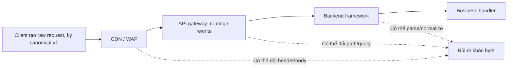

# Mục tiêu canonicalization trong HMAC request authentication

## Mục tiêu học tập

Trong chương **Canonical request**, *canonicalization* là quá trình biểu diễn các thành phần HTTP request theo **một hợp đồng ký chính xác**, để client và server tính HMAC trên cùng một dãy byte. Nếu hai bên hiểu dữ liệu như nhau nhưng tạo chuỗi ký khác nhau, request hợp lệ sẽ bị từ chối. Nguy hiểm hơn, nếu hai request có ý nghĩa bảo mật khác nhau lại bị chuẩn hóa thành cùng một chuỗi, một chữ ký có thể được chấp nhận cho thao tác không được dự định.

Bài học này thuộc module `SECURITY_AUTHENTICATION_HMAC_REQUEST_AUTHENTICATION`, nơi chúng ta thiết kế xác thực HTTP request bằng **shared secret**, ký phương thức, URI, header hoặc body tùy hợp đồng, kiểm tra chữ ký, chống replay bằng timestamp/nonce, vận hành key rotation, kiểm thử qua proxy/gateway và phân biệt **authentication** với **authorization**.

Sau bài này, bạn có thể:

- Giải thích vì sao canonicalization cần thiết, nó **phải bảo đảm những bất biến nào** và những việc nó không thể bảo đảm.
- Phân biệt **ký raw representation** với **chuẩn hóa giá trị có ngữ nghĩa**, đồng thời đánh giá rủi ro nhập nhằng khi chuẩn hóa URI, query, header và body.
- Thiết kế một hợp đồng canonical request rõ thuật toán, phiên bản, thứ tự trường, charset, dấu phân cách và định dạng hash/chữ ký.
- Xác định điểm lấy method/URI/header/body đáng tin cậy khi request đi qua HTTP client, proxy, gateway và backend.
- Áp dụng kiểm thử đối chiếu canonical bytes bằng Java, kết hợp xác minh HMAC, timestamp/nonce, key rotation và authorization ở đúng tầng.

## 1. Canonical request và canonicalization là gì?

Một HTTP request được nhiều lớp phần mềm biểu diễn khác nhau. Cùng request có thể được mô tả dưới dạng request line của HTTP/1.1, pseudo-header của HTTP/2, URI object của HTTP client, request đã route trong framework hoặc dữ liệu đã được gateway rewrite. Những biểu diễn này có thể khác nhau về percent-encoding, thứ tự query, khoảng trắng header hoặc byte body.

**Canonicalization** trong HMAC request auth là **quy tắc ánh xạ** từ những thành phần request được chọn thành dãy byte thống nhất:

```text
HTTP request và ngữ cảnh đáng tin cậy
        |
        v
[Chọn method, URI, header, byte body, clientId, keyId, timestamp, nonce...]
        |
        v
[Kiểm tra cú pháp, từ chối dữ liệu mơ hồ, áp dụng quy tắc canonicalization v1]
        |
        v
canonicalRequestBytes
        |
        v
HMAC-SHA256(sharedSecret, canonicalRequestBytes)
        |
        v
signatureBytes -> Base64URL để truyền
```

Khi server nhận request, server **tự dựng lại** `canonicalRequestBytes` từ request **thực nhận** tại ranh giới xác minh đã định, rồi đối chiếu HMAC bằng khóa đã đăng ký. Server không tin một chuỗi `X-Canonical-Request` do client gửi như nguồn sự thật thay cho việc đọc HTTP thực tế.

Có hai ý quan trọng:

1. **Canonicalization không tự tạo tính bảo mật.** Nó chỉ xác định byte đưa vào phép HMAC. Bảo đảm toàn vẹn phụ thuộc vào HMAC, shared secret, tập trường được ký và cách server kiểm tra.
2. **Canonicalization không nhất thiết làm mọi request tương đương về ngữ nghĩa trở thành một chuỗi duy nhất.** Một hợp đồng có thể cố ý ký *raw path/query*; hai cách viết URI được framework xem là cùng tài nguyên vẫn có hai chữ ký khác nhau. Điều này hợp lệ nếu hai phía thống nhất và không có chỗ diễn giải mơ hồ.

## 2. Năm mục tiêu cốt lõi của canonicalization

### 2.1. Tính xác định (*determinism*)

Với cùng một phiên bản hợp đồng và cùng các trường đầu vào, kết quả phải luôn là **cùng một dãy byte**, không phụ thuộc thứ tự duyệt map, locale, múi giờ, charset mặc định, máy chủ hay thời điểm thực thi.

Ví dụ, nếu hợp đồng ký body hash ở dạng Base64URL không padding, client không được tùy lúc dùng hex hoặc Base64 chuẩn có dấu `=`. Nếu hợp đồng dùng LF, không được để `System.lineSeparator()` tạo CRLF trên một hệ điều hành khác.

```text
Cùng byte body + cùng metadata + cùng contract v1
                   |
                   v
      Cùng canonicalRequestBytes
```

### 2.2. Tính nhất quán giữa bên ký và bên xác minh (*agreement*)

Client ký dữ liệu nào, server phải xác minh chính dữ liệu đó. Đây là mục tiêu thực tế quan trọng nhất khi triển khai qua nhiều SDK và framework.

Ví dụ:

- Client ký `POST`, backend phải xác minh `POST`, không phải method đã bị middleware override.
- Client ký `/v1/items?b=2&a=1`, server không được tự sắp lại thành `/v1/items?a=1&b=2` nếu hợp đồng yêu cầu raw query.
- Client ký body JSON có khoảng trắng cụ thể, server phải hash **đúng byte body đã ký**, không parse thành object rồi serialize lại.
- Header `Content-Type` được chuẩn hóa theo quy tắc cụ thể, ví dụ chỉ bỏ khoảng trắng/tab ở hai đầu, không tự hạ chữ hoa/thường của toàn bộ giá trị.

### 2.3. Không nhập nhằng về ý nghĩa bảo mật (*unambiguous binding*)

Điều kiện an toàn quan trọng là **hai request mà ứng dụng thực thi như hai hành động bảo mật khác nhau không được vô tình có cùng biểu diễn đã ký**.

Ví dụ rủi ro:

```text
Request A: GET /v1/items?role=viewer&role=admin
Request B: GET /v1/items?role=admin&role=viewer
```

Nếu gateway chọn **tham số đầu tiên**, nhưng backend chọn **tham số cuối cùng**, ý nghĩa của `role` có thể khác nhau. Tự sort query hoặc chỉ lấy một giá trị trong khi tầng xử lý khác vẫn thấy toàn bộ query có thể dẫn đến xác minh một request nhưng thực thi request khác.

Do đó, với request nhạy cảm, cần **thống nhất parser và chính sách với tham số trùng**; khi không có nhu cầu hợp lệ, hãy từ chối các query key trùng thay vì đoán ý nghĩa. Ký raw query giúp ràng buộc dãy ký tự đã nhận, nhưng **không tự giải quyết** việc gateway/backend giải thích chuỗi đó khác nhau.

Tương tự, khi nối các trường:

```text
method + path + bodyHash
```

mà không có delimiter/length/escaping, các bộ dữ liệu khác nhau có thể ghép ra cùng chuỗi. Hợp đồng cần quy tắc phân cách **không mơ hồ** (ví dụ mỗi trường một dòng và **cấm CR/LF** trong trường), hoặc dùng length prefix/binary encoding có cấu trúc.

### 2.4. Bao phủ đúng dữ liệu có ảnh hưởng đến quyết định

Chỉ những thành phần nằm trong canonical request mới được HMAC bảo vệ. Nếu một header, path, query hoặc body field ảnh hưởng đến **route, quyền, tenant, đối tượng hay hành động nghiệp vụ**, nó phải được bao phủ bởi chữ ký hoặc được server xác định từ nguồn đáng tin cậy độc lập.

Các trường thường cần ràng buộc:

| Thành phần | Rủi ro nếu bỏ khỏi phạm vi ký |
| --- | --- |
| Method | Đổi `POST` thành `DELETE` trên cùng target nếu route hỗ trợ. |
| Raw path và query | Đổi đối tượng/tài nguyên, filter, tenant hoặc tham số xử lý. |
| Header có ý nghĩa xử lý, như `Content-Type` | Thay cách parse body, dẫn đến cách hiểu khác về dữ liệu. |
| Body hoặc digest của byte body | Sửa số tiền, số lượng hoặc dữ liệu nghiệp vụ. |
| Client ID và key ID | Nhầm định danh/credential nếu không ràng buộc chặt với registry. |
| Audience/API đích | Chuyển request đã ký sang dịch vụ hoặc môi trường khác. |
| Timestamp và nonce | Tạo điều kiện cho replay request đã ký. |
| Thuật toán và phiên bản hợp đồng | Nhầm định dạng ký, chọn nhầm thuật toán hoặc downgrade nếu policy lỏng lẻo. |

**Không nên ký “tất cả header” một cách máy móc.** Proxy thường thêm/chỉnh các header như `Via`, `Forwarded`, `User-Agent`, `Content-Length` hoặc các header theo từng hop; ký những trường bất ổn có thể làm request hợp lệ bị từ chối. Hãy định nghĩa **allowlist header cần ký**, trong đó mọi header còn lại không được dùng như bằng chứng về danh tính/quyền nếu chưa có cơ chế bảo vệ khác.

### 2.5. Có thể kiểm thử, vận hành và nâng phiên bản

Canonicalization là **hợp đồng giao tiếp**, không chỉ là một hàm tiện ích. Hợp đồng phải có:

- Tên/phiên bản bất biến như `v1`; sửa quy tắc canonicalization cần đánh giá khả năng tương thích và thường phải tạo `v2`.
- Test vector chung: raw request, các trường đã chuẩn hóa, canonical bytes, body hash và chữ ký kỳ vọng.
- Chính sách từ chối trường mơ hồ, ký tự không hợp lệ, header trùng, percent-encoding lỗi và biến đổi proxy ngoài hợp đồng.
- Điểm kiểm tra trên đường đi request: phía client ký trước/sau middleware nào, phía server xác minh trước/sau proxy/gateway nào.
- Quy định rõ cách xử lý failure để không tự “thử cách chuẩn hóa khác” đến khi một chữ ký khớp.

## 3. Hai hướng xây dựng canonicalization

### 3.1. Ký biểu diễn nguyên dạng đã thống nhất (*raw representation*)

Hợp đồng có thể ký method, **raw path/query** và **hash của raw body bytes**. Hướng này hạn chế tối đa việc sửa nội dung khi ký.

Ví dụ:

```text
/v1/products?x=%2F&tag=a&tag=b
/v1/products?x=/&tag=a&tag=b
```

Hai chuỗi trên có thể được một thành phần HTTP xử lý tương tự trong một số ngữ cảnh, nhưng **hợp đồng ký raw target xem chúng khác nhau**. Chữ ký được tạo cho chuỗi thứ nhất không tự hợp lệ với chuỗi thứ hai.

**Ưu điểm:** dễ xác định dữ liệu đã ký, không phải thống nhất quy trình parse và tái serialize mọi loại query/JSON.

**Đổi lại:** client/server phải có quyền truy cập raw representation **trước khi bị rewrite/normalize**; một proxy đổi raw path/query có thể làm chữ ký không khớp.

### 3.2. Chuẩn hóa theo cấu trúc/ngữ nghĩa (*parsed representation*)

Một số giao thức chọn parse URI/query/header hoặc JSON rồi áp dụng quy tắc chuẩn như sắp xếp, percent-encoding, Unicode normalization hoặc JSON canonicalization.

Hướng này có thể cho phép nhiều biểu diễn khác nhau đi tới cùng một chuỗi ký **nếu đó là chủ đích của hợp đồng**. Tuy nhiên nó khó hơn:

- Cần định nghĩa rõ parser, xử lý query key trùng, tham số không giá trị, ký tự `+`, percent-encoding, ký tự Unicode và route resolution.
- Cần chứng minh rằng các biểu diễn được gom lại **thực sự tương đương theo semantics xử lý và chính sách quyền**.
- Nếu ký JSON ở mức cấu trúc, phải quy định phương pháp canonical JSON tương thích giữa ngôn ngữ; `Map.toString()` hoặc serializing mặc định của từng SDK không đủ.
- Proxy, gateway và backend phải dùng cùng cách hiểu các trường bảo mật, hoặc phải kiểm tra trước khi chúng thay đổi.

**Quy tắc lựa chọn:** Không có một chiến lược mặc định đúng cho mọi API. Nếu không có lý do rõ ràng để chuẩn hóa sâu, **ký raw target và raw body hash theo một hợp đồng nghiêm ngặt** thường dễ triển khai và kiểm tra hơn; vẫn phải từ chối các trường khiến các tầng xử lý có thể hiểu khác nhau.

## 4. Bảng quyết định cho từng thành phần HTTP

| Thành phần | Cách làm minh họa cho hợp đồng `v1` | Những gì không được tự ý làm |
| --- | --- | --- |
| HTTP method | Chỉ chấp nhận token viết hoa theo allowlist, ký đúng token nhận được. | Tự đổi `post` thành `POST` hoặc ký method trước khi middleware override rồi thực thi method khác. |
| Raw path | Bắt đầu bằng `/`, giữ nguyên dấu slash, percent-encoding và dấu `/` cuối. | Decode `%2F` thành `/`, chuẩn hóa dot-segment hoặc xóa slash nếu hợp đồng không yêu cầu. |
| Raw query | Ký nguyên thứ tự và ký tự của query, gồm tham số trùng (nếu API cho phép). | Sort query, gộp key, chuyển `+` thành `%20` hay đổi thứ tự các tham số lặp. |
| Fragment | Không có trong HTTP request target được gửi đến origin server. | Tưởng `#fragment` được server nhận và có thể đưa vào chữ ký HTTP. |
| `Content-Type` | Chỉ bỏ ASCII space/tab ở hai đầu; thiếu thì dùng chuỗi rỗng. | Tự thêm `charset`, đổi thứ tự tham số hoặc chuẩn hóa value không có trong hợp đồng. |
| Body | SHA-256 trên **byte payload chính xác** tại ranh giới ký/xác minh. | Parse rồi serialize lại JSON/XML, thay newline, giải nén không theo hợp đồng. |
| `Content-Length` / transfer framing | Không ký; để HTTP transport xử lý framing. | Tưởng chunk size/transfer encoding là một phần byte body cần ký. |
| Host/audience | Ký audience ổn định do API định nghĩa; khóa được ràng buộc với audience. | Tin vào `Host`/`X-Forwarded-Host` tự khai nếu proxy có thể sửa/giả mạo. |
| Timestamp/nonce | Định dạng số giây và nonce ngẫu nhiên cố định; ký cả hai. | Chuyển đổi múi giờ theo locale hoặc chấp nhận nonce/timestamp chưa được MAC bảo vệ. |
| Client ID/key ID | Định dạng giới hạn và ký cả hai; tra registry theo cặp. | Xem ID tự khai là danh tính đã được xác thực hoặc quyền tự động. |

**Raw target** cần được định nghĩa cụ thể. Trong ví dụ này, đó là path bắt đầu bằng `/` cộng với dấu `?` và raw query **nếu dấu hỏi hiện diện**, đúng cách biểu diễn tại ranh giới xác minh. `/v1/items` và `/v1/items?` được xem là **hai chuỗi khác nhau**. Hợp đồng chỉ nhận dạng origin-form cho đường dẫn API; các dạng absolute-form/authority-form/asterisk-form hoặc target có fragment phải được xử lý bởi chính sách khác, không âm thầm chuyển đổi.

HTTP/2 và HTTP/3 không dùng request line như HTTP/1.1. Nếu có proxy chuyển protocol, yêu cầu bảo toàn phương thức và target tương đương theo **quy tắc dữ liệu được ký**; các pseudo-header như `:method` và `:path` phải được ánh xạ vào cùng hợp đồng, không lấy path đã được router decode làm raw target.

### 4.1. Header trùng và khoảng trắng

HTTP field name nhìn chung **không phân biệt chữ hoa/chữ thường**, nhưng **giá trị header** có quy tắc riêng tùy từng trường. Hợp đồng ví dụ không cần ký chữ hoa/chữ thường của tên `Content-Type`; nó ký **giá trị Content-Type** sau khi bỏ khoảng trắng/tab ở hai đầu.

Các request như sau cần có quy tắc từ chối rõ ràng:

```http
Content-Type: application/json
content-type: text/plain
```

Nếu gateway lấy dòng đầu nhưng framework lấy dòng cuối, chữ ký có thể được xác minh cho `application/json` trong khi ứng dụng parse `text/plain`. Tầng tiếp nhận nên **từ chối header ký bị trùng/mơ hồ** trước khi xác minh; không tùy tiện gộp bằng dấu phẩy. Cũng cần xử lý các ký tự điều khiển/CRLF và giới hạn độ dài header để tránh request smuggling hoặc injection.

### 4.2. URI encoding, Unicode và route resolution

Các chuỗi `/v1/%61` và `/v1/a` có thể trỏ tới cùng route trong một số framework; hợp đồng ký raw path vẫn coi chúng là hai request khác nhau. Về bảo mật:

- Client và server phải biết **đâu là raw target**, không dựng lại từ route template `/v1/{id}` hoặc path đã decode.
- Không cho phép định dạng encoding không hợp lệ hoặc nhiều cách decode khác nhau được âm thầm diễn giải.
- Giới hạn hoặc từ chối path có `..`, encoded slash, backslash hoặc dấu phân cách bất thường nếu nhiều tầng có khả năng xử lý khác nhau; chính sách cụ thể phụ thuộc route/API.
- Với ký raw target, Unicode trong URI nên được mã hóa thành percent-encoded bytes theo hợp đồng. Tránh tự normalization Unicode sau khi ký.

Điểm cần kiểm tra là **dữ liệu ứng dụng thực thi phải khớp với dữ liệu HMAC đã ràng buộc**; nếu ký `/users/alice` nhưng một tầng trung gian thực thi `/users/bob` thì dù chữ ký ở gateway từng hợp lệ, luồng tổng thể vẫn sai ranh giới tin cậy.

## 5. Một hợp đồng canonical request cụ thể

Không có một chuẩn canonical request duy nhất áp dụng cho mọi API HMAC. Đây là **hợp đồng minh họa** để học và kiểm thử, không được coi là định dạng của một dịch vụ bên ngoài nếu dịch vụ đó không công bố như vậy.

Giả sử client gọi API thanh toán:

```http
POST /v1/payments?tag=a&tag=b HTTP/1.1
Host: payments.example.test
Content-Type: application/json
X-Client-Id: partner-a
X-Key-Id: key-2026-11
X-Timestamp: 1795800000
X-Nonce: NJS09IPyMtXBV4fF5saS0w
X-Content-SHA256: <base64url-sha256-of-body>
X-Signature: <base64url-hmac-sha256>

{"amount":120000,"currency":"VND"}
```

Quy ước `v1`:

1. Thuật toán HMAC là **HMAC-SHA256** với raw shared secret được cấp; ở Java dùng `Mac.getInstance("HmacSHA256")`. MAC cuối cùng mã hóa **Base64URL không padding**, 32 byte thành 43 ký tự.
2. Canonical request có **11 trường, 11 dòng**, được nối bằng ký tự LF (`\n`) ở UTF-8; **không có LF cuối**. Mỗi trường cấm CR/LF; hạn chế định dạng và độ dài trước khi ký/xác minh.
3. `audience` là `payments-api-prod` do client/server đã cấu hình và được kiểm tra với registry. `clientId` và `keyId` là giá trị được khai trong request và đều được ký; server kiểm tra key ID thuộc đúng client.
4. Method viết hoa ASCII và thuộc allowlist của API; raw target là path + query **đúng biểu diễn đã tiếp nhận**, không chứa fragment hoặc ký tự điều khiển.
5. `Content-Type` được chuẩn hóa bằng cách loại ASCII space/tab ở hai đầu; header vắng mặt → chuỗi rỗng. Từ chối bản sao header trùng/mơ hồ.
6. `bodyHash` là **Base64URL không padding của SHA-256 trên byte body** sau HTTP transfer framing nhưng **trước** parse, re-serialization, transformation hoặc giải nén nội dung. Hợp đồng minh họa chỉ chấp nhận `Content-Encoding` vắng mặt hoặc `identity`.
7. `timestamp` là Unix epoch tính bằng **giây**, dạng số thập phân ASCII, không chứa khoảng trắng; `nonce` là Base64URL không padding của **16 byte ngẫu nhiên** được tạo bằng CSPRNG, nên có 22 ký tự.
8. `X-Signature` không được đưa vào chính canonical request. `X-Content-SHA256` nếu được gửi phải khớp với body hash server tự tính.

Canonical request của request trên:

```text
HMAC-SHA256
v1
payments-api-prod
partner-a
key-2026-11
POST
/v1/payments?tag=a&tag=b
application/json
<base64url-sha256-of-body>
1795800000
NJS09IPyMtXBV4fF5saS0w
```

Trong ví dụ, những giá trị nằm giữa `<...>` chỉ là chỗ giữ chỗ, **không phải hash/chữ ký thật**. Timestamp cố định này chỉ minh họa; khi gửi request thực tế, client phải tạo timestamp hiện tại.

Bằng công thức:

```text
canonical = join(LF, [
  "HMAC-SHA256",
  "v1",
  audience,
  clientId,
  keyId,
  method,
  rawTarget,
  trimmedContentType,
  Base64URL_NoPadding(SHA256(exactBodyBytes)),
  timestampSeconds,
  nonce
])
signature = Base64URL_NoPadding(HMAC_SHA256(secretBytes, UTF8(canonical)))
```

**Vì sao delimiter LF an toàn trong hợp đồng này?** Vì mọi trường dạng văn bản đều bị từ chối nếu chứa CR/LF, nên không thể nhét thêm một dòng để thay đổi vị trí trường khác. Nếu API cần cho phép ký trường chứa byte tùy ý hoặc xuống dòng, cần escape/length-prefix có định nghĩa chặt hoặc cấu trúc nhị phân thay cho nối chuỗi đơn giản.

### 5.1. Ví dụ thay đổi một ký tự làm thay đổi chữ ký

| Client đã ký | Server thực nhận | Hệ quả |
| --- | --- | --- |
| `POST` | `PUT` | Dòng method khác → HMAC sai. |
| `/v1/payments?tag=a&tag=b` | `/v1/payments?tag=b&tag=a` | Dòng raw target khác → HMAC sai. |
| `Content-Type: application/json` | `Content-Type: text/plain` | Dòng header ký khác → HMAC sai. |
| Body `{"amount":120000}` | `{"amount":120001}` | Byte body/hash khác → HMAC sai. |
| `partner-a` | `partner-b` | Client ID đã ký khác → HMAC sai hoặc không tìm đúng credential. |
| `payments-api-prod` | `payments-api-staging` | Audience khác → HMAC sai theo hợp đồng. |
| Timestamp/nonce ban đầu | Timestamp/nonce bị sửa | Dữ liệu canonical khác → HMAC sai. |

Ngược lại, nếu chỉ đổi `User-Agent` mà hợp đồng không ký trường này, MAC có thể vẫn hợp lệ. Vì vậy không dùng một header chưa ký để xác quyết danh tính, quyền, tài nguyên hay hành động nghiệp vụ.

## 6. Ví dụ Java: tạo cùng canonical bytes rồi xác minh HMAC

Đoạn code sau dùng Java 17+ và API chuẩn JDK, tập trung vào **sự nhất quán của canonical request**. Nó là chương trình độc lập mô phỏng hai phía đã có cùng shared secret. Trong HTTP server thật, các trường phải được lấy từ request thực nhận và khóa phải được tra từ registry theo `(clientId, keyId)`.

```java
import java.nio.charset.StandardCharsets;
import java.security.GeneralSecurityException;
import java.security.MessageDigest;
import java.security.SecureRandom;
import java.time.Instant;
import java.util.Arrays;
import java.util.Base64;
import java.util.Objects;
import java.util.Set;
import javax.crypto.Mac;
import javax.crypto.spec.SecretKeySpec;

public final class CanonicalRequestDemo {
    private static final String AUDIENCE = "payments-api-prod";
    private static final Set<String> METHODS =
            Set.of("GET", "HEAD", "POST", "PUT", "PATCH", "DELETE");
    private static final Base64.Encoder B64 =
            Base64.getUrlEncoder().withoutPadding();
    private static final Base64.Decoder B64_DECODER =
            Base64.getUrlDecoder();

    private CanonicalRequestDemo() {}

    record RequestData(
            String method, String rawTarget, String contentType,
            byte[] body, String clientId, String keyId,
            String timestamp, String nonce) {
        RequestData {
            body = Objects.requireNonNull(body, "body").clone();
        }
        @Override public byte[] body() {
            return body.clone();
        }
    }

    record SignedHeaders(String bodyHash, String signature) {}

    static String sha256Body(byte[] body) throws GeneralSecurityException {
        return B64.encodeToString(
                MessageDigest.getInstance("SHA-256").digest(body));
    }

    static String trimOws(String value) {
        if (value == null) return "";
        int from = 0;
        int to = value.length();
        while (from < to
                && (value.charAt(from) == ' ' || value.charAt(from) == '\t')) {
            from++;
        }
        while (to > from
                && (value.charAt(to - 1) == ' ' || value.charAt(to - 1) == '\t')) {
            to--;
        }
        return value.substring(from, to);
    }

    static String canonical(RequestData request, String bodyHash) {
        if (!METHODS.contains(request.method())) {
            throw new IllegalArgumentException("Unsupported HTTP method");
        }
        String rawTarget = request.rawTarget();
        // Hợp đồng mẫu chỉ nhận ASCII origin-form path + query.
        if (rawTarget == null || !rawTarget.startsWith("/")
                || rawTarget.indexOf('#') >= 0
                || !rawTarget.chars().allMatch(c -> c >= 0x21 && c <= 0x7E)) {
            throw new IllegalArgumentException("Invalid raw request-target");
        }

        String[] fields = {
                "HMAC-SHA256", "v1", AUDIENCE,
                request.clientId(), request.keyId(),
                request.method(), rawTarget,
                trimOws(request.contentType()), bodyHash,
                request.timestamp(), request.nonce()
        };
        for (String field : fields) {
            if (field == null || field.indexOf('\r') >= 0
                    || field.indexOf('\n') >= 0) {
                throw new IllegalArgumentException("Invalid canonical field");
            }
        }
        if (!request.timestamp().matches("[1-9][0-9]{0,18}")) {
            throw new IllegalArgumentException("Invalid timestamp");
        }
        if (request.nonce() == null
                || !request.nonce().matches("[A-Za-z0-9_-]{22}")) {
            throw new IllegalArgumentException("Invalid nonce syntax");
        }
        return String.join("\n", fields); // Không có LF cuối.
    }

    static byte[] hmac(byte[] secret, String canonical)
            throws GeneralSecurityException {
        Mac mac = Mac.getInstance("HmacSHA256");
        mac.init(new SecretKeySpec(secret, "HmacSHA256"));
        return mac.doFinal(canonical.getBytes(StandardCharsets.UTF_8));
    }

    static SignedHeaders sign(RequestData request, byte[] secret)
            throws GeneralSecurityException {
        String bodyHash = sha256Body(request.body());
        String signature = B64.encodeToString(
                hmac(secret, canonical(request, bodyHash)));
        return new SignedHeaders(bodyHash, signature);
    }

    static boolean verifyMac(RequestData received, SignedHeaders headers,
                             byte[] secret)
            throws GeneralSecurityException {
        if (headers == null || headers.bodyHash() == null
                || headers.signature() == null) {
            return false;
        }
        try {
            String actualBodyHash = sha256Body(received.body());
            if (!actualBodyHash.equals(headers.bodyHash())) {
                return false;
            }
            if (!headers.signature().matches("[A-Za-z0-9_-]{43}")) {
                return false;
            }
            byte[] supplied = B64_DECODER.decode(headers.signature());
            if (supplied.length != 32
                    || !B64.encodeToString(supplied)
                            .equals(headers.signature())) {
                return false;
            }
            byte[] expected = hmac(secret,
                    canonical(received, actualBodyHash));
            return MessageDigest.isEqual(expected, supplied);
        } catch (IllegalArgumentException ex) {
            return false;
        }
    }

    public static void main(String[] args)
            throws GeneralSecurityException {
        byte[] secret = new byte[32]; // Chỉ mô phỏng cấp phát.
        SecureRandom random = new SecureRandom();
        random.nextBytes(secret);

        byte[] nonceBytes = new byte[16];
        random.nextBytes(nonceBytes);
        byte[] body =
                "{\"amount\":120000,\"currency\":\"VND\"}"
                        .getBytes(StandardCharsets.UTF_8);

        RequestData request = new RequestData(
                "POST", "/v1/payments?tag=a&tag=b",
                "application/json", body,
                "partner-a", "key-2026-11",
                Long.toString(Instant.now().getEpochSecond()),
                B64.encodeToString(nonceBytes));

        SignedHeaders signature = sign(request, secret);
        System.out.println("Original accepted: "
                + verifyMac(request, signature, secret));

        RequestData reorderedQuery = new RequestData(
                request.method(), "/v1/payments?tag=b&tag=a",
                request.contentType(), request.body(),
                request.clientId(), request.keyId(),
                request.timestamp(), request.nonce());
        System.out.println("Reordered query accepted: "
                + verifyMac(reorderedQuery, signature, secret));

        byte[] changedBody =
                "{\"currency\":\"VND\",\"amount\":120000}"
                        .getBytes(StandardCharsets.UTF_8);
        RequestData reserializedJson = new RequestData(
                request.method(), request.rawTarget(),
                request.contentType(), changedBody,
                request.clientId(), request.keyId(),
                request.timestamp(), request.nonce());
        System.out.println("Reserialized JSON accepted: "
                + verifyMac(reserializedJson, signature, secret));

        Arrays.fill(secret, (byte) 0);
    }
}
```

Kết quả kỳ vọng:

```text
Original accepted: true
Reordered query accepted: false
Reserialized JSON accepted: false
```

**Giải thích:** request thứ hai chỉ đổi thứ tự hai tham số query nhưng vì hợp đồng ký raw target, canonical bytes khác. Request thứ ba giữ JSON gần tương đương về ngữ nghĩa nhưng byte body khác, do đó SHA-256 body cũng khác. Đây là hành vi có chủ đích khi chọn **raw representation**.

**Giới hạn của demo:** `verifyMac` kiểm tra HMAC và body hash của một `RequestData` đã được dựng sẵn; nó **chưa** kiểm tra header trùng, độ dài request, timestamp còn trong cửa sổ, nonce đã dùng hay chưa, trạng thái key/audience từ registry và authorization. Trong ứng dụng thật, server phải tự lấy method/raw target/body bytes tại đúng điểm tiếp nhận tin cậy, không tin struct hoặc canonical string do client gửi.

### 6.1. Khi nào dùng `MessageDigest` và khi nào dùng `Mac`?

```java
// Băm payload, không có khóa:
MessageDigest.getInstance("SHA-256").digest(bodyBytes);

// Ký canonical request bằng shared secret:
Mac mac = Mac.getInstance("HmacSHA256");
mac.init(new SecretKeySpec(secretBytes, "HmacSHA256"));
byte[] signature = mac.doFinal(canonicalRequestBytes);
```

SHA-256 body chỉ là một **thành phần** của canonical request; nó không tự xác thực bên gửi. Bằng chứng xác thực nằm ở HMAC được tính từ **secret đã đăng ký** và toàn bộ trường đã chọn, sau khi server xác minh thành công.

## 7. Proxy/gateway: ranh giới thực tế của canonicalization

Canonicalization thường hỏng ở các điểm chuyển tiếp vì HTTP request bị biểu diễn lại hoặc biến đổi:



Một số ví dụ:

| Nơi thay đổi | Trước | Sau | Tác động |
| --- | --- | --- | --- |
| Gateway rewrite path | `/public/v1/payments` | `/internal/payments` | Server dựng raw target khác request client ký. |
| Reverse proxy normalize path | `/files/%2F` | `/files//` | Không còn cùng byte path; có thể khác route. |
| Middleware sắp query | `?a=1&b=2` | `?b=2&a=1` | Thứ tự raw query thay đổi. |
| Parser JSON + serializer | `{"a":1,"b":2}` | `{"b":2,"a":1}` | Body hash khác dù object có thể tương đương. |
| Server thêm Content-Type | `application/json` | `application/json; charset=UTF-8` | Header được ký khác. |
| Proxy giải nén body | Compressed bytes | Uncompressed bytes | Byte body được hash thay đổi. |
| HTTP/1.1 → HTTP/2 | Request line | Pseudo-header | Cần ánh xạ nhất quán method/path; protocol framing không thuộc chữ ký. |

Có hai mô hình triển khai điển hình:

1. **Xác minh tại gateway trước các thay đổi.** Gateway lấy raw method/target/header/body theo hợp đồng, xác minh HMAC và chống replay rồi tạo **authenticated client principal**. Backend chỉ tin principal do gateway cung cấp trên kênh nội bộ có bảo vệ danh tính/toàn vẹn; edge phải xóa các header principal do internet tự gửi.
2. **Xác minh tại backend.** Gateway phải bảo toàn dữ liệu đã ký hoặc cung cấp bản gốc qua cơ chế nội bộ đáng tin cậy, chống giả mạo và gắn đúng request. Hợp đồng phải quy định rõ ký giá trị **trước hay sau** từng phép biến đổi.

Không lấy header như `X-Original-URI`, `X-Forwarded-Host` hoặc `X-Original-Method` từ internet làm nguồn tin cậy nếu gateway không xóa và thiết lập lại chúng theo một chính sách xác thực nội bộ.

**Ngay cả khi gateway đã xác minh chữ ký**, authorization ở backend vẫn phải kiểm tra *action/resource/tenant thực tế sẽ thực thi*. Không được để request được ký cho route A nhưng do rewrite/override không kiểm soát lại thực hiện action B.

### 7.1. Ranh giới lấy body bytes

Ví dụ body dùng HTTP/1.1 chunked transfer encoding. Chunk size và transfer framing là cơ chế vận chuyển; thông thường framework HTTP trả **payload bytes sau khi giải mã transfer framing**. Hợp đồng mẫu ký dãy byte payload đó, **trước** các phép biến đổi nội dung như giải nén `Content-Encoding: gzip` hoặc JSON parse.

Nếu một gateway tự giải nén hoặc sửa nội dung trước khi backend thấy request, hệ thống phải chọn điểm xác minh nhất quán hoặc quy định một hợp đồng khác. Với hợp đồng mẫu, đơn giản nhất là **từ chối Content-Encoding khác identity** và tránh transform body tại điểm xác minh.

## 8. Canonicalization không thay thế xác thực, chống replay hay phân quyền

Chỉ dựng canonical string giống nhau không chứng minh danh tính. Một server HMAC request auth cần chuỗi kiểm tra:

1. **Giới hạn request:** size, cú pháp, header trùng, raw target, method, body encoding; từ chối các biểu diễn mơ hồ.
2. **Tra credential:** dùng `(clientId, keyId)` từ request như chỉ dẫn lookup, kiểm tra client/key còn hiệu lực và được phép cho audience đã cấu hình. Các ID này vẫn chưa đáng tin trước khi MAC hợp lệ.
3. **Kiểm tra timestamp:** ví dụ chênh lệch không quá **±300 giây** so với đồng hồ server đã đồng bộ; timestamp phải được đưa vào dữ liệu ký.
4. **Tạo canonical từ request thực nhận:** băm body, kiểm tra hash body header, dựng 11 dòng đã công bố, tính lại HMAC bằng raw secret tương ứng và so sánh **byte MAC** bằng cơ chế phù hợp như `MessageDigest.isEqual`.
5. **Claim nonce nguyên tử:** khi MAC hợp lệ, ghi nonce một lần theo phạm vi `(audience, clientId, keyId, nonce)` vào kho chia sẻ giữa các node, bằng `put-if-absent`/Redis `SET ... NX EX`. Từ chối nonce đã dùng hoặc khi kho nonce không khả dụng theo chính sách bảo mật.
6. **Tạo authenticated principal** từ bản ghi client đáng tin cậy; chỉ khi xác thực thành công mới đưa vào security context.
7. **Authorization:** kiểm tra scope, tenant, resource và action thực tế; signature hợp lệ không cho client vượt quyền.

Với cửa sổ timestamp ±300 giây, một timestamp được chấp nhận sớm có thể còn hợp lệ khoảng 600 giây. TTL nonce **ít nhất bao phủ khoảng thời gian còn có thể replay**, ví dụ 610 giây tính từ lần claim đầu tiên có biên dự phòng.

**Replay không đòi thay đổi canonical request.** Kẻ tấn công có thể phát lại *y nguyên* request có chữ ký đúng. HMAC và canonicalization sẽ vẫn khớp; timestamp và nonce store mới giúp từ chối lần dùng lại.

**Idempotency cũng không phải replay protection.** Một request POST có nonce mới, chữ ký đúng nhưng nội dung nghiệp vụ trùng request cũ vẫn có thể xử lý hai lần. Nếu API có thao tác không được lặp, cần idempotency key và cơ chế kết quả nghiệp vụ riêng.

### 8.1. Key rotation và version canonicalization là hai việc khác nhau

- **Key rotation:** cùng client ID và cùng hợp đồng `v1`, nhưng key ID và shared secret đổi. Server tạm chấp nhận key cũ/mới trong thời gian chuyển tiếp hữu hạn, rồi thu hồi key cũ. Canonical request có ký cả key ID.
- **Contract migration:** đổi quy tắc canonicalization, ví dụ từ raw query sang query có quy tắc sort, hoặc thêm header được ký. Cần **phiên bản mới**, test vector mới và chính sách xác minh rõ; không tự thử cả `v1` và `v2` cho mọi key đến khi một chữ ký khớp.
- **Algorithm migration:** đổi HMAC-SHA256 sang primitive khác cần thiết kế riêng thuật toán, key, độ dài MAC, biểu diễn chữ ký và whitelist. Không để client yêu cầu algorithm tùy ý rồi server tin ngay.

Thay đổi key không tự giải quyết mismatch do URI/body đã bị gateway sửa. Tương tự, thay hợp đồng chuẩn hóa không giúp thu hồi một secret bị lộ.

### 8.2. Authentication và authorization

Giả sử client `partner-a` có key đúng và gửi request đã ký `POST /v1/payments?tenant=merchant-99`. Nếu registry chỉ cấp quyền `payments:create` cho `merchant-42`:

- **Authentication:** có thể thành công nếu HMAC, timestamp, nonce, credential và audience hợp lệ.
- **Authorization:** phải từ chối quyền truy cập `merchant-99`, thường trả `403 Forbidden`.

Canonicalization bảo vệ `tenant=merchant-99` khỏi bị sửa mà chữ ký vẫn khớp; nó **không chứng minh client được cấp quyền** đối với tenant đó. Quyền phải lấy từ chính sách server.

## 9. Kiểm thử từng mục tiêu của canonicalization

Một bài kiểm thử tốt cần so sánh **byte canonical trước HMAC** (với dữ liệu thử không nhạy cảm) rồi mới so sánh MAC. Nếu chỉ nhận một lỗi `401`, bạn chưa biết lỗi do key, body hash, URI hay timestamp.

| Test | Đầu vào thay đổi | Kỳ vọng theo hợp đồng `v1` |
| --- | --- | --- |
| Tính xác định | Cùng request, chạy nhiều lần trên Java và SDK khác | Canonical UTF-8 bytes và MAC giống hệt. |
| Method | `POST` → `PUT` | Canonical dòng method khác; chữ ký cũ bị từ chối. |
| Raw query order | `tag=a&tag=b` → `tag=b&tag=a` | Canonical khác; MAC cũ không hợp lệ. |
| Percent-encoding | `%2F` → `/` hoặc `%20` → `+` | Canonical khác; không tự decode rồi ký. |
| Query key trùng | `?role=user&role=admin` | Từ chối theo chính sách API khi các tầng parse không nhất quán; không đoán thứ tự giá trị. |
| Header whitespace | `Content-Type:  application/json  ` | Nếu chỉ có OWS hai đầu, canonical bằng `application/json` theo hợp đồng. |
| Header semantic change | `application/json` → `text/plain` | Canonical khác; HMAC cũ bị từ chối. |
| Header trùng | Hai `Content-Type` có giá trị khác nhau | Từ chối trước khi xây canonical. |
| JSON whitespace/key order | Body byte thay dù dữ liệu JSON gần tương đương | SHA-256 khác; MAC cũ bị từ chối. |
| Body rỗng | Không có byte body | SHA-256 Base64URL là `47DEQpj8HBSa-_TImW-5JCeuQeRkm5NMpJWZG3hSuFU`. |
| LF/CRLF | Canonical dùng `\r\n` thay `\n` | Test phát hiện byte khác; không tự chấp nhận cả hai. |
| Bỏ/thêm LF cuối | Ký thêm newline sau nonce | MAC khác; hợp đồng không cho LF cuối. |
| Client/key ID | Đổi một định danh sau ký | Từ chối; ID là trường được ký và key được lookup đúng cặp. |
| Audience | Chuyển request prod sang staging | Từ chối khi audience khác. |
| Proxy rewrite | Gateway đổi prefix hoặc giải nén body | Phải xác minh trước biến đổi hoặc bảo toàn dữ liệu theo trust boundary đã công bố. |
| Replay | Gửi lại đúng byte request, nonce đã claim | MAC vẫn đúng nhưng tầng nonce từ chối. |
| Key revoked | Dùng secret của key đã thu hồi | Từ chối dù có thể tự tính ra MAC đúng. |
| Authorization | MAC đúng, tenant không được phép | Xác thực thành công, phân quyền từ chối. |

Với nhiều SDK, nên có test vector **được công bố như dữ liệu cố định**: tên phiên bản, raw method/target, các header được ký, body byte (hex hoặc Base64), canonical bytes (hex), body hash, nonce/timestamp và chữ ký HMAC kỳ vọng. Không dùng secret production trong test vector.

### 9.1. Ma trận lỗi thường gặp và cách chẩn đoán

| Triệu chứng | Nguyên nhân có thể | Cách xác định |
| --- | --- | --- |
| Cùng secret nhưng mọi chữ ký đều sai | Một phía dùng UTF-8 của chuỗi Base64 secret thay vì decode raw bytes. | So sánh length/byte khóa thử được cấp và kết quả HMAC test vector. |
| Chỉ request có query phức tạp mới sai | Sort query, key trùng, `+`/`%20`, percent-encoding hoặc encoding lỗi. | So sánh raw target theo byte tại client và verifier. |
| Chỉ lỗi sau gateway | Rewrite URI, thêm Content-Type, đổi body/encoding. | Đo canonical tại trust boundary trước/sau biến đổi (che dữ liệu nhạy cảm). |
| Chỉ lỗi với JSON tiếng Việt/Unicode | Charset không cố định hoặc serialize lại. | So sánh byte UTF-8 và hash body, không chỉ log object. |
| MAC đúng nhưng vẫn nhận `401` | Timestamp quá cũ, nonce đã dùng hoặc key bị thu hồi. | Kiểm tra mã nguyên nhân nội bộ và trạng thái registry/nonce. |
| MAC đúng nhưng nhận `403` | Client không có scope/tenant/action cho tài nguyên. | Kiểm tra authorization độc lập. |
| Cùng request đôi khi qua, đôi khi bị chặn | Nonce store không chia sẻ, đồng hồ node lệch hoặc middleware không nhất quán. | Kiểm tra đồng bộ thời gian, atomic claim, đường đi load balancer. |

Khi debug, **không log shared secret**, không log toàn bộ body hoặc canonical chứa dữ liệu nhạy cảm vào hệ thống telemetry chung. Có thể ghi **hash của canonical bytes**, các field metadata không nhạy cảm và mã lỗi để chẩn đoán; nếu cần kiểm tra byte đầy đủ, sử dụng test vector giả trong môi trường kiểm thử có kiểm soát.

## 10. Bài thực hành

Tạo client Java và verifier cho endpoint `POST /v1/payments`, ban đầu dùng hợp đồng `v1` ở mục 5:

1. Sinh shared secret **32 byte ngẫu nhiên** bằng `SecureRandom` và cấp cho client/server qua cơ chế an toàn của môi trường thực hành. Dùng `Mac.getInstance("HmacSHA256")` và `SecretKeySpec` trên cùng raw byte khóa.
2. Viết `CanonicalRequestBuilder` nhận method, raw target, Content-Type, body bytes, client ID, key ID, audience, timestamp và nonce; kiểm tra định dạng, xây đúng **11 dòng UTF-8/LF không LF cuối**.
3. Sinh test vector có body JSON UTF-8, query trùng key, percent-encoding và body rỗng. So sánh canonical bytes trước khi tính HMAC, không chỉ xem status HTTP.
4. Thử thay `%2F` thành `/`, đảo thứ tự query và serialize JSON lại; xác nhận hash/chữ ký cũ không hợp lệ theo hợp đồng raw representation.
5. Tạo một header `Content-Type` trùng lặp và request có path chứa `..`; quyết định chính sách từ chối để gateway/backend không hiểu khác nhau. Ghi lại nguyên nhân.
6. Đặt ứng dụng sau gateway rewrite `/external/v1/payments` thành `/v1/payments`, xác định **điểm xác minh HMAC** và xem backend có thể lấy đúng raw target đã ký không.
7. Thêm client registry, key ID mới và key rotation, sau đó thu hồi key cũ. Kiểm tra credential còn hiệu lực độc lập với việc canonical bytes đúng.
8. Thêm timestamp/nonce store nguyên tử, gửi lại y nguyên request hợp lệ và xác nhận lần replay bị chặn. Thử client đủ HMAC nhưng thiếu quyền tenant và xác nhận authorization từ chối.

**Câu hỏi tự đánh giá:**

- Canonicalization có bắt buộc biến hai URI tương đương về mặt ngữ nghĩa thành một chuỗi hay không? Vì sao?
- Nếu client ký chuỗi `a=1&b=2` mà proxy sắp lại thành `b=2&a=1`, nên sửa hợp đồng hay chuyển điểm xác minh?
- Tại sao phải từ chối header Content-Type trùng có thể được các tầng xử lý khác nhau?
- Ký JSON dưới dạng raw body hash khác gì ký JSON object đã chuẩn hóa? Khi nào cần phương pháp canonical JSON được công bố?
- Tại sao một chữ ký HMAC còn hợp lệ vẫn không ngăn người khác gửi lại nguyên request?
- Vì sao chữ ký đúng cho `merchant-99` không tự cấp quyền truy cập dữ liệu merchant đó?

## 11. Tài liệu tham khảo

- **RFC 2104 — HMAC: Keyed-Hashing for Message Authentication:** nguyên lý HMAC và khóa bí mật.
- **RFC 9110 — HTTP Semantics:** method, URI, header và ý nghĩa xử lý HTTP.
- **RFC 3986 — Uniform Resource Identifier: Generic Syntax:** cấu trúc URI, percent-encoding và các loại URI component.
- **RFC 4648 — Base Encodings:** Base64URL của body digest và chữ ký.
- **RFC 8785 — JSON Canonicalization Scheme (JCS):** một ví dụ về chuẩn canonical JSON khi hợp đồng chọn ký dữ liệu JSON ở mức cấu trúc, không áp dụng mặc định cho HMAC raw-body.
- **Java SE API — `javax.crypto.Mac`, `javax.crypto.spec.SecretKeySpec`, `java.security.MessageDigest`:** tạo và kiểm tra HMAC-SHA256/hash bằng JCA.

**Mục tiêu của canonicalization** là giúp client và server **đồng thuận chính xác về byte được ký** và bảo đảm request được xác minh chính là request được thực thi theo chính sách. Khi hợp đồng rõ ràng, các điểm biến đổi trên đường đi được kiểm soát, secret được quản lý an toàn và server kiểm tra replay/phân quyền độc lập, chữ ký HMAC mới có ý nghĩa bảo vệ HTTP request trong thực tế.

