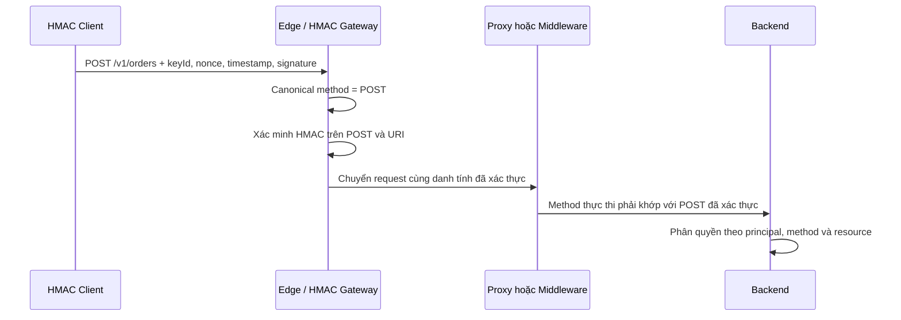

# Canonical method: Ràng buộc phương thức HTTP vào chữ ký HMAC

Trong xác thực HTTP request bằng HMAC, **canonical method** là biểu diễn được hợp đồng ký quy định cho **phương thức HTTP mà server thực sự sẽ xử lý**. Khi client ký `POST /v1/orders`, chữ ký phải ràng buộc cả `POST` và đích `/v1/orders`. Nếu server chỉ ký body hoặc URI, một request có thể bị chuyển thành hành động khác mà bộ xác minh không phát hiện được.

Bài học thuộc chương **Canonical request** của module `SECURITY_AUTHENTICATION_HMAC_REQUEST_AUTHENTICATION`. Module hướng tới thiết kế xác thực HTTP bằng **shared secret** và chuỗi canonical có method, URI, header và body theo hợp đồng; xác minh chữ ký, chống replay bằng timestamp/nonce, quản lý key rotation, kiểm thử qua proxy/gateway và tách xác thực khỏi phân quyền. Bài này tập trung vào **chọn, chuẩn hóa đúng hợp đồng và kiểm chứng HTTP method**.

## 1. Mục tiêu học tập

Sau bài này, người học có thể:

1. Giải thích vì sao HTTP method phải có mặt trong canonical request và ảnh hưởng của nó tới tính toàn vẹn hành động.
2. Phân biệt **method token nhận được**, **canonical method** và **method mà router/backend cuối cùng thực thi**, kể cả khi có reverse proxy hoặc middleware override.
3. Áp dụng chính sách method rõ ràng: phân biệt hoa/thường, allowlist, cách xử lý method không hợp lệ và quy tắc ký byte chính xác.
4. Xây dựng và xác minh HMAC-SHA256 bằng Java 17 sao cho việc đổi `POST` thành `PUT` làm chữ ký cũ thất bại.
5. Thiết kế kiểm thử tích hợp qua HTTP/1.1, HTTP/2, gateway và middleware; kết hợp kiểm tra timestamp/nonce, key rotation và authorization.

## 2. HTTP method là một phần của ý nghĩa request

HTTP request có phương thức xác định **ý định hành động** với tài nguyên được chỉ định:

```http
POST /v1/orders HTTP/1.1
Host: api.example.test
Content-Type: application/json

{"sku":"BK-42","quantity":2}
```

Ở ví dụ này:

| Thành phần | Giá trị | Tác dụng trong xác thực HMAC |
| --- | --- | --- |
| Method | `POST` | Ràng buộc chữ ký với hành động tạo/gửi dữ liệu theo hợp đồng API. |
| Request target | `/v1/orders` | Ràng buộc chữ ký với tài nguyên được gọi. |
| Header được ký | `Content-Type: application/json` | Ràng buộc cách diễn giải body. |
| Body | Byte JSON của request | Ràng buộc nội dung, thường thông qua SHA-256 của raw body. |
| Timestamp và nonce | Header do client tạo | Chống dùng lại request hợp lệ nếu được ký và xác minh theo chính sách. |

Hãy tưởng tượng bộ xác minh chỉ tính `HMAC(secret, SHA256(body))`. Ai đó giữ nguyên body và chữ ký rồi thay request line thành:

```http
PUT /v1/orders/42 HTTP/1.1
```

Nếu phần method và URI **không được ký**, tầng mật mã không tự phát hiện request đã chuyển sang thao tác cập nhật đơn hàng 42. Việc chuyển đó có được backend chấp nhận hay không còn tùy API, nhưng thiết kế chữ ký đã bỏ sót thông tin quyết định hành động. Bởi vậy trong giao thức xác thực request, **method và request target thường phải được ràng buộc với cùng MAC**.

### Method phổ biến và tính chất của nó

| Method | Ngữ nghĩa HTTP thông thường | Lưu ý khi thiết kế hợp đồng |
| --- | --- | --- |
| `GET` | Lấy biểu diễn của tài nguyên; được định nghĩa là phương thức an toàn. | Không suy ra “không cần ký” vì query, path và quyền đọc vẫn nhạy cảm. |
| `HEAD` | Như GET nhưng không trả nội dung response; an toàn. | Đừng tự đồng nhất `HEAD` với `GET` trong chữ ký. |
| `POST` | Xử lý dữ liệu theo ngữ nghĩa tài nguyên đích. | Thường dùng cho tạo/thực thi hành động; ký method, đích và body. |
| `PUT` | Tạo/thay thế trạng thái tài nguyên đích theo biểu diễn gửi lên; idempotent theo định nghĩa HTTP. | Không cho dùng chữ ký `POST` thay cho `PUT`. |
| `PATCH` | Thay đổi một phần tài nguyên theo patch document. | Yêu cầu hợp đồng riêng cho media type và body. |
| `DELETE` | Yêu cầu xóa liên kết tài nguyên đích; idempotent theo định nghĩa HTTP. | Idempotent không có nghĩa ai cũng được phép xóa. |
| `OPTIONS` | Hỏi lựa chọn giao tiếp; liên quan preflight CORS trong trình duyệt. | Nếu API HMAC không hỗ trợ method này, quy định rõ cách xử lý ở gateway. |

“Safe” hoặc “idempotent” theo HTTP mô tả **ngữ nghĩa kỳ vọng của method**, không đồng nghĩa với có quyền truy cập, không cần xác thực, hoặc mặc nhiên loại bỏ yêu cầu chống replay. Các thao tác nghiệp vụ có side effect cần kiểm soát riêng.

## 3. Method là token phân biệt chữ hoa và chữ thường

Theo ngữ nghĩa HTTP, **method token phân biệt hoa/thường**. Những method chuẩn thường được viết bằng chữ hoa: `GET`, `POST`, `PUT`, `PATCH`, `DELETE`. Trong giao thức ký, lựa chọn chắc chắn và dễ kiểm thử là **chỉ chấp nhận chính xác các token chữ hoa nằm trong allowlist**.

| Method nhận được | Xử lý ở hợp đồng V1 minh họa | Lý do |
| --- | --- | --- |
| `POST` | Chấp nhận nếu endpoint cho phép. | Token được quy định đúng byte. |
| `PUT` | Chấp nhận nếu endpoint cho phép. | Token chuẩn, phân biệt với `POST`. |
| `PATCH` | Chấp nhận nếu endpoint cho phép. | Token chuẩn, chỉ khi API thực sự hỗ trợ. |
| `post` | **Từ chối**. | Không tự sửa thành `POST`; token không giống nhau. |
| `Post` | **Từ chối**. | Không áp dụng `equalsIgnoreCase` hoặc `toUpperCase` để hợp thức hóa. |
| `POST ` | **Từ chối** nếu có khoảng trắng thừa trong giá trị method được cung cấp. | Method token không chứa khoảng trắng; adapter phải phân tích framing HTTP chính xác. |
| `GET`, `DELETE`, `TRACE`, `CONNECT` | Từ chối ở API V1 chỉ nhận các thao tác JSON thay đổi dữ liệu. | Không nằm trong allowlist của API minh họa; API khác có thể có policy khác. |
| Method mở rộng chưa biết | Từ chối trừ khi hợp đồng ghi rõ token và ngữ nghĩa. | Không để một lớp xử lý tự ánh xạ thành method được phép. |

**Vì sao không dùng `method.toUpperCase()`?** Cách này biến `post` thành `POST` trong chuỗi ký, trong khi một server, proxy hoặc router khác có thể coi hai token là hai phương thức khác nhau. Kết quả là bộ xác minh và handler có thể bất đồng về thứ client thực sự yêu cầu. `toUpperCase(Locale.ROOT)` tránh lỗi locale, nhưng **vẫn không giải quyết vấn đề thay đổi ngữ nghĩa**. Với hợp đồng strict V1, hãy kiểm tra chính xác `equals("POST")` trước khi tạo canonical string.

Khi API chủ động hỗ trợ method mở rộng hợp lệ, cần công bố **token chính xác**, cách gateway chuyển tiếp và test vector tương ứng. Đừng suy đoán rằng mọi request HTTP đều bắt buộc có method in hoa; đây là **quy tắc lựa chọn của hợp đồng V1**.

## 4. Phân biệt ba nơi có thể thấy HTTP method

Trong hệ thống nhiều tầng, cần tách:

1. **Wire method**: token client thực sự gửi tại điểm HTTP ingress mà hệ thống tin cậy; HTTP/1.1 đặt trong request line, HTTP/2/HTTP/3 dùng pseudo-header `:method`.
2. **Canonical method**: token được chọn theo hợp đồng ký; với V1 là **chính xác** token wire thuộc allowlist, không sửa chữ hoa/thường và không thay đổi phương thức.
3. **Effective method**: phương thức mà routing/handler/logic nghiệp vụ **thực sự thực hiện**, có thể bị thay bởi proxy rewrite hoặc middleware method override.

Ba giá trị này phải nhất quán về ý nghĩa trong chính sách. Nếu gateway xác minh chữ ký cho `POST` nhưng một middleware phía sau biến request thành `DELETE`, ta đã ký một hành động và thực hiện một hành động khác.



### Các cơ chế cần kiểm soát

- **HTTP method override header** như `X-HTTP-Method-Override`: một số framework có thể nhận `POST` và áp dụng hành động `PUT` hoặc `DELETE` từ header. Nếu không có giao thức override được ký rõ ràng, nên vô hiệu hóa hoặc loại bỏ cơ chế này đối với API HMAC.
- **Form field override** như `_method`: middleware xử lý form có thể thay method mà router nhìn thấy. Kiểm tra thứ tự middleware xác thực, body parser và router; không để đổi method sau khi kiểm tra chữ ký.
- **Reverse proxy / API gateway**: có cấu hình chuyển method hoặc xử lý preflight; hãy xác minh đúng điểm và giữ nguyên effective method, hoặc thiết kế hợp đồng ký rõ ràng cho chuyển đổi có kiểm soát.
- **HTTP/1.1 sang HTTP/2/HTTP/3**: các protocol version biểu diễn method khác nhau. Đừng suy ra method từ route name, controller annotation hay một header do client tự khai khi có pseudo-header/HTTP parser đáng tin.

Nếu buộc phải chuyển đổi method vì một quy trình legacy, có thể thiết kế giao thức **ký method gốc + method dự định** và kiểm tra chính xác policy chuyển đổi, dùng phiên bản hợp đồng khác. Không âm thầm “chuẩn hóa” hoặc chấp nhận override ngoài dữ liệu đã ký.

## 5. Một hợp đồng ký canonical method cụ thể

Giả sử API đặt hàng `orders-api-prod` định nghĩa hợp đồng **HMAC-SHA256-V1**, dành cho thao tác JSON `POST`, `PUT`, `PATCH`. Các dòng canonical được nối bằng LF (`\n`), mã hóa UTF-8 và **không có LF cuối**:

| Thứ tự | Thành phần | Quy tắc |
| --- | --- | --- |
| 1 | Signature version | Chính xác `HMAC-SHA256-V1`. |
| 2 | Audience | Chính xác `orders-api-prod` để ràng buộc API/môi trường. |
| 3 | **Canonical method** | Chính xác `POST`, `PUT` hoặc `PATCH` theo method HTTP được nhận và được phép; không `trim` hay đổi hoa/thường. |
| 4 | Request target | Raw origin-form path + `?rawQuery` nếu có, giữ nguyên thứ tự và percent-encoding. |
| 5 | Content type | `content-type:application/json`, header phải hiện diện đúng một lần với giá trị chính xác. |
| 6 | Key ID | `x-key-id:<id>`, dùng tra đúng một secret còn hiệu lực. |
| 7 | Timestamp | `x-timestamp:<UTC timestamp>`, bắt buộc được ký. |
| 8 | Nonce | `x-nonce:<random nonce>`, bắt buộc được ký. |
| 9 | Body digest | `sha256:<hex chữ thường của SHA-256(raw body bytes)>`. |

Request client gửi:

```http
POST /v1/orders?channel=partner HTTP/1.1
Host: api.example.test
Content-Type: application/json
X-Key-Id: partner-a-202611
X-Timestamp: 2026-11-28T02:00:00Z
X-Nonce: u3vlOYs0rAS65M6h0y8ClQ
X-Signature: v1=<BASE64_FULL_HMAC_SHA256>

{"sku":"BK-42","quantity":2}
```

Canonical string của V1 là:

```text
HMAC-SHA256-V1
orders-api-prod
POST
/v1/orders?channel=partner
content-type:application/json
x-key-id:partner-a-202611
x-timestamp:2026-11-28T02:00:00Z
x-nonce:u3vlOYs0rAS65M6h0y8ClQ
sha256:<LOWERCASE_HEX_SHA256_OF_RAW_BODY>
```

Hai chuỗi trong dấu `<...>` là placeholder minh họa; chúng phải được thay bằng digest/chữ ký thực do chương trình tính. Client lấy shared secret `K` ứng với key ID, dựng đúng canonical bytes `C`, sau đó tính:

\[
\text{signatureBytes}=\operatorname{HMAC\mbox{-}SHA256}(K,\operatorname{UTF8}(C))
\]

Giao thức V1 mã hóa toàn bộ 32 byte HMAC thành **Base64 chuẩn có padding** và gắn prefix `v1=`. Server lấy secret theo `X-Key-Id`, **tự dựng canonical string từ request thực nhận**, tính HMAC và so sánh byte theo cách an toàn. Không gửi shared secret trong HTTP request.

### Vì sao thay method sẽ làm chữ ký cũ sai?

Với cùng key, URI, header, timestamp, nonce và body:

```text
HMAC-SHA256-V1
orders-api-prod
POST
/v1/orders?channel=partner
...
```

và:

```text
HMAC-SHA256-V1
orders-api-prod
PUT
/v1/orders?channel=partner
...
```

là hai message **khác byte**, nên gần như chắc chắn cho HMAC khác nhau. Kẻ tấn công không thể chỉ sửa `POST` thành `PUT` mà giữ nguyên chữ ký cũ, nếu bên xác minh ký đúng method thực thi và secret chưa bị lộ.

Tương tự, thay raw query, header được ký, timestamp, nonce hoặc raw body làm canonical bytes thay đổi. Nếu một yếu tố nhạy cảm bị bỏ khỏi hợp đồng ký, HMAC **không** bảo vệ yếu tố đó chỉ nhờ có tag 256 bit.

## 6. Java 17: Canonical method và HMAC-SHA256

Ví dụ sau minh họa một lõi ký/xác minh có chính sách method rõ ràng:

- Chỉ cho phép chính xác `POST`, `PUT`, `PATCH`; không tự đổi chữ hoa/thường.
- Nhận raw request target do **HTTP adapter đáng tin cậy** cung cấp; kiểm tra hình thức origin-form cơ bản.
- Giữ method nguyên vẹn trong canonical string; tính SHA-256 trên body byte thực nhận.
- Dùng shared secret đã tra đúng `keyId` để tạo **HMAC-SHA256 full 32 byte** và so sánh tag dạng byte.

```java
import java.nio.charset.StandardCharsets;
import java.security.GeneralSecurityException;
import java.security.MessageDigest;
import java.util.Base64;
import java.util.HexFormat;
import javax.crypto.Mac;
import javax.crypto.spec.SecretKeySpec;

public final class CanonicalMethodHmacV1 {
    private static final String AUDIENCE = "orders-api-prod";
    private static final String ALGORITHM = "HmacSHA256";
    private static final String PREFIX = "v1=";

    private CanonicalMethodHmacV1() {}

    // HTTP method là token phân biệt hoa/thường. Không dùng toUpperCase().
    public static String canonicalMethod(String actualMethod) {
        if ("POST".equals(actualMethod)
                || "PUT".equals(actualMethod)
                || "PATCH".equals(actualMethod)) {
            return actualMethod;
        }
        throw new IllegalArgumentException("HTTP method not allowed");
    }

    public record RequestToSign(
            String actualMethod, String rawTarget, String contentType,
            String keyId, String timestamp, String nonce, byte[] rawBody) {}

    private static void validateTarget(String rawTarget) {
        if (rawTarget == null || rawTarget.length() > 4096
                || !rawTarget.startsWith("/") || rawTarget.startsWith("//")) {
            throw new IllegalArgumentException("Invalid request target");
        }
        for (int i = 0; i < rawTarget.length(); i++) {
            char c = rawTarget.charAt(i);
            if (c < 0x21 || c > 0x7e || c == '#' || c == '\\') {
                throw new IllegalArgumentException("Invalid target character");
            }
            if (c == '%') {
                if (i + 2 >= rawTarget.length()
                        || Character.digit(rawTarget.charAt(i + 1), 16) < 0
                        || Character.digit(rawTarget.charAt(i + 2), 16) < 0) {
                    throw new IllegalArgumentException("Invalid percent escape");
                }
                i += 2;
            }
        }
    }

    public static byte[] canonicalBytes(RequestToSign req)
            throws GeneralSecurityException {
        if (req == null) {
            throw new IllegalArgumentException("Missing request");
        }
        String method = canonicalMethod(req.actualMethod());
        validateTarget(req.rawTarget());

        if (!"application/json".equals(req.contentType())
                || req.keyId() == null
                || !req.keyId().matches("[A-Za-z0-9_-]{1,80}")
                || req.timestamp() == null
                || !req.timestamp().matches(
                        "[0-9]{4}-[0-9]{2}-[0-9]{2}T"
                        + "[0-9]{2}:[0-9]{2}:[0-9]{2}Z")
                || req.nonce() == null
                || !req.nonce().matches("[A-Za-z0-9_-]{22,128}")
                || req.rawBody() == null) {
            throw new IllegalArgumentException("Invalid signed fields");
        }

        byte[] digest = MessageDigest.getInstance("SHA-256")
                .digest(req.rawBody());
        String bodyHash = HexFormat.of().formatHex(digest);

        String canonical = String.join("\n",
                "HMAC-SHA256-V1",
                AUDIENCE,
                method,
                req.rawTarget(),
                "content-type:application/json",
                "x-key-id:" + req.keyId(),
                "x-timestamp:" + req.timestamp(),
                "x-nonce:" + req.nonce(),
                "sha256:" + bodyHash);
        return canonical.getBytes(StandardCharsets.UTF_8);
    }

    private static byte[] hmac(byte[] secret, byte[] canonical)
            throws GeneralSecurityException {
        // Ví dụ yêu cầu secret sản xuất tối thiểu 32 byte ngẫu nhiên.
        if (secret == null || secret.length < 32) {
            throw new IllegalArgumentException("Invalid credential");
        }
        Mac mac = Mac.getInstance(ALGORITHM);
        mac.init(new SecretKeySpec(secret, ALGORITHM));
        return mac.doFinal(canonical);
    }

    public static String sign(byte[] secret, RequestToSign request)
            throws GeneralSecurityException {
        return PREFIX + Base64.getEncoder()
                .encodeToString(hmac(secret, canonicalBytes(request)));
    }

    // Server phải dựng RequestToSign từ HTTP request thực nhận.
    // Credential registry, timestamp, nonce, authorization được xử lý riêng.
    public static boolean verify(
            byte[] activeSecret, RequestToSign receivedRequest,
            String signatureHeader) throws GeneralSecurityException {
        if (signatureHeader == null
                || !signatureHeader.startsWith(PREFIX)) {
            return false;
        }
        String encoded = signatureHeader.substring(PREFIX.length());
        byte[] supplied;
        try {
            supplied = Base64.getDecoder().decode(encoded);
        } catch (IllegalArgumentException ex) {
            return false;
        }
        if (supplied.length != 32
                || !Base64.getEncoder().encodeToString(supplied)
                         .equals(encoded)) {
            return false;
        }
        byte[] expected = hmac(activeSecret, canonicalBytes(receivedRequest));
        return MessageDigest.isEqual(expected, supplied);
    }

    public static void main(String[] args) throws Exception {
        // Dữ liệu key thử nghiệm, không phải secret sản xuất.
        byte[] testSecret = new byte[32];
        java.util.Arrays.fill(testSecret, (byte) 0x5a);
        byte[] body = "{\"sku\":\"BK-42\",\"quantity\":2}"
                .getBytes(StandardCharsets.UTF_8);

        RequestToSign post = new RequestToSign(
                "POST", "/v1/orders?channel=partner", "application/json",
                "partner-a-202611", "2026-11-28T02:00:00Z",
                "u3vlOYs0rAS65M6h0y8ClQ", body);
        String signature = sign(testSecret, post);
        if (!verify(testSecret, post, signature)) {
            throw new AssertionError("Valid POST was rejected");
        }

        RequestToSign put = new RequestToSign(
                "PUT", post.rawTarget(), post.contentType(), post.keyId(),
                post.timestamp(), post.nonce(), post.rawBody());
        if (verify(testSecret, put, signature)) {
            throw new AssertionError("POST signature accepted for PUT");
        }

        try {
            canonicalMethod("post");
            throw new AssertionError("Lowercase method was accepted");
        } catch (IllegalArgumentException expected) {
            // Đúng policy: không chuyển "post" thành "POST".
        }
        System.out.println("Canonical-method HMAC checks passed.");
    }
}
```

**Ranh giới của ví dụ:** Đây là phần lõi tạo canonical bytes và HMAC, **chưa phải bộ lọc HTTP hoàn chỉnh**. HTTP adapter phải bảo đảm method là token thật được parser nhận, header `Content-Type` chỉ có một giá trị hợp lệ, URI chính xác tại điểm xác minh và raw body được giữ nguyên. Hàm trên mới kiểm tra **hình thức** timestamp/nonce, chưa kiểm tra đồng hồ hoặc kho nonce; cũng chưa quyết định endpoint cụ thể có cho phép `PATCH` hay không. Việc định tuyến và phân quyền phải kiểm tra method sau xác thực khớp method ứng dụng sử dụng.

Không đưa `X-HTTP-Method-Override`, `X-Original-Method` hoặc một header do bên ngoài tự đặt vào `actualMethod` để “khôi phục” phương thức, trừ khi proxy tin cậy đã tạo và bảo vệ thông tin đó theo một hợp đồng đã kiểm thử.

## 7. Tích hợp với servlet, framework và gateway

Trong ứng dụng Java, việc lấy method thường trông đơn giản:

```java
// jakarta.servlet.http.HttpServletRequest request
String methodFromContainer = request.getMethod();
String canonical = CanonicalMethodHmacV1.canonicalMethod(
        methodFromContainer);
```

Tuy nhiên, `getMethod()` phản ánh request mà **servlet container đang biểu diễn** tại điểm đó. Nếu middleware thay method trước khi filter xác thực chạy, giá trị không nhất thiết còn là method client gửi ở edge. Cần kiểm tra thứ tự các filter/handler/proxy thật và xác định tầng nào có quyền sửa method.

Trong Spring MVC, một số cấu hình/middleware hỗ trợ biến đổi phương thức dựa trên dữ liệu form hoặc header. Khi sử dụng HMAC để xác thực client:

- Ưu tiên **vô hiệu hóa method override** nếu endpoint không cần.
- Nếu override là một phần nghiệp vụ bắt buộc, xác định một hợp đồng ký bao gồm cả method gốc lẫn method có hiệu lực, và đảm bảo verifier và router dùng **cùng kết quả**.
- Không dùng riêng method trong `@RequestMapping` hoặc tên controller để dựng canonical string; nó là thông tin route đã được quyết định, có thể khác token client gửi.
- Không đặt danh tính đã xác thực trong header cho backend nếu client ngoài có thể giả mạo header đó. Gateway phải loại bỏ thông tin đầu vào giả rồi truyền principal qua kết nối nội bộ đáng tin.

### HTTP/2 và HTTP/3

Ở HTTP/2 và HTTP/3, pseudo-header `:method` biểu diễn HTTP method của request thông thường. Nếu gateway chuyển HTTP/2 sang HTTP/1.1 ở phía backend, method đã xác minh phải giữ đúng **token và ý nghĩa**, kể cả với request không thuộc allowlist. Đừng âm thầm đổi `HEAD` thành `GET` hay `post` thành `POST` chỉ để chữ ký khớp. Hợp đồng V1 trong bài chọn từ chối method ngoài allowlist tại ingress.

### Chính sách CORS và health check

Browser có thể gửi `OPTIONS` preflight trước request thật; load balancer có thể dùng health check `GET`. Có thể tách các luồng công khai/health/CORS ra khỏi phạm vi endpoint business yêu cầu HMAC theo chính sách định tuyến, nhưng cần quy định chúng rõ ràng. Không để một ngoại lệ `OPTIONS` hoặc `GET` vượt qua lớp xác thực rồi được middleware chuyển thành `POST`/`DELETE` trên cùng endpoint có quyền ghi.

## 8. Xác minh HMAC đúng method vẫn cần các biện pháp khác

HMAC giúp xác nhận các byte đã ký. Để request được chấp nhận, hệ thống còn phải:

1. **Tra credential:** `X-Key-Id` chỉ là lời khai danh tính; server tìm đúng secret đang ACTIVE cho client, audience và môi trường. Không thử tất cả secret khi tag sai.
2. **Dựng canonical request:** server dùng **method thực nhận**, raw target, header được ký, timestamp, nonce và digest body **do chính server tính**; giữ nguyên quy tắc UTF-8, LF và thứ tự.
3. **So sánh MAC an toàn:** HMAC-SHA256 trả raw tag 32 byte; header `v1=Base64` được giải mã, kiểm tra đủ 32 byte rồi so sánh bằng `MessageDigest.isEqual`.
4. **Chặn replay:** timestamp được ký phải nằm trong cửa sổ, nonce được ký phải mới. Claim `(keyId, nonce)` bằng thao tác nguyên tử ở kho dùng chung giữa các instance **sau khi** xác minh chữ ký và **trước khi** thực thi nghiệp vụ.
5. **Phân quyền:** principal `clientId` đã xác thực còn phải có quyền dùng **method + tài nguyên** tương ứng; method được ký không tự trao quyền.

**Lưu ý về thời gian nonce:** với cửa sổ timestamp ±5 phút, một request có timestamp ở tương lai 5 phút có thể hợp lệ tối đa khoảng 10 phút tính từ lần nhận sớm nhất. Nonce phải được giữ đến sau thời điểm `timestamp + window`, cộng biên an toàn; chỉ giữ 5 phút từ lúc nhận có thể mở lại cơ hội replay.

**Retry và idempotency:** retry một `POST` hợp lệ sau lỗi mạng cần timestamp/nonce mới và chữ ký mới. Nhưng HMAC và nonce không tự đảm bảo không tạo hai đơn; backend vẫn cần `Idempotency-Key` hoặc cơ chế chống trùng nghiệp vụ, ràng buộc với client/đích/nội dung.

## 9. Key rotation không làm thay đổi định nghĩa canonical method

Khi xoay khóa, một client có thể dùng hai `keyId` trong giai đoạn overlap:

| Credential | Secret | Client principal | Hợp đồng ký |
| --- | --- | --- | --- |
| `partner-a-202611` | Secret A | `partner-a` | `HMAC-SHA256-V1`, method chính xác. |
| `partner-a-202702` | Secret B | `partner-a` | `HMAC-SHA256-V1`, method chính xác. |
| `partner-a-202608` | Đã thu hồi | `partner-a` | Không được dùng để xác minh request mới. |

Server lấy **chính xác một secret** theo key ID và trạng thái registry. Việc đổi khóa không cho phép client đổi cách viết method hoặc yêu cầu một fallback như “nếu chữ ký V1 fail, thử uppercase method”. Nếu cần thay **hợp đồng canonicalization**, hãy tạo **phiên bản giao thức mới** có test vector và thời gian chuyển đổi rõ ràng.

Không dùng chung secret cho nhiều client hoặc môi trường rồi dựa vào method để phân biệt. Canonical method chỉ ràng buộc **hành động**; audience/host đáng tin, key ID, URI và scope vẫn cần được bảo vệ theo policy.

## 10. Xác thực method khác với quyền thực hiện method

Ví dụ một client có credential hợp lệ, ký đúng:

```http
PATCH /v1/orders/42 HTTP/1.1
Content-Type: application/json
```

Server xác minh được HMAC trên method `PATCH` và target `/v1/orders/42`. Điều đó trả lời câu hỏi: **request có được ký dưới secret ứng với client đã đăng ký không và các byte được ký có toàn vẹn không?**

Các bước tiếp theo vẫn cần:

| Kiểm tra | Câu hỏi | Kết quả ví dụ |
| --- | --- | --- |
| **Authentication** | Chữ ký của `partner-a` có hợp lệ cho `PATCH /v1/orders/42` không? | Có, nếu HMAC, key, timestamp và nonce đều hợp lệ. |
| **Authorization** | `partner-a` có quyền `orders:update` với đơn 42 thuộc tenant này không? | Có thể **không** → từ chối `403`. |
| **Business validation** | Đơn 42 ở trạng thái hiện tại có được sửa không? | Đơn đã giao có thể không được sửa → từ chối theo nghiệp vụ. |

Thông thường signature sai/credential sai là lỗi xác thực (`401`), còn đã xác thực nhưng thiếu quyền là lỗi phân quyền (`403`). Không dùng `X-Key-Id` chưa xác minh như danh tính nghiệp vụ; cũng không cho rằng “đã ký đúng `DELETE`” tức là có quyền xóa.

## 11. Ma trận kiểm thử canonical method

| Tình huống | Kỳ vọng |
| --- | --- |
| `POST` được ký đúng theo V1, key ACTIVE, các trường khác hợp lệ. | MAC khớp và tiếp tục kiểm tra freshness/quyền. |
| Giữ nguyên chữ ký `POST` nhưng sửa request thành `PUT`. | MAC không khớp, từ chối. |
| Đổi `POST` thành `PATCH` và giữ nguyên chữ ký. | MAC không khớp dù cả hai đều có trong allowlist. |
| Client dùng `post` hoặc `Post`. | V1 từ chối, không tự uppercase. |
| Client gửi method `TRACE`, `CONNECT` hoặc token mở rộng ngoài allowlist. | Từ chối theo policy trước xử lý nghiệp vụ. |
| Có khoảng trắng/ký tự điều khiển trong method token. | HTTP parser hoặc adapter từ chối; không tạo canonical string nhập nhằng. |
| HMAC verifier chạy trước middleware `X-HTTP-Method-Override: DELETE`, router lại xử lý DELETE. | Integration test phải phát hiện, cấu hình phải chặn override hoặc ký cả method có hiệu lực. |
| Gateway nhận HTTP/2 `:method=POST` rồi chuyển HTTP/1.1 `POST`. | Canonical method thống nhất; chữ ký hợp lệ nếu các trường khác cũng được bảo toàn. |
| Gateway đổi `HEAD` thành `GET` hoặc sửa method sau xác thực. | Không âm thầm chấp nhận; policy/định tuyến phải nhất quán với method đã ký. |
| Cùng method/body nhưng đổi raw path hoặc query. | MAC không khớp nếu target được ký đúng. |
| Cùng method/target nhưng sửa body, header ký, timestamp hoặc nonce. | MAC không khớp nếu byte được ký thay đổi. |
| Chữ ký đúng nhưng nonce đã dùng, hoặc timestamp hết hạn. | Từ chối replay/freshness; không gây side effect. |
| Key ID đã REVOKED hoặc key thuộc môi trường khác. | Từ chối xác thực, không thử secret khác. |
| Chữ ký `PATCH` đúng nhưng client không có quyền sửa đơn. | Authentication có thể thành công, authorization từ chối. |

Hãy lưu **test vector có thể đối chiếu giữa các ngôn ngữ**: byte secret giả, method chính xác, raw target, header được ký, raw body, body hash, canonical string UTF-8, HMAC output (hex) và signature (Base64). Với phép thử thay method, cần bảo đảm **mọi trường khác giữ nguyên** để khẳng định nguyên nhân chữ ký khác là method.

Đối với integration test, chạy request qua **đúng gateway, reverse proxy, HTTP stack và middleware** đang triển khai. Một unit test thuần Java có thể xác minh tính đúng đắn HMAC nhưng không phát hiện method bị thay giữa nơi ký và handler.

## 12. Bài tập thực hành

### Bài 1 — Có nên uppercase method?

Một developer viết:

```java
String methodForSignature = request.getMethod()
        .toUpperCase(java.util.Locale.ROOT);
```

**Yêu cầu:** Phân tích vì sao cách này không phù hợp với hợp đồng V1 strict và đề xuất sửa.

**Gợi ý:** HTTP method token phân biệt hoa/thường. Việc uppercase có thể gộp các request khác nhau thành một message HMAC và gây lệch ngữ nghĩa giữa verifier và router. Hãy so sánh chính xác token `POST`, `PUT`, `PATCH` theo allowlist; từ chối token khác và lấy method ở điểm tin cậy.

### Bài 2 — Phát hiện method override

Gateway xác minh `POST /v1/orders/42` hợp lệ. Sau đó middleware đọc `X-HTTP-Method-Override: DELETE` và backend thực hiện xóa đơn 42.

**Yêu cầu:** Hãy chỉ ra vấn đề và hai phương án sửa có kiểm soát.

**Gợi ý:** HMAC đã bảo vệ `POST` nhưng backend thực thi `DELETE`. Có thể (1) vô hiệu hóa/loại bỏ override cho API HMAC, hoặc (2) thiết kế phiên bản hợp đồng ký cả method gốc và method đích với policy chuyển đổi được server áp dụng nhất quán; kèm test gateway-endpoint.

### Bài 3 — Method có được xem là permission?

Chữ ký hợp lệ cho `PATCH /v1/orders/42`. Client chỉ có scope `orders:read`.

**Yêu cầu:** Endpoint có thể cho sửa đơn vì đã ký đúng `PATCH` không?

**Gợi ý:** Không. HMAC xác thực việc sở hữu shared secret và bảo vệ request đã ký. Authorization phải từ chối nếu thiếu `orders:update` hoặc quyền tương ứng trên tài nguyên.

### Bài 4 — Retry cùng method

Client gửi `POST /v1/orders` nhưng mất phản hồi nên retry cùng method và body.

**Yêu cầu:** Nonce và chữ ký cũ có được tái sử dụng không? Làm sao tránh tạo đơn trùng?

**Gợi ý:** Không tái sử dụng nonce đã claim. Client tạo timestamp/nonce mới, dựng lại canonical bytes và ký lại; backend cần idempotency key gắn với client và nội dung nghiệp vụ để xử lý retry an toàn.

## 13. Ghi nhớ

**Canonical method ràng buộc chữ ký HMAC với hành động HTTP thực sự được yêu cầu.** Trong hợp đồng strict V1, method là **token chính xác từ request đáng tin cậy và nằm trong allowlist**; không tự đổi hoa/thường, không suy từ route name và không cho middleware đổi hành động sau xác minh. Khi method, raw URI, header hoặc body thuộc dữ liệu ký thay đổi, chữ ký cũ không còn hợp lệ.

Thiết kế an toàn phải đi qua cả chuỗi **client → proxy/gateway → verifier → router/backend**: các tầng phải đồng thuận về method được ký và method được thực thi. HMAC hợp lệ còn cần secret đúng, timestamp/nonce để chống replay, key rotation có kiểm soát và **authorization riêng cho method + tài nguyên**.
