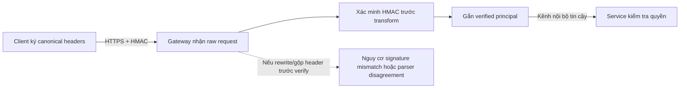
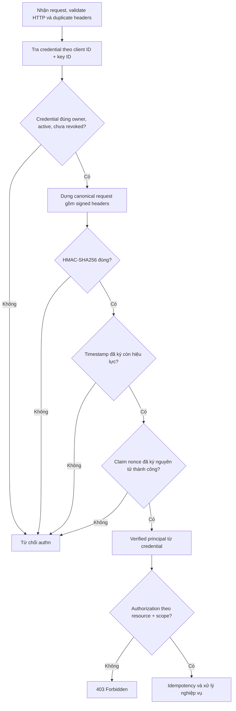

# Canonical headers

## 1. Vì sao phải chuẩn hóa header trước khi ký HMAC?

Trong cơ chế **xác thực HTTP request bằng HMAC**, client và server dùng chung một secret. Client tạo chữ ký trên **canonical request** gồm các thành phần đã thống nhất, chẳng hạn phương thức, URI, một tập header và hash của body. Server dựng lại cùng dữ liệu từ request thực nhận và so sánh HMAC.

**Canonical headers** là cách biểu diễn **nhất quán, không mơ hồ** của những HTTP header được đưa vào dữ liệu ký (*signature input*). Ví dụ, tên header `Content-Type` và `content-type` tương đương theo quy tắc tên field của HTTP; nếu một bên ký theo chữ hoa còn bên kia ký theo chữ thường, HMAC sẽ khác dù ý nghĩa HTTP không đổi.

Vấn đề còn lớn hơn chữ hoa/thường. Header có thể bị thêm, bỏ, gộp, đổi khoảng trắng hoặc biến đổi qua reverse proxy/gateway. Nếu bộ xác minh dùng một cách hiểu header, còn backend sử dụng cách hiểu khác, attacker có thể khai thác **chênh lệch giữa “đã ký cái gì” và “đã thực thi cái gì”**.

Bài **Canonical headers** thuộc chương *Canonical request* của module `SECURITY_AUTHENTICATION_HMAC_REQUEST_AUTHENTICATION`. Kết thúc bài, bạn cần có khả năng:

- Phân biệt **HTTP headers nhận được**, **tập header phải ký**, **giá trị header đã chuẩn hóa** và **danh sách tên header được ký**.
- Thiết kế hợp đồng chuẩn hóa tên, giá trị, thứ tự, whitespace và xử lý duplicate headers.
- Biết header nào cần ký theo nghiệp vụ và header nào nên xử lý riêng vì proxy hoặc HTTP framing.
- Dựng canonical headers bằng Java 17 và tính/xác minh HMAC-SHA256 trên **đúng byte**.
- Kiểm thử qua HTTP/1.1, HTTP/2, proxy/gateway, key rotation, timestamp/nonce và authorization.

## 2. Header nào có ý nghĩa bảo mật?

Giả sử đối tác `merchant-42` gửi lệnh tạo chuyển khoản:

```http
POST /v1/transfers?currency=VND HTTP/1.1
Host: api.example.test
Content-Type: application/json
X-Client-Id: merchant-42
X-Key-Id: k-2026-11
X-Idempotency-Key: tr-101
X-Timestamp: 1790000000
X-Nonce: Rk8t15Yv0jOa8Pn6
X-Signature: <base64url-hmac-sha256>

{"transferId":"tr-101","amount":250000}
```

Giá trị `1790000000` chỉ nhằm minh họa và có thể đã hết hạn tại thời điểm thử; chữ ký trong dấu nhọn là placeholder, không phải chữ ký thực.

| Header/thành phần | Vai trò | Quyết định trong hợp đồng minh họa |
| --- | --- | --- |
| `Content-Type` | Giúp server hiểu body bytes theo kiểu nội dung nào | **Ký**; v1 chỉ chấp nhận chính xác `application/json` |
| `X-Client-Id` | Chọn danh tính client/credential để tra key | **Ký** và kiểm tra owner của credential |
| `X-Key-Id` | Chọn phiên bản shared secret; hỗ trợ rotation | **Ký**; phải thuộc đúng client và còn hiệu lực |
| `X-Idempotency-Key` | Nhận diện ý định nghiệp vụ để chống xử lý trùng | **Ký** để không bị thay đổi sau khi ký; vẫn phải kiểm tra idempotency |
| `X-Timestamp` | Giới hạn độ mới của request | **Ký**, sau đó kiểm tra cửa sổ thời gian |
| `X-Nonce` | Định danh ngẫu nhiên mỗi lần gửi; hỗ trợ chống replay | **Ký**, sau đó claim nonce nguyên tử |
| `X-Signature` | Chở kết quả HMAC | **Không tự ký chính nó**, tránh phụ thuộc vòng tròn |
| `Host` / HTTP/2 `:authority` | Chỉ định authority/đích; có thể ảnh hưởng routing, tenant | **Bảo vệ** dưới dạng trường `authority` riêng trong canonical request |
| `Content-Length` / `Transfer-Encoding` | Framing, có thể thay đổi khi proxy truyền lại request | Không ký raw framing; **ký hash body bytes đã định nghĩa** |
| `Connection`, `Keep-Alive`, `TE`, `Via` | Header liên quan hop hoặc trung gian | Không đưa vào canonical headers cho authn nghiệp vụ |
| `X-Forwarded-For`, `X-Forwarded-Host` | Metadata do proxy có thể cấp | Không tin giá trị do client ngoài tự khai; chính sách trust riêng |
| `User-Agent`, `Accept-Encoding` | Thông tin hiển thị và thương lượng HTTP | Chỉ ký nếu thay đổi chúng thực sự có ảnh hưởng bảo mật/ý nghĩa request |

**Nguyên tắc thiết kế:** mọi header mà backend dùng để quyết định **principal, tài nguyên, quyền, routing hoặc ý định thao tác** phải được ràng buộc vào chữ ký **hoặc** được tạo/kiểm tra bởi một ranh giới tin cậy tương đương. Không nên bỏ một header nhạy cảm khỏi chữ ký chỉ vì nó thường do gateway thêm vào.

Ví dụ: nếu `X-Target-Account` quyết định tài khoản thụ hưởng mà verifier chỉ ký body, attacker có thể thay đổi `X-Target-Account` mà chữ ký vẫn hợp lệ. Cần đưa header này vào hợp đồng ký hoặc chuyển thông tin đích sang nội dung khác đã được bảo vệ.

## 3. Tên header, giá trị và thứ tự: ba lớp cần chuẩn hóa

### 3.1. Tên header không phân biệt chữ hoa/thường

Trong HTTP, field name **không phân biệt chữ hoa/thường**:

```http
X-Client-Id: merchant-42
x-client-id: merchant-42
X-CLIENT-ID: merchant-42
```

Ba cách viết *tên* biểu diễn cùng một field name. Hợp đồng ví dụ chuẩn hóa tên thành **ASCII lowercase**:

```text
x-client-id:merchant-42
```

Chỉ chuyển **tên field** thành chữ thường. Không tự chuyển mọi **giá trị** thành chữ thường: `merchant-A` có thể khác `merchant-a` trong hệ thống định danh. Khi chọn Java, cần xử lý tên ASCII bằng quy tắc HTTP, không dựa vào locale mặc định của JVM.

### 3.2. Giá trị header và khoảng trắng

Trong một số cách phân tích header HTTP, khoảng trắng `SP` hoặc `HTAB` ở đầu/cuối giá trị được gọi là *optional whitespace* (**OWS**). Tuy nhiên, hợp đồng ký không thể chỉ ghi chung chung “normalize whitespace” rồi để mỗi thư viện làm một kiểu.

Hợp đồng `HTTP-HMAC-HEADERS-V1` của bài quy định:

1. Giá trị các **signed headers** phải là ASCII hiển thị: cho phép byte từ `0x20` (SP) đến `0x7E`; **từ chối HTAB**, CR, LF, DEL, control characters và ký tự ngoài ASCII.
2. Bỏ **ASCII SP** ở đầu và cuối giá trị; giữ **nguyên vẹn khoảng trắng ở giữa**.
3. Không tự đổi dấu cách kép thành một dấu cách; không decode percent encoding, chuyển case giá trị hay áp dụng Unicode normalization.
4. Sau trim, các field định danh phải khớp regex đã công bố. Ví dụ `X-Client-Id` có dạng `[A-Za-z0-9._-]{1,64}` và `Content-Type` phải chính xác `application/json`.
5. Mọi biến đổi phải diễn ra **trước khi tính HMAC ở cả client lẫn verifier** và phải được ghi lại thành test vector.

Ví dụ:

| Giá trị nhận được | Giá trị chuẩn hóa | Kết quả |
| --- | --- | --- |
| `" application/json "` | `"application/json"` | Hợp lệ |
| `"merchant-42"` | `"merchant-42"` | Hợp lệ |
| `"merchant-42  "` | `"merchant-42"` | Hợp lệ |
| `"merchant -42"` | Giữ khoảng trắng nội bộ | Sau đó **bị từ chối** bởi regex client ID |
| `"a  b"` | `"a  b"` | Khoảng trắng đôi được giữ; được phép hay không phụ thuộc schema field |
| Giá trị chứa TAB hoặc CR/LF | Không chuẩn hóa | **Từ chối** theo hợp đồng v1 |

Quy định này **cố ý chặt hơn cú pháp HTTP tổng quát** để tránh hành vi khác nhau ở client, proxy và framework. Nếu hệ thống muốn hỗ trợ các header value phức tạp hoặc Unicode, cần có quy tắc chuẩn hóa cụ thể và bộ kiểm thử liên thông; không mở rộng tùy tiện khi request đã phát sinh lỗi chữ ký.

### 3.3. Thứ tự header trên đường truyền không ổn định

Client có thể gửi:

```http
X-Key-Id: k-2026-11
Content-Type: application/json
X-Client-Id: merchant-42
```

hoặc:

```http
x-client-id: merchant-42
content-type: application/json
x-key-id: k-2026-11
```

Nếu hợp đồng yêu cầu cùng nội dung, hai request này phải tạo **cùng phần canonical headers**. Trong v1, ta liệt kê tập header ký **cố định** và **sắp xếp tên ASCII lowercase** (không dựa trên thứ tự nhận được):

```text
content-type:application/json
x-client-id:merchant-42
x-idempotency-key:tr-101
x-key-id:k-2026-11
x-nonce:Rk8t15Yv0jOa8Pn6
x-timestamp:1790000000
```

Bộ tên được ký sau đó được biểu diễn bằng **một dòng danh sách**:

```text
content-type;x-client-id;x-idempotency-key;x-key-id;x-nonce;x-timestamp
```

Dòng này giúp ghi rõ hợp đồng có bao phủ đúng những trường bắt buộc. Vì v1 có tập tên cố định, cả client và server đều phải tạo đúng dòng trên; **client không được tùy ý khai “signed headers” ít hơn** để loại một field khỏi việc kiểm tra.

## 4. Duplicate headers: trường hợp phải từ chối thay vì đoán

HTTP cho phép một số field nhận nhiều giá trị và có quy tắc gộp riêng. Nhưng các header như `X-Client-Id`, `X-Key-Id`, `X-Timestamp`, `X-Nonce` hay `Content-Type` trong hợp đồng v1 đều là **singleton fields**: mỗi tên chỉ được xuất hiện **một lần** theo so sánh case-insensitive.

Đầu vào cần bị từ chối:

```http
X-Client-Id: merchant-42
x-client-id: admin
```

Cũng từ chối trường hợp hai giá trị giống nhau:

```http
X-Nonce: abcdefghijklmnop
x-nonce: abcdefghijklmnop
```

**Vì sao phải từ chối cả duplicate giống nhau?** Một thành phần có thể lấy giá trị đầu, thành phần khác lấy giá trị cuối hoặc gộp bằng dấu phẩy. Dù hiện tại giống nhau, cho phép duplicate tạo thêm lối xử lý mơ hồ và làm hợp đồng khó kiểm toán.

Các rủi ro tiêu biểu:

- **Header smuggling / parser disagreement:** gateway xác minh client ID đầu, backend dùng client ID cuối.
- **Comma-joined values:** proxy tự gộp hai `X-Key-Id` thành `k1,k2` nhưng client đã ký giá trị khác.
- **Case-insensitive duplication:** `X-Timestamp` và `x-timestamp` phải được coi là cùng tên.
- **HTTP/2 → HTTP/1.1 conversion:** header có thể bị chuẩn hóa hoặc hợp nhất trong quá trình chuyển protocol.

**Ranh giới quan trọng:** nếu framework đã gộp hoặc loại bỏ duplicate **trước khi** adapter xác minh có thể kiểm tra, thao tác đếm trên `Map<String,String>` không còn đủ. Hãy kiểm tra duplicate tại điểm nhận request trước khi dữ liệu bị hợp nhất, hoặc đặt verifier tại gateway có khả năng đảm bảo các điều kiện này. Backend không nên suy diễn rằng “map chỉ có một giá trị” chứng minh request gốc không có duplicate.

Với các field có nhiều giá trị hợp lệ ngoài tập v1, cần một hợp đồng khác quy định có ký từng occurrence, gộp theo quy tắc HTTP tương ứng hay canonicalize cấu trúc giá trị. **Không áp dụng một phép nối dấu phẩy chung cho tất cả header.**

## 5. Hợp đồng hoàn chỉnh: HTTP-HMAC-HEADERS-V1

Để tránh nói mơ hồ, ta chốt một hợp đồng **minh họa dành riêng cho bài học**, tên `HTTP-HMAC-HEADERS-V1`. Đây không phải định dạng mặc định của JCA hoặc tiêu chuẩn bắt buộc cho mọi API.

### 5.1. Dữ liệu và quy tắc chung

- Thuật toán là **HMAC-SHA256**. Secret đủ entropy, cấp riêng theo client/môi trường và lưu trong hệ thống quản lý secret. `X-Key-Id` chỉ là định danh tra secret, **không phải secret**.
- Dựng signature input ở **ingress trước rewrite**; nếu verifier ở service phải dùng representation đáng tin với cùng ngữ nghĩa đã công bố.
- Method `POST`, raw path `/v1/transfers`, raw query `currency=VND` và canonical authority `api.example.test` được ký ngoài khối header; các phép chuẩn hóa path/query/authority phải được quy định riêng.
- Hợp đồng này chỉ chấp nhận `Content-Type: application/json` và **không chấp nhận request body content coding khác identity**; tránh tình huống proxy giải nén rồi hash khác.
- Signed headers bắt buộc: `content-type`, `x-client-id`, `x-idempotency-key`, `x-key-id`, `x-nonce` và `x-timestamp`. Mỗi tên xuất hiện đúng một lần, không có duplicate khác case.
- Tên field được chuẩn hóa ASCII lowercase; giá trị bỏ ASCII SP đầu/cuối, giữ khoảng trắng ở giữa, từ chối TAB/CR/LF/control/non-ASCII.
- Body digest là **SHA-256 hex chữ thường** của đúng body bytes sau HTTP transfer decoding, trước bước parse/serialize JSON; HMAC ký digest nằm trong canonical input.
- Ghép chính xác các dòng bằng LF (`\n`), mã hóa UTF-8, **không thêm LF cuối**. Nếu query vắng mặt, dòng raw query là chuỗi rỗng. V1 coi query vắng mặt và query có dấu `?` nhưng rỗng là tương đương; nếu ứng dụng cần phân biệt phải định nghĩa phiên bản khác.
- Chữ ký HMAC được truyền trong `X-Signature` dưới dạng Base64url **không padding** (32 byte HMAC-SHA256 → 43 ký tự). Header `X-Signature` không có mặt trong input vì nó chứa **kết quả** của phép ký.

### 5.2. Canonical request 13 dòng

```text
HTTP-HMAC-HEADERS-V1
POST
/v1/transfers
currency=VND
api.example.test
content-type:application/json
x-client-id:merchant-42
x-idempotency-key:tr-101
x-key-id:k-2026-11
x-nonce:Rk8t15Yv0jOa8Pn6
x-timestamp:1790000000
content-type;x-client-id;x-idempotency-key;x-key-id;x-nonce;x-timestamp
<sha256-lowercase-hex-of-exact-body-bytes>
```

Đây là **13 dòng**:

| Dòng | Ý nghĩa |
| --- | --- |
| 1 | `HTTP-HMAC-HEADERS-V1`: domain/version |
| 2–4 | Method, raw path, raw query |
| 5 | Canonical authority |
| 6–11 | **Sáu canonical signed headers** theo tên tăng dần |
| 12 | Danh sách tên signed headers, phân tách bằng `;` |
| 13 | Hex SHA-256 của exact body bytes |

Dòng cuối là ký hiệu mô tả; khi chạy thực tế phải thay bằng **64 ký tự hex digest**. Timestamp chỉ minh họa; request phải dùng thời điểm còn hiệu lực. Đây là input của HMAC, **không phải** toàn bộ HTTP request và không chứa raw header framing hoặc `X-Signature`.

### 5.3. Tại sao cần cả khối canonical headers và danh sách tên?

Ví dụ hai client cùng có secret nhưng một bên bỏ `x-idempotency-key` ra khỏi input. Nếu server chấp nhận danh sách tùy ý do client cung cấp, trường này có thể bị thay đổi sau ký mà verifier không phát hiện. Trong v1, danh sách tên **bất biến**, nên thiếu một field bắt buộc phải bị từ chối trước HMAC. Một phiên bản muốn có tùy chọn header phải định nghĩa **tập required**, quy tắc bổ sung tên, sắp xếp, và cách ngăn field nhạy cảm bị loại khỏi danh sách.

Thêm header không thuộc tập ký, ví dụ `X-Debug: true`, không làm thay đổi HMAC v1. Điều đó chỉ an toàn khi backend **không dựa vào giá trị header chưa ký để quyết định hành vi nhạy cảm**. Nếu `X-Debug` vô tình làm bỏ qua validation hoặc đổi đích thanh toán, đó là lỗ hổng ứng dụng cần xử lý, không thể đổ cho HMAC.

## 6. Java 17: tạo canonical headers và xác minh HMAC

Mẫu Java dưới đây thể hiện các quy tắc quan trọng của `HTTP-HMAC-HEADERS-V1`: tên header case-insensitive, duplicate detection, trim ASCII SP, sắp xếp cố định, dựng canonical bytes, tính HMAC và so sánh tag an toàn.

**Giới hạn có chủ ý:** `RequestParts` phải được tạo bởi HTTP adapter tin cậy từ request thực nhận. Adapter còn phải kiểm tra nguyên tắc framing, duplicate trước khi proxy gộp, raw URI/query, authority cho phép, body limits, HTTP content coding và cú pháp tham số nghiệp vụ. Mã Java không thực hiện replay store, key lookup hoặc authorization.

```java
import java.nio.charset.StandardCharsets;
import java.security.GeneralSecurityException;
import java.security.MessageDigest;
import java.util.ArrayList;
import java.util.Base64;
import java.util.HashMap;
import java.util.HexFormat;
import java.util.List;
import java.util.Map;
import javax.crypto.Mac;
import javax.crypto.spec.SecretKeySpec;

public final class CanonicalHeadersV1 {
    private static final String VERSION = "HTTP-HMAC-HEADERS-V1";
    private static final String MAC_ALGORITHM = "HmacSHA256";

    // Đã sắp xếp theo ASCII lowercase: không phụ thuộc thứ tự input.
    private static final List<String> SIGNED_NAMES = List.of(
        "content-type",
        "x-client-id",
        "x-idempotency-key",
        "x-key-id",
        "x-nonce",
        "x-timestamp"
    );

    public record Header(String name, String value) {}

    public record RequestParts(
        String method,
        String rawPath,
        String rawQuery,
        String canonicalAuthority,
        List<Header> headers,
        byte[] body
    ) {}

    private CanonicalHeadersV1() {}

    // Chỉ nhận HTTP token name ASCII hợp lệ.
    private static String lowerAsciiName(String name) {
        if (name == null || name.isEmpty()) {
            throw new IllegalArgumentException("Missing header name");
        }
        StringBuilder out = new StringBuilder(name.length());
        for (int i = 0; i < name.length(); i++) {
            char c = name.charAt(i);
            boolean alpha = (c >= 'A' && c <= 'Z')
                         || (c >= 'a' && c <= 'z');
            boolean digit = c >= '0' && c <= '9';
            boolean symbol = "!#$%&'*+-.^_`|~".indexOf(c) >= 0;
            if (!alpha && !digit && !symbol) {
                throw new IllegalArgumentException("Invalid header name");
            }
            out.append(c >= 'A' && c <= 'Z' ? (char) (c + 32) : c);
        }
        return out.toString();
    }

    // V1: cho phép ASCII SP ở hai đầu; từ chối TAB/CR/LF/control.
    // Khoảng trắng nội bộ được giữ nguyên.
    private static String normalizeValue(String value) {
        if (value == null || value.length() > 1024) {
            throw new IllegalArgumentException("Invalid signed value length");
        }
        for (int i = 0; i < value.length(); i++) {
            char c = value.charAt(i);
            if (c < 0x20 || c > 0x7E) {
                throw new IllegalArgumentException("Invalid signed value");
            }
        }
        int start = 0;
        int end = value.length();
        while (start < end && value.charAt(start) == ' ') start++;
        while (end > start && value.charAt(end - 1) == ' ') end--;
        return value.substring(start, end);
    }

    private static Map<String, String> signedValues(
            List<Header> requestHeaders) {
        if (requestHeaders == null) {
            throw new IllegalArgumentException("Headers missing");
        }
        Map<String, String> found = new HashMap<>();

        for (Header header : requestHeaders) {
            String name = lowerAsciiName(header.name());
            if (!SIGNED_NAMES.contains(name)) continue;

            String value = normalizeValue(header.value());
            if (found.putIfAbsent(name, value) != null) {
                throw new IllegalArgumentException(
                    "Duplicate signed header: " + name);
            }
        }

        for (String required : SIGNED_NAMES) {
            if (!found.containsKey(required)) {
                throw new IllegalArgumentException(
                    "Missing signed header: " + required);
            }
        }

        if (!"application/json".equals(found.get("content-type"))) {
            throw new IllegalArgumentException("Content-Type not allowed");
        }
        for (String field : List.of(
                "x-client-id", "x-key-id", "x-idempotency-key")) {
            if (!found.get(field).matches("[A-Za-z0-9._-]{1,64}")) {
                throw new IllegalArgumentException("Invalid ID field");
            }
        }
        if (!found.get("x-nonce").matches("[A-Za-z0-9_-]{16,128}")) {
            throw new IllegalArgumentException("Invalid nonce");
        }
        String time = found.get("x-timestamp");
        if (!time.matches("[1-9][0-9]{0,18}")) {
            throw new IllegalArgumentException("Noncanonical timestamp");
        }
        try {
            Long.parseLong(time);
        } catch (NumberFormatException e) {
            throw new IllegalArgumentException("Timestamp out of range", e);
        }

        return found;
    }

    private static String asciiRequestLine(String s) {
        if (s == null || s.length() > 4096) {
            throw new IllegalArgumentException("Invalid request component");
        }
        for (int i = 0; i < s.length(); i++) {
            char c = s.charAt(i);
            if (c < 0x21 || c > 0x7E) {
                throw new IllegalArgumentException(
                    "Invalid raw request component");
            }
        }
        return s;
    }

    public static byte[] canonicalBytes(RequestParts p)
            throws GeneralSecurityException {
        if (p == null || p.body() == null) {
            throw new IllegalArgumentException("Request/body missing");
        }
        if (!"POST".equals(p.method())) {
            throw new IllegalArgumentException("Method not permitted");
        }

        String path = asciiRequestLine(p.rawPath());
        if (!path.startsWith("/") || path.indexOf('?') >= 0
                || path.indexOf('#') >= 0) {
            throw new IllegalArgumentException("Invalid raw path");
        }
        String query = p.rawQuery() == null
                ? "" : p.rawQuery();
        // Cho phép dòng rỗng, từ chối CR/LF/control ở query không rỗng.
        if (!query.isEmpty()) asciiRequestLine(query);

        String authority = asciiRequestLine(p.canonicalAuthority());
        if (!authority.matches("[a-z0-9.-]{1,253}")) {
            throw new IllegalArgumentException("Invalid authority");
        }

        Map<String, String> values = signedValues(p.headers());
        String bodyHash = HexFormat.of().formatHex(
            MessageDigest.getInstance("SHA-256").digest(p.body())
        );

        List<String> lines = new ArrayList<>();
        lines.add(VERSION);
        lines.add(p.method());
        lines.add(path);
        lines.add(query);
        lines.add(authority);

        for (String name : SIGNED_NAMES) {
            lines.add(name + ":" + values.get(name));
        }
        lines.add(String.join(";", SIGNED_NAMES));
        lines.add(bodyHash);

        // String.join không thêm LF sau dòng cuối.
        return String.join("\n", lines).getBytes(StandardCharsets.UTF_8);
    }

    public static byte[] computeTag(byte[] secret, byte[] input)
            throws GeneralSecurityException {
        if (secret == null || secret.length < 32) {
            throw new IllegalArgumentException("Invalid HMAC secret");
        }
        Mac mac = Mac.getInstance(MAC_ALGORITHM);
        mac.init(new SecretKeySpec(secret, MAC_ALGORITHM));
        return mac.doFinal(input);
    }

    public static String sign(RequestParts p, byte[] secret)
            throws GeneralSecurityException {
        return Base64.getUrlEncoder().withoutPadding()
                .encodeToString(computeTag(secret, canonicalBytes(p)));
    }

    public static boolean verify(
            RequestParts p, byte[] secret, String signature)
            throws GeneralSecurityException {
        // 32-byte HMAC-SHA256 => 43 Base64url chars without padding.
        if (signature == null
                || !signature.matches("[A-Za-z0-9_-]{43}")) {
            return false;
        }

        final byte[] supplied;
        try {
            supplied = Base64.getUrlDecoder().decode(signature);
        } catch (IllegalArgumentException e) {
            return false;
        }
        if (supplied.length != 32) return false;
        String canonicalEncoding = Base64.getUrlEncoder().withoutPadding()
                .encodeToString(supplied);
        if (!canonicalEncoding.equals(signature)) return false;

        byte[] expected = computeTag(secret, canonicalBytes(p));
        return MessageDigest.isEqual(expected, supplied);
    }
}
```

### 6.1. Sử dụng class với request minh họa

```java
import java.nio.charset.StandardCharsets;
import java.security.SecureRandom;
import java.util.List;

// Dùng secret test, không sao chép secret production vào ví dụ.
byte[] testSecret = new byte[32];
new SecureRandom().nextBytes(testSecret);

CanonicalHeadersV1.RequestParts request =
    new CanonicalHeadersV1.RequestParts(
        "POST",
        "/v1/transfers",
        "currency=VND",
        "api.example.test",
        List.of(
            new CanonicalHeadersV1.Header("X-Timestamp", "1790000000"),
            new CanonicalHeadersV1.Header("X-Nonce", "Rk8t15Yv0jOa8Pn6"),
            new CanonicalHeadersV1.Header("X-Key-Id", "k-2026-11"),
            new CanonicalHeadersV1.Header("X-Client-Id", "merchant-42"),
            new CanonicalHeadersV1.Header("Content-Type",
                                          " application/json "),
            new CanonicalHeadersV1.Header("X-Idempotency-Key", "tr-101")
        ),
        "{\"transferId\":\"tr-101\",\"amount\":250000}"
            .getBytes(StandardCharsets.UTF_8)
    );

// Header input đảo thứ tự so với bảng, nhưng canonical header order
// vẫn cố định theo SIGNED_NAMES.
String tag = CanonicalHeadersV1.sign(request, testSecret);
boolean cryptoOk = CanonicalHeadersV1.verify(request, testSecret, tag);
// cryptoOk == true; chưa kiểm tra thời gian, nonce, key state, quyền.
```

### 6.2. Mã minh họa đã làm gì và chưa làm gì?

Mã trên:

- Kiểm tra các **tên header** theo cú pháp token ASCII, chuyển tên thành lowercase, chọn đúng sáu header bắt buộc.
- Từ chối signed header bị **thiếu hoặc lặp**, kể cả khi khác chữ hoa/thường.
- Giữ nguyên giá trị trừ ASCII SP ở hai đầu; hạn chế giá trị từng field theo hợp đồng và sắp xếp theo tên cố định.
- Ghép **13 dòng** canonical request, hash body, tính HMAC-SHA256, encode Base64url và so sánh kết quả bằng `MessageDigest.isEqual`.

Mã **chưa** triển khai đầy đủ HTTP parser, percent-encoding validation, giới hạn kích thước request/body ở ingress, kiểm tra authority thuộc allowlist, content coding, kho key/nonce hay phân quyền. Nó cũng giả định `RequestParts.headers()` chứa **các field occurrence trước khi bị gộp**. Nếu framework đã làm mất thông tin duplicate, cần đặt kiểm tra ở tầng thấp hơn hoặc tại gateway.

`Mac` có trạng thái nội bộ, nên ví dụ khởi tạo instance riêng cho mỗi phép tính; không chia sẻ một instance `Mac` static cho request đồng thời. Secret không được hardcode/log, và ngoại lệ do provider JCA không khả dụng (`NoSuchAlgorithmException`) phải khiến xác thực thất bại an toàn, **không** được chuyển sang cho qua request.

### 6.3. Cách tạo test vector đúng

Để test xuyên ngôn ngữ, hãy lưu bộ vector có:

```yaml
contractVersion: HTTP-HMAC-HEADERS-V1
method: POST
rawPath: /v1/transfers
rawQuery: currency=VND
authority: api.example.test
headers:
  Content-Type: "application/json"
  X-Client-Id: merchant-42
  X-Idempotency-Key: tr-101
  X-Key-Id: k-2026-11
  X-Nonce: Rk8t15Yv0jOa8Pn6
  X-Timestamp: "1790000000"
bodyUtf8: '{"transferId":"tr-101","amount":250000}'
expected:
  bodySha256Hex: <calculate-independent-test-vector>
  canonicalBytesHex: <calculate-independent-test-vector>
  hmacSha256Base64Url: <calculate-with-a-dedicated-test-key>
```

Các trường `expected` ở đây là **placeholder**, chưa phải vector đã tính. Bộ test thực sự phải cố định một **test secret** chỉ dùng cho test, tính digest, canonical bytes và HMAC bằng **implementation độc lập** rồi lưu kết quả bất biến. Nếu chỉ gọi `sign` rồi `verify` trên cùng class, hai hàm có thể cùng mắc một lỗi mà test vẫn xanh.

## 7. Canonical headers qua proxy/gateway



Các biến đổi cần đánh giá:

| Biến đổi | Hậu quả nếu không có hợp đồng | Cách xử lý |
| --- | --- | --- |
| Header name đổi case | Hai bên có thể dựng string khác | Canonicalize name thành ASCII lowercase |
| Header trên wire đảo thứ tự | Thứ tự khác gây khác MAC | Sắp xếp tập tên cố định, không theo thứ tự wire |
| Thêm/bớt khoảng trắng đầu/cuối | MAC khác nếu trim không nhất quán | Định nghĩa chính xác ASCII SP trim; từ chối TAB trong v1 |
| Gộp hoặc tách signed header | Verifier/handler có thể chọn các giá trị khác nhau | Từ chối duplicate trước khi framework gộp |
| Gateway sửa `Host` | Sai authority/tenant hoặc signature input | Xác minh trước rewrite; xác định authority từ ingress đáng tin |
| HTTP/1.1 → HTTP/2 | Tên header lowercase; dùng `:authority` thay `Host` | Ký các thành phần ngữ nghĩa đã chuẩn hóa, không ký raw framing |
| Thêm `X-Forwarded-*` | Caller có thể giả nguồn nếu backend tin header | Gateway xóa/ghi đè metadata từ bên ngoài, backend chỉ tin kênh đã xác thực |
| Thay `Content-Type` hoặc body | Signed header/body hash khác | Không biến đổi trước verify hoặc có hợp đồng representation rõ ràng |
| Thay `Content-Length` khi chuyển hop | MAC có thể hỏng nếu ký framing | Không ký raw framing; ký exact body bytes đã định nghĩa |
| Key rotation chưa đồng bộ | Instance khác dùng key/state khác | Tra `clientId + keyId` và đồng bộ trạng thái thu hồi giữa các verifier |

### 7.1. Bảo vệ authority khi proxy đổi Host

Một proxy thường nhận `Host: api.example.test` nhưng route nội bộ đến `transfer-service.internal`. Nếu client ký `api.example.test` còn service tự lấy host nội bộ để verify, hai phía sẽ tạo input khác. Hướng dễ kiểm soát là **xác minh tại ingress trước rewrite**, nơi còn biết authority gốc, sau đó tạo verified principal.

Nếu bắt buộc xác minh tại service, gateway phải truyền representation authority gốc bằng cơ chế nội bộ được **xác thực nguồn, chống giả mạo và có quy ước rõ**, không tin `X-Forwarded-Host` do client ngoài cung cấp. Với HTTP/2 hoặc HTTP/3, `:authority` là pseudo-header ở tầng giao thức và phải được xử lý theo quy tắc giao thức, **không coi là một header thông thường để nối tùy tiện**.

### 7.2. Truyền danh tính sau HMAC verification

Sau khi gateway xác minh, backend không tự động được tin `X-Verified-Client: merchant-42` nếu caller bên ngoài có thể đặt header cùng tên. Gateway phải xóa header do caller khai, cấp lại principal dưới một context/metadata tin cậy, giới hạn đường vào backend và xác thực kênh giữa các service (ví dụ mTLS hoặc assertion nội bộ có chữ ký). Backend vẫn phải thực hiện **authorization theo principal, scope, action và tài nguyên**.

Nếu gateway và service cùng chạy xác thực HMAC nhưng **cùng claim một nonce**, request hợp lệ có thể bị coi là replay ở tầng thứ hai. Cần chỉ định đúng **một nơi sở hữu trạng thái nonce** cho credential bên ngoài hoặc thiết kế giao thức xác thực riêng giữa hai tầng.

## 8. Xác minh HMAC không tự giải quyết replay và phân quyền

Quy trình đầy đủ nên có thứ tự logic:



**Timestamp và nonce:** cùng nằm trong canonical headers để attacker không thể đổi chúng mà giữ HMAC cũ. Server kiểm tra timestamp Unix seconds, ví dụ cửa sổ ±300 giây, và claim nonce theo client trong kho chia sẻ bằng thao tác **nguyên tử** với TTL đủ dài cho toàn bộ cửa sổ có thể chấp nhận request. Không claim nonce **trước khi HMAC hợp lệ**, tránh caller không có secret chiếm nonce của client.

**Secret bị lộ:** attacker có thể tạo request mới, timestamp mới, nonce mới và HMAC hợp lệ nếu biết secret đang được chấp nhận. Lúc đó phải **thu hồi key ID bị lộ**, cấp secret mới và kiểm tra phạm vi quyền/giao dịch; timestamp/nonce không chữa được tình trạng secret bị lộ.

**Key rotation:** key ID phải được ký; server tra secret theo `clientId + keyId`, trạng thái, môi trường và phiên bản thuật toán. Rotation định kỳ có thể có khoảng chuyển đổi được quy định; nếu key nghi lộ thì không tiếp tục cho phép key cũ chỉ để tránh gián đoạn.

**Authorization:** chữ ký đúng cho `merchant-42` chỉ xác thực credential, không có nghĩa được chuyển tiền từ mọi tài khoản hoặc thay đổi hạn mức. Dữ liệu header hoặc query tự khai không được dùng làm quyền mặc định. Sau authn, backend kiểm tra hành động, tài nguyên, principal, scope, ownership và quy tắc nghiệp vụ; áp dụng idempotency riêng để tránh xử lý giao dịch trùng.

**Confidentiality:** HMAC xác thực và bảo vệ tính toàn vẹn của các trường đã ký; nó không mã hóa header/body. Sử dụng TLS cho đường truyền cần bảo vệ, không log shared secret và hạn chế log request đầy đủ kèm signature (có thể phục vụ replay nếu những lớp khác bị lỗi).

## 9. Bài thực hành và ma trận kiểm thử

Thiết lập môi trường Java 17 với gateway và một service thử nghiệm. Sử dụng **test secret ngẫu nhiên**, không dùng secret production; dựng canonical request theo `HTTP-HMAC-HEADERS-V1`. Mỗi test thay một yếu tố và so sánh **canonical bytes lẫn kết quả verification**, không chỉ so HTTP status.

| Test | Thao tác | Kết quả mong đợi |
| --- | --- | --- |
| T1. Header name case | `Content-Type` → `cOnTeNt-TyPe` | Canonical headers **giống nhau** |
| T2. Header order | Đảo thứ tự tất cả signed headers | Canonical headers **giống nhau** |
| T3. OWS ở hai đầu | `" application/json "` → `"application/json"` | Canonical value **giống nhau** theo hợp đồng v1 |
| T4. TAB | Giá trị signed header chứa HTAB | **Từ chối** trước HMAC |
| T5. CR/LF injection | Header value chứa CR hoặc LF | **Từ chối** |
| T6. Duplicate khác case | Cùng `x-client-id` lặp với tên khác case | **Từ chối** |
| T7. Duplicate cùng giá trị | Hai `X-Key-Id: k1` giống nhau | **Từ chối**, kể cả values trùng |
| T8. Thiếu signed header | Bỏ `X-Nonce` | **Từ chối** |
| T9. Đổi client ID | `merchant-42` thành `merchant-73`, giữ signature | HMAC không khớp hoặc credential lookup thất bại |
| T10. Đổi key ID | `k-2026-11` thành key ID khác, giữ signature | HMAC không khớp hoặc key state không hợp lệ |
| T11. Đổi timestamp | Thay giá trị timestamp, giữ signature | HMAC không khớp |
| T12. Đổi nonce | Thay nonce, giữ signature | HMAC không khớp |
| T13. Đổi idempotency key | `tr-101` → `tr-102`, giữ signature | HMAC không khớp |
| T14. Đổi content type | `application/json` → `text/plain` | Bị từ chối bởi policy/hợp đồng |
| T15. Header ngoài tập ký | Thêm `User-Agent`, giữ toàn bộ input có ý nghĩa | HMAC không đổi; backend không được dựa vào header đó cho quyền |
| T16. Sửa body | Thêm khoảng trắng JSON, giữ signature | Body digest/HMAC thay đổi |
| T17. Đổi raw path/query | Thay query hoặc path đã ký | HMAC không khớp |
| T18. Đổi authority | Proxy chuyển host có ý nghĩa tenant | HMAC không khớp hoặc bị từ chối bởi authority policy |
| T19. HTTP/1.1 → HTTP/2 | Chuyển protocol, cùng semantic headers | Canonical input giống nếu adapter tạo representation đúng |
| T20. Proxy gộp duplicate | Gateway gộp hai signed header thành một | Bị chặn trước khi mất thông tin duplicate |
| T21. Timestamp cũ | Tính HMAC đúng nhưng timestamp ngoài cửa sổ | Bị từ chối vì freshness |
| T22. Nonce replay | Gửi lại nguyên request hai lần | Lần sau bị từ chối vì nonce đã dùng |
| T23. Nonce nhiều instance | Hai replica cùng nhận nonce đồng thời | Tối đa một claim thành công |
| T24. Key revoked | Tính HMAC đúng bằng secret đã thu hồi | Không được xác thực |
| T25. Thiếu quyền | Client ký đúng nhưng thao tác ngoài scope | Xác thực thành công, **403** tại authorization |
| T26. Provider JCA lỗi | Không khởi tạo được `HmacSHA256` | Fail-closed; không bỏ kiểm tra signature |
| T27. Header trusted principal giả | Caller gửi `X-Verified-Client: admin` | Gateway loại bỏ, không cấp quyền giả |
| T28. Raw Content-Length thay đổi | Proxy thay framing nhưng body bytes không đổi | Canonical input vẫn giữ nguyên |

### Tình huống A — “Header case làm HMAC sai”

Client ký `X-Client-Id: merchant-42` nhưng gateway chuyển tên thành `x-client-id` trước khi request tới server.

**Phân tích:** Nếu hai bên sử dụng hợp đồng v1, tên được chuẩn hóa ASCII lowercase trước khi ký nên header case **không làm HMAC thay đổi**. Nếu vẫn thất bại, điều tra xem client có đang ký raw header line, value, thứ tự hoặc framing không đúng hợp đồng.

### Tình huống B — “Hai X-Client-Id và quyền admin”

Request chứa `X-Client-Id: merchant-42` và `x-client-id: admin`. Gateway dùng giá trị đầu để xác minh; backend đọc giá trị cuối để gán principal.

**Phân tích:** Đây là **parser disagreement** có thể dẫn tới giả mạo danh tính. Signed header phải là singleton, trùng tên không phân biệt case bị từ chối **trước khi** framework gộp giá trị. Backend chỉ tin principal do verifier cấp sau HMAC, không lấy trực tiếp từ header caller.

### Tình huống C — “Proxy đổi Host nhưng MAC vẫn nên đúng?”

Client ký external authority `api.example.test`; proxy forward đến `transfer.internal` và backend tự dựng canonical request theo `Host: transfer.internal`.

**Phân tích:** Hai phía tạo signature input khác nhau nên MAC thất bại. Giải pháp thường là **xác minh tại ingress trước rewrite**, hoặc truyền external authority qua cơ chế nội bộ được xác thực và tin cậy. Không dùng forwarded host do client tùy ý đặt để sửa lỗi.

### Tình huống D — “X-Signature có cần nằm trong canonical headers?”

Một lập trình viên muốn đưa luôn `X-Signature` vào danh sách signed headers để “bảo vệ mọi header”.

**Phân tích:** Không. Chữ ký là **kết quả** HMAC trên canonical request; yêu cầu chữ ký phụ thuộc vào chính nó tạo vòng tròn không có điểm bắt đầu. Thay vì vậy, signed-header list và các trường có ý nghĩa bảo mật phải được chốt và nằm trong input; `X-Signature` chỉ vận chuyển tag.

### Tình huống E — “Nonce đã ký, nhưng duplicate nonce”

Request mang hai `X-Nonce`, gateway dùng nonce A để verify, service dùng nonce B để chống replay.

**Phân tích:** Cả hai kiểm tra có thể hoạt động trên **dữ liệu khác nhau**. Không chấp nhận duplicate signed headers. Sau khi HMAC thành công, thực hiện claim **chính nonce đã ký và được verifier xác minh**, trong kho chia sẻ nguyên tử.

## 10. Checklist thiết kế canonical headers

- [ ] Hợp đồng nêu rõ **tập signed headers bắt buộc** và thứ tự; danh sách tên đã ký không được client tự giảm.
- [ ] Tên header được chuẩn hóa ASCII lowercase, không phụ thuộc locale và thứ tự nhận trên wire.
- [ ] Giá trị có quy tắc chuẩn hóa chặt: OWS, whitespace nội bộ, charset, control/CR/LF, length và schema từng field.
- [ ] Signed headers trùng tên (kể cả khác case) hoặc thiếu được **từ chối trước khi framework gộp**.
- [ ] Chỉ chấp nhận những trường có ảnh hưởng bảo mật/nghiệp vụ đã được ký hoặc được bảo vệ bằng chính sách khác tương đương.
- [ ] `Host`/`:authority` được xử lý theo hợp đồng routing/tenant rõ ràng; không tin `X-Forwarded-*` từ client ngoài.
- [ ] Không ký hop-by-hop/framing tùy tiện; ký exact body digest và kiểm soát Content-Encoding theo hợp đồng.
- [ ] Canonical request có version/domain separation, method, URI/query, authority, canonical header lines, signed names, body digest và quy tắc LF/UTF-8 minh bạch.
- [ ] Key ID/client ID được ràng buộc với credential, thuật toán, trạng thái và môi trường; HMAC dùng secret bảo quản an toàn.
- [ ] Timestamp + nonce nằm trong input và được kiểm tra freshness, claim nonce nguyên tử sau HMAC; có rotation/revocation.
- [ ] Gateway/HTTP/2/backend được kiểm thử header case, thứ tự, duplicate, whitespace, Host rewrite, body transform và principal spoofing.
- [ ] Authentication HMAC thành công vẫn phải qua authorization cho principal, scope, hành động và tài nguyên; không log secret.

**Điểm cốt lõi:** *Canonical headers* không chỉ là “đổi tên header thành chữ thường”. Một hợp đồng HMAC an toàn phải định nghĩa **header nào được ký, tên/giá trị được chuẩn hóa ra sao, thứ tự thế nào, header trùng hoặc thiếu bị xử lý thế nào và proxy có được thay đổi gì trước điểm xác minh**. Khi client và server cùng tạo đúng canonical bytes, HMAC mới bảo vệ được các header quyết định danh tính và hành vi; timestamp/nonce, key rotation và authorization vẫn cần được thực hiện độc lập.

