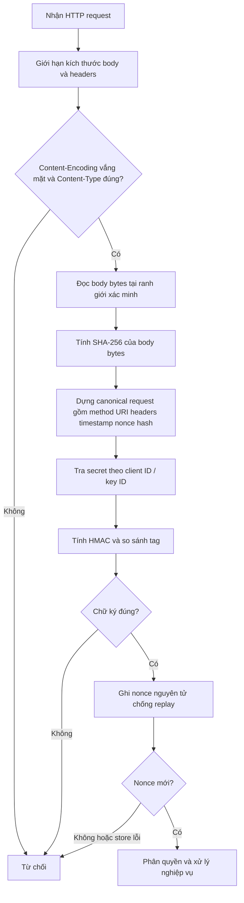

# Canonical body

## 1. Canonical body giải quyết bài toán gì?

Trong xác thực HTTP request bằng **HMAC với shared secret**, client tạo chữ ký cho một **canonical request** và server tạo lại cùng biểu diễn đó để xác minh. Canonical request có thể bao gồm phương thức HTTP, URI, các header được chọn, body hoặc giá trị băm của body. Vì HMAC xử lý **byte**, chỉ cần khác một byte giữa bên gửi và bên xác minh là chữ ký có thể khác.

**Canonical body** là cách hợp đồng ký định nghĩa **những byte nào của body được bảo vệ và cách đưa chúng vào dữ liệu ký**. Tên gọi này dễ gây hiểu nhầm: không phải hệ thống nào cũng cần chuyển JSON sang một biểu diễn “chuẩn” mới. Nhiều giao thức chọn ký **hash của body bytes nguyên gốc**. Với cách đó, canonical body đơn giản là dãy byte payload được xác định tại ranh giới đã thống nhất, và giá trị tham gia canonical request là hash của dãy byte ấy.

Trong mô-đun **`SECURITY_AUTHENTICATION_HMAC_REQUEST_AUTHENTICATION`**, người học xây dựng xác thực HTTP request bằng HMAC với shared secret, ràng buộc method, URI, header hoặc body theo hợp đồng ký; sau đó xác minh chữ ký, chống replay bằng timestamp/nonce, quản lý key rotation, kiểm thử proxy/gateway và phân biệt xác thực với phân quyền. Bài **Canonical body** thuộc chương **Canonical request** tập trung vào việc xác định và bảo toàn **nội dung HTTP body được ký**, không đánh đồng dữ liệu ứng dụng với byte thực sự đi qua mạng.

Xét yêu cầu thanh toán:

```http
POST /v1/payments?merchantId=m-42 HTTP/1.1
Host: api.example.test
Content-Type: application/json
X-Client-Id: client-42
X-Key-Id: key-demo-01
X-Timestamp: 1795856400
X-Nonce: AAAAAAAAAAAAAAAAAAAAAA
X-Signature: <base64-hmac-sha256>

{"orderId":"O-42","amount":250000,"currency":"VND"}
```

Timestamp, nonce và key ở đây chỉ dùng cho **test vector**, tuyệt đối không sao chép các giá trị tĩnh này vào ứng dụng thật. Nếu kẻ tấn công đổi `amount` từ `250000` thành `2500000` sau khi request đã ký, HMAC chỉ phát hiện thay đổi nếu body được đưa vào hợp đồng ký hoặc được bảo vệ bằng cơ chế toàn vẹn tương đương.

## 2. Phân biệt body của HTTP, đối tượng ứng dụng và canonical body

Có ít nhất ba cách nhìn một request body:

| Góc nhìn | Ví dụ | Có thể thay đổi khi đi qua phần mềm? |
| --- | --- | --- |
| **Đối tượng nghiệp vụ** | `Payment(orderId="O-42", amount=250000)` | Có; nhiều cách serialize cùng một đối tượng |
| **Body bytes** | Byte UTF-8 của `{"amount":250000,...}` | Có nếu middleware serialize lại, nén/giải nén hoặc đổi charset |
| **Giá trị ký đại diện cho body** | `hex(SHA-256(bodyBytes))` | Thay đổi nếu body bytes thay đổi |

Hai JSON này thường được parser hiểu là đối tượng chứa cùng giá trị:

```json
{"amount":250000,"currency":"VND"}
```

```json
{
  "currency": "VND",
  "amount": 250000
}
```

Nhưng chúng là **hai dãy byte khác nhau** vì thứ tự property và khoảng trắng khác nhau. Với cách **hash body bytes nguyên gốc**, digest và HMAC khác nhau. Tính chất này là hành vi **được mong đợi**, không phải lỗi SHA-256.

Một số thay đổi tinh vi hơn cũng làm byte khác:

- Một chuỗi dùng ký tự Unicode trực tiếp, bản khác dùng JSON escape `\uXXXX`.
- Một số biểu diễn thành `1`, `1.0` hoặc `1e0` dù một số parser xem chúng tương đương về giá trị.
- Payload có hoặc không có xuống dòng cuối; `LF` khác `CRLF`.
- Serializer đổi thứ tự property, kiểu escape của dấu `/` hoặc khoảng trắng sau dấu phẩy.
- Một bên dùng UTF-8, bên kia chuyển mã sang UTF-16 hay một charset khác.
- Một body rỗng thực sự dài **0 byte**; nó khác với hai byte `{}`, bốn byte `null` hoặc một byte newline.

**Nguyên tắc cốt lõi:** luôn định nghĩa cụ thể **dữ liệu được ký là byte nào**, ở **điểm quan sát nào** trong luồng HTTP, và có phép biến đổi nào được phép trước khi xác minh hay không.

## 3. Ba chiến lược phổ biến để đưa body vào chữ ký

| Chiến lược | Biểu diễn trong canonical request | Ưu điểm | Rủi ro và điều kiện |
| --- | --- | --- | --- |
| **Ký trực tiếp body bytes** | HMAC nhận các byte body trong thông điệp ký | Bảo vệ nguyên byte, không cần hash riêng | Xử lý byte lớn/streaming phải bảo toàn thứ tự và separator |
| **Ký hash của body bytes** | Một dòng `hex(SHA-256(bodyBytes))` | Canonical request gọn, kích thước cố định; dễ tạo test vector | Phải thống nhất byte đầu vào SHA-256, hex format và xử lý body rỗng |
| **Canonical hóa cấu trúc dữ liệu rồi ký** | `hash(canonicalJson(value))` hoặc byte canonical JSON | Hai serializer khác nhau có thể tạo một biểu diễn thống nhất | Cần chuẩn canonicalization cụ thể, parser/schema nhất quán; xử lý số, Unicode và duplicate keys nghiêm ngặt |

Các chiến lược **không tự tương thích**. Nếu client dùng `SHA-256(rawBody)` còn server parse JSON rồi serialize lại mới hash, hai bên đang thực thi **hai hợp đồng khác nhau**.

Trong nhiều API Java server-to-server, lựa chọn dễ kiểm soát là **hash SHA-256 của raw body bytes**, sau đó đưa chuỗi hex lowercase 64 ký tự vào canonical request. Bài này sử dụng lựa chọn đó để minh họa. Chữ ký HMAC-SHA-256 cuối cùng vẫn được tính trên **toàn bộ canonical request**, không phải chỉ trên body hash.

### 3.1. Hash của body không thay thế HMAC

SHA-256 **không sử dụng secret**. Bất kỳ người nào nhận được body đều có thể tính lại SHA-256. Do đó:

```text
bodyHash = SHA-256(bodyBytes)             // Không xác thực người gửi
canonicalRequest = method + URI + ... + bodyHash
signature = HMAC-SHA256(secret, canonicalRequest)
```

Hash giúp HMAC ràng buộc với body mà không cần nhúng toàn bộ body vào canonical string. Chính **HMAC trên canonical request**, cùng chính sách khóa, mới cung cấp kiểm tra toàn vẹn có khóa bí mật.

Nếu server nhận một header như `X-Body-SHA256` từ client, **không được mặc nhiên tin** giá trị đó. Server phải tính lại SHA-256 từ body thực nhận và so sánh với giá trị khai báo (nếu hợp đồng có dùng header ấy); khi dựng canonical request nên dùng **hash do server tự tính**.

## 4. Định nghĩa rõ ranh giới byte của body

Trong HTTP, phần mềm có thể nhìn thấy body ở nhiều lớp:

```text
Ứng dụng sender
    |
    | Serialize JSON → byte[] ứng dụng
    v
HTTP client / interceptor
    |
    | Có thể thêm Content-Encoding: gzip
    v
HTTP transport (TLS, framing HTTP/1.1 hoặc HTTP/2)
    |
    v
Reverse proxy / gateway
    |
    | Có thể bỏ framing, giải nén, chuyển mã, sửa payload
    v
HTTP server / framework
    |
    | Dãy byte body được expose cho verifier
    v
JSON parser và xử lý nghiệp vụ
```

**Transfer framing** và **content coding** là hai khái niệm khác nhau:

- Với HTTP/1.1, `Transfer-Encoding: chunked` chia payload thành các chunk trong quá trình vận chuyển. Marker chunk và độ dài chunk **không thuộc body bytes ứng dụng**. Thông thường HTTP stack đã loại framing trước khi ứng dụng đọc body.
- `Content-Encoding: gzip` biểu diễn một **nội dung đã được nén**; nếu một bên hash byte nén còn bên kia hash byte sau giải nén, chữ ký sẽ khác. Chỉ ký “body” mà không nói rõ trước/sau content decoding là chưa đủ.
- `Content-Type` và `charset` ảnh hưởng cách **diễn giải byte thành dữ liệu**, không tự thay đổi byte. Tuy nhiên, middleware có thể thực hiện việc decode/encode lại và tạo ra byte mới.

Vì vậy, **hợp đồng minh họa** trong bài sử dụng chính sách đơn giản:

1. Chỉ chấp nhận body JSON UTF-8 gửi **không sử dụng content coding**. `Content-Encoding` phải **vắng mặt**; nếu có header này, verifier từ chối thay vì tự giải nén rồi cố gắng xác minh.
2. `bodyBytes` là byte của HTTP message content **sau khi giao thức vận chuyển đã xử lý framing**, nhưng **trước khi ứng dụng parse, thay đổi charset hoặc deserialize/serialize JSON**.
3. Sender phát đúng dãy `bodyBytes` đã tính hash; gateway không được sửa body trước điểm xác minh.
4. `Content-Type` cố định bằng `application/json` và được ràng buộc vào canonical request. Nếu hệ thống muốn cho phép tham số `charset`, cần định nghĩa chuẩn hóa cụ thể trong hợp đồng mới.
5. Kiểm tra giới hạn kích thước body **trước khi đọc/buffer** dữ liệu lớn.

Chính sách trên là **một lựa chọn thiết kế cụ thể**, không phải quy tắc chung của mọi hệ thống HMAC. Nếu cần nén, multipart, upload streaming hoặc canonical JSON, hãy phát hành và kiểm thử hợp đồng rõ ràng hơn.

## 5. Hợp đồng ký `HMAC-SHA256-V1` với body hash

Để có một ví dụ kiểm chứng được, định nghĩa hợp đồng học tập:

| Thuộc tính | Quy ước chính xác |
| --- | --- |
| Thuật toán MAC | `HmacSHA256`, tag đầy đủ 32 byte |
| Secret | Khóa ngẫu nhiên có entropy cao được cấp riêng cho client, tra theo `clientId` và `keyId` |
| Method | `POST` viết hoa |
| Public path | `/v1/payments` (raw path đã thỏa thuận) |
| Raw query | `merchantId=m-42` (không gồm dấu `?`) |
| Content-Type | Chính xác `application/json` |
| Content-Encoding | Không được xuất hiện |
| Body | Byte UTF-8 nguyên gốc, không parse rồi serialize lại |
| Body digest | `SHA-256(bodyBytes)` thành **64 ký tự hex lowercase** |
| Timestamp | Unix seconds, được ký và kiểm tra trong cửa sổ thời gian |
| Nonce | Chuỗi ngẫu nhiên mới cho mỗi lần ký, được ký và lưu chống replay |
| Canonical encoding | 10 dòng UTF-8 nối bằng **LF**, không có LF cuối |
| Signature output | Base64 chuẩn có padding của tag HMAC-SHA-256 đầy đủ |

Dùng body chính xác **51 byte** (không thêm xuống dòng cuối):

```json
{"orderId":"O-42","amount":250000,"currency":"VND"}
```

Giá trị hash của 51 byte này là:

```text
ea646bb8b1903a83256034142a633e90ffad35b3a40bb4c5f0e8f1eb4f4f27f9
```

Canonical request tương ứng:

```text
HMAC-SHA256-V1
POST
/v1/payments
merchantId=m-42
content-type:application/json
x-client-id:client-42
x-key-id:key-demo-01
x-timestamp:1795856400
x-nonce:AAAAAAAAAAAAAAAAAAAAAA
ea646bb8b1903a83256034142a633e90ffad35b3a40bb4c5f0e8f1eb4f4f27f9
```

Đây là **mười dòng**, ngăn cách bằng **9 byte LF**, không có LF sau digest. Để tạo vector kiểm tra cụ thể, sử dụng secret **thử nghiệm**, gồm đúng 32 ký tự ASCII:

```text
0123456789abcdef0123456789abcdef
```

Signature Base64 kỳ vọng:

```text
GMGNFyHLvQHRH53KE9+jTILR1qc0HauQJiX06bXm1n0=
```

**Cảnh báo cho test vector:** nonce toàn ký tự `A`, timestamp cố định và secret công khai đều chỉ dùng để kiểm thử khả năng tương thích. Chúng không phù hợp cho request production. Một triển khai thực tế phải tạo nonce mới bằng CSPRNG, dùng thời gian hiện tại và giữ secret trong hệ thống quản lý khóa.

Hợp đồng ở đây cố định path/query để tập trung vào body. Khi mở rộng sang URI tổng quát, hai phía phải đặc tả percent-encoding, thứ tự query key/value, tham số trùng và dấu `/`; **không** tự cho rằng `URI.getPath()`, `URI.getRawPath()` và gateway trả cùng byte.

## 6. Java 17+: hash body và ký canonical request

JDK cung cấp `MessageDigest` cho SHA-256, `javax.crypto.Mac` cho HMAC và `HttpRequest.BodyPublishers.ofByteArray` để phát đúng dãy byte đã ký.

```java
import java.nio.charset.StandardCharsets;
import java.security.GeneralSecurityException;
import java.security.MessageDigest;
import java.util.Base64;
import java.util.HexFormat;
import java.util.Objects;
import javax.crypto.Mac;
import javax.crypto.spec.SecretKeySpec;

public final class CanonicalBodySigning {
    private CanonicalBodySigning() {}

    public static String sha256Hex(byte[] bodyBytes)
            throws GeneralSecurityException {
        Objects.requireNonNull(bodyBytes, "bodyBytes");
        byte[] digest = MessageDigest.getInstance("SHA-256")
                .digest(bodyBytes);
        return HexFormat.of().formatHex(digest);
    }

    public static String canonicalRequest(
            byte[] bodyBytes, String clientId, String keyId,
            String timestampSeconds, String nonce)
            throws GeneralSecurityException {
        // Những thành phần HTTP khác đang cố định theo test contract V1.
        // Trong production cần parser/validator phù hợp cho từng trường.
        String hash = sha256Hex(bodyBytes);

        return String.join("\n",
                "HMAC-SHA256-V1",
                "POST",
                "/v1/payments",
                "merchantId=m-42",
                "content-type:application/json",
                "x-client-id:" + clientId,
                "x-key-id:" + keyId,
                "x-timestamp:" + timestampSeconds,
                "x-nonce:" + nonce,
                hash);
    }

    public static byte[] mac(byte[] secret, byte[] canonicalBytes)
            throws GeneralSecurityException {
        Objects.requireNonNull(secret, "secret");
        Objects.requireNonNull(canonicalBytes, "canonicalBytes");
        if (secret.length == 0) {
            throw new IllegalArgumentException("Secret cannot be empty");
        }

        // Mac có trạng thái: tạo mới cho mỗi phép tính.
        Mac mac = Mac.getInstance("HmacSHA256");
        mac.init(new SecretKeySpec(secret, "HmacSHA256"));
        return mac.doFinal(canonicalBytes);
    }

    public static String signBase64(
            byte[] secret, String canonical)
            throws GeneralSecurityException {
        byte[] signature = mac(
                secret, canonical.getBytes(StandardCharsets.UTF_8));
        return Base64.getEncoder().encodeToString(signature);
    }
}
```

Ví dụ dùng body từ **một lần serialize duy nhất**, không ký một bản rồi gửi bản khác:

```java
import java.net.URI;
import java.net.http.HttpRequest;
import java.nio.charset.StandardCharsets;
import java.time.Instant;
import java.security.SecureRandom;
import java.util.Base64;

byte[] bodyBytes = (
        "{\"orderId\":\"O-42\",\"amount\":250000,\"currency\":\"VND\"}"
).getBytes(StandardCharsets.UTF_8);

// Trong production: secretBytes nhận từ secret manager và keyId
// phải tương ứng với secret đang có hiệu lực.
String timestamp = Long.toString(Instant.now().getEpochSecond());

byte[] nonceBytes = new byte[16];
new SecureRandom().nextBytes(nonceBytes);
String nonce = Base64.getUrlEncoder().withoutPadding()
        .encodeToString(nonceBytes);

String canonical = CanonicalBodySigning.canonicalRequest(
        bodyBytes, "client-42", "key-demo-01", timestamp, nonce);
String signature = CanonicalBodySigning.signBase64(
        secretBytes, canonical);

HttpRequest request = HttpRequest.newBuilder(
        URI.create("https://api.example.test/v1/payments?merchantId=m-42"))
        .header("Content-Type", "application/json")
        .header("X-Client-Id", "client-42")
        .header("X-Key-Id", "key-demo-01")
        .header("X-Timestamp", timestamp)
        .header("X-Nonce", nonce)
        .header("X-Signature", signature)
        .POST(HttpRequest.BodyPublishers.ofByteArray(bodyBytes))
        .build();
```

`secretBytes` là biến do tầng quản lý khóa cung cấp; ví dụ không hard-code secret thật. `key-demo-01` chỉ là tên khóa minh họa: môi trường thực tế phải có key ID và secret **đúng cùng phiên bản**.

Lưu ý: mã khóa cố định path/query trong `canonicalRequest` chỉ phù hợp với endpoint mẫu. Nếu tái sử dụng cho URI khác, phải làm **trọn hợp đồng canonical URI** và kiểm tra dữ liệu input không chứa newline hay trường bất hợp lệ. Ví dụ này nhằm giải thích **canonical body và data flow**, không phải một SDK HMAC tổng quát hoàn chỉnh.

### 6.1. Kiểm tra test vector bằng Java

```java
import java.nio.charset.StandardCharsets;

byte[] sampleBody = (
        "{\"orderId\":\"O-42\",\"amount\":250000,\"currency\":\"VND\"}"
).getBytes(StandardCharsets.UTF_8);

String digest = CanonicalBodySigning.sha256Hex(sampleBody);
if (!digest.equals(
        "ea646bb8b1903a83256034142a633e90ffad35b3a40bb4c5f0e8f1eb4f4f27f9")) {
    throw new AssertionError("Unexpected body hash");
}

String canonical = CanonicalBodySigning.canonicalRequest(
        sampleBody, "client-42", "key-demo-01",
        "1795856400", "AAAAAAAAAAAAAAAAAAAAAA");

byte[] testSecret = (
        "0123456789abcdef0123456789abcdef"
).getBytes(StandardCharsets.US_ASCII);

String actual = CanonicalBodySigning.signBase64(testSecret, canonical);
if (!actual.equals(
        "GMGNFyHLvQHRH53KE9+jTILR1qc0HauQJiX06bXm1n0=")) {
    throw new AssertionError("Unexpected HMAC signature");
}
```

Test vector giúp kiểm tra cả body hash, thứ tự 10 dòng, dấu LF và mã hóa signature. **Không** dùng test secret hoặc nonce cố định cho tích hợp thật; hãy thay bằng secret ngẫu nhiên và nonce mới theo từng request.

## 7. Server xác minh canonical body như thế nào?

Ở phía verifier, hash phải được tạo từ **body bytes mà hệ thống thực nhận** tại điểm quan sát được hợp đồng xác định. Không được nhận chữ ký, lấy body hash do client khai báo rồi xác minh HMAC mà bỏ qua body thực tế.

Luồng logic:



**Thứ tự kiểm tra cụ thể có thể thay đổi vì hiệu năng**, nhưng phải bảo đảm không xử lý nghiệp vụ và không chấp nhận nonce trước khi chữ ký được xác minh hợp lệ. Timestamp nên được kiểm tra trước phép tính HMAC tốn kém; key ID chỉ là gợi ý tra khóa trước xác thực, chưa phải principal đã được chứng thực.

### 7.1. Verify chữ ký không đồng nghĩa với parse JSON

Sau khi kiểm tra chữ ký, server **vẫn phải validate JSON**. Hai nhóm kiểm tra trả lời các câu hỏi khác nhau:

- **HMAC / hash body:** Byte đã ký có bị sửa, và bên gửi có biết secret không?
- **JSON parsing và schema validation:** Body có đúng cú pháp, kiểu dữ liệu, ràng buộc `amount > 0`, currency hợp lệ, business ID…?
- **Authorization:** Client đã xác thực có quyền tạo thanh toán cho `merchantId` đó không?
- **Idempotency:** Một ý định nghiệp vụ có bị thực thi hai lần do retry khác nonce không?

Một request có body nguyên vẹn và chữ ký hợp lệ **vẫn có thể** chứa dữ liệu nghiệp vụ không được phép.

### 7.2. Không parse rồi serialize JSON để xác minh HMAC raw-body

Đây là một thiết kế sai thường thấy:

```java
// SAI với hợp đồng SHA-256(raw body bytes):
PaymentDto payment = objectMapper.readValue(
        requestBodyBytes, PaymentDto.class);
byte[] normalized = objectMapper.writeValueAsBytes(payment);
byte[] hash = MessageDigest.getInstance("SHA-256").digest(normalized);
```

Nếu `PaymentDto` bỏ trường chưa biết, đổi thứ tự field, chuyển số thành dạng khác hay normalize Unicode, `normalized` khác body gốc. Từ đó hệ thống có thể từ chối request hợp lệ; nghiêm trọng hơn, verifier có thể **xác minh nội dung khác với nội dung mà downstream xử lý** nếu nhiều parser có cách diễn giải khác nhau.

Đối với hợp đồng raw-body, thao tác đúng là hash **`requestBodyBytes` nguyên vẹn** trước khi parse. Sau khi qua xác thực, hãy parse và xử lý **chính bản body đã được kiểm tra**, và áp dụng schema validation để tránh mơ hồ ngữ nghĩa.

## 8. Khi nào cần canonical JSON theo nội dung ngữ nghĩa?

Có hệ thống cần hai bên tạo cùng chữ ký dù thứ tự property và khoảng trắng khác nhau. Lúc đó có thể chọn **canonical JSON** theo một chuẩn xác định, ví dụ **JSON Canonicalization Scheme (JCS, RFC 8785)**, nhưng cách làm này đòi hỏi sự đồng thuận sâu hơn:

- Cả hai bên parse cùng dữ liệu JSON theo một profile và cùng bộ ràng buộc, thay vì đoán cách serializer của từng ngôn ngữ hoạt động.
- Property được sắp xếp và số được serialize theo **quy tắc chính xác của chuẩn**; không đơn giản là gọi `Map.sortByKey()` hay Jackson `ORDER_MAP_ENTRIES_BY_KEYS` rồi coi đã tương thích.
- Phải xử lý input có **duplicate object member names**, Unicode, biểu diễn số, NaN/Infinity không hợp lệ, string escape, array và type distinction theo chính sách đã chọn.
- Một số chuẩn canonical JSON có điều kiện về dữ liệu đầu vào, chẳng hạn tuân thủ I-JSON; cần kiểm tra chúng **trước khi canonicalize**.
- Phải làm rõ server kiểm tra chữ ký trên **canonical JSON bytes** rồi parse/tiêu thụ payload theo cùng quy tắc, tránh xảy ra hai cách hiểu JSON giữa lớp xác thực và nghiệp vụ.

**Cẩn thận với Unicode:** các dãy ký tự hiển thị giống nhau có thể có cách biểu diễn code point khác nhau. Không được tự động normalization Unicode nếu chuẩn canonical JSON được chọn **không** quy định bước đó. Trong raw-body signing, chỉ cần byte khác là hash khác, bất kể hai chuỗi nhìn bằng mắt giống nhau.

Một hợp đồng mới có thể mô tả:

```text
canonicalJsonBytes = RFC8785Canonicalize(parsedAndValidatedJson)
bodyHash = SHA-256(canonicalJsonBytes)
signature = HMAC(secret, canonicalRequestUsing(bodyHash))
```

Đây là **một phiên bản hợp đồng khác** với `SHA-256(raw body bytes)`. Không trộn hai cách trong cùng phiên bản, không tự “thử cả raw và normalized” để xem chữ ký nào khớp vì có thể tạo chênh lệch giữa những byte đã xác thực và dữ liệu được thực thi.

## 9. Multipart, form data và file upload

### 9.1. Multipart/form-data

Multipart body có boundary, header từng part, line endings và byte nội dung. Hai multipart cùng tập file/field nhưng có **boundary khác nhau** có thể có body bytes khác nhau. Vì vậy:

- Nếu hợp đồng ký **raw multipart bytes**, client cần xây dựng toàn bộ multipart body **một lần** với boundary cố định trước khi ký và phát đúng byte đã ký.
- Nếu thư viện HTTP tự tạo boundary trong lúc phát request, việc hash một bản multipart được dựng trước có thể không khớp.
- Không parse multipart thành map rồi serialize lại để xác minh nếu hợp đồng không có cơ chế canonical multipart riêng.

### 9.2. application/x-www-form-urlencoded

`a=1&b=2` và `b=2&a=1` có thể biểu diễn các cặp giống nhau, nhưng byte khác. `a=1&a=2` còn chứa khóa lặp; biến nó thành `Map<String,String>` sẽ mất thông tin. Nếu ký raw bytes, server chỉ hash byte gốc. Nếu cần ký nội dung theo ngữ nghĩa, phải định nghĩa thứ tự, percent-encoding, cách diễn giải dấu `+`, khóa lặp và giá trị rỗng.

### 9.3. Tệp lớn và streaming

Với file lớn, không nên luôn đọc toàn bộ body vào RAM. `MessageDigest.update(byte[], offset, length)` cho phép tính SHA-256 tăng dần khi đọc từng chunk. Nhưng phải quyết định:

1. Hash trước khi gửi hay trong lúc gửi? Nếu hash được đưa vào **header chữ ký**, client thường cần biết digest **trước lúc gửi header**. Có thể cần đọc file trước một lượt rồi phát lại **đúng cùng snapshot dữ liệu**.
2. Có thể đảm bảo file không đổi giữa lượt hash và lượt gửi không? Nên chụp snapshot, dùng file không thay đổi hoặc buffer phù hợp.
3. Verifier phải đồng thời **không làm mất body** cho downstream và giới hạn số byte tiếp nhận. Có thể dùng streaming digest kết hợp spool-to-disk/quy trình xử lý phù hợp thay vì đọc vô hạn.
4. Nếu streaming upload qua gateway, cần kiểm tra rằng gateway không chuyển mã nội dung hoặc thực hiện biến đổi khiến digest khác hợp đồng.

**Hash streaming** và **HMAC streaming trực tiếp trên body** là hai chiến lược khác nhau; không thể thay thế nhau mà vẫn giữ nguyên chữ ký.

## 10. Proxy/gateway và các phép biến đổi body

Một chữ ký có thể sai dù sender và server cùng sử dụng HMAC-SHA-256 nếu một thành phần trung gian thay đổi payload:

| Thay đổi trên đường đi | Ảnh hưởng với hợp đồng raw-body hash | Hướng xử lý |
| --- | --- | --- |
| Gateway giải nén `gzip` rồi chuyển tiếp JSON | Byte body ở server khác byte client đã hash | V1 từ chối content coding; phiên bản khác phải quy định ranh giới nén |
| Middleware format lại JSON | Thay whitespace/order property | Không serialize lại trước xác minh; ký/vận chuyển đúng byte |
| Proxy thay charset | Byte khác | Cấm chuyển mã hoặc định nghĩa phiên bản hợp đồng mới |
| HTTP/1.1 chunked → HTTP/2 framing | Thay **framing vận chuyển**, không nhất thiết thay content bytes | Hợp đồng ký content bytes **sau xử lý framing**, kiểm thử đường đi |
| Chèn newline vào cuối body | Hash khác | Bảo toàn byte gốc |
| API gateway chạy WAF thay nội dung | Byte đã ký khác | Xác minh trước phép biến đổi hoặc đảm bảo downstream dùng đúng nội dung đã xác thực |
| JSON parser bỏ field không biết | Downstream thấy object khác | Bảo vệ raw bytes; schema validation theo cùng chính sách |
| CDN/cache trả lại body khác | Không tương thích với dữ liệu đã ký | Không dùng representation bị biến đổi để xác minh chữ ký gốc |

**Hai cách đặt ranh giới thường dùng:**

- **Xác minh tại gateway trước khi thay body**: gateway còn thấy byte đồng nhất với sender; sau xác minh, backend chỉ chấp nhận principal đã được gateway chứng thực qua kênh tin cậy. Nếu gateway tiếp tục thay đổi body, cần chính sách bảo đảm rằng biến đổi đó được kiểm soát và backend xử lý dữ liệu đúng với quyết định xác thực.
- **Xác minh tại backend**: gateway phải **bảo toàn body bytes được ký** hoặc cung cấp một cơ chế gắn metadata về bản gốc được bảo vệ khỏi giả mạo. Backend tuyệt đối không tin `X-Original-Body-Hash` do client Internet tự gửi mà bỏ qua việc xác minh ranh giới tin cậy.

Không sửa lỗi bằng cách bỏ body ra khỏi HMAC hoặc chấp nhận chữ ký sai; cách đó làm mất khả năng phát hiện sửa đổi payload.

## 11. Java server frameworks: đọc body mà vẫn bảo vệ byte

Một controller Java có thể nhận object đã được JSON parser tạo ra, nhưng kiểm tra raw-body HMAC cần byte **trước khi chuyển sang object**. Ví dụ trong Spring, có thể sử dụng một lớp filter/interceptor được thiết kế để đọc **chính byte request body** và cho downstream tiếp tục đọc lại từ nguồn đã được buffer hoặc cơ chế streaming an toàn.

Lưu ý triển khai:

1. Thực hiện giới hạn kích thước request/body trước khi buffer để tránh bị lấp đầy heap.
2. Không gọi `request.getReader()` rồi chuyển thành String với charset không rõ; cần giữ **raw byte**.
3. Nếu dùng request wrapper để cache body, phải bảo đảm downstream đọc lại **đúng byte**, bao gồm body rỗng, newline và ký tự Unicode.
4. Xác định có filter nào đã đọc/giải nén/thay body trước verifier; cần kiểm thử cả những interceptor đó.
5. Tách tầng **kiểm tra chữ ký** khỏi tầng **JSON validation/authorization** để lỗi body hash không bị nhầm với lỗi dữ liệu nghiệp vụ.
6. Khi request được xử lý đồng thời, tạo `MessageDigest`/`Mac` phù hợp phạm vi phép tính; không dùng một `Mac` mutable dùng chung giữa nhiều request.
7. Với body nhạy cảm, log chỉ nên có request ID, mã lỗi và dữ liệu đã che. Không ghi nguyên body, secret hoặc signature header đầy đủ.

Ví dụ nội dung ở ranh giới xác minh:

```java
// Pseudocode: bodyBytes được lấy từ HTTP input trước khi JSON parser
// chạy; phần framework wiring và body replay wrapper không trình bày.
byte[] bodyBytes = readBoundedBodyBytes(request, maxAllowedBytes);

String calculatedBodyHash =
        CanonicalBodySigning.sha256Hex(bodyBytes);

String canonical = buildCanonicalRequestFromTrustedHttpParts(
        method, rawPublicUri, signedHeaders, calculatedBodyHash);

// Sau đó tra secret theo client/key ID, kiểm tra HMAC và nonce.
// Downstream phải parse chính bodyBytes đã được xác minh.
```

Đây là **pseudocode minh họa luồng**, không phải đoạn có thể compile độc lập; không có sẵn các hàm `readBoundedBodyBytes` hay `buildCanonicalRequestFromTrustedHttpParts` trong JDK. Ứng dụng cần viết chúng theo HTTP stack và hợp đồng ký đã chọn.

## 12. Body hash, replay, key rotation và phân quyền

### 12.1. Body hash không chặn replay

Giả sử request thanh toán có body hash chính xác và chữ ký HMAC đúng. Kẻ tấn công có được toàn bộ request đã ký vẫn có thể **gửi lại nguyên request**: body hash vẫn giống và HMAC vẫn đúng.

Để chống replay:

- Sender đưa **timestamp và nonce** vào canonical request trước khi ký.
- Server kiểm tra timestamp trong cửa sổ cho phép.
- Server tính HMAC từ body bytes thực nhận và xác minh chữ ký **trước khi chấp nhận nonce**.
- Server ghi nonce theo principal bằng **atomic insert-if-absent** trong kho dùng chung, với TTL đủ bao trùm thời gian timestamp còn có thể được chấp nhận.
- Retry hợp lệ nên tạo timestamp, nonce và HMAC mới; một **idempotency key nghiệp vụ** giữ ổn định cho cùng ý định thanh toán để tránh tạo giao dịch trùng.

**Nonce không phải hash body.** Hai request hoàn toàn khác body có thể có nonce khác nhau, còn hai request cùng body vẫn cần nonce khác nhau. Body hash phục vụ kiểm tra nội dung; nonce phục vụ kiểm tra **request đã được nhận trước đó hay chưa**.

### 12.2. Key rotation không thay đổi định nghĩa canonical body

Trong giai đoạn chuyển đổi `key-A` sang `key-B`, cùng body bytes vẫn tạo **cùng SHA-256 body hash**, nhưng chữ ký HMAC cuối cùng thay đổi vì secret thay đổi. `keyId` cần được ràng buộc vào canonical request và server chỉ được chấp nhận phiên bản key đang còn hiệu lực theo client.

Nếu thay đổi **cách tính hash body** (ví dụ chuyển raw bytes sang canonical JSON, đổi SHA-256 sang một thuật toán khác), đó là **thay đổi giao thức ký**, cần phiên bản mới và test vector mới. Không để client tự lựa chọn thuật toán yếu hơn qua header không được ràng buộc.

### 12.3. HMAC hợp lệ không tự cấp quyền

Một request có body hash và HMAC đúng có thể vẫn yêu cầu thanh toán thay cho merchant mà client không được phép. Server phải kiểm tra **authorization** sau khi xác thực principal; đồng thời validate số tiền, loại tiền, idempotency key và quy tắc nghiệp vụ. Body hash **không bảo đảm dữ liệu là đúng về mặt nghiệp vụ**, chỉ ràng buộc byte vào chữ ký.

## 13. Ma trận kiểm thử canonical body

Một bộ kiểm thử nên sử dụng **test vector độc lập**: raw body bytes (hoặc hex dump), body hash, canonical request bytes, secret giả và signature Base64 kỳ vọng. Mỗi case phải mô tả rõ byte body ở điểm ký và điểm xác minh.

| Kiểm thử | Thao tác | Kết quả mong đợi |
| --- | --- | --- |
| Vector body mẫu | Dùng chính 51 byte JSON của mục 5 | SHA-256 và HMAC khớp giá trị kỳ vọng |
| Thay một byte | Đổi `250000` thành `250001` sau khi ký | Body hash và HMAC khác; từ chối |
| JSON khác whitespace | Thêm một dấu cách nhưng giữ số tiền | Hash khác trong hợp đồng raw-body |
| Thay thứ tự property | Serialize cùng object với thứ tự khác | Hash khác trong hợp đồng raw-body |
| Thay Unicode escape | Dùng escape thay cho ký tự Unicode tương ứng | Byte khác, hash khác |
| Body rỗng | Gửi đúng 0 byte | Hash bằng SHA-256 của empty input, không phải hash của `{}` |
| Newline cuối | Thêm một byte LF sau `}` | Hash khác |
| UTF-8/UTF-16 | Chuyển charset nhưng giữ ý nghĩa text | Hash khác hoặc bị từ chối theo Content-Type contract |
| Content-Encoding gzip | Gửi body nén dù V1 yêu cầu không nén | Từ chối trước xác thực nội dung |
| Chunked transport | Thay cách chia chunk nhưng giữ content bytes | Digest của content bytes phải giữ nguyên |
| Multipart boundary | Đổi boundary trong payload multipart | Hash raw bytes khác |
| Body bị middleware serialize lại | JSON parser rồi serializer ghi ra byte khác | Phát hiện bất đồng trong e2e test |
| Gateway rewrite path | Body giữ nguyên nhưng public URI khác canonical URI | Chữ ký sai; kiểm tra ranh giới proxy |
| Thay timestamp/nonce | Giữ body nhưng đổi signed metadata | Chữ ký sai nếu không ký lại |
| Replay request nguyên vẹn | Gửi lại request đã được nhận với nonce cũ | Bị chặn bởi replay store |
| Rotation key | Cùng body, đổi secret/key ID hợp lệ | Body hash giữ nguyên, HMAC thay đổi |
| Thiếu phân quyền | HMAC đúng nhưng merchant không thuộc client | Từ chối ở authorization |
| Body quá lớn | Gửi request vượt giới hạn cấu hình | Từ chối theo chính sách kích thước trước khi buffer |

**Empty body test vector:** SHA-256 của đúng **0 byte** là:

```text
e3b0c44298fc1c149afbf4c8996fb92427ae41e4649b934ca495991b7852b855
```

Điều này tránh nhầm body không tồn tại với JSON object rỗng, String rỗng đã qua encoder khác hoặc chuỗi `null`.

### 13.1. Tách kiểm thử crypto khỏi kiểm thử byte đường truyền

Một unit test cho `sha256Hex` chỉ chứng minh thuật toán digest chạy đúng trên input được cung cấp. Nó **không chứng minh HTTP client thực sự gửi những byte ấy**. Cần test tích hợp theo các mức:

1. **Byte fixture:** hash và HMAC của vector cố định khớp kỳ vọng.
2. **Sender:** body publisher phát đúng byte đã được hash.
3. **Proxy/gateway:** các thành phần trung gian có giữ body và các trường canonical không?
4. **Verifier:** body được đọc trước JSON parse; không có khác biệt charset/encoding.
5. **Nghiệp vụ:** phần xử lý tiếp nhận chính dữ liệu đã được xác minh, phân quyền và idempotency hoạt động độc lập.

## 14. Bài tập phân tích

Một dịch vụ Java dùng HMAC-SHA-256 xác thực `POST /v1/payments`. Client xây dựng JSON bằng Jackson, tính `SHA-256(bodyBytes)` và đưa digest vào canonical request. API gateway có thể giải nén body trước khi chuyển tiếp. Backend đọc body vào DTO trước khi tính chữ ký.

Hãy giải thích:

1. Nếu client serialize JSON thành byte A để hash nhưng HTTP client lại serialize lần nữa thành byte B để gửi, khi nào chữ ký sai?
2. Nếu hai bản JSON có cùng dữ liệu nhưng khác khoảng trắng, server ký raw bytes có nên xem chúng là **cùng byte** không?
3. Gateway giải nén gzip làm byte body thay đổi. Có thể xử lý bằng cách đơn giản bỏ body hash khỏi canonical request không? Vì sao?
4. Nếu backend tạo lại JSON từ DTO rồi hash, rủi ro nào xuất hiện với field không biết, thứ tự property và biểu diễn số?
5. Với body rỗng, digest nào phải được dùng? Nó có giống digest của `{}` không?
6. Vì sao checksum SHA-256 của body một mình không chứng minh client biết shared secret?
7. Request có body hash và HMAC đúng nhưng nonce cũ có được chấp nhận lại không? Nếu nonce mới nhưng lặp ý định thanh toán, cần cơ chế gì khác?
8. Khi đổi key ID trong giai đoạn rotation nhưng body không đổi, body hash và HMAC thay đổi thế nào?
9. Nếu muốn cho phép hai client serialize JSON khác nhau mà vẫn tạo cùng chữ ký, cần những điều kiện gì trước khi chọn canonical JSON?
10. Vì sao phải kiểm tra quyền truy cập merchant dù canonical body, chữ ký và nonce đều hợp lệ?

**Gợi ý trả lời:** (1) Khi A khác B, server hash B nên HMAC không khớp; (2) không, raw bytes khác; (3) không, làm mất bảo vệ nội dung, cần thống nhất ranh giới byte hoặc xác minh trước biến đổi; (4) DTO/serializer có thể thay dữ liệu, khiến verifier ký một nội dung khác; (5) digest của 0 byte như vector ở mục 13, khác `{}`; (6) SHA-256 không có khóa; (7) nonce cũ phải bị chặn, idempotency xử lý retry nghiệp vụ; (8) SHA-256 giữ nguyên, HMAC đổi vì secret/keyId thay; (9) chọn chuẩn canonical JSON cụ thể, cùng validation/parser và version contract; (10) HMAC là xác thực/toàn vẹn, không tự phân quyền.

## 15. Những nguyên tắc cần nhớ

**Canonical body không nhất thiết là “JSON đã chuẩn hóa”**. Trong một thiết kế phổ biến, nó là **body bytes nguyên gốc tại ranh giới HTTP đã được quy định**, được đại diện trong canonical request bằng hash SHA-256. Hai phía cần thống nhất **đúng byte**, **đúng cách hash/encoding**, **đúng method/URI/header được ký**, rồi dùng shared secret để tính HMAC.

Khi đi qua hệ thống thực, hãy kiểm tra serializer, charset, nén/giải nén, HTTP framing, gateway, filter, body streaming và parser. Sau xác minh HMAC, hệ thống vẫn phải chống replay bằng timestamp/nonce, quản lý key rotation, phân quyền theo tài nguyên và bảo vệ idempotency nghiệp vụ. Một lỗi nhỏ ở **ranh giới byte** có thể làm sai toàn bộ chữ ký dù thuật toán mật mã được sử dụng đúng.

