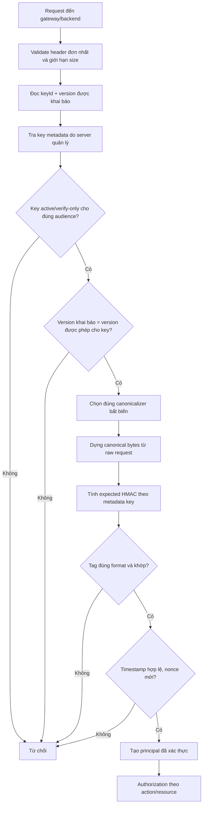

# Canonical format version trong xác thực HMAC HTTP request

## 1. Vì sao canonical request cần có phiên bản?

Trong module `SECURITY_AUTHENTICATION_HMAC_REQUEST_AUTHENTICATION`, client và server dùng một **shared secret** để xác thực HTTP request bằng HMAC. HMAC chỉ tính toán trên **mảng byte**. Vì vậy hai phía phải thống nhất cách chuyển request thành một mảng byte duy nhất, thường gọi là **canonical request**: chọn method, raw URI/query, các header đã ký và/hoặc hash của raw body; quy định thứ tự, encoding và dấu phân cách.

**Canonical format version** là phiên bản của **quy tắc tạo những byte đó**. Khi yêu cầu phát triển, bạn có thể cần thêm một header vào chữ ký, ràng buộc request với audience, thay cách xử lý query, đổi body digest hoặc sửa biểu diễn ký tự. Nếu server âm thầm thay quy tắc mà client vẫn ký theo quy tắc cũ, HMAC sẽ không còn khớp; nếu server tùy tiện thử nhiều kiểu chuẩn hóa đến khi một kiểu khớp, giao thức trở nên nhập nhằng và khó kiểm soát bảo mật.

Ví dụ:

- **CR-V1** ký method, raw request target, `Content-Type`, `keyId`, timestamp, nonce và SHA-256 của raw body.
- **CR-V2** giữ nguyên các trường trên nhưng **bổ sung một audience cố định của dịch vụ** và header `Idempotency-Key` bắt buộc vào chuỗi ký. Nhờ vậy request được ràng buộc rõ hơn với đích sử dụng và ý định giao dịch.
- Khi chuyển sang CR-V2, client và server phải cùng áp dụng quy tắc mới; `keyId`/metadata phía server quyết định phiên bản nào được phép xác minh.

> **Nguyên tắc:** Canonical format là một phần của **hợp đồng mật mã**, không phải một hàm tiện ích được phép đổi định dạng bất kỳ lúc nào. Phiên bản phải xác định chính xác dữ liệu được ký, được ràng buộc vào chữ ký và được kiểm soát ở phía server.

Sau bài học **“Canonical format version”** thuộc chương **“Canonical request”**, bạn cần có thể:

1. Phân biệt *canonical format version*, *HMAC algorithm*, *key version* và *API version*.
2. Định nghĩa một phiên bản canonical có thể kiểm thử bằng **byte-for-byte golden vector**.
3. Xây dựng phiên bản mới khi thay đổi tập trường hoặc cách chuẩn hóa mà không tự tạo downgrade/fallback.
4. Triển khai canonicalizer Java chọn phiên bản từ chính sách server, bảo vệ method/URI/header/body, timestamp/nonce.
5. Kiểm thử qua proxy/API gateway, key rotation và kiểm tra riêng **authentication, replay protection, authorization**.

## 2. Bốn loại “version” thường bị nhầm lẫn

| Loại phiên bản | Ví dụ | Trả lời câu hỏi nào? |
| --- | --- | --- |
| **Canonical format version** | `cr-v1`, `cr-v2` | Những thành phần nào được ký, ghép ra sao, chuẩn hóa thành byte thế nào? |
| **HMAC algorithm / algorithm version** | `HmacSHA256`, `HmacSHA512` | Hàm mật mã nào tính MAC và tag có kích thước bao nhiêu? |
| **Key version** | `merchant-42:k2026a`, `merchant-42:k2026b` | Secret nào đang được dùng; key đang active, verify-only hay revoked? |
| **API version** | `/v1/payments`, `/v2/payments` | Hành vi và schema nghiệp vụ của endpoint nào đang được gọi? |

Chúng liên quan nhưng **không đồng nhất**:

- Xoay key từ `k2026a` sang `k2026b` có thể vẫn dùng **CR-V1** và HMAC-SHA256.
- Chuyển từ **CR-V1 sang CR-V2** có thể giữ HMAC-SHA256 nhưng thay nội dung được ký; nên tạo key ID/version mới để chính sách dễ kiểm soát.
- API đổi đường dẫn từ `/v1` sang `/v2` không có nghĩa canonical format phải đổi; nếu raw path đã nằm trong chữ ký, bản thân đường dẫn mới đã tạo MAC khác.
- Đổi HMAC-SHA256 sang HMAC-SHA512 đòi hỏi cập nhật chính sách thuật toán và tag length; đôi khi cần phiên bản hợp đồng mới, nhưng không tự động đồng nghĩa với thay cách canonicalize.

**Server nên lưu ánh xạ rõ ràng**:

```text
keyId = "merchant-42:k2026b"
  -> secretRef        = secret-manager/merchant-42/k2026b
  -> algorithm        = HmacSHA256
  -> canonicalVersion = cr-v2
  -> audience         = payments-api/prod
  -> principal        = merchant-42
  -> state            = ACTIVE
```

`keyId` là dữ liệu do client gửi **để tra cứu**, chưa phải bằng chứng danh tính. Chỉ sau khi HMAC, timestamp và nonce đều hợp lệ, server mới tạo principal. Quyền thực hiện giao dịch hoặc truy cập merchant khác do **authorization** độc lập quyết định.

## 3. Hợp đồng canonical không chỉ là tên phiên bản

Gắn chuỗi `cr-v1` ở đầu mà không quy định chi tiết các byte bên dưới vẫn chưa đủ. Mỗi phiên bản cần có **đặc tả bất biến** cho các khía cạnh sau.

| Thành phần | Câu hỏi phải trả lời trong hợp đồng |
| --- | --- |
| Method | Lấy từ HTTP layer nào; có chấp nhận `post` hay chỉ `POST`; có phân biệt action thực tế được định tuyến không? |
| Request target | Origin-form path + raw query? Thứ tự query và percent-encoding ra sao? Có chấp nhận duplicate query key, dấu `+`, `%2F`, path alias? |
| Authority / audience | Có ký `Host`/`:authority` không, hay ràng buộc đích bằng audience cố định server-side? |
| Signed headers | Những tên nào bắt buộc; có trim OWS không; header bị lặp/gộp xử lý thế nào; thứ tự header ra sao? |
| Body digest | Hash **raw body bytes** hay một dạng canonical JSON; SHA-256 hay SHA-512; biểu diễn hash bằng hex hay Base64? |
| Key và thuật toán | Key ID có nằm trong chữ ký không; HMAC algorithm nào được phép; chữ ký full tag hay truncated? |
| Timestamp và nonce | Định dạng, đơn vị thời gian, độ dài/charset nonce, cách chống replay và TTL? |
| Encoding canonical | UTF-8? Phân cách bằng `LF` hay `CRLF`? Có newline cuối không? Có space cuối dòng không? |
| Signature encoding | Base64 chuẩn có padding, Base64URL hay hex; số byte tag; header nào chứa chữ ký? |
| Version và domain | Version nằm ở đâu trong request, có nằm trong **dữ liệu ký** và có ánh xạ với key policy server không? |
| Proxy/gateway | Xác minh trước hay sau rewrite/decode; có giữ được raw target và raw body không? |

Mỗi quyết định phải cụ thể đến mức **hai chương trình độc lập cùng tạo ra dãy byte giống nhau**. Những câu như “chuẩn hóa query hợp lý”, “xóa whitespace nếu cần” hay “dùng path bình thường” không đủ cho một giao thức ký.

### 3.1 Phiên bản như domain separation

Một tiền tố cố định trong canonical request giúp tách ngữ cảnh:

```text
HMAC-REQUEST/CR-V1
...các dòng thuộc quy tắc CR-V1...
```

Khi đổi sang phiên bản mới:

```text
HMAC-REQUEST/CR-V2
...các dòng thuộc quy tắc CR-V2...
```

Tiền tố này là **một phần byte HMAC đầu vào**. Với cùng key, cùng request và cùng những trường còn lại, đổi tiền tố sẽ tạo MAC khác với xác suất rất cao. Ngoài tiền tố, phải có **chính sách server** quyết định key nào được verify theo phiên bản nào. Chỉ nhúng chuỗi version vào HMAC **không buộc một client sở hữu secret phải ngừng tự ký bằng phiên bản yếu** nếu server vẫn cho phép phiên bản đó.

### 3.2 Không cần truyền một version header trong mọi thiết kế

Server có thể suy ra canonical version hoàn toàn từ `keyId`, không cần header version. Bài này **cố ý dùng thêm header `X-HMAC-Canonical-Version`** để minh họa cách hai phía xác nhận hợp đồng. Khi có header, nó phải xuất hiện **đúng một lần**, khớp metadata server và nằm trong dữ liệu ký.

Không để client tự yêu cầu `cr-v1` nếu key đã bị cấu hình chỉ cho phép `cr-v2`. Header version chỉ là **giá trị được kiểm tra**, không phải nguồn quyền quyết định. Khi không cần header, vẫn có thể đưa version prefix cố định từ metadata vào canonical bytes.

## 4. Ví dụ cụ thể: hợp đồng CR-V1

Giả sử client đã được cấp secret cho `merchant-42:k2026a` và sử dụng **HMAC-SHA256**. Client gửi:

```http
POST /v1/payments?ref=ab%2Fcd&tag=one&tag=two HTTP/1.1
Host: api.example.test
Content-Type: application/json
X-HMAC-Key-Id: merchant-42:k2026a
X-HMAC-Canonical-Version: cr-v1
X-HMAC-Timestamp: 1795838400
X-HMAC-Nonce: 4b55f5b2e2fd42fb9dca65b8e6c1d902
X-HMAC-Signature: <base64-cua-32-byte-mac>

{"amountMinor":125000,"currency":"VND"}
```

Đây là request minh họa; timestamp cần được tạo mới khi chạy thực tế, chữ ký placeholder không phải MAC hợp lệ.

**Hợp đồng CR-V1** của ví dụ:

- Algorithm: HMAC-SHA256, trả về **32 byte tag**, gửi Base64 chuẩn **có padding** (44 ký tự).
- Chỉ chấp nhận method viết hoa theo HTTP request thực tế; raw request target ở dạng **origin-form** `/path?query`, giữ nguyên thứ tự query và percent-encoding tại nơi verify.
- Header `Content-Type` bắt buộc, sau khi loại bỏ SP/HTAB ở hai đầu theo cùng quy tắc HTTP adapter, phải **chính xác** `application/json`. Mỗi signed header bắt buộc có **đúng một giá trị**; từ chối duplicate, comma-join và CR/LF.
- `X-HMAC-Key-Id`, `X-HMAC-Canonical-Version`, `X-HMAC-Timestamp`, `X-HMAC-Nonce` phải được ký. Version chính xác `cr-v1`; timestamp là epoch **seconds** thập phân canonical; nonce là hex chữ thường của 16 byte ngẫu nhiên (32 ký tự).
- Trong hợp đồng mẫu của endpoint thanh toán, **CR-V1 không chấp nhận header `Idempotency-Key`** vì chưa đưa nó vào chữ ký. Nếu endpoint cần xử lý idempotency ở V1, phải có một hợp đồng riêng bảo vệ trường này; không thêm âm thầm một header ảnh hưởng nghiệp vụ mà không được ký.
- Body digest: **SHA-256 của raw body bytes**, biểu diễn thành **64 hex chữ thường**. Không parse rồi serialize JSON trước khi hash.
- Canonical text mã hóa bằng **UTF-8**, nối dòng bằng **LF (0x0A)**, **không thêm LF ở cuối**. Không tự thêm space sau dấu hai chấm hoặc dòng trống.

Với request ví dụ, canonical có **10 dòng đúng thứ tự**:

```text
HMAC-REQUEST/CR-V1
HMAC-SHA256
POST
/v1/payments?ref=ab%2Fcd&tag=one&tag=two
content-type:application/json
x-hmac-key-id:merchant-42:k2026a
x-hmac-canonical-version:cr-v1
x-hmac-timestamp:1795838400
x-hmac-nonce:4b55f5b2e2fd42fb9dca65b8e6c1d902
body-sha256:<lowercase-hex-sha256-of-raw-body>
```

Dòng cuối phải thay `<...>` bằng giá trị SHA-256 hex thực tế. `X-HMAC-Signature` không nằm trong canonical string của hợp đồng này vì nó là kết quả của phép tính:

```text
bodyHash    = lowercase_hex(SHA256(rawBodyBytes))
canonical   = join_with_LF(10_lines_without_final_LF)
expectedMac = HMAC_SHA256(secretBytes, UTF8(canonical))
signature   = Base64_Standard_Padded(expectedMac)
```

**Mẫu quan trọng:** nếu query `tag=one&tag=two` bị đảo thành `tag=two&tag=one`, canonical bytes đổi. Nếu `%2F` bị decode thành `/`, canonical bytes đổi. Nếu body JSON được viết lại với khoảng trắng khác, body digest đổi. Tất cả những thay đổi đó đều tác động đến HMAC dù chúng có vẻ tương đương với một số parser.

### 4.1 Header/URI có vẻ “giống” nhưng byte khác

| Dữ liệu CR-V1 được ký | Dữ liệu đã thay | Hậu quả |
| --- | --- | --- |
| `/v1/a/%2F` | `/v1/a//` | Raw target khác, HMAC khác. |
| `?x=1&x=2` | `?x=2&x=1` | Thứ tự raw query khác, HMAC khác. |
| `?name=a%20b` | `?name=a+b` | Trong một số ngữ cảnh decode cùng nghĩa, nhưng byte raw khác. |
| JSON `{"a":1,"b":2}` | JSON `{"b":2,"a":1}` | Hash raw body khác. |
| Timestamp `1795838400` | `1795838401` | Chuỗi ký khác; sửa timestamp không có secret sẽ fail. |
| Version `cr-v1` | `cr-v2` | Prefix/header và chính sách khác; không thể dùng cùng signature. |

HMAC bảo vệ **tính toàn vẹn của những trường đã ký**; client vẫn có thể tự ký request mới với secret của mình, nên server phải phân quyền đối với tài nguyên/tenant sau khi xác thực.

## 5. Phiên bản CR-V2: thêm audience và idempotency key vào chữ ký

Giả sử API cần chống chuyển request hợp lệ sang dịch vụ khác có cấu hình dùng chung và muốn bảo vệ header `Idempotency-Key` khỏi bị thay đổi khi đi qua mạng. Ta ban hành **CR-V2**.

CR-V2 trong bài là **hợp đồng minh họa**; khác CR-V1 ở **hai trường mới được ký**, trong khi quy tắc ký các trường cũ vẫn giữ nguyên:

1. Thêm dòng `audience:payments-api/prod` sau raw target. Giá trị này lấy từ **metadata dịch vụ/key phía server**, client được cấp biết trước để ký. Nó không được lấy tùy tiện từ `X-Audience` công khai hoặc `Host` chưa chuẩn hóa.
2. Yêu cầu header `Idempotency-Key` duy nhất, định dạng đã thống nhất, và thêm dòng `x-idempotency-key:<value>` trước body hash. Client không thể đổi idempotency key trong request đã ký mà không làm HMAC sai.

Ví dụ client dùng một **key ID mới** `merchant-42:k2026b` ràng buộc CR-V2:

```http
POST /v1/payments?ref=ab%2Fcd&tag=one&tag=two HTTP/1.1
Host: api.example.test
Content-Type: application/json
X-HMAC-Key-Id: merchant-42:k2026b
X-HMAC-Canonical-Version: cr-v2
X-HMAC-Timestamp: 1795838400
X-HMAC-Nonce: 4b55f5b2e2fd42fb9dca65b8e6c1d902
Idempotency-Key: payment-intent-2026-42
X-HMAC-Signature: <base64-cua-32-byte-mac>

{"amountMinor":125000,"currency":"VND"}
```

Canonical CR-V2 có **12 dòng**, theo thứ tự:

```text
HMAC-REQUEST/CR-V2
HMAC-SHA256
POST
/v1/payments?ref=ab%2Fcd&tag=one&tag=two
audience:payments-api/prod
content-type:application/json
x-hmac-key-id:merchant-42:k2026b
x-hmac-canonical-version:cr-v2
x-hmac-timestamp:1795838400
x-hmac-nonce:4b55f5b2e2fd42fb9dca65b8e6c1d902
x-idempotency-key:payment-intent-2026-42
body-sha256:<lowercase-hex-sha256-of-raw-body>
```

Phiên bản CR-V2 **không tự cung cấp idempotency**. Việc đưa `Idempotency-Key` vào chữ ký chỉ bảo vệ tính toàn vẹn của header; server vẫn cần lưu trạng thái/kết quả nghiệp vụ để hai request mới có nonce khác nhau nhưng cùng intent không gây tạo thanh toán hai lần. Phải ràng buộc idempotency theo principal/operation/payload để không cho hai ý định khác nhau dùng cùng key gây nhầm kết quả.

### 5.1 Khi nào cần tạo CR-V3?

Một số thay đổi cần **phiên bản mới** vì làm thay đổi byte ký hoặc ý nghĩa bảo mật:

- Chuyển từ raw query giữ nguyên thứ tự sang quy tắc sort/normalize query.
- Thêm `Host`/`:authority`, audience hoặc header có ý nghĩa quyền vào danh sách ký.
- Thay body digest SHA-256 thành SHA-512, hoặc chuyển từ raw JSON bytes sang canonical JSON scheme.
- Đổi dấu phân cách `LF` thành `CRLF`, thay encoding, thêm newline cuối hoặc thay thứ tự dòng.
- Đổi cách xử lý repeated headers/duplicate query keys hoặc cách chuẩn hóa percent-encoding.

Nếu sửa quy tắc dưới cùng tên `cr-v1`, những client đã phát hành có thể bị lỗi, còn log/test vector cùng tên lại có hai nghĩa khác nhau. Đừng thực hiện “thay đổi nhỏ có vẻ tương đương” dưới phiên bản cũ nếu nó đổi những byte client/server tính.

**Không phải thay đổi nào cũng cần CR-V3:** xoay secret sang key mới khi format không đổi, đổi server từ Java sang Go nhưng vẫn tạo byte giống hệt, hoặc tối ưu bộ hash mà không đổi đầu ra đều có thể giữ phiên bản hiện tại.

## 6. Quyết định phiên bản từ phía server để chống downgrade

Một thiết kế yếu dễ mắc lỗi:

```text
Client gửi X-HMAC-Canonical-Version: cr-v1
Server tự thử canonical V1, nếu không đúng lại thử V2
Nếu vẫn sai thì bỏ các header “khó normalize” rồi thử lại
```

Cách làm này phá tính bất biến của hợp đồng và khiến verifier khó chứng minh rằng tất cả các trường nhạy cảm đã được bảo vệ. Đặc biệt, khi CR-V2 bổ sung audience/idempotency, một client còn giữ secret được phép ký theo CR-V1 **có thể tạo request không bảo vệ các trường mới** nếu server chấp nhận V1 tùy ý cho mọi key. Đây là vấn đề **downgrade qua policy cho phép bản cũ**, kể cả khi HMAC không bị phá về mặt mật mã.

Quy trình tốt:



Trong thực tế có thể kiểm tra timestamp **sớm hơn** để từ chối request ngoài cửa sổ mà không tốn HMAC, miễn là không tin timestamp hay cấp quyền trước khi MAC xác thực. Nonce phải được ghi **nguyên tử sau khi chữ ký hợp lệ** và trước nghiệp vụ.

Ví dụ một bảng policy:

| Key ID | Algorithm | Canonical format | Status | Principal |
| --- | --- | --- | --- | --- |
| `merchant-42:k2026a` | HMAC-SHA256 | `cr-v1` | VERIFY_ONLY, có hạn chuyển đổi | `merchant-42` |
| `merchant-42:k2026b` | HMAC-SHA256 | `cr-v2` | ACTIVE | `merchant-42` |
| `merchant-99:k2026c` | HMAC-SHA512 | `cr-v2` nhưng có hợp đồng thuật toán/tag đã version rõ | `ACTIVE` | `merchant-99` |

**Lưu ý:** ví dụ code ở phần sau chỉ hỗ trợ **HMAC-SHA256** cho cả CR-V1/V2. Nếu một ứng dụng hỗ trợ HMAC-SHA512, thuật toán đó cần được định nghĩa và kiểm thử theo metadata tương ứng, cùng kích thước tag, và có thể yêu cầu một biến thể protocol riêng. Không tự thay dòng `HMAC-SHA256` bằng `HMAC-SHA512` mà giữ nguyên các giả định khác.

### 6.1 Chính sách từ chối version cũ

- Trong migration có kiểm soát, một số **key ID cũ** được giữ khả năng verify CR-V1 đến mốc đã công bố.
- Client đã nhận **key CR-V2** không được phép dùng nó để yêu cầu CR-V1.
- Khi hết thời hạn, revoke key CR-V1; không fallback theo version do client chọn.
- Key rotation, thu hồi secret và thu hồi **quyền nghiệp vụ** là những vòng đời khác nhau. Dù CR-V2/HMAC hợp lệ, client vẫn chỉ có quyền với tài nguyên đã được grant.

## 7. Java 17+: canonicalizer theo version bất biến

Bộ tạo canonical dưới đây minh họa **CR-V1 và CR-V2**, dùng chung SHA-256 raw body digest, HMAC-SHA256 full tag và byte UTF-8/LF. Trong production, HTTP adapter phải giới hạn request size và cung cấp **raw request target/body**, kiểm tra các signed header xuất hiện chính xác một lần. `KeyPolicy` đến từ kho metadata phía server sau khi tra `keyId`.

### 7.1 Model dữ liệu và canonical builder

```java
import java.nio.charset.StandardCharsets;
import java.security.GeneralSecurityException;
import java.security.MessageDigest;
import java.util.ArrayList;
import java.util.Base64;
import java.util.HexFormat;
import java.util.List;
import java.util.Objects;
import javax.crypto.Mac;
import javax.crypto.SecretKey;

record SignedInput(
        String method,
        String rawTarget,
        String contentType,
        String keyId,
        String canonicalVersion,
        String timestamp,
        String nonce,
        String idempotencyKey, // bắt buộc ở CR-V2; cấm ở CR-V1 của ví dụ
        byte[] rawBody) {}

record KeyPolicy(
        String keyId,
        String canonicalVersion, // "cr-v1" hoặc "cr-v2"
        String algorithm,        // "HmacSHA256" trong ví dụ
        String audience,         // "payments-api/prod"
        SecretKey secret) {}

final class VersionedCanonicalRequest {
    private VersionedCanonicalRequest() {}

    static byte[] canonicalBytes(SignedInput r, KeyPolicy policy) {
        Objects.requireNonNull(r);
        Objects.requireNonNull(policy);
        Objects.requireNonNull(r.rawBody());
        if (!Objects.equals(r.keyId(), policy.keyId())
                || !Objects.equals(r.canonicalVersion(), policy.canonicalVersion())
                || !"HmacSHA256".equals(policy.algorithm())) {
            throw new IllegalArgumentException("Key/version/algorithm mismatch");
        }

        // Quy tắc mẫu: Content-Type đã được HTTP adapter trim OWS và
        // duplicate signed headers đã được phát hiện trước bước này.
        if (!"application/json".equals(r.contentType())
                || r.method() == null || !r.method().matches("[A-Z]+")
                || r.rawTarget() == null || !r.rawTarget().startsWith("/")
                || r.rawTarget().indexOf('#') >= 0
                || r.rawTarget().chars().anyMatch(ch -> ch < 0x21 || ch > 0x7e)
                || r.keyId() == null
                || !r.keyId().matches("[A-Za-z0-9._:-]{1,100}")
                || r.timestamp() == null
                || !r.timestamp().matches("(0|[1-9][0-9]{0,11})")
                || r.nonce() == null
                || !r.nonce().matches("[0-9a-f]{32}")) {
            throw new IllegalArgumentException("Invalid signed request fields");
        }

        final String hashHex;
        try {
            byte[] digest = MessageDigest.getInstance("SHA-256")
                    .digest(r.rawBody());
            hashHex = HexFormat.of().formatHex(digest);
        } catch (GeneralSecurityException e) {
            throw new IllegalStateException("SHA-256 unavailable", e);
        }

        boolean v1 = "cr-v1".equals(policy.canonicalVersion());
        boolean v2 = "cr-v2".equals(policy.canonicalVersion());
        if (!v1 && !v2) {
            throw new IllegalArgumentException("Unsupported version");
        }
        if (v1 && r.idempotencyKey() != null) {
            // Ví dụ chọn cấm unsigned idempotency header ở CR-V1.
            throw new IllegalArgumentException("Unexpected idempotency header");
        }
        if (v2 && (r.idempotencyKey() == null
                || !r.idempotencyKey().matches("[A-Za-z0-9._:-]{8,128}"))) {
            throw new IllegalArgumentException("Idempotency key required");
        }

        List<String> lines = new ArrayList<>();
        lines.add(v1 ? "HMAC-REQUEST/CR-V1" : "HMAC-REQUEST/CR-V2");
        lines.add("HMAC-SHA256");
        lines.add(r.method());
        lines.add(r.rawTarget());
        if (v2) {
            if (!"payments-api/prod".equals(policy.audience())) {
                throw new IllegalArgumentException("Wrong audience");
            }
            lines.add("audience:" + policy.audience());
        }
        lines.add("content-type:" + r.contentType());
        lines.add("x-hmac-key-id:" + r.keyId());
        lines.add("x-hmac-canonical-version:" + r.canonicalVersion());
        lines.add("x-hmac-timestamp:" + r.timestamp());
        lines.add("x-hmac-nonce:" + r.nonce());
        if (v2) {
            lines.add("x-idempotency-key:" + r.idempotencyKey());
        }
        lines.add("body-sha256:" + hashHex);
        return String.join("\n", lines).getBytes(StandardCharsets.UTF_8);
    }

    static byte[] expectedMac(KeyPolicy key, byte[] canonical) {
        try {
            Mac mac = Mac.getInstance("HmacSHA256");
            mac.init(key.secret());
            return mac.doFinal(canonical); // 32 byte
        } catch (GeneralSecurityException e) {
            throw new IllegalStateException("HMAC provider/key error", e);
        }
    }

    static boolean verifyFullBase64(
            KeyPolicy key, byte[] canonical, String signature) {
        if (signature == null || signature.length() != 44) return false;
        final byte[] received;
        try {
            received = Base64.getDecoder().decode(signature);
        } catch (IllegalArgumentException e) {
            return false;
        }
        if (received.length != 32) return false;
        if (!Base64.getEncoder().encodeToString(received).equals(signature)) {
            return false; // Base64 chuẩn có padding, một biểu diễn duy nhất
        }
        return MessageDigest.isEqual(expectedMac(key, canonical), received);
    }
}
```

**Giới hạn của đoạn code:**

- `KeyPolicy` phải được lấy từ kho tin cậy: trạng thái active/verify-only, ngày hết hạn, audience và principal phải được kiểm tra **trước** khi dùng secret. Không khởi tạo `KeyPolicy` từ header do client tự cung cấp.
- `SignedInput` giả định HTTP adapter đã kiểm tra **header bị nhân đôi**, raw URI/query và giới hạn body; nếu không, một số proxy/framework có thể parse khác nhau. CR-V1 của ví dụ **cấm** `Idempotency-Key` để tránh một header nghiệp vụ chưa được ký xuất hiện không được kiểm soát. Đây là quy tắc riêng của hợp đồng mẫu.
- Dùng SHA-256(raw body bytes), không normalize JSON. Đừng đổi body encoding bằng serializer trước hash. Với request body lớn, đặt giới hạn streaming/buffering phù hợp và bảo đảm controller đọc lại được body.
- `VersionedCanonicalRequest` chỉ xử lý **canonicalization và MAC**. Một bộ verifier hoàn chỉnh còn phải kiểm tra timestamp, nonce, trạng thái khóa, rate limiting, quyền và idempotency.

### 7.2 Luồng verifier thực tế

```java
// Pseudocode: các interface phụ thuộc HTTP framework và hạ tầng.
RawHttpRequest raw = adapter.readAndValidateWithinLimits(http);
String keyId = raw.singleHeader("X-HMAC-Key-Id");
String declaredVersion = raw.singleHeader("X-HMAC-Canonical-Version");

// Key metadata là nguồn quyết định algorithm/version được phép.
VerificationKey key = keyStore.findVerificationKey(keyId, trustedNow);
if (key == null || !key.canVerifyAt(trustedNow)
        || !key.canonicalVersion().equals(declaredVersion)) {
    rejectUnauthenticated();
    return;
}

SignedInput input = adapter.toSignedInput(raw);
byte[] canonical = VersionedCanonicalRequest.canonicalBytes(
        input, key.canonicalPolicy());

if (!VersionedCanonicalRequest.verifyFullBase64(
        key.canonicalPolicy(), canonical, raw.singleHeader("X-HMAC-Signature"))) {
    rejectUnauthenticated();
    return;
}

// Timestamp đã ký phải nằm trong cửa sổ với clock server đáng tin.
if (!timestampPolicy.accepts(input.timestamp(), trustedNow)) {
    rejectUnauthenticated();
    return;
}

// Nonce mới phải được ghi nguyên tử tại kho dùng chung.
// Lỗi kho nonce => fail-closed, không đi tiếp nghiệp vụ.
if (!nonceStore.reserve(key.id(), input.nonce(), nonceTtlSeconds)) {
    rejectReplay();
    return;
}

// Authentication hoàn tất; quyền là bước riêng.
AuthenticatedPrincipal principal = identity.fromVerifiedKey(key);
if (!authorization.canInvoke(principal, raw.action(), raw.resource())) {
    rejectForbidden();
    return;
}
executeWithIdempotency(principal, raw);
```

`VerificationKey`, `RawHttpRequest`, `adapter` và các store/service trong pseudocode không phải API có sẵn của JDK. Trong sản phẩm thực tế cần phân biệt nonce đã dùng với lỗi kho nonce, xử lý exception bằng fail-closed và tạo principal **chỉ sau** khi tất cả điều kiện authentication đạt.

## 8. Migration giữa các canonical format version

### 8.1 Kịch bản chuyển CR-V1 sang CR-V2

1. **Đóng băng CR-V1:** xác định text spec và bộ golden vector đang hoạt động; không sửa âm thầm cách tạo raw target, signed headers hay body hash của V1.
2. **Đặc tả CR-V2:** chỉ ra từng dòng mới, vì sao cần audience/idempotency; công bố key version mới, compatibility contract và test vector chính xác.
3. **Cấp key mới:** phát hành `merchant-42:k2026b` với secret ngẫu nhiên mạnh, metadata `cr-v2`, audience và quyền phù hợp. Giữ `k2026a` ở `cr-v1` tạm thời nếu cần migration.
4. **Triển khai server trước:** cho phép đúng phiên bản theo **key ID**; kiểm tra cả hai đường qua gateway, header trùng, nonce và phân quyền; không thực hiện fallback.
5. **Đổi client:** client sử dụng key V2, thêm `Idempotency-Key` đã ký và cố định audience, xử lý retry bằng nonce/timestamp mới nhưng **giữ cùng idempotency key cho cùng ý định nghiệp vụ**.
6. **Theo dõi adoption:** tỷ lệ request V1/V2, lỗi signature, lỗi canonical mismatch, gateway rewriting và key usage; lưu metric không chứa secret.
7. **Kết thúc chuyển tiếp:** revoke key V1, tắt khả năng verify V1 sau hạn đã định, bảo đảm mọi replica/gateway cập nhật policy.

Không có lý do bắt buộc thay HMAC-SHA256 nếu thay đổi chỉ nằm ở tập trường được ký. Nếu đồng thời đổi algorithm, hãy lập kế hoạch riêng cho tag length/encoding và test vector; tránh gom nhiều lỗi tương thích thành một “thử đủ kiểu cho chạy”.

### 8.2 Tình huống các service không nâng cấp đồng bộ

Ví dụ gateway đã biết CR-V2 nhưng backend chưa có bản triển khai V2. Một request ký bằng CR-V2 có thể được gateway kiểm tra hợp lệ nhưng backend không hiểu `Idempotency-Key` hoặc audience. Có hai hướng triển khai:

- **Verify tại gateway:** gateway phải thực hiện đầy đủ timestamp/nonce theo hợp đồng, truyền principal và những context nội bộ cần thiết qua kênh tin cậy; backend kiểm tra authorization và idempotency. Không cho backend bị gọi trực tiếp từ Internet.
- **Verify tại backend:** đợi backend hỗ trợ CR-V2 trước khi cấp key V2; gateway phải chuyển nguyên raw request/signed headers, không rewrite làm khác canonical bytes.

Không để gateway xác minh CR-V2 nhưng backend tự xử lý một resource URI **khác** mà hai lớp hiểu không nhất quán. Nếu frontend/gateway rewrite path, phải bảo đảm cùng ý nghĩa resource được truyền và không có đường phân quyền theo path bị bypass.

## 9. Vấn đề proxy/gateway khi hai phiên bản cùng tồn tại

Canonical version thay đổi **quy tắc**, không thể phục hồi byte gốc đã bị biến đổi bằng cách thử thêm một version khác.

| Hiện tượng | Nguy cơ | Cách kiểm soát |
| --- | --- | --- |
| Proxy decode `%2F` hoặc normalize `//` | Raw path mà client ký khác path backend nhìn thấy; có thể gây route ambiguity. | Xác minh trước rewrite hoặc chuyển raw target gốc qua kênh tin cậy và kiểm tra route/resource nhất quán. |
| Query chứa `x=1&x=2`, proxy đổi thứ tự | MAC mismatch nếu contract giữ raw query; query parser ở các lớp có thể hiểu khác nhau. | Test đúng raw `:path`/request-target; không parse rồi build lại. |
| Gateway gộp duplicate signed headers | Bên ký và bên verify chọn giá trị khác nhau; có thể mở đường request smuggling/ambiguity. | Reject duplicate và header nhập nhằng tại trust boundary. |
| CR-V2 thêm `Idempotency-Key` nhưng gateway tự tạo lại giá trị | MAC mismatch hoặc header idempotency không còn được bảo vệ. | Client gửi một giá trị duy nhất đã ký; gateway bảo toàn. |
| Chuyển HTTP/2 sang HTTP/1.1 | `:authority`/`:path` và `Host` có thể được biểu diễn khác; đường dẫn có thể bị normalize. | Contract chỉ rõ trường ký và nơi lấy raw target/audience; test thực tế. |
| Body gzip bị giải nén hoặc JSON parse/serialize | SHA-256(raw body) thay đổi; dù ý nghĩa JSON giống nhau, chữ ký không khớp. | Quy định ký byte trước/sau content transform và cố định điểm verify. |
| Một replica còn CR-V1 policy cũ | Client nhận kết quả chập chờn, có thể chấp nhận version đã hết hạn. | Phân phối policy đồng nhất, đo lỗi theo node và thu hồi key cũ trên tất cả instance. |
| Gateway chuyển `X-HMAC-Canonical-Version` thành giá trị khác | HMAC không khớp hoặc version header không phù hợp key metadata. | Header version phải được kiểm tra duy nhất và ký; không để proxy tự thay. |

Nếu backend dùng header nội bộ như `X-Verified-Client`, gateway phải **xóa header cùng tên do client gửi**, tự tạo context xác thực và bảo vệ đường kết nối, ví dụ bằng mTLS hoặc hệ thống identity nội bộ tin cậy. Không coi một header public không được xác thực là bằng chứng identity.

## 10. Replay, key rotation và authorization không thay đổi theo phép chọn version

Một canonical format mới có thể ký thêm trường quan trọng, nhưng **không thay thế** các kiểm soát khác.

### 10.1 Timestamp + nonce vẫn là bắt buộc khi chống replay

Với CR-V1 hoặc CR-V2, client phải ký timestamp (epoch seconds) và nonce mới. Server kiểm tra cửa sổ thời gian, ví dụ ±300 giây, rồi reserve nonce bằng thao tác nguyên tử tại kho dùng chung:

```redis
SET hmac:nonce:merchant-42:k2026b:4b55f5b2e2fd42fb9dca65b8e6c1d902 1 NX EX 630
```

`NX` bảo đảm chỉ request đầu được reserve nonce, `EX` đặt TTL cùng thao tác. Với cửa sổ đối xứng ±300 giây, khoảng timestamp có thể hợp lệ tính từ lần được chấp nhận sớm nhất đến hết hiệu lực dài tới 600 giây; TTL 630 giây là **ví dụ có dự phòng**, cần chỉnh theo clock skew/độ trễ và phạm vi node. Nonce store phải dùng chung giữa các replica/đường xác minh có cùng miền replay; lỗi kho nonce phải **fail-closed**.

Nếu cùng application được phép dùng **hai key song song trong rotation**, hãy đánh giá **phạm vi nonce store**. Với khóa nonce tách hoàn toàn theo key ID, một client giữ hai secret có thể ký cùng nội dung hai lần với hai key/nonce. Điều đó không phá HMAC; để bảo vệ tính không lặp của **nghiệp vụ**, vẫn cần idempotency key dùng chung theo principal và operation, không chỉ nonce cache theo key.

### 10.2 Authentication khác authorization

CR-V2 có audience đã ký và header idempotency được bảo vệ, nhưng một request HMAC đúng từ `merchant-42` vẫn có thể nhắm `/v1/merchants/merchant-99/payments`. Phía server phải **xác thực** principal `merchant-42` rồi **phân quyền riêng**: principal có quyền trên merchant 99, operation tương ứng, hạn mức và trạng thái resource hay không. Không tự lấy tenant từ path/header làm principal.

### 10.3 Rotation key và version format

- Khi **chỉ đổi secret**, có thể tạo key mới vẫn dùng CR-V2 và giữ nguyên thuật toán/tag.
- Khi **đổi canonical format**, nên dùng key ID mới được ghim CR-V2 để kiểm soát từng client.
- Khi **thu hồi key hoặc format cũ**, không cho request có timestamp “trước ngày thu hồi” phục hồi quyền verify của key đã revoke.
- Quyền `payments:create` hoặc quyền truy cập tenant có thể bị thu hồi **độc lập** với thời hạn key và canonical version.

## 11. Ma trận kiểm thử canonical format version

Một hệ thống cần **golden vector** cho mỗi version: raw method, raw request target, signed header (bao gồm thứ tự/chính sách normalize), raw body bytes, body digest, canonical text bytes, HMAC tag bytes và signature encoding. Test vector ở client/server phải có **kết quả byte cụ thể**. Không chỉ kiểm tra “client tự ký rồi tự verify thành công” vì hai phía có thể cùng triển khai sai so với hợp đồng.

| Case | Tình huống | Kỳ vọng |
| --- | --- | --- |
| V01 | Key `k2026a` cho CR-V1, canonical 10 dòng đúng hợp đồng, MAC đúng. | Verify thành công tại lớp chữ ký khi policy vẫn cho phép key. |
| V02 | Key `k2026b` cho CR-V2, canonical 12 dòng đúng và idempotency header hợp lệ. | Verify thành công tại lớp chữ ký khi key/audience hợp lệ. |
| V03 | Đổi header `cr-v1` thành `cr-v2` nhưng giữ key/MAC cũ. | Từ chối vì version metadata không khớp và MAC sai. |
| V04 | Key chỉ cho CR-V2 nhưng client ký CR-V1 với secret của chính mình. | Từ chối do policy; không fallback xuống V1. |
| V05 | Thay version prefix nhưng giữ các dòng còn lại. | MAC khác; chữ ký cũ bị từ chối. |
| V06 | CR-V2 thiếu `Idempotency-Key`. | Từ chối vì trường bắt buộc bị thiếu. |
| V07 | CR-V2 thay `Idempotency-Key` sau khi ký. | MAC không khớp. |
| V08 | CR-V1 nhận `Idempotency-Key` dù hợp đồng mẫu cấm. | Từ chối header không được ký/không được phép trong V1. |
| V09 | CR-V2 đổi audience từ `payments-api/prod` sang đích khác. | Key policy/audience không khớp; không cho cross-service replay. |
| V10 | Thay thứ tự query `tag=one&tag=two`. | MAC sai vì CR-V1/V2 giữ raw query. |
| V11 | Đổi `%2F` thành `/`, hoặc `+` thành `%20`. | MAC sai nếu raw target thay đổi. |
| V12 | JSON có cùng giá trị nhưng đổi whitespace/thứ tự key. | Body SHA-256 khác, MAC sai. |
| V13 | Raw body UTF-8 có tiếng Việt và body rỗng. | Mọi ngôn ngữ tạo đúng digest và canonical UTF-8 theo version. |
| V14 | Thêm LF cuối dòng hoặc đổi LF thành CRLF. | Byte canonical khác, MAC sai. |
| V15 | Header `Content-Type` bị lặp hoặc gộp nhiều giá trị. | Từ chối trước canonicalization do ambiguity. |
| V16 | Client tự chỉ định algorithm `HmacSHA1` cho key metadata HMAC-SHA256. | Không hạ cấp thuật toán. |
| V17 | Key CR-V1 hết thời hạn chuyển đổi hoặc bị revoked. | Từ chối dù MAC trước đây từng hợp lệ. |
| V18 | Cùng request timestamp trong cửa sổ nhưng nonce đã dùng. | Bị từ chối replay trước nghiệp vụ. |
| V19 | Hai replica đồng thời nhận cùng nonce. | Chỉ tối đa một atomic reserve thành công. |
| V20 | Clock verifier không đáng tin, hoặc nonce store mất kết nối. | Fail-closed; không cho chạy nghiệp vụ. |
| V21 | HMAC/nonce đúng, principal không có quyền với tenant/resource. | Authentication pass, authorization từ chối. |
| V22 | Hai request khác nonce nhưng cùng intent và `Idempotency-Key`. | Authorization có thể pass; idempotency ngăn side effect trùng. |
| V23 | CR-V2 đi qua gateway rewrite URI/HTTP2 conversion. | Verifier nhận đúng raw target theo hợp đồng hoặc từ chối mismatch; không bypass quyền. |
| V24 | Java/Go/Node/Python dựng cùng một CR-V2 vector. | Canonical byte, HMAC raw tag và Base64 phải khớp tuyệt đối. |
| V25 | Cùng key được thử lần lượt V1/V2 khi MAC ban đầu sai. | Test bảo đảm **không có fallback**; chỉ đúng một version từ metadata. |

### Test từng byte trước khi kiểm tra chữ ký

Nếu một test thất bại, hãy xác định nguyên nhân theo thứ tự:

1. **Raw request:** cùng method, target, header (kể cả duplicate và cách trim), raw body bytes chưa?
2. **Version/key policy:** key nào, CR-V1 hay CR-V2, audience và algorithm có đúng không?
3. **Body digest:** SHA-256 trên byte nào, hex có đúng 64 ký tự chữ thường không?
4. **Canonical text:** số dòng, thứ tự, encoding UTF-8, dấu LF, có newline cuối hay không?
5. **MAC bytes:** tính HMAC bằng secret thử nghiệm, so với golden vector độc lập.
6. **Signature transport:** full tag 32 byte hay không, Base64 chuẩn có padding đã đúng chưa?
7. **Replay và quyền:** timestamp/nonce còn hợp lệ không, principal có permission trên resource không?

Không ghi **shared secret**, đầy đủ chữ ký, raw request chứa PII hoặc payload giao dịch vào log production. Có thể log request ID, key ID đã kiểm soát, canonical format version, chiều dài tag, loại lỗi và digest chẩn đoán phù hợp chính sách nội bộ; test vector dùng secret giả phải nằm trong môi trường thử nghiệm.

## 12. Bài tập tình huống: một “tối ưu” làm thay đổi giao thức

**Đề bài:** API đã triển khai CR-V1, ký raw target `/v1/payments?tag=b&tag=a`. Một kỹ sư tối ưu thư viện canonicalizer bằng cách **sắp xếp query alphabetically** và dùng chung cho cả V1 và V2. Đồng thời CR-V2 thêm `Idempotency-Key` nhưng backend vẫn chấp nhận yêu cầu `cr-v1` với mọi key để “không ảnh hưởng client cũ”. Đối tác báo MAC mismatch qua gateway; có lúc request tạo thanh toán lặp.

**Phân tích:**

1. **Sắp xếp query thay đổi byte ký của CR-V1.** Đây là thay đổi hợp đồng, không phải tối ưu vô hại. Phải giữ nguyên CR-V1 và nếu muốn canonical query sorting, định nghĩa một **CR-V3 riêng** với quy tắc percent-encoding, duplicate keys và golden vector đầy đủ.
2. **Cho mọi key fallback về CR-V1 là downgrade policy.** Key CR-V2 phải bị ràng buộc CR-V2. Chỉ những key cũ được phép rõ ràng mới có thời gian verify V1 giới hạn.
3. **CR-V2 ký Idempotency-Key chỉ bảo vệ header khỏi bị thay đổi**; server vẫn cần cơ chế idempotency theo principal/operation/payload để ngăn giao dịch lặp khi client retry ký request mới.
4. **Gateway phải giữ raw target** hoặc verify trước rewrite. Nếu gateway sắp xếp query còn backend ký raw query, không thể chữa bằng thử nhiều version.
5. HMAC và nonce hợp lệ vẫn cần **authorization** kiểm tra merchant/tenant, action và resource, vì bên có secret có thể tự ký request mới.

### Câu hỏi tự kiểm tra

1. Khác nhau giữa canonical format version, key version và HMAC algorithm là gì?
2. Vì sao chỉ thêm prefix `CR-V2` vào byte ký mà không áp dụng policy key/version ở server vẫn có thể tạo vấn đề downgrade?
3. CR-V1 giữ raw query; sắp xếp query sau khi phát hành có nên coi là thay đổi tương thích không?
4. Vì sao `X-HMAC-Canonical-Version` là header client khai nhưng không được tin để quyết định policy?
5. Tại sao CR-V2 chọn `audience:payments-api/prod` từ metadata server thay vì `Host` tùy ý từ Internet?
6. Khi client đổi thứ tự key JSON mà giữ nguyên nội dung nghiệp vụ, SHA-256(raw body) có đổi không?
7. Trong key rotation, khi nào vẫn có thể dùng CR-V2 mà chỉ thay `keyId`/secret?
8. Vì sao thêm idempotency key vào chữ ký chưa đủ để ngăn hai request mới tạo cùng giao dịch?
9. Nếu gateway xác minh CR-V2, backend cần điều kiện gì để tin principal và vẫn phân quyền được?
10. Một golden vector đầy đủ cần những byte/trường nào để xác nhận hai implementation Java và Go tương thích?

**Ghi nhớ:** **Canonical format version** mô tả một hợp đồng **byte-level bất biến** về cách ký method, URI, header và body. Ghi version vào canonical bytes, **ghim version theo key metadata phía server**, viết test vector độc lập và chuyển phiên bản có thời hạn rõ ràng. Hệ thống còn cần **timestamp/nonce chống replay, quản lý key rotation, kiểm thử proxy/gateway và authorization độc lập**; version chính xác là nền tảng để những kiểm soát đó cùng diễn giải một request theo một cách.

