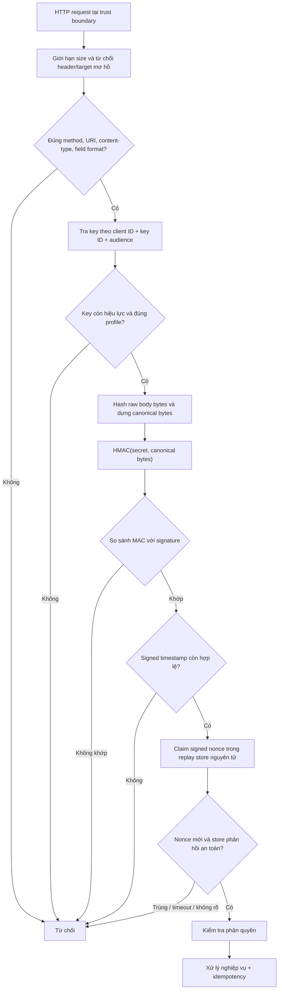
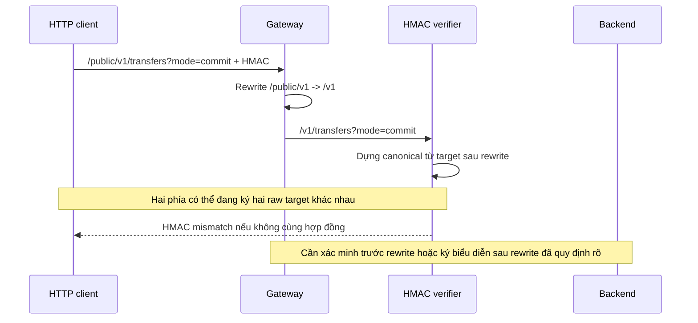

# Kiểm tra chuỗi canonical trong xác thực HTTP request bằng HMAC

> **Chương:** Canonical request  
> **Bài học:** Kiểm tra chuỗi canonical (*canonical request verification*) trước khi chấp nhận chữ ký HMAC.  
> **Phạm vi:** Xác thực HTTP request bằng shared secret và hợp đồng ký bao gồm phương thức, URI, header hoặc body. Bài học dùng Java 17/JCA, đồng thời xét timestamp/nonce chống replay, key rotation, proxy/gateway và sự khác biệt giữa xác thực với phân quyền.

## 1. Bài toán: HMAC đúng khi nào?

Giả sử một client gọi API:

```http
POST /v1/transfers?mode=commit HTTP/1.1
Host: payments.example.test
Content-Type: application/json
X-Client-Id: billing-service
X-Key-Id: key-2026-11
X-Timestamp: 1795800000
X-Nonce: 7OJVp4AOY2uBV_kH5v85Jw
X-Signature: <hmac-sha256-base64url>

{"transactionId":"t-101","amount":100000,"currency":"VND"}
```

Client tạo một dãy bytes đại diện cho các thành phần request đã thống nhất và tính:

```text
signature = BASE64URL_NO_PADDING(
    HMAC_SHA256(shared_secret, canonical_request_bytes)
)
```

Server cần **tái tạo chuỗi canonical từ HTTP request thật mà server được phép tin**, chọn key phù hợp, tính HMAC kỳ vọng và so sánh với signature nhận được. Nếu client ký `/v1/transfers?mode=commit` nhưng server tái tạo thành `/v1/transfers?mode=preview`, hai dãy bytes khác nhau sẽ tạo HMAC khác nhau.

**Kiểm tra chuỗi canonical** không chỉ là so sánh hai chuỗi văn bản. Nó bao gồm:

1. Xác minh cấu trúc, định dạng và nguồn gốc của mọi trường được ký.
2. Dựng lại **đúng thứ tự và đúng bytes** theo hợp đồng ký.
3. Tính MAC từ bytes phía server dựng lại, so sánh với tag client gửi.
4. Kiểm tra timestamp/nonce chống replay và phân quyền sau khi MAC hợp lệ.

Server **không được tin một chuỗi `canonicalRequest` do client gửi rồi chỉ kiểm tra chữ ký trên chuỗi đó** nếu chưa ràng buộc chuỗi với method, target, headers và body **thực sự được xử lý**. Một chuỗi được ký hợp lệ nhưng không tương ứng HTTP request đang thực thi có thể tạo lỗ hổng đổi đường dẫn, query hoặc tenant.

## 2. Canonical request là hợp đồng bytes

HTTP có nhiều cách biểu diễn tương đương hoặc gần tương đương: header không phân biệt chữ hoa/thường ở tên, URI có percent-encoding, query parameter có thể đổi thứ tự, JSON có khoảng trắng và thứ tự field khác nhau. HMAC lại nhận **một dãy bytes chính xác**, không hiểu ngữ nghĩa HTTP hoặc JSON.

Vì thế, cả client và server phải tuân thủ một **hợp đồng canonicalization có phiên bản**. Không tồn tại một cách canonicalize HTTP duy nhất mặc định đúng cho mọi API.

### 2.1 Hợp đồng minh họa `request-hmac-v1`

Giả sử endpoint `POST /v1/transfers` sử dụng các quy tắc sau:

| Trường được ký | Biểu diễn canonical | Ràng buộc |
| --- | --- | --- |
| Version | `request-hmac-v1` | Cố định ở cả hai phía |
| Audience | `payments-api-prod` | Được cấu hình đáng tin ở server, không lấy tùy tiện từ header client |
| Method | `POST` | Chỉ chấp nhận đúng method được phép |
| Request target | Raw path và query, ví dụ `/v1/transfers?mode=commit` | Cùng biểu diễn ở điểm ký và điểm xác minh; không parse rồi ghép lại tùy ý |
| Content type | `application/json` | Định dạng cố định cho ví dụ; các biến thể phải có quy tắc riêng |
| Client ID | `billing-service` | Gắn với key được server quản lý |
| Key ID | `key-2026-11` | Gắn đúng secret, thời hạn, thuật toán |
| Timestamp | Unix epoch seconds dạng số thập phân | Phải được ký, sau đó kiểm tra cửa sổ |
| Nonce | Base64URL không padding của 16 bytes ngẫu nhiên | Phải được ký, sau đó claim một lần |
| Body digest | Hex chữ thường của SHA-256 trên raw body bytes | Không parse/re-serialize JSON trước khi hash |

Chuỗi canonical được ghép theo thứ tự hàng ở trên, với **một byte LF (`0x0A`)** giữa hai trường, mã hóa UTF-8, **không thêm LF cuối**:

```text
request-hmac-v1
payments-api-prod
POST
/v1/transfers?mode=commit
application/json
billing-service
key-2026-11
1795800000
7OJVp4AOY2uBV_kH5v85Jw
<sha256-hex-cua-raw-body-bytes>
```

Dòng cuối trong mẫu hiển thị là placeholder; triển khai thật phải thay bằng digest 64 ký tự hex của raw body bytes. Với hợp đồng này, signature được tính **trên toàn bộ bytes UTF-8 của chuỗi canonical**, không phải riêng chuỗi body, và cũng không phải HMAC của một JSON object đã được chuẩn hóa ngầm.

**Quan trọng:** Đây là một hợp đồng để thực hành, không phải chuẩn chữ ký HTTP tổng quát. Nếu header `X-Tenant-Id`, `Host`, `Content-Encoding` hoặc metadata khác ảnh hưởng đến quyền, định tuyến hoặc cách diễn giải body, chúng cần được ký bổ sung hoặc được cố định bởi hạ tầng tin cậy. Có thể chọn cấu trúc canonical khác như length-prefix hoặc định dạng có escaping; bất kỳ cách nào cũng phải đủ rõ để tránh hai tập trường khác nhau biến thành cùng một chuỗi bytes.

### 2.2 Yêu cầu không nhập nhằng

Khi nối các trường bằng LF, phải từ chối **CR/LF bên trong từng trường**. Nếu không, một trường có ký tự newline có thể giả dạng nhiều trường khác và tạo mơ hồ.

Ví dụ sai:

```text
contentType = "application/json\nbilling-service"
```

Dùng `String.join("\n", ...)` mà không kiểm tra input có thể tạo chuỗi khó phân biệt nguồn gốc các dòng. Vì vậy:

- Định dạng cho method, raw target, content type, client ID, key ID, timestamp và nonce phải được kiểm tra trước khi ghép.
- Header xác thực trùng tên, header chứa CR/LF, giá trị bị gộp bằng dấu phẩy hoặc có khoảng trắng bất thường phải được xử lý rõ ràng, tốt nhất là **từ chối** nếu hợp đồng không hỗ trợ.
- Không cho một field chứa ký tự phân cách mà không escape/length-prefix theo quy tắc chính thức.
- Bên xác minh chỉ sử dụng đúng tập field mà handler nghiệp vụ sẽ tiêu thụ; dữ liệu nào ảnh hưởng xử lý nhưng không được ký phải được kiểm soát theo ranh giới tin cậy.

## 3. Phân biệt ba thao tác: dựng, kiểm tra, xác minh

| Thao tác | Đầu vào | Đầu ra | Nó chứng minh gì? |
| --- | --- | --- | --- |
| **Dựng canonical** | Request ở ranh giới tin cậy và hợp đồng ký | Chuỗi bytes canonical | Các field được biểu diễn theo một quy tắc xác định |
| **Kiểm tra canonical** | Cấu trúc, field, bytes, digest, phiên bản, định dạng | Hợp lệ về hợp đồng hay bị từ chối | Dữ liệu ký được tạo từ nguồn/định dạng đúng |
| **Xác minh HMAC** | Canonical bytes, shared secret, signature nhận được | MAC khớp/không khớp | Tag phù hợp với key và bytes đã ký |
| **Chống replay** | Timestamp, nonce đã ký, kho nonce | Request có còn hạn và nonce chưa dùng? | Request không bị chấp nhận lặp trong cửa sổ bảo vệ |
| **Phân quyền** | Danh tính client và tài nguyên/hành động | Cho phép/từ chối nghiệp vụ | Client có quyền thực hiện hành động |

Một request có canonical string **đúng cú pháp** vẫn có thể chứa chữ ký HMAC giả. Ngược lại, chữ ký HMAC **đúng trên một chuỗi do attacker tự cung cấp** cũng không có nghĩa nó khớp request mà backend sẽ xử lý.

Lỗi phổ biến là thiết kế:

```text
client gửi request + X-Canonical-Request + X-Signature
server xác minh HMAC(secret, X-Canonical-Request)
server xử lý method/path/body thật mà không đối chiếu
```

Kẻ biết một request hợp lệ có thể gửi lại canonical string và chữ ký cũ nhưng đổi phần HTTP nằm ngoài chuỗi mà server xác minh. Để tránh điều đó, server cần **tái dựng canonical bytes từ các trường HTTP thực nhận**; nếu giao thức thực sự truyền canonical string riêng thì bắt buộc đối chiếu từng trường với dữ liệu thực thi theo quy tắc chính xác trước khi xác minh.

## 4. Quy trình kiểm tra chuỗi canonical tại server

Một pipeline điển hình:



### 4.1 Nguồn dữ liệu để dựng canonical

Với mỗi thành phần, server phải biết **lấy dữ liệu ở đâu**:

| Thành phần | Nguồn nên dùng | Sai sót cần tránh |
| --- | --- | --- |
| Method | Method thực nhận ở boundary xác minh | Dùng method client tự khai trong header chưa xác minh |
| Path/query | Raw request-target tại điểm được thống nhất | Lấy route đã rewrite/URI đã decode khi client ký target khác |
| Header | Header thực nhận, đã xử lý đúng quy tắc duplicate/casing | Tin header mang danh tính do client tự khai ở gateway không được làm sạch |
| Body | Bytes body sau transfer framing theo hợp đồng | Hash body parser đã chuẩn hóa hoặc một bản khác bản xử lý nghiệp vụ |
| Audience | Giá trị từ cấu hình server/route đáng tin | Lấy audience trực tiếp từ dữ liệu client gửi mà không ràng buộc |
| Key | Secret được server tra theo client, key ID và chính sách | Tin client ID như danh tính đã xác thực trước khi MAC hợp lệ |

**Raw target** trong hợp đồng minh họa là biểu diễn chính xác tại điểm xác minh. Một API Java/framework có thể chỉ cung cấp URI đã được decode hoặc normalize. Nếu thông tin nguyên gốc đã bị mất, không nên “đoán lại” bytes client đã ký; cần di chuyển điểm xác minh ra trước biến đổi hoặc tạo một hợp đồng riêng cho biểu diễn sau proxy được kiểm soát.

### 4.2 Kiểm tra byte-level thay vì “so sánh logic”

Những khác biệt sau làm thay đổi canonical bytes theo hợp đồng raw-target/raw-body:

| Phần được ký | Biểu diễn A | Biểu diễn B | Tác động |
| --- | --- | --- | --- |
| Query | `?a=1&b=2` | `?b=2&a=1` | Khác bytes |
| Encoding URI | `/a%2Fb` | `/a/b` | Khác bytes và có thể khác route |
| Dấu slash | `/v1/orders` | `/v1/orders/` | Khác bytes |
| Method | `POST` | `PUT` | Khác bytes và ý nghĩa nghiệp vụ |
| Header value | `application/json` | `application/json; charset=utf-8` | Khác bytes nếu không có quy tắc chuẩn hóa |
| JSON body | `{"a":1,"b":2}` | `{ "b": 2, "a": 1 }` | Khác bytes dù có thể cùng dữ liệu sau parse |
| Timestamp | `1795800000` | `01795800000` | Khác bytes; hợp đồng nên giới hạn định dạng |
| Line ending | LF `\n` | CRLF `\r\n` | Khác bytes |

Hợp đồng cũng phải quyết định việc xử lý query parameter trùng tên (`?role=user&role=admin`), percent-encoding không hợp lệ, dấu `+` so với `%20`, Unicode normalization và header gộp. Một lựa chọn an toàn khi không cần các biến thể này là **từ chối chúng một cách nhất quán**. Nếu cần chuẩn hóa, phải có thuật toán chính xác, độc lập ngôn ngữ và test vector hai phía; không dùng các lệnh tự động như `trim()`, `URLDecoder.decode()` hoặc JSON serialization tùy tiện trong bước xác thực.

### 4.3 Tránh canonicalization mismatch qua gateway

Một cấu hình thường gặp:



Một gateway có thể chuyển HTTP/2 sang HTTP/1.1, normalize header names, giải nén body hoặc thêm metadata. Cần xác định **chính xác hop nào thực hiện HMAC**. Nếu verifier chạy sau rewrite, client và gateway phải có hợp đồng về target **sau rewrite**; nếu không, xác minh trước rewrite.

Header như `X-Original-URI` hay `X-Forwarded-*` chỉ đáng tin khi gateway xóa giá trị do client ngoài tự gửi, tái tạo từ request thật và truyền nội bộ an toàn. Không mặc định tin giá trị do bất kỳ request bên ngoài nào cung cấp.

## 5. Thực hành Java 17: dựng và xác minh canonical bytes

Ví dụ sau minh họa một bộ xác minh có **hợp đồng cố định** cho endpoint chuyển tiền. Nó nhận các giá trị HTTP đã được adapter xác định tại boundary tin cậy, validate định dạng, dựng canonical bytes từ request thực tế, tính HMAC-SHA256 và kiểm tra signature. Sau khi MAC hợp lệ, ví dụ tiếp tục dùng timestamp và một replay store thử nghiệm.

Để dễ kiểm tra, ví dụ dùng:

- `POST`, `application/json`, audience `payments-api-prod`; path/query phải là ASCII nhìn thấy và bắt đầu bằng `/`.
- Timestamp là chuỗi 10 chữ số thập phân, nonce là Base64URL không padding của 16 bytes.
- Body hash là SHA-256 hex chữ thường của bytes body đã nhận; body giới hạn 1 MiB.
- MAC là Base64URL không padding của tag HMAC-SHA256 đầy đủ 32 bytes.
- Key của client do caller truyền vào **chỉ trong demo**; production cần key store với policy client/key ID/audience.
- Replay store trong ví dụ dùng bộ nhớ một JVM để minh họa, **không phù hợp** triển khai production nhiều instance.

```java
import java.nio.charset.StandardCharsets;
import java.security.GeneralSecurityException;
import java.security.MessageDigest;
import java.security.SecureRandom;
import java.time.Clock;
import java.util.Base64;
import java.util.HexFormat;
import java.util.Set;
import java.util.concurrent.ConcurrentHashMap;

import javax.crypto.Mac;
import javax.crypto.spec.SecretKeySpec;

public final class CanonicalCheckDemo {
    private static final String AUDIENCE = "payments-api-prod";
    private static final String MAC_ALGO = "HmacSHA256";
    private static final long WINDOW_SECONDS = 300L;

    // Minh họa một JVM; production cần shared durable replay store.
    private static final Set<String> USED =
            ConcurrentHashMap.newKeySet();

    private CanonicalCheckDemo() {}

    public record Request(
            String method,
            String rawTarget,
            String contentType,
            String clientId,
            String keyId,
            String timestamp,
            String nonce,
            byte[] rawBody) {

        public Request {
            rawBody = rawBody == null ? null : rawBody.clone();
        }

        @Override
        public byte[] rawBody() {
            return rawBody == null ? null : rawBody.clone();
        }
    }

    private static String digestHex(byte[] body)
            throws GeneralSecurityException {
        return HexFormat.of().formatHex(
                MessageDigest.getInstance("SHA-256").digest(body));
    }

    private static boolean validNonce(String value) {
        if (value == null
                || !value.matches("[A-Za-z0-9_-]{22}")) {
            return false;
        }
        try {
            byte[] decoded = Base64.getUrlDecoder().decode(value);
            return decoded.length == 16
                    && Base64.getUrlEncoder().withoutPadding()
                            .encodeToString(decoded).equals(value);
        } catch (IllegalArgumentException malformed) {
            return false;
        }
    }

    private static boolean validRawTarget(String target) {
        if (target == null || target.length() > 2048
                || !target.startsWith("/") || target.contains("#")) {
            return false;
        }
        // Từ chối whitespace, control characters và non-ASCII
        // theo hợp đồng minh họa.
        if (!target.chars().allMatch(
                c -> c >= 0x21 && c <= 0x7e)) {
            return false;
        }
        // Bảo đảm percent-encoding luôn có hai hex digits.
        for (int i = 0; i < target.length(); i++) {
            if (target.charAt(i) == '%') {
                if (i + 2 >= target.length()
                        || Character.digit(target.charAt(i + 1), 16) < 0
                        || Character.digit(target.charAt(i + 2), 16) < 0) {
                    return false;
                }
                i += 2;
            }
        }
        return true;
    }

    private static boolean validRequest(Request r) {
        if (r == null || r.rawBody() == null
                || r.rawBody().length > 1_048_576) {
            return false;
        }
        return "POST".equals(r.method())
                && validRawTarget(r.rawTarget())
                && "application/json".equals(r.contentType())
                && r.clientId() != null
                && r.clientId().matches("[A-Za-z0-9._-]{1,64}")
                && r.keyId() != null
                && r.keyId().matches("[A-Za-z0-9._-]{1,64}")
                && r.timestamp() != null
                && r.timestamp().matches("[0-9]{10}")
                && validNonce(r.nonce());
    }

    // Chỉ gọi sau khi adapter xác định headers là duy nhất và
    // request rawTarget/body là cùng dữ liệu backend sẽ xử lý.
    private static byte[] canonicalBytes(Request r)
            throws GeneralSecurityException {
        if (!validRequest(r)) {
            throw new IllegalArgumentException("Invalid request");
        }
        String canonical = String.join("\n",
                "request-hmac-v1",
                AUDIENCE,
                r.method(),
                r.rawTarget(),
                r.contentType(),
                r.clientId(),
                r.keyId(),
                r.timestamp(),
                r.nonce(),
                digestHex(r.rawBody()));
        return canonical.getBytes(StandardCharsets.UTF_8);
    }

    private static byte[] hmac(byte[] key, byte[] canonical)
            throws GeneralSecurityException {
        Mac mac = Mac.getInstance(MAC_ALGO);
        mac.init(new SecretKeySpec(key, MAC_ALGO));
        return mac.doFinal(canonical);
    }

    private static String signForDemo(byte[] key, Request r)
            throws GeneralSecurityException {
        return Base64.getUrlEncoder().withoutPadding()
                .encodeToString(hmac(key, canonicalBytes(r)));
    }

    private static boolean verifyAndClaim(
            byte[] resolvedKey,
            Request r,
            String signature,
            Clock clock) throws GeneralSecurityException {
        if (!validRequest(r) || resolvedKey == null
                || resolvedKey.length < 32 || signature == null
                || !signature.matches("[A-Za-z0-9_-]{43}")) {
            return false;
        }

        byte[] supplied;
        try {
            supplied = Base64.getUrlDecoder().decode(signature);
        } catch (IllegalArgumentException malformed) {
            return false;
        }
        if (supplied.length != 32
                || !Base64.getUrlEncoder().withoutPadding()
                        .encodeToString(supplied).equals(signature)) {
            return false;
        }

        // Không tin client-supplied canonical string.
        // Tái dựng từ method/target/headers/body mà server sẽ dùng.
        byte[] canonical = canonicalBytes(r);
        byte[] expected = hmac(resolvedKey, canonical);
        if (!MessageDigest.isEqual(expected, supplied)) {
            return false;
        }

        long sentAt = Long.parseLong(r.timestamp());
        long now = clock.instant().getEpochSecond();
        if (sentAt < now - WINDOW_SECONDS
                || sentAt > now + WINDOW_SECONDS) {
            return false;
        }

        // Chỉ để chứng minh replay: không TTL, không cluster, không DB.
        String namespace =
                AUDIENCE + ":" + r.clientId() + ":" + r.nonce();
        return USED.add(namespace);
    }

    private static String newNonce(SecureRandom rng) {
        byte[] bytes = new byte[16];
        rng.nextBytes(bytes);
        return Base64.getUrlEncoder().withoutPadding()
                .encodeToString(bytes);
    }

    public static void main(String[] args)
            throws GeneralSecurityException {
        SecureRandom rng = new SecureRandom();
        byte[] sharedSecret = new byte[32];
        rng.nextBytes(sharedSecret);

        String now = Long.toString(
                Clock.systemUTC().instant().getEpochSecond());
        byte[] body = (
                "{\"transactionId\":\"t-101\","
                + "\"amount\":100000,\"currency\":\"VND\"}"
        ).getBytes(StandardCharsets.UTF_8);

        Request original = new Request(
                "POST",
                "/v1/transfers?mode=commit",
                "application/json",
                "billing-service", "key-2026-11",
                now, newNonce(rng), body);
        String signature = signForDemo(sharedSecret, original);

        Clock clock = Clock.systemUTC();
        System.out.println("Original: "
                + verifyAndClaim(sharedSecret, original, signature, clock));
        System.out.println("Replay: "
                + verifyAndClaim(sharedSecret, original, signature, clock));

        Request changedTarget = new Request(
                original.method(),
                "/v1/transfers?mode=preview",
                original.contentType(),
                original.clientId(), original.keyId(),
                original.timestamp(), newNonce(rng), original.rawBody());

        // Chữ ký gốc không thể dùng cho request có target/nonce khác.
        System.out.println("Changed target: "
                + verifyAndClaim(
                        sharedSecret, changedTarget, signature, clock));

        byte[] changedBody = original.rawBody();
        changedBody[changedBody.length - 2] ^= 1;
        Request modified = new Request(
                original.method(), original.rawTarget(),
                original.contentType(), original.clientId(), original.keyId(),
                original.timestamp(), newNonce(rng), changedBody);
        System.out.println("Changed body: "
                + verifyAndClaim(sharedSecret, modified, signature, clock));
    }
}
```

Lưu tên `CanonicalCheckDemo.java`, sau đó biên dịch và chạy trên JDK 17:

```bash
javac CanonicalCheckDemo.java
java CanonicalCheckDemo
```

Kết quả kỳ vọng:

```text
Original: true
Replay: false
Changed target: false
Changed body: false
```

Từ ví dụ có thể rút ra:

- Bản request gốc có HMAC đúng và nonce mới nên được chấp nhận ở lớp demo.
- Phát lại **nguyên request** vẫn có HMAC đúng nhưng bị bộ lưu nonce từ chối.
- Đổi raw target hoặc body mà giữ chữ ký gốc làm canonical bytes khác, nên MAC không khớp.
- Tên `signature` chỉ là tag biểu diễn Base64URL; hệ thống phải kiểm tra đúng 32 bytes của HMAC-SHA256, không chỉ kiểm tra prefix/encoding.
- Lớp `verifyAndClaim` chỉ mô phỏng lõi kiểm tra; trước khi gọi, HTTP adapter còn phải từ chối header duplicate, route mơ hồ, request size không phù hợp, nội dung mã hóa không được phép và đảm bảo handler đọc đúng raw body đã xác minh.
- Để tránh bị sửa trong lúc xác minh và xử lý (*time-of-check/time-of-use*), nên truyền payload bất biến hoặc bản sao đã xác minh cho bước nghiệp vụ.

**Giới hạn quan trọng:** Ví dụ dùng bộ nhớ cục bộ để minh họa nonce; không có TTL, key store thật, kiểm tra key ID đang active, HTTP proxy thực hay phân quyền. Trong production, nonce store phải có thao tác claim nguyên tử, chia sẻ giữa các instance, TTL bao phủ cửa sổ timestamp và fail closed khi timeout. Không dùng giá trị HMAC trả về làm quyết định phân quyền nghiệp vụ.

## 6. Kiểm tra và xử lý lỗi trong canonical verification

### 6.1 Khác biệt giữa lỗi format, lỗi MAC và lỗi chống replay

| Nhóm lỗi | Dấu hiệu | Quyết định an toàn |
| --- | --- | --- |
| Format thiếu/sai | Header signature không hợp lệ, thiếu timestamp/nonce, raw target sai quy tắc | Từ chối trước nghiệp vụ |
| Nguồn dữ liệu nhập nhằng | Header trùng, query lặp không được hỗ trợ, nhiều cách decode URI | Từ chối; không chọn tùy tiện một giá trị |
| Key không hợp lệ | Key ID không thuộc client, key bị thu hồi hoặc sai audience | Từ chối xác thực |
| MAC không khớp | Canonical bytes hoặc secret khác bản được ký | Từ chối xác thực |
| Timestamp sai | Ngoài cửa sổ thời gian được phép | Từ chối |
| Nonce trùng | Đã claim cùng nonce | Từ chối replay |
| Replay store lỗi | Timeout/failover/không biết nonce còn mới | **Fail closed**, không chạy nghiệp vụ |
| MAC và nonce hợp lệ nhưng thiếu quyền | Client gọi tài nguyên khác tenant hoặc thao tác không được cấp | Authorization từ chối |
| Retry cùng nghiệp vụ | Nonce mới nhưng cùng operation | Idempotency nghiệp vụ tránh side effect lặp |

API có thể ghi mã lỗi nội bộ chi tiết cho quan sát, nhưng phản hồi bên ngoài không nên tiết lộ secret, MAC kỳ vọng, raw canonical chứa dữ liệu nhạy cảm hoặc chi tiết topology của replay store.

### 6.2 Key rotation và phiên bản canonical

Key và canonical format có thể thay đổi độc lập. Khi rotate shared secret nhưng giữ nguyên cấu trúc ký, có thể đổi `X-Key-Id` mà version canonical vẫn là `request-hmac-v1`. Trong thời gian chuyển tiếp, server có thể cho phép hai key ID đang có hiệu lực theo policy của từng client; không được thử mọi key trong hệ thống cho đến khi một MAC khớp.

Khi thay đổi cấu trúc ký, ví dụ từ ký raw target sang normalize query có quy tắc, phải tạo **version canonical mới** và bộ test vector tương ứng. Một request v1 phải được kiểm tra theo v1; không được tính v2 thất bại rồi im lặng fallback sang v1 nếu policy client/endpoint không cho phép. Version và audience nên có mặt trong bytes được ký để chống nhầm giao thức hoặc dùng lại chữ ký ở môi trường khác.

Replay nonce nên được ràng buộc theo client/audience, duy trì khả năng chặn replay trong cửa sổ dù key ID chuyển từ cũ sang mới; không tạo lỗ hổng khi rotation.

### 6.3 Replay store và TTL

Giả sử timestamp được chấp nhận trong khoảng ±300 giây. Một request có timestamp “tương lai” 300 giây có thể còn hợp lệ **tới 600 giây sau lần chấp nhận sớm nhất**. Nonce TTL tính từ claim đầu phải bao phủ toàn bộ quãng thời gian này, cộng margin cho clock skew; ví dụ 660 giây khi giả định đồng hồ và độ trễ thực tế phù hợp.

Claim nonce phải tương đương thao tác insert-if-absent nguyên tử như Redis:

```text
SET hmac-replay:v1:<audience>:<clientId>:<nonceDigest> 1 NX EX 660
```

Kết quả `OK` cho phép đi tiếp; nil cho thấy đã dùng; timeout/lỗi là trạng thái không xác định và phải từ chối. `GET` rồi `SET` riêng rẽ có thể tạo race giữa hai request. Redis single-primary atomic claim **không tự đảm bảo durability khi failover**; đánh giá replication, persistence hoặc lưu trữ bền vững hơn theo rủi ro nghiệp vụ.

## 7. Kiểm thử chuỗi canonical: từ vector đơn vị đến gateway

Một bộ kiểm thử tốt không chỉ cho client ký rồi server cùng thư viện tự verify. Cần **test vector cố định** và kiểm tra độc lập các đường đi HTTP:

```text
Test vector cần lưu:
- MAC algorithm + canonical contract version
- key bytes thử nghiệm (hex hoặc Base64, không dùng secret production)
- exact raw method, raw request-target, signed headers, raw body bytes
- exact canonical UTF-8 bytes ở dạng hex
- expected body SHA-256 hex
- expected HMAC bytes và signature encoding
```

Dùng test vector đã được thỏa thuận giữa các ngôn ngữ khác nhau (Java/Go/Node/Python) để tìm khác biệt về encoding, Unicode, newline và header parsing. Với body JSON, so sánh **raw bytes** trước khi so sánh object đã parse. Test vector chứa dữ liệu và key **thử nghiệm** để có thể chia sẻ; không ghi secret production vào tài liệu, log hoặc báo cáo.

### 7.1 Ma trận kiểm thử

| Tình huống | Thao tác | Kỳ vọng |
| --- | --- | --- |
| Baseline | Request gốc, key đúng, timestamp đúng, nonce mới | Canonical bytes đúng, MAC hợp lệ |
| Method bị đổi | `POST` → `PUT`, giữ tag cũ | Từ chối |
| Path bị đổi | `/v1/transfers` → `/v1/refunds` | MAC sai |
| Query bị đổi | `mode=commit` → `mode=preview` | MAC sai |
| Query đổi thứ tự | `?a=1&b=2` → `?b=2&a=1` | Khác MAC nếu ký raw target |
| Query trùng | Thêm `?role=user&role=admin` | Từ chối nếu hợp đồng không hỗ trợ; kiểm tra parser thống nhất |
| Percent encoding | `%2F` ↔ `/` hoặc `%2f` ↔ `%2F` | Cùng quy tắc bytes hoặc từ chối; không canonicalize ngầm |
| Header có ý nghĩa | Đổi Content-Type, tenant hoặc header đã ký | MAC sai hoặc policy từ chối |
| Duplicate headers | Hai giá trị `X-Timestamp` hoặc `X-Client-Id` | Từ chối trước khi ký/verify |
| Body bị sửa | Đổi số tiền một byte | Body digest và MAC thay đổi |
| JSON re-serialize | Đổi whitespace/thứ tự field nhưng cùng object | MAC raw bytes khác |
| Byte encoding | Thay LF bằng CRLF hoặc đổi charset | MAC sai |
| Body compression | Gateway giải nén body trước verifier | Hoặc hợp đồng quy định cùng bytes, hoặc từ chối |
| HTTP protocol conversion | HTTP/2 `:path` qua proxy HTTP/1.1 | Canonical target nhất quán ở trust boundary |
| Gateway path rewrite | `/public/v1` → `/v1` | Vị trí verify/hợp đồng phải rõ; không dùng target bất nhất |
| Client đưa canonical string riêng | Sửa request thật nhưng giữ `X-Canonical` cũ | Không được cho qua xác thực |
| Signature sai | Base64URL lỗi, độ dài khác 32 bytes, MAC sai | Từ chối |
| Khác secret | Key không thuộc client, key hết hạn | Từ chối |
| Replay nguyên request | Gửi lại cùng timestamp/nonce/tag | HMAC có thể đúng, nhưng nonce store từ chối |
| Replay store lỗi | Timeout khi claim | Fail closed, không chạy nghiệp vụ |
| Nonce đồng thời | Hai instance nhận cùng nonce | Chỉ một claim thành công |
| Signed request nhưng thiếu quyền | Client thiếu quyền trên tài nguyên | Authorization từ chối |
| Nhiều lần retry nghiệp vụ | Request mới, nonce mới, cùng idempotency key | Không tạo hai hiệu ứng nghiệp vụ |

### 7.2 Cách xác định nguyên nhân mismatch

Khi client và server không khớp MAC, dùng quy trình kiểm tra theo tầng:

1. Xác nhận hợp đồng version, algorithm, key ID, audience và chính sách key đang hiệu lực.
2. Đối chiếu phương thức HTTP và raw target **ở đúng hop đã thống nhất**; kiểm tra cả percent-encoding, query order và path rewrite.
3. Đối chiếu signed headers: giá trị thật, duplicate, whitespace, content type, encoding.
4. Đối chiếu chiều dài và digest raw body bytes đã được ký; không log raw body nhạy cảm.
5. Đối chiếu bytes canonical từ **test vector có secret giả lập** hoặc digest chẩn đoán có kiểm soát; kiểm tra UTF-8 và byte LF.
6. Chỉ sau khi canonical bytes trùng nhau mới xem xét khác biệt của MAC algorithm, key bytes, Base64URL/hex và so sánh tag.

Trong môi trường production, tránh log raw canonical request nếu chứa client data, nonce, header riêng hoặc body hash có khả năng làm lộ thông tin qua tương quan. Dùng logging/tracing đã giới hạn thông tin nhạy cảm, correlation ID, mã lỗi nội bộ và điều kiện truy cập kiểm soát; tuyệt đối không log shared secret.

## 8. Bài tập ứng dụng

**Bài 1 — So sánh bytes:** Với hai chuỗi query `?page=1&limit=10` và `?limit=10&page=1`, cho biết vì sao SHA-256 của raw target và HMAC canonical khác nhau theo hợp đồng raw bytes. Nếu muốn sắp xếp query trước khi ký, cần bổ sung những quy tắc nào cho key trùng, percent-encoding, khoảng trắng và encoding?

**Bài 2 — JSON:** Lấy hai body `{"amount":100,"currency":"VND"}` và `{"currency":"VND", "amount":100}`. Tính digest bytes riêng, giải thích vì sao hash khác dù object có thể tương đương. Trình bày rủi ro nếu server hash body đã parse nhưng ứng dụng xử lý raw body khác.

**Bài 3 — Header ambiguity:** Một proxy gộp hai header `X-Tenant-Id` thành chuỗi có dấu phẩy, còn backend chỉ lấy giá trị đầu tiên. Vì sao canonicalization đúng ở một phía vẫn không bảo đảm phân quyền đúng? Đề xuất chính sách từ chối cấu trúc nhập nhằng.

**Bài 4 — Gateway:** Client ký `/public/v1/transfers` nhưng gateway chuyển thành `/v1/transfers`. Vẽ vị trí client, gateway, verifier và backend; chọn điểm xác minh phù hợp. Nêu cách thử HTTP/1.1 và HTTP/2.

**Bài 5 — Replay:** Giữ nguyên method, URI, headers, body và signature của request hợp lệ rồi gửi lại. Vì sao kiểm tra canonical và HMAC đều có thể vẫn đúng? Viết interface replay store có `CLAIMED`, `ALREADY_USED`, `UNAVAILABLE`, và thiết kế lỗi fail closed.

**Bài 6 — Version migration:** Một API chuyển từ raw query sang canonical query đã sắp xếp. Thiết kế version mới và bộ test vector. Chứng minh server không thể cho phép một client tự chọn thuật toán yếu hoặc dùng lại chữ ký v1 cho v2 mà bỏ qua policy.

## 9. Câu hỏi tự kiểm tra

1. Vì sao server phải dựng lại chuỗi canonical từ HTTP request thật thay vì tin chuỗi client gửi?
2. Khác biệt giữa “canonical đúng định dạng” và “HMAC hợp lệ” là gì?
3. Hợp đồng LF và UTF-8 cần quy định điều gì để hai bên tạo đúng cùng bytes?
4. Tại sao header trùng hoặc query parameter trùng có thể gây nguy cơ ngay cả khi HMAC hợp lệ?
5. Dưới hợp đồng ký raw target, `/a%2Fb` và `/a/b` có giống nhau không?
6. Nếu proxy rewrite path, điểm xác minh chữ ký có thể ảnh hưởng kết quả thế nào?
7. Tại sao hash body JSON đã serialize lại có thể dẫn đến MAC mismatch?
8. Signed timestamp và nonce giúp giải quyết vấn đề nào mà HMAC đơn thuần chưa giải quyết?
9. Hệ thống nên làm gì khi replay store timeout sau khi HMAC khớp?
10. Vì sao không thể dùng kết quả HMAC đúng để bỏ qua kiểm tra phân quyền?

**Ghi nhớ:** Kiểm tra chuỗi canonical là kiểm tra **đúng nguồn dữ liệu, đúng cấu trúc và đúng bytes được dùng để tính HMAC**. Bộ xác minh phải dựng lại canonical request từ các thành phần HTTP đáng tin theo một hợp đồng ký có phiên bản, so sánh MAC an toàn, kiểm tra timestamp/nonce chống replay và phân quyền nghiệp vụ. Mọi khác biệt do URI, header, body hoặc proxy cần được mô tả và kiểm thử rõ ràng; khi trạng thái xác minh không chắc chắn, phải từ chối trước khi thực hiện nghiệp vụ.
