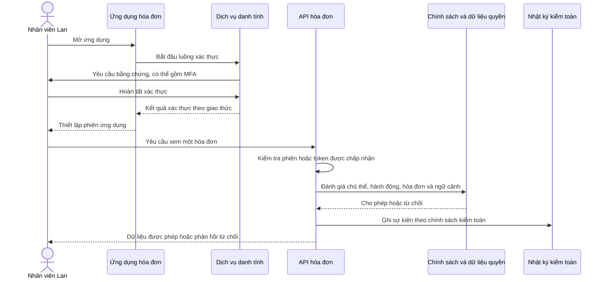

# Identity and Access Management là gì

## Mục tiêu bài học

Trong chương **Nền tảng IAM**, bài học này giúp bạn hình thành cách nhìn tổng thể về quản lý danh tính và quyền truy cập. Sau khi học, bạn có thể:

- Giải thích IAM giải quyết vấn đề gì trong một hệ thống có người dùng, ứng dụng và dịch vụ.
- Phân biệt danh tính, tài khoản, thông tin xác thực, xác thực và phân quyền.
- Mô tả một yêu cầu truy cập được nhận diện, kiểm tra và thực thi quyền như thế nào.
- Nhận biết vai trò của MFA, phiên, RBAC, ABAC, SSO, OAuth, OIDC và liên kết danh tính trong bức tranh IAM.
- Áp dụng tư duy ít quyền nhất, quản lý vòng đời truy cập và kiểm toán vào một tình huống thực tế.

## 1. IAM là gì và vì sao hệ thống cần IAM?

**Identity and Access Management (IAM)** là tập hợp chính sách, quy trình và thành phần kỹ thuật dùng để quản lý danh tính cùng quyền truy cập vào tài nguyên. IAM giúp hệ thống trả lời những câu hỏi liên quan nhưng khác nhau:

1. Chủ thể đang yêu cầu truy cập là ai hoặc là dịch vụ nào?
2. Hệ thống có bằng chứng gì để tin vào danh tính đó?
3. Chủ thể được thực hiện hành động nào trên tài nguyên nào, trong điều kiện nào?
4. Quyền bắt đầu, thay đổi và kết thúc khi nào?
5. Ai đã làm gì, lúc nào, và quyết định cho phép hay từ chối dựa trên cơ sở nào?

Một tài nguyên có thể là hồ sơ nhân viên, hóa đơn, API, cơ sở dữ liệu, khóa mã hóa hoặc chức năng quản trị. Chủ thể truy cập có thể là con người hoặc phần mềm. Vì vậy, IAM không chỉ là màn hình đăng nhập hay nơi lưu mật khẩu.

Có thể biểu diễn một quyết định truy cập bằng mô hình khái niệm:

```text
Quyết định truy cập = đánh giá(chủ thể, hành động, tài nguyên, ngữ cảnh, chính sách)
```

Ví dụ: “Nhân viên kế toán được xem hóa đơn thuộc công ty của mình trong thời gian tài khoản còn hoạt động”. Chủ thể là nhân viên kế toán; hành động là xem; tài nguyên là hóa đơn cụ thể; ngữ cảnh gồm trạng thái tài khoản và công ty; chính sách quy định điều kiện được phép.

### Vấn đề khi chỉ có chức năng đăng nhập

Một ứng dụng có thể xác thực mật khẩu chính xác nhưng vẫn để người dùng xem dữ liệu của người khác bằng cách thay mã hóa đơn trong URL. Một nhân viên có thể đã nghỉ việc nhưng vẫn còn phiên truy cập hoạt động. Một dịch vụ có thể dùng chung khóa quản trị với nhiều dịch vụ khác, khiến việc điều tra sự cố không xác định được bên thực hiện.

Các trường hợp đó cho thấy đăng nhập chỉ giải quyết một phần. IAM cần gắn bằng chứng danh tính với chính sách truy cập, vòng đời tài khoản, phiên, thông tin xác thực và dấu vết kiểm toán.

## 2. Những khái niệm cần phân biệt

| Khái niệm | Ý nghĩa | Ví dụ trong hệ thống doanh nghiệp |
| --- | --- | --- |
| Danh tính — identity | Biểu diễn một thực thể cùng những thuộc tính liên quan trong một phạm vi tin cậy | Nhân viên có mã nội bộ `employee-482` và thuộc phòng kế toán |
| Chủ thể bảo mật — principal | Danh tính mà hệ thống dùng làm bên thực hiện hành động khi ra quyết định bảo mật | Người dùng đã đăng nhập hoặc dịch vụ lập báo cáo |
| Tài khoản — account | Bản ghi cho phép một danh tính tương tác với một hệ thống cụ thể | Tài khoản trên cổng nhân sự và tài khoản trên hệ thống hóa đơn |
| Định danh — identifier | Giá trị dùng để tham chiếu đến một danh tính hoặc tài khoản trong một phạm vi | Mã người dùng nội bộ; cặp nhà phát hành và `sub` trong OIDC |
| Thuộc tính — attribute | Thông tin mô tả danh tính, tài nguyên hoặc ngữ cảnh | Phòng ban, mã công ty, loại tài nguyên, trạng thái thiết bị |
| Thông tin xác thực — credential | Bí mật, khóa hoặc bằng chứng được dùng trong quá trình xác thực | Mật khẩu, khóa riêng của thiết bị, chứng thư của workload |
| Quyền — permission | Khả năng thực hiện một hành động xác định trên một loại hoặc một tài nguyên cụ thể | `invoice:read`, `invoice:approve` |
| Vai trò — role | Tập quyền được tổ chức theo một trách nhiệm | Nhân viên kế toán, người phê duyệt, quản trị viên |
| Phiên — session | Trạng thái hoặc cơ chế duy trì ngữ cảnh truy cập sau quá trình xác thực | Phiên đăng nhập trên trình duyệt |
| Chính sách — policy | Quy tắc quyết định truy cập hoặc quản lý quyền | Chỉ được duyệt hóa đơn thuộc công ty được phân công |

Một người có thể có nhiều tài khoản, chẳng hạn tài khoản công việc thông thường và tài khoản quản trị. Ngược lại, một tài khoản dùng chung cho nhiều người làm giảm khả năng quy trách nhiệm. Với thao tác quan trọng, cần biết người cụ thể đã thực hiện, thay vì chỉ biết “tài khoản admin”.

Email thường được dùng làm tên đăng nhập, nhưng có thể thay đổi hoặc được tái cấp cho người khác. Hệ thống nên có định danh nội bộ ổn định, có phạm vi rõ ràng, để liên kết dữ liệu và ghi nhật ký. Trong liên kết danh tính, không nên tự động gộp hai tài khoản chỉ vì chúng có cùng chuỗi email mà chưa có quy tắc xác minh và liên kết phù hợp.

## 3. Nhận diện, xác thực và phân quyền là ba việc khác nhau

### 3.1. Nhận diện: chủ thể tự khai mình là ai

Người dùng nhập tên đăng nhập hoặc ứng dụng gửi một mã định danh. Đây mới là một lời khai. Việc biết tên tài khoản, địa chỉ email hoặc mã nhân viên chưa chứng minh người gửi là chủ sở hữu danh tính đó.

### 3.2. Xác thực — authentication: kiểm tra bằng chứng

Xác thực kiểm tra bằng chứng theo cơ chế hệ thống chấp nhận. Ví dụ, hệ thống kiểm tra mật khẩu hoặc yêu cầu thiết bị chứng minh đang giữ một khóa riêng.

**Xác thực đa yếu tố — MFA** kết hợp các yếu tố thuộc những nhóm khác nhau, thường gồm điều biết, điều sở hữu và đặc điểm sinh trắc học. Nhập hai mật khẩu vẫn chỉ thuộc một nhóm yếu tố. MFA làm tăng độ tin cậy của quá trình xác thực, nhưng không tự cấp thêm quyền cho tài khoản và cũng không loại bỏ mọi hình thức tấn công.

Với hệ thống tiếp nhận tài khoản tự đăng ký, xác thực còn cần được phân biệt với kiểm chứng danh tính thực tế. Đăng nhập thành công có thể chỉ chứng minh quyền kiểm soát tài khoản đã đăng ký; mức độ liên hệ với một người hoặc tổ chức ngoài đời phụ thuộc quy trình ghi danh và xác minh trước đó.

### 3.3. Phân quyền — authorization: quyết định được làm gì

Sau khi nhận được danh tính đã xác thực, hệ thống vẫn phải kiểm tra hành động cụ thể. Một nhân viên có thể xem hóa đơn nhưng không được duyệt, hoặc được duyệt hóa đơn thuộc một công ty mà không được truy cập công ty khác.

```text
Xác thực:  Có đủ bằng chứng đây là tài khoản employee-482 không?
Phân quyền: Tài khoản đó có được duyệt hóa đơn INV-2026-104 không?
```

Có những tài nguyên công khai cho phép truy cập ẩn danh. Chính sách khi đó chủ động cho phép một số hành động mà không cần xác thực; không phải mọi yêu cầu đều bắt buộc đăng nhập. Tuy nhiên, tài nguyên được bảo vệ phải có cơ chế kiểm tra quyền phù hợp.

### 3.4. Kiểm toán và quy trách nhiệm

Ngoài xác thực và phân quyền, hệ thống cần ghi lại các sự kiện liên quan để truy vết: tài khoản nào được tạo, ai cấp quyền, phiên nào thực hiện thao tác, quyết định là cho phép hay từ chối.

Nhật ký hỗ trợ điều tra và đánh giá việc sử dụng quyền; bản thân nhật ký không ngăn một thao tác trái phép. Việc ngăn chặn thuộc về cơ chế thực thi chính sách ở thời điểm xử lý truy cập.

## 4. Các thành phần trong một hệ thống IAM

IAM có thể được triển khai bằng nhiều sản phẩm và thành phần. Một số trách nhiệm thường gặp gồm:

| Thành phần hoặc trách nhiệm | Công việc chính |
| --- | --- |
| Nguồn dữ liệu danh tính | Cung cấp thông tin gốc về nhân viên, khách hàng, đối tác hoặc workload |
| Kho danh tính, thư mục | Lưu tài khoản, thuộc tính, nhóm và các liên kết danh tính |
| Dịch vụ xác thực hoặc nhà cung cấp danh tính — IdP | Thực hiện xác thực và cung cấp kết quả theo giao thức được các bên tin cậy chấp nhận |
| Quản lý vòng đời | Tạo, cập nhật, vô hiệu hóa tài khoản và điều chỉnh quyền theo thay đổi thực tế |
| Quản lý chính sách và quyền | Định nghĩa vai trò, điều kiện truy cập, quy trình cấp quyền và rà soát quyền |
| Cơ chế quyết định và thực thi truy cập | Đánh giá chính sách, cho phép hoặc chặn yêu cầu tại nơi truy cập tài nguyên |
| Quản lý phiên và thông tin xác thực | Duy trì, hết hạn, xoay vòng và thu hồi các phương tiện truy cập |
| Kiểm toán | Ghi nhận và tra cứu sự kiện danh tính, quyền và truy cập |

Một sản phẩm có thể đảm nhiệm nhiều trách nhiệm. Một tổ chức cũng có thể kết hợp nhiều sản phẩm. Sự tồn tại của một IdP không có nghĩa ứng dụng được miễn kiểm tra quyền trên dữ liệu nghiệp vụ.

Cần phân biệt **nơi quản lý chính sách** với **nơi thực thi chính sách**. Quản trị viên có thể cấp vai trò ở một cổng IAM tập trung, nhưng API hóa đơn vẫn phải kiểm tra xem yêu cầu hiện tại có được đọc hoặc duyệt hóa đơn cụ thể hay không. Việc đánh giá có thể dựa trên dữ liệu cục bộ hoặc dịch vụ quyết định tập trung, tùy kiến trúc.

## 5. Một yêu cầu truy cập đi qua IAM như thế nào?

Xét nhân viên Lan mở ứng dụng hóa đơn của doanh nghiệp:



Sơ đồ thể hiện các trách nhiệm khái niệm; một triển khai thực tế có thể gộp hoặc tách chúng. Nếu dùng OIDC cho ứng dụng web, các bước chuyển hướng, kiểm tra phản hồi, đổi mã và thiết lập phiên cần tuân theo luồng giao thức thích hợp; sơ đồ này không phải hướng dẫn tích hợp giao thức hoàn chỉnh.

Một số điểm cần chú ý:

- **Phiên ứng dụng và phiên IdP là những phạm vi khác nhau.** Đăng xuất khỏi một ứng dụng không mặc nhiên chấm dứt mọi phiên tại các hệ thống khác.
- **Bằng chứng truy cập phải được kiểm tra theo cơ chế được chọn.** Với token dạng JWT, việc giải mã nội dung chưa đủ; bên nhận cần kiểm tra chữ ký cùng các điều kiện như bên phát hành, đối tượng nhận và thời hạn phù hợp với loại token.
- **Phân quyền phải diễn ra ở phía được tin cậy.** Ẩn nút trên giao diện chỉ giúp trải nghiệm sử dụng; API vẫn phải bảo vệ hành động đó.
- **Danh tính không thay thế quyền trên tài nguyên.** API cần xét hóa đơn cụ thể, công ty sở hữu, trạng thái nghiệp vụ và các điều kiện liên quan.
- **Quyền có thể thay đổi trong khi phiên còn tồn tại.** Cách dùng bộ nhớ đệm, thời hạn token và cơ chế thu hồi ảnh hưởng đến thời điểm thay đổi quyền có hiệu lực.

## 6. Ví dụ xuyên suốt: phân quyền trong ứng dụng hóa đơn

Giả sử doanh nghiệp vận hành ứng dụng cho nhiều công ty thành viên. Lan là nhân viên kế toán của công ty A; Minh là người phê duyệt của cùng công ty. Dịch vụ báo cáo chạy tự động để tổng hợp số liệu.

### 6.1. Chuyển nhu cầu nghiệp vụ thành quyền

| Chủ thể | Nhu cầu hợp lệ | Phạm vi cần giới hạn |
| --- | --- | --- |
| Lan | Xem và tạo hóa đơn | Công ty A |
| Minh | Xem và duyệt hóa đơn | Công ty A; tuân theo quy tắc phê duyệt |
| Dịch vụ báo cáo | Đọc dữ liệu phục vụ báo cáo | Nguồn dữ liệu được chỉ định; không sửa hoặc duyệt hóa đơn |
| Người vận hành IAM | Quản lý tài khoản và việc gán quyền theo nhiệm vụ | Không mặc nhiên có quyền duyệt hóa đơn nghiệp vụ |

Ở đây, quyền quản trị hệ thống và quyền phê duyệt nghiệp vụ cần được thiết kế rõ ràng. Không nên gộp mọi khả năng vào một vai trò chỉ vì tên gọi là “admin”.

### 6.2. Chính sách cần xét cả hành động lẫn tài nguyên

Giả mã dưới đây minh họa kiểm tra quyền đọc hóa đơn. Đây là mô hình tư duy, không phải mã cấu hình của một sản phẩm IAM:

```text
function canReadInvoice(subject, invoice):
    if subject.accountStatus != "ACTIVE":
        return DENY

    if "invoice:read" not in subject.permissions:
        return DENY

    if invoice.companyId not in subject.allowedCompanyIds:
        return DENY

    return ALLOW
```

Trạng thái tài khoản, quyền và phạm vi công ty phải đến từ nguồn được hệ thống tin cậy. Không được chấp nhận chúng chỉ vì trình duyệt gửi lên. Hóa đơn cũng cần được tra cứu từ nguồn dữ liệu phía máy chủ; một giá trị `companyId` do người gọi tự khai không chứng minh quyền sở hữu tài nguyên.

Nếu Lan thay mã hóa đơn trong đường dẫn sang một hóa đơn của công ty B, điều kiện phạm vi công ty phải khiến yêu cầu bị từ chối. Chỉ kiểm tra vai trò “kế toán” sẽ bỏ sót ranh giới dữ liệu này.

### 6.3. Nghiệp vụ có thể đặt thêm điều kiện

Với hành động duyệt, hệ thống có thể yêu cầu hóa đơn ở trạng thái chờ duyệt, người duyệt có hạn mức phù hợp và người tạo không đồng thời là người duyệt. Đây là ví dụ về **phân tách nhiệm vụ — separation of duties**.

Khi cần, một thao tác nhạy cảm có thể yêu cầu xác thực bổ sung hoặc xác thực lại gần thời điểm thực hiện. Điều này tăng độ tin cậy về người đang thao tác, nhưng các điều kiện phân quyền và nghiệp vụ vẫn phải được đánh giá.

## 7. RBAC và ABAC nằm ở đâu trong IAM?

**Role-Based Access Control (RBAC)** tổ chức quyền theo vai trò, rồi gán vai trò cho chủ thể. Ví dụ, vai trò `ACCOUNTANT` gồm quyền tạo và xem hóa đơn. RBAC giúp quản lý quyền theo trách nhiệm công việc thay vì cấp từng quyền lẻ cho từng người.

**Attribute-Based Access Control (ABAC)** đánh giá quyền dựa trên thuộc tính của chủ thể, tài nguyên, hành động và môi trường. Ví dụ, người dùng chỉ được xem hóa đơn khi công ty của hóa đơn thuộc phạm vi được giao và tài khoản còn hoạt động.

| Góc nhìn | RBAC | ABAC |
| --- | --- | --- |
| Câu hỏi trung tâm | Chủ thể có vai trò nào? | Những thuộc tính và điều kiện nào thỏa chính sách? |
| Ví dụ | Vai trò kế toán có quyền đọc hóa đơn | Chỉ đọc hóa đơn trong công ty được phân công |
| Lợi ích thường gặp | Dễ tổ chức theo nhiệm vụ | Diễn đạt điều kiện theo ngữ cảnh và tài nguyên |
| Điều cần quản lý | Vai trò quá rộng, quá nhiều vai trò hoặc gán sai vai trò | Chất lượng thuộc tính, nguồn tin cậy và độ phức tạp của chính sách |

Hai cách này có thể phối hợp. Trong ví dụ hóa đơn, vai trò quyết định nhóm hành động, còn thuộc tính công ty giới hạn tài nguyên. Tên vai trò tự nó chưa nói hết phạm vi truy cập; hệ thống cần xác định chính sách có hiệu lực trong từng yêu cầu.

## 8. SSO, liên kết danh tính, OAuth và OIDC

Các thuật ngữ này thường xuất hiện cùng nhau nhưng giải quyết những phần khác nhau của bài toán.

| Khái niệm | Vai trò trong IAM | Điểm cần nhớ |
| --- | --- | --- |
| SSO — Single Sign-On | Cho phép người dùng truy cập nhiều ứng dụng dựa trên một lần xác thực hoặc một ngữ cảnh xác thực đã có, tùy chính sách | Mỗi ứng dụng vẫn cần kiểm tra quyền của mình; có thể yêu cầu xác thực lại khi cần |
| Liên kết danh tính — identity federation | Cho phép một hệ thống chấp nhận thông tin danh tính từ một hệ thống khác dựa trên quan hệ tin cậy và giao thức | Cần xác định bên được tin, thuộc tính được chấp nhận và cách liên kết tài khoản |
| OAuth 2.0 | Khung ủy quyền để ứng dụng nhận quyền truy cập tài nguyên được bảo vệ bằng access token | Bản thân OAuth 2.0 không định nghĩa một cơ chế đăng nhập người dùng hoàn chỉnh |
| OpenID Connect — OIDC | Lớp danh tính xây trên OAuth 2.0, cung cấp thông tin về quá trình xác thực và người dùng | ID token phục vụ bên ứng dụng nhận kết quả xác thực; access token dùng cho truy cập API theo thiết kế |

SSO là khả năng hoặc trải nghiệm đăng nhập trên nhiều ứng dụng; federation là cách tổ chức quan hệ tin cậy giữa các miền danh tính. Chúng có thể đi cùng nhau, nhưng không đồng nghĩa.

Trong OIDC, không nên coi ID token là access token để gọi API một cách tùy tiện. Bên nhận cần sử dụng đúng loại bằng chứng cho đúng mục đích và đúng đối tượng. Tương tự, scope trong access token có thể giới hạn một nhóm hành động, nhưng API vẫn có thể cần kiểm tra quyền trên từng tài nguyên nghiệp vụ.

Ví dụ, một ứng dụng có scope đọc hóa đơn không đương nhiên được đọc mọi hóa đơn của mọi công ty. Phạm vi công ty và quan hệ giữa chủ thể với hóa đơn vẫn là phần chính sách phải thực thi.

## 9. IAM quản lý cả vòng đời truy cập

IAM bắt đầu trước lần đăng nhập đầu tiên và tiếp tục sau khi người dùng rời tổ chức. Với nhân sự, vòng đời thường được mô tả bằng ba nhóm thay đổi: **Joiner, Mover, Leaver**.

### 9.1. Joiner — gia nhập

Khi Lan vào công ty, dữ liệu nhân sự đáng tin cậy có thể kích hoạt quy trình tạo tài khoản, đăng ký phương thức xác thực và cấp quyền theo vị trí. Những quyền nhạy cảm cần quy trình phê duyệt tương ứng. Quy trình khôi phục tài khoản cũng phải được thiết kế, vì kẻ tấn công có thể tìm cách vượt qua xác thực bằng đường khôi phục yếu hơn.

**Provisioning** là việc tạo hoặc cập nhật tài khoản và cấu hình truy cập trên các hệ thống đích. Việc này có thể thủ công hoặc tự động, nhưng cần theo dõi kết quả thực tế; một yêu cầu tạo tài khoản thành công ở hệ thống nguồn không chứng minh mọi ứng dụng đích đã được cập nhật.

### 9.2. Mover — thay đổi vị trí hoặc trách nhiệm

Khi Lan chuyển từ kế toán sang hỗ trợ khách hàng, IAM cần thu hồi quyền kế toán không còn cần thiết và cấp quyền mới theo nhiệm vụ. Nếu chỉ cộng thêm quyền qua mỗi lần chuyển việc, tài khoản sẽ tích lũy khả năng truy cập vượt nhu cầu.

Ngoài thay đổi chức danh, việc chuyển công ty thành viên, hết hạn hợp đồng dự án hoặc thay đổi người quản lý cũng có thể làm thay đổi phạm vi quyền.

### 9.3. Leaver — rời tổ chức hoặc kết thúc nhu cầu

Khi người dùng nghỉ việc, cần vô hiệu hóa quyền truy cập theo thời hạn yêu cầu, thu hồi phương tiện truy cập có liên quan và xử lý các tài khoản ứng dụng đích. Những quyền tạm thời cũng phải kết thúc khi hết nhu cầu, kể cả khi người dùng vẫn làm việc tại tổ chức.

Không nên giả định vô hiệu hóa tài khoản ở một nơi sẽ lập tức làm mọi token, phiên, khóa API và tài khoản cục bộ mất hiệu lực. Cần biết từng thành phần kiểm tra trạng thái ra sao, token có thể còn được chấp nhận trong bao lâu và việc thu hồi được truyền đến các hệ thống đích thế nào.

Thu hồi truy cập không nhất thiết đồng nghĩa xóa ngay mọi bản ghi tài khoản. Một số dữ liệu cần được giữ theo chính sách lưu trữ để phục vụ liên kết nghiệp vụ và kiểm toán, trong khi khả năng đăng nhập đã bị chặn.

## 10. Danh tính workload và quyền đặc quyền

### 10.1. Phần mềm cũng cần danh tính

Workload có thể là dịch vụ backend, tác vụ định kỳ, ứng dụng chạy trong container hoặc một bước của quy trình triển khai. Chúng gọi API và truy cập dữ liệu mà không có con người trực tiếp đăng nhập ở mỗi lần chạy.

Danh tính workload nên gắn với trách nhiệm cụ thể và có chủ sở hữu quản lý. Dịch vụ báo cáo chỉ cần quyền đọc nguồn dữ liệu được giao, không cần dùng tài khoản cá nhân của một kỹ sư hoặc khóa quản trị chung.

Khi kiến trúc hỗ trợ, thông tin xác thực ngắn hạn và cơ chế cấp phát tự động giúp hạn chế nhu cầu giữ bí mật dài hạn. Dù dùng cơ chế nào, vẫn cần kiểm soát nơi lưu bí mật, việc xoay vòng, thu hồi và dấu vết sử dụng. Thông tin xác thực ngắn hạn giảm khoảng thời gian bị lạm dụng; nó không thay thế chính sách quyền phù hợp.

### 10.2. Đặc quyền cần được quản lý riêng

**Privileged Access Management (PAM)** tập trung vào quyền và phiên truy cập có tác động lớn, chẳng hạn quản trị danh tính, quản trị cơ sở dữ liệu hoặc vận hành hạ tầng quan trọng.

Các biện pháp có thể gồm tài khoản quản trị riêng, xác thực mạnh, phê duyệt, quyền tạm thời, giới hạn phạm vi và ghi nhận hoạt động quản trị. Mục đích là chỉ cho phép thực hiện nhiệm vụ nhạy cảm trong phạm vi và thời gian cần thiết.

Nếu cần cơ chế truy cập khẩn cấp, tổ chức phải xác định rõ ai được dùng, dùng khi nào, cách bảo vệ phương tiện truy cập và cách rà soát sau khi sử dụng. Một tài khoản đặc biệt tồn tại ngoài mọi giám sát sẽ tạo ra khoảng trống trong quản lý IAM.

## 11. Các nguyên tắc nền tảng

### Ít quyền nhất — least privilege

Cấp đúng hành động, đúng tài nguyên và đúng thời gian cần thiết cho nhiệm vụ. Ít quyền nhất không có nghĩa làm tài khoản càng ít quyền càng tốt bất kể công việc; mục tiêu là đủ làm việc mà không có khả năng dư thừa không cần thiết.

Ví dụ, dịch vụ báo cáo được đọc dữ liệu cần tổng hợp nhưng không được cập nhật hóa đơn. Nhân viên được xử lý dữ liệu của công ty được giao, không mặc nhiên truy cập toàn bộ các công ty thành viên.

### Mặc định từ chối

Với tài nguyên được bảo vệ, chỉ cho phép khi có chính sách cho phép hợp lệ. Nếu không tìm được quyền phù hợp hoặc thiếu thuộc tính bắt buộc, yêu cầu không được tự động coi là hợp lệ. Thiết kế cũng cần quy định cách xử lý khi thành phần đánh giá quyền không sẵn sàng, thay vì vô tình bỏ qua kiểm tra.

### Kiểm tra quyền trên từng yêu cầu

Một lần đăng nhập thành công không cho phép mọi hành động trong suốt phiên. Hệ thống cần kiểm tra quyền cho yêu cầu hiện tại, kể cả khi người gọi truy cập API trực tiếp, thay URL hoặc gọi lại yêu cầu cũ.

### Phân tách nhiệm vụ và giới hạn quyền quản trị

Một người không nên tự thực hiện mọi bước của một quy trình nhạy cảm khi nghiệp vụ yêu cầu kiểm soát chéo. Quyền cấp quyền cũng là quyền có tác động lớn: người không được trực tiếp duyệt hóa đơn nhưng có thể tự cấp quyền duyệt vẫn có thể vượt qua mục tiêu kiểm soát nếu thiết kế thiếu ràng buộc.

### Rà soát quyền và quản lý ngoại lệ

Cần xem lại tài khoản, vai trò, quyền trực tiếp, quyền tạm thời và danh tính workload theo mức độ ảnh hưởng và chính sách tổ chức. Mỗi ngoại lệ nên có lý do, người chịu trách nhiệm và thời điểm xem xét hoặc hết hạn.

### Có thể truy vết nhưng không làm lộ bí mật

Sự kiện truy cập hữu ích thường gắn được chủ thể, hành động, tài nguyên, thời điểm, kết quả và mã tương quan của yêu cầu. Việc cấp hoặc thu hồi quyền cần ghi được người thực hiện và đối tượng bị thay đổi. Không ghi mật khẩu, khóa bí mật hoặc toàn bộ bearer token vào nhật ký; nhật ký cũng cần kiểm soát truy cập và bảo vệ tính toàn vẹn.

## 12. Những hiểu nhầm thường gặp

| Hiểu nhầm | Cách hiểu đúng |
| --- | --- |
| Có đăng nhập là đã làm xong IAM | Còn có phân quyền, vòng đời danh tính, phiên, thông tin xác thực và kiểm toán |
| Đã bật MFA thì người dùng được tin cho mọi thao tác | MFA tăng độ tin cậy khi xác thực; quyền của từng hành động vẫn cần được kiểm tra |
| Ẩn nút trên giao diện là đã chặn thao tác | Bên xử lý tài nguyên phải thực thi quyền, kể cả khi API được gọi trực tiếp |
| Người dùng có vai trò kế toán thì đọc được mọi hóa đơn | Cần xét thêm phạm vi công ty, tài nguyên và điều kiện liên quan |
| Đăng xuất hoặc khóa tài khoản luôn vô hiệu hóa mọi truy cập ngay lập tức | Hiệu lực phụ thuộc phiên, token, bộ nhớ đệm, tài khoản đích và cơ chế thu hồi |
| OAuth và OIDC là cùng một cơ chế | OAuth giải quyết ủy quyền; OIDC bổ sung lớp danh tính cho quá trình đăng nhập |
| Một khóa quản trị chung giúp các dịch vụ hoạt động đơn giản hơn | Dùng chung làm rộng phạm vi ảnh hưởng và khó quy trách nhiệm; mỗi workload cần phạm vi quyền phù hợp |
| Đã có sản phẩm IAM thì ứng dụng không cần quan tâm đến quyền | Ứng dụng vẫn phải thực thi các ràng buộc nghiệp vụ và quyền trên tài nguyên |

IAM cũng không thay thế mã hóa, bảo vệ mạng, quản lý lỗ hổng hay kiểm soát toàn vẹn dữ liệu. Nó cung cấp cơ chế quản lý danh tính và truy cập để phối hợp với các biện pháp đó trong bảo vệ hệ thống.

## 13. Tự kiểm tra bằng tình huống

**Tình huống:** Một công ty có cổng nhân sự và ứng dụng hóa đơn dùng chung dịch vụ đăng nhập. Nhân viên Huy thuộc công ty A, có vai trò kế toán và đã bật MFA. Dịch vụ báo cáo dùng một khóa API có quyền quản trị. Khi Huy nghỉ việc, bộ phận vận hành chỉ đổi mật khẩu tại dịch vụ đăng nhập.

Hãy tự trả lời trước khi đọc gợi ý:

1. Việc Huy đã đăng nhập qua MFA chứng minh điều gì? Nó có cho phép đọc hóa đơn công ty B không?
2. API hóa đơn cần kiểm tra gì nếu Huy đổi mã hóa đơn trong URL?
3. Dùng chung dịch vụ đăng nhập đã đủ chứng minh hai ứng dụng có cùng quyền hoặc cùng phiên chưa?
4. Quyền của dịch vụ báo cáo đang có vấn đề gì?
5. Vì sao chỉ đổi mật khẩu chưa đủ để kết luận mọi truy cập của Huy đã chấm dứt?

### Gợi ý phân tích

1. MFA cung cấp thêm bằng chứng cho quá trình xác thực theo cơ chế đã triển khai. Nó không cấp quyền đọc dữ liệu của công ty khác. API vẫn cần kiểm tra quyền và phạm vi tài nguyên.
2. API cần xác định chủ thể từ bằng chứng hợp lệ, kiểm tra quyền đọc và đối chiếu hóa đơn thực tế với phạm vi công ty được giao. Không tin vào mã công ty hoặc vai trò do trình duyệt tự gửi.
3. SSO có thể giúp tái sử dụng ngữ cảnh xác thực, nhưng mỗi ứng dụng vẫn có chính sách quyền và cơ chế phiên riêng. Cần xác định rõ cách liên kết danh tính và cách kết thúc phiên.
4. Dịch vụ chỉ làm báo cáo đang có quyền lớn hơn nhiệm vụ. Cần một danh tính workload với quyền đọc và phạm vi dữ liệu phù hợp, đồng thời quản lý vòng đời thông tin xác thực của nó.
5. Mật khẩu mới có thể chặn một cách xác thực về sau, nhưng phiên đã có, access token, refresh token, khóa khác hoặc tài khoản cục bộ có thể vẫn cần xử lý riêng. Quy trình nghỉ việc phải kiểm chứng việc thu hồi trên các hệ thống liên quan.

## 14. Khung câu hỏi khi nhìn vào một hệ thống mới

Khi khảo sát IAM của một ứng dụng, hãy bắt đầu từ các câu hỏi cụ thể:

- Những người dùng và workload nào đang truy cập? Mỗi danh tính có nguồn quản lý và chủ sở hữu nào?
- Hệ thống dùng bằng chứng nào để xác thực, và quy trình đăng ký, khôi phục, thay đổi thông tin xác thực được kiểm soát ra sao?
- Quyền được mô tả bằng hành động, tài nguyên và điều kiện nào? Thành phần nào thực sự thực thi quyết định?
- Việc gia nhập, đổi nhiệm vụ và kết thúc nhu cầu truy cập được phản ánh đến các hệ thống đích thế nào?
- Quyền đặc quyền và quyền tạm thời được phê duyệt, giới hạn và kết thúc ra sao?
- Có thể truy ra ai cấp quyền, ai sử dụng quyền và việc thu hồi có hiệu lực khi nào không?

Trả lời được các câu hỏi này giúp chuyển từ cách nhìn “hệ thống có đăng nhập” sang cách thiết kế đầy đủ về danh tính, quyền và trách nhiệm. Đó là nền tảng để tiếp tục học sâu về xác thực, MFA, phiên, RBAC, ABAC, SSO, OAuth/OIDC, liên kết danh tính và quản lý đặc quyền.
