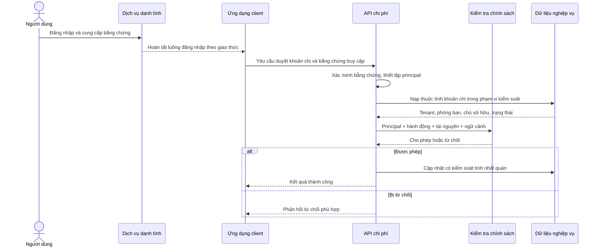

# Identity, authentication và authorization

## 1. Ba khái niệm tạo nền cho IAM

Trong quản lý danh tính và quyền truy cập (Identity and Access Management — IAM), một yêu cầu truy cập cần được xem xét qua ba câu hỏi:

1. **Identity — danh tính:** hệ thống đang biểu diễn chủ thể nào?
2. **Authentication — xác thực:** hệ thống có bằng chứng gì để tin rằng bên gửi yêu cầu kiểm soát thông tin xác thực gắn với danh tính đó?
3. **Authorization — quyết định quyền truy cập:** chủ thể này có được thực hiện hành động này trên tài nguyên này, trong điều kiện hiện tại hay không?

Ví dụ, nhân viên Lan đăng nhập vào hệ thống quản lý chi phí bằng mật khẩu và khóa bảo mật. Hệ thống nhận diện Lan là nhân viên có mã `usr_1042`, xác thực phiên đăng nhập, rồi kiểm tra xem Lan có được duyệt khoản chi `exp_7001` hay không. Đăng nhập thành công chưa trả lời được câu hỏi cuối cùng: Lan có thể chỉ được xem khoản chi của mình, còn quyền duyệt thuộc về quản lý của phòng ban.

| Khái niệm | Câu hỏi trọng tâm | Đầu vào điển hình | Kết quả điển hình |
| --- | --- | --- | --- |
| Identity | Chủ thể nào được biểu diễn? | Hồ sơ, định danh, quan hệ với tổ chức | Bản ghi danh tính có mã ổn định |
| Authentication | Bằng chứng truy cập có hợp lệ không? | Mật khẩu, phản hồi từ authenticator, chứng thư hoặc phiên đã xác thực | Ngữ cảnh xác thực của một principal |
| Authorization | Yêu cầu cụ thể có được phép không? | Principal, hành động, tài nguyên, chính sách và ngữ cảnh | Cho phép hoặc từ chối, kèm lý do phù hợp |

Ba khái niệm liên quan chặt chẽ nhưng có trách nhiệm khác nhau. Một hệ thống có xác thực mạnh vẫn có thể lộ dữ liệu nếu kiểm tra quyền sai.

Sau bài này, người học cần giải thích được sự khác nhau giữa ba khái niệm, mô tả một luồng truy cập hoàn chỉnh và nhận ra các lỗi thường gặp khi dùng kết quả xác thực để thay thế quyết định quyền truy cập.

## 2. Identity: mô hình hóa chủ thể trong hệ thống

### 2.1. Danh tính không chỉ là tên đăng nhập

Danh tính số là tập hợp định danh và thuộc tính mà một hệ thống dùng để biểu diễn một chủ thể. Chủ thể có thể là con người, ứng dụng, dịch vụ hoặc workload chạy tự động.

Một danh tính nhân viên có thể được biểu diễn như sau:

```json
{
  "id": "usr_1042",
  "displayName": "Lan",
  "email": "lan@example.test",
  "department": "finance",
  "tenantId": "org_alpha",
  "employmentStatus": "active"
}
```

Đây là dữ liệu minh họa, không phải schema bắt buộc. Trong thực tế, từng thuộc tính có thể đến từ nguồn khác nhau: bộ phận nhân sự quản lý tình trạng làm việc, hệ thống tài khoản quản lý thông tin đăng nhập, ứng dụng nghiệp vụ quản lý phạm vi quyền.

Không nên dùng tên hiển thị hoặc địa chỉ email như một định danh bất biến. Chúng có thể thay đổi; địa chỉ email cũ cũng có thể được cấp lại. Ứng dụng thường cần mã nội bộ ổn định và cơ chế liên kết với định danh bên ngoài.

### 2.2. Phân biệt subject, identity, account, credential và principal

| Thuật ngữ | Ý nghĩa trong bài | Ví dụ |
| --- | --- | --- |
| Subject | Chủ thể có thể yêu cầu truy cập | Lan hoặc dịch vụ xử lý hóa đơn |
| Identity | Biểu diễn số của chủ thể trong một miền quản lý | Hồ sơ nhân viên `usr_1042` |
| Account | Bản ghi tài khoản trong một hệ thống | Tài khoản Lan trong ứng dụng chi phí |
| Identifier | Giá trị dùng để phân biệt hoặc tham chiếu | Mã người dùng nội bộ |
| Credential | Thông tin hoặc cơ chế chứng minh quyền kiểm soát danh tính | Mật khẩu, cặp khóa cùng cơ chế chứng minh sở hữu |
| Principal | Biểu diễn chủ thể trong ngữ cảnh thực thi hoặc kiểm soát truy cập | Người dùng đã được gắn vào yêu cầu hiện tại |

Cách dùng thuật ngữ có thể khác nhau giữa nền tảng. Điều cần giữ rõ là: hồ sơ danh tính, tài khoản, bí mật xác thực và ngữ cảnh đang thực thi không phải cùng một thứ.

Một người có thể có nhiều tài khoản: tài khoản làm việc hằng ngày và tài khoản quản trị đặc quyền. Một dịch vụ cũng có danh tính riêng để truy cập API. Không nên để dịch vụ dùng chung tài khoản của nhân viên, vì cách đó gây khó khăn khi thu hồi quyền, đổi nhân sự và truy vết hành động.

### 2.3. Danh tính luôn có phạm vi tin cậy

Mã người dùng `1042` do nhà cung cấp A cấp không tự động chỉ cùng người với mã `1042` do nhà cung cấp B cấp. Khi tích hợp danh tính qua OIDC, ứng dụng thường phân biệt định danh bên ngoài bằng cặp `iss` và `sub` rồi ánh xạ sang mã nội bộ. Không nên mặc định `sub` có giá trị toàn cục giữa mọi issuer hoặc mọi ứng dụng.

Trong hệ thống nhiều tổ chức thuê chung dịch vụ, còn cần xét quan hệ thành viên với từng tenant. Một người có thể thuộc nhiều tenant với quyền khác nhau. Việc xác định đúng người không tự động xác định đúng tổ chức mà người đó đang hành động thay mặt.

Liên kết hai tài khoản cũng là thao tác nhạy cảm. Hai tài khoản có cùng chuỗi email chưa đủ để kết luận có thể gộp; cần quy trình xác minh và chính sách tin cậy phù hợp với nhà cung cấp danh tính.

### 2.4. Identity proofing khác authentication

**Identity proofing** là quá trình xác minh các thông tin về chủ thể khi đăng ký hoặc nâng mức tin cậy của danh tính, chẳng hạn đối chiếu hồ sơ nhân sự với giấy tờ theo quy trình của tổ chức.

**Authentication** kiểm tra bằng chứng gắn với tài khoản trong một lần đăng nhập hoặc truy cập. Việc một người chứng minh được quyền kiểm soát hộp thư không tự động chứng minh chức danh, quan hệ lao động hoặc danh tính pháp lý của họ.

Sự phân biệt này giúp tránh thiết kế sai như cho rằng “đã đăng nhập bằng email công ty” đồng nghĩa với “đang là nhân viên có quyền xem mọi dữ liệu nội bộ”.

## 3. Authentication: thiết lập sự tin cậy cho một lần truy cập

### 3.1. Khai báo danh tính chưa phải là xác thực

Khi một người điền tên đăng nhập, họ mới **khai báo** danh tính muốn sử dụng. Hệ thống cần kiểm tra bằng chứng thích hợp trước khi chấp nhận khai báo đó.

Các nhóm yếu tố xác thực thường gặp gồm:

| Nhóm yếu tố | Ví dụ | Điểm cần hiểu |
| --- | --- | --- |
| Điều người dùng biết | Mật khẩu, mã PIN | Hai mật khẩu vẫn thuộc cùng một nhóm yếu tố |
| Thứ người dùng sở hữu | Thiết bị giữ khóa, authenticator tạo mã | Cần cơ chế chứng minh quyền kiểm soát, không chỉ khai báo tên thiết bị |
| Đặc điểm của người dùng | Sinh trắc học | Có thể được dùng cục bộ để mở khóa authenticator |

MFA sử dụng các yếu tố thuộc những nhóm khác nhau theo cơ chế của giải pháp cụ thể. Chẳng hạn, sinh trắc học có thể chỉ mở khóa khóa riêng trên thiết bị; máy chủ nhận bằng chứng mật mã từ authenticator, không nhất thiết nhận dữ liệu vân tay.

Mức độ tin cậy còn phụ thuộc vào khả năng chống phishing, cách đăng ký yếu tố, quy trình khôi phục tài khoản và bảo vệ phiên. Có MFA không có nghĩa mọi phương thức MFA có cùng mức bảo vệ, và cũng không có nghĩa người dùng được thêm quyền nghiệp vụ.

### 3.2. Kết quả xác thực là một ngữ cảnh

Sau khi xác thực thành công, ứng dụng thường biết nhiều hơn một cờ `loggedIn = true`:

- Principal nào đã được xác thực.
- Nguồn nào đã xác thực principal đó.
- Thời điểm xác thực và thời hạn sử dụng ngữ cảnh.
- Phương thức hoặc mức bảo đảm xác thực, nếu được cung cấp và kiểm chứng.
- Phiên hoặc cơ chế mang thông tin xác thực cho các yêu cầu tiếp theo.

Một ứng dụng có thể cho phép xem thông tin cơ bản với phiên hiện tại nhưng yêu cầu xác thực lại hoặc tăng cường xác thực trước khi thay đổi yếu tố MFA. Đây thường được gọi là **step-up authentication**. Sau step-up, ứng dụng vẫn phải kiểm tra quyền đối với thao tác đó.

### 3.3. Phiên và token duy trì ngữ cảnh truy cập

Người dùng không thường xuyên nhập lại mật khẩu cho mỗi yêu cầu. Thay vào đó, trình duyệt có thể gửi cookie phiên; ứng dụng hoặc workload có thể gửi token.

Với phiên phía máy chủ, cookie thường chứa một giá trị tham chiếu để máy chủ tìm ngữ cảnh phiên. Với access token, API cần xác minh token theo cơ chế của hệ thống: có thể kiểm tra token JWT tại chỗ hoặc tham chiếu cơ chế kiểm tra token của máy chủ cấp quyền, tùy loại token và kiến trúc.

Đọc được nội dung token không chứng minh token đáng tin. Với JWT có chữ ký, việc kiểm tra thường bao gồm chữ ký với khóa tin cậy, thuật toán được cho phép, issuer, audience và các ràng buộc thời gian phù hợp. Các yêu cầu như thu hồi hay trạng thái tài khoản cần được xử lý theo thiết kế của hệ thống; một chữ ký hợp lệ không tự giải quyết những yêu cầu đó.

JWT được mã hóa biểu diễn bằng Base64url không vì thế mà được bảo mật nội dung. Không đưa bí mật vào token chỉ vì nó trông khó đọc. Với bearer token, bên chiếm được token có thể sử dụng nó trong phạm vi token còn được chấp nhận, nên token cần được bảo vệ khi truyền, lưu và ghi log.

### 3.4. Không đồng nhất SSO, OAuth và OIDC

Trong phạm vi nền tảng IAM, có thể phân biệt ngắn gọn:

- **SSO:** trải nghiệm dùng một lần đăng nhập để truy cập nhiều ứng dụng trong quan hệ tin cậy phù hợp. Mỗi ứng dụng vẫn cần quyết định quyền riêng.
- **OAuth:** khuôn khổ ủy quyền truy cập, thường dùng access token để client truy cập tài nguyên theo quyền được cấp. OAuth tự nó không phải giao thức đăng nhập người dùng.
- **OIDC:** lớp danh tính xây trên OAuth 2.0, cung cấp cơ chế để client xác thực người dùng và nhận thông tin danh tính.

ID token và access token có mục đích khác nhau. Không lấy một token bất kỳ xuất hiện sau đăng nhập rồi mặc định dùng được cho mọi API. Token cần đúng loại, đúng bên nhận và được xác minh theo ngữ cảnh sử dụng.

## 4. Authorization: quyết định cho từng yêu cầu cụ thể

### 4.1. Quyền truy cập là quan hệ giữa nhiều yếu tố

Một cách diễn đạt quyết định quyền truy cập là:

```text
decision = evaluate(subject, action, resource, context, policy)
```

Trong hệ thống chi phí:

```text
subject  = nhân viên usr_1042, thành viên org_alpha
action   = expense.approve
resource = khoản chi exp_7001, thuộc org_alpha và phòng finance
context  = thời điểm yêu cầu, ngữ cảnh xác thực, trạng thái khoản chi
policy   = quy tắc duyệt chi của tổ chức
```

Một chính sách minh họa có thể yêu cầu đồng thời:

1. Người thực hiện đang có tư cách thành viên hợp lệ trong tổ chức sở hữu khoản chi.
2. Người thực hiện có quyền `expense.approve` trong phạm vi liên quan.
3. Khoản chi thuộc phòng ban mà người đó được duyệt.
4. Người thực hiện không phải người tạo khoản chi.
5. Số tiền không vượt hạn mức và khoản chi đang chờ duyệt.

Đây là ví dụ nghiệp vụ để thấy tính cụ thể của authorization. Chính sách thực tế phải được tổ chức định nghĩa, không suy ra chỉ từ tên vai trò.

### 4.2. Role, permission, scope và ownership không đồng nghĩa

| Khái niệm | Vai trò trong quyết định | Ví dụ |
| --- | --- | --- |
| Permission | Mô tả hành động được cấp | `expense.approve` |
| Role | Gom các quyền theo chức năng công việc | `finance_approver` |
| Scope của OAuth | Diễn đạt phạm vi truy cập được cấp cho token theo hệ thống | `expenses.read` |
| Ownership | Quan hệ sở hữu giữa chủ thể và tài nguyên | Người tạo một khoản chi |
| Resource attribute | Thuộc tính của đối tượng đang được truy cập | Tenant, phòng ban, số tiền, trạng thái |

Có role `finance_approver` chưa đủ để duyệt mọi khoản chi của mọi tổ chức. Có scope `expenses.read` cũng chưa chứng minh token được đọc khoản chi bất kỳ. API vẫn cần áp dụng các ràng buộc đối tượng và nghiệp vụ.

**RBAC** tổ chức quyền qua vai trò. **ABAC** quyết định quyền dựa trên thuộc tính của chủ thể, tài nguyên, hành động và môi trường. Hai cách này có thể kết hợp: vai trò cung cấp quyền duyệt chi, còn thuộc tính tenant, phòng ban và hạn mức giới hạn nơi quyền đó có hiệu lực.

### 4.3. Kiểm tra ở nơi thực thi hành động

Ẩn nút “Duyệt” trên giao diện giúp người dùng hiểu họ có thể làm gì, nhưng không thực thi được ranh giới bảo mật. Một client khác vẫn có thể gửi HTTP request trực tiếp.

Máy chủ hoặc dịch vụ thực thi hành động phải kiểm tra quyền. Trong kiến trúc có API gateway, gateway có thể kiểm tra token hoặc quyền tổng quát; dịch vụ nắm dữ liệu nghiệp vụ vẫn cần kiểm tra những điều mà gateway không biết, chẳng hạn chủ sở hữu, tenant và trạng thái tài nguyên.

Điều này áp dụng cho từng đối tượng và từng thao tác. Việc đã được phép mở danh sách không bảo đảm được phép đọc chi tiết, sửa hoặc xuất dữ liệu của mọi đối tượng trong danh sách đó.

### 4.4. Áp dụng ít quyền nhất và mặc định từ chối

Nguyên tắc ít quyền nhất yêu cầu chỉ cấp những quyền cần thiết, trong phạm vi và thời gian cần thiết. Mặc định từ chối nghĩa là khi không có căn cứ cho phép hợp lệ, hệ thống không thực hiện hành động được bảo vệ.

Ví dụ, nếu dịch vụ không lấy được dữ liệu thành viên để kiểm tra quyền duyệt chi, không được tự cho phép chỉ để tránh gián đoạn. Cần có cách xử lý lỗi và trải nghiệm phù hợp nhưng vẫn giữ ranh giới truy cập.

Các endpoint công khai có thể chủ động cho phép truy cập ẩn danh theo chính sách. Authorization vẫn tồn tại trong trường hợp đó: chính sách quyết định rằng chủ thể ẩn danh được thực hiện một số hành động cụ thể.

## 5. Ghép ba khái niệm trong một luồng truy cập



Sơ đồ mô tả các trách nhiệm logic; không bắt buộc hệ thống có một dịch vụ chính sách độc lập. Điều quan trọng là có điểm xác minh bằng chứng truy cập, có điểm quyết định quyền và có điểm thực thi quyết định trước hành động được bảo vệ.

Một luồng thành công cần phân biệt các kết luận sau:

- **Identity:** `usr_1042` ánh xạ đến đúng chủ thể trong miền tin cậy.
- **Authentication:** yêu cầu mang bằng chứng truy cập hợp lệ theo cơ chế đang sử dụng.
- **Authorization:** chủ thể có quyền duyệt chính khoản chi này với trạng thái hiện tại.
- **Audit:** hệ thống ghi được ai đã yêu cầu hành động gì, trên đối tượng nào, kết quả ra sao.

## 6. Ví dụ kiểm soát truy cập ở API

Giả sử client gửi:

```http
POST /api/expenses/exp_7001/approve
Authorization: Bearer <access-token>
Content-Type: application/json

{"comment": "Đủ chứng từ"}
```

Đoạn mã giả sau minh họa thứ tự trách nhiệm, không phải mã triển khai mật mã hoặc thư viện bảo mật:

```text
function approveExpense(request):
    principal = accessVerifier.verify(request.accessEvidence)
    if principal is absent:
        return unauthenticatedResponse()

    membership = membershipService.findActiveMembership(
        principal.internalSubjectId,
        request.requestedTenant
    )
    if membership is absent:
        return deniedResponse()

    begin transaction
        expense = expenseRepository.findForUpdate(
            membership.tenantId,
            request.expenseId
        )
        if expense is absent:
            return resourceNotAvailableResponse()

        decision = expensePolicy.canApprove(
            principal,
            membership,
            expense,
            trustedRequestContext()
        )
        if decision is not allow:
            audit.recordDenied(principal, expense.id, decision.reason)
            return deniedResponse()

        expense.approveBy(principal.internalSubjectId)
        expenseRepository.save(expense)
        audit.recordApproved(principal, expense.id)
    commit transaction

    return successResponse()
```

Các điểm cần hiểu từ ví dụ:

- `accessVerifier` kiểm tra bằng chứng trước khi xây dựng principal. API không nhận `userId` do client tự gửi rồi coi đó là người đã xác thực.
- Tenant mà client chọn chỉ là yêu cầu về ngữ cảnh. Máy chủ phải xác minh tư cách thành viên trước khi dùng tenant đó để truy cập dữ liệu.
- Truy vấn tài nguyên được giới hạn bằng tenant đã được kiểm tra. Chính sách còn kiểm tra quyền và các điều kiện nghiệp vụ trên tài nguyên.
- Việc kiểm tra trạng thái và cập nhật cần cơ chế nhất quán phù hợp, như khóa hoặc cập nhật có điều kiện. Nếu dữ liệu thay đổi sau kiểm tra, quyết định cũ có thể không còn đúng.
- Log cần phục vụ truy vết nhưng không chứa mật khẩu, bearer token hoặc dữ liệu nhạy cảm không cần thiết.

Trong HTTP API, `401` thường thể hiện yêu cầu chưa có thông tin xác thực hợp lệ cho tài nguyên được bảo vệ; `403` thường thể hiện việc truy cập bị từ chối. Một số API chủ động trả `404` để hạn chế tiết lộ sự tồn tại của đối tượng. Hợp đồng API cần quy định cách phản hồi nhất quán; không để thông báo lỗi tiết lộ chi tiết tài nguyên cho bên không có quyền.

## 7. Quyền và ngữ cảnh xác thực thay đổi theo thời gian

Xác thực thành công là kết quả tại một thời điểm. Sau đó, nhân viên có thể chuyển phòng ban, bị khóa tài khoản hoặc hết thời hạn được cấp quyền quản trị.

Nếu token còn chứa role cũ và API chỉ dựa vào token đó cho tới khi hết hạn, thay đổi quyền có thể chưa có hiệu lực ngay. Vì vậy, hệ thống cần xác định rõ:

- Thời gian tối đa có thể chấp nhận quyền cũ tiếp tục được sử dụng.
- Thao tác nào cần lấy dữ liệu quyền hoặc trạng thái tài khoản mới hơn.
- Khi nào cần thu hồi phiên, token hoặc grant theo cơ chế được hỗ trợ.
- Cách xử lý công việc chạy nền và quyền của workload khi chủ sở hữu hoặc mục đích sử dụng thay đổi.

Khóa tài khoản trong một kho danh tính không tự bảo đảm mọi phiên và mọi token đã phát hành đều ngừng hoạt động ngay. Đây là vấn đề phối hợp giữa vòng đời danh tính, xác thực, quản lý phiên và thực thi quyền.

Với workload, nguyên tắc vẫn tương tự: xác thực dịch vụ gọi đến, xác định quyền cần thiết cho công việc của nó, giới hạn tài nguyên được truy cập và thu hồi thông tin xác thực khi workload ngừng hoạt động. Không cần có người nhập mật khẩu thì mới có authentication.

## 8. Những nhầm lẫn dễ gây lỗ hổng

| Nhầm lẫn | Vì sao sai | Hướng xử lý |
| --- | --- | --- |
| Đăng nhập được thì đọc được mọi API | Authentication chưa trả lời quyền đối với hành động và tài nguyên | Kiểm tra authorization tại API thực thi |
| Có MFA thì được quyền quản trị | MFA tăng độ tin cậy của xác thực, không tự cấp đặc quyền | Cấp quyền quản trị theo chính sách và phạm vi rõ ràng |
| Frontend đã ẩn nút nên backend không cần kiểm tra | Client có thể bị thay thế hoặc sửa đổi | Thực thi quyền phía máy chủ |
| UUID khó đoán nên không cần kiểm tra chủ sở hữu | Độ khó đoán không tạo ra quyền truy cập | Kiểm tra đối tượng, tenant và hành động |
| JWT giải mã được nghĩa là token hợp lệ | Giải mã biểu diễn không xác minh nguồn phát hành hay bên nhận | Xác minh token bằng cơ chế tin cậy |
| Scope đọc dữ liệu cho phép đọc mọi bản ghi | Scope không nhất thiết chứa toàn bộ điều kiện nghiệp vụ | Kết hợp scope với ràng buộc đối tượng |
| Email giống nhau thì hai tài khoản là một | Email có phạm vi tin cậy, có thể thay đổi hoặc được cấp lại | Liên kết qua quy trình xác minh phù hợp |
| Đăng xuất một ứng dụng là chấm dứt mọi phiên SSO | Phiên ứng dụng và phiên nhà cung cấp có thể có vòng đời khác nhau | Thiết kế hành vi đăng xuất và thu hồi rõ ràng |
| Chỉ kiểm tra quyền lúc đăng nhập là đủ | Quyền, tài nguyên và trạng thái nghiệp vụ thay đổi | Kiểm tra quyền trên từng yêu cầu được bảo vệ |

## 9. Tự kiểm tra qua tình huống

### Tình huống 1: xác thực hợp lệ nhưng sai chủ sở hữu

Minh đăng nhập hợp lệ và gọi `GET /api/expenses/exp_8002`. Khoản chi này thuộc đồng nghiệp khác, còn Minh chỉ có quyền đọc khoản chi do mình tạo.

**Phân tích:** authentication đã thành công. Authorization phải từ chối vì quan hệ với đối tượng không thỏa chính sách. Việc client biết mã khoản chi không thay đổi quyền.

### Tình huống 2: cùng người dùng, khác tổ chức

Lan là người duyệt chi của `org_alpha` và là thành viên thông thường của `org_beta`. Lan chọn `org_beta` trên giao diện rồi gửi yêu cầu duyệt chi của tổ chức đó.

**Phân tích:** identity của Lan không đổi nhưng quyền phụ thuộc tenant đang xét. Role tại `org_alpha` không được tự động áp dụng sang `org_beta`. Máy chủ cần kiểm tra quan hệ thành viên và quyền trong đúng tenant sở hữu tài nguyên.

### Tình huống 3: tài khoản vừa bị thu hồi quyền

Một nhân viên đã bị gỡ role quản trị nhưng vẫn giữ access token còn hạn có role cũ.

**Phân tích:** token có thể vẫn vượt qua kiểm tra mật mã và thời gian. Vấn đề là độ mới của thông tin quyền cùng cơ chế thu hồi. Thiết kế phải đáp ứng thời hạn thu hồi quyền đã cam kết, đặc biệt với thao tác đặc quyền.

### Tình huống 4: dịch vụ gọi dịch vụ

Dịch vụ xuất báo cáo dùng danh tính workload để đọc dữ liệu tổng hợp. Nó gửi yêu cầu xóa một tài khoản người dùng.

**Phân tích:** có thể xác thực thành công danh tính dịch vụ nhưng phải từ chối hành động xóa vì vượt phạm vi được cấp. Danh tính máy không mặc nhiên có nhiều quyền hơn danh tính con người.

## 10. Ghi nhớ để đọc các chủ đề IAM tiếp theo

Identity cung cấp mô hình về chủ thể; authentication thiết lập sự tin cậy vào bằng chứng truy cập; authorization quyết định hành động nào được phép trên tài nguyên nào trong ngữ cảnh cụ thể.

Khi học MFA và quản lý phiên, hãy theo dõi độ tin cậy và vòng đời của ngữ cảnh xác thực. Khi học RBAC, ABAC và đặc quyền, hãy theo dõi cách biểu diễn, giới hạn và thu hồi quyền. Khi học SSO, OAuth/OIDC và liên kết danh tính, hãy theo dõi ranh giới tin cậy giữa các hệ thống. Khi học kiểm toán, hãy bảo đảm có thể liên hệ hành động với principal, tài nguyên và quyết định quyền tương ứng.

Một cách kiểm tra thiết kế hữu ích là lấy một yêu cầu cụ thể và lần lượt chỉ ra: danh tính nào đang được sử dụng, bằng chứng nào đã được kiểm chứng, chính sách nào cho phép hành động và thành phần nào thực thi quyết định đó.
