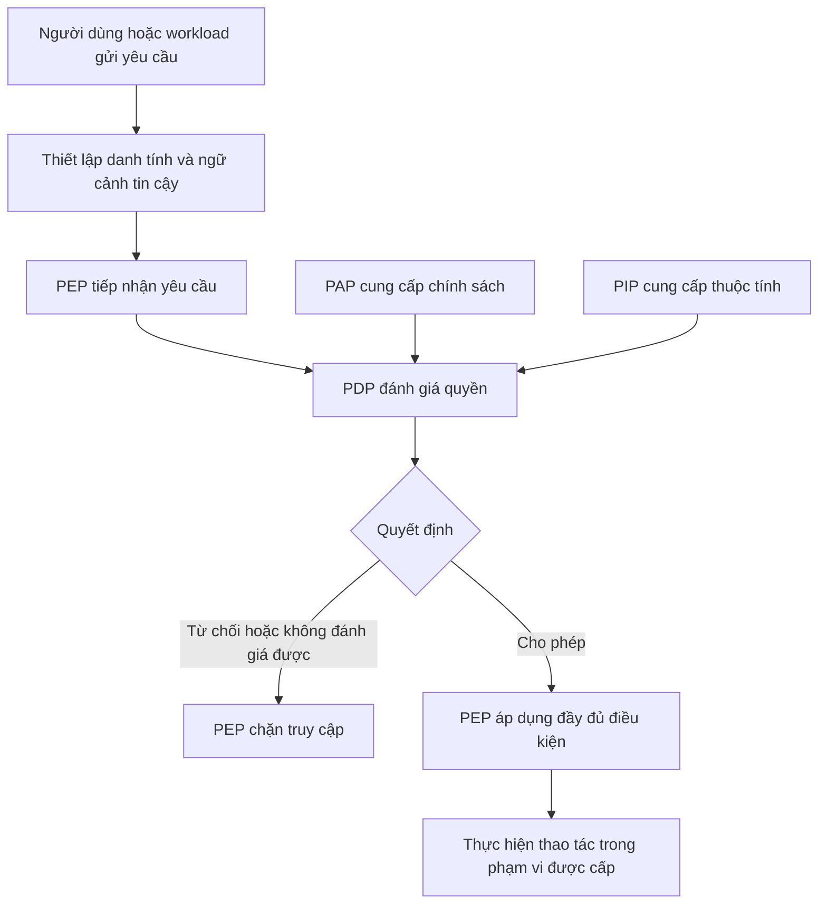

# Access control khác authorization như thế nào

## Mục tiêu bài học

Trong nền tảng quản lý danh tính và quyền truy cập (IAM), biết người gọi là ai chưa đủ để bảo vệ tài nguyên. Hệ thống còn phải xác định người gọi được làm gì và bảo đảm mọi đường truy cập đều tuân theo quyết định đó.

Sau bài học này, bạn có thể:

- Phân biệt xác thực danh tính, quyết định quyền và cơ chế kiểm soát truy cập.
- Giải thích vì sao quyết định quyền đúng vẫn có thể dẫn đến truy cập trái phép nếu thực thi sai.
- Nhận diện nơi định nghĩa chính sách, lấy dữ kiện, ra quyết định và chặn hoặc cho phép yêu cầu.
- Áp dụng nguyên tắc ít quyền nhất cho người dùng, tài khoản quản trị và danh tính workload.

## 1. Điểm khác nhau cốt lõi

**Authorization** thường được dịch là **phân quyền** hoặc **ủy quyền**, tùy ngữ cảnh. Trong bài này, khi nói đến một yêu cầu cụ thể, authorization là việc đánh giá xem một chủ thể có được thực hiện một hành động trên một tài nguyên trong bối cảnh hiện tại hay không. Việc gán vai trò, cấp quyền và thu hồi quyền là các hoạt động quản trị tạo ra đầu vào cho quá trình đánh giá đó.

**Access control**, hay **kiểm soát truy cập**, là tập hợp chính sách, quy trình và cơ chế dùng để giới hạn truy cập tài nguyên. Trong góc nhìn kiến trúc của bài học, nó bao gồm việc tổ chức chính sách, đưa ra quyết định và thực thi quyết định tại các đường truy cập được bảo vệ.

Ví dụ, hệ thống xác định “Lan được xem hóa đơn INV-42 vì Lan thuộc đúng tenant và có quyền đọc hóa đơn” là một quyết định authorization. API kiểm tra quyết định đó rồi chỉ trả dữ liệu khi được phép là hoạt động thực thi kiểm soát truy cập. Cách gán quyền, cách bảo vệ API xuất dữ liệu và cách thu hồi quyền cũng thuộc bức tranh kiểm soát truy cập.

### Không phải hai thuật ngữ luôn tách biệt

Trong tài liệu, thư viện và sản phẩm, hai từ này có thể được dùng gần như đồng nghĩa. Một thư viện gọi middleware chặn truy cập là “authorization middleware”; một nền tảng gọi cả hệ thống vai trò và bộ đánh giá quyền là “access control”. Cả hai cách gọi đều có thể hợp lý trong phạm vi của chúng.

Vì vậy, không nên khẳng định rằng authorization luôn chỉ là một hàm trả về đúng/sai, hoặc access control luôn chỉ là thao tác chặn ở middleware. Khi trao đổi thiết kế, hãy nói rõ đang bàn về **quản trị chính sách**, **đánh giá quyền** hay **thực thi quyền**.

| Góc nhìn | Authorization trong một yêu cầu | Access control ở mức hệ thống |
|---|---|---|
| Câu hỏi chính | Chủ thể này có được làm việc này không? | Hệ thống giới hạn và bảo vệ các đường truy cập như thế nào? |
| Đầu vào điển hình | Danh tính, quyền hoặc vai trò, hành động, tài nguyên, ngữ cảnh | Chính sách, dữ kiện danh tính, bộ đánh giá, điểm thực thi, quy trình cấp và thu hồi quyền |
| Kết quả | Cho phép, từ chối; đôi khi kèm điều kiện hoặc nghĩa vụ phải thực hiện | Yêu cầu được thực hiện trong đúng giới hạn hoặc bị chặn |
| Ví dụ | Đánh giá Lan có được duyệt hóa đơn INV-42 không | Bảo vệ API, truy vấn dữ liệu, tác vụ nền và công cụ quản trị liên quan đến hóa đơn |
| Sai sót thường gặp | Chính sách quá rộng hoặc dùng sai thuộc tính | Có đường đi bỏ qua kiểm tra, thực thi thiếu điều kiện hoặc dùng quyết định đã lỗi thời |

## 2. Authentication đứng ở đâu?

**Authentication**, hay **xác thực**, kiểm tra bằng chứng để thiết lập danh tính của chủ thể theo cơ chế đang sử dụng. Bằng chứng có thể là mật khẩu cùng yếu tố thứ hai, chứng chỉ của dịch vụ hoặc token được kiểm tra đúng quy tắc.

Ba câu hỏi cần được phân biệt:

1. **Authentication:** Ai hoặc workload nào đang gọi? Bằng chứng có hợp lệ không?
2. **Authorization:** Danh tính đó được thực hiện hành động được yêu cầu trên tài nguyên này không?
3. **Thực thi access control:** Thành phần nào bảo đảm yêu cầu chỉ được xử lý trong phạm vi cho phép?

Đăng nhập thành công không có nghĩa là được xem tất cả dữ liệu. MFA tăng mức tin cậy của việc xác thực nhưng không tự cấp quyền quản trị. Một phiên hợp lệ cũng không bảo đảm quyền của người dùng vẫn còn phù hợp sau khi họ chuyển bộ phận.

Ngược lại, tài nguyên công khai có thể cho phép người chưa đăng nhập truy cập theo chính sách dành cho khách. Điều đó vẫn là một quyết định truy cập; không phải mọi tài nguyên đều bắt buộc có người dùng đã xác thực.

## 3. Một quyết định quyền cần những gì?

Có thể biểu diễn một yêu cầu bằng bốn thành phần:

```text
request = (subject, action, resource, context)
decision = evaluate(policy, request, trusted_attributes)
```

| Thành phần | Ý nghĩa | Ví dụ |
|---|---|---|
| Subject — chủ thể | Người dùng hoặc danh tính máy đang hành động | Nhân viên Lan, dịch vụ xử lý hóa đơn |
| Action — hành động | Thao tác có ý nghĩa nghiệp vụ | Đọc, tạo, sửa, duyệt, xuất dữ liệu |
| Resource — tài nguyên | Đối tượng hoặc tập dữ liệu được bảo vệ | Hóa đơn INV-42, danh sách hóa đơn của tenant A |
| Context — ngữ cảnh | Điều kiện liên quan đến lần truy cập | Thời điểm, mức xác thực, trạng thái phiên, kênh truy cập |

Thuộc tính của chủ thể và tài nguyên cũng ảnh hưởng đến quyết định: tenant, bộ phận, hạn mức duyệt, người tạo hóa đơn hoặc trạng thái hồ sơ. Không nhất thiết mọi hệ thống đều lưu các thuộc tính trong cùng một cấu trúc; điều quan trọng là nguồn dữ liệu có thẩm quyền và ngữ nghĩa nhất quán.

Một chính sách đọc có thể là:

```text
Cho phép đọc hóa đơn nếu:
  tài khoản đang hoạt động
  VÀ chủ thể có quyền invoice:read trong tenant đang xét
  VÀ tenant của chủ thể phù hợp với tenant của hóa đơn.
Các trường hợp còn lại bị từ chối.
```

Chỉ kiểm tra `invoice:read` mà bỏ qua tenant có thể làm lộ hóa đơn của khách hàng khác. Chỉ kiểm tra tenant mà bỏ qua hành động cũng có thể cho người chỉ được xem thực hiện thao tác duyệt.

**Điểm cần nhớ:** quyền phải gắn với hành động và phạm vi tài nguyên. Tên vai trò như `manager` tự nó chưa mô tả đầy đủ phạm vi đó.

## 4. Từ chính sách đến việc thực thi

Một mô hình thường dùng để phân tích hệ thống có bốn trách nhiệm:

- **PAP — Policy Administration Point:** nơi quản trị hoặc cung cấp chính sách, chẳng hạn cấu hình vai trò, quy tắc và phiên bản chính sách.
- **PIP — Policy Information Point:** nơi cung cấp dữ kiện cho đánh giá, chẳng hạn tenant của tài nguyên, trạng thái tài khoản và quan hệ thành viên.
- **PDP — Policy Decision Point:** nơi đánh giá yêu cầu theo chính sách và đưa ra quyết định.
- **PEP — Policy Enforcement Point:** nơi thực thi quyết định, chẳng hạn chặn lời gọi API hoặc giới hạn tập bản ghi được trả về.

Đây là các trách nhiệm logic. Một ứng dụng nhỏ có thể thực hiện tất cả trong cùng một tiến trình; không bắt buộc phải triển khai bốn dịch vụ riêng.



Trong luồng này, PDP đưa ra quyết định nhưng PEP mới là nơi trực tiếp ngăn yêu cầu đi tiếp. Một quyết định “từ chối” không có tác dụng nếu ứng dụng ghi nhận nó rồi vẫn trả dữ liệu.

Một số bộ đánh giá còn trả kết quả như “không có chính sách áp dụng” hoặc “không xác định được”. Với tài nguyên được bảo vệ theo nguyên tắc mặc định từ chối, ứng dụng không được chuyển những kết quả đó thành cho phép. Cách kết hợp nhiều chính sách, như ưu tiên từ chối hay ưu tiên cho phép, phải được định nghĩa rõ; không có một thứ tự ngầm định đúng cho mọi hệ thống.

### Quyết định có thể kèm nghĩa vụ

Ví dụ, hệ thống cho phép bộ phận hỗ trợ xem hồ sơ nhưng phải che một số trường và ghi lại lý do truy cập. “Cho phép” khi đó không đồng nghĩa với trả toàn bộ hồ sơ. Nếu PEP không thực hiện được nghĩa vụ bắt buộc, nó phải từ chối hoặc báo lỗi theo chính sách.

Tương tự, nếu chính sách yêu cầu xác thực tăng cường trước khi xuất dữ liệu nhạy cảm, ứng dụng phải hoàn thành bước đó và đánh giá lại trước khi xuất. Một quyết định quyền không tự tạo ra bằng chứng MFA.

## 5. Ví dụ xuyên suốt: duyệt hóa đơn trong ứng dụng nhiều tenant

Giả sử một ứng dụng có các thông tin sau:

| Đối tượng | Thông tin |
|---|---|
| Lan | Tài khoản đang hoạt động, thuộc tenant A, được duyệt hóa đơn của bộ phận Kinh doanh trong tenant A |
| Hóa đơn INV-42 | Thuộc tenant A, bộ phận Kinh doanh, do Minh tạo, đang chờ duyệt, giá trị 30 triệu đồng |
| Hạn mức của Lan | Tối đa 50 triệu đồng cho mỗi hóa đơn |
| Quy tắc tách biệt nhiệm vụ | Người tạo không được tự duyệt hóa đơn của mình |

Hệ thống chỉ cho phép Lan duyệt khi tất cả điều kiện cần thiết đều đúng: có quyền duyệt trong phạm vi tương ứng, đúng tenant, đúng bộ phận, không phải người tạo, hóa đơn còn chờ duyệt và không vượt hạn mức.

Giả mã dưới đây minh họa cách gắn đánh giá quyền với việc cập nhật dữ liệu. Nó không phải mã hoàn chỉnh của một framework cụ thể.

```text
function approveInvoice(request):
    subject = requireAuthenticatedSubject(request)
    invoiceId = validateIdentifier(request.path.invoiceId)

    transaction:
        subjectState = loadCurrentAccountAndScopedGrants(subject.id)
        invoice = loadInvoiceForProtectedUpdate(invoiceId)

        decision = evaluateApprovalPolicy(
            subject = subjectState,
            action = "invoice:approve",
            resource = invoice,
            context = trustedRequestContext(request)
        )

        if decision != PERMIT:
            stopWithAccessDenied()

        updateInvoiceToApproved(invoice, subject.id)
        persistRequiredAuditEvent(subject.id, invoice.id, decision)

    return success
```

Hàm `evaluateApprovalPolicy` chịu trách nhiệm đánh giá đầy đủ các điều kiện đã nêu, bao gồm trạng thái tài khoản và phạm vi của quyền. Đoạn `if decision != PERMIT` cùng ranh giới cập nhật dữ liệu thể hiện trách nhiệm thực thi. Việc lưu sự kiện trong ví dụ giả định đây là bản ghi kiểm toán bắt buộc của giao dịch; nếu bắt buộc mà không lưu được thì giao dịch không được hoàn tất.

`loadInvoiceForProtectedUpdate` cần được triển khai bằng cơ chế phù hợp như khóa bản ghi hoặc kiểm soát phiên bản. Nếu dữ liệu quan trọng thay đổi giữa lúc kiểm tra và lúc cập nhật, kết luận trước đó có thể không còn đúng. Mức cô lập giao dịch và cách xử lý thu hồi quyền đồng thời phải phù hợp với yêu cầu nghiệp vụ; chỉ bọc mã trong một transaction chưa tự giải quyết mọi thay đổi quyền ở hệ thống bên ngoài.

### Không tin thuộc tính do client tự khai

Ứng dụng không được lấy `role=approver`, `tenant=A` hay `amount=30000000` từ body rồi xem đó là dữ kiện có thẩm quyền. Client có thể sửa các giá trị này.

Danh tính phải đến từ cơ chế xác thực được kiểm tra đúng. Quyền và thành viên tenant phải đến từ nguồn được tin cậy. Tenant, số tiền, bộ phận và người tạo của hóa đơn phải được đọc hoặc kiểm chứng từ dữ liệu có thẩm quyền. Nếu client gửi lựa chọn tenant, lựa chọn đó vẫn phải được đối chiếu với phạm vi mà chủ thể được cấp.

### Vì sao giấu nút Duyệt không đủ?

Ẩn nút giúp giao diện phù hợp với quyền của người dùng, nhưng người dùng vẫn có thể gửi HTTP request trực tiếp. API phải tự thực thi kiểm soát truy cập. Tương tự, bảo vệ API duyệt không bảo vệ thay cho API sửa trực tiếp trạng thái hóa đơn nếu API thứ hai vẫn cho phép đi vòng.

Đây là khác biệt thực tế giữa “đã có logic authorization” và “đường truy cập đã được kiểm soát đầy đủ”.

## 6. RBAC, ABAC, SSO và OAuth/OIDC nằm ở đâu?

Những cơ chế này giải quyết các phần khác nhau trong nền tảng IAM và có thể kết hợp với nhau.

| Cơ chế | Đóng góp cho hệ thống | Điều vẫn phải làm |
|---|---|---|
| RBAC | Gắn quyền với vai trò rồi gán vai trò cho chủ thể | Xác định phạm vi vai trò và thực thi quyền trên từng thao tác |
| ABAC | Đánh giá thuộc tính của chủ thể, tài nguyên, hành động và môi trường theo chính sách | Bảo đảm thuộc tính có nguồn tin cậy, đủ mới và được dùng nhất quán |
| SSO và liên kết danh tính | Cho phép ứng dụng dựa vào quan hệ tin cậy với hệ thống danh tính để thiết lập phiên hoặc danh tính | Ánh xạ danh tính ngoài vào tài khoản, tenant và quyền của ứng dụng |
| OAuth 2.0 | Cung cấp khuôn khổ cấp quyền truy cập tài nguyên, thường bằng access token | Resource server kiểm tra token và đánh giá quyền cần thiết đối với tài nguyên cụ thể |
| OpenID Connect | Bổ sung lớp danh tính trên OAuth 2.0, giúp ứng dụng nhận thông tin về việc xác thực người dùng | Thiết lập phiên đúng cách và áp dụng chính sách truy cập của ứng dụng |

Ví dụ, một access token có scope `invoice:read` chưa đủ để kết luận người gọi được xem mọi hóa đơn. Resource server còn phải kiểm tra token theo loại token và cấu hình tin cậy, bao gồm hiệu lực, bên phát hành, đối tượng nhận phù hợp, rồi kiểm tra phạm vi tài nguyên và tenant. Với token ký số, chữ ký hợp lệ là một điều kiện cần trong quá trình kiểm tra, không thay thế toàn bộ việc đánh giá quyền.

ID token của OIDC phục vụ ứng dụng khách xác nhận thông tin xác thực; không mặc nhiên dùng nó thay access token để gọi một API. Đăng nhập SSO thành công cũng không tự động khiến người dùng có vai trò quản trị trong mọi ứng dụng liên kết.

Trong ví dụ hóa đơn, RBAC có thể cung cấp quyền `invoice:approve`, còn các điều kiện về tenant, bộ phận, số tiền và người tạo có thể được biểu diễn bằng quy tắc dựa trên thuộc tính. Mọi quyết định đó vẫn cần được thực thi ở phía máy chủ.

## 7. Kiểm soát truy cập phải theo vòng đời quyền

Quyền không đứng yên sau thời điểm tạo tài khoản. Nhân viên chuyển bộ phận, nhà thầu hết hợp đồng, dịch vụ ngừng hoạt động hoặc một quyền đặc biệt hết thời hạn đều cần được phản ánh vào hệ thống.

Các hoạt động cần liên kết với nhau gồm:

- **Cấp phát:** tạo danh tính, xác lập chủ sở hữu và cấp đúng quyền cho đúng phạm vi.
- **Thay đổi:** cập nhật quyền khi nhiệm vụ thay đổi; tránh chỉ cộng quyền mới mà giữ toàn bộ quyền cũ.
- **Rà soát:** kiểm tra định kỳ quyền còn cần thiết, nhất là quyền đặc biệt và quyền quản trị.
- **Thu hồi:** vô hiệu hóa tài khoản hoặc quyền và xác định thời gian thay đổi có hiệu lực trên phiên, token, cache và các hệ thống liên quan.
- **Kiểm toán:** ghi đủ dữ kiện để giải thích ai đã truy cập gì, khi nào, theo quyết định và chính sách nào.

Thu hồi một vai trò trong cơ sở dữ liệu không bảo đảm mọi access token hoặc cache quyền mất hiệu lực ngay. Thiết kế phải xác định độ trễ chấp nhận được và chọn cơ chế tương ứng, chẳng hạn thời hạn token phù hợp, cập nhật cache, kiểm tra trạng thái trực tuyến hoặc thu hồi phiên khi cần. Không nên hứa “thu hồi tức thời” khi đường truy cập vẫn dùng quyền đã lưu đến lần hết hạn tiếp theo.

Các nguyên tắc này cũng áp dụng cho **workload identity**: dịch vụ, tác vụ nền hoặc pipeline là chủ thể có quyền riêng. Một tác vụ chỉ đọc hóa đơn không cần quyền quản trị toàn hệ thống. Nếu dịch vụ gọi thay người dùng, hệ thống phải phân biệt danh tính của dịch vụ với người dùng mà nó đại diện và kiểm tra phạm vi đại diện đó.

Với quyền đặc biệt, có thể áp dụng cấp quyền có thời hạn, phê duyệt, xác thực tăng cường và lưu vết sử dụng theo mức rủi ro. Mục tiêu là giữ quyền ở mức cần thiết, trong thời gian cần thiết và trên đúng tài nguyên.

## 8. Các lỗi dễ nhầm khi thiết kế

### Chỉ kiểm tra đăng nhập

Một API yêu cầu phiên hợp lệ nhưng không kiểm tra quyền tài nguyên vẫn có thể cho người dùng đã đăng nhập xem dữ liệu của người khác. Xác thực thành công chỉ giải quyết câu hỏi về danh tính theo cơ chế đã dùng.

### Có bộ quyết định nhưng thiếu điểm thực thi

API thông thường gọi PDP, nhưng API xuất báo cáo, đường tải tệp hoặc tác vụ nền lại bỏ qua. Cần bao phủ mọi đường có thể chạm đến tài nguyên được bảo vệ, không chỉ màn hình chính.

### Chỉ kiểm tra vai trò, bỏ qua đối tượng

Quyền `editor` không mặc nhiên cho phép sửa mọi bản ghi. Khi người gọi đổi ID tài nguyên trong URL, máy chủ phải kiểm tra lại quyền trên đối tượng thực sự được yêu cầu. ID khó đoán có thể giảm khả năng dò tìm nhưng không thay thế kiểm soát truy cập.

### Cấp quyền để xử lý tình huống bộ đánh giá bị lỗi

Nếu không đọc được thuộc tính cần thiết hoặc không liên hệ được bộ đánh giá, cho qua sẽ biến sự cố thành đường vượt quyền. Với tài nguyên được bảo vệ, mặc định từ chối khi không thể xác nhận quyền; phản hồi có thể là lỗi dịch vụ thay vì kết luận người dùng chắc chắn không có quyền. Kế hoạch duy trì hoạt động phải được thiết kế rõ, tránh một nhánh “lỗi thì cho phép” tùy tiện.

### Nhầm kiểm toán với ngăn chặn

Log giúp phát hiện, điều tra và giải trình nhưng không tự ngăn dữ liệu bị đọc. Kiểm toán bổ trợ cho điểm thực thi; việc ghi lại một lần truy cập trái phép sau khi đã trả dữ liệu không biến yêu cầu đó thành an toàn.

### Trả dữ liệu trước rồi mới lọc quyền

Nếu dữ liệu đã được gửi đến client, lọc ở giao diện không còn bảo vệ tính bí mật. Với danh sách và tìm kiếm, phạm vi quyền cần được áp dụng phía máy chủ trước khi dữ liệu rời khỏi ranh giới được bảo vệ, kể cả đối với xuất dữ liệu và các kết quả tổng hợp cần giới hạn phạm vi.

## 9. Tự kiểm tra bằng các tình huống

| Tình huống | Vấn đề cần nhận diện |
|---|---|
| Người dùng hoàn thành MFA nhưng bị từ chối duyệt hóa đơn | Không nhất thiết là lỗi: xác thực mạnh không tự cấp quyền duyệt |
| PDP trả từ chối nhưng handler vẫn trả nội dung hóa đơn | Lỗi thực thi kiểm soát truy cập |
| API có kiểm tra quyền nhưng chính sách cho mọi nhân viên đọc mọi tenant | Lỗi phạm vi chính sách authorization |
| Người dùng chỉ được đọc nhưng gọi API xuất toàn bộ dữ liệu và thành công | Cần kiểm tra cả quyền xuất, phạm vi dữ liệu và đường thực thi của API xuất |
| Quyền đã bị thu hồi nhưng token cũ còn được chấp nhận | Cần xem cơ chế kiểm tra quyền hiện tại và độ trễ thu hồi đã thiết kế |
| Dịch vụ nhận ID hóa đơn từ client rồi dùng quyền quản trị để trả dữ liệu | Cần kiểm tra quyền của người gọi trên hóa đơn; quyền rộng của dịch vụ không tự chứng minh quyền của người dùng |

Khi đọc một thiết kế IAM, hãy lần theo một yêu cầu cụ thể: danh tính được thiết lập từ đâu, thuộc tính nào đáng tin, chính sách nào quyết định, thành phần nào thực thi và điều gì xảy ra khi quyền thay đổi. Cách lần theo này giúp xác định rõ hệ thống đang có quyết định quyền đúng và cơ chế bảo vệ đầy đủ hay mới chỉ có một trong hai.
