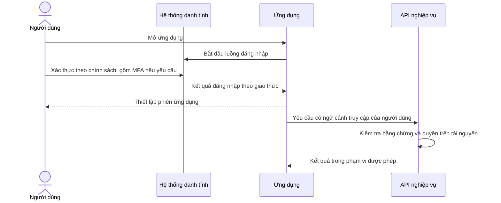
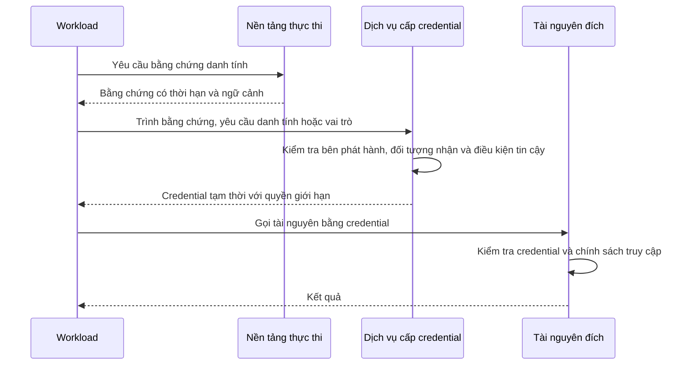

# Human identity và workload identity

## 1. Vì sao IAM cần phân biệt người dùng và workload?

Trong một hệ thống quản lý danh tính và quyền truy cập (Identity and Access Management — IAM), bên yêu cầu truy cập không phải lúc nào cũng là con người. Nhân viên đăng nhập cổng nội bộ là một trường hợp; dịch vụ thanh toán gọi API, tác vụ chạy ban đêm đọc cơ sở dữ liệu và pipeline triển khai phần mềm là những trường hợp khác.

Các chủ thể này đều cần được nhận diện, xác thực, cấp quyền và ghi nhận hoạt động. Tuy nhiên, cách chứng minh danh tính và quản lý vòng đời của chúng khác nhau. Một người có thể sử dụng khóa bảo mật và xác nhận đăng nhập. Một tiến trình chạy tự động cần cơ chế lấy thông tin xác thực mà không chờ người bấm xác nhận mỗi lần thực thi.

Phân biệt đúng hai nhóm giúp tránh hai lỗi thiết kế phổ biến:

- Dùng tài khoản nhân viên làm danh tính chạy dịch vụ hoặc tác vụ tự động.
- Bảo vệ danh tính phần mềm bằng các quy trình vốn được thiết kế cho người dùng, trong khi bỏ qua nơi phần mềm chạy và cách thông tin xác thực được cấp phát.

Trong bài này, **human identity** là danh tính gắn với một con người; **workload identity** là danh tính dùng để nhận diện phần mềm khi nó thực thi. Hai nhóm cùng tuân theo nguyên tắc ít quyền nhất, nhưng cần những cách kiểm soát phù hợp với đặc điểm của mình.

Sau bài học, bạn có thể phân loại các chủ thể truy cập, tách danh tính khỏi thông tin xác thực, mô tả luồng truy cập của người dùng và workload, đồng thời nhận ra những rủi ro khi trộn lẫn hai loại danh tính.

## 2. Các khái niệm cần tách biệt

### 2.1. Identity, account và principal

**Identity — danh tính** là tập thông tin giúp hệ thống nhận diện một thực thể trong một phạm vi tin cậy. Danh tính người dùng có thể gồm mã nhân viên, tổ chức và trạng thái làm việc. Danh tính workload có thể gắn với ứng dụng, môi trường, đơn vị vận hành và ngữ cảnh thực thi.

**Account — tài khoản** là bản ghi được tạo trong một hệ thống để biểu diễn hoặc phục vụ danh tính. Một người có thể có tài khoản đăng nhập thông thường và một tài khoản quản trị riêng. Một ứng dụng có thể có nhiều tài khoản kỹ thuật ở những hệ thống khác nhau.

**Principal — chủ thể bảo mật** là thực thể được hệ thống đánh giá khi quyết định cho phép truy cập. Tùy nền tảng, principal có thể là người dùng, service account, ứng dụng hoặc một phiên đảm nhận vai trò. Vai trò và principal có thể được mô hình hóa khác nhau giữa các sản phẩm; cần xem cách hệ thống thực tế biểu diễn chúng.

Ví dụ, dịch vụ `invoice-worker` ở môi trường production có thể lấy thông tin xác thực tạm thời để đảm nhận vai trò chỉ được đọc hàng đợi hóa đơn. Trong một yêu cầu cụ thể, hệ thống nhận có thể thấy principal là phiên của vai trò đó, thay vì tên tiến trình trên máy.

### 2.2. Identity không phải là credential

**Credential — thông tin xác thực** là phương tiện được dùng để chứng minh hoặc đại diện cho danh tính khi truy cập. Credential có thể là mật khẩu, khóa riêng, chứng thư, khóa API hoặc token, tùy giao thức.

Một danh tính có thể thay credential nhiều lần mà vẫn giữ nguyên định danh và mục đích. Ngược lại, biết một chuỗi token không có nghĩa là biết chắc ai đang sử dụng nó: nếu đó là bearer token, bên sở hữu token thường có thể dùng nó trong phạm vi và thời hạn token cho phép.

| Khái niệm | Ví dụ với người dùng | Ví dụ với workload |
|---|---|---|
| Danh tính | Nhân viên có mã `EMP-042` | Dịch vụ `invoice-worker` trong production |
| Tài khoản biểu diễn | Tài khoản trong hệ thống quản lý nhân viên | Service account hoặc application principal |
| Thông tin xác thực | Khóa bảo mật, mật khẩu, token của phiên | Token tạm thời, khóa riêng và chứng thư, bí mật ứng dụng |
| Quyền được cấp | Xem các hóa đơn thuộc nhóm phụ trách | Đọc hàng đợi hóa đơn đã được chỉ định |
| Bằng chứng truy vết | Định danh người dùng và phiên đăng nhập | Định danh workload, phiên cấp quyền và tác vụ thực thi |

Không nên thiết kế quản lý danh tính chỉ bằng cách liệt kê mật khẩu hoặc API key. Danh sách credential không cho biết đầy đủ ai sở hữu danh tính, vì sao nó cần tồn tại và quyền nào còn cần thiết.

### 2.3. Xác thực khác với phân quyền

**Xác thực (authentication)** kiểm tra bằng chứng để xác định chủ thể đang truy cập. **Phân quyền (authorization)** quyết định chủ thể đó được thực hiện hành động nào trên tài nguyên nào trong ngữ cảnh hiện tại.

Token hợp lệ của `invoice-worker` không tự động cho phép nó đọc mọi dữ liệu. Sau khi kiểm tra token, hệ thống vẫn phải áp dụng chính sách quyền. Tương tự, nhân viên đăng nhập thành công bằng MFA vẫn có thể không được phép phê duyệt một giao dịch.

## 3. Human identity: danh tính gắn với con người

### 3.1. Đặc điểm của human identity

Human identity đại diện cho một cá nhân có trách nhiệm đối với hoạt động của mình: nhân viên, khách hàng, đối tác hoặc quản trị viên. Danh tính này thường liên quan đến quy trình gia nhập, thay đổi vai trò và rời tổ chức.

Một người có thể hoạt động qua nhiều kênh và thiết bị. Vì thế, hệ thống không nên đồng nhất người đó với một máy tính, một địa chỉ IP hoặc một phiên trình duyệt. Thiết bị và vị trí mạng có thể là tín hiệu hỗ trợ đánh giá truy cập, nhưng không thay thế danh tính người dùng.

Các yêu cầu thường gặp gồm:

- Có định danh cá nhân đủ ổn định để liên kết quyền và bản ghi kiểm toán.
- Có quy trình cấp tài khoản, xác minh ban đầu và khôi phục truy cập phù hợp.
- Bảo vệ đăng nhập bằng phương thức xác thực tương ứng với mức độ rủi ro.
- Quản lý phiên, giới hạn thời gian sử dụng và yêu cầu xác thực lại khi cần.
- Điều chỉnh quyền khi người dùng chuyển vị trí hoặc thay đổi nhiệm vụ.
- Thu hồi truy cập khi hết quan hệ công việc hoặc phát hiện tài khoản bị xâm phạm.

Với tài khoản đặc quyền, có thể cần xác thực mạnh hơn, phê duyệt theo nhiệm vụ và quyền chỉ tồn tại trong khoảng thời gian cần thiết. Khóa bảo mật hoặc passkey được triển khai đúng có thể giúp chống các hình thức phishing mà OTP vẫn dễ gặp, nhưng chất lượng quy trình khôi phục tài khoản cũng ảnh hưởng trực tiếp đến mức bảo vệ thực tế.

### 3.2. Luồng truy cập điển hình



Sơ đồ chỉ mô tả trách nhiệm ở mức khái niệm. Cách trao đổi token và quản lý phiên phụ thuộc kiến trúc ứng dụng. Khi dùng OpenID Connect (OIDC), ID token giúp ứng dụng nhận kết quả xác thực người dùng theo giao thức. API được bảo vệ bằng OAuth thường nhận access token dành cho API đó; không nên mặc định dùng ID token thay access token.

### 3.3. Rủi ro cần chú ý

Các rủi ro nổi bật gồm phishing, chiếm phiên, lạm dụng quy trình khôi phục, cấp quyền tích lũy qua nhiều lần chuyển vị trí và tài khoản vẫn hoạt động sau khi người dùng rời tổ chức.

Tài khoản dùng chung làm suy yếu khả năng quy trách nhiệm. Nếu nhiều người dùng chung tài khoản `admin`, log chỉ cho thấy tài khoản đó hoạt động, không đủ để xác định cá nhân nào thực hiện. Mỗi người nên có danh tính cá nhân; quyền quản trị được cấp qua cơ chế có thể kiểm soát và kiểm toán.

## 4. Workload identity: danh tính của phần mềm đang thực thi

### 4.1. Workload bao gồm những gì?

Workload có thể là dịch vụ chạy lâu dài, container, hàm serverless, tiến trình xử lý dữ liệu, job định kỳ, pipeline CI/CD hoặc tác nhân phần mềm thực hiện công việc tự động.

Workload identity dùng để trả lời những câu hỏi như:

- Đây là ứng dụng hoặc tác vụ nào?
- Nó đang chạy trong môi trường nào?
- Nó có được phép nhận danh tính hoặc vai trò đang yêu cầu không?
- Danh tính đó được truy cập tài nguyên nào, bằng hành động nào?

**Machine identity** đôi khi được dùng với nghĩa rộng hơn, bao gồm danh tính thiết bị, máy chủ, ứng dụng và workload. Phạm vi thuật ngữ có thể khác nhau giữa tổ chức. Trong bài này, workload identity tập trung vào danh tính phần mềm khi thực thi; một máy chủ có thể chạy nhiều workload cần các danh tính khác nhau.

### 4.2. Workload không tương đương một máy hay một instance

Một dịch vụ có thể chạy trên hàng chục instance. Các instance có thể cùng sử dụng một danh tính logic nếu chúng thực hiện cùng nhiệm vụ và có cùng ranh giới tin cậy. Hệ thống vẫn cần ngữ cảnh instance, phiên hoặc job để điều tra hoạt động cụ thể.

Ngược lại, các workload chạy trên cùng máy không nên mặc nhiên dùng chung quyền của máy đó. Nếu dịch vụ xuất báo cáo và dịch vụ thanh toán có nhiệm vụ khác nhau, chia sẻ một credential có quyền rộng sẽ khiến sự cố ở một dịch vụ lan sang dịch vụ còn lại.

Cần phân biệt hai mức:

- **Danh tính logic:** ứng dụng hoặc nhóm tác vụ được cấp cùng một tập quyền.
- **Ngữ cảnh thực thi:** lần chạy, instance, bản triển khai hoặc phiên sử dụng quyền cụ thể.

Không nhất thiết tạo một tài khoản lâu dài cho mỗi tiến trình. Điều cần thiết là cấp quyền ở mức phù hợp và giữ đủ dấu vết để phân biệt các hoạt động cần điều tra.

### 4.3. Workload thường chứng minh danh tính như thế nào?

Một số cơ chế phổ biến gồm:

| Cơ chế | Ý nghĩa | Điểm phải kiểm soát |
|---|---|---|
| Khóa API hoặc bí mật ứng dụng | Workload trình credential đã được cấp | Lưu trữ, phân phối, thời hạn, xoay vòng và thu hồi |
| Khóa riêng và chứng thư | Workload chứng minh sở hữu khóa theo giao thức | Chuỗi tin cậy, định danh trong chứng thư, bảo vệ khóa và vòng đời chứng thư |
| Danh tính do nền tảng cấp | Môi trường thực thi cung cấp cơ chế nhận credential | Workload nào được gắn danh tính và tiến trình nào tiếp cận được cơ chế cấp credential |
| Liên kết danh tính | Hệ thống đích chấp nhận bằng chứng từ bên phát hành được tin cậy | Bên phát hành, đối tượng nhận, chủ thể, thời hạn và điều kiện ánh xạ quyền |

Credential ngắn hạn do nền tảng cấp hoặc qua liên kết danh tính thường giúp giảm nhu cầu lưu bí mật lâu dài trong ứng dụng. Tuy nhiên, lựa chọn này không tự động an toàn: nếu workload bị chiếm quyền hoặc chính sách cho phép nhận vai trò quá rộng, kẻ tấn công vẫn có thể lấy và dùng credential hợp lệ.

Xác thực hai chiều bằng TLS (mTLS) có thể chứng minh các bên nắm giữ khóa tương ứng với chứng thư được tin cậy. Việc xác thực ở lớp kết nối vẫn cần được nối với chính sách phân quyền nghiệp vụ. Chứng thư hợp lệ không có nghĩa là được gọi mọi API.

### 4.4. Vì sao không bắt workload dùng MFA như người dùng?

MFA tương tác được thiết kế cho người dùng có thể tham gia quá trình xác thực. Một job chạy lúc 02:00 không thể phụ thuộc vào việc nhân viên nhận thông báo rồi chấp thuận mỗi lần gọi API.

Việc một người dùng MFA để tạo bí mật ứng dụng cũng không biến các lần sử dụng bí mật đó thành truy cập có MFA. Nếu bí mật bị đánh cắp, bên giữ bí mật có thể sử dụng nó theo khả năng mà hệ thống cho phép.

Đối với workload, trọng tâm kiểm soát là ràng buộc danh tính với môi trường thực thi được tin cậy, hạn chế bên được nhận credential, giảm phạm vi quyền và thời hạn credential, bảo vệ môi trường chạy và theo dõi hoạt động. Người quản lý việc cấp quyền cho workload vẫn nên được bảo vệ bằng các kiểm soát dành cho human identity.

## 5. So sánh hai loại danh tính

| Khía cạnh | Human identity | Workload identity |
|---|---|---|
| Thực thể đại diện | Một con người | Một ứng dụng, dịch vụ hoặc tác vụ thực thi |
| Tính tương tác | Có thể đăng nhập, xác nhận, khôi phục tài khoản | Thường phải hoạt động tự động |
| Nguồn vòng đời | Gia nhập, chuyển vị trí, nghỉ việc, chấm dứt hợp đồng | Tạo ứng dụng, triển khai, thay đổi môi trường, ngừng hệ thống |
| Bằng chứng thường gặp | Khóa bảo mật, passkey, mật khẩu kết hợp yếu tố khác | Token do nền tảng cấp, chứng thư, bằng chứng liên kết, bí mật ứng dụng |
| Cách tổ chức quyền | Nhóm, vai trò công việc, quyền theo ngữ cảnh | Chức năng ứng dụng, môi trường, tài nguyên và điều kiện thực thi |
| Hình thức lạm dụng nổi bật | Phishing, chiếm phiên, dùng chung tài khoản | Lộ bí mật, chiếm workload, lạm dụng cơ chế cấp credential |
| Trách nhiệm vận hành | Cá nhân sử dụng và bộ phận quản lý tài khoản | Nhóm sở hữu ứng dụng hoặc dịch vụ được chỉ định |
| Dữ liệu kiểm toán hữu ích | Định danh cá nhân, phiên, phương thức đăng nhập | Principal, môi trường, phiên credential, instance hoặc mã job |
| Cách khôi phục | Xác minh người dùng rồi khôi phục quyền truy cập | Khôi phục môi trường tin cậy, cấp lại credential và triển khai lại khi cần |

Phân loại dựa trên thực thể mà danh tính đại diện và mục đích sử dụng, không dựa đơn thuần vào tên tài khoản hoặc việc một người có bấm nút khởi chạy hay không.

Ví dụ, lập trình viên bấm chạy pipeline. Danh tính của lập trình viên là human identity; danh tính dùng để pipeline triển khai ứng dụng vẫn là workload identity. Log nên liên kết hai phía để biết ai khởi chạy và workload nào thực thi.

## 6. Một yêu cầu có thể liên quan cả người dùng lẫn workload

### 6.1. Workload hành động bằng quyền riêng

Một tác vụ ban đêm tổng hợp doanh thu không nhất thiết đại diện cho người dùng đang đăng nhập. Nó dùng danh tính ứng dụng với quyền đã được phê duyệt cho nhiệm vụ đó.

Trong OAuth 2.0, client credentials là một kiểu cấp quyền thường được dùng cho client có khả năng bảo vệ thông tin xác thực để lấy access token cho quyền của chính client, không có bước đăng nhập của một người dùng trong lần cấp token đó. OAuth 2.0 chủ yếu phục vụ ủy quyền; không nên coi mọi luồng OAuth là luồng xác thực người dùng.

Các API mà tác vụ gọi phải giới hạn quyền theo nhiệm vụ: chẳng hạn chỉ đọc dữ liệu báo cáo cần thiết, thay vì có toàn quyền ghi vào mọi bảng nghiệp vụ.

### 6.2. Workload hành động thay mặt người dùng

Một nhân viên yêu cầu ứng dụng xuất dữ liệu hóa đơn. Ứng dụng có thể cần gọi dịch vụ dữ liệu với ngữ cảnh được ủy quyền của nhân viên đó.

Lúc này có hai câu hỏi riêng:

1. Ứng dụng nào đang thực hiện lời gọi?
2. Ứng dụng đang hành động thay mặt người dùng nào và trong phạm vi nào?

Thiết kế cần giữ được quan hệ giữa bên thực thi và người được đại diện. Tùy nền tảng và giao thức, việc này có thể được biểu diễn bằng thông tin client, subject, actor hoặc một chuỗi ủy quyền. Không nên giả định mọi token đều chứa đầy đủ các trường đó với cùng một ý nghĩa.

Quyết định truy cập cần xét các giới hạn có liên quan: quyền của ứng dụng, quyền của người dùng và tài nguyên cụ thể. Một token có scope `invoice.read` chưa đủ để kết luận người dùng được đọc hóa đơn của mọi khách hàng. API vẫn phải kiểm tra quan hệ với tài nguyên hoặc tenant theo chính sách.

### 6.3. Rủi ro confused deputy

Giả sử dịch vụ xuất báo cáo có quyền đọc kho dữ liệu. Người dùng gửi yêu cầu kèm `tenantId` và đường dẫn đầu ra. Nếu dịch vụ chỉ kiểm tra mình có credential hợp lệ rồi thực hiện mọi yêu cầu, một người dùng ít quyền có thể khiến nó đọc dữ liệu của tenant khác.

Đây là dạng rủi ro **confused deputy**: thành phần có quyền bị lợi dụng để thực hiện hành động vượt quá quyền của bên yêu cầu.

Biện pháp bảo vệ gồm kiểm tra quyền trên tài nguyên, ràng buộc tenant với ngữ cảnh đã được xác thực, giới hạn đích đầu ra và bảo toàn ngữ cảnh ủy quyền khi đi qua các dịch vụ. Trường `userId` do client tự gửi không phải là bằng chứng danh tính nếu chưa được gắn với ngữ cảnh đáng tin cậy.

## 7. Cấp credential cho workload bằng liên kết danh tính

Một cách triển khai là để workload nhận bằng chứng từ môi trường thực thi, rồi trao đổi bằng chứng đó lấy credential tạm thời ở hệ thống đích. Cách này có thể thay thế bí mật lâu dài được chép vào pipeline hoặc cấu hình ứng dụng.



**Liên kết danh tính (federation)** thiết lập quan hệ tin cậy giữa các miền danh tính. Hệ thống đích dựa vào bằng chứng của bên phát hành bên ngoài, nhưng vẫn phải tự quyết định bằng chứng nào được chấp nhận và được ánh xạ sang quyền gì.

Với bằng chứng dạng JWT, việc kiểm tra thường liên quan đến chữ ký, bên phát hành (`iss`), đối tượng nhận (`aud`), thời hạn và chủ thể (`sub`). Những điều kiện khác phụ thuộc nguồn bằng chứng: dự án, repository, nhánh, môi trường triển khai hoặc namespace. Chỉ nên sử dụng claim mà bên phát hành bảo đảm ý nghĩa và hệ thống đích thực sự kiểm tra.

Ví dụ, một pipeline production cần được giới hạn vào dự án, luồng triển khai và môi trường đã phê duyệt. Chỉ kiểm tra rằng bằng chứng đến từ một nhà cung cấp CI quen thuộc là quá rộng: nhiều tổ chức và nhiều job khác cũng có thể nhận bằng chứng từ nhà cung cấp đó. Đặc biệt, mã từ nguồn đóng góp không tin cậy không nên có đường nhận quyền production chỉ vì nó chạy trên cùng nền tảng CI.

Việc loại bỏ bí mật tĩnh chuyển trọng tâm sang cấu hình quan hệ tin cậy, quyền sửa pipeline và an toàn của runner. Những thành phần này trở thành phần quan trọng của ranh giới bảo mật.

## 8. Thiết kế quyền và vòng đời cho hai nhóm danh tính

### 8.1. Mỗi danh tính cần có mục đích và chủ sở hữu

Danh tính người dùng gắn với một cá nhân, nhưng vẫn cần đơn vị chịu trách nhiệm cấp và duy trì quyền. Danh tính workload cần nhóm sở hữu rõ ràng, vì nó không tự trả lời yêu cầu rà soát hoặc thông báo thay đổi chính sách.

Thông tin quản lý hữu ích cho workload gồm mục đích, nhóm sở hữu, môi trường, tài nguyên cần truy cập, phương thức cấp credential và điều kiện ngừng sử dụng. Nên chỉ định nhóm vận hành bền vững thay vì chỉ gắn với người đã tạo tài khoản lần đầu.

Nhân viên tạo service account không có nghĩa service account đó đại diện cho nhân viên. Khi nhân viên nghỉ việc, cần chuyển giao trách nhiệm và rà soát quyền quản lý workload, đồng thời xử lý tài khoản cá nhân theo quy trình rời tổ chức.

### 8.2. Cấp quyền theo chức năng và môi trường

Nguyên tắc ít quyền nhất áp dụng cho cả người và phần mềm. Quyền cần đủ để hoàn thành nhiệm vụ, giới hạn theo tài nguyên và có thời hạn khi phù hợp.

RBAC có thể gom quyền theo vai trò, chẳng hạn người duyệt hóa đơn hoặc dịch vụ đọc hàng đợi. ABAC có thể xét thêm thuộc tính và ngữ cảnh như tenant, môi trường hoặc loại tài nguyên. Thuộc tính dùng để cấp quyền phải đến từ nguồn có thể tin cậy; nếu người gọi tự sửa thuộc tính rồi được tăng quyền, chính sách không còn bảo vệ đúng mục tiêu.

Danh tính development và production thường nên tách biệt. Tách biệt cần thể hiện ở cấu hình cấp danh tính và chính sách truy cập, không chỉ ở hậu tố tên. Một token development không nên được chấp nhận để nhận quyền production nếu không có một cơ chế chuyển đổi đã được chủ động thiết kế và kiểm soát.

Ví dụ quyền tối thiểu cho dịch vụ xử lý hóa đơn:

| Hoạt động | Quyết định minh họa | Lý do |
|---|---|---|
| Nhận thông điệp từ hàng đợi hóa đơn production | Cho phép | Là nhiệm vụ chính |
| Xác nhận đã xử lý thông điệp | Cho phép | Cần để hoàn thành xử lý hàng đợi |
| Ghi kết quả vào vùng dữ liệu đầu ra đã chỉ định | Cho phép | Thuộc quy trình nghiệp vụ |
| Xóa toàn bộ kho dữ liệu khách hàng | Từ chối | Không phục vụ nhiệm vụ |
| Tạo danh tính mới hoặc tự cấp quyền quản trị | Từ chối | Vượt trách nhiệm của dịch vụ |
| Đọc bí mật của ứng dụng khác | Từ chối | Vượt ranh giới ứng dụng |

Quyền tạo hoặc sửa danh tính, sửa chính sách tin cậy và gắn vai trò vào workload có thể dẫn đến leo thang đặc quyền. Người không được đọc dữ liệu trực tiếp vẫn có thể tiếp cận dữ liệu nếu họ được phép triển khai mã tùy ý dưới một workload có quyền đọc dữ liệu đó. Vì vậy, rà soát quyền phải xét cả khả năng điều khiển workload.

### 8.3. Vòng đời human identity

Vòng đời điển hình gồm tạo tài khoản khi gia nhập, cấp quyền theo nhiệm vụ, cập nhật khi chuyển vai trò, rà soát định kỳ và thu hồi khi không còn nhu cầu.

Khi chuyển vị trí, cần xem xét gỡ quyền cũ thay vì chỉ bổ sung quyền mới. Khi chấm dứt truy cập, cần xét cả tài khoản, phiên hiện có, token và phương thức khôi phục theo khả năng của từng hệ thống.

### 8.4. Vòng đời workload identity

Vòng đời workload gắn với hệ thống và môi trường triển khai:

1. Xác định nhiệm vụ và nhóm sở hữu.
2. Tạo danh tính hoặc ánh xạ tin cậy cho đúng workload.
3. Cấp quyền tối thiểu theo tài nguyên và môi trường.
4. Thiết lập cơ chế nhận credential và khả năng truy vết.
5. Rà soát khi thay đổi kiến trúc, nơi chạy hoặc quyền truy cập.
6. Khi ngừng workload, gỡ quan hệ tin cậy, quyền và credential còn tồn tại.

Xóa container hoặc dừng máy ảo chưa chắc đã xóa service account, khóa API hoặc quyền đã cấp ở hệ thống khác. Những thành phần còn sót lại có thể trở thành danh tính không còn người quản lý.

### 8.5. Phân biệt xoay vòng credential với thu hồi quyền

Xoay vòng thay credential cũ bằng credential mới. Thu hồi quyền làm mất khả năng thực hiện một hành động hoặc nhận một danh tính. Hai thao tác phục vụ các mục tiêu liên quan nhưng không đồng nhất.

Ví dụ, đổi bí mật ứng dụng có thể ngăn việc dùng bí mật cũ để lấy token mới. Tuy nhiên, access token đã phát hành trước đó có thể tiếp tục được chấp nhận đến khi hết hạn, tùy cách hệ thống kiểm tra và thu hồi token.

Tương tự, khóa một tài khoản không luôn làm mọi phiên và mọi token ở các hệ thống liên quan mất hiệu lực ngay lập tức. Thiết kế phản ứng sự cố cần biết thời gian hiệu lực thực tế và các cơ chế thu hồi mà từng thành phần hỗ trợ.

## 9. Kiểm toán và phát hiện lạm dụng

Kiểm toán cần cho phép nối các sự kiện từ lúc nhận danh tính đến khi truy cập tài nguyên. Chỉ lưu thông báo “đã xác thực thành công” sẽ không đủ để giải thích một hành động nhạy cảm.

Với human identity, thông tin hữu ích gồm định danh người dùng, phiên, thời điểm, ứng dụng, kết quả xác thực và tài nguyên được truy cập. Với workload identity, nên bổ sung môi trường, danh tính thực thi, phiên cấp credential và mã job hoặc instance khi có.

Với lời gọi thay mặt người dùng, cần có khả năng liên hệ người dùng với ứng dụng thực thi. Dữ liệu nhận diện actor hoặc subject chỉ nên được tin cậy sau khi kiểm tra nguồn và cách nó được bảo vệ.

Ví dụ bản ghi kiểm toán minh họa; tên trường do hệ thống tự quy định:

```json
{
  "event": "invoice.export",
  "actor_type": "workload",
  "actor_id": "invoice-exporter-prod",
  "delegated_user_id": "EMP-042",
  "tenant_id": "tenant-a",
  "resource": "invoice-batch-2026-11",
  "action": "read",
  "decision": "allow",
  "request_id": "req-78c2",
  "job_id": "export-job-815"
}
```

Bản ghi này chỉ có giá trị nếu `delegated_user_id` và `tenant_id` được xác lập từ ngữ cảnh đã được kiểm tra. Sao chép trực tiếp các giá trị do client gửi vào log không chứng minh được quan hệ ủy quyền.

Không ghi mật khẩu, khóa riêng hoặc toàn bộ token vào log. Có thể dùng mã định danh phiên hay mã tương quan đã được thiết kế cho kiểm toán để liên kết sự kiện mà không làm lộ credential.

Các tín hiệu đáng điều tra gồm workload đột nhiên gọi tài nguyên chưa từng sử dụng, danh tính production xuất hiện ở môi trường khác, job ngừng hoạt động nhưng vẫn có truy cập, hoặc một ứng dụng bắt đầu yêu cầu quyền rộng hơn nhiệm vụ được phê duyệt.

## 10. Ví dụ tổng hợp: hệ thống xử lý hóa đơn

Giả sử hệ thống có nhân viên kế toán, ứng dụng web, dịch vụ `invoice-worker` và pipeline triển khai.

| Chủ thể | Loại danh tính | Nhu cầu truy cập | Cách kiểm soát minh họa |
|---|---|---|---|
| Nhân viên kế toán | Human | Xem và phê duyệt hóa đơn thuộc phạm vi phụ trách | Đăng nhập tập trung, xác thực phù hợp, kiểm tra quyền trên từng hóa đơn |
| Backend của ứng dụng web | Workload | Gọi API nghiệp vụ theo chức năng ứng dụng | Danh tính riêng; giữ ngữ cảnh ủy quyền khi gọi thay mặt người dùng |
| `invoice-worker` | Workload | Nhận và xử lý tác vụ hóa đơn | Credential tạm thời, quyền trên hàng đợi và vùng đầu ra cụ thể |
| Pipeline triển khai | Workload | Triển khai đúng dịch vụ vào đúng môi trường | Điều kiện tin cậy chặt chẽ, quyền triển khai giới hạn, liên kết với người hoặc sự kiện khởi chạy |
| Quản trị viên vận hành | Human | Xử lý sự cố và thay đổi cấu hình được phê duyệt | Danh tính cá nhân, quyền đặc quyền có kiểm soát, lưu dấu hành động |

Một thiết kế yếu có thể dùng tài khoản của trưởng nhóm cho pipeline, cho mọi dịch vụ dùng chung khóa `system-admin`, và ghi người dùng yêu cầu vào một trường tùy ý mà không xác minh.

Thiết kế phù hợp hơn sẽ:

1. Giữ tài khoản cá nhân cho việc đăng nhập và các thao tác của từng người.
2. Cấp danh tính riêng cho ứng dụng, worker và pipeline theo ranh giới nhiệm vụ.
3. Tách môi trường và giới hạn tài nguyên mà mỗi workload được sử dụng.
4. Bảo toàn ngữ cảnh người dùng khi thực hiện tác vụ được ủy quyền.
5. Kiểm tra quyền ở API nghiệp vụ, kể cả khi lời gọi đến từ một workload nội bộ.
6. Ghi nhận chuỗi từ người hoặc sự kiện khởi chạy đến job và tài nguyên đã truy cập.
7. Định kỳ gỡ danh tính, quan hệ tin cậy và credential không còn sử dụng.

Nếu nhân viên kế toán nghỉ việc, tổ chức thu hồi truy cập cá nhân và xử lý các phiên, token liên quan. `invoice-worker` vẫn có thể hoạt động theo danh tính và mục đích riêng. Nếu chính worker bị xâm phạm, hướng xử lý là cô lập môi trường chạy, chặn khả năng nhận credential, hạn chế truy cập đang tồn tại và khôi phục workload từ nguồn tin cậy theo cơ chế hệ thống hỗ trợ.

## 11. Các hiểu nhầm thường gặp

| Hiểu nhầm | Cách hiểu đúng |
|---|---|
| “Tài khoản không có người đăng nhập thì không cần quản lý.” | Danh tính tự động vẫn có quyền, chủ sở hữu và vòng đời; đôi khi có khả năng truy cập rất rộng. |
| “Service account luôn có ít quyền.” | Service account chỉ là một cách biểu diễn danh tính; mức quyền phụ thuộc chính sách thực tế. |
| “Người tạo API key dùng MFA nên mọi lần dùng key đều có MFA.” | Bước tạo key và bước sử dụng key là hai sự kiện khác nhau; bảo vệ lúc tạo không thay thế bảo vệ credential khi chạy. |
| “Token sống ngắn nên lộ token không đáng ngại.” | Token vẫn có thể bị sử dụng trong thời gian còn hiệu lực; phạm vi quyền và cơ chế bảo vệ vẫn quyết định mức thiệt hại. |
| “Workload ở mạng nội bộ nên có thể tin cậy hoàn toàn.” | Vị trí mạng không đủ để xác định danh tính và quyền trên tài nguyên. |
| “Một server chỉ cần một danh tính cho mọi dịch vụ.” | Các dịch vụ có nhiệm vụ và quyền khác nhau có thể cần danh tính riêng dù cùng nơi chạy. |
| “Có SSO cho nhân viên là đã giải quyết xong IAM.” | SSO hỗ trợ truy cập của người dùng; danh tính workload vẫn cần cơ chế cấp phát, phân quyền và thu hồi riêng. |
| “Dừng ứng dụng là mọi quyền của nó cũng biến mất.” | Tài khoản, khóa và quyền ở hệ thống ngoài có thể còn tồn tại. |

## 12. Tự kiểm tra kiến thức

**Tình huống 1:** Một job sao lưu dùng tài khoản của lập trình viên vì tài khoản đó đã có quyền đọc dữ liệu. Vấn đề nằm ở đâu?

Job tự động đang phụ thuộc vào human identity và vòng đời của một cá nhân. Nó có thể giữ quyền rộng hơn nhu cầu, khó phân biệt hoạt động của người và job, đồng thời dễ hỏng hoặc tạo ngoại lệ khi người đó nghỉ việc. Nên dùng workload identity có chủ sở hữu rõ ràng và quyền phục vụ riêng tác vụ sao lưu.

**Tình huống 2:** Pipeline nhận token ngắn hạn từ hệ thống CI. Chính sách đích chỉ kiểm tra bên phát hành rồi cấp quyền quản trị production. Thiết kế đã đủ chặt chưa?

Chưa. Cần giới hạn bằng chứng nào được nhận quyền, dựa trên các thuộc tính đáng tin cậy mà hệ thống hỗ trợ, như dự án, nguồn mã và môi trường triển khai. Đồng thời, quyền quản trị production phải được thay bằng quyền đủ cho nhiệm vụ thực tế. Thời hạn ngắn không sửa được quan hệ tin cậy quá rộng.

**Tình huống 3:** API xác thực thành công workload gọi đến, nhưng nhận `customerId` bất kỳ rồi trả dữ liệu tương ứng. Còn thiếu gì?

Còn thiếu kiểm tra phân quyền trên khách hàng hoặc tài nguyên cụ thể. Nếu workload gọi thay mặt người dùng, API phải xét ngữ cảnh ủy quyền đã được xác minh. Nếu workload dùng quyền riêng, chính sách ứng dụng vẫn phải xác định rõ khách hàng hoặc tập dữ liệu nào thuộc phạm vi được phép.

**Tình huống 4:** Một quản trị viên bấm chạy job triển khai. Log chỉ lưu tên quản trị viên. Có đủ để điều tra không?

Chưa đủ. Cần liên kết người khởi chạy với danh tính pipeline, mã job, môi trường, thay đổi triển khai và các hành động truy cập liên quan. Người khởi chạy và workload thực thi là hai thực thể khác nhau trong cùng chuỗi hoạt động.

## 13. Những điểm cần ghi nhớ

- Human identity đại diện cho con người; workload identity đại diện cho phần mềm thực thi công việc.
- Danh tính, tài khoản, principal và credential có liên quan nhưng không đồng nhất.
- Cả hai loại danh tính đều cần xác thực, phân quyền, chủ sở hữu, quản lý vòng đời và kiểm toán.
- Người dùng cần phương thức xác thực và quản lý phiên phù hợp; workload cần cơ chế nhận credential tự động gắn với ranh giới tin cậy của môi trường chạy.
- Credential ngắn hạn và liên kết danh tính giúp giảm phụ thuộc vào bí mật lâu dài, nhưng vẫn đòi hỏi chính sách tin cậy và quyền tối thiểu chính xác.
- Khi workload hành động thay mặt người dùng, phải bảo toàn và kiểm tra quan hệ ủy quyền, cùng quyền trên tài nguyên cụ thể.
- Quyền điều khiển workload có thể gián tiếp đem lại quyền của workload; cần xét đường truy cập này khi cấp quyền quản trị và triển khai.
- Thu hồi danh tính hoặc credential cần tính đến phiên và token đã được cấp, cũng như hành vi thực tế của hệ thống đích.
