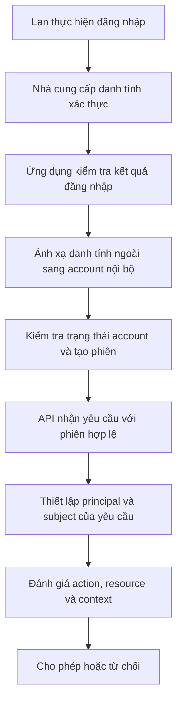

# Account, principal và subject

Trong một hệ thống quản lý danh tính và quyền truy cập (IAM), câu hỏi “ai đang truy cập?” thường có nhiều lớp trả lời. Một nhân viên có hồ sơ trong hệ thống nhân sự, có tài khoản trên ứng dụng, đăng nhập qua nhà cung cấp danh tính và gửi yêu cầu bằng một phiên đã xác thực. Khi yêu cầu đến API, hệ thống có thể kiểm tra quyền của người dùng, của ứng dụng đang gọi thay người dùng, hoặc của cả hai.

Ba từ **account**, **principal** và **subject** giúp mô tả những lớp này. Chúng liên quan chặt chẽ nhưng không phải ba tên gọi có thể thay thế cho nhau trong mọi ngữ cảnh. Hiểu rõ chúng là nền tảng để thiết kế xác thực, quản lý phiên, RBAC, ABAC, SSO và vòng đời quyền theo nguyên tắc ít quyền nhất.

## 1. Ba khái niệm cốt lõi

### 1.1. Account: bản ghi được hệ thống quản lý

**Account**, hay tài khoản, là một bản ghi mà hệ thống tạo và quản lý để biểu diễn một người, một ứng dụng, một dịch vụ hoặc một thực thể khác trong phạm vi của hệ thống đó.

Một tài khoản thường có:

- Mã định danh nội bộ.
- Loại tài khoản: người dùng, dịch vụ, tài khoản đặc quyền hoặc loại khác.
- Trạng thái: chờ kích hoạt, hoạt động, bị khóa, bị vô hiệu hóa hoặc đã xóa.
- Thông tin hồ sơ và liên kết tới danh tính bên ngoài.
- Quan hệ với tổ chức, nhóm, vai trò và các quyền được cấp.
- Chính sách hoặc tham chiếu đến phương thức xác thực, nếu tài khoản có khả năng đăng nhập.

Ví dụ, ứng dụng quản lý hóa đơn có tài khoản nội bộ `acct-2048` của Lan. Bản ghi này chứa trạng thái hoạt động, đơn vị công tác và liên kết tới tài khoản của Lan ở hệ thống SSO.

Tài khoản không nhất thiết lưu mật khẩu. Một ứng dụng dùng SSO có thể chỉ lưu mã tài khoản nội bộ cùng liên kết tới nhà cung cấp danh tính. Một tài khoản cũng có thể tồn tại trước khi người dùng đăng nhập lần đầu hoặc tiếp tục tồn tại dưới dạng lưu vết sau khi quyền truy cập đã bị thu hồi.

> Trong bài này, “account” chủ yếu có nghĩa là tài khoản người dùng hoặc dịch vụ trong một miền quản lý. Một số nền tảng dùng cùng từ này để chỉ vùng chứa tài nguyên, tổ chức hoặc phạm vi thanh toán. Khi đọc tài liệu sản phẩm, cần xác định nghĩa cụ thể trước khi áp dụng mô hình.

### 1.2. Principal: danh tính dùng trong xử lý bảo mật

**Principal** là danh tính được hệ thống bảo mật nhận diện và sử dụng khi xử lý xác thực, cấp quyền hoặc ghi nhận hành động.

Trong một yêu cầu đã xác thực, principal thường là danh tính mà hệ thống đã thiết lập sau khi kiểm tra bằng chứng xác thực. Principal có thể đại diện cho:

- Một người dùng.
- Một ứng dụng hoặc dịch vụ.
- Một workload như tiến trình, pod hoặc tác vụ chạy theo lịch.
- Một danh tính được ủy quyền thực hiện hành động trong phạm vi nhất định.

Ví dụ:

```text
Principal: user:acct-2048
Principal: service:invoice-exporter
```

Tiền tố `user:` và `service:` ở đây chỉ là quy ước minh họa nhằm tránh nhầm loại danh tính; không phải cú pháp IAM bắt buộc.

Không nên hiểu principal luôn là một đối tượng chỉ xuất hiện sau đăng nhập. Khi cấu hình chính sách, hệ thống có thể gọi một danh tính được khai báo sẵn là principal, dù chưa có yêu cầu nào đang chạy. Một số framework cũng dùng principal mặc định cho truy cập ẩn danh. Vì vậy, **có principal trong cấu trúc dữ liệu chưa đủ để kết luận yêu cầu đã được xác thực**; cần kiểm tra trạng thái và nguồn thiết lập danh tính.

### 1.3. Subject: chủ thể mà ngữ cảnh bảo mật đang nói tới

**Subject**, hay chủ thể, là thực thể được mô hình bảo mật xem là bên thực hiện hoặc yêu cầu một hành động. Trong mô hình cấp quyền phổ biến:

```text
Subject + Action + Resource + Context → Permit hoặc Deny
```

Ví dụ:

- Subject: tài khoản Lan.
- Action: đọc hóa đơn.
- Resource: hóa đơn `inv-9001`.
- Context: tổ chức hiện tại, trạng thái phiên và mức xác thực.

Principal thường cung cấp danh tính đã được thiết lập để xây dựng subject của yêu cầu. Subject có thể bao gồm nhiều thông tin hơn một mã danh tính: loại thực thể, tenant, thuộc tính, nhóm và quan hệ ủy quyền.

Tuy nhiên, **nghĩa chính xác của subject phụ thuộc mô hình hoặc API**:

- Trong mô hình cấp quyền, subject là chủ thể được đánh giá.
- Trong một token, trường `sub` chỉ định chủ thể mà token nói tới theo quy tắc của loại token đó.
- Trong Java JAAS, một `Subject` có thể chứa một tập các `Principal` cùng thông tin xác thực; principal và subject không phải hai đối tượng đồng nhất.

Do đó, không có quy tắc tổng quát “subject luôn bằng principal” hoặc “subject luôn là bản ghi account”. Mỗi hệ thống cần định nghĩa rõ cách ánh xạ giữa chúng.

### 1.4. Bảng phân biệt nhanh

| Khái niệm | Câu hỏi chính | Ví dụ | Điểm cần nhớ |
|---|---|---|---|
| Account | Hệ thống quản lý bản ghi nào? | Tài khoản nội bộ `acct-2048` | Có vòng đời tạo, cấp phát, khóa và thu hồi |
| Principal | Danh tính nào được cơ chế bảo mật nhận diện? | `user:acct-2048` trong yêu cầu đã xác thực | Phải biết loại danh tính và nguồn tin cậy |
| Subject | Đang đánh giá hoặc mô tả chủ thể nào? | Lan cùng thuộc tính tenant trong quyết định đọc hóa đơn | Ý nghĩa phụ thuộc mô hình, framework hoặc loại token |
| Credential | Bằng chứng nào dùng để chứng minh danh tính hoặc quyền gọi? | Mật khẩu, khóa riêng, token truy cập | Là bằng chứng, không phải bản thân account |
| Session | Ngữ cảnh truy cập nào được duy trì qua nhiều yêu cầu? | Phiên trình duyệt sau khi Lan đăng nhập | Có thời hạn và cơ chế chấm dứt riêng |

## 2. Đi từ con người tới một quyết định cấp quyền

Xét ứng dụng hóa đơn của công ty An Bình:

1. Lan là một người trong tổ chức.
2. Nhà cung cấp danh tính của công ty quản lý danh tính đăng nhập của Lan.
3. Ứng dụng hóa đơn có tài khoản nội bộ `acct-2048`, liên kết với danh tính bên ngoài đó.
4. Lan hoàn tất xác thực tại nhà cung cấp danh tính.
5. Ứng dụng kiểm tra kết quả đăng nhập, tìm đúng liên kết và thiết lập phiên.
6. Khi Lan gọi API, lớp bảo mật khôi phục principal từ ngữ cảnh phiên hợp lệ.
7. Lớp cấp quyền xây dựng subject và kiểm tra quyền với hành động, tài nguyên, tenant và các điều kiện liên quan.

Sơ đồ sau mô tả luồng dùng phiên, không phải quy trình chung cho mọi loại token:



Có hai quyết định khác nhau:

- **Xác thực:** bằng chứng có đủ để thiết lập danh tính này không?
- **Cấp quyền:** chủ thể này có được thực hiện hành động cụ thể trên tài nguyên cụ thể trong hoàn cảnh hiện tại không?

Việc xác thực thành công không có nghĩa Lan được xem mọi hóa đơn. Tài khoản vẫn có thể bị vô hiệu hóa ở ứng dụng, không thuộc tenant của hóa đơn hoặc thiếu quyền đọc.

MFA có thể tăng mức bảo đảm của bước xác thực hoặc đáp ứng điều kiện xác thực bổ sung. MFA không tự cấp cho subject một vai trò quản trị.

## 3. Quan hệ giữa các thực thể không nhất thiết là một–một

### 3.1. Một người có thể có nhiều account

Lan có thể có:

- Tài khoản làm việc thông thường.
- Tài khoản quản trị dùng cho công việc đặc quyền.
- Tài khoản ở một môi trường thử nghiệm riêng.

Cả ba liên quan tới cùng một người nhưng là ba tài khoản có phạm vi quyền và vòng đời khác nhau. Việc tách tài khoản giúp hạn chế sử dụng đặc quyền trong công việc hàng ngày và ghi nhận rõ hành động nào dùng quyền quản trị.

Để kiểm toán, có thể lưu quan hệ từ các tài khoản tới cùng hồ sơ nhân sự. Không vì quan hệ này mà tự động hợp nhất quyền của chúng.

### 3.2. Một account có thể hỗ trợ nhiều cách xác thực

Tài khoản `acct-2048` có thể cho phép đăng nhập bằng SSO và một phương thức dự phòng được kiểm soát. Trong mỗi luồng, hệ thống phải liên kết kết quả xác thực với đúng account theo quy tắc rõ ràng.

Không nên tạo một account mới chỉ vì người dùng đổi khóa bảo mật, đổi mật khẩu hoặc thay chứng thư. Credential có vòng đời riêng. Việc thay credential thường không cần thay danh tính ổn định của account.

Ngược lại, nhiều credential không đồng nghĩa với MFA. MFA đòi hỏi phối hợp các yếu tố xác thực theo chính sách phù hợp; hai mật khẩu vẫn là cùng một loại yếu tố.

### 3.3. Một account có thể gắn với nhiều danh tính ngoài

Một ứng dụng có thể cho cùng account đăng nhập qua hai nhà cung cấp danh tính khác nhau. Mỗi liên kết bên ngoài cần lưu riêng nguồn phát hành và định danh chủ thể của nguồn đó.

Việc liên kết tài khoản phải dựa trên bằng chứng sở hữu và quy trình được kiểm soát. Không tự động gộp hai account chỉ vì chúng có cùng email hoặc tên hiển thị. Email có thể thay đổi, được tái cấp hoặc mang ý nghĩa khác nhau giữa các nguồn danh tính.

### 3.4. Một người có thể có nhiều membership trong cùng ứng dụng

Trong một ứng dụng nhiều tenant, Lan có thể là người xem tại tenant A và là người duyệt hóa đơn tại tenant B.

Có thể thiết kế một account dùng chung cho Lan và hai membership:

```text
acct-2048
  ├─ membership tại tenant-a: invoice_viewer
  └─ membership tại tenant-b: invoice_approver
```

Đây là một lựa chọn thiết kế, không phải quy tắc bắt buộc. Dù dùng một account hay nhiều account, quyết định cấp quyền vẫn phải xác định đúng tenant và quyền trong tenant đó.

Không thể suy ra rằng quyền của Lan tại tenant B áp dụng cho một hóa đơn của tenant A.

### 3.5. Workload cũng có danh tính

Một tác vụ xuất báo cáo có thể hoạt động mà không có người dùng tương tác. Khi đó:

- Account hoặc cấu hình quản lý danh tính ghi nhận dịch vụ nào được phép hoạt động.
- Principal của yêu cầu là danh tính workload.
- Subject được đánh giá là workload đó, cùng các thuộc tính và giới hạn của nó.

Một số nền tảng thiết lập principal của workload từ quan hệ tin cậy và cấu hình định danh mà không cần một hàng “user account” trong cơ sở dữ liệu ứng dụng.

Điều này cho thấy principal không bắt buộc phải ánh xạ tới tài khoản con người. Thiết kế IAM cần phân biệt danh tính con người và danh tính workload, đồng thời quản lý chủ sở hữu, mục đích và vòng đời của cả hai.

## 4. Phân biệt identifier, credential và quyền

Một sai lầm phổ biến là coi mọi chuỗi liên quan đến đăng nhập đều là “danh tính”.

| Thành phần | Chức năng | Có tự chứng minh quyền truy cập không? |
|---|---|---|
| `account_id` | Chỉ tới một account nội bộ | Không |
| Username hoặc email | Giúp tìm account hoặc hiển thị thông tin | Không |
| `principal_id` | Chỉ tới danh tính trong miền bảo mật | Không, cần ngữ cảnh tin cậy |
| Mật khẩu hoặc bằng chứng từ khóa riêng | Tham gia chứng minh danh tính theo cơ chế xác thực | Chỉ có ý nghĩa khi được kiểm tra đúng cơ chế |
| Session cookie hoặc access token | Cho phép hệ thống khôi phục hoặc xác minh ngữ cảnh truy cập theo thiết kế | Phải kiểm tra tính hợp lệ và tiếp tục cấp quyền |
| Role hoặc permission | Mô tả quyền hoặc tập quyền được cấp | Phải gắn với đúng chủ thể, phạm vi và trạng thái |

Biết mã `acct-2048` không chứng minh người gửi yêu cầu là Lan. API không được tin một trường `accountId` do client gửi rồi thiết lập principal từ giá trị đó.

Ví dụ, trong yêu cầu:

```http
GET /api/invoices/inv-9001
X-User-Id: acct-2048
```

header `X-User-Id` chỉ là dữ liệu do bên gửi cung cấp nếu API trực tiếp cho phép client đặt nó. Một hệ thống có gateway tin cậy có thể truyền thông tin danh tính qua header, nhưng phải bảo vệ đường truyền, xác thực gateway và ngăn client giả mạo hoặc bỏ qua gateway. Tên header tự nó không tạo ra sự tin cậy.

Tương tự, mã tài nguyên trong URL chỉ xác định tài nguyên được yêu cầu. Nó không chứng minh subject có quyền truy cập tài nguyên đó.

## 5. Định danh ổn định và phạm vi định danh

### 5.1. Định danh phải đi cùng miền có ý nghĩa

Chuỗi `42` không đủ để nhận diện một người dùng nếu hai nhà cung cấp danh tính đều có subject mang giá trị `42`.

Một khóa liên kết bên ngoài nên chứa ít nhất thông tin về nguồn phát hành và định danh trong nguồn đó. Với OIDC, cặp `issuer` và `subject` thường được biểu diễn bằng hai claim `iss` và `sub`:

```text
Identity link:
  issuer: https://login.example.test
  subject: usr-7f31
  local_account_id: acct-2048
```

Không dùng `sub` trần làm khóa duy nhất cho toàn bộ các issuer được chấp nhận.

Nếu hệ thống hỗ trợ nhiều cấu hình liên kết, nhiều loại giao thức hoặc miền danh tính có quy tắc khác nhau, mô hình dữ liệu có thể cần thêm khóa của cấu hình liên kết. Cần áp dụng quy tắc định danh của giao thức và nhà cung cấp tương ứng.

### 5.2. Subject trong OIDC không phải email

Trong một ID token OIDC hợp lệ, `sub` xác định người dùng tại issuer theo ngữ cảnh mà issuer cấp. Nó không phải:

- Địa chỉ email.
- Tên đăng nhập.
- Mã phiên.
- Một role.
- Mã account nội bộ bắt buộc của ứng dụng.

Một issuer có thể sử dụng subject dạng pairwise, khiến cùng một người nhận các giá trị `sub` khác nhau ở các nhóm client khác nhau. Vì vậy, không giả định các ứng dụng luôn nhìn thấy cùng một `sub`, kể cả khi chúng dùng chung hệ thống đăng nhập.

Liên kết chỉ được sử dụng sau khi ứng dụng đã kiểm tra kết quả xác thực theo luồng OIDC. Đọc được chuỗi `iss` và `sub` từ JSON chưa đủ để tin rằng người gửi có danh tính đó.

### 5.3. Subject trong access token phụ thuộc loại token

Không áp nghĩa của `sub` trong ID token cho mọi access token hoặc mọi hệ thống JWT.

Trong một token truy cập, chủ thể có thể là người dùng hoặc một ứng dụng/workload, tùy luồng và quy ước của hệ thống phát hành. Có access token là chuỗi opaque mà API cần tra cứu qua cơ chế được hỗ trợ, thay vì tự giải mã như JWT.

API phải xác định rõ:

- Chấp nhận loại token nào.
- Tin issuer nào và token được cấp cho API nào.
- Claim hoặc kết quả tra cứu nào xác định subject và client.
- Khi nào subject là người dùng, khi nào là workload.
- Scope, quyền và quan hệ ủy quyền được diễn giải ra sao.

ID token phục vụ kết quả xác thực tại client trong OIDC; không dùng nó làm token truy cập API chỉ vì token chứa thông tin người dùng.

### 5.4. Không tái sử dụng định danh nội bộ cho thực thể mới

Giả sử tài khoản `acct-2048` bị xóa, sau đó địa chỉ email của Lan được cấp cho một nhân viên khác. Account mới cần có định danh nội bộ khác.

Nếu tái sử dụng `acct-2048`, hệ thống có thể gán nhầm:

- Các quyền chưa được dọn sạch.
- Quyền sở hữu tài nguyên.
- Liên kết tới hệ thống bên ngoài.
- Lịch sử hành động của người cũ.

Định danh ổn định giúp theo dõi một thực thể xuyên suốt vòng đời của nó. Định danh đó không nên được chuyển cho một thực thể khác chỉ vì trùng email hoặc tên đăng nhập.

## 6. Subject, principal và actor trong luồng ủy quyền

Ứng dụng gọi API thay người dùng là trường hợp dễ gây nhầm lẫn nhất.

Giả sử Lan cho phép ứng dụng báo cáo đọc một phần dữ liệu hóa đơn. Khi ứng dụng báo cáo gọi API, cần phân biệt:

- **Người dùng được đại diện:** Lan.
- **Client hoặc actor đang thực hiện lời gọi:** ứng dụng báo cáo.
- **Account nội bộ được ánh xạ:** tài khoản của Lan trong ứng dụng hóa đơn.
- **Phạm vi ủy quyền:** phần quyền mà ứng dụng được phép sử dụng.
- **Tài nguyên và tenant đích:** dữ liệu cụ thể đang được yêu cầu.

Một mô hình ngữ cảnh có thể là:

```text
Request context:
  subject_type: human
  subject_account_id: acct-2048
  client_id: reporting-app
  tenant_id: tenant-a
  delegated_permissions:
    - invoices:read
```

Đây là mô hình minh họa, không phải bộ claim chuẩn của OAuth.

Với trường hợp này, quyết định cho phép cần xét đồng thời quyền của Lan trên tài nguyên, quyền mà ứng dụng thực sự được ủy quyền sử dụng và các điều kiện hiện hành. Không nên để scope của ứng dụng tự mở rộng quyền vốn có của người dùng.

Nếu cùng ứng dụng gọi bằng danh tính riêng để chạy tác vụ nền, subject có thể trở thành workload. Khi đó không được tự thêm một người dùng giả định vào yêu cầu.

Cũng cần phân biệt **ủy quyền** với **mạo danh được quản trị**. Chức năng hỗ trợ “xem như người dùng” phải ghi nhận được cả người thực hiện thật và người được đại diện. Nếu log chỉ lưu subject hiệu lực, tổ chức có thể không biết ai đã kích hoạt hành động.

Không phải token hay framework nào cũng biểu diễn đầy đủ chuỗi actor. Nếu sản phẩm cần thông tin đó cho cấp quyền hoặc kiểm toán, thiết kế phải có cách lưu và truyền thông tin tin cậy tương ứng.

## 7. Mô hình dữ liệu và ngữ cảnh yêu cầu

### 7.1. Tách các quan hệ có vòng đời khác nhau

Một mô hình đơn giản có thể gồm:

| Thành phần | Dữ liệu minh họa | Mục đích |
|---|---|---|
| Account | ID, loại, trạng thái | Quản lý thực thể nội bộ |
| External identity link | Issuer, subject, account ID | Liên kết kết quả xác thực với account |
| Tenant membership | Account ID, tenant ID, trạng thái | Xác định quan hệ với từng tổ chức |
| Role assignment | Chủ thể nhận quyền, role, phạm vi, thời hạn | Quản lý việc cấp quyền |
| Session | Account ID, thời điểm xác thực, thời hạn, trạng thái | Duy trì và chấm dứt truy cập |
| Workload identity configuration | Danh tính dịch vụ, chủ sở hữu, quan hệ tin cậy | Quản lý truy cập của workload |

Không nhất thiết mỗi hàng trong bảng là một bảng SQL. Điểm quan trọng là không gộp chúng thành một trường mơ hồ như `user`, rồi dùng cùng trường đó cho mọi mục đích.

Ví dụ:

- Đổi tên hiển thị không làm thay đổi account ID.
- Hết hạn membership tại tenant A không bắt buộc xóa account toàn cục.
- Thu hồi một role không nhất thiết đóng mọi phiên.
- Vô hiệu hóa account cần tác động tới truy cập theo chính sách thu hồi đã thiết kế.

### 7.2. Ngữ cảnh bảo mật ở phía server

Ví dụ giả mã:

```text
function readInvoice(request, invoiceId):
    auth = authenticateRequest(request)
    if auth is invalid:
        rejectUnauthenticated()

    account = resolveAccount(auth.trustedIdentity)
    if account is missing or account.status != ACTIVE:
        deny()

    invoice = loadInvoice(invoiceId)
    membership = loadActiveMembership(account.id, invoice.tenantId)
    if membership is missing:
        deny()

    subject = buildSubject(
        accountId = account.id,
        accountType = account.type,
        tenantId = invoice.tenantId,
        trustedAuthenticationContext = auth.context,
        trustedDelegationContext = auth.delegation
    )

    decision = authorize(
        subject = subject,
        action = "invoice.read",
        resource = invoice,
        context = currentRequestContext()
    )

    if decision != PERMIT:
        deny()

    recordAudit(subject, auth.actor, "invoice.read", invoice.id, decision)
    return invoice
```

Mục tiêu của giả mã là làm rõ ranh giới:

1. Xác thực kiểm tra bằng chứng và thiết lập thông tin danh tính tin cậy.
2. Ánh xạ account xác định bản ghi nội bộ và trạng thái của nó.
3. Tenant và tài nguyên xác định phạm vi quyết định.
4. Cấp quyền đánh giá yêu cầu thực tế.
5. Kiểm toán lưu được chủ thể, actor nếu có, hành động và tài nguyên.

Trong triển khai thật, cách trả lỗi, truy xuất tài nguyên và ghi log còn phải phù hợp với yêu cầu bảo mật, hiệu năng và khả năng quan sát của ứng dụng.

### 7.3. Không biến principal thành toàn bộ hồ sơ người dùng

Principal thường chỉ cần thông tin phục vụ xử lý bảo mật. Đưa toàn bộ hồ sơ nhân sự, dữ liệu cá nhân hoặc mọi quan hệ quyền vào session/token có thể gây:

- Rò rỉ thông tin không cần thiết.
- Dữ liệu quyền cũ tồn tại lâu sau khi được thay đổi.
- Tăng kích thước dữ liệu truyền.
- Nhầm lẫn giữa dữ liệu hiển thị và dữ liệu được phép dùng để quyết định quyền.

Nên giữ danh tính ổn định và các thông tin cần thiết cho cơ chế đang dùng. Với thuộc tính thay đổi hoặc có yêu cầu thu hồi nhanh, cần quy định rõ nguồn dữ liệu, thời điểm làm mới và giới hạn chấp nhận dữ liệu cũ.

## 8. Áp dụng vào RBAC, ABAC và nguyên tắc ít quyền nhất

### 8.1. Trong RBAC

RBAC gán quyền thông qua role. Role phải gắn với một chủ thể hoặc quan hệ thành viên cụ thể trong phạm vi xác định.

Ví dụ:

```text
Assignee: user:acct-2048
Role: invoice_viewer
Scope: tenant-a
```

Tên role giống nhau ở hai tenant không có nghĩa việc gán role ở tenant này có hiệu lực ở tenant kia.

Không nên dùng email làm khóa duy nhất của role assignment. Khi email thay đổi hoặc được tái cấp, quyền có thể đi theo sai thực thể.

### 8.2. Trong ABAC

ABAC đánh giá thuộc tính của subject, tài nguyên và ngữ cảnh.

Ví dụ chính sách minh họa:

```text
Cho phép invoice.read khi:
  subject.membershipStatus == ACTIVE
  và subject.tenantId == resource.tenantId
  và subject.department == resource.department
  và subject có quyền invoice.read trong tenant đó
```

Thuộc tính subject phải đến từ nguồn có thẩm quyền hoặc một cơ chế xác minh phù hợp. Không chấp nhận `department=finance` trong request body làm bằng chứng rằng người gọi thuộc phòng tài chính.

Cũng không nên mặc định mọi thuộc tính từ nhà cung cấp danh tính đều được phép dùng để cấp quyền. Hệ thống cần biết issuer nào có thẩm quyền với thuộc tính nào, cách ánh xạ và mức độ cập nhật của dữ liệu.

### 8.3. Với workload và tài khoản đặc quyền

Tài khoản xuất hóa đơn chỉ cần đọc và xuất dữ liệu trong phạm vi công việc. Nó không nên được cấp quyền quản trị người dùng chỉ vì cả hai chức năng chạy trong cùng hệ thống.

Tương tự, tài khoản quản trị của Lan cần được kiểm soát riêng với tài khoản làm việc thường ngày. Cơ chế cấp quyền tạm thời, xác thực bổ sung và kiểm toán có thể dựa vào việc phân biệt chính xác principal đang sử dụng.

Danh tính càng rõ, việc giới hạn quyền và truy tìm trách nhiệm càng cụ thể.

## 9. Vòng đời account không đồng nhất với vòng đời truy cập

Một account có thể bị vô hiệu hóa trong cơ sở dữ liệu trong khi phiên hoặc token đã phát hành vẫn còn được hệ thống khác chấp nhận.

Ví dụ:

1. Lúc 09:00, Lan đăng nhập và nhận quyền truy cập.
2. Lúc 09:10, quản trị viên vô hiệu hóa account.
3. Lúc 09:12, Lan gửi một token chưa hết hạn tới API.
4. Nếu API chỉ kiểm tra tính hợp lệ của token và không có cơ chế cập nhật trạng thái hoặc thu hồi phù hợp, yêu cầu có thể vẫn được chấp nhận.

Vì vậy, chính sách ngừng truy cập cần chỉ rõ tác động tới:

- Account và membership.
- Session.
- Refresh token và khả năng cấp token mới.
- Access token đã phát hành.
- API key, chứng thư hoặc credential của workload.
- Bản sao quyền và trạng thái trong các hệ thống liên kết.

SSO không tự bảo đảm rằng khóa tài khoản ở một nơi sẽ chấm dứt tức thì mọi quyền truy cập ở mọi ứng dụng. Độ trễ phụ thuộc cách ứng dụng kiểm tra trạng thái, cơ chế thu hồi, thời hạn token, cache và đồng bộ cấp phát tài khoản.

Ở mức thiết kế nền tảng, cần trả lời được: **sau khi thu hồi, tối đa bao lâu một yêu cầu cũ còn có thể được chấp nhận, và cơ chế nào thực thi giới hạn đó?**

Không nên xóa toàn bộ dấu vết định danh chỉ để ngăn truy cập. Có thể cần giữ bản ghi hoặc tham chiếu định danh theo chính sách lưu giữ, trong khi tách biệt và chấm dứt khả năng xác thực, phát hành phiên và sử dụng quyền.

## 10. Kiểm toán cần lưu được những gì?

Bản ghi kiểm toán hữu ích cần trả lời “ai đã làm gì, trên đối tượng nào, trong ngữ cảnh nào và kết quả ra sao”.

Ví dụ minh họa:

```json
{
  "event": "authorization_decision",
  "subject_type": "human",
  "subject_account_id": "acct-2048",
  "identity_issuer": "https://login.example.test",
  "identity_subject": "usr-7f31",
  "actor_client_id": "reporting-app",
  "tenant_id": "tenant-a",
  "action": "invoice.read",
  "resource_id": "inv-9001",
  "decision": "DENY",
  "reason": "MISSING_PERMISSION",
  "request_id": "req-c82a"
}
```

Đây là cấu trúc sự kiện minh họa; hệ thống thực tế cần thêm thời điểm và các trường phù hợp với mục tiêu vận hành.

Một số nguyên tắc:

- Ghi định danh ổn định thay vì chỉ ghi tên hiển thị.
- Phân biệt subject hiệu lực và actor/client trong luồng ủy quyền.
- Ghi tenant hoặc phạm vi cần thiết để giải thích quyết định.
- Với workload, lưu danh tính workload và thông tin liên quan đến chủ sở hữu qua hệ thống quản lý danh tính.
- Không ghi mật khẩu, private key, session cookie hoặc toàn bộ bearer token vào log.
- Chỉ ghi thông tin danh tính và thuộc tính cần thiết, với quyền truy cập và thời hạn lưu phù hợp.

Một sự kiện “Lan đọc hóa đơn” là chưa đủ nếu nhiều người có cùng tên hoặc lời gọi thực tế do một ứng dụng thực hiện thay Lan.

## 11. Những lỗi thiết kế thường gặp

| Lỗi | Hậu quả | Cách thiết kế phù hợp hơn |
|---|---|---|
| Đồng nhất account với email | Đổi hoặc tái cấp email làm sai liên kết quyền | Dùng account ID ổn định; email là thuộc tính |
| Tin `userId` do client gửi | Kẻ gọi có thể chọn danh tính của người khác | Lấy principal từ cơ chế xác thực tin cậy |
| Dùng `sub` không kèm issuer | Hai nguồn danh tính có thể bị nhập nhầm | Ánh xạ theo nguồn và định danh có phạm vi |
| Tự liên kết account theo email trùng nhau | Có thể gộp nhầm danh tính hoặc chiếm account | Có quy trình liên kết và bằng chứng sở hữu |
| Xem xác thực thành công là đủ quyền | Người dùng truy cập ngoài phạm vi được cấp | Kiểm tra subject, action, resource và context |
| Gộp người dùng và client thành một chuỗi không rõ nghĩa | Không giải thích được ủy quyền và trách nhiệm | Giữ rõ subject, client/actor và phạm vi ủy quyền |
| Dùng chung một account cho nhiều người | Mất khả năng quy trách nhiệm cá nhân | Dùng danh tính cá nhân và cấp quyền qua nhóm/role |
| Dùng account quản trị cho mọi tác vụ | Tăng phạm vi tác động khi phiên bị lộ | Tách công việc thường ngày và công việc đặc quyền |
| Khóa account nhưng bỏ qua session/token | Truy cập đã cấp có thể tiếp tục | Thiết kế thu hồi trên các thành phần liên quan |
| Tin tenant do client khai báo mà không kiểm tra | Truy cập chéo tenant | Kiểm tra membership và tenant của tài nguyên |

Tài khoản dùng chung đôi khi tồn tại vì giới hạn của một hệ thống cũ. Khi đó, cần kiểm soát người được sử dụng, cách lấy credential và dấu vết truy cập; việc có lý do vận hành không khôi phục được khả năng phân biệt cá nhân vốn đã mất ở hệ thống đích.

## 12. Tình huống thực hành

### Tình huống A: Một người, hai vai trò ở hai tenant

Lan dùng cùng một account cho hai tổ chức:

```text
tenant-a → invoice_viewer
tenant-b → invoice_approver
```

Lan yêu cầu duyệt hóa đơn thuộc tenant A.

**Phân tích:** principal vẫn là danh tính của Lan. Subject của quyết định cần gắn với ngữ cảnh tenant A. Quyền duyệt ở tenant B không đáp ứng yêu cầu tại tenant A. Hệ thống phải từ chối nếu Lan không có quyền duyệt phù hợp tại tenant A.

### Tình huống B: Tác vụ đêm xuất báo cáo

Một tác vụ chạy lúc nửa đêm gọi API để xuất báo cáo đã được tổ chức cho phép.

**Phân tích:** principal có thể là workload `service:invoice-exporter`. Không cần giả định có một người dùng đang đăng nhập. Hệ thống cấp quyền cho workload theo mục đích, tenant và tài nguyên được cấp, đồng thời quản lý chủ sở hữu và credential hoặc quan hệ tin cậy của nó.

Người tạo tác vụ có thể được lưu như thông tin quản trị hoặc actor ở bước cấu hình. Người đó không tự động trở thành subject của mọi lời gọi chạy nền sau này.

### Tình huống C: Hai issuer có cùng subject

Hai nhà cung cấp danh tính đều trả về `sub=usr-100`.

**Phân tích:** không có đủ căn cứ coi đây là cùng một người. Cần phân biệt từng cặp issuer–subject và chỉ liên kết với cùng account khi có quy trình hợp lệ. Trùng chuỗi định danh không tạo ra quan hệ tin cậy giữa hai miền.

### Tình huống D: Lan đổi email

Email của Lan đổi từ `lan.old@example.test` sang `lan.new@example.test`.

**Phân tích:** nếu vẫn là cùng account và liên kết danh tính hợp lệ, account ID không cần đổi. Các role assignment, quyền sở hữu và log vẫn tham chiếu định danh ổn định. Email mới được cập nhật như thuộc tính theo nguồn dữ liệu có thẩm quyền.

### Tình huống E: Ứng dụng báo cáo gọi thay Lan

Ứng dụng có phạm vi được ủy quyền là đọc hóa đơn, nhưng yêu cầu xóa một hóa đơn.

**Phân tích:** quyền của Lan và phạm vi được ủy quyền cho ứng dụng đều cần được kiểm tra. Việc Lan có quyền xóa không tự cấp quyền xóa cho ứng dụng báo cáo. API phải từ chối khi phạm vi ủy quyền không đáp ứng hành động.

## 13. Câu hỏi tự kiểm tra

1. Một account dùng SSO có bắt buộc lưu mật khẩu không?
2. Vì sao cùng một người có thể có hai principal khác nhau trong hai lần truy cập?
3. Account ID trong request body có đủ để thiết lập danh tính người gọi không?
4. Trong OIDC, vì sao không dùng email hoặc `sub` trần làm khóa liên kết chung cho mọi issuer?
5. Khi ứng dụng gọi thay người dùng, cần phân biệt những bên nào?
6. Vì sao role ở tenant A không tự có hiệu lực tại tenant B?
7. Khi account bị vô hiệu hóa, cần xem xét thêm những thành phần truy cập nào?
8. Principal của một tác vụ tự động có nhất thiết là một tài khoản con người không?

Gợi ý trả lời:

1. Không. Account có thể liên kết tới nhà cung cấp danh tính và không xác thực bằng mật khẩu cục bộ.
2. Người đó có thể sử dụng account thường, account quản trị hoặc danh tính thuộc miền khác; quan hệ với cùng một người không hợp nhất các quyền.
3. Không. Đây là dữ liệu do client cung cấp; principal phải được thiết lập qua cơ chế tin cậy.
4. Email có thể thay đổi hoặc được tái cấp; `sub` có phạm vi tại issuer và còn có thể khác nhau theo cấu hình pairwise.
5. Subject/người dùng được đại diện, client hoặc actor thực hiện lời gọi, cùng phạm vi và điều kiện ủy quyền.
6. Role assignment có phạm vi. Cấp quyền phải đối chiếu đúng tenant của tài nguyên.
7. Session, refresh token, access token, credential và dữ liệu quyền hoặc trạng thái tại các hệ thống liên quan.
8. Không. Workload có thể dùng danh tính riêng và phải được quản lý vòng đời, chủ sở hữu và quyền phù hợp.

## 14. Những điểm cần ghi nhớ

Account là bản ghi được quản lý; principal là danh tính mà cơ chế bảo mật nhận diện; subject là chủ thể mà một mô hình, quyết định hoặc token đang mô tả. Cách ánh xạ giữa chúng phải được định nghĩa theo hệ thống cụ thể.

Thiết kế tốt giữ định danh ổn định, phân biệt bằng chứng xác thực với danh tính, phân biệt người dùng với workload và actor, đồng thời gắn mọi quyết định quyền với tài nguyên cùng phạm vi thực tế.

Từ nền tảng này, MFA giúp kiểm soát mức bảo đảm xác thực; SSO và liên kết danh tính giải quyết ánh xạ giữa các miền; RBAC và ABAC quyết định quyền; quản lý phiên, đặc quyền và vòng đời account giúp duy trì hoặc thu hồi truy cập theo chính sách.

