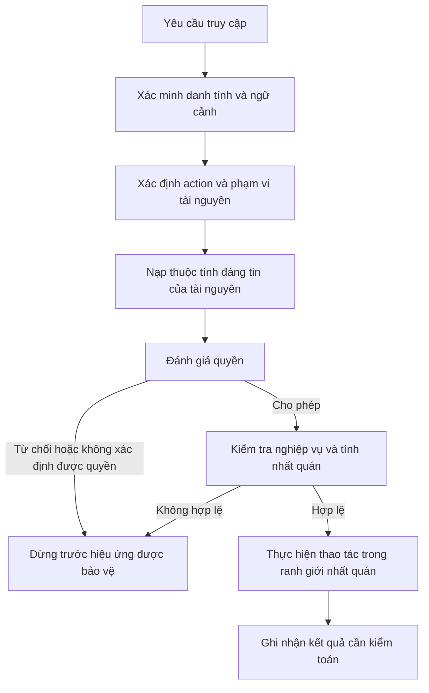

# Resource và protected operation

## Mục tiêu bài học

Trong nền tảng quản lý danh tính và quyền truy cập (IAM), hệ thống cần biết **ai đang yêu cầu**, **muốn thực hiện thao tác gì** và **thao tác đó tác động lên tài nguyên nào**. Xác thực danh tính chỉ giải quyết một phần của câu hỏi này. Một người đã đăng nhập vẫn có thể không được phép đọc hóa đơn của khách hàng khác, xuất toàn bộ dữ liệu hoặc thay đổi quyền của đồng nghiệp.

Bài học tập trung vào hai thành phần của quyết định cấp quyền:

- **Resource**: tài nguyên được truy cập hoặc chịu tác động.
- **Protected operation**: thao tác mà hệ thống phải kiểm tra quyền trước khi cho phép thực hiện.

Sau bài học, bạn có thể xác định tài nguyên ở cấp loại, đối tượng và tập hợp; đặt tên thao tác theo ý nghĩa nghiệp vụ; thiết kế điểm kiểm tra quyền; và nhận diện những đường truy cập dễ bỏ sót như tải tệp, xử lý hàng loạt hoặc công việc nền. Đây là cơ sở để áp dụng RBAC, ABAC, nguyên tắc ít quyền nhất và kiểm toán trong các bài toán IAM tiếp theo.

## 1. Resource là gì?

**Resource là đối tượng hoặc phạm vi mà một chính sách truy cập bảo vệ.** Tài nguyên không bắt buộc phải là một tệp hay một bản ghi cơ sở dữ liệu.

Ví dụ:

| Bối cảnh | Resource có thể được bảo vệ | Thao tác liên quan |
| --- | --- | --- |
| Ứng dụng quản lý công việc | Dự án, nhiệm vụ, tệp đính kèm | Xem dự án, giao việc, tải tệp |
| Hệ thống tài chính | Hóa đơn, khoản thanh toán, báo cáo | Đọc, phê duyệt, chi trả, xuất báo cáo |
| Hạ tầng | Máy ảo, cơ sở dữ liệu, kho bí mật | Khởi động, truy vấn, đọc bí mật |
| Quản trị IAM | Tài khoản, nhóm, vai trò, liên kết cấp quyền | Khóa tài khoản, thêm thành viên, gán vai trò |
| Dịch vụ vận hành | Hàng đợi, công việc xử lý, phiên quản trị | Gửi tác vụ, hủy công việc, thu hồi phiên |

Điểm chung là tài nguyên có **danh tính hoặc phạm vi xác định**, có những thao tác được thực hiện trên nó và có quy tắc kiểm soát những thao tác đó.

### 1.1. Loại tài nguyên và tài nguyên cụ thể

Phân biệt hai mức:

- **Resource type**: loại tài nguyên, chẳng hạn `invoice`, `project` hoặc `role-binding`.
- **Resource instance**: một đối tượng cụ thể, chẳng hạn hóa đơn `INV-204` của tenant `tenant-a`.

Quyền thao tác trên một loại tài nguyên chưa đủ để kết luận rằng người dùng được thao tác trên mọi đối tượng thuộc loại đó.

Ví dụ, vai trò kế toán có thể mang quyền `invoice:read`, nhưng chính sách còn giới hạn hóa đơn trong tenant của người dùng. Nếu chỉ kiểm tra vai trò mà bỏ qua hóa đơn cụ thể, một kế toán có thể đọc dữ liệu của tổ chức khác.

### 1.2. Tập hợp và phạm vi cũng là resource

Một yêu cầu tạo hóa đơn chưa có hóa đơn đích tồn tại. Một yêu cầu liệt kê hóa đơn có thể trả về nhiều đối tượng. Vì vậy, mô hình tài nguyên cần biểu diễn cả **phạm vi chứa tài nguyên**:

```text
tenant-a
└── project-p7
    └── invoices
        ├── INV-204
        └── INV-205
```

Trong mô hình minh họa này:

- Tạo hóa đơn được kiểm tra trên phạm vi chứa hóa đơn của `project-p7`.
- Đọc hóa đơn được kiểm tra trên `INV-204` cụ thể.
- Liệt kê hóa đơn được kiểm tra trên tập hợp và giới hạn kết quả theo quyền đối với các đối tượng bên trong.

Việc cho phép truy cập tài nguyên cha **không tự động** cho phép mọi thao tác trên mọi tài nguyên con. Quan hệ kế thừa phải được quy định trong chính sách. Được xem một dự án không nhất thiết được xem bí mật tích hợp hoặc sửa cấu hình quyền của dự án đó.

### 1.3. Resource không đồng nhất với bảng dữ liệu

Một hóa đơn nghiệp vụ có thể gồm dữ liệu ở nhiều bảng: thông tin chung, dòng hàng, thuế và lịch sử phê duyệt. Hệ thống vẫn có thể coi toàn bộ đó là một resource `invoice`.

Ngược lại, một bản ghi có thể chứa nhiều nhóm dữ liệu cần bảo vệ khác nhau. Hồ sơ nhân viên chứa tên hiển thị, số tài khoản và thông tin lương. Quyền xem hồ sơ không mặc nhiên cho phép đọc mọi trường.

Thiết kế resource nên bám vào **ranh giới dữ liệu và trách nhiệm nghiệp vụ**, sau đó ánh xạ xuống mô hình lưu trữ. Nếu lấy nguyên cấu trúc bảng làm mô hình quyền, quyền dễ bị thay đổi theo chi tiết triển khai và có thể không phản ánh đúng tác động thực tế.

## 2. Protected operation là gì?

**Protected operation là thao tác cần một quyết định cấp quyền trước khi tạo ra hiệu ứng được bảo vệ.** Hiệu ứng đó có thể là đọc dữ liệu, thay đổi trạng thái, tiêu thụ tài nguyên hoặc thay đổi quyền truy cập.

Không chỉ thao tác ghi mới cần bảo vệ:

- Đọc thông tin lương có thể làm lộ dữ liệu nhạy cảm.
- Tải báo cáo có thể lấy đi toàn bộ dữ liệu của một phòng ban.
- Tìm kiếm có thể tiết lộ sự tồn tại của khách hàng.
- Khởi động một tác vụ tính toán có thể phát sinh chi phí.
- Xem danh sách thành viên quản trị có thể tiết lộ cấu trúc đặc quyền.

Một thao tác công khai cũng cần được xác định rõ là công khai. Ví dụ, xem trang giới thiệu sản phẩm có thể không cần danh tính người dùng; điều đó không làm cho mọi API đọc dữ liệu sản phẩm đều trở thành API công khai.

### 2.1. Phân biệt action và việc thực thi operation

Trong bài này:

- **Action** là tên thao tác dùng trong chính sách, ví dụ `invoice:approve`.
- **Operation** là hành vi cụ thể mà hệ thống thực hiện, ví dụ chuyển hóa đơn `INV-204` từ trạng thái chờ duyệt sang đã duyệt.

Một action có thể được thực thi qua nhiều điểm vào: REST API, GraphQL, giao diện quản trị, dòng lệnh hoặc công việc nền. Tất cả các điểm vào phải tuân theo cùng ý nghĩa bảo vệ.

Tên như `invoice:approve` trong bài chỉ là quy ước minh họa. Không có cú pháp đặt tên action chung bắt buộc cho mọi nền tảng IAM.

### 2.2. HTTP method không diễn tả đầy đủ quyền nghiệp vụ

| Yêu cầu | Action nghiệp vụ minh họa | Vì sao cần phân biệt? |
| --- | --- | --- |
| `GET /invoices/INV-204` | `invoice:read` | Đọc một hóa đơn |
| `POST /invoices/INV-204/approve` | `invoice:approve` | Chấp thuận trách nhiệm nghiệp vụ |
| `POST /invoices/INV-204/pay` | `invoice:pay` | Có thể tạo giao dịch tài chính |
| `POST /invoices/export` | `invoice:export` | Trích xuất một tập dữ liệu |
| `PATCH /invoices/INV-204` | Một hoặc nhiều action cập nhật được ánh xạ rõ | Sửa mô tả và đổi người thụ hưởng có tác động khác nhau |

Nếu gom tất cả thành quyền `POST` hoặc `invoice:write`, hệ thống có thể cho phép một người được sửa nội dung hóa đơn đồng thời được duyệt và chi trả hóa đơn đó.

CRUD là điểm bắt đầu hữu ích, nhưng không phải mô hình đầy đủ cho mọi nghiệp vụ. Những thao tác như `approve`, `publish`, `transfer`, `rotate-credential`, `grant-role` và `revoke-session` thường cần ý nghĩa riêng.

### 2.3. Chọn độ chi tiết có ý nghĩa

Tách action khi sự khác biệt ảnh hưởng đến quyết định ai được làm gì. Ví dụ, phân tách `invoice:edit` và `invoice:approve` hỗ trợ nguyên tắc người lập hóa đơn không tự duyệt hóa đơn của mình.

Không cần tạo một action cho từng câu lệnh SQL hoặc từng hàm nội bộ. Quá nhiều action gắn chặt với chi tiết triển khai sẽ làm chính sách khó hiểu và khó duy trì.

Một action hữu ích thường có các đặc điểm:

- Tên diễn đạt một hành vi mà người quản trị quyền hiểu được.
- Có loại tài nguyên đích rõ ràng.
- Có hiệu ứng và giới hạn được mô tả.
- Có thể ghi vào nhật ký để giải thích một quyết định truy cập.
- Không âm thầm bao gồm các hành vi nhạy cảm khác ngoài ý nghĩa đã công bố.

## 3. Một quyết định cấp quyền gồm những gì?

Có thể mô tả một yêu cầu cấp quyền theo mô hình:

```text
authorize(subject, action, resource, context) → quyết định
```

| Thành phần | Câu hỏi | Ví dụ |
| --- | --- | --- |
| Subject | Ai đang yêu cầu? | Người dùng `user-18`, dịch vụ `billing-worker` |
| Action | Muốn làm gì? | `invoice:approve` |
| Resource | Tác động lên đối tượng hoặc phạm vi nào? | `INV-204` trong `tenant-a` |
| Context | Trong điều kiện nào? | Tenant đang chọn đã được xác minh, trạng thái phiên, mức xác thực |

Subject có thể là người dùng hoặc workload. Resource có thể là dữ liệu nghiệp vụ hoặc đối tượng IAM. Cùng một tài khoản có thể là subject khi gửi yêu cầu, đồng thời là resource khi quản trị viên thực hiện thao tác khóa tài khoản đó.

### 3.1. Xác thực chưa phải là cấp quyền

Giả sử người dùng đăng nhập qua SSO và hoàn thành MFA. Hệ thống đã có thêm cơ sở tin cậy về danh tính hoặc mức xác thực, nhưng vẫn cần kiểm tra:

- Người dùng có được duyệt hóa đơn không?
- Có được duyệt hóa đơn của tenant này không?
- Có phải chính người lập hóa đơn không?
- Hóa đơn có nằm trong phạm vi được phân công không?

Tương tự, một access token hợp lệ chưa tự chứng minh quyền đối với mọi resource. Ứng dụng vẫn phải ánh xạ các quyền hoặc scope mà nó tin cậy vào action và đối tượng cụ thể.

### 3.2. Permission không phải chỉ là tên action

Trong thiết kế thực tế, một sự cấp quyền thường cần thể hiện ít nhất **action và phạm vi tài nguyên**, kèm điều kiện nếu có:

```text
Cho phép: invoice:read
Trong phạm vi: project-p7 thuộc tenant-a
Điều kiện: người yêu cầu còn là thành viên hợp lệ của dự án
```

RBAC có thể cung cấp action thông qua vai trò. ABAC có thể xét thuộc tính của subject, resource và ngữ cảnh. Các cơ chế đó vẫn cần một mô hình resource và action rõ ràng để diễn giải quyền.

Biểu thức dưới đây chỉ minh họa logic của một quy tắc phê duyệt:

```text
Có thể phê duyệt nếu đồng thời thỏa mãn:
  subject đang hoạt động
  subject có quyền invoice:approve trong phạm vi tương ứng
  subject có tư cách hợp lệ trong tenant của resource
  resource thuộc phạm vi dự án mà subject được phê duyệt
  subject.id khác resource.createdBy
```

Đây không phải cú pháp của một policy engine. Cách kết hợp các quy tắc cho phép, từ chối và ngoại lệ phải được định nghĩa rõ trong hệ thống sử dụng.

## 4. Nhận diện resource một cách chính xác

### 4.1. ID là địa chỉ, không phải bằng chứng về quyền

Một ID cho phép tìm đối tượng. Nó không chứng minh người biết ID có quyền truy cập đối tượng đó.

Đổi số tăng dần sang UUID có thể làm việc đoán ID khó hơn, nhưng không thay thế kiểm tra quyền. ID vẫn có thể xuất hiện trong URL, thông báo, nhật ký hoặc dữ liệu đã chia sẻ.

Ví dụ sau luôn cần kiểm tra quyền đối tượng, bất kể `invoiceId` được sinh theo cách nào:

```http
GET /tenants/tenant-a/invoices/INV-204
```

Backend phải xác nhận danh tính người yêu cầu, quyền trên `INV-204` và sự nhất quán giữa tenant trên đường dẫn với tenant thực của hóa đơn.

### 4.2. Namespace và tenant là một phần của định danh khi cần

Nếu `INV-204` chỉ duy nhất trong từng tenant, tra cứu bằng `invoiceId` đơn lẻ là thiếu thông tin. Khóa logic cần bao gồm tenant:

```text
(tenantId, resourceType, resourceId)
(tenant-a, invoice, INV-204)
```

Một dạng tham chiếu minh họa khác là:

```text
tenant/tenant-a/project/project-p7/invoice/INV-204
```

Chuỗi tham chiếu này chỉ giúp biểu diễn danh tính và vị trí logic. Việc nó chứa tenant hoặc project không làm nó trở thành bằng chứng cấp quyền.

Nếu ID đã duy nhất toàn hệ thống, hệ thống vẫn cần kiểm tra phạm vi tenant. Tính duy nhất của ID và quyền truy cập là hai thuộc tính khác nhau.

### 4.3. Thuộc tính dùng để cấp quyền phải đến từ nguồn đáng tin

Các thuộc tính như `tenantId`, `ownerId`, `projectId`, `classification` hoặc `createdBy` có thể quyết định quyền. Không được mặc nhiên tin chúng chỉ vì client gửi lên.

Ví dụ, người dùng gửi:

```json
{
  "invoiceId": "INV-204",
  "tenantId": "tenant-a",
  "ownerId": "user-18",
  "status": "APPROVED"
}
```

Payload này là dữ liệu đầu vào cần kiểm tra. Nó không chứng minh hóa đơn thuộc `tenant-a`, người gửi là chủ sở hữu hoặc người gửi có quyền duyệt. Với tài nguyên đã tồn tại, backend phải lấy các thuộc tính có thẩm quyền từ kho dữ liệu hoặc dịch vụ chịu trách nhiệm về tài nguyên.

Với tài nguyên mới, backend xác định phạm vi tạo hợp lệ, kiểm tra quyền trên phạm vi đó và chỉ chấp nhận các trường mà người gọi được phép thiết lập. Các giá trị do hệ thống quản lý như người tạo hoặc trạng thái phê duyệt phải có quy tắc riêng.

Ngay cả khi thuộc tính nằm trong token được xác minh, ứng dụng cũng cần xét ai phát hành thuộc tính, thuộc tính được định nghĩa cho mục đích gì và có còn đủ mới cho quyết định hiện tại không.

## 5. Ví dụ xuyên suốt: bảo vệ hóa đơn trong ứng dụng nhiều tenant

Giả sử ứng dụng có hai tổ chức `tenant-a` và `tenant-b`. Người dùng Lan là kế toán thuộc `tenant-a`, được phụ trách dự án `project-p7`.

Hóa đơn đang xét có dữ liệu do server quản lý:

```text
Resource type: invoice
ID: INV-204
Tenant: tenant-a
Project: project-p7
Created by: user-minh
State: PENDING_APPROVAL
```

Một bảng action đơn giản có thể như sau:

| Action | Resource đích | Ý nghĩa và giới hạn |
| --- | --- | --- |
| `invoice:create` | Phạm vi hóa đơn của dự án | Tạo bản nháp trong đúng tenant và dự án |
| `invoice:list` | Tập hợp hóa đơn trong phạm vi yêu cầu | Truy vấn các bản ghi được phép xuất hiện |
| `invoice:read` | Một hóa đơn cụ thể | Đọc các trường mà chính sách cho phép |
| `invoice:edit-draft` | Một hóa đơn cụ thể | Sửa các trường được phép khi còn là bản nháp |
| `invoice:approve` | Một hóa đơn cụ thể | Phê duyệt với ràng buộc phân tách nhiệm vụ |
| `invoice:pay` | Một hóa đơn cụ thể | Yêu cầu chi trả theo quy trình thanh toán |
| `invoice:export` | Tập hợp hóa đơn hoặc phạm vi báo cáo | Xuất dữ liệu trong phạm vi được cấp |

Không được suy diễn rằng action ở dòng trước bao hàm action ở dòng sau. Nếu muốn `invoice:read` đi kèm quyền tải bản PDF hóa đơn, hệ thống phải định nghĩa rõ điều đó. Nếu PDF chứa thêm dữ liệu nhạy cảm, có thể cần một action riêng.

### 5.1. Trường hợp được phép

Lan yêu cầu đọc `INV-204`. Server xác minh Lan đang hoạt động, có quyền đọc trong dự án `project-p7`, có tư cách hợp lệ ở `tenant-a` và hóa đơn thực sự thuộc phạm vi đó. Kết quả trả về chỉ chứa các trường Lan được xem.

### 5.2. Đổi ID sang tài nguyên của tenant khác

Lan đổi đường dẫn sang một hóa đơn thuộc `tenant-b`. Việc Lan có vai trò kế toán không đủ để cho phép yêu cầu. Server phải chặn vì tài nguyên nằm ngoài phạm vi được cấp.

Nếu API chỉ kiểm tra “có đăng nhập” hoặc “có vai trò kế toán” rồi truy vấn bằng ID, ranh giới quyền đối tượng đã bị bỏ qua.

### 5.3. Gọi trực tiếp thao tác phê duyệt

Giao diện không hiển thị nút “Phê duyệt” cho Lan, nhưng Lan vẫn có thể tự gửi HTTP request. Server phải kiểm tra `invoice:approve`, phạm vi tài nguyên và điều kiện người lập khác người duyệt.

Việc ẩn nút hỗ trợ trải nghiệm người dùng. Quyết định có hiệu lực phải được thực thi ở phía server hoặc thành phần tin cậy chịu trách nhiệm bảo vệ tài nguyên.

### 5.4. Quyền và tính hợp lệ nghiệp vụ cùng cần được kiểm tra

Một người có quyền phê duyệt vẫn không thể phê duyệt lại một hóa đơn đã hủy. Ngược lại, hóa đơn ở trạng thái chờ duyệt không có nghĩa mọi người đều được duyệt.

- **Kiểm tra quyền**: chủ thể có được thực hiện hành vi này trên tài nguyên này không?
- **Kiểm tra nghiệp vụ**: hành vi này có hợp lệ với dữ liệu và trạng thái hiện tại không?

Hai nhóm kiểm tra có thể dùng chung một số thuộc tính, nhưng giải quyết hai trách nhiệm khác nhau. Cả hai phải thành công trước khi hiệu ứng được ghi nhận.

## 6. Đặt điểm kiểm tra trước hiệu ứng được bảo vệ

Luồng điển hình:



Sơ đồ thể hiện trách nhiệm logic. Trong triển khai, một phần tra cứu hoặc lọc theo quyền có thể được gộp vào truy vấn dữ liệu. Không bắt buộc phải thực hiện đúng một truy vấn cho mỗi ô.

### 6.1. Đọc nội bộ để kiểm tra quyền khác với tiết lộ dữ liệu

Backend có thể cần đọc `tenantId`, `projectId` và `createdBy` để quyết định quyền. Việc đọc nội bộ này phải giới hạn trong thành phần tin cậy; nó không cho phép trả toàn bộ đối tượng cho client trước khi kiểm tra xong.

Không được gửi dữ liệu qua phản hồi, sự kiện, thông báo hoặc đường tải xuống rồi mới kiểm tra quyền sau đó.

### 6.2. Mã giả cho thao tác phê duyệt

Đoạn dưới mô tả trách nhiệm kiểm tra, không phải chương trình hoàn chỉnh hay cú pháp của thư viện IAM:

```text
function approveInvoice(request):
    subject = authenticate(request.credentials)
    scope = resolveValidatedTenantContext(subject, request.tenantId)
    action = "invoice:approve"

    begin transaction:
        invoice = loadInvoiceForProtectedUpdate(
            tenantId = scope.tenantId,
            invoiceId = request.invoiceId
        )

        if invoice does not exist:
            return responseAccordingToDisclosurePolicy()

        decision = authorize(
            subject = subject,
            action = action,
            resource = trustedAttributesOf(invoice),
            context = trustedContextOf(request, scope)
        )

        if decision is not ALLOW:
            recordAccessOutcomeWithoutSensitivePayload()
            stopWithoutChangingInvoice()

        require invoice.state == PENDING_APPROVAL
        require subject.id != invoice.createdBy

        saveApprovedStateWithConsistencyCheck(invoice, subject.id)
        recordSuccessfulApprovalReliably()
    commit transaction

    return permittedResponseFields()
```

Các điểm cần hiểu:

- `request.tenantId` là phạm vi được yêu cầu; `resolveValidatedTenantContext` phải xác minh tư cách của subject trong phạm vi đó.
- `action` được xác định từ thao tác server đang xử lý. Client không được chọn một action yếu hơn để kiểm tra thay cho hành vi thực tế.
- Thuộc tính resource lấy từ dữ liệu đáng tin, không lấy từ các trường mà client tự khai.
- Khi không có quyết định cho phép, thao tác dừng. Lỗi dịch vụ cấp quyền không được biến thành quyền truy cập.
- Cách phản hồi lỗi phụ thuộc giao thức và chính sách tiết lộ thông tin; không nhất thiết mọi tình huống dừng đều dùng cùng mã HTTP.
- Cơ chế giao dịch, khóa hoặc kiểm tra phiên bản phải phù hợp với dữ liệu mà hệ thống thực sự quản lý.

### 6.3. Khoảng cách giữa kiểm tra và sử dụng

Nếu kiểm tra quyền dựa trên dữ liệu cũ, rồi sử dụng tài nguyên đã thay đổi, quyết định ban đầu có thể không còn đúng. Đây là vấn đề **time of check to time of use**, thường viết là TOCTOU.

Ví dụ: quyền phụ thuộc vào dự án của hóa đơn. Sau khi quyền được kiểm tra, một yêu cầu khác chuyển hóa đơn sang dự án mà người gọi không được truy cập. Nếu thao tác ban đầu vẫn tiếp tục trên phiên bản mới, phạm vi đã thay đổi.

Tùy kiến trúc, hệ thống có thể dùng giao dịch, khóa phù hợp, điều kiện cập nhật theo phiên bản hoặc đánh giá lại trước hiệu ứng quan trọng. Một giao dịch trên cơ sở dữ liệu hóa đơn không tự khóa được trạng thái quyền nằm ở dịch vụ IAM khác. Nếu quyền và dữ liệu ở các hệ thống khác nhau, phải xác định rõ yêu cầu về độ mới và cách xử lý thay đổi đồng thời.

## 7. Các thao tác dễ bị mô hình hóa thiếu

### 7.1. List, search và count

Quyền đọc một hóa đơn không mặc nhiên cho phép liệt kê toàn bộ hóa đơn. Ngược lại, quyền vào màn hình danh sách không có nghĩa mọi bản ghi đều được xuất hiện.

Đối với danh sách, cần xác định:

1. Người gọi có được thực hiện truy vấn trong phạm vi này không?
2. Bản ghi nào được phép xuất hiện trong kết quả?
3. Trường nào của mỗi bản ghi được phép hiển thị?
4. Tổng số, bộ lọc gợi ý và thông tin phân trang có tiết lộ dữ liệu ngoài quyền không?

Nếu cơ sở dữ liệu đếm 200 hóa đơn nhưng người dùng chỉ được xem 12 hóa đơn, trả `total = 200` có thể làm lộ quy mô dữ liệu ngoài phạm vi. Khi chính sách yêu cầu che giấu thông tin đó, phép đếm phải áp dụng cùng phạm vi quyền.

Lọc sau khi phân trang còn có thể gây trang rỗng, số trang sai hoặc bỏ sót bản ghi hợp lệ. Cần thiết kế truy vấn và phân trang cùng cơ chế giới hạn quyền; không chỉ lọc giao diện sau khi đã gửi dữ liệu về trình duyệt.

### 7.2. Create

Vì tài nguyên mới chưa tồn tại, kiểm tra thường nhắm vào tenant, dự án, thư mục hoặc tập hợp chứa tài nguyên. Backend đồng thời kiểm tra các thuộc tính được yêu cầu khi tạo.

Ví dụ, quyền tạo hóa đơn trong `project-p7` không cho phép gửi `projectId = project-p9` trong body để tạo hóa đơn ở nơi khác. Các tham chiếu như khách hàng, dự án hoặc tài khoản thanh toán cũng phải thuộc phạm vi hợp lệ.

Nếu cho phép đặt `ownerId` là người khác, cần quy định ai được giao quyền sở hữu. Nếu không cho phép, backend tự gán theo quy tắc của hệ thống.

### 7.3. Update và từng trường dữ liệu

Quyền sửa một đối tượng có thể chỉ áp dụng cho một số trường. Ví dụ, nhân viên được đổi tên hiển thị nhưng không được tự sửa `isAdmin` hoặc danh sách vai trò.

Không ánh xạ toàn bộ payload vào thực thể dữ liệu rồi lưu mà thiếu giới hạn trường. Đây là cách dễ tạo ra thay đổi ngoài quyền thông qua việc gán hàng loạt trường, thường gọi là **mass assignment**.

Với hóa đơn, đổi mô tả có thể thuộc `invoice:edit-draft`, còn thay đổi người thụ hưởng cần hành vi và quy trình kiểm soát riêng. Khi một request chứa nhiều nhóm thay đổi, hệ thống phải kiểm tra đủ quyền cho các thay đổi thực tế hoặc từ chối request theo hợp đồng đã định.

### 7.4. Chuyển tài nguyên và thay đổi liên kết

Chuyển tài nguyên từ dự án A sang dự án B tác động lên nhiều phạm vi. Người dùng có quyền sửa tài nguyên tại A chưa chắc được đưa dữ liệu vào B hoặc làm thay đổi quyền của người trong B.

Cần định nghĩa quyền trên tài nguyên nguồn, quyền đưa tài nguyên vào đích, ràng buộc tenant và ảnh hưởng đến các liên kết cấp quyền. Với thay đổi tenant, mức kiểm soát có thể còn chặt hơn chuyển giữa hai dự án cùng tenant.

Tương tự, gắn tệp vào hóa đơn cần xác minh tệp được phép sử dụng và thuộc phạm vi phù hợp. Quyền sửa hóa đơn không tự cấp quyền truy cập mọi `fileId` được gửi lên.

### 7.5. Batch và bulk operation

Giả sử request yêu cầu xóa 20 tài nguyên, trong đó người gọi chỉ được xóa 19. Có hai hợp đồng thường gặp:

| Hợp đồng | Hành vi cần thể hiện rõ |
| --- | --- |
| Toàn bộ hoặc không có gì | Chỉ thực hiện khi mọi phần tử đều được phép và đủ điều kiện; cần cơ chế bảo đảm tính nguyên tử tương ứng |
| Cho phép thành công từng phần | Kiểm tra từng phần tử, trả kết quả theo hợp đồng và ghi nhận phần đã thực hiện |

Không được kiểm tra quyền trên phần tử đầu tiên rồi áp dụng cho toàn bộ danh sách. Quyền gọi endpoint bulk cũng không tự chứng minh quyền trên mọi phần tử.

Ngay cả khi API cho phép thành công từng phần, thông tin lỗi của một phần tử vẫn phải tuân theo chính sách tiết lộ sự tồn tại của tài nguyên.

### 7.6. Export, tệp tải xuống và đường dẫn đã ký

Quyền xem từng bản ghi và quyền xuất dữ liệu hàng loạt có thể khác nhau. Một người được xem hóa đơn theo công việc hằng ngày chưa chắc được tải toàn bộ dữ liệu lịch sử.

Nếu thao tác xuất tạo một tệp, tệp đó trở thành resource mới cần bảo vệ:

- Ai được tạo bản xuất và dữ liệu nào được đưa vào?
- Ai được xem trạng thái công việc xuất dữ liệu?
- Ai được tải kết quả và trong bao lâu?
- Khi quyền của người yêu cầu bị thu hồi, kết quả còn được tải theo điều kiện nào?

Một đường dẫn đã ký thường trao khả năng truy cập theo điều kiện gắn với chữ ký. Trong mô hình phổ biến, ai có đường dẫn còn hiệu lực có thể sử dụng nó. Vì vậy, phải kiểm tra quyền trước khi phát hành, giới hạn tài nguyên, hành vi và thời hạn theo khả năng của dịch vụ. Không được coi việc có endpoint phát hành URL an toàn là đủ nếu kho lưu trữ phía sau vẫn cho tải công khai.

### 7.7. Công việc nền và danh tính workload

Một yêu cầu hợp lệ lúc đưa vào hàng đợi có thể được xử lý sau khi người dùng đã mất quyền. Hệ thống cần quy định thao tác chạy theo mô hình nào:

- **Thực hiện thay mặt người dùng**: lưu ngữ cảnh ủy quyền có kiểm soát và quy định khi nào phải đánh giá lại quyền.
- **Thực hiện nhiệm vụ của dịch vụ**: workload dùng danh tính riêng với quyền giới hạn cho trách nhiệm đó.

Không được chỉ lưu `requestedBy` rồi cho worker chạy mọi việc bằng đặc quyền rộng mà không còn ràng buộc phạm vi. Dữ liệu từ hàng đợi vẫn cần được xác minh: loại action, tài nguyên đích và nguồn gửi đều ảnh hưởng đến quyết định thực thi.

Thời điểm đánh giá lại quyền phụ thuộc nghiệp vụ. Với quy trình quan trọng, phải xác định rõ quyền cần hợp lệ lúc gửi yêu cầu, lúc thực thi hay cả hai; việc “đã vào hàng đợi” không tự trả lời câu hỏi này.

## 8. Các ranh giới quyền phải phân biệt

| Ranh giới | Câu hỏi kiểm soát | Ví dụ lỗi |
| --- | --- | --- |
| Chức năng | Subject có được thực hiện action này không? | Người dùng thường gọi API gán vai trò quản trị |
| Đối tượng | Subject có được thực hiện action trên resource cụ thể này không? | Đổi ID để đọc hóa đơn của tổ chức khác |
| Thuộc tính | Subject được đọc hoặc thay đổi những trường nào? | Tự sửa trường `isAdmin` trong hồ sơ |
| Phạm vi | Resource có nằm trong tenant, dự án hoặc quan hệ được cấp không? | Dùng quyền của dự án A để xuất dữ liệu dự án B |
| Đường truy cập | Mọi điểm vào có thực thi cùng ranh giới bảo vệ không? | API chặn tải tệp nhưng URL lưu trữ công khai |

Lỗi bỏ qua quyền đối tượng thường được gọi là **Broken Object Level Authorization (BOLA)**. Trong tình huống dùng tham chiếu trực tiếp như ID để truy cập ngoài quyền, thuật ngữ **Insecure Direct Object Reference (IDOR)** cũng thường xuất hiện.

Lỗi cho phép gọi chức năng ngoài quyền thuộc nhóm **Broken Function Level Authorization (BFLA)**. Mỗi nhóm nhấn mạnh một ranh giới khác nhau; chỉ kiểm tra một ranh giới không giải quyết được các ranh giới còn lại.

### 8.1. Thiếu thông tin không phải là được phép

Nếu không tìm được chính sách, không lấy được thuộc tính cần thiết hoặc dịch vụ quyết định quyền gặp lỗi, hệ thống không có cơ sở cho phép thao tác được bảo vệ.

Hành vi an toàn là dừng hiệu ứng được bảo vệ và xử lý lỗi theo hợp đồng vận hành. Điều này không có nghĩa phải trả cùng một thông báo cho lỗi hạ tầng và hành vi bị từ chối; nó có nghĩa cả hai đều không được âm thầm vượt qua kiểm soát quyền.

### 8.2. Cache phải phản ánh đúng quyết định

Nếu cache một quyết định, khóa cache phải phân biệt được các yếu tố làm thay đổi quyết định đó. Cache chỉ theo `userId` hoặc cặp `userId + action` có thể vô tình dùng quyền của tài nguyên A cho tài nguyên B.

Tùy mô hình, quyết định còn phụ thuộc tenant, resource, phiên bản quyền, thuộc tính tài nguyên, trạng thái phiên hoặc điều kiện ngữ cảnh. Cần có cơ chế hết hạn hoặc vô hiệu hóa phù hợp khi những yếu tố này thay đổi.

Không có một khóa cache hay thời hạn chung đúng cho mọi hệ thống. Yêu cầu cốt lõi là không tái sử dụng kết quả ngoài phạm vi và độ mới mà quyết định ban đầu bảo đảm.

## 9. Đối tượng IAM cũng là resource cần bảo vệ

IAM không chỉ bảo vệ dữ liệu kinh doanh. Bản thân các đối tượng quản lý quyền là tài nguyên có tác động lớn:

| Resource IAM | Protected operation minh họa | Tác động |
| --- | --- | --- |
| Tài khoản | `account:disable` | Ngăn một danh tính tiếp tục hoạt động theo cơ chế của hệ thống |
| Phiên | `session:revoke` | Thu hồi một phiên cụ thể |
| Liên kết vai trò | `role-binding:create` | Cấp quyền trong một phạm vi |
| Chính sách | `policy:update` | Thay đổi cách đánh giá quyền |
| Thông tin xác thực workload | `credential:rotate` | Thay thế thông tin xác thực của dịch vụ |

Quyền sửa tên tài khoản không nên vô tình bao hàm quyền gán vai trò. Quyền quản lý một nhóm cũng cần định nghĩa rõ có cho phép thêm thành viên vào nhóm mang đặc quyền hay không.

Đặc biệt, các thao tác cấp quyền phải kiểm soát **có được cấp loại quyền này, cho đối tượng này, trong phạm vi này hay không**. Nếu chỉ kiểm tra “được sửa liên kết vai trò”, một người có thể cấp cho mình quyền rộng hơn thẩm quyền được giao.

Đây là lý do các action như cấp vai trò, cập nhật chính sách và tạo thông tin xác thực thường cần được mô hình hóa rõ ràng, với phạm vi và dấu vết kiểm toán tương ứng.

## 10. Ghi nhận resource và operation để kiểm toán

Nhật ký cần giúp trả lời: ai đã yêu cầu thao tác gì, trên tài nguyên nào, kết quả ra sao và vì sao hệ thống đưa ra quyết định đó.

Một sự kiện minh họa:

```json
{
  "eventType": "access_decision",
  "subjectId": "user-18",
  "action": "invoice:approve",
  "resourceType": "invoice",
  "resourceId": "INV-204",
  "tenantId": "tenant-a",
  "decision": "DENY",
  "reasonCode": "OUTSIDE_APPROVAL_SCOPE",
  "correlationId": "req-example-7"
}
```

Mã lý do chi tiết phục vụ vận hành nội bộ không nhất thiết được trả nguyên vẹn cho client. Nhật ký cũng là dữ liệu cần bảo vệ: không ghi access token, bí mật, toàn bộ hóa đơn hoặc các trường nhạy cảm không cần thiết.

Phân biệt **quyết định cho phép** với **kết quả thực thi**. Một request có thể được phép nhưng thất bại do xung đột trạng thái hoặc lỗi lưu trữ. Nhật ký “ALLOW” không tự chứng minh hóa đơn đã được phê duyệt thành công. Với chuỗi xử lý qua worker, mã liên kết giúp nối yêu cầu ban đầu, quyết định quyền và kết quả thực hiện.

## 11. Cách xây dựng mô hình resource–operation

Khi thiết kế một chức năng mới, có thể đi theo trình tự sau:

1. **Liệt kê hiệu ứng cần bảo vệ.** Xét dữ liệu đọc ra, trạng thái bị đổi, tài nguyên bị tiêu thụ và quyền có thể được cấp thêm.
2. **Xác định resource và phạm vi.** Ghi rõ loại tài nguyên, định danh, tenant, tài nguyên cha và các tham chiếu liên quan.
3. **Đặt tên action theo nghiệp vụ.** Tách những hành vi cần được phân quyền độc lập, như đọc, xuất, duyệt và chi trả.
4. **Xác định thuộc tính và nguồn có thẩm quyền.** Biết thuộc tính nào đến từ IAM, kho dữ liệu tài nguyên hoặc ngữ cảnh được xác minh.
5. **Quy định quan hệ giữa các quyền.** Nếu quyền cha bao hàm quyền con hoặc một action bao hàm action khác, phải mô tả tường minh.
6. **Xác định điểm thực thi.** Bao phủ API, dịch vụ nội bộ, xử lý nền và đường truy cập trực tiếp vào dữ liệu hoặc tệp.
7. **Quy định hành vi khi quyền không xác định, dữ liệu thay đổi hoặc request có nhiều phần tử.** Tránh để chi tiết đó trở thành hành vi ngẫu nhiên của mã nguồn.
8. **Thiết kế dấu vết kiểm toán.** Có đủ subject, action, resource, phạm vi và kết quả để giải thích một sự kiện.

Đầu ra có thể là bảng hợp đồng đơn giản như sau:

| Trường mô tả | Ví dụ |
| --- | --- |
| Action | `invoice:approve` |
| Loại resource | `invoice` |
| Định danh logic | Tenant và ID hóa đơn |
| Thuộc tính cần dùng | Tenant, dự án, người tạo, trạng thái |
| Nguồn thuộc tính | Dữ liệu hóa đơn do server quản lý |
| Điều kiện quyền | Quyền duyệt trong phạm vi được giao; không tự duyệt |
| Điều kiện nghiệp vụ | Hóa đơn đang chờ duyệt |
| Điểm thực thi | Dịch vụ thực hiện chuyển trạng thái, dùng chung cho các điểm vào |
| Kết quả cần ghi nhận | Quyết định truy cập và kết quả chuyển trạng thái |

## 12. Tự kiểm tra mức hiểu

### Tình huống 1: URL khó đoán

API dùng UUID cho mọi tài liệu và chỉ kiểm tra access token hợp lệ. Thiết kế đã đủ chưa?

**Phân tích:** Chưa đủ. UUID là định danh, không phải bằng chứng cấp quyền. API vẫn cần kiểm tra action trên tài liệu cụ thể và phạm vi của người gọi.

### Tình huống 2: Quyền tạo khi tài nguyên chưa tồn tại

Một người được tạo hóa đơn ở dự án A nhưng gửi body chứa dự án B. Nên kiểm tra ở đâu?

**Phân tích:** Kiểm tra trên phạm vi tạo đích đã được xác định và xác minh; đối chiếu các trường trong body với phạm vi đó. Không tạo trước rồi mới kiểm tra quyền trên hóa đơn vừa sinh.

### Tình huống 3: Có quyền đọc nên được export

Nhân viên được xem các hóa đơn phục vụ công việc. Có nên tự động cho tải toàn bộ lịch sử hóa đơn?

**Phân tích:** Cần quyết định chính sách riêng. Export có phạm vi và tác động khác việc đọc một đối tượng. Nếu cho phép, bản xuất vẫn chỉ được chứa dữ liệu trong phạm vi hợp lệ và kết quả phải có kiểm soát tải xuống.

### Tình huống 4: Endpoint quản trị đã kiểm tra vai trò

Endpoint gán vai trò yêu cầu vai trò quản trị dự án. Người gọi truyền ID của một vai trò quản trị toàn hệ thống. Kiểm tra hiện tại có đủ không?

**Phân tích:** Không đủ nếu chỉ kiểm tra tên vai trò của người gọi. Cần kiểm soát loại vai trò được phép cấp, đối tượng nhận quyền và phạm vi cấp quyền; đồng thời ngăn vượt quá thẩm quyền được giao.

### Tình huống 5: Worker chạy chậm

Một người có quyền yêu cầu xuất dữ liệu nhưng bị thu hồi quyền trước khi worker bắt đầu xử lý. Worker có tiếp tục không?

**Phân tích:** Câu trả lời phụ thuộc hợp đồng ủy quyền đã định nghĩa. Hệ thống phải quy định thời điểm quyền cần còn hiệu lực, ai là subject thực thi và khi nào đánh giá lại. Không được mặc nhiên coi việc gửi vào hàng đợi là một sự cho phép vô thời hạn.

## Kết luận

Một quyết định IAM có ý nghĩa khi gắn **chủ thể, thao tác, tài nguyên và ngữ cảnh** với nhau. Resource xác định thứ đang được bảo vệ; protected operation xác định hành vi cần được cho phép trước khi tạo hiệu ứng.

Khi mô hình hóa rõ định danh, tenant, phạm vi chứa, thuộc tính và action nghiệp vụ, hệ thống có cơ sở để áp dụng quyền ít nhất, phân tách nhiệm vụ và kiểm toán. Ranh giới đó phải được giữ xuyên suốt từ yêu cầu ban đầu đến API, tệp tải xuống và công việc nền thực hiện thao tác cuối cùng.
