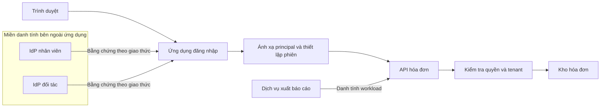

# Identity boundary và trust boundary

## Mục tiêu bài học

Một nhân viên đăng nhập thành công vào cổng nội bộ không có nghĩa là mọi ứng dụng đều phải chấp nhận phiên của người đó. Một dịch vụ chạy trong mạng công ty cũng không mặc nhiên được đọc dữ liệu của mọi khách hàng. Cả hai tình huống đều liên quan đến ranh giới: danh tính có ý nghĩa trong phạm vi nào, và thành phần nào được tin cậy để khẳng định điều gì?

Trong nền tảng quản lý danh tính và quyền truy cập (IAM), hiểu các ranh giới này giúp thiết kế xác thực, phiên, SSO, liên kết danh tính, quyền người dùng và quyền workload một cách nhất quán.

Sau bài học này, bạn có thể:

- Phân biệt phạm vi định danh với ranh giới tin cậy.
- Giải thích vì sao cùng một danh tính vẫn phải được kiểm tra khi đi qua nhiều thành phần.
- Xác định nguồn có thẩm quyền cho một định danh, một thuộc tính và một quyền truy cập.
- Phân tích luồng qua nhà cung cấp danh tính, ứng dụng, API, tenant và tác vụ nền.
- Đặt yêu cầu xác thực, phân quyền, vòng đời và kiểm toán tại đúng ranh giới.

## 1. Identity boundary: danh tính có ý nghĩa trong phạm vi nào?

**Identity boundary**, hay ranh giới danh tính, là cách mô tả phạm vi mà trong đó các định danh, quy tắc quản lý danh tính và phát biểu về danh tính được hiểu theo một hệ thống thẩm quyền xác định.

Thuật ngữ này không có một cách phân chia duy nhất trong mọi sản phẩm. Trong bài học, ta dùng nó như một công cụ thiết kế để trả lời bốn câu hỏi:

1. Ai có quyền tạo, thay đổi và vô hiệu hóa danh tính?
2. Định danh nào phân biệt duy nhất một chủ thể trong phạm vi đang xét?
3. Nguồn nào có thẩm quyền cung cấp từng thuộc tính của chủ thể?
4. Hệ thống khác phải ánh xạ danh tính này như thế nào để sử dụng an toàn?

Ví dụ, mã người dùng `u-123` của nhà cung cấp danh tính A và mã `u-123` của nhà cung cấp B có thể chỉ hai người hoàn toàn khác nhau. Giá trị chuỗi giống nhau không làm hai danh tính trở thành một.

Ngay cả tên vai trò cũng có phạm vi. `admin` của một tenant không tự mang nghĩa quản trị toàn nền tảng; nhóm `Finance` của một đối tác không tự tương đương nhóm tài chính nội bộ.

Ranh giới danh tính có thể liên quan đến một tổ chức, một nhà cung cấp danh tính, một miền định danh workload, một môi trường hoặc mô hình tenant. Các phạm vi này có thể lồng nhau hoặc giao nhau. Không nên mặc định rằng mỗi tenant luôn có một nhà cung cấp danh tính riêng, hoặc một nhà cung cấp chỉ phục vụ một tenant.

### Định danh cần đi kèm phạm vi

Trong OIDC, cặp `issuer` và `sub` xác định chủ thể theo phạm vi của bên phát hành. Chỉ dùng `sub` mà bỏ qua `issuer` có thể gây nhầm lẫn giữa các nguồn phát hành. Ứng dụng thường ánh xạ danh tính ngoài đã được xác minh sang một định danh nội bộ ổn định:

```text
(trusted_issuer, verified_subject) -> local_principal_id

Ví dụ dữ liệu minh họa:
(Issuer A, u-123) -> principal-801
(Issuer B, u-123) -> principal-916
```

`trusted_issuer` ở đây phải được xác nhận qua quy trình kiểm tra giao thức và cấu hình tin cậy, không phải chuỗi mà client tự gửi để ứng dụng tin ngay.

Email hữu ích cho liên hệ hoặc hiển thị, nhưng có thể thay đổi, được tái cấp hoặc mang ý nghĩa khác giữa các nguồn. Không tự động liên kết hai tài khoản hay cấp quyền chỉ vì chúng có cùng email. Liên kết tài khoản cần quy trình xác minh và chính sách rõ ràng. Một số cơ chế OIDC còn dùng subject khác nhau cho các ứng dụng khác nhau; không nên suy ra quan hệ giữa các danh tính chỉ bằng cách so chuỗi.

## 2. Trust boundary: điều gì thay đổi khi dữ liệu đi qua?

**Trust boundary**, hay ranh giới tin cậy, là điểm phân cách giữa các thành phần hoặc miền có giả định tin cậy, quyền kiểm soát hay mức bảo đảm khác nhau. Khi dữ liệu, thông điệp hoặc hành động đi qua ranh giới đó, bên nhận phải quyết định có thể tin điều gì, dựa trên bằng chứng nào và trong phạm vi nào.

Các ví dụ quen thuộc:

- Trình duyệt do người dùng kiểm soát gửi yêu cầu đến máy chủ.
- Ứng dụng nhận kết quả xác thực từ một nhà cung cấp danh tính.
- API gateway chuyển yêu cầu đến dịch vụ nghiệp vụ.
- Dịch vụ của tenant này yêu cầu dữ liệu thuộc tenant khác.
- Tác vụ CI/CD xin quyền triển khai vào môi trường production.

Một ranh giới tin cậy không nhất thiết trùng với ranh giới mạng. Hai tiến trình cùng máy có thể có quyền và chủ sở hữu khác nhau. Hai dịch vụ trong cùng cụm vẫn có thể cần xác thực workload và kiểm tra quyền riêng. Ngược lại, một kết nối qua mạng công cộng có thể mang bằng chứng danh tính hợp lệ mà bên nhận được cấu hình để chấp nhận.

“Tin cậy” phải gắn với **một phát biểu cụ thể**. Ứng dụng có thể tin nhà cung cấp danh tính xác nhận người dùng đã đăng nhập, nhưng chỉ tin hệ thống nhân sự xác nhận quan hệ lao động, và chỉ tin kho quyền nội bộ xác định ai được duyệt hóa đơn.

```text
Tin nguồn A về danh tính
không tự suy ra:
  tin mọi thuộc tính do A gửi,
  chấp nhận mọi token do A phát hành,
  hoặc cấp mọi quyền mà A đề xuất.
```

## 3. Hai ranh giới liên quan nhưng không đồng nhất

| Tiêu chí | Identity boundary | Trust boundary |
|---|---|---|
| Trọng tâm | Ngữ nghĩa, phạm vi và thẩm quyền của danh tính | Sự thay đổi giả định tin cậy giữa bên gửi và bên nhận |
| Câu hỏi chính | Chủ thể này được định danh và quản lý bởi ai? | Bên nhận được phép tin điều gì từ bên gửi? |
| Đối tượng cần xem xét | Namespace, issuer, subject, thuộc tính, ánh xạ tài khoản | Dữ liệu đầu vào, bằng chứng, kênh truyền, quyền, điểm thực thi |
| Ví dụ | Tài khoản nhân viên và tài khoản đối tác do hai nguồn quản lý | Trình duyệt gửi request vào API của công ty |
| Kiểm soát điển hình | Định danh có phạm vi, ánh xạ tài khoản, quản lý vòng đời | Xác minh bằng chứng, kiểm tra quyền, kiểm tra dữ liệu và ghi vết |

Một yêu cầu có thể đi qua nhiều trust boundary trong khi vẫn dùng cùng danh tính người dùng: trình duyệt gọi API, API gọi dịch vụ tài liệu, dịch vụ đọc kho dữ liệu. Mỗi bên nhận có trách nhiệm kiểm tra những gì liên quan đến tài nguyên mình bảo vệ.

Ngược lại, liên kết danh tính giữa công ty và đối tác giúp ứng dụng chấp nhận một danh tính do tổ chức khác quản lý. Quan hệ tin cậy được thiết lập giữa các bên, nhưng hai tổ chức vẫn có thẩm quyền quản lý danh tính và vòng đời tài khoản riêng. Federation không làm các miền đó tự hợp nhất.

### Ba phạm vi thường bị nhầm

Khi phân tích một luồng, hãy tách ba câu hỏi:

- **Nguồn phát hành:** Ai đưa ra phát biểu về danh tính hoặc cấp credential?
- **Bên nhận dự kiến:** Token hay bằng chứng này được tạo để bên nào sử dụng?
- **Phạm vi quyền:** Chủ thể được làm gì trên những tài nguyên nào?

Một token có chữ ký hợp lệ từ nguồn đáng tin vẫn có thể dành cho API khác. Token được API này chấp nhận vẫn có thể không cho phép đọc hóa đơn cụ thể. Cả nguồn phát hành, đối tượng nhận và quyền truy cập đều phải phù hợp; chúng không thay thế cho nhau.

## 4. Ví dụ: cổng hóa đơn có nhân viên và nhà cung cấp

Giả sử công ty xây dựng một cổng hóa đơn với các thành phần:

- Nhân viên đăng nhập qua IdP nội bộ.
- Nhà cung cấp đăng nhập qua IdP đối tác đã được chấp thuận.
- Ứng dụng ánh xạ danh tính ngoài sang principal nội bộ và tenant tương ứng.
- API hóa đơn quyết định quyền đọc, tạo và duyệt.
- Dịch vụ xuất báo cáo chạy bằng danh tính workload riêng.
- Kho dữ liệu chứa hóa đơn của nhiều tenant.

**IdP** là identity provider, bên cung cấp danh tính; **principal** là biểu diễn chủ thể mà ứng dụng dùng để đánh giá quyền.

Sơ đồ dưới đây biểu diễn quan hệ xử lý ở mức khái niệm, không phải toàn bộ các bước trao đổi của OAuth/OIDC:



Có ít nhất bốn nhóm ranh giới cần phân tích trong thiết kế này.

### 4.1. Từ trình duyệt vào máy chủ

Trình duyệt là môi trường người dùng có thể kiểm soát. Các trường như `userId`, `tenantId`, `role` và `approvedBy` trong request không trở thành dữ kiện có thẩm quyền chỉ vì giao diện chính thức tạo ra chúng.

Máy chủ cần xác thực credential hoặc phiên phù hợp, kiểm tra đầu vào và tự xác định principal. Nếu client chọn tenant đang làm việc, máy chủ phải đối chiếu lựa chọn đó với quan hệ thành viên được cấp. Phiên dùng cookie còn cần các kiểm soát thích hợp cho cookie và yêu cầu thay đổi trạng thái, bao gồm bảo vệ CSRF theo mô hình ứng dụng.

### 4.2. Từ IdP ngoài vào ứng dụng

Ứng dụng phải biết mình chấp nhận IdP nào, theo cấu hình nào và để làm gì. Việc một IdP được phép xác thực nhà cung cấp không có nghĩa nhóm `admin` của IdP đó được ánh xạ thành quản trị viên nền tảng.

Với OIDC, ứng dụng dùng thư viện giao thức phù hợp để kiểm tra phản hồi và token theo flow, bao gồm nguồn phát hành, đối tượng nhận, thời hạn và các ràng buộc chống tráo hoặc phát lại theo ngữ cảnh. Không coi một đoạn JSON tự khai là bằng chứng đăng nhập. ID token phục vụ bên ứng dụng nhận kết quả xác thực; không mặc nhiên thay thế access token dành cho API.

Sau khi xác minh, ứng dụng mới ánh xạ sang principal nội bộ. Quyền và thành viên tenant được quyết định theo chính sách của ứng dụng, dùng các thuộc tính đã được chấp nhận từ đúng nguồn.

### 4.3. Từ API đến dữ liệu nhiều tenant

Danh tính hợp lệ mới là một đầu vào. API phải kiểm tra quyền đối với hành động và tài nguyên được yêu cầu. Nhà cung cấp thuộc tenant A không được đọc hóa đơn tenant B bằng cách đổi ID trên URL.

Nếu dùng bộ lọc tenant, điều kiện lọc phải dựa trên ngữ cảnh đã được máy chủ xác nhận và áp dụng nhất quán cho đọc đơn lẻ, danh sách, tìm kiếm, cập nhật và xuất dữ liệu. Row-level security hoặc phân tách kho dữ liệu có thể hỗ trợ, nhưng hiệu quả còn phụ thuộc cấu hình và danh tính truy cập thực tế.

Tenant là một phạm vi cô lập cần được mô hình hóa rõ. Có nhiều tenant trong cùng cơ sở dữ liệu không tự chứng minh chúng đã được cô lập; cũng không bắt buộc mọi tenant phải có cơ sở dữ liệu riêng.

### 4.4. Từ workload vào API

Dịch vụ xuất báo cáo có danh tính riêng và phải được cấp đúng quyền cần dùng. Không dùng tài khoản quản trị của nhân viên làm credential chung cho tác vụ nền.

Nếu workload hành động thay người dùng, hệ thống cần biết cả bên gọi trực tiếp và chủ thể được đại diện. Nếu nó chạy theo lịch bằng quyền hệ thống, phạm vi đó cũng phải được mô tả và cấp rõ. Không nên gắn tùy ý một `userId` vào request rồi diễn giải thành quyền đại diện cho người dùng đó.

## 5. Quy trình xử lý tại một ranh giới của API

Với một API được bảo vệ bằng access token, có thể tổ chức xử lý thành các bước:

1. Nhận yêu cầu qua kênh được bảo vệ và lấy credential từ vị trí được quy định.
2. Kiểm tra credential theo cấu hình tin cậy dành cho API và loại token đang dùng.
3. Xác định danh tính ngoài đã xác minh và ánh xạ sang principal nội bộ.
4. Lấy trạng thái tài khoản, quyền, tenant và thuộc tính cần thiết từ nguồn có thẩm quyền.
5. Đánh giá quyền trên hành động và tài nguyên cụ thể.
6. Thực thi đúng quyết định, bao gồm các điều kiện bắt buộc, rồi ghi lại dữ kiện kiểm toán phù hợp.

Giả mã minh họa:

```text
function readInvoice(request):
    verifiedIdentity = validateAccessToken(
        token = request.bearerToken,
        acceptedIssuers = serverConfiguredIssuers,
        expectedAudience = invoiceApiAudience
    )

    principal = findMappedPrincipal(
        verifiedIdentity.issuer,
        verifiedIdentity.subject
    )

    if principal is absent or principal.status != ACTIVE:
        denyAccess()

    tenantContext = resolveAuthorizedTenant(
        principal,
        request.selectedTenant
    )

    invoice = loadInvoiceInTenant(
        tenantContext.id,
        request.invoiceId
    )

    requirePermission(principal, "invoice:read", invoice)
    recordAccessDecision(principal, tenantContext, invoice)
    return permittedInvoiceView(invoice)
```

`validateAccessToken` đại diện cho toàn bộ quy trình xác minh theo giao thức và định dạng token, không chỉ giải mã payload. Token ký số cần được kiểm tra chữ ký bằng khóa thuộc nguồn đã được cấu hình tin cậy; token opaque có cơ chế xác minh tương ứng. Không tự lấy một URL bất kỳ trong token chưa xác minh làm nơi tải khóa tin cậy.

Các hàm `resolveAuthorizedTenant` và `requirePermission` phải dựa trên nguồn dữ liệu có thẩm quyền. Với tài nguyên được bảo vệ, thiếu credential, không xác minh được nguồn, không ánh xạ được chủ thể hoặc không đủ quyền đều không được biến thành cho phép. Phản hồi lỗi cụ thể tùy tình huống xác thực, phân quyền hay sự cố dịch vụ.

## 6. Gateway và mạng nội bộ không xóa trust boundary

Một mô hình thường gặp là gateway xác thực người gọi rồi chuyển `X-User-Id` cho backend. Mô hình này chỉ đáng tin khi có một chuỗi kiểm soát rõ ràng:

- Client không thể tự gán giá trị có thẩm quyền cho header đó; gateway loại bỏ hoặc ghi đè đầu vào trùng tên.
- Backend xác thực được bên gửi là gateway được chấp thuận.
- Các đường đi vòng vào backend cũng được kiểm soát.
- Ngữ cảnh được chuyển tiếp có tính toàn vẹn và được ràng buộc với yêu cầu theo thiết kế.
- Backend vẫn thực thi quyền nghiệp vụ và phạm vi tài nguyên cần thiết.

Nếu backend có cổng khác cho phép truy cập trực tiếp và tin mọi header `X-User-Id`, kẻ gọi có thể vượt qua gateway. Đặt tên header bắt đầu bằng `X-` không làm nó trở thành dữ liệu đáng tin.

Tương tự, mTLS có thể giúp xác thực workload ở hai đầu kết nối theo cấu hình chứng chỉ và miền tin cậy. Nó không tự xác thực người dùng cuối, không tự chứng minh dịch vụ được đại diện cho người dùng nào và không tự cấp quyền đọc mọi bản ghi.

Khi dịch vụ A gọi dịch vụ B, cần chọn cách chuyển tiếp hoặc trao đổi credential phù hợp với đối tượng nhận và phạm vi quyền. Không mặc định chuyển nguyên token dành cho A sang B rồi yêu cầu B chấp nhận. Quan hệ “A tin B” và “B tin C” cũng không tự tạo ra quyền hay quan hệ tin cậy trực tiếp giữa A và C.

## 7. SSO, MFA và vai trò ở hai phía ranh giới

**SSO** giảm nhu cầu đăng nhập lại trong các ứng dụng có quan hệ tin cậy phù hợp. Nó không xóa ranh giới quyền của từng ứng dụng. Một người có phiên SSO hợp lệ vẫn có thể chưa được cấp tài khoản hoặc quyền sử dụng một ứng dụng cụ thể.

**MFA** bổ sung bằng chứng xác thực. Nếu ứng dụng yêu cầu mức xác thực cao cho một thao tác, nó phải diễn giải đúng thông tin về phương thức, thời điểm và mức bảo đảm xác thực từ nguồn được chấp nhận. Một chuỗi `mfa=true` tự khai không đáp ứng yêu cầu đó. Độ tin cậy vào thông tin MFA cũng thuộc thỏa thuận giữa ứng dụng và IdP.

**RBAC** và **ABAC** giúp mô tả quyền sau khi danh tính và thuộc tính đã có ngữ nghĩa rõ. Gán vai trò từ bên ngoài cần ánh xạ có kiểm soát; đánh giá theo thuộc tính cần biết ai được phép khẳng định thuộc tính đó.

| Dữ kiện | Nguồn có thẩm quyền trong ví dụ | Cách sử dụng |
|---|---|---|
| Danh tính nhân viên | IdP nội bộ đã cấu hình | Ánh xạ sang principal nội bộ |
| Danh tính nhà cung cấp | IdP đối tác đã được chấp thuận | Ánh xạ sang principal đối tác |
| Tenant được phép truy cập | Kho thành viên và cấp quyền của ứng dụng | Giới hạn phạm vi yêu cầu |
| Quyền duyệt hóa đơn | Chính sách và kho quyền của ứng dụng | Đánh giá hành động duyệt |
| Tenant sở hữu hóa đơn | Dữ liệu hóa đơn do hệ thống quản lý | Kiểm tra tài nguyên thuộc phạm vi nào |
| Bên workload đang gọi | Cơ chế workload identity được chấp nhận | Kiểm tra quyền dịch vụ và quyền đại diện nếu có |

Đây là một thiết kế minh họa, không phải quy định rằng mọi thuộc tính đều phải nằm trong ứng dụng. Một tổ chức có thể dùng nguồn ngoài cho thành viên tenant hoặc quyền, miễn quan hệ thẩm quyền và cách kiểm tra được xác định rõ.

## 8. Vòng đời danh tính cũng phải đi qua ranh giới

Một đối tác vô hiệu hóa tài khoản của họ không bảo đảm phiên ứng dụng của công ty chấm dứt ngay. Một nhóm bị xóa ở IdP không bảo đảm cache quyền của mọi API được cập nhật tức thời.

Thiết kế IAM cần xác định:

- Ai tạo và sở hữu tài khoản cục bộ sau lần đăng nhập hoặc cấp phát đầu tiên.
- Nguồn nào quyết định trạng thái hoạt động và cách đồng bộ thay đổi.
- Khi nào phiên, token, cache và quyền workload hết hiệu lực.
- Cách xử lý tài khoản liên kết khi hợp đồng, quan hệ đối tác hoặc quan hệ lao động kết thúc.
- Cách rà soát và thu hồi quyền đặc biệt đã cấp ở từng hệ thống.

Cấp phát tự động, đồng bộ thư mục hoặc SCIM có thể hỗ trợ truyền thay đổi vòng đời khi được triển khai phù hợp. Tuy nhiên, quy trình vẫn cần xử lý lỗi đồng bộ, tài khoản mồ côi và độ trễ. Thời gian thu hồi thực tế phải được đo trên toàn bộ đường truy cập, không chỉ tại nơi quản trị bấm “vô hiệu hóa”.

Danh tính workload cũng cần chủ sở hữu, phạm vi sử dụng, thời hạn credential và cơ chế thu hồi. Môi trường thử nghiệm không được tự có quyền production chỉ vì dùng cùng tên dịch vụ. Quyền đặc biệt nên được giới hạn theo mục đích, phạm vi và thời gian cần thiết.

## 9. Kiểm toán để theo được danh tính qua nhiều miền

Khi một yêu cầu đi qua ứng dụng, gateway và nhiều dịch vụ, chỉ ghi tên hiển thị của người dùng thường không đủ để điều tra. Bản ghi phù hợp có thể bao gồm:

- Principal nội bộ và nguồn danh tính đã xác minh.
- Danh tính workload gọi trực tiếp và chủ thể được đại diện nếu có.
- Tenant, hành động và định danh tài nguyên.
- Kết quả kiểm tra quyền, mã lý do và phiên bản chính sách khi có.
- Thời điểm và mã tương quan giúp nối các sự kiện trong cùng luồng.

Không ghi nguyên mật khẩu, access token, refresh token hoặc cookie phiên vào log. Bản thân log chứa danh tính và hoạt động cũng cần quyền truy cập, thời hạn lưu và bảo vệ tính toàn vẹn thích hợp.

Ghi vết giúp giải thích việc đi qua ranh giới nhưng không thay thế việc chặn yêu cầu sai ngay tại ranh giới đó.

## 10. Tự phân tích các tình huống

| Tình huống | Điều cần kiểm tra |
|---|---|
| Hai IdP đều có người dùng `u-123` | Định danh có được ràng buộc với nguồn phát hành và ánh xạ tách biệt không? |
| Nhân viên đăng nhập SSO nhưng không được mở ứng dụng | Ứng dụng đã cấp tài khoản, trạng thái và quyền phù hợp chưa? |
| Token được ký đúng nhưng dành cho API khác | Bên nhận có kiểm tra đối tượng nhận dự kiến không? |
| Đối tác gửi nhóm `platform-admin` | Ứng dụng có ánh xạ quyền ngoài vượt phạm vi được cho phép không? |
| Client đổi `tenantId` và thấy dữ liệu khách hàng khác | Ngữ cảnh tenant và quyền tài nguyên có được xác nhận phía máy chủ không? |
| Backend tin `X-User-Id` từ bất kỳ kết nối nào | Nguồn chuyển tiếp danh tính và đường truy cập trực tiếp có được kiểm soát không? |
| Workload dùng mTLS rồi truy cập mọi tenant | Xác thực dịch vụ có bị nhầm thành quyền truy cập dữ liệu không? |
| Tài khoản nguồn đã bị khóa nhưng phiên cục bộ còn hoạt động | Cơ chế truyền thay đổi và thời gian thu hồi xuyên hệ thống là gì? |

Khi vẽ kiến trúc IAM, hãy ghi bên cạnh mỗi mũi tên: ai đang gọi, bằng chứng nào được gửi, ai có thẩm quyền xác nhận, bên nhận kiểm tra gì và quyền có phạm vi đến đâu. Identity boundary giúp tránh hiểu sai danh tính; trust boundary giúp xác định nơi phải kiểm tra và thực thi các giả định trước khi cho phép truy cập.
