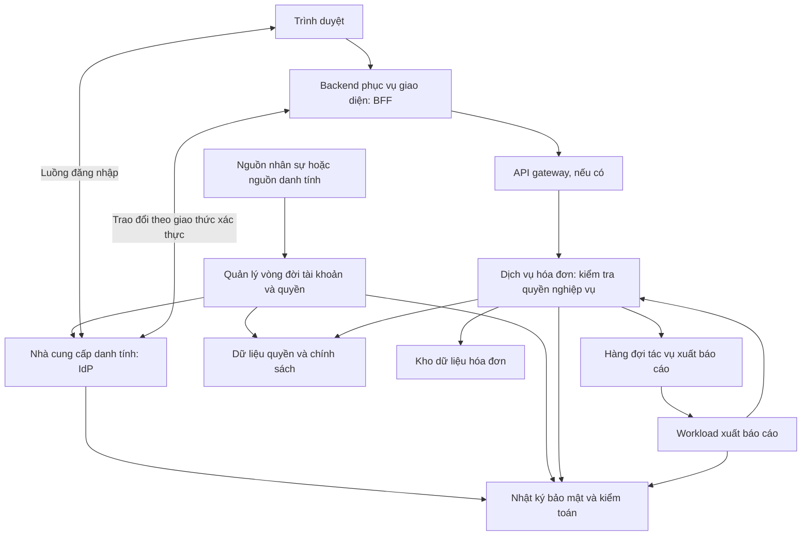
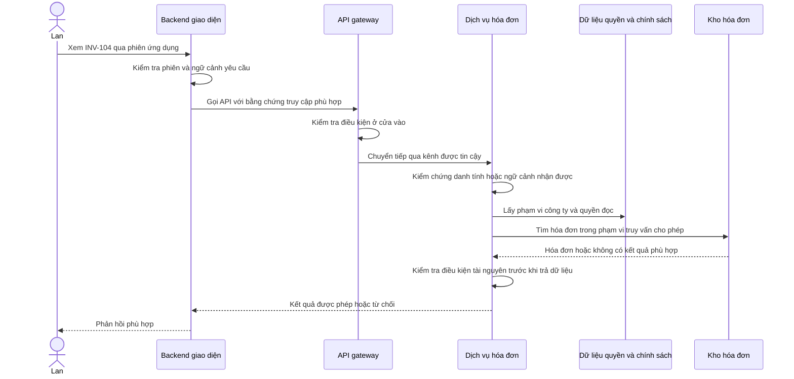

# IAM trong kiến trúc ứng dụng

## Mục tiêu bài học

Trong chương **Nền tảng IAM**, bài học này đặt quản lý danh tính và quyền truy cập vào cấu trúc của một ứng dụng thực tế. Sau khi học, bạn có thể:

- Xác định trách nhiệm của nhà cung cấp danh tính, ứng dụng, API gateway, dịch vụ nghiệp vụ và kho dữ liệu.
- Phân biệt quản lý danh tính, xác thực, quản lý phiên và thực thi quyền trên tài nguyên.
- Theo dõi danh tính người dùng và danh tính workload qua nhiều ranh giới tin cậy.
- Nhận biết các lựa chọn kiến trúc liên quan đến SSO, OAuth/OIDC, RBAC, ABAC, token và phiên.
- Giải thích tác động của thay đổi quyền, thu hồi truy cập và lỗi thành phần IAM đến hoạt động của hệ thống.

## 1. IAM là một trách nhiệm xuyên suốt kiến trúc

Một ứng dụng có thể có màn hình đăng nhập, dịch vụ danh tính tập trung và cơ sở dữ liệu người dùng nhưng vẫn để lộ dữ liệu do kiểm tra quyền sai chỗ. Chẳng hạn, API gateway xác nhận người gọi đã đăng nhập, còn dịch vụ hóa đơn trả về bất kỳ hóa đơn nào theo mã được truyền vào. Danh tính đã được xác thực, nhưng quyền trên hóa đơn cụ thể chưa được kiểm tra.

Vì vậy, khi đặt **Identity and Access Management (IAM)** vào kiến trúc, cần xác định đủ ba nhóm trách nhiệm:

1. **Quản lý danh tính và quyền:** danh tính đến từ đâu, ai được cấp quyền, quyền thay đổi và kết thúc thế nào.
2. **Thiết lập ngữ cảnh truy cập:** chủ thể được xác thực ra sao, bằng chứng nào được chấp nhận, phiên hoặc token được dùng thế nào.
3. **Bảo vệ hành động trên tài nguyên:** thành phần nào quyết định và thành phần nào chặn yêu cầu không hợp lệ.

IAM không nhất thiết là một máy chủ duy nhất. Nó là sự phối hợp giữa chính sách, quy trình và các thành phần kỹ thuật. Một số trách nhiệm có thể tập trung để dùng chung; những ràng buộc gắn với dữ liệu và nghiệp vụ thường vẫn cần được thực thi tại ứng dụng sở hữu tài nguyên.

### Ví dụ xuyên suốt

Xét một nền tảng quản lý hóa đơn phục vụ nhiều công ty. Người dùng truy cập qua trình duyệt; một lớp backend phục vụ giao diện gọi API hóa đơn. Dịch vụ xuất báo cáo xử lý tác vụ trong hàng đợi. Tổ chức sử dụng nhà cung cấp danh tính để hỗ trợ đăng nhập tập trung và MFA.

Yêu cầu nghiệp vụ là: kế toán công ty A chỉ được xem hóa đơn thuộc phạm vi được giao; người phê duyệt có thể duyệt hóa đơn theo hạn mức; dịch vụ xuất báo cáo chỉ đọc dữ liệu cần thiết. Khi nhân viên nghỉ việc hoặc chuyển công ty, quyền truy cập phải được điều chỉnh trên các thành phần liên quan.

## 2. Bắt đầu từ chủ thể, tài nguyên và ranh giới tin cậy

Trước khi vẽ một khối mang tên “IAM”, hãy xác định những yếu tố mà nó phải bảo vệ.

| Yếu tố | Câu hỏi kiến trúc | Ví dụ |
| --- | --- | --- |
| Chủ thể con người | Ai đăng nhập, thuộc tổ chức nào, có trách nhiệm gì? | Kế toán, người phê duyệt, người quản trị |
| Chủ thể phần mềm | Workload nào truy cập mà không có người dùng thao tác trực tiếp? | Dịch vụ báo cáo, tác vụ đồng bộ tài khoản |
| Tài nguyên | Dữ liệu hoặc chức năng nào cần được kiểm soát? | Một hóa đơn, một tập báo cáo, chức năng cấp quyền |
| Hành động | Chủ thể muốn thực hiện việc gì? | Đọc, tạo, duyệt, xuất dữ liệu, gán vai trò |
| Nguồn thông tin tin cậy | Ai có quyền xác nhận danh tính, thuộc tính hoặc trạng thái? | IdP, hệ thống nhân sự, dữ liệu thành viên công ty |
| Ranh giới tin cậy | Dữ liệu đi từ miền nào sang miền nào, và được kiểm tra ở đâu? | Trình duyệt sang backend; dịch vụ hóa đơn sang dịch vụ báo cáo |

**Ranh giới tin cậy** là nơi không thể mặc nhiên chấp nhận một lời khai chỉ vì nó được gửi tới hệ thống. Trình duyệt có thể gửi `userId`, `role` hoặc `companyId`, nhưng các giá trị đó chưa phải bằng chứng về danh tính và quyền của người gọi.

Tương tự, một kết nối đến từ mạng nội bộ không đủ để chứng minh dịch vụ gọi là ai hoặc được phép làm gì. Dịch vụ nhận cần có cơ chế xác thực bên gọi và giới hạn hành động phù hợp.

### Dữ liệu từ phía khách và dữ liệu đã được xác minh

Cần phân biệt hai loại dữ liệu:

- **Thông tin yêu cầu:** mã hóa đơn muốn đọc, công ty đang được chọn trên giao diện, bộ lọc báo cáo.
- **Thông tin bảo mật đã được kiểm chứng:** principal hiện tại, nguồn phát hành danh tính được chấp nhận, tập công ty được phép truy cập, trạng thái quyền theo chính sách.

Người dùng có thể chọn công ty B trên giao diện; backend chỉ chấp nhận ngữ cảnh đó nếu principal hiện tại thực sự có quyền trong công ty B. Lựa chọn của người dùng không tự tạo ra quyền thành viên.

## 3. Kiến trúc tham chiếu và trách nhiệm từng thành phần



Đây là mô hình trách nhiệm để phân tích, không phải số lượng dịch vụ bắt buộc. Trong ứng dụng nhỏ, BFF và dịch vụ hóa đơn có thể nằm trong cùng một tiến trình; API gateway hoặc hàng đợi có thể chưa cần thiết. Mũi tên trong sơ đồ không mô tả đầy đủ mọi bước của một giao thức đăng nhập.

| Thành phần | Trách nhiệm liên quan đến IAM | Giới hạn trách nhiệm cần hiểu |
| --- | --- | --- |
| Nguồn nhân sự hoặc nguồn danh tính | Cung cấp dữ liệu gốc về người dùng, quan hệ tổ chức, trạng thái làm việc | Không trực tiếp quyết định mọi quyền trên hóa đơn |
| Quản lý vòng đời | Tạo, cập nhật, vô hiệu hóa tài khoản; cấp và thu hồi quyền theo quy trình | Cần theo dõi kết quả đồng bộ tại hệ thống đích |
| IdP — Identity Provider | Xác thực, MFA, hỗ trợ liên kết danh tính và cung cấp kết quả theo giao thức | Không mặc nhiên biết mọi quy tắc nghiệp vụ của ứng dụng |
| BFF — Backend for Frontend | Tiếp nhận kết quả đăng nhập, quản lý phiên phía ứng dụng và gọi API phục vụ giao diện | Vẫn cần bảo vệ yêu cầu từ trình duyệt và giới hạn quyền khi gọi API |
| API gateway | Kiểm tra ở cửa vào như bằng chứng truy cập, tuyến API hoặc scope phù hợp | Thường chưa có đủ dữ liệu để quyết định quyền trên từng hóa đơn |
| Dịch vụ hóa đơn | Bảo vệ tài nguyên, kiểm tra công ty, quyền hành động và điều kiện nghiệp vụ | Không được bỏ qua kiểm tra chỉ vì yêu cầu đã qua gateway |
| Dữ liệu quyền và chính sách | Cung cấp vai trò, quan hệ thành viên, thuộc tính và quy tắc | Phải có nguồn quản lý, tính nhất quán và thời hạn cập nhật rõ ràng |
| Kho dữ liệu | Lưu dữ liệu, hỗ trợ giới hạn truy vấn và bảo vệ truy cập bằng tài khoản dịch vụ | Không thể tự suy ra người dùng cuối nếu ứng dụng không truyền ngữ cảnh đúng |
| Workload báo cáo | Xử lý tác vụ bằng danh tính phần mềm với phạm vi quyền riêng | Cần chính sách rõ khi thực hiện công việc thay mặt người dùng |

Kiến trúc tốt phải trả lời được **ai sở hữu mỗi quyết định**. Nếu không thành phần nào kiểm tra công ty của hóa đơn vì mỗi bên cho rằng bên khác đã làm, khoảng trống đó có thể trở thành lỗ hổng truy cập.

## 4. Tách quản lý quyền khỏi việc thực thi quyền

Một thay đổi quyền và một yêu cầu đọc hóa đơn là hai luồng khác nhau.

### 4.1. Luồng quản trị danh tính và quyền

Luồng này gồm ghi danh người dùng, liên kết tài khoản, gán nhóm hoặc vai trò, phê duyệt đặc quyền, rà soát quyền và thu hồi truy cập. Nguồn thay đổi có thể là quản trị viên, hệ thống nhân sự hoặc quy trình tự động được ủy quyền.

Ví dụ: người quản lý phê duyệt Lan làm người duyệt hóa đơn cho công ty A trong một khoảng thời gian. Hệ thống cần lưu phạm vi, thời hạn, người phê duyệt và kết quả cập nhật tới nơi thực thi.

### 4.2. Luồng xử lý truy cập lúc chạy

Khi Lan gửi yêu cầu duyệt một hóa đơn, API phải lấy ngữ cảnh danh tính hợp lệ, tìm hóa đơn, đánh giá chính sách và thực hiện hoặc chặn thao tác. Quy trình phê duyệt quyền trước đó cung cấp dữ liệu đầu vào; nó không thay thế kiểm tra cho yêu cầu hiện tại.

Có thể mô tả bốn trách nhiệm logic:

| Trách nhiệm | Câu hỏi cần trả lời | Ví dụ |
| --- | --- | --- |
| Quản lý chính sách — PAP | Ai định nghĩa và thay đổi quy tắc? | Quy tắc người tạo không được tự duyệt hóa đơn |
| Cung cấp thông tin — PIP | Thuộc tính phục vụ đánh giá đến từ đâu? | Công ty sở hữu hóa đơn, hạn mức người duyệt |
| Quyết định — PDP | Với các đầu vào hiện tại, có được phép không? | Đánh giá quyền duyệt và điều kiện nghiệp vụ |
| Thực thi — PEP | Thành phần nào bảo đảm yêu cầu bị chặn khi không được phép? | Điểm xử lý API trước khi cập nhật hóa đơn |

Các tên PAP, PIP, PDP và PEP mô tả vai trò kiến trúc, không bắt buộc phải triển khai thành bốn dịch vụ riêng. Một hàm trong ứng dụng nguyên khối có thể đảm nhiệm đánh giá chính sách; một thư viện dùng chung hoặc một dịch vụ chuyên biệt cũng có thể làm việc đó.

Điều quan trọng là nơi thực thi phải sử dụng quyết định đúng cách. Một dịch vụ đánh giá trả về `DENY` sẽ không bảo vệ tài nguyên nếu API bỏ qua kết quả và vẫn truy vấn hoặc cập nhật dữ liệu.

## 5. Đặt xác thực, phiên và token ở đúng vị trí

### 5.1. Đăng nhập tập trung và phiên ứng dụng

Trong một thiết kế web có BFF, trình duyệt có thể được chuyển tới IdP để xác thực. Nếu dùng OIDC, ứng dụng nhận và kiểm tra kết quả theo luồng giao thức đã chọn, sau đó thiết lập phiên ứng dụng. **OIDC bổ sung lớp danh tính trên OAuth 2.0; OAuth 2.0 là khung ủy quyền truy cập tài nguyên.**

Một lần xác thực tại IdP có thể hỗ trợ SSO giữa nhiều ứng dụng. Tuy nhiên, phiên tại IdP và phiên trong từng ứng dụng là những phạm vi khác nhau. Thiết kế phải quy định đăng xuất, thời hạn phiên, xác thực lại và thu hồi có tác động đến từng phạm vi ra sao.

MFA thường do IdP thực hiện, còn ứng dụng có thể yêu cầu mức xác thực phù hợp cho thao tác nhạy cảm theo khả năng tích hợp. Việc đã hoàn thành MFA không chứng minh người dùng có quyền duyệt hóa đơn; nó chỉ bổ sung bằng chứng về quá trình xác thực.

### 5.2. BFF, ứng dụng trình duyệt và ứng dụng di động

Với BFF, token để gọi dịch vụ phía sau có thể được giữ ở backend, trong khi trình duyệt giữ định danh phiên qua cookie được bảo vệ phù hợp. Thiết kế này cần xem xét bảo vệ phiên, CSRF, XSS và các endpoint thay đổi trạng thái. Chuyển token sang backend không tự loại bỏ mọi rủi ro từ trình duyệt.

Một ứng dụng chạy trong trình duyệt hoặc ứng dụng di động có đặc điểm khác: không thể coi một bí mật được nhúng trong mã phân phối cho người dùng là bí mật chỉ máy chủ biết. Khi dùng OAuth/OIDC, cần chọn luồng và cơ chế bảo vệ phù hợp với loại ứng dụng, chẳng hạn PKCE trong luồng authorization code có hỗ trợ tương ứng. PKCE không thay cho phân quyền API hoặc bảo vệ ứng dụng khỏi mã độc.

Bài toán kiến trúc là xác định rõ token nằm ở đâu, thành phần nào được phép dùng nó, và hệ quả nếu thành phần đó bị chiếm quyền. Không nên lựa chọn chỉ theo tiêu chí giảm số bước đăng nhập.

### 5.3. Phân biệt các loại bằng chứng

| Cơ chế | Vai trò khái niệm | Trách nhiệm tại bên nhận |
| --- | --- | --- |
| Phiên ứng dụng | Duy trì ngữ cảnh truy cập trong phạm vi ứng dụng | Kiểm tra phiên còn hợp lệ, liên kết đúng principal và áp dụng chính sách hiện tại |
| ID token trong OIDC | Cung cấp kết quả xác thực cho ứng dụng nhận token | Kiểm tra theo OIDC và giao dịch đăng nhập tương ứng; không tùy tiện dùng làm bằng chứng gọi API |
| Access token | Cho phép bên gọi truy cập tài nguyên theo phạm vi và điều kiện được cấp | API kiểm tra token có dành cho mình, còn được chấp nhận và đủ quyền cho hành động hay không |
| Refresh token | Cho phép client đủ điều kiện xin token mới theo chính sách của bên cấp | Giữ tại đúng nơi được phép, bảo vệ và quản lý vòng đời; không gửi tới API hóa đơn để thay access token |

**JWT là một định dạng, không phải tên đồng nghĩa với access token.** Một token có thể dùng định dạng JWT hoặc là chuỗi mờ đối với client. Không nên suy ra mục đích token chỉ từ việc có thể đọc được nội dung của nó.

Với JWT có chữ ký, việc giải mã phần nội dung không chứng minh tính hợp lệ. Bên nhận cần xác minh bằng khóa và thuật toán được tin cậy, kiểm tra bên phát hành, đối tượng nhận, thời hạn cùng các điều kiện của loại token. Token mờ có thể cần được kiểm tra thông qua dịch vụ có thẩm quyền hoặc một cơ chế tra cứu phù hợp.

## 6. Theo dõi một yêu cầu đọc hóa đơn

Giả sử Lan đã đăng nhập và yêu cầu đọc hóa đơn `INV-104` trong công ty A.



Luồng này tách rõ ba lớp: phiên ở ứng dụng, điều kiện truy cập API và quyền trên tài nguyên. Một số kiểm tra có thể được triển khai chung, nhưng trách nhiệm cuối cùng về dữ liệu phải được xác định rõ.

### Không tin vào header danh tính từ bên ngoài

Giả sử gateway chuyển tiếp các header như `X-User-Id` và `X-Company-Id`. Nếu người dùng có thể gửi các header đó trực tiếp tới dịch vụ hoặc gateway không xử lý giá trị đầu vào đúng cách, kẻ tấn công có thể giả mạo ngữ cảnh.

Nếu chọn kiến trúc để gateway xác thực và dịch vụ tin vào ngữ cảnh do gateway phát ra, cần bảo vệ toàn bộ đường truyền và nguồn phát hành ngữ cảnh: kiểm soát đường truy cập trực tiếp, xử lý các header do client tự khai và xác thực bên chuyển tiếp. Một lựa chọn khác là dịch vụ tự kiểm tra access token dành cho mình. Không thể chỉ ghi trong tài liệu rằng “đã qua gateway” rồi bỏ qua cách chứng minh điều đó.

### Chặn ở đâu khi không đủ điều kiện?

Kiểm tra token không hợp lệ có thể kết thúc yêu cầu ở cửa vào. Nếu token hợp lệ nhưng Lan không có quyền đọc hóa đơn công ty B, lớp nghiệp vụ phải chặn yêu cầu trước khi trả dữ liệu. Cách trả lỗi cũng cần tránh tiết lộ thông tin tài nguyên ngoài phạm vi được phép.

Đối với thao tác cập nhật, các điều kiện có thể thay đổi đồng thời, như trạng thái hóa đơn hoặc người sở hữu, cần được ràng buộc phù hợp trong giao dịch hoặc thao tác dữ liệu. Một lần kiểm tra ở đầu yêu cầu không bảo đảm các điều kiện vẫn đúng nếu trạng thái đã thay đổi trước lúc ghi.

## 7. Phân quyền ở lớp nghiệp vụ và lớp dữ liệu

### 7.1. Kết hợp quyền hành động với phạm vi tài nguyên

RBAC giúp tổ chức tập quyền theo trách nhiệm như kế toán hoặc người duyệt. ABAC cho phép xét thuộc tính của principal, tài nguyên và ngữ cảnh. Trong ứng dụng nhiều công ty, hai cách có thể phối hợp: vai trò cho biết được đọc hóa đơn, còn quan hệ thành viên giới hạn công ty nào được đọc.

Giả mã dưới đây biểu diễn trách nhiệm xử lý ở backend, không phải cấu hình của một sản phẩm IAM:

```text
function readInvoice(request):
    principal = requireVerifiedPrincipal(request)
    companyId = parseRequestedCompany(request)

    access = loadTrustedAccessContext(principal.id)
    require(access.accountStatus == "ACTIVE")
    require(companyId in access.allowedCompanyIds)
    require(hasPermission(access, companyId, "invoice:read"))

    invoice = findInvoiceWithinCompany(request.invoiceId, companyId)
    require(invoice exists)
    require(resourcePolicyAllows(principal, "read", invoice))

    recordAccessDecision(principal, "read", invoice.id, "ALLOW")
    return permittedInvoiceFields(invoice)
```

Các dữ liệu quyền phải đến từ nguồn được tin cậy. Hàm từ chối, xử lý lỗi và ghi nhận sự kiện cần được triển khai nhất quán; đoạn giả mã chỉ minh họa thứ tự trách nhiệm chính. Phản hồi cũng phải giới hạn trường dữ liệu nếu một số thông tin nhạy cảm có chính sách riêng.

### 7.2. Ngăn đọc chéo công ty từ truy vấn dữ liệu

Nếu chỉ truy vấn theo mã hóa đơn rồi quên kiểm tra phạm vi, một thay đổi URL có thể làm lộ dữ liệu. Đưa phạm vi công ty vào truy vấn giúp thể hiện ràng buộc ngay tại nơi lấy dữ liệu:

```sql
SELECT id, company_id, amount, status
FROM invoices
WHERE id = :invoice_id
  AND company_id = :authorized_company_id;
```

Ví dụ này dùng tham số liên kết và giả định `authorized_company_id` đã được backend xác minh thuộc phạm vi người gọi. Câu SQL không tự chứng minh người dùng được quyền truy cập công ty đó, cũng chưa bao gồm toàn bộ điều kiện nghiệp vụ hoặc quyền trên từng trường.

Các chức năng danh sách, tìm kiếm, thống kê, tải tệp và xuất báo cáo đều cần cùng nguyên tắc giới hạn phạm vi. Bảo vệ endpoint đọc một hóa đơn nhưng cho phép xuất toàn bộ hóa đơn vẫn làm mất ranh giới truy cập.

Tài khoản dịch vụ truy cập cơ sở dữ liệu cũng cần ít quyền nhất. Nếu dùng thêm cơ chế kiểm soát theo dòng tại cơ sở dữ liệu, cần thiết kế cách thiết lập và xóa ngữ cảnh khi tái sử dụng kết nối; cơ chế bổ sung này không thay cho xác thực và phân quyền đúng ở ứng dụng.

## 8. Danh tính khi các dịch vụ gọi nhau

Trong ứng dụng phân tán, một lời gọi có thể đồng thời liên quan đến **dịch vụ đang kết nối** và **người dùng mà dịch vụ đang phục vụ**. Hai danh tính này không nên bị đánh đồng.

Ví dụ, BFF là workload đang gọi dịch vụ hóa đơn, còn Lan là người khởi tạo thao tác. Xác thực được BFF không tự chứng minh mọi người dùng đi qua BFF đều được đọc hóa đơn. Ngược lại, biết Lan là ai cũng không tự chứng minh bên kết nối là một dịch vụ được phép gọi API nội bộ.

### 8.1. Phân biệt quyền của workload và quyền được ủy quyền

| Kiểu truy cập | Chủ thể cần xét | Câu hỏi phân quyền |
| --- | --- | --- |
| Workload tự thực hiện nhiệm vụ của mình | Danh tính dịch vụ | Dịch vụ này có được đọc tập dữ liệu phục vụ công việc đã giao không? |
| Workload xử lý thay người dùng | Danh tính workload cùng ngữ cảnh người dùng được truyền một cách tin cậy | Dịch vụ có được thực hiện hành động này thay người dùng, và người dùng có quyền trên tài nguyên không? |
| Tác vụ quản trị | Người hoặc workload quản trị cùng phạm vi đặc quyền | Ai cho phép thao tác quản trị, hiệu lực đến khi nào và có cần phê duyệt không? |

Với hành động thay mặt người dùng, quyền hiệu lực phải được ràng buộc bởi phạm vi ủy quyền và chính sách áp dụng cho workload, người dùng và tài nguyên. Một dịch vụ có quyền kỹ thuật rộng để kết nối dữ liệu không nên dùng quyền đó để đáp ứng mọi mã tài nguyên do người gọi tự chọn.

Đây là một dạng rủi ro **confused deputy**: một thành phần có quyền bị bên khác lợi dụng để thực hiện việc mà bên yêu cầu không được phép làm. Điểm phòng vệ là kiểm tra rõ hành động đang được thực hiện cho ai, trên tài nguyên nào và dựa vào sự ủy quyền nào.

### 8.2. Không chuyển token qua mọi dịch vụ một cách mặc định

Access token được cấp cho API hóa đơn không mặc nhiên phù hợp với API báo cáo hoặc dịch vụ lưu trữ. Bên nhận phải kiểm tra đối tượng nhận và chính sách của token. Tùy thiết kế, dịch vụ trung gian có thể cần lấy một token khác hoặc sử dụng cơ chế ủy quyền được hỗ trợ, thay vì chuyển nguyên token đi bất kỳ đâu.

Một ngữ cảnh người dùng tự tạo bằng JSON cũng không trở thành bằng chứng đáng tin chỉ vì được đặt trong một header nội bộ. Cần xác định bên nào có quyền phát hành, bên nào được chấp nhận và làm sao bảo vệ ngữ cảnh khỏi sửa đổi hoặc giả mạo.

### 8.3. Quản lý danh tính workload

Mỗi workload hoặc nhóm workload có cùng trách nhiệm nên có danh tính với phạm vi rõ ràng, chủ sở hữu và vòng đời quản lý. Có thể dùng chứng thư, cơ chế danh tính của nền tảng chạy workload hoặc thông tin xác thực thích hợp với kiến trúc.

Kết nối có xác thực hai chiều có thể giúp chứng minh danh tính các bên tham gia kết nối; nó không tự trả lời dịch vụ đó có quyền đọc hóa đơn công ty A hay không. Bảo vệ kênh truyền, xác thực workload và phân quyền nghiệp vụ là các trách nhiệm cần phối hợp.

Khi khả năng nền tảng cho phép, thông tin xác thực ngắn hạn và cấp phát tự động giúp hạn chế việc duy trì bí mật dài hạn. Dù dùng cách nào, cần kiểm soát nơi lưu, quyền đọc, xoay vòng và thu hồi. Không nên chia sẻ một khóa quản trị giữa BFF, dịch vụ hóa đơn và dịch vụ báo cáo chỉ để giảm cấu hình.

## 9. IAM trong hàng đợi và tác vụ nền

Luồng bất đồng bộ tạo thêm khoảng cách giữa thời điểm người dùng yêu cầu và thời điểm hệ thống thực hiện. Đó là một thay đổi quan trọng đối với quyền truy cập.

Giả sử Lan yêu cầu xuất báo cáo lúc 09:00. Tác vụ nằm trong hàng đợi tới 09:15. Trong khoảng đó, Lan được chuyển sang công ty khác và bị thu hồi quyền ở công ty A. Kiến trúc phải xác định tác vụ cũ có còn được chạy hay không.

### 9.1. Ba điểm kiểm soát cần tách biệt

1. **Khi nhận yêu cầu:** kiểm tra người dùng có quyền tạo tác vụ, phạm vi dữ liệu và bộ lọc được phép hay không.
2. **Khi thực hiện:** xác thực workload xử lý và áp dụng chính sách về hiệu lực quyền tại thời điểm chạy.
3. **Khi giao kết quả:** kiểm tra ai được tải báo cáo, kết quả còn hiệu lực không và có được chuyển cho người khác không.

Không nên coi việc đã tạo được một job là quyền tải kết quả vĩnh viễn. Một báo cáo được tạo hợp lệ cũng có thể chứa dữ liệu không còn được phép phân phối cho người yêu cầu ở thời điểm tải.

### 9.2. Chọn chính sách theo ý nghĩa công việc

Có công việc yêu cầu đánh giá lại quyền hiện tại trước khi thực thi. Có quy trình nghiệp vụ cần tiếp tục một lệnh đã được phê duyệt hợp lệ, theo một bản ghi ủy quyền có phạm vi và thời hạn riêng. Hai trường hợp cần được mô hình hóa rõ, thay vì để kết quả phụ thuộc vào việc token cũ tình cờ còn hạn.

Trong ví dụ báo cáo, có thể quy định job phải đánh giá lại quyền của Lan khi chạy và khi tải. Nếu cần tiếp tục sau khi người tạo không còn quyền, hệ thống phải có một cơ sở ủy quyền độc lập phù hợp với nghiệp vụ, cùng người chịu trách nhiệm và dấu vết kiểm toán.

Thông điệp trong hàng đợi nên chứa định danh tác vụ, bên yêu cầu, phạm vi đã được xác minh và dữ liệu cần cho xử lý theo thiết kế. Không nên dùng hàng đợi như nơi lưu trữ tùy tiện token người dùng hoặc bí mật có hiệu lực dài. Chính tính toàn vẹn và quyền gửi, đọc thông điệp cũng phải được bảo vệ.

## 10. IAM trong ứng dụng nguyên khối và microservices

Mục tiêu bảo vệ giống nhau, nhưng cách phân bố trách nhiệm khác nhau.

| Kiến trúc | Cách đặt trách nhiệm thường gặp | Rủi ro cần nhận diện |
| --- | --- | --- |
| Ứng dụng nguyên khối | Bộ lọc hoặc middleware xác thực; lớp dịch vụ nghiệp vụ kiểm tra quyền; lớp dữ liệu giới hạn truy vấn | Chỉ kiểm tra tại controller, trong khi tác vụ nền hoặc điểm gọi khác đi thẳng vào nghiệp vụ |
| Ứng dụng nguyên khối có mô-đun | Dùng chung ngữ cảnh principal, mỗi mô-đun bảo vệ tài nguyên của mình | Mô-đun này tin rằng mô-đun khác đã kiểm tra, hoặc dùng sai phạm vi dữ liệu |
| Microservices | Gateway kiểm tra ở cửa vào; từng dịch vụ bảo vệ tài nguyên; có xác thực giữa workload | Mất ngữ cảnh người dùng, tin header tùy ý, chuyển token sai đối tượng nhận, quyền giữa các dịch vụ quá rộng |

Trong ứng dụng nguyên khối, nên đặt quy tắc nghiệp vụ ở nơi các đường gọi hợp lệ đều đi qua. Nếu quyền duyệt hóa đơn chỉ được kiểm tra trên một endpoint nhưng không được kiểm tra trong hàm xử lý dùng chung, một endpoint mới hoặc tác vụ nền có thể vô tình đi vòng qua ràng buộc đó.

Trong microservices, không phải mọi dịch vụ phải tự phát minh một hệ thống quyền riêng. Có thể dùng chung thư viện xác thực, hợp đồng ngữ cảnh bảo mật và quy tắc nền tảng. Tuy nhiên, việc dùng chung cần bảo đảm chính sách được cập nhật và mỗi dịch vụ hiểu đúng trách nhiệm với tài nguyên của mình.

Chia ứng dụng thành nhiều dịch vụ không tự làm IAM an toàn hơn. Nó làm tăng số ranh giới cần kiểm soát và đòi hỏi cách truyền, xác minh và ghi nhận danh tính rõ ràng hơn.

## 11. Đánh giá quyền tập trung hay tại ứng dụng?

Một lựa chọn thiết kế là nơi thực hiện quyết định quyền. Cần phân biệt **quản lý chính sách tập trung** với **mọi yêu cầu đều phải gọi mạng tới một nơi để quyết định**. Chính sách có thể được quản lý chung nhưng phân phối để đánh giá cục bộ.

| Cách tổ chức | Điểm thuận lợi | Điều phải giải quyết |
| --- | --- | --- |
| Đánh giá trong ứng dụng | Gần dữ liệu nghiệp vụ, ít phụ thuộc mạng khi xử lý | Tránh quy tắc phân tán thiếu nhất quán; quản lý thay đổi qua nhiều ứng dụng |
| Gọi dịch vụ quyết định tập trung | Dùng chung chính sách và có thể thống nhất cách giải thích quyết định | Độ trễ, khả năng sẵn sàng, tải, dữ liệu thuộc tính và hành vi khi lỗi |
| Phân phối chính sách để đánh giá cục bộ | Giữ được quản lý chung và giảm lời gọi mạng lúc chạy | Phiên bản chính sách, độ trễ cập nhật, thu hồi và tương thích giữa các bên |

Không có một vị trí duy nhất phù hợp với mọi hệ thống. Một ứng dụng nhỏ có thể kiểm tra quyền trong mã nghiệp vụ. Nhiều ứng dụng có cùng chính sách phức tạp có thể cần một cơ chế dùng chung. Quyết định cần dựa trên độ phức tạp quyền, yêu cầu nhất quán, độ trễ và khả năng vận hành.

Dù chọn cách nào, bên ra quyết định cần đủ thông tin đáng tin cậy, còn bên thực thi phải biết cách xử lý kết quả, lỗi và điều kiện kèm theo. Ví dụ, quyết định chỉ cho phép trả một số trường dữ liệu sẽ không có tác dụng nếu API luôn trả toàn bộ bản ghi.

## 12. Vòng đời tài khoản, thay đổi quyền và tính nhất quán

IAM cần kết nối luồng **Joiner, Mover, Leaver** với các thành phần đang xử lý truy cập.

- **Gia nhập:** tạo tài khoản, liên kết định danh, đăng ký xác thực và cấp quyền ban đầu theo trách nhiệm.
- **Thay đổi nhiệm vụ:** thu hồi quyền cũ không còn cần, cập nhật công ty hoặc phòng ban và cấp quyền mới đúng phạm vi.
- **Rời tổ chức hoặc hết nhu cầu:** chặn truy cập, thu hồi quyền và thông tin xác thực có liên quan, xử lý phiên và tài khoản ứng dụng đích.

Định danh nội bộ ổn định giúp liên kết tài khoản ứng dụng với danh tính do bên khác phát hành. Khi dùng OIDC, việc nhận diện chủ thể cần xét phạm vi nhà phát hành cùng định danh chủ thể, thay vì coi mọi giá trị `sub` hoặc email là duy nhất trên toàn hệ thống. Liên kết tài khoản là một thao tác nhạy cảm và cần quy tắc xác minh phù hợp.

### 12.1. Tại sao quyền cũ vẫn có thể có hiệu lực?

Dữ liệu về quyền có thể xuất hiện ở nhiều nơi: kho chính sách, bản sao tại ứng dụng, phiên đăng nhập, claim trong token hoặc bộ nhớ đệm quyết định. Những bản sao này không nhất thiết cập nhật đồng thời.

| Nơi lưu hoặc biểu diễn quyền | Nguyên nhân có thể chậm phản ánh thay đổi | Điều kiến trúc phải làm rõ |
| --- | --- | --- |
| Claim trong token đã phát hành | Nội dung token cũ không tự thay đổi sau khi cấp | Thời hạn, cơ chế kiểm tra bổ sung và giới hạn hiệu lực sau thu hồi |
| Phiên ứng dụng | Vai trò được sao chép vào phiên lúc đăng nhập | Khi nào nạp lại quyền, vô hiệu hóa phiên hoặc kiểm tra trạng thái |
| Bộ nhớ đệm quyền | Kết quả đánh giá được tái sử dụng | Khóa bộ nhớ đệm, thời hạn, phạm vi tài nguyên và cơ chế làm mất hiệu lực |
| Tài khoản ở hệ thống đích | Đồng bộ hoặc cấp phát tài khoản chưa hoàn tất | Theo dõi kết quả, thử lại và xử lý sai lệch |

Nếu bộ nhớ đệm chỉ khóa theo người dùng mà bỏ qua công ty, tài nguyên hoặc hành động, hệ thống có thể dùng một quyết định hợp lệ ở ngữ cảnh này cho một ngữ cảnh khác. Thiết kế bộ nhớ đệm phải giữ đủ các yếu tố quyết định quyền và phạm vi phiên bản chính sách liên quan.

### 12.2. Thu hồi là yêu cầu kiến trúc có thể kiểm chứng

Thay vì chỉ yêu cầu “khóa tài khoản”, hãy xác định sau thay đổi thì những đường truy cập nào phải ngừng hoạt động và trong khoảng thời gian nào theo nhu cầu hệ thống. Cần xét phiên ứng dụng, khả năng lấy token mới, access token đã phát hành, thông tin xác thực khác và tác vụ đang chờ.

Đổi mật khẩu hoặc kết thúc phiên tại IdP không mặc nhiên làm mọi phiên ứng dụng và token mất hiệu lực ngay. Ngược lại, rút ngắn thời hạn token cũng không thay cho quy trình thu hồi refresh token, vô hiệu hóa tài khoản đích hoặc xử lý khóa API riêng.

Việc thu hồi khẩn cấp một tài khoản đặc quyền có thể cần cơ chế khác với hết hạn quyền đọc dữ liệu ít nhạy cảm. Các khác biệt này phải là quyết định chủ động, có người chịu trách nhiệm và có cách xác minh hiệu lực.

## 13. Khi thành phần IAM không sẵn sàng

IAM nằm trên đường xử lý quan trọng nên lựa chọn kiến trúc ảnh hưởng trực tiếp đến khả năng hoạt động của ứng dụng.

### 13.1. Phân biệt loại lỗi và phạm vi ảnh hưởng

IdP tạm thời không sẵn sàng có thể làm đăng nhập mới hoặc làm mới token thất bại. Các yêu cầu đã có phiên hoặc token hợp lệ có tiếp tục hay không phụ thuộc thiết kế: bên nhận có đủ dữ liệu kiểm tra cục bộ không, trạng thái nào cần tra cứu trực tuyến và chính sách cho phép trong trường hợp đó là gì.

Nếu dịch vụ quyết định quyền không phản hồi, API không được tự coi là người dùng đã có quyền. Với tài nguyên được bảo vệ, không được thực hiện thao tác khi thiếu cơ sở cho phép theo chính sách. Hệ thống có thể trả lỗi tạm thời; lỗi phụ thuộc không có nghĩa phải được biểu diễn như một quyết định nghiệp vụ rằng người dùng chắc chắn bị từ chối quyền.

### 13.2. Tiếp tục trong phạm vi chính sách đã xác định

Một thiết kế có thể cho phép đánh giá bằng chính sách cục bộ hoặc dữ liệu đệm còn hợp lệ. Khi đó cần quy định rõ độ cũ tối đa, loại thao tác được phép, trường hợp bắt buộc dừng và cách ghi nhận trạng thái vận hành.

Không nên có nhánh dự phòng kiểu “nếu gọi IAM lỗi thì bỏ qua kiểm tra”. Cách tiếp tục hợp lệ phải vẫn tạo ra quyết định quyền dựa trên dữ liệu và quy tắc được chấp nhận, với giới hạn đã được xác định trước.

Ngoài dịch vụ quyết định quyền, cần tính đến việc lấy khóa kiểm chứng, xoay vòng khóa, độ lệch đồng hồ và giới hạn thời gian gọi dịch vụ. Dữ liệu khóa hoặc chính sách cũ không nên được chấp nhận vô thời hạn chỉ để tránh lỗi vận hành.

## 14. Đặc quyền, kiểm toán và khả năng điều tra

### 14.1. Cổng quản trị cũng là tài nguyên nhạy cảm

Người có quyền gán vai trò có thể làm thay đổi khả năng truy cập của nhiều tài khoản. Vì vậy, quyền quản trị IAM cần ít quyền nhất, phân tách nhiệm vụ và được quản lý như đặc quyền, không chỉ như một màn hình cấu hình thông thường.

Tùy mức ảnh hưởng, có thể dùng tài khoản quản trị riêng, MFA, phê duyệt, thời hạn quyền, xác thực lại và cơ chế quản lý truy cập đặc quyền — PAM. Một người không được duyệt hóa đơn nhưng có thể tự cấp vai trò người duyệt vẫn có thể vượt mục tiêu kiểm soát nếu luồng cấp quyền không bị ràng buộc.

Các quyền tạm thời và quyền khẩn cấp cần có phạm vi, thời hạn, chủ sở hữu và dấu vết sử dụng. Thao tác thu hồi cũng phải bao gồm phương tiện truy cập thực tế chứ không chỉ xóa tên vai trò trên giao diện.

### 14.2. Liên kết sự kiện qua nhiều thành phần

Một cuộc điều tra cần nối được các sự kiện: đăng nhập tại IdP, thiết lập phiên ở ứng dụng, yêu cầu tới API, quyết định quyền, thay đổi dữ liệu và tác vụ nền liên quan.

Một sự kiện truy cập hữu ích có thể chứa:

```text
time: thời điểm sự kiện
request_id: mã tương quan do hạ tầng tin cậy quản lý
actor: principal đã được xác minh
calling_workload: dịch vụ đang gọi, nếu có
action: invoice.read
resource: định danh tài nguyên cần thiết cho truy vết
company_scope: phạm vi công ty đã được xác minh
decision: ALLOW hoặc DENY
policy_version: phiên bản chính sách, nếu có
reason_code: mã lý do phù hợp cho vận hành và kiểm toán
```

Đây là ví dụ cấu trúc khái niệm, không phải danh sách trường bắt buộc cho mọi hệ thống. Việc thu thập dữ liệu cần phù hợp chính sách lưu trữ và nhu cầu điều tra, tránh ghi thông tin nhạy cảm không cần thiết.

Không ghi mật khẩu, khóa riêng, cookie phiên hoặc bearer token đầy đủ vào log. Nhật ký phải có kiểm soát truy cập và bảo vệ tính toàn vẹn. Nếu người có đặc quyền có thể vừa thay quyền vừa sửa hoặc xóa mọi dấu vết liên quan mà không bị phát hiện, khả năng quy trách nhiệm sẽ suy yếu.

Theo dõi vận hành cũng nên phân biệt lỗi đăng nhập, lỗi kiểm chứng token, từ chối do thiếu quyền, lỗi tải thuộc tính và lỗi phụ thuộc chính sách. Gộp mọi trường hợp thành “lỗi IAM” khiến việc khắc phục khó xác định đúng thành phần.

## 15. Đọc một thiết kế và tìm khoảng trống trách nhiệm

Xét đề xuất ban đầu cho nền tảng hóa đơn:

> Gateway xác thực token. Dịch vụ hóa đơn tin mọi yêu cầu từ mạng nội bộ. Mọi người có vai trò kế toán được truy vấn hóa đơn theo mã. Dịch vụ báo cáo dùng chung khóa quản trị. Khi nhân viên nghỉ việc, tài khoản IdP bị khóa.

Thiết kế này chưa trả lời một số câu hỏi quan trọng:

| Khoảng trống | Cách làm rõ trách nhiệm trong kiến trúc |
| --- | --- |
| Dịch vụ không chứng minh được nguồn ngữ cảnh danh tính | Xác định cách xác thực bên gọi, kiểm chứng token hoặc ngữ cảnh và ngăn đường đi vòng qua cơ chế đã chọn |
| Vai trò kế toán chưa giới hạn dữ liệu | Dịch vụ kiểm tra quyền hành động cùng quan hệ thành viên, công ty sở hữu và chính sách trên tài nguyên |
| Workload có quyền quản trị vượt nhiệm vụ | Tách danh tính dịch vụ báo cáo, giới hạn quyền đọc và quản lý thông tin xác thực riêng |
| Job chưa có chính sách khi quyền người tạo thay đổi | Quy định kiểm tra lúc tạo, lúc chạy và lúc nhận kết quả; mô hình hóa ủy quyền nếu cần |
| Khóa IdP chưa chứng minh hết truy cập | Thiết kế thu hồi cho phiên, token, tài khoản đích và phương tiện truy cập liên quan |
| Không rõ nơi ghi quyết định quyền | Xác định sự kiện tại IdP, ứng dụng, dịch vụ và quản trị quyền; liên kết bằng ngữ cảnh có thể truy vết |

Từ đây có thể mô tả rõ trách nhiệm đích: IdP xác thực và quản lý ngữ cảnh đăng nhập; ứng dụng quản lý phiên; cửa vào API kiểm tra điều kiện của lời gọi; dịch vụ hóa đơn thực thi quyền trên tài nguyên; workload có danh tính riêng; vòng đời quyền được truyền tới các nơi thực thi và được kiểm chứng bằng sự kiện.

## 16. Các câu hỏi cần trả lời khi thiết kế

Khi xem xét IAM trong một ứng dụng, hãy tìm câu trả lời cụ thể cho các nhóm sau:

1. **Danh tính:** có những người dùng và workload nào; nguồn xác nhận là ai; định danh có phạm vi ra sao; tài khoản được tạo và liên kết thế nào?
2. **Xác thực và phiên:** thành phần nào thực hiện MFA, nhận kết quả OIDC, giữ token, tạo phiên, khôi phục tài khoản và kết thúc truy cập?
3. **Phân quyền:** ai quản lý chính sách; ai cung cấp thuộc tính; ai quyết định; ai thực thi; quyền trên công ty, đối tượng và trường dữ liệu được bảo vệ ở đâu?
4. **Truyền ngữ cảnh:** khi qua gateway, dịch vụ hoặc hàng đợi, làm sao chứng minh chủ thể, bên gọi và phạm vi ủy quyền mà không tin dữ liệu tự khai?
5. **Vòng đời:** thay đổi quyền phản ánh đến phiên, token, bộ nhớ đệm và hệ thống đích khi nào; quyền đặc quyền hoặc quyền tạm thời được kết thúc ra sao?
6. **Lỗi và điều tra:** khi không đủ dữ liệu để cho phép, yêu cầu được xử lý thế nào; có thể truy ra nguồn quyết định và tác động thực tế không?

Mỗi câu trả lời nên gắn với một thành phần, một nguồn dữ liệu và một hành vi có thể quan sát. Cách phân bổ trách nhiệm đó giúp các chủ đề xác thực, MFA, phiên, RBAC, ABAC, SSO, OAuth/OIDC, danh tính workload và kiểm toán kết nối thành một kiến trúc IAM nhất quán.
