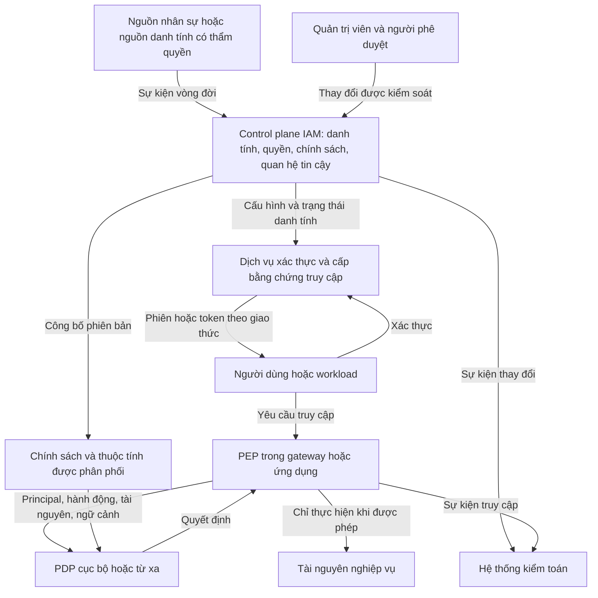

# IAM như một security control plane

## 1. Từ màn hình đăng nhập đến lớp điều khiển bảo mật

Khi chỉ nhìn vào màn hình đăng nhập, ta dễ hiểu IAM là nơi kiểm tra mật khẩu và cấp token. Cách nhìn này chưa thể hiện hết vai trò của IAM trong một hệ thống có nhiều ứng dụng, người dùng, tổ chức và workload.

IAM còn quản lý những quyết định có ảnh hưởng đến toàn bộ hệ thống:

- Danh tính nào được tạo, đang hoạt động và đã bị thu hồi.
- Ai được cấp quyền gì, trên phạm vi nào và trong bao lâu.
- Hệ thống tin nhà cung cấp danh tính, khóa hoặc thông tin xác thực nào.
- Một ứng dụng có thể chấp nhận bằng chứng truy cập trong điều kiện nào.
- Thay đổi quyền cần được phân phối, thực thi và kiểm toán ra sao.

Theo góc nhìn đó, **IAM là một security control plane — lớp điều khiển bảo mật cho danh tính và quyền truy cập**. Nó tổ chức trạng thái, chính sách và quan hệ tin cậy để các thành phần thực thi truy cập sử dụng.

Đây là mô hình kiến trúc để phân tích trách nhiệm, không phải tên một sản phẩm hay yêu cầu bắt buộc xây dựng một dịch vụ IAM duy nhất. IAM cũng không bao trùm mọi kiểm soát bảo mật: mã hóa dữ liệu, bảo vệ mạng, quản lý lỗ hổng và các kiểm soát khác vẫn có trách nhiệm riêng.

Sau bài này, người học cần phân biệt được control plane với data plane, xác định nơi quản lý và thực thi chính sách, đồng thời giải thích được vì sao thay đổi một quyền trên giao diện quản trị chưa bảo đảm quyền đó đã thay đổi ở mọi nơi.

## 2. Control plane và data plane khác nhau ở trách nhiệm

### 2.1. Lớp điều khiển quản lý điều gì được phép

Control plane quản lý các dữ kiện và quy tắc chi phối truy cập. Ví dụ:

- Tiếp nhận thông tin nhân viên từ nguồn có thẩm quyền.
- Cấp và thu hồi tài khoản, nhóm, vai trò hoặc quan hệ thành viên.
- Định nghĩa quyền, chính sách RBAC/ABAC và phạm vi tổ chức.
- Quản lý việc đăng ký MFA, thông tin xác thực và quan hệ liên kết danh tính.
- Cấu hình issuer, audience, khóa tin cậy và thời hạn sử dụng bằng chứng truy cập.
- Phê duyệt đặc quyền tạm thời, công bố chính sách và ghi nhận thay đổi.

Một thay đổi ở control plane có thể ảnh hưởng đến nhiều luồng nghiệp vụ. Gỡ quyền xuất dữ liệu của một vai trò có thể làm thay đổi hành vi tại cổng API, dịch vụ báo cáo và tác vụ chạy nền.

### 2.2. Lớp thực thi áp dụng kiểm soát trên yêu cầu thực tế

Data plane là nơi diễn ra việc truy cập tài nguyên: đọc hồ sơ, duyệt khoản chi, tải tệp hoặc gọi API giữa các dịch vụ. Thành phần thực thi phải dùng ngữ cảnh danh tính và chính sách phù hợp để cho phép hoặc từ chối yêu cầu.

| Khía cạnh | Control plane của IAM | Data plane có thực thi IAM |
| --- | --- | --- |
| Câu hỏi chính | Chính sách và trạng thái truy cập phải như thế nào? | Yêu cầu này có được thực hiện không? |
| Thao tác ví dụ | Cấp role đọc báo cáo cho một nhân viên | Xử lý một yêu cầu tải báo cáo cụ thể |
| Dữ liệu quan trọng | Danh tính, quan hệ thành viên, grant, chính sách, cấu hình tin cậy | Principal của yêu cầu, tài nguyên, hành động, ngữ cảnh và quyết định |
| Rủi ro điển hình | Cấu hình sai lan rộng hoặc cấp đặc quyền trái phép | Bỏ sót kiểm tra đối tượng hoặc dùng quyền đã lỗi thời |
| Đặc tính cần chú ý | Tính đúng đắn của thay đổi, kiểm toán, phân phối trạng thái | Độ trễ, khả dụng và tính đúng đắn của từng lần thực thi |

Ranh giới này mang tính logic. Một tiến trình có thể phục vụ cả API quản trị quyền lẫn API kiểm tra quyền. Dịch vụ xác thực cũng có luồng phục vụ trực tiếp như đăng nhập hoặc cấp token. Không nên phân loại máy móc rằng mọi thành phần mang tên IAM chỉ chạy ngoài đường đi của yêu cầu.

### 2.3. Ví dụ phân biệt bằng một thay đổi cụ thể

Trong hệ thống báo cáo tài chính:

1. Quản lý cấp cho Hương quyền đọc báo cáo của phòng kế toán: thay đổi ở control plane.
2. Hương gửi yêu cầu tải báo cáo tháng: hoạt động ở data plane.
3. API kiểm tra principal, tenant, phòng ban và quyền đọc trước khi trả tệp: thực thi kiểm soát truy cập.
4. Hệ thống ghi nhận việc cấp quyền và việc tải báo cáo: hai loại sự kiện kiểm toán khác nhau.

Nếu bước 1 đúng nhưng API bỏ qua bước 3, control plane không tự ngăn được truy cập trái phép.

## 3. Các thành phần logic trong một kiến trúc IAM

Có thể dùng bốn vai trò logic để phân tích việc quản lý và thực thi chính sách:

| Vai trò | Trách nhiệm | Ví dụ |
| --- | --- | --- |
| PAP — Policy Administration Point | Tạo, sửa, phê duyệt và công bố chính sách | Cổng quản trị vai trò và quyền |
| PDP — Policy Decision Point | Đánh giá chính sách để đưa ra quyết định | Bộ đánh giá quyền xuất báo cáo |
| PIP — Policy Information Point | Cung cấp thuộc tính phục vụ quyết định | Nguồn thành viên tenant, hồ sơ phòng ban, dữ liệu tài nguyên |
| PEP — Policy Enforcement Point | Chặn hoặc cho thực hiện yêu cầu theo quyết định | Middleware API, bộ lọc truy vấn, kiểm tra trong dịch vụ |

Những vai trò này không bắt buộc tương ứng với bốn dịch vụ triển khai riêng. PDP có thể là thư viện nằm trong ứng dụng. PIP có thể là dữ liệu cục bộ hoặc truy vấn sang một hệ thống khác. PEP có thể tồn tại ở nhiều tầng.

Nhà cung cấp danh tính (Identity Provider — IdP) thường hỗ trợ xác thực và cung cấp thông tin danh tính theo quan hệ tin cậy đã cấu hình. IdP không tự biết mọi quy tắc nghiệp vụ, chẳng hạn ai được tải một báo cáo đang bị hạn chế phân phối.

Một luồng quyết định thường cần trả lời:

```text
subject:  Ai đang yêu cầu, thay mặt ai, trong tenant nào?
action:   Đọc, sửa, duyệt, xuất hay quản trị?
resource: Đối tượng nào, thuộc tổ chức và phạm vi nào?
context:  Thời điểm, mức xác thực, trạng thái phiên, điều kiện liên quan?
policy:   Phiên bản quy tắc nào đang được áp dụng?
```

Quyết định cần được thực thi ở nơi có khả năng ngăn hành động. Trả về kết quả “deny” từ PDP sẽ không có ý nghĩa nếu ứng dụng vẫn gửi dữ liệu cho client.

## 4. Luồng quản trị và luồng truy cập kết nối với nhau ra sao?



Sơ đồ không hàm ý mỗi yêu cầu đều phải gọi một IAM trung tâm. Chức năng có thể được phân phối, miễn là các thành phần giữ được quan hệ tin cậy, độ mới dữ liệu và trách nhiệm thực thi rõ ràng.

Tập trung cách định nghĩa và quản trị quyền có thể giúp hệ thống nhất quán. Việc thực thi thường vẫn nằm ở nhiều dịch vụ, vì mỗi dịch vụ nắm các thuộc tính và ràng buộc nghiệp vụ riêng.

## 5. Những trạng thái mà control plane phải quản lý

### 5.1. Vòng đời danh tính và quyền

Với con người, vòng đời thường gồm gia nhập, thay đổi công việc và rời tổ chức. Với workload, vòng đời gồm tạo, triển khai, đổi mục đích, thay thông tin xác thực và ngừng hoạt động.

Control plane cần thể hiện được nguồn gốc và thời hạn của quyền:

```json
{
  "grantId": "grant_731",
  "subjectId": "usr_204",
  "tenantId": "org_north",
  "permission": "report.export",
  "resourceScope": {
    "department": "accounting"
  },
  "validUntil": "2026-12-31T10:00:00Z",
  "approvedBy": "usr_080",
  "reason": "Đối soát cuối kỳ"
}
```

Đây là mô hình dữ liệu minh họa, không phải định dạng cấu hình của một sản phẩm. Điểm cần thấy là một quyền có chủ thể, phạm vi, thời hạn và căn cứ cấp, thay vì chỉ là một cờ toàn cục như `isAdmin = true`.

Không phải mọi quyền đều cần cùng một quy trình phê duyệt. Mức kiểm soát nên tương xứng với tác động: quyền đọc tài liệu phổ thông khác với quyền cấp role quản trị hoặc thay khóa tin cậy.

### 5.2. Chính sách và thuộc tính

RBAC giúp gom quyền theo vai trò. ABAC bổ sung điều kiện theo thuộc tính của chủ thể, tài nguyên và môi trường. Control plane cần làm rõ ai có quyền sửa role, ai quản lý thuộc tính và nguồn nào được coi là có thẩm quyền.

Ví dụ, người dùng không được tự sửa trường `department` rồi dùng giá trị đó để vượt qua chính sách chỉ cho phòng kế toán xuất báo cáo. Một claim có chữ ký chứng minh nguồn phát hành của claim; hệ thống vẫn phải quyết định nguồn đó có thẩm quyền xác nhận thuộc tính này hay không.

### 5.3. Thông tin xác thực, phiên và quan hệ tin cậy

Control plane còn quản lý các ràng buộc như:

- Danh tính nào được phép đăng ký hoặc đặt lại yếu tố xác thực.
- Dịch vụ nào được cấp thông tin xác thực cho workload.
- Ứng dụng nào được tin một issuer hoặc chấp nhận token cho audience nào.
- Quy trình thêm, thay thế và loại bỏ khóa tin cậy.
- Cách khóa tài khoản, chấm dứt phiên và xử lý quyền đã được cấp trước đó.

SSO giúp tái sử dụng kết quả đăng nhập trong một quan hệ tin cậy. OAuth/OIDC hỗ trợ các luồng cấp quyền và danh tính theo mục đích tương ứng. Các cơ chế này cần được cấu hình và vận hành trong control plane, nhưng không thay thế kiểm tra quyền trên tài nguyên tại ứng dụng.

## 6. Từ “đã thu hồi quyền” đến “không còn truy cập được”

Đây là chỗ mô hình control plane đặc biệt hữu ích: nó buộc ta phân biệt trạng thái mong muốn với trạng thái đã được thực thi.

Giả sử nhân viên hợp đồng kết thúc công việc lúc 17:00. Cổng quản trị ghi nhận thu hồi quyền xuất báo cáo, nhưng:

- Một dịch vụ vẫn dùng bản sao danh sách nhóm từ lần đồng bộ trước.
- Một access token còn chứa role cũ.
- Một PDP đã cache kết quả cho phép.
- Một tác vụ xuất dữ liệu đã được xếp hàng và sắp bắt đầu.
- Một kết nối lâu dài đã được thiết lập trước thời điểm thu hồi.

Nếu chỉ kiểm tra bản ghi trên cổng quản trị, ta có thể kết luận sai rằng việc thu hồi đã hoàn tất.

### 6.1. Xác định đường đi của thay đổi

| Chặng | Câu hỏi cần trả lời |
| --- | --- |
| Nguồn danh tính | Nguồn nào xác nhận hợp đồng đã kết thúc? |
| Tiếp nhận vào IAM | Sự kiện đã được nhận và xử lý thành công chưa? |
| Thay đổi grant | Quyền nào bị thu hồi, tại tenant và phạm vi nào? |
| Phân phối | Những dịch vụ nào đã nhận phiên bản mới? |
| Phiên và token | Bằng chứng cũ còn được chấp nhận trong điều kiện nào? |
| Cache quyết định | Cache bị vô hiệu hóa thế nào hoặc hết hạn khi nào? |
| Công việc đang chạy | Khi nào cần kiểm tra lại, dừng hoặc hạn chế kết quả? |

Cần quy định mục tiêu có thể đo, chẳng hạn “quyền xuất báo cáo phải mất hiệu lực trong vòng 5 phút từ khi IAM tiếp nhận sự kiện hợp lệ”. Đây chỉ là ví dụ mục tiêu vận hành; tổ chức phải chọn mốc bắt đầu, giới hạn thời gian và ngoại lệ phù hợp với rủi ro của mình.

### 6.2. Token ngắn hạn giải quyết một phần vấn đề

Giảm thời hạn token có thể giảm thời gian bằng chứng cũ tiếp tục được chấp nhận, nhưng không tự xử lý mọi phiên, mọi cache hoặc tác vụ nền. Thu hồi refresh token thường không tự làm mọi access token đã cấp mất hiệu lực ngay.

Tùy kiến trúc, hệ thống có thể dùng kiểm tra trạng thái trực tuyến, phiên phía máy chủ, sự kiện thu hồi, phiên bản quyền hoặc cache có thời hạn. Mỗi cách có đánh đổi về độ trễ, khả dụng và tính nhất quán.

Đối với thao tác đặc quyền hoặc xuất dữ liệu nhạy cảm, có thể cần kiểm tra dữ liệu mới hơn ngay trước khi thực hiện. Với tác vụ bất đồng bộ, cần xác định tác vụ chạy bằng quyền của ai và tại thời điểm nào quyền đó được đánh giá lại.

### 6.3. Không thể thu hồi dữ liệu đã được nhận bằng cách sửa quyền

Thu hồi quyền chặn các hành động tiếp theo trong phạm vi được kiểm soát. Nó không làm bản sao dữ liệu đã tải về tự biến mất. Vì vậy, quản lý quyền cần phối hợp với các kiểm soát dữ liệu và quy trình xử lý sự cố phù hợp.

## 7. Chọn cách ra quyết định và phân phối chính sách

Có ba cách triển khai thường gặp, có thể kết hợp trong cùng hệ thống:

| Cách triển khai | Lợi ích | Điều cần xử lý |
| --- | --- | --- |
| PDP từ xa | Dễ dùng trạng thái tập trung và thay đổi chính sách tại một nơi | Phụ thuộc mạng, độ trễ, tải và khả dụng của dịch vụ quyết định |
| PDP hoặc thư viện cục bộ | Quyết định nhanh, có thể tiếp tục khi mất kết nối tới nơi quản trị | Phân phối phiên bản, cập nhật thuộc tính và giới hạn độ cũ |
| Thông tin quyền trong token | Truyền được một phần ngữ cảnh, giảm một số truy vấn khi xử lý | Quyền có thể cũ; token không luôn đủ dữ liệu để quyết định trên đối tượng |

Không có lựa chọn nào loại bỏ nhu cầu thực thi quyền. Dù token hợp lệ và có scope `reports.read`, API vẫn có thể cần kiểm tra báo cáo thuộc tenant nào, ai được xem và dữ liệu có đang bị hạn chế hay không.

### 7.1. Tính mới của dữ liệu phải gắn với từng quyết định

Không phải thuộc tính nào cũng có cùng yêu cầu cập nhật. Tên hiển thị có thể chấp nhận chậm đồng bộ lâu hơn trạng thái khóa tài khoản. Quyền quản trị khóa mã hóa có thể cần ràng buộc chặt hơn quyền xem nội dung công khai.

Với mỗi loại quyết định, cần biết:

- Thuộc tính nào bắt buộc có và nguồn nào được tin.
- Độ cũ tối đa được chấp nhận.
- Cache áp dụng cho chủ thể, tenant, hành động và tài nguyên nào.
- Điều kiện làm mất hiệu lực của quyết định đã cache.
- Khi không đáp ứng được các điều kiện trên, yêu cầu sẽ được xử lý ra sao.

Cache chỉ theo `userId` là không đủ nếu cùng người đó có quyền khác nhau theo tenant hoặc tài nguyên.

### 7.2. Mất kết nối không có nghĩa luôn cùng một cách xử lý

Đối với thao tác được bảo vệ, khi không đủ căn cứ cho phép thì cần từ chối hoặc trả lỗi phù hợp. Không tự chuyển sang cho phép mọi yêu cầu khi PDP lỗi.

Tuy nhiên, tiếp tục dùng một chính sách cục bộ đã được xác minh, còn trong giới hạn độ cũ được chấp nhận, có thể là hành vi đã được thiết kế. Đây khác với bỏ qua kiểm tra quyền.

Tương tự, IdP ngừng phục vụ có thể làm đăng nhập mới thất bại nhưng không nhất thiết làm mọi phiên hiện có lập tức mất hiệu lực. Khả năng tiếp tục xử lý phụ thuộc vào cơ chế xác minh phiên, token và các yêu cầu cập nhật trạng thái của ứng dụng.

## 8. Ví dụ: chính sách xuất báo cáo tài chính

Giả sử hệ thống nhiều tenant có quy tắc:

- Người dùng phải đang hoạt động và có tư cách thành viên hợp lệ.
- Quyền `report.export` chỉ có hiệu lực trong tenant và phòng ban được cấp.
- Báo cáo phải ở trạng thái cho phép xuất.
- Với báo cáo nhạy cảm, cần ngữ cảnh xác thực đáp ứng yêu cầu tăng cường.
- Quyền tạm thời phải chưa hết hạn.

Mã giả tại dịch vụ báo cáo:

```text
function exportReport(request):
    principal = verifyAccessEvidence(request)
    if principal is absent:
        return unauthenticated()

    membership = getTrustedMembership(
        principal.subjectId,
        request.selectedTenant
    )
    if membership is not active:
        return deny()

    report = loadReportWithinTenant(
        membership.tenantId,
        request.reportId
    )
    if report is absent:
        return resourceNotAvailable()

    decision = policyDecision.evaluate(
        principal = principal,
        membership = membership,
        action = "report.export",
        resource = report,
        context = trustedContext(),
        requiredFreshness = exportFreshnessPolicy
    )

    recordDecisionMetadata(decision)

    if decision.effect is not "allow":
        return denyOrDependencyError(decision)

    return exportWithConsistencyControls(report, decision)
```

Các hàm trong ví dụ chỉ mô tả trách nhiệm logic. Việc triển khai phải xác định cơ chế bảo đảm dữ liệu và trạng thái dùng để quyết định vẫn phù hợp lúc hành động diễn ra, chẳng hạn kiểm tra lại, khóa hoặc cập nhật có điều kiện tùy tài nguyên.

Trong luồng này:

1. Control plane quản lý grant, chính sách và yêu cầu về độ mới.
2. Dữ liệu thành viên và thuộc tính báo cáo cung cấp thông tin cho quyết định.
3. PDP đánh giá quyền đối với yêu cầu cụ thể.
4. Dịch vụ báo cáo đóng vai PEP và chỉ xuất khi có kết quả cho phép hợp lệ.
5. Log quyết định ghi được phiên bản chính sách và căn cứ truy vết mà không ghi token hoặc nội dung báo cáo.

Nếu cổng API chỉ kiểm tra chữ ký token, dịch vụ báo cáo vẫn cần các kiểm tra đối tượng nêu trên. Nếu xuất báo cáo được đưa vào hàng đợi, worker cần có quy tắc riêng về danh tính thực thi, quyền của người yêu cầu và việc kiểm tra lại trước khi tạo hoặc phân phối tệp.

## 9. Bảo vệ chính control plane

Control plane là mục tiêu có giá trị cao vì thay đổi tại đây có thể mở đường vào nhiều hệ thống. Người có quyền sửa chính sách có thể gây tác động lớn hơn người chỉ có quyền sử dụng một chức năng nghiệp vụ.

### 9.1. Phân tách các loại đặc quyền

Nên phân biệt quyền quản lý tài khoản, phê duyệt quyền, sửa chính sách, thay cấu hình liên kết và truy cập dữ liệu nghiệp vụ. Quản trị viên IAM không nên mặc nhiên có quyền đọc mọi dữ liệu ứng dụng.

Với thay đổi tác động lớn, có thể áp dụng:

- Xác thực mạnh và xác thực lại khi cần.
- Cấp đặc quyền có thời hạn, theo nhiệm vụ.
- Phê duyệt độc lập hoặc phân tách trách nhiệm.
- Giới hạn tenant và phạm vi tài nguyên có thể quản trị.
- Ghi nhận cả người yêu cầu, người phê duyệt và người thực hiện.

Cũng cần kiểm soát đường leo thang gián tiếp. Một người không có role quản trị vẫn có thể chiếm đặc quyền nếu được tùy ý đặt lại yếu tố xác thực của quản trị viên hoặc sửa nhóm mà chính sách quản trị đang tin cậy.

### 9.2. Bảo vệ khóa và cấu hình tin cậy

Khóa ký, thông tin xác thực quản trị và cấu hình liên kết danh tính là những tài sản cần bảo vệ riêng. Thay issuer, khóa tin cậy hoặc quy tắc ánh xạ nhóm có thể làm hệ thống chấp nhận chủ thể ngoài dự kiến.

Phân phối chính sách cũng cần xác minh nguồn, tính toàn vẹn, phiên bản và phạm vi áp dụng. Một tệp có chữ ký hợp lệ vẫn có thể là phiên bản cũ hoặc được ký cho tenant khác; kiểm tra chữ ký không thay thế kiểm tra các ràng buộc đó.

### 9.3. Thiết kế khôi phục và truy cập khẩn cấp

Nếu IAM gặp sự cố, tổ chức cần khả năng khôi phục cấu hình, khóa và trạng thái thiết yếu. Đường truy cập khẩn cấp cần có phạm vi, thời hạn, người chịu trách nhiệm và kiểm toán rõ ràng.

Không nên thiết kế khôi phục bằng một cờ toàn cục tắt mọi kiểm tra quyền. Đồng thời, cần tránh tình huống mọi công cụ khôi phục đều phụ thuộc duy nhất vào thành phần IAM đang bị hỏng. Cơ chế khôi phục phải được thử trong điều kiện có kiểm soát và không trở thành lối truy cập thường ngày.

## 10. Thay đổi chính sách như thay đổi một hệ thống quan trọng

Một lỗi trong chính sách dùng chung có thể làm gián đoạn nhiều ứng dụng hoặc mở rộng quyền ngoài dự kiến. Vòng đời thay đổi nên đủ rõ để trả lời: ai sửa gì, vì sao, đã được xem xét thế nào và các nơi thực thi đang dùng phiên bản nào.

Một quy trình minh họa:

1. Tạo phiên bản dự kiến từ yêu cầu nghiệp vụ đã xác định.
2. Kiểm tra các tình huống cho phép và từ chối, gồm truy cập chéo tenant và quyền hết hạn.
3. Đánh giá phạm vi tác động, đặc biệt với role hoặc nhóm dùng chung.
4. Triển khai theo phạm vi giới hạn trước khi mở rộng.
5. Theo dõi tỷ lệ từ chối, lỗi phụ thuộc và sự khác biệt giữa phiên bản.
6. Công bố rộng hơn hoặc khôi phục phiên bản trước theo tiêu chí đã định.

Khôi phục không luôn chỉ là chép lại một tệp. Phiên bản chính sách trước có thể không tương thích với thuộc tính, schema hoặc trạng thái mới. Vì vậy, kế hoạch thay đổi cần xét cả dữ liệu và các thành phần thực thi.

## 11. Kiểm toán và quan sát hiệu lực của kiểm soát

Cần phân biệt hai dòng sự kiện:

| Dòng sự kiện | Ví dụ | Câu hỏi được hỗ trợ |
| --- | --- | --- |
| Thay đổi ở control plane | Cấp quyền, gỡ role, sửa policy, thay khóa tin cậy | Ai đã làm thay đổi khả năng truy cập? |
| Truy cập ở data plane | Đọc báo cáo, xuất tệp, bị từ chối thao tác | Ai đã thực sự làm gì trên tài nguyên nào? |

Một bản ghi quyết định có thể gồm:

```json
{
  "requestId": "req_842",
  "subjectId": "usr_204",
  "tenantId": "org_north",
  "action": "report.export",
  "resourceId": "report_581",
  "decision": "deny",
  "reasonCode": "GRANT_EXPIRED",
  "policyVersion": "policy_27",
  "occurredAt": "2026-12-31T10:01:00Z"
}
```

Thông tin cần ghi phụ thuộc vào yêu cầu bảo mật và bảo vệ dữ liệu. Không ghi mật khẩu, bearer token hoặc toàn bộ claims theo thói quen. Log cũng cần được kiểm soát truy cập và bảo vệ trước việc sửa hoặc xóa trái phép.

Các chỉ số vận hành hữu ích gồm:

- Thời gian từ khi thay đổi quyền được tiếp nhận đến khi có hiệu lực tại nơi thực thi.
- Số nơi thực thi đang dùng chính sách quá cũ hoặc không đồng bộ được.
- Số grant đặc quyền đã hết hạn nhưng chưa được dọn dẹp hoặc còn được sử dụng.
- Độ trễ và tỷ lệ lỗi của luồng đánh giá quyền.
- Thay đổi bất thường trong tỷ lệ cho phép hoặc từ chối.

Tỷ lệ từ chối tăng không tự chứng minh có tấn công: có thể do lỗi chính sách, đồng bộ hoặc luồng nghiệp vụ mới. Cần liên hệ sự kiện truy cập với thay đổi ở control plane để phân tích.

## 12. Tự phân tích các tình huống

### Tình huống 1: đã gỡ nhóm nhưng API vẫn cho truy cập

Người dùng bị gỡ khỏi nhóm đọc báo cáo. API tiếp tục chấp nhận access token còn hạn mang nhóm cũ.

**Phân tích:** trạng thái mong muốn đã thay đổi, nhưng đường thực thi vẫn dùng bằng chứng cũ. Cần xác định giới hạn chấp nhận quyền cũ, cách xử lý token và việc kiểm tra trạng thái mới tại API. Không thể kết luận lỗi chỉ nằm ở giao diện quản trị.

### Tình huống 2: PDP trả từ chối nhưng dữ liệu vẫn bị trả về

Một ứng dụng gọi PDP, ghi log kết quả `deny`, rồi vẫn chạy nhánh tải tệp.

**Phân tích:** điểm quyết định hoạt động nhưng điểm thực thi không tuân theo quyết định. Có PDP tập trung không thay thế trách nhiệm chặn hành động tại PEP.

### Tình huống 3: nhân viên tự sửa thuộc tính quyết định quyền

Ứng dụng cho phép người dùng sửa trường phòng ban trong hồ sơ tự phục vụ. Chính sách ABAC lại dùng ngay trường đó để cấp quyền xem báo cáo kế toán.

**Phân tích:** quyền quản lý thuộc tính đã trở thành đường cấp quyền gián tiếp. Control plane cần xác định nguồn có thẩm quyền và phân biệt thuộc tính người dùng tự khai với thuộc tính dùng để quyết định quyền.

### Tình huống 4: control plane lỗi nhưng chính sách cục bộ còn hợp lệ

Dịch vụ không kết nối được tới nơi công bố chính sách. Nó vẫn giữ phiên bản đã xác minh và chưa vượt giới hạn độ cũ cho loại thao tác đang xử lý.

**Phân tích:** có thể tiếp tục đánh giá theo thiết kế đã định, nếu các dữ kiện bắt buộc khác cũng đáp ứng yêu cầu. Khi không còn đủ căn cứ cho phép, hệ thống cần từ chối hoặc báo lỗi phù hợp. Cần phân biệt duy trì khả dụng có kiểm soát với bỏ qua kiểm soát truy cập.

## 13. Câu hỏi để áp dụng vào một hệ thống thực tế

Khi nhìn IAM như một security control plane, hãy lần theo một quyền cụ thể từ lúc được cấp tới lúc được thực thi:

1. Danh tính và thuộc tính đến từ nguồn nào?
2. Ai được cấp, phê duyệt hoặc sửa phạm vi quyền đó?
3. Phiên bản chính sách được phân phối tới đâu?
4. Thành phần nào quyết định, thành phần nào thực sự chặn hành động?
5. Token, phiên và cache có thể giữ trạng thái cũ trong bao lâu?
6. Khi thu hồi quyền hoặc có sự cố, có thể chứng minh hiệu lực tại nơi thực thi bằng cách nào?

Cách nhìn này kết nối quản lý vòng đời tài khoản, MFA, phiên, RBAC/ABAC, SSO, OAuth/OIDC, danh tính workload và đặc quyền thành một hệ thống kiểm soát có thể vận hành và kiểm toán. Giá trị của control plane chỉ trở thành bảo vệ thực tế khi các quyết định đúng được áp dụng đúng chỗ, đúng phạm vi và đúng thời điểm.
