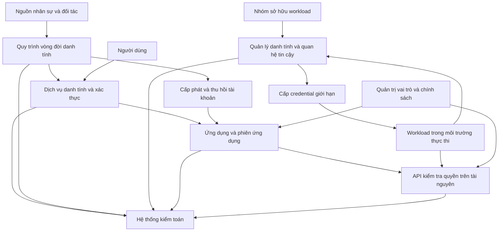

# Khi nào cần tập trung hóa IAM

## 1. Vấn đề cần giải quyết

Khi một tổ chức mới có một ứng dụng, việc quản lý tài khoản ngay trong ứng dụng thường dễ hiểu: ứng dụng lưu người dùng, kiểm tra đăng nhập và quyết định quyền truy cập. Khi có thêm cổng nhân sự, hệ thống tài chính, công cụ vận hành, API và các dịch vụ tự động, mỗi hệ thống có thể hình thành một cách quản lý danh tính riêng.

Hệ quả không chỉ là người dùng phải nhớ nhiều mật khẩu. Một nhân viên đổi bộ phận nhưng vẫn giữ quyền cũ; tài khoản đã bị khóa ở hệ thống nhân sự vẫn dùng được ở ứng dụng khác; dịch vụ chạy bằng khóa của người đã nghỉ việc; đội vận hành không xác định được nơi nào đang cấp quyền quản trị. Những vấn đề này cho thấy tổ chức đang thiếu khả năng quản lý danh tính và quyền truy cập một cách nhất quán.

**Tập trung hóa IAM** là đưa những trách nhiệm quản lý danh tính và truy cập có tính dùng chung về các dịch vụ, chính sách và quy trình được quản trị thống nhất. Mục tiêu là kiểm soát tốt hơn việc ai hoặc workload nào được truy cập, bằng cách nào, vào tài nguyên nào và đến khi nào.

Tập trung hóa không có nghĩa mọi dữ liệu, mọi quyết định quyền và mọi lần kiểm tra token đều phải đi qua một máy chủ duy nhất. Một thiết kế có thể quản trị danh tính tập trung nhưng thực thi quyền tại từng ứng dụng, sử dụng nhiều cụm triển khai và liên kết với các miền danh tính bên ngoài.

Sau bài học, bạn có thể nhận diện nhu cầu tập trung hóa, chọn phần trách nhiệm cần tập trung, đánh giá rủi ro vận hành và xây dựng một lộ trình chuyển đổi có thể kiểm chứng.

## 2. Tập trung hóa những gì?

IAM bao gồm nhiều trách nhiệm khác nhau. Trước khi quyết định xây dựng một nền tảng dùng chung, cần xác định rõ phần nào đang gây khó khăn.

| Trách nhiệm | Có thể tập trung hóa như thế nào? | Phần vẫn cần gắn với ứng dụng hoặc miền nghiệp vụ |
|---|---|---|
| Quản lý danh tính | Dùng nguồn danh tính có thẩm quyền, định danh ổn định và quy trình tạo, cập nhật, ngừng sử dụng | Hồ sơ và thuộc tính nghiệp vụ đặc thù |
| Xác thực | Dùng nhà cung cấp danh tính chung, chính sách đăng nhập và MFA thống nhất | Thiết lập phiên ứng dụng, xử lý mức xác thực cần cho từng thao tác |
| Cấp phát tài khoản | Đồng bộ tài khoản và trạng thái theo quy trình quản lý vòng đời | Kiểm tra kết quả áp dụng tại hệ thống đích và xử lý ngoại lệ |
| Cấp quyền | Quản lý nhóm, vai trò cơ bản, phê duyệt và rà soát quyền | Quyền trên từng tài nguyên, quan hệ tenant, trạng thái giao dịch |
| Danh tính workload | Quản lý chủ sở hữu, cơ chế cấp credential và quan hệ tin cậy | Quyền theo nhiệm vụ, môi trường thực thi và tài nguyên của workload |
| Kiểm toán | Thu thập và liên kết sự kiện từ nhiều hệ thống | Ghi lại hành động nghiệp vụ và kết quả thực thi cụ thể |
| Quản trị đặc quyền | Quản lý việc cấp quyền nhạy cảm, thời hạn và phê duyệt | Kiểm soát thao tác đặc quyền trên từng nền tảng |

### 2.1. Phân biệt SSO, liên kết danh tính và quản lý vòng đời

**Đăng nhập một lần (Single Sign-On — SSO)** giúp người dùng truy cập nhiều ứng dụng dựa trên phiên xác thực hoặc quan hệ tin cậy với nhà cung cấp danh tính. SSO giảm việc đăng nhập lặp lại, nhưng không tự động giải quyết tất cả tài khoản, quyền và phiên ở các ứng dụng.

**Liên kết danh tính (identity federation)** cho phép một miền tin cậy chấp nhận bằng chứng danh tính từ miền khác. Tổ chức có thể quản trị việc chấp nhận danh tính đối tác một cách tập trung mà không cần sở hữu tài khoản gốc của từng nhân viên đối tác.

**Quản lý vòng đời danh tính** xử lý việc tạo, thay đổi, vô hiệu hóa và xóa tài khoản theo nhu cầu. Một ứng dụng hỗ trợ SSO vẫn có thể cần tài khoản cục bộ để lưu hồ sơ, quyền hoặc dữ liệu. Nếu quy trình vòng đời không được tích hợp, tài khoản và quyền đó có thể còn tồn tại sau khi người dùng không còn được đăng nhập ở nhà cung cấp danh tính.

OIDC và SAML thường được dùng trong các tích hợp đăng nhập liên kết; OAuth 2.0 phục vụ các luồng ủy quyền truy cập. SCIM có thể được dùng để cấp phát và cập nhật tài khoản, nhóm khi các hệ thống hỗ trợ. Những giao thức này xử lý các phần việc khác nhau; bật một giao thức không đồng nghĩa toàn bộ vòng đời IAM đã được bao phủ.

### 2.2. Quản trị tập trung và thực thi phân tán

Một kiến trúc phù hợp thường tách hai lớp:

- **Lớp quản trị và điều khiển:** quản lý danh tính, chính sách tin cậy, nhóm, phê duyệt, cấu hình cấp token và quy trình thu hồi.
- **Lớp thực thi truy cập:** kiểm tra yêu cầu và áp dụng quyền tại API, ứng dụng, cổng truy cập hoặc tài nguyên đích.

Ví dụ, nền tảng IAM xác nhận một người thuộc bộ phận kế toán. API hóa đơn vẫn cần kiểm tra người đó có được xem hóa đơn của chi nhánh đang yêu cầu hay không. Nếu IAM phát ra một vai trò chung rồi API bỏ qua kiểm tra tài nguyên, việc tập trung hóa chưa bảo đảm quyền đúng.

## 3. Những dấu hiệu cho thấy cần tập trung hóa

### 3.1. Không thể thu hồi truy cập đầy đủ và kịp thời

Đây là một trong những tín hiệu rõ nhất. Khi một người nghỉ việc hoặc một workload bị ngừng sử dụng, tổ chức không biết phải khóa ở đâu, hoặc phải nhờ từng nhóm xử lý thủ công.

Các câu hỏi cần đặt ra gồm:

- Có danh sách đầy đủ những hệ thống đang chấp nhận danh tính này không?
- Khi nguồn có thẩm quyền ghi nhận ngừng sử dụng, hệ thống nào nhận được thay đổi?
- Phiên và token đã cấp còn được chấp nhận bao lâu?
- Tài khoản cục bộ, khóa API hoặc đường đăng nhập dự phòng có tiếp tục cho phép truy cập không?
- Ai kiểm tra rằng việc thu hồi đã thực sự có hiệu lực ở hệ thống đích?

Nếu tổ chức chỉ trả lời được “đã khóa ở hệ thống trung tâm” mà chưa biết ứng dụng đích còn chấp nhận truy cập hay không, vẫn còn khoảng trống cần giải quyết.

### 3.2. Chính sách xác thực khác nhau giữa các ứng dụng

Một ứng dụng yêu cầu MFA, ứng dụng khác chỉ dùng mật khẩu. Một nơi kiểm soát khôi phục tài khoản chặt chẽ, nơi khác cho phép đặt lại qua quy trình yếu hơn. Người dùng có thể đi qua đường xác thực ít được bảo vệ nhất để tiếp cận cùng dữ liệu.

Tập trung hóa xác thực giúp thống nhất các yêu cầu nền tảng và giảm số nơi phải triển khai, vận hành cơ chế đăng nhập. Tuy vậy, các đường đăng nhập cục bộ hoặc giao diện quản trị cũ phải được kiểm kê và kiểm soát; nếu chúng vẫn mở, chính sách trung tâm có thể bị đi vòng.

### 3.3. Quyền tích lũy qua nhiều lần thay đổi nhiệm vụ

Khi cấp quyền chủ yếu bằng yêu cầu riêng lẻ, tổ chức dễ chỉ thêm quyền mới mà không gỡ quyền cũ. Sau vài lần chuyển bộ phận, người dùng có thể giữ đồng thời nhiều quyền không còn cần thiết.

Quản trị quyền tập trung có ích khi cần biết ai đã phê duyệt, quyền được cấp vì lý do gì, thời hạn bao lâu và lần rà soát gần nhất là khi nào. Không nhất thiết đưa mọi quy tắc nghiệp vụ vào cùng một hệ thống; điều cần tập trung trước có thể là quy trình phê duyệt và danh mục quyền.

### 3.4. Không có cái nhìn đầy đủ về danh tính workload

Các nhóm phát triển tự tạo service account, khóa API và bí mật trong pipeline. Sau một thời gian, tổ chức không biết danh tính nào còn hoạt động, ai sở hữu và hệ thống nào đang sử dụng credential đó.

Nhu cầu tập trung hóa lúc này có thể bao gồm danh mục workload identity, quy tắc đặt chủ sở hữu, tách môi trường, cấp credential ngắn hạn và quản lý quan hệ tin cậy. Tập trung hóa IAM chỉ cho người dùng sẽ bỏ sót một phần quan trọng của truy cập tự động.

### 3.5. Chi phí tích hợp và vận hành tăng lặp lại

Mỗi nhóm tự viết đăng nhập, MFA, khôi phục tài khoản, quản lý phiên và giao diện cấp quyền. Khi yêu cầu thay đổi, nhiều nhóm phải sửa cùng một loại chức năng nhưng triển khai không đồng nhất.

Đó là dấu hiệu có thể cung cấp năng lực IAM dùng chung. Giá trị không chỉ nằm ở giảm công viết mã, mà còn ở việc có nhóm chịu trách nhiệm rõ ràng về cấu hình, vận hành, nâng cấp và xử lý sự cố cho năng lực đó.

### 3.6. Không thể trả lời câu hỏi kiểm toán xuyên hệ thống

Ví dụ: “Ai có thể triển khai vào production, thông qua quyền trực tiếp hoặc điều khiển một pipeline?” Câu trả lời có thể nằm trong hệ thống nguồn mã, công cụ CI/CD, tài khoản cloud và nền tảng quản lý bí mật.

Khi phải ghép dữ liệu thủ công mỗi lần, có thể cần tập trung danh mục quyền, quan hệ giữa các danh tính và sự kiện kiểm toán. Chỉ gom log đăng nhập là chưa đủ; cần cả dữ liệu về quyền hiện tại và các thay đổi quyền.

## 4. Quyết định dựa trên rủi ro và nhu cầu thực tế

### 4.1. Số lượng ứng dụng không phải ngưỡng duy nhất

Không có một con số chung như “đủ năm ứng dụng thì phải tập trung hóa”. Một tổ chức có ít ứng dụng nhưng nhiều quản trị viên, dữ liệu nhạy cảm và thay đổi nhân sự liên tục có thể cần quản trị danh tính chung sớm. Một môi trường học tập tạm thời với dữ liệu giả và ít người dùng có nhu cầu khác.

Cần xem xét mức nhạy cảm của tài nguyên, tốc độ thay đổi danh tính, mức độ liên thông và hậu quả khi thu hồi hoặc phân quyền sai.

### 4.2. Bảng câu hỏi quyết định

| Câu hỏi | Dấu hiệu nhu cầu cao | Hành động có thể ưu tiên |
|---|---|---|
| Việc rời tổ chức hoặc ngừng workload có được xử lý xuyên hệ thống không? | Không biết còn quyền ở đâu; không đo được thời gian thu hồi | Nguồn danh tính có thẩm quyền và quy trình vòng đời |
| Chính sách đăng nhập có thống nhất không? | Có đường bỏ qua MFA hoặc khôi phục tài khoản yếu | Xác thực liên kết, quản lý phương thức xác thực và ngoại lệ |
| Có kiểm soát được đặc quyền không? | Tài khoản quản trị dùng chung, quyền không có thời hạn | Danh tính cá nhân, phê duyệt và quản lý truy cập đặc quyền |
| Có biết chủ sở hữu danh tính tự động không? | Khóa không rõ người quản lý, service account dùng chung | Quản lý workload identity và credential |
| Có nhiều tích hợp phải xây lại không? | Mỗi ứng dụng tự triển khai cùng một chức năng IAM | Dịch vụ dùng chung và mẫu tích hợp |
| Có yêu cầu truy vết hoạt động xuyên ứng dụng không? | Không liên kết được danh tính, phiên và hành động | Định danh, mã tương quan và kiểm toán thống nhất |
| Có khả năng vận hành nền tảng chung không? | Không có nhóm sở hữu, dự phòng hoặc quy trình phục hồi | Bổ sung năng lực vận hành trước khi mở rộng phụ thuộc |

Bảng này là công cụ phân tích, không phải quy định chấm điểm. Một rủi ro đặc quyền nghiêm trọng có thể cần được xử lý ngay dù các khía cạnh khác còn đơn giản.

### 4.3. Khi nào có thể giữ phạm vi triển khai hẹp?

Một ứng dụng độc lập, ít người dùng, không liên thông với hệ thống khác và có vòng đời tài khoản được kiểm soát có thể chưa cần một chương trình tập trung hóa toàn tổ chức. Tuy nhiên, vẫn cần xác thực phù hợp, quyền tối thiểu, thu hồi tài khoản và kiểm toán theo rủi ro.

Nếu ứng dụng dự kiến sớm tham gia hệ sinh thái lớn hơn, nên chuẩn bị khả năng tích hợp: tách logic xác thực khỏi nghiệp vụ, dùng định danh ổn định và tránh phụ thuộc email như khóa duy nhất cho mọi quan hệ. Điều này giúp giảm chi phí chuyển đổi sau này.

Trong nhiều trường hợp, lựa chọn hợp lý là tập trung một phần: dùng nhà cung cấp danh tính chung để xác thực, nhưng chưa xây dịch vụ quyết định quyền dùng chung cho toàn bộ nghiệp vụ.

## 5. Chọn ranh giới tập trung hóa

### 5.1. Xác định nguồn có thẩm quyền cho từng loại thông tin

“Có hệ thống trung tâm” không có nghĩa mọi thuộc tính đều được tạo ở đó. Nguồn có thẩm quyền là nơi chịu trách nhiệm xác lập một loại thông tin.

Ví dụ:

- Hệ thống nhân sự xác lập quan hệ làm việc và trạng thái nhân viên.
- Quy trình quản lý đối tác xác lập thời hạn hợp đồng và người bảo trợ.
- Nhóm sở hữu dịch vụ xác lập mục đích và môi trường của workload.
- Quy trình cấp quyền xác lập việc ai được nhận vai trò nhạy cảm.
- Ứng dụng nghiệp vụ xác lập quyền trên một hồ sơ hoặc giao dịch cụ thể.

Cần quy định hướng đồng bộ và cách xử lý xung đột. Nếu hai hệ thống cùng được phép sửa trạng thái tài khoản mà không có quy tắc ưu tiên, một thay đổi cũ có thể vô tình kích hoạt lại truy cập đã bị thu hồi.

### 5.2. Tập trung xác thực, giữ quyền nghiệp vụ gần tài nguyên

Ứng dụng có thể tin kết quả xác thực từ nhà cung cấp danh tính, nhưng vẫn chịu trách nhiệm kiểm tra quyền cho từng yêu cầu.

Ví dụ, một người có vai trò `finance-reader`. Vai trò đó chưa trả lời được người này có quyền xem hóa đơn của tenant A hay được xem hóa đơn đang bị hạn chế đặc biệt hay không. API cần kiểm tra quan hệ với tài nguyên và các điều kiện nghiệp vụ tương ứng.

RBAC giúp tổ chức quyền theo vai trò. ABAC có thể xét thêm thuộc tính như tenant, môi trường hoặc mức nhạy cảm. Những thuộc tính dùng để cấp quyền cần đến từ nguồn đáng tin cậy và có quy trình cập nhật rõ ràng.

Khi nhiều ứng dụng thực sự dùng chung một mô hình chính sách, có thể đưa phần quyết định quyền đó vào một dịch vụ chung. Nếu các miền có ngữ nghĩa khác nhau, việc ép tất cả vào một vai trò `admin` hoặc một bộ quyền quá chung sẽ làm mất ranh giới cần bảo vệ.

### 5.3. Tách các miền danh tính có vòng đời khác nhau

Nhân viên, khách hàng, đối tác và workload không nhất thiết dùng cùng một kho danh tính hoặc chính sách đăng nhập. Các nhóm này khác nhau về nguồn dữ liệu, cách đăng ký, cơ chế khôi phục, quyền quản trị và quy mô vận hành.

Tổ chức có thể có nhiều miền danh tính nhưng quản trị tập trung về nguyên tắc, tiêu chuẩn tích hợp và kiểm toán. Điều quan trọng là xác định rõ miền nào được chấp nhận ở tài nguyên nào, cùng điều kiện ánh xạ sang quyền.

Một danh tính khách hàng được xác thực hợp lệ không nên được coi là danh tính nhân viên chỉ vì hai tài khoản có cùng địa chỉ email. Tương tự, bằng chứng của workload development không được tự động nhận quyền production.

### 5.4. Định danh và liên kết tài khoản phải rõ ràng

Tên hiển thị và email có thể thay đổi; email cũng có thể được tái sử dụng theo chính sách tổ chức. Dùng chúng làm căn cứ duy nhất để liên kết tài khoản dễ dẫn đến gắn sai người với quyền cũ.

Nên dùng định danh ổn định theo thiết kế của nguồn danh tính và lưu ánh xạ giữa các hệ thống. Trong OIDC, cặp bên phát hành và `sub` là thông tin quan trọng để xác định chủ thể trong ngữ cảnh của token. Không nên giả định `sub` luôn giống nhau ở mọi ứng dụng; một số cấu hình dùng định danh khác nhau theo client hoặc nhóm client.

Khi di chuyển tài khoản, cần xác minh quan hệ sở hữu bằng quy trình đáng tin cậy. Không tự động hợp nhất các tài khoản có email giống nhau nếu chưa đánh giá nguồn và mức bảo đảm của thông tin đó.

## 6. Kiến trúc minh họa



Sơ đồ biểu diễn trách nhiệm và quan hệ ở mức khái niệm, không yêu cầu triển khai mỗi ô thành một sản phẩm riêng. Nó cũng không yêu cầu API gọi dịch vụ trung tâm cho mọi lần truy cập; cách xác minh credential và lấy chính sách cần được chọn theo yêu cầu bảo mật, độ trễ và tính sẵn sàng.

Đăng nhập tập trung có thể hỗ trợ SSO và MFA cho người dùng. Workload thường nhận credential qua cơ chế của nền tảng hoặc liên kết danh tính phù hợp với môi trường chạy. Hai nhóm có thể chia sẻ tiêu chuẩn quản trị, nhưng không nên buộc tác vụ tự động sử dụng phiên hoặc tài khoản cá nhân của nhân viên.

## 7. Những rủi ro phải giải quyết trước khi mở rộng

### 7.1. Điểm tập trung có phạm vi ảnh hưởng lớn

Một thay đổi sai trong chính sách tin cậy hoặc tài khoản quản trị nền tảng có thể ảnh hưởng nhiều ứng dụng. Sự cố ở nhà cung cấp danh tính có thể ngăn người dùng đăng nhập hoặc ngăn workload nhận credential mới.

Vì vậy, cần thiết kế tính sẵn sàng, dự phòng, sao lưu cấu hình và phục hồi tương xứng với mức phụ thuộc. Có nhiều máy chủ không tự động bảo đảm phục hồi nếu tất cả cùng phụ thuộc vào một cấu hình sai, một khóa ký hoặc một miền quản trị bị xâm phạm.

Quyền quản trị nền tảng IAM cần được giới hạn và kiểm toán. Các thay đổi nhạy cảm như thêm bên phát hành tin cậy, đổi phương thức khôi phục hoặc cho phép một workload nhận vai trò mạnh nên có kiểm soát tương ứng với tác động của chúng.

### 7.2. Hành vi khi dịch vụ trung tâm không sẵn sàng

Không nên chỉ nói chung rằng “IAM có dự phòng”. Cần xác định điều gì xảy ra với từng hoạt động:

| Hoạt động | Câu hỏi cần làm rõ khi có sự cố |
|---|---|
| Đăng nhập mới | Có cụm hoặc vùng khác phục vụ không? Nếu không, người dùng nhận lỗi như thế nào? |
| Phiên đang hoạt động | Ứng dụng có tiếp tục chấp nhận phiên không, và đến khi nào? |
| API nhận token | Có thể xác minh cục bộ bằng dữ liệu tin cậy đã có hay phải gọi dịch vụ trực tuyến? |
| Cấp credential cho workload | Workload còn credential hợp lệ bao lâu? Khả năng tự làm mới có phụ thuộc thành phần đang lỗi không? |
| Thu hồi quyền khẩn cấp | Có đường chặn tại tài nguyên đích nếu kênh đồng bộ trung tâm đang gián đoạn không? |
| Thao tác cần xác thực mạnh hơn | Nếu không thực hiện được bước xác thực bổ sung, hệ thống sẽ từ chối hay trì hoãn thao tác? |

Một API xác minh JWT cục bộ có thể tiếp tục xử lý một số token còn hiệu lực khi dịch vụ phát hành tạm ngừng, nếu nó đã có dữ liệu khóa và cấu hình tin cậy cần thiết. Điều này phụ thuộc cách triển khai, thời hạn token và cơ chế cập nhật khóa. Nó cũng có nghĩa thay đổi trạng thái tài khoản có thể chưa phản ánh ngay vào token đã phát hành.

Ngược lại, cách kiểm tra token trực tuyến có thể phản ánh trạng thái tập trung nhanh hơn theo thiết kế, nhưng tạo thêm phụ thuộc về mạng, độ trễ và tính sẵn sàng. Không có một lựa chọn phù hợp cho mọi loại tài nguyên.

Hành vi khi lỗi phải được quyết định theo rủi ro. Không nên bỏ qua xác thực hoặc phân quyền chỉ để giữ hệ thống hoạt động. Với thao tác nhạy cảm, nếu không đủ bằng chứng thì từ chối hoặc trì hoãn là một lựa chọn cần được thiết kế rõ ràng.

### 7.3. Truy cập khẩn cấp phải là một quy trình có kiểm soát

Một số môi trường cần phương án truy cập khẩn cấp để phục hồi nền tảng khi đường quản trị thông thường không dùng được. Phương án đó cần có phạm vi hẹp, người chịu trách nhiệm, bảo vệ credential, cảnh báo sử dụng và kiểm tra định kỳ.

Không nên biến tài khoản cục bộ quyền cao thành đường đăng nhập hằng ngày. Sau khi sử dụng truy cập khẩn cấp, cần rà soát hành động và xử lý credential theo quy trình đã định. Đồng thời, phải kiểm tra rằng các bước khôi phục không phụ thuộc hoàn toàn vào chính thành phần đang cần khôi phục.

### 7.4. Đồng bộ không phải lúc nào cũng tức thời

Trạng thái tài khoản, nhóm, vai trò, cache chính sách và phiên có thể được cập nhật ở các thời điểm khác nhau. Lệnh đồng bộ thành công ở phía gửi chưa chứng minh hệ thống đích đã từ chối truy cập.

Cần theo dõi lỗi, thử lại có kiểm soát và đối soát trạng thái. Phải xác định cách xử lý sự kiện đến trễ hoặc đến sai thứ tự, đặc biệt khi chúng có thể kích hoạt lại tài khoản hoặc khôi phục quyền đã bị gỡ.

### 7.5. Tập trung dữ liệu cũng cần giới hạn

Danh mục danh tính và log truy cập chứa thông tin có thể nhạy cảm. Cần giới hạn người được xem, dữ liệu được thu thập và thời gian lưu theo mục đích thực tế. Không gửi toàn bộ thuộc tính người dùng tới mọi ứng dụng chỉ vì nền tảng trung tâm có sẵn các thuộc tính đó.

Đối với môi trường có yêu cầu riêng về lưu trữ hoặc chia sẻ dữ liệu, kiến trúc cần xem xét các ràng buộc áp dụng trước khi gom dữ liệu vào một nơi. Tập trung hóa quản trị không bắt buộc mọi dữ liệu phải nằm trong cùng một vùng triển khai.

## 8. Lộ trình chuyển đổi theo từng giai đoạn

### Giai đoạn 1: Kiểm kê hiện trạng và xác định vấn đề ưu tiên

Lập danh sách các ứng dụng, API, tài khoản đặc quyền và workload thuộc phạm vi. Với mỗi hệ thống, ghi nhận nguồn danh tính, phương thức đăng nhập, đường truy cập cục bộ, cách cấp quyền, chủ sở hữu và cơ chế thu hồi.

Không chỉ đếm tài khoản. Cần biết đường truy cập thực tế: ứng dụng có nhận API key riêng không, pipeline có giữ bí mật không, quyền của một nhóm có gián tiếp cho phép điều khiển workload mạnh hơn không.

Từ kiểm kê, chọn vấn đề cụ thể như thời gian thu hồi quá dài, thiếu MFA ở ứng dụng nhạy cảm hoặc không rõ chủ sở hữu service account. Vấn đề ưu tiên giúp xác định phần IAM cần tập trung trước.

### Giai đoạn 2: Thiết lập mô hình danh tính và trách nhiệm

Xác định nguồn có thẩm quyền cho từng loại danh tính và thuộc tính. Quy định định danh, ánh xạ tài khoản, chủ sở hữu và người phê duyệt quyền.

Phân công trách nhiệm giữa nhóm nền tảng IAM và nhóm ứng dụng. Nhóm nền tảng có thể chịu trách nhiệm dịch vụ xác thực; nhóm ứng dụng vẫn phải chịu trách nhiệm kiểm tra quyền trên tài nguyên và kết thúc phiên theo thiết kế. Không để trách nhiệm thu hồi rơi vào khoảng trống giữa hai nhóm.

### Giai đoạn 3: Thử nghiệm với phạm vi có ý nghĩa

Chọn một nhóm ứng dụng đủ đại diện để kiểm tra đăng nhập, tài khoản, quyền và thu hồi. Không nên đánh giá thành công chỉ bằng việc người dùng đăng nhập SSO được một lần.

Các tình huống cần xác minh gồm:

- Người dùng mới nhận đúng quyền ban đầu.
- Người dùng chuyển nhiệm vụ được gỡ quyền không còn cần.
- Tài khoản ngừng sử dụng bị chặn theo mục tiêu đã đặt.
- Phiên và token cũ có hành vi đúng với thiết kế.
- Tài khoản không được liên kết nhầm khi thông tin hồ sơ thay đổi.
- Ứng dụng từ chối danh tính từ miền hoặc tenant không được chấp nhận.
- Sự cố ở thành phần chung tạo ra hành vi đã dự kiến.

Với workload, cần xác minh thêm rằng danh tính được cấp cho đúng môi trường và đúng tác vụ, credential có phạm vi phù hợp và pipeline không nhận quyền vượt nhu cầu.

### Giai đoạn 4: Mở rộng và đóng các đường truy cập cũ

Tích hợp theo nhóm hệ thống, ưu tiên theo rủi ro và khả năng thực hiện. Mỗi đợt cần có điều kiện hoàn tất rõ ràng, bao gồm tài khoản, quyền, phiên, log và vận hành sự cố.

Sau chuyển đổi, gỡ hoặc hạn chế các đường đăng nhập và credential cũ theo kế hoạch. Nếu cần duy trì ngoại lệ, phải có chủ sở hữu, lý do, kiểm soát bù đắp và thời điểm xem xét lại. Một đường truy cập cũ không được quản lý có thể làm mất hiệu lực của chính sách mới.

Kế hoạch quay lại cấu hình trước cũng phải xét thay đổi quyền. Khôi phục kết nối không nên vô tình khôi phục quyền của người đã bị thu hồi trong thời gian chuyển đổi.

### Giai đoạn 5: Vận hành và cải tiến liên tục

Sau tích hợp, cần theo dõi cấp phát thất bại, chênh lệch quyền, tài khoản không có chủ sở hữu, thời gian thu hồi và sự cố xác thực. Kiểm tra định kỳ khả năng phục hồi và hành vi khi nền tảng chung gián đoạn.

Tập trung hóa là một năng lực vận hành lâu dài. Nếu không có nhóm sở hữu, quy trình thay đổi và cơ chế hỗ trợ ứng dụng, các nhóm có thể tiếp tục tạo cách truy cập riêng để giải quyết công việc trước mắt.

## 9. Đo kết quả bằng hành vi truy cập thực tế

Một dự án IAM có thể tích hợp nhiều ứng dụng nhưng vẫn chưa giảm được rủi ro quan trọng. Cần đo kết quả tại nơi quyền được thực thi.

| Chỉ số | Cách hiểu hữu ích | Điểm cần tránh |
|---|---|---|
| Thời gian thu hồi có hiệu lực | Khoảng thời gian từ sự kiện ngừng truy cập được xác nhận đến khi các đường truy cập liên quan thực sự bị chặn | Chỉ đo lúc gửi lệnh khóa tài khoản |
| Phạm vi áp dụng chính sách xác thực | Các đường đăng nhập thuộc phạm vi đã đáp ứng chính sách, gồm cả đường quản trị và dự phòng | Chỉ đếm số ứng dụng hiển thị nút SSO |
| Danh tính có chủ sở hữu | Danh tính hoạt động có người hoặc nhóm chịu trách nhiệm rõ ràng | Coi người tạo tài khoản từ nhiều năm trước là chủ sở hữu mặc định |
| Ngoại lệ còn tồn tại | Ngoại lệ có lý do, thời hạn và trạng thái rà soát | Loại ngoại lệ khỏi báo cáo để làm tỷ lệ đẹp hơn |
| Chênh lệch quyền | Khác biệt giữa quyền đã phê duyệt và quyền thực tế ở hệ thống đích | Chỉ đọc dữ liệu trong danh mục trung tâm |
| Khả năng phục hồi | Thời gian và mức chức năng khôi phục được qua diễn tập | Chỉ kiểm tra rằng có bản sao lưu |

Một cách biểu diễn thời gian thu hồi là:

```text
Thời gian thu hồi có hiệu lực
= Thời điểm các đường truy cập trong phạm vi đã bị chặn
  - Thời điểm sự kiện thu hồi được xác nhận
```

Cần công bố phạm vi đo: ứng dụng nào, loại credential nào, phiên nào và cách kiểm chứng. Nếu một đường truy cập chưa bị chặn, kết quả phải được ghi nhận là chưa hoàn tất thay vì loại khỏi số liệu. Có thể theo dõi phân bố thời gian và các trường hợp chậm nhất để nhận diện hệ thống đang tạo độ trễ.

Các mục tiêu cụ thể cần do tổ chức lựa chọn theo rủi ro và kiến trúc. Không nên đặt một thời hạn thu hồi rồi mặc định mọi token tự chứa hoặc phiên độc lập đều đáp ứng nếu chưa có cơ chế thực thi tương ứng.

## 10. Ví dụ: từ nhiều tài khoản rời rạc đến quản trị thống nhất

Giả sử một công ty có cổng nhân sự, ứng dụng hóa đơn, công cụ vận hành và pipeline triển khai. Nhân viên phải xin tài khoản riêng ở từng nơi. Việc nghỉ việc được xử lý qua email cho các nhóm, còn pipeline đang dùng khóa dài hạn do một kỹ sư tạo.

Tổ chức phát hiện ba vấn đề: không chứng minh được đã thu hồi mọi quyền khi nhân viên rời đi, chính sách MFA không đồng nhất và khóa pipeline không có chủ sở hữu vận hành rõ ràng.

### 10.1. Phạm vi tập trung hóa ban đầu

Công ty có thể chọn:

1. Dùng thông tin quan hệ làm việc làm đầu vào cho vòng đời tài khoản nhân viên.
2. Chuyển các ứng dụng thuộc phạm vi sang xác thực liên kết và chính sách MFA chung.
3. Tạo quy trình đồng bộ trạng thái và kiểm tra thu hồi tại từng ứng dụng.
4. Giữ kiểm tra quyền trên hóa đơn trong API nghiệp vụ.
5. Cấp workload identity riêng cho pipeline, giới hạn theo dịch vụ và môi trường triển khai.
6. Liên kết log về người khởi chạy, phiên pipeline và hành động triển khai.

Công ty chưa nhất thiết phải xây một hệ thống quyền chung mô tả mọi trạng thái hóa đơn. Phần cần giải quyết trước là danh tính, đường đăng nhập, vòng đời truy cập và quyền triển khai.

### 10.2. Tiêu chí hoàn tất một đợt tích hợp

Với ứng dụng hóa đơn, đăng nhập thành công chỉ là một phần. Đợt tích hợp cần chứng minh người dùng không liên kết nhầm tài khoản, không truy cập tenant ngoài phạm vi, không giữ quyền cũ sau thay đổi nhiệm vụ và không đi vòng bằng đường đăng nhập chưa được kiểm soát.

Với pipeline, cần chứng minh bằng chứng danh tính chỉ được chấp nhận từ tác vụ và môi trường đã cho phép. Quyền sửa cấu hình pipeline cũng phải được xét, vì người điều khiển được pipeline có thể sử dụng quyền của nó.

### 10.3. Cách xử lý tình huống nghỉ việc

Khi một nhân viên rời tổ chức, sự kiện từ nguồn có thẩm quyền kích hoạt thu hồi tài khoản và quyền. Các hệ thống đích trả kết quả để đối soát. Phiên hoặc token còn hiệu lực được xử lý theo cơ chế từng hệ thống, trong giới hạn đã được xác định.

Pipeline tiếp tục hoạt động bằng danh tính workload riêng nếu nhiệm vụ vẫn cần thiết. Quyền quản lý pipeline của nhân viên đã nghỉ được gỡ; trách nhiệm sở hữu được duy trì bởi nhóm vận hành. Như vậy, vòng đời cá nhân và vòng đời tác vụ tự động được quản lý rõ ràng hơn.

## 11. Các sai lầm thường gặp

| Sai lầm | Hệ quả | Cách tiếp cận phù hợp hơn |
|---|---|---|
| Đồng nhất tập trung hóa với một máy chủ duy nhất | Sự cố đơn lẻ ảnh hưởng nhiều hệ thống | Quản trị thống nhất cùng thiết kế dự phòng và phục hồi |
| Coi SSO là toàn bộ IAM | Tài khoản, quyền và phiên cũ vẫn có thể tồn tại | Tích hợp xác thực cùng quy trình vòng đời và đối soát |
| Gom mọi người dùng vào cùng một miền tin cậy | Trộn lẫn khách hàng, nhân viên và đối tác | Xác định ranh giới, bên phát hành và điều kiện chấp nhận |
| Chuyển toàn bộ quyền nghiệp vụ vào một vai trò chung | Quyền quá rộng hoặc không phản ánh tài nguyên thực tế | Tách quyền dùng chung với kiểm tra nghiệp vụ tại ứng dụng |
| Chỉ quan tâm human identity | Service account và khóa pipeline tiếp tục thiếu quản lý | Bao phủ cả danh tính workload và khả năng điều khiển workload |
| Dùng email để tự động gộp mọi tài khoản | Có thể liên kết sai người với quyền tồn tại | Dùng định danh và ánh xạ được xác minh |
| Giữ đăng nhập cục bộ vô thời hạn mà không quản lý | Chính sách xác thực tập trung bị đi vòng | Đóng đường cũ hoặc quản lý ngoại lệ có giới hạn |
| Bỏ qua kiểm tra quyền khi IAM gián đoạn | Truy cập không được bảo vệ đúng lúc sự cố | Quy định hành vi khi lỗi theo rủi ro và diễn tập |
| Coi lệnh thu hồi đã gửi là đã hoàn tất | Hệ thống đích có thể vẫn chấp nhận phiên hoặc token | Kiểm chứng tại các đường truy cập thực tế |
| Không xác định nhóm vận hành nền tảng | Tích hợp chậm, cấu hình cũ và ngoại lệ tăng dần | Phân công sở hữu, hỗ trợ và quản lý thay đổi rõ ràng |

## 12. Kết luận để ra quyết định

Nên cân nhắc tập trung hóa IAM khi việc quản lý rời rạc làm tổ chức không còn kiểm soát tốt vòng đời truy cập, chính sách xác thực, đặc quyền hoặc khả năng kiểm toán. Nhu cầu có thể xuất hiện sớm ở hệ thống nhạy cảm, dù số lượng ứng dụng chưa lớn.

Hãy bắt đầu bằng một vấn đề có thể xác định và đo lường: thu hồi chậm, đường đăng nhập không nhất quán, quyền không có người phê duyệt hoặc credential workload không có chủ sở hữu. Chọn phần năng lực chung phù hợp để giải quyết vấn đề đó, cùng trách nhiệm rõ ràng của các ứng dụng tích hợp.

Một phương án tập trung hóa có cơ sở cần trả lời được năm câu hỏi:

1. Nguồn nào có thẩm quyền xác lập danh tính và trạng thái của nó?
2. Phần xác thực, cấp phát và quản trị quyền nào sẽ được dùng chung?
3. Ứng dụng vẫn phải kiểm tra và thực thi quyền gì trên tài nguyên?
4. Khi thành phần trung tâm lỗi hoặc danh tính bị xâm phạm, truy cập được kiểm soát thế nào?
5. Bằng chứng nào cho thấy quyền đã được cấp đúng, thu hồi đúng và có thể truy vết?

Tập trung hóa đạt giá trị khi tổ chức kiểm soát truy cập nhất quán hơn trong cả hoạt động bình thường, thay đổi vòng đời và sự cố. Số ứng dụng kết nối vào nền tảng chung là một dữ liệu triển khai; quyền truy cập thực tế mới là kết quả cần quản lý.
