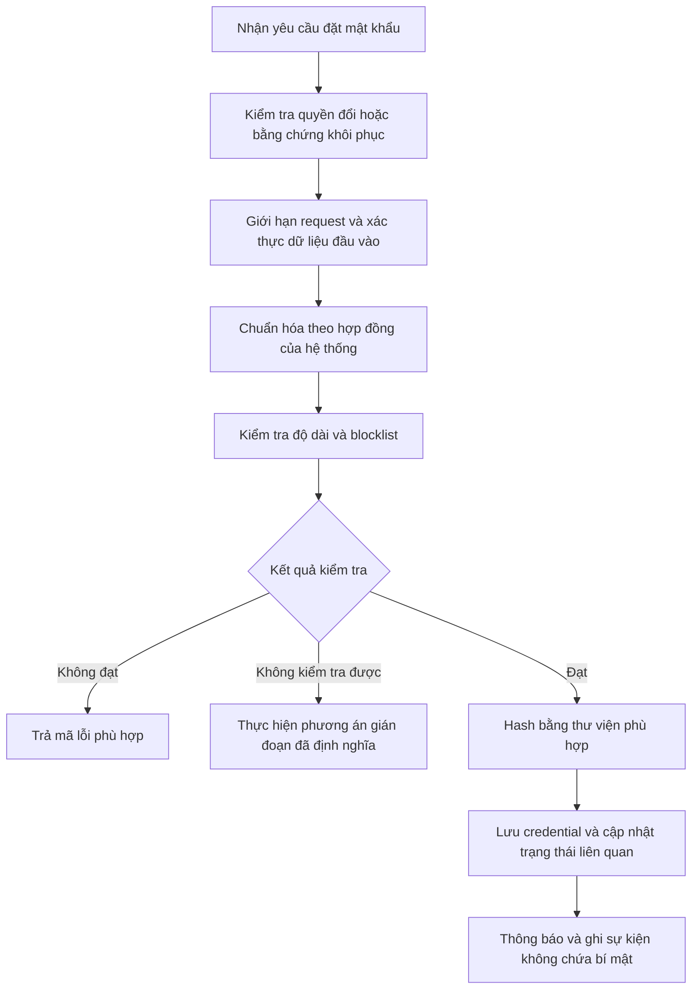

# Password policy — Chính sách mật khẩu trong IAM

## 1. Chính sách mật khẩu bảo vệ điều gì?

**Password policy** là tập quy tắc quyết định mật khẩu nào được chấp nhận, được dùng trong hoàn cảnh nào và phải được thay thế khi nào. Chính sách này là một phần của quản lý thông tin xác thực trong IAM, gắn với đăng ký tài khoản, đăng nhập, đổi mật khẩu, khôi phục tài khoản và xử lý sự cố.

Một chính sách có ích phải giúp người dùng chọn bí mật khó đoán, duy nhất cho dịch vụ, đồng thời giúp hệ thống phát hiện và hạn chế việc lạm dụng bí mật đó. Quy tắc trên biểu mẫu chỉ là một điểm thực thi; API, công cụ quản trị và hệ thống cung cấp danh tính cũng phải tuân theo quyết định tương ứng.

Ví dụ, một cổng quản lý nhân sự cho phép đăng nhập bằng mật khẩu. Nhân viên dùng mật khẩu dài, nhưng đã dùng cùng mật khẩu tại một diễn đàn bị rò rỉ. Kẻ tấn công thử lại thông tin đó tại cổng nhân sự và đăng nhập thành công. Việc thêm yêu cầu một ký tự đặc biệt vào biểu mẫu sẽ không ngăn được tình huống này. Hệ thống còn cần kiểm tra mật khẩu đã lộ, MFA và kiểm soát thử đăng nhập.

Trong mô hình IAM, xác thực thành công cũng không tự cấp quyền đọc bảng lương hoặc quản trị người dùng. Quyền truy cập tiếp tục do chính sách RBAC, ABAC và nguyên tắc ít quyền nhất quyết định.

### Những nguy cơ cần phân biệt

| Nguy cơ | Cách xảy ra | Chính sách và biện pháp liên quan |
| --- | --- | --- |
| Đoán mật khẩu trực tuyến | Thử nhiều giá trị trên một tài khoản | Độ dài, blocklist, giới hạn thử theo tài khoản |
| Password spraying | Thử một vài mật khẩu phổ biến trên nhiều tài khoản | Chặn giá trị phổ biến, phát hiện mẫu thử trên toàn hệ thống |
| Credential stuffing | Thử cặp tài khoản/mật khẩu đã lộ từ dịch vụ khác | Mật khẩu riêng cho từng dịch vụ, MFA, giám sát hành vi |
| Dò mật khẩu ngoại tuyến | Đánh cắp dữ liệu hash rồi thử đoán trên máy của kẻ tấn công | Mật khẩu khó đoán và cơ chế lưu hash có chi phí phù hợp |
| Phishing | Lừa người dùng nhập mật khẩu vào trang giả | Phương thức xác thực chống phishing; tăng độ dài không giải quyết việc bí mật bị trao đi |

Credential stuffing cần được xử lý bằng nhiều lớp phòng vệ. MFA giúp hạn chế việc chỉ sở hữu mật khẩu đã lộ là đủ đăng nhập; giám sát và giới hạn lưu lượng vẫn cần thiết. Xem [OWASP Credential Stuffing Prevention](https://cheatsheetseries.owasp.org/cheatsheets/Credential_Stuffing_Prevention_Cheat_Sheet.html).

## 2. Cơ sở lựa chọn quy tắc

NIST SP 800-63B-4, mục 3.1.1.2, phân biệt mức bắt buộc **SHALL**, khuyến nghị **SHOULD** và tùy chọn **MAY**:

| Nội dung | Hướng dẫn NIST |
| --- | --- |
| Chỉ dùng mật khẩu | SHALL tối thiểu 15 ký tự |
| Mật khẩu chỉ dùng trong MFA | MAY ngắn hơn 15, nhưng SHALL tối thiểu 8 |
| Độ dài tối đa | SHOULD cho phép ít nhất 64 ký tự |
| Công thức hoa/thường/số/ký hiệu | SHALL NOT bắt buộc |
| Đổi theo lịch | SHALL NOT bắt buộc; SHALL đổi khi có bằng chứng bị xâm phạm |
| Lập hoặc đổi mật khẩu | SHALL đối chiếu toàn bộ giá trị với blocklist |
| Kiểm tra mật khẩu | SHALL kiểm tra đầy đủ, không cắt ngắn |
| Unicode | Đếm code point; SHOULD chuẩn hóa NFC trước hash |

Nguồn: [NIST — Password Verifiers](https://pages.nist.gov/800-63-4/sp800-63b/authenticators/#passwordver).

Đây là cơ sở thiết kế cho phạm vi phù hợp, không phải khẳng định mọi tổ chức có cùng nghĩa vụ áp dụng NIST. Tài liệu chính sách của một hệ thống cần nêu phiên bản tham chiếu, nhóm tài khoản áp dụng và các ràng buộc thực tế.

Nếu sản phẩm áp dụng tối thiểu 15 ký tự cho mọi mật khẩu người dùng, kể cả người đã bật MFA, đó là một quyết định sản phẩm dễ quản lý. Nếu chọn ngưỡng thấp hơn cho một nhóm bắt buộc MFA, phải chứng minh mật khẩu của nhóm đó không thể trở thành yếu tố duy nhất qua luồng dự phòng, tài khoản cũ hoặc cơ chế khôi phục.

## 3. Độ dài, khả năng dự đoán và trải nghiệm sử dụng

### 3.1. Vì sao một biểu thức chính quy chưa đủ?

Một regex yêu cầu chữ hoa, chữ thường, số và dấu có thể chấp nhận `Welcome2026!`. Tuy nhiên, chuỗi này có cấu trúc quen thuộc và dễ xuất hiện trong danh sách phỏng đoán. Ngược lại, một mật khẩu do trình quản lý mật khẩu sinh có thể rất khó đoán dù không khớp một công thức hình thức nào đó.

Độ dài có giá trị khi phần được thêm vào làm tăng sự khó đoán. Kéo dài một từ phổ biến bằng một dãy số tuần tự hoặc lặp lại cùng một ký tự không đem lại hiệu quả như chọn một bí mật dài và ít dự đoán được.

Với passphrase, cách chọn từ rất quan trọng. Một câu nổi tiếng, tên bài hát hoặc thông tin cá nhân ghép lại có thể dài nhưng vẫn dễ đoán. Một tổ hợp từ được chọn ngẫu nhiên khác với một câu được chọn vì ai cũng biết.

Các chuỗi trong bài chỉ minh họa cách phân tích, không phải mật khẩu để sử dụng thực tế.

### 3.2. Tránh biến chính sách thành trở ngại nhập liệu

Biểu mẫu nên cho phép dán và autofill, hỗ trợ trình quản lý mật khẩu, có tùy chọn hiện mật khẩu khi người dùng chủ động chọn. Thành phần báo độ mạnh giúp hướng dẫn, nhưng backend vẫn là nơi quyết định chấp nhận. Xem [OWASP Authentication — Password Managers](https://cheatsheetseries.owasp.org/cheatsheets/Authentication_Cheat_Sheet.html#password-managers).

Ví dụ, trong một hệ thống nội bộ có người dùng di chuyển giữa máy tính và điện thoại, nhóm sản phẩm cần thử nhập passphrase tiếng Việt trên cả hai thiết bị. Một chính sách cho phép Unicode trên giấy nhưng bàn phím hoặc ứng dụng di động xử lý sai sẽ khiến người dùng phải đặt lại mật khẩu thường xuyên.

### 3.3. Quy định rõ đơn vị độ dài

Cần phân biệt:

- **Byte:** kích thước sau khi mã hóa, chẳng hạn UTF-8.
- **UTF-16 code unit:** đơn vị mà `String.length()` của Java đếm.
- **Unicode code point:** giá trị mã Unicode; một code point ngoài BMP dùng hai UTF-16 code unit.
- **Ký tự nhìn thấy:** có thể gồm nhiều code point, chẳng hạn một số emoji hoặc chữ kèm dấu kết hợp.

Ví dụ Java:

```java
String symbol = "🔐";

int utf16Units = symbol.length();
int codePoints = symbol.codePointCount(0, symbol.length());
int utf8Bytes = symbol.getBytes(java.nio.charset.StandardCharsets.UTF_8).length;

// utf16Units = 2, codePoints = 1, utf8Bytes = 4
```

Trong cấu hình minh họa của bài, độ dài chính sách được đếm bằng code point sau NFC. Giới hạn kích thước request lại được kiểm soát riêng để bảo vệ tài nguyên. Không dùng một con số với hai ý nghĩa khác nhau.

Chuẩn hóa phải nhất quán ở thời điểm đặt mật khẩu và xác minh mật khẩu. Không tự động thêm `trim()`, chuyển chữ thường hoặc xóa dấu trong một tầng xử lý bất kỳ: việc đó có thể làm thay đổi bí mật người dùng đã chọn. Khi thay đổi cách chuẩn hóa của hệ thống cũ, cần kế hoạch tương thích thay vì áp dụng trực tiếp cho mọi hash hiện có.

## 4. Blocklist và mật khẩu đã bị lộ

Blocklist là dữ liệu dùng để từ chối các ứng viên đã biết là yếu hoặc đã bị lộ. Hệ thống có thể dùng bộ dữ liệu cục bộ, dịch vụ nội bộ hoặc một dịch vụ kiểm tra được đánh giá phù hợp về bảo mật và quyền riêng tư.

Một thiết kế kiểm tra cần trả lời được các câu hỏi sau:

1. Dữ liệu đến từ đâu và cập nhật bằng cách nào?
2. Giá trị được so sánh đã đi qua cách chuẩn hóa nào?
3. Có gửi dữ liệu nhạy cảm ra ngoài ranh giới hệ thống không?
4. Dịch vụ kiểm tra không hoạt động thì xử lý thế nào?
5. Backend thông báo lý do từ chối bằng mã nào?

Ví dụ, cổng nhân sự giả định có quy tắc chặn những giá trị trùng mật khẩu phổ biến, cùng một tập ứng viên dự đoán được từ tên sản phẩm. Bộ phận vận hành có thể cập nhật tập dữ liệu này mà không thay mã của biểu mẫu.

Không mở rộng một quy tắc so khớp toàn bộ giá trị thành việc cấm mọi passphrase có chứa bất kỳ từ thông thường nào. Ví dụ, sự xuất hiện của từ `river` trong một passphrase dài không đủ để kết luận toàn bộ passphrase yếu. Khi dùng quy tắc theo ngữ cảnh, cần định nghĩa rõ cách tạo và so khớp các ứng viên dự đoán được.

### Xử lý gián đoạn kiểm tra

Trong ví dụ thiết kế của bài, nếu không có dữ liệu kiểm tra đáng tin cậy thì yêu cầu đặt mật khẩu mới được hoãn, trả lỗi tạm thời có thể thử lại. Không âm thầm coi lỗi kết nối là kết quả “không nằm trong blocklist”.

Đây là lựa chọn cho hệ thống minh họa. Hệ thống khác có thể dùng snapshot cục bộ đã xác thực hoặc cơ chế dự phòng phù hợp. Quyết định phải được nêu trong chính sách và có chỉ số giám sát. Không đưa mật khẩu thô vào log, trace, URL hoặc thông báo lỗi để chẩn đoán gián đoạn.

## 5. Chính sách theo vòng đời và loại danh tính

### 5.1. Đặt, đổi và khôi phục mật khẩu

Đăng ký mới, đổi mật khẩu chủ động và đặt lại qua khôi phục cần dùng cùng bộ quy tắc chấp nhận mật khẩu mới. Nếu một API quản trị đặt được giá trị mà API đăng ký từ chối, hệ thống đã có đường đi vòng chính sách.

Quyền đặt lại mật khẩu cần được kiểm tra trước khi cập nhật credential. Đổi chủ động thường đòi hỏi xác thực lại phù hợp; khôi phục cần một bằng chứng khôi phục hợp lệ. Token đặt lại phải có thời hạn và chỉ dùng một lần; gửi thông báo sau khi đặt lại, không gửi mật khẩu. Xem [OWASP Forgot Password](https://cheatsheetseries.owasp.org/cheatsheets/Forgot_Password_Cheat_Sheet.html).

Hai quyết định sau phải tách biệt:

- **Mật khẩu mới có được chấp nhận không?** Do bộ quy tắc password policy quyết định.
- **Ai được thay credential của tài khoản này?** Do luồng xác thực, khôi phục và phân quyền quyết định.

Một mật khẩu đáp ứng mọi quy tắc vẫn không được lưu nếu người gọi chưa có quyền thay đổi nó.

### 5.2. Sự cố và hiệu lực của phiên

Trong kịch bản cổng nhân sự phát hiện mật khẩu của một nhân viên đã bị chiếm đoạt, quy trình xử lý cần xác định cả credential và quyền truy cập đang còn hiệu lực:

1. Xác minh tín hiệu và tài khoản bị ảnh hưởng.
2. Hạn chế đường đăng nhập bị xâm phạm và buộc thiết lập bí mật mới qua luồng phù hợp.
3. Xem xét các phiên, refresh token và phương thức khôi phục liên quan.
4. Thu hồi hoặc yêu cầu xác thực lại theo quyết định ứng phó sự cố.
5. Thông báo người dùng và lưu dấu vết xử lý không chứa bí mật.

Đổi hash trong cơ sở dữ liệu không tự làm cho mọi session cookie, refresh token hoặc access token đã cấp mất hiệu lực. Tác động thực tế phụ thuộc cơ chế phiên, thời hạn token và cách thu hồi của hệ thống.

### 5.3. SSO, đặc quyền và workload

| Loại danh tính hoặc đường đăng nhập | Nơi cần xem xét chính sách |
| --- | --- |
| Người dùng đăng nhập local | Backend hoặc dịch vụ danh tính thực sự xác minh mật khẩu |
| Người dùng đăng nhập SSO | IdP quản lý credential; ứng dụng kiểm tra giao thức và mức bảo đảm cần thiết |
| Quản trị viên có đặc quyền | Chính sách credential kết hợp MFA, xác thực lại và hạn chế quyền quản trị |
| Tài khoản khẩn cấp | Quy trình bảo quản, sử dụng, giám sát và rà soát riêng, có chủ sở hữu |
| Workload hoặc tác vụ tự động | Chính sách danh tính máy và vòng đời secret/token phù hợp |

Nếu ứng dụng dùng SSO nhưng vẫn có một endpoint đăng nhập local cũ, endpoint đó vẫn phải được đưa vào kiểm kê. Đánh giá chính sách chỉ trên màn hình SSO sẽ bỏ sót đường dự phòng.

Mật khẩu người dùng, PIN mở khóa thiết bị, recovery code, client secret OAuth và khóa API có mục đích khác nhau. Ví dụ, quyết định không ép người dùng đổi mật khẩu định kỳ không phải căn cứ để bỏ quy trình luân chuyển một client secret của workload. Với danh tính máy, nên đánh giá khả năng dùng credential ngắn hạn hoặc danh tính workload được nền tảng quản lý.

## 6. Một cấu hình chính sách minh họa

Cổng nhân sự giả định chọn cùng ngưỡng độ dài cho mọi mật khẩu local. Cấu hình dưới đây là ví dụ kiến trúc của bài, không phải schema của một sản phẩm IAM cụ thể:

```yaml
passwordPolicy:
  version: hr-local-v1
  scope: human-local-accounts

  length:
    unit: unicode-code-points-after-nfc
    minimum: 15
    maximum: 128

  normalization: NFC
  requireUppercase: false
  requireLowercase: false
  requireDigit: false
  requireSymbol: false
  allowSpaces: true
  allowPasteAndAutofill: true

  screening:
    commonAndCompromisedPasswords: true
    unavailableAction: defer-new-password

  periodicExpiryDays: null
  compromiseResponse: require-secure-reset
```

Ở đây, `maximum: 128` là quyết định thiết kế được chọn để minh họa; `null` biểu thị không đặt lịch hết hạn theo số ngày trong schema ví dụ. Không sao chép nguyên cấu hình vào một sản phẩm mà chưa kiểm tra ý nghĩa các trường.

Phiên bản chính sách giúp trả lời một sự kiện đặt mật khẩu đã dùng bộ quy tắc nào. Tuy nhiên, biết tài khoản đã dùng phiên bản cũ không cho phép suy ra mật khẩu hiện tại có bao nhiêu ký tự: hệ thống lưu hash phù hợp sẽ không khôi phục mật khẩu để đo lại được.

## 7. Thực thi chính sách tại backend

### 7.1. Luồng thiết lập mật khẩu mới



Nếu dùng token khôi phục, cần phối hợp việc tiêu thụ token và cập nhật credential để hai request đồng thời không dùng cùng token thành công. Quy tắc mật khẩu không thay thế kiểm soát tính nguyên tử của thao tác này.

### 7.2. Ví dụ Java: kiểm tra ứng viên mới

Đoạn mã sau minh họa phần kiểm tra độ dài sau NFC và gọi bộ screening. Nó không triển khai controller, luồng khôi phục, hash hay lưu cơ sở dữ liệu. Đầu vào được giả định là chuỗi Unicode hợp lệ đã qua giới hạn kích thước request của tầng HTTP.

```java
import java.text.Normalizer;

public final class NewPasswordValidator {
    private static final int MIN_CODE_POINTS = 15;
    private static final int MAX_CODE_POINTS = 128;

    // Giới hạn tài nguyên sơ bộ, không phải độ dài mật khẩu theo chính sách.
    private static final int MAX_RAW_UTF16_UNITS = 4096;

    public enum ScreeningResult {
        ALLOWED, BLOCKED, UNAVAILABLE
    }

    public interface PasswordScreening {
        ScreeningResult check(String normalizedCandidate);
    }

    private final PasswordScreening screening;

    public NewPasswordValidator(PasswordScreening screening) {
        this.screening = java.util.Objects.requireNonNull(screening);
    }

    public String validate(String rawCandidate) {
        if (rawCandidate == null
                || rawCandidate.length() > MAX_RAW_UTF16_UNITS) {
            throw new IllegalArgumentException("PASSWORD_INPUT_INVALID");
        }

        String normalized = Normalizer.normalize(
                rawCandidate, Normalizer.Form.NFC);
        int length = normalized.codePointCount(0, normalized.length());

        if (length < MIN_CODE_POINTS || length > MAX_CODE_POINTS) {
            throw new IllegalArgumentException("PASSWORD_LENGTH_INVALID");
        }

        ScreeningResult result = screening.check(normalized);
        if (result == ScreeningResult.BLOCKED) {
            throw new IllegalArgumentException("PASSWORD_NOT_ALLOWED");
        }
        if (result != ScreeningResult.ALLOWED) {
            throw new IllegalStateException("PASSWORD_SCREENING_UNAVAILABLE");
        }

        // Giá trị trả về chỉ chuyển tiếp đến tầng hash, không trả cho client.
        return normalized;
    }
}
```

Tầng gọi cần chuyển lỗi screening tạm thời thành phản hồi có thể thử lại theo hợp đồng API. Thông báo về ứng viên bị từ chối nên giúp người dùng chọn giá trị khác, nhưng không chứa lại ứng viên đó. Ví dụ: “Mật khẩu này quá phổ biến hoặc đã xuất hiện trong dữ liệu bị lộ. Hãy chọn mật khẩu khác.”

Không ghi tham số, giá trị trả về hoặc nội dung request của đoạn xử lý này vào APM và log. Dùng `String` trong ví dụ giúp trình bày ngắn gọn, nhưng nó là đối tượng bất biến và không thể xóa nội dung tại chỗ; ứng dụng cần hạn chế thời gian tồn tại và các bản sao của dữ liệu nhạy cảm.

### 7.3. Luồng đăng nhập có trách nhiệm khác

Không gọi toàn bộ `NewPasswordValidator` ở mọi lần đăng nhập rồi từ chối chỉ vì chính sách vừa tăng độ dài tối thiểu. Một credential được lập hợp lệ trước đó có thể vẫn cần được xác minh bằng đường tương thích của nó. Sau khi xác minh, hệ thống quyết định có yêu cầu nâng cấp credential theo kế hoạch chuyển đổi hay không.

Đăng nhập cần kiểm soát lưu lượng trước khi làm công việc hash tốn tài nguyên, xác minh toàn bộ mật khẩu và hoàn tất các yếu tố còn lại nếu luồng yêu cầu MFA. Một dịch vụ screening bên ngoài bị gián đoạn cũng không nên vô tình làm mọi phiên đăng nhập phụ thuộc vào nó nếu kiến trúc ban đầu chỉ dùng screening khi thiết lập mật khẩu.

## 8. Lưu trữ và giới hạn của thuật toán

Password policy quyết định chấp nhận ứng viên; lưu trữ credential quyết định cách bảo vệ bí mật sau khi chấp nhận. Mật khẩu cần được hash bằng cơ chế chuyên dụng có salt riêng và tham số chi phí được quản lý. SHA-256 đơn thuần không phù hợp để lưu mật khẩu. OWASP ưu tiên Argon2id và có hướng dẫn cho các lựa chọn khác theo bối cảnh. Xem [OWASP Password Storage](https://cheatsheetseries.owasp.org/cheatsheets/Password_Storage_Cheat_Sheet.html).

Một lỗi tích hợp thường gặp là hứa hỗ trợ passphrase dài nhưng thư viện bên dưới giới hạn theo byte. Nhiều triển khai bcrypt có giới hạn đầu vào 72 byte; chuỗi Unicode có thể đạt ngưỡng byte sớm hơn số ký tự người dùng nhìn thấy. Không âm thầm cắt bỏ phần vượt ngưỡng. Xem [OWASP — Input Limits of bcrypt](https://cheatsheetseries.owasp.org/cheatsheets/Password_Storage_Cheat_Sheet.html#input-limits-of-bcrypt).

Ví dụ thiết kế: nếu cổng nhân sự muốn chấp nhận đến 128 code point Unicode, nhóm phát triển cần kiểm chứng đường hash thực tế hỗ trợ hợp đồng đó. Gắn `maxlength=128` vào biểu mẫu không giải quyết giới hạn của thư viện hash. Việc thay thuật toán hoặc thêm bước xử lý trước hash cần thiết kế tương thích và phiên bản credential rõ ràng.

## 9. Triển khai thay đổi mà không gây mất quyền truy cập ngoài ý muốn

Giả sử chính sách cũ của cổng nhân sự yêu cầu 8 ký tự và đổi sau mỗi 60 ngày. Chính sách mới dùng cấu hình ở mục 6. Một kế hoạch chuyển đổi có thể gồm:

1. Kiểm kê tất cả đường đặt và xác minh credential, gồm API quản trị và luồng dự phòng SSO.
2. Triển khai backend chấp nhận các quy tắc mới trước khi cập nhật hướng dẫn trên giao diện.
3. Áp dụng chính sách mới cho mọi lần đặt hoặc đổi mật khẩu tiếp theo.
4. Quyết định cách xử lý credential cũ theo rủi ro; tách chiến dịch chuyển đổi khỏi ứng phó một vụ lộ mật khẩu đã xác nhận.
5. Kiểm tra tác động đến bàn hỗ trợ, MFA, phục hồi tài khoản và các phiên hiện hành.
6. Theo dõi kết quả và lưu phiên bản chính sách đang thực thi.

Không thể chuyển một hash cũ thành hash của mật khẩu đã chuẩn hóa theo cách mới nếu không có mật khẩu gốc. Với thay đổi cần bí mật gốc, hệ thống phải dùng một thời điểm người dùng cung cấp lại mật khẩu hợp lệ hoặc luồng đặt lại thích hợp.

Trong môi trường có nhiều tenant, phiên bản chính sách phải được chọn theo ngữ cảnh tenant đã được xác minh. Không cho client tùy ý gửi một tên policy yếu hơn để backend sử dụng.

## 10. Các tình huống cần kiểm tra khi triển khai

Các tình huống dưới đây là gợi ý kiểm tra cho cấu hình minh họa, không phải kết quả chạy thử của một ứng dụng:

| Tình huống | Kết quả hoặc điều kiện cần xác minh |
| --- | --- |
| Ứng viên 14 code point | Từ chối theo ngưỡng của ví dụ |
| Ứng viên 15 code point | Qua bước độ dài; vẫn phải qua screening |
| Ứng viên 128 code point | Không bị từ chối chỉ vì độ dài |
| Ứng viên 129 code point | Từ chối rõ ràng, không cắt ngắn |
| Emoji ngoài BMP | Đếm code point đúng, phân biệt với UTF-16 unit |
| Hai biểu diễn Unicode tương đương qua NFC | Được xử lý nhất quán khi đặt và xác minh credential mới |
| Có khoảng trắng đầu hoặc cuối | Không bị tầng trung gian tự ý trim |
| Mật khẩu nằm trong blocklist | Từ chối dù đã đủ độ dài |
| Screening gián đoạn | Thực hiện phương án gián đoạn, không coi là ALLOWED |
| Client bỏ qua JavaScript | Backend vẫn thực thi đầy đủ |
| Đặt lại qua API quản trị | Cùng quy tắc ứng viên mới và có kiểm tra quyền |
| Hai request dùng cùng reset token | Không cho cả hai cập nhật thành công |
| Đổi mật khẩu sau sự cố | Xác minh riêng hiệu lực phiên/token theo phương án thu hồi |
| Credential cũ chưa đáp ứng ngưỡng mới | Đi theo kế hoạch chuyển đổi đã định nghĩa |

Các chỉ số vận hành có thể gồm tỷ lệ đặt mật khẩu thất bại theo mã lý do, lỗi screening, yêu cầu hỗ trợ khôi phục và dấu hiệu thử đăng nhập trên nhiều tài khoản. Không thu thập độ dài hoặc mẫu ký tự của mật khẩu thô chỉ để làm dashboard; ưu tiên dữ liệu sự kiện cần thiết và không chứa bí mật.

## 11. Câu hỏi tự kiểm tra

**Một mật khẩu đủ dài và có bốn nhóm ký tự có chắc phù hợp không?** Chưa. Nó có thể phổ biến, đã lộ hoặc rất dễ dự đoán theo ngữ cảnh. Quyền đặt credential và cách lưu trữ cũng cần được kiểm tra riêng.

**Người dùng đã bật MFA thì có thể tùy ý giảm độ dài tối thiểu không?** Không. Phải xem ngưỡng của chính sách áp dụng và liệu mọi đường sử dụng mật khẩu đó có thực sự bắt buộc MFA hay không. Bật MFA trên một màn hình chưa chứng minh các đường dự phòng có cùng bảo đảm.

**Tăng độ dài tối thiểu từ 8 lên 15 có thể tự động rà mọi hash để biết ai cần đổi không?** Không. Hash không cung cấp mật khẩu gốc để đo lại. Cần cơ chế chuyển đổi phù hợp với dữ liệu hiện có và rủi ro.

**Đổi mật khẩu xong có nghĩa kẻ tấn công đã bị đăng xuất không?** Chưa chắc. Phiên và token phải được xử lý theo thiết kế thu hồi của hệ thống.

**Ứng dụng chỉ dùng SSO thì có thể bỏ qua password policy hoàn toàn không?** Cần xác định ai quản lý credential và kiểm tra các đường local hoặc khôi phục còn tồn tại. Trách nhiệm có thể nằm tại IdP, nhưng ứng dụng vẫn cần kiểm tra mức bảo đảm và quyền truy cập của chính nó.
