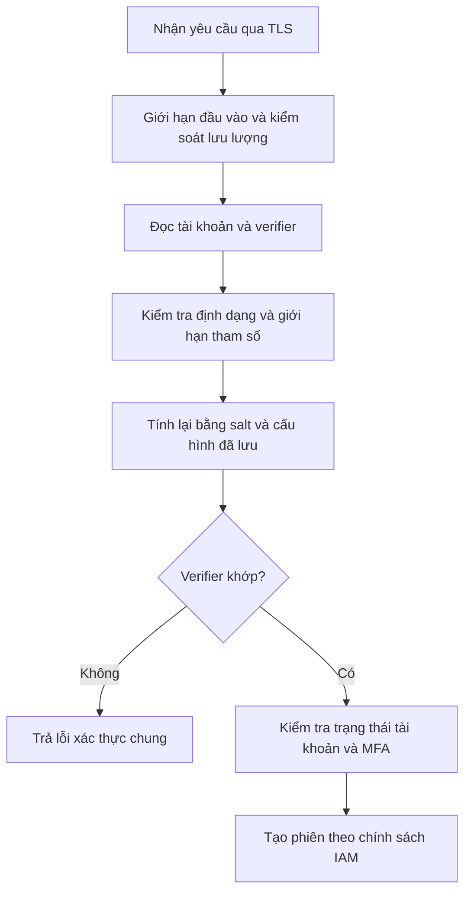

# Password hashing — Băm mật khẩu trong hệ thống IAM

## 1. Mục tiêu và vị trí trong luồng xác thực

Trong một hệ thống IAM, người dùng đăng ký một thông tin xác thực, rồi dùng nó để chứng minh quyền kiểm soát tài khoản khi đăng nhập. Nếu thông tin đó là mật khẩu, máy chủ cần lưu một **password verifier**: dữ liệu đủ để kiểm tra mật khẩu được nhập lại, nhưng không phải bản rõ của mật khẩu.

Password hashing biến mật khẩu thành verifier thông qua thuật toán chuyên dụng, salt và tham số chi phí. Thiết kế này giảm thiệt hại khi bảng tài khoản hoặc bản sao lưu bị lộ. Nó vẫn không khiến mật khẩu yếu trở nên không thể đoán được.

Sau bài học, người học có thể giải thích vì sao SHA-256 đơn thuần không đủ, phân biệt salt với pepper, đọc cấu trúc một bản ghi hash, lựa chọn tham số có kiểm soát và thiết kế quá trình nâng cấp hash khi người dùng đăng nhập.

Trong phạm vi IAM, kiểm tra mật khẩu chỉ là một bước. Sau khi verifier khớp, hệ thống còn có thể phải xác minh MFA, kiểm tra trạng thái tài khoản và tạo phiên. Quyền RBAC/ABAC được đánh giá ở bước cấp quyền truy cập tài nguyên; hash đúng không chứng minh người dùng có quyền quản trị.

## 2. Mối đe dọa chính: đoán mật khẩu ngoại tuyến

Giả sử một cổng học tập lưu bảng sau:

```text
account_id | login_name      | password_verifier
u-104      | an@example.test | <encoded verifier>
u-205      | vy@example.test | <encoded verifier>
```

Kẻ tấn công lấy được bảng này qua một bản backup bị lộ. Họ có thể thử nhiều mật khẩu ứng viên trên máy riêng và so sánh kết quả với verifier. Đây là **offline guessing**, không đi qua endpoint đăng nhập. Rate limit của ứng dụng không giới hạn được số lần thử đó.

Ngược lại, một người gửi hàng nghìn yêu cầu đăng nhập đến máy chủ đang thực hiện **online guessing**. Máy chủ có thể áp dụng giới hạn tốc độ, kiểm soát rủi ro, MFA và chính sách chống lạm dụng. Hai đường tấn công cần hai nhóm biện pháp phối hợp.

Ví dụ tính toán dưới đây chỉ minh họa quan hệ giữa chi phí và số lần đoán, không dự báo hiệu năng của thuật toán nào:

```text
Giả sử mỗi phép kiểm tra tốn 0,2 giây trên một thiết bị:
1.000.000 phép thử tuần tự cần khoảng 200.000 giây ≈ 55,6 giờ.
```

Thực tế, đối thủ có thể dùng nhiều thiết bị và ưu tiên mật khẩu phổ biến. Thời gian đo trên máy chủ cũng không bằng thời gian trên phần cứng của đối thủ. Vì vậy, hashing cần đi cùng mật khẩu đủ mạnh, chặn mật khẩu đã bị lộ và khả năng ứng phó sự cố.

NIST mô tả việc lưu mật khẩu dưới dạng có salt và tham số chi phí nhằm làm tăng giá thành của mỗi phép đoán khi dữ liệu verifier bị lấy cắp. Xem [NIST SP 800-63B-4, mục Password Verifiers](https://pages.nist.gov/800-63-4/sp800-63b.html#passwordver).

## 3. Hashing, encryption và encoding khác nhau thế nào?

| Cơ chế | Có cách khôi phục bằng khóa không? | Công dụng phù hợp |
| --- | --- | --- |
| Encoding như Base64 | Không cần khóa; giải mã biểu diễn được ngay | Biểu diễn byte thành chuỗi để lưu hoặc truyền |
| Encryption như AES-GCM | Có, nếu giữ khóa giải mã | Bảo vệ dữ liệu cần đọc lại |
| Hash tổng quát như SHA-256 | Không có phép giải mã bằng khóa | Kiểm tra tính toàn vẹn hoặc làm thành phần mật mã |
| Password hashing như Argon2id | Kiểm tra bằng cách tính lại với đúng đầu vào | Lưu verifier cho mật khẩu |

Một hash không có API “giải mã mật khẩu”, nhưng đối thủ vẫn có thể đoán đầu vào. Với mật khẩu phổ biến, họ không cần đảo ngược hàm băm; chỉ cần thử đúng từ ứng viên.

Ví dụ sau không phải cách lưu mật khẩu thích hợp:

```text
verifier = SHA256(password)
```

Vấn đề quan trọng là SHA-256 được thiết kế để tính nhanh. Thêm salt vào một lần SHA-256 giúp phân biệt các bản ghi nhưng vẫn không tạo chi phí CPU/bộ nhớ như một thuật toán password hashing chuyên dụng. Tự viết một vòng lặp SHA-256 cũng không thay thế việc dùng KDF chuẩn và thư viện đã được kiểm tra.

Một hệ thống chỉ cần kiểm tra mật khẩu đăng nhập thường không cần khả năng đọc lại mật khẩu. Nếu một thành phần phải giữ credential để kết nối đến hệ thống khác, đó là bài toán quản lý secret riêng, với vòng đời và quyền truy cập riêng.

## 4. Các thành phần của password verifier

Mô hình khái niệm:

```text
verifier = PasswordKDF(password, salt, parameters)
```

`PasswordKDF` là hàm dẫn xuất chuyên dụng. `parameters` có thể gồm số vòng lặp, lượng bộ nhớ, mức song song và độ dài đầu ra. Mật khẩu không được lưu cùng verifier.

### 4.1. Salt: ngẫu nhiên, riêng cho mỗi lần tạo hash

Salt là giá trị công khai được đưa vào KDF. Dùng nguồn ngẫu nhiên mật mã để tạo salt mới khi đăng ký, đổi mật khẩu hoặc rehash. Một lựa chọn thực tế cho bài học là 16 byte ngẫu nhiên, tương đương 128 bit.

Salt phải được lưu cùng verifier vì cần dùng lại nó khi kiểm tra. Không dùng một salt chung cho toàn hệ thống hoặc giá trị dễ lặp như username. Với thư viện cấp cao, hàm `encode` có thể tự sinh salt; với API cấp thấp, người gọi thường phải cung cấp salt.

```text
Cùng mật khẩu P:
KDF(P, salt_A, parameters) → verifier_A
KDF(P, salt_B, parameters) → verifier_B
```

Hai bản ghi có salt khác nhau thường cho đầu ra khác nhau dù người dùng chọn cùng mật khẩu. Đối thủ không thể lấy kết quả tính cho salt A để so trực tiếp với toàn bộ tài khoản có salt khác. Tuy nhiên, salt không ngăn việc đoán riêng mật khẩu của tài khoản A.

### 4.2. Work factor: tăng chi phí kiểm tra

Tăng work factor làm máy chủ tốn thêm tài nguyên cho mỗi lần đăng nhập và cũng khiến phép đoán ngoại tuyến đắt hơn. Chi phí có thể phụ thuộc vào CPU, RAM và băng thông bộ nhớ.

Mục tiêu vận hành là chọn cấu hình đủ tốn kém trong ngân sách độ trễ và tài nguyên cho phép. Cần đo trên môi trường triển khai thực tế, gồm cả tải đồng thời, thay vì suy từ số đo của laptop phát triển.

### 4.3. Độ dài đầu ra và phiên bản

Đầu ra 256 bit không có nghĩa mật khẩu người dùng có 256 bit entropy. Khi đầu vào thuộc một tập từ dễ đoán, đối thủ chỉ cần thử tập đó. Tăng độ dài đầu ra cũng không bù được việc dùng thuật toán quá nhanh.

Lưu định danh thuật toán, phiên bản và tham số cùng verifier để tài khoản cũ tiếp tục được kiểm tra đúng sau khi chính sách thay đổi. Salt và tham số là dữ liệu công khai, còn khả năng sửa bản ghi phải được bảo vệ bằng quyền ghi chặt chẽ và kiểm toán.

## 5. Lựa chọn thuật toán và hiểu đúng tham số

Các mốc sau là cấu hình tham khảo từ tài liệu OWASP tại thời điểm biên soạn; cần xem lại nguồn và benchmark trước khi triển khai:

| Thuật toán | Ngữ cảnh sử dụng | Mốc tham khảo |
| --- | --- | --- |
| Argon2id | Lựa chọn ưu tiên cho thiết kế mới có hỗ trợ phù hợp | `m=19456 KiB`, `t=2`, `p=1` |
| scrypt | Phương án khi Argon2id không khả dụng | `N=2^17`, `r=8`, `p=1` |
| bcrypt | Duy trì và nâng cấp hệ thống cũ | Cost từ `10`; kiểm soát giới hạn đầu vào 72 byte |
| PBKDF2-HMAC-SHA-256 | Môi trường có ràng buộc tương thích hoặc yêu cầu FIPS | Từ `600000` vòng lặp |

Nguồn cho các mốc trên: [OWASP Password Storage Cheat Sheet](https://cheatsheetseries.owasp.org/cheatsheets/Password_Storage_Cheat_Sheet.html).

### 5.1. Argon2id

Argon2id kết hợp các cách truy cập bộ nhớ của hai biến thể Argon2i và Argon2d. Khi dùng, cần hiểu đúng từng tham số:

- `m`: tổng ngân sách bộ nhớ cho một lần tính, thường biểu diễn bằng KiB trong chuỗi mã hóa.
- `t`: số lượt đi qua bộ nhớ.
- `p`: số lane song song của thuật toán; không phải số yêu cầu đăng nhập đồng thời.

Đơn vị rất quan trọng: `m=19456 KiB` tương đương 19 MiB. Đặt nhầm byte thành KiB có thể làm chi phí khác dự kiến rất lớn.

RFC 9106 đưa ra các profile khác với mốc tối thiểu trong bảng, gồm profile dùng 64 MiB, ba lượt và bốn lane khi bộ nhớ hạn chế hơn profile 2 GiB. Các profile phục vụ những giả định tài nguyên khác nhau; chúng không phải cam kết độ trễ cho mọi ứng dụng. Xem [RFC 9106, mục 4 và 7.4](https://www.rfc-editor.org/rfc/rfc9106.html#section-4).

### 5.2. PBKDF2 và bcrypt

PBKDF2 sử dụng một hàm giả ngẫu nhiên, thường là HMAC, lặp nhiều lần để dẫn xuất đầu ra. Với PBKDF2, phải lưu cả định danh HMAC và số vòng; chỉ ghi “PBKDF2” là chưa đủ. Cấu trúc PBKDF2 được mô tả tại [RFC 8018, mục 5.2](https://www.rfc-editor.org/rfc/rfc8018.html#section-5.2).

Với bcrypt, cost là một tham số theo thang lũy thừa; tăng cost từ 10 lên 11 thường gần gấp đôi lượng công việc. Không so sánh trực tiếp cost của bcrypt với số vòng của PBKDF2 hoặc `t` của Argon2id.

Giới hạn bcrypt thường tính theo **byte**, không phải ký tự hiển thị. Mật khẩu có tiếng Việt hoặc emoji có thể chiếm nhiều byte khi mã hóa UTF-8. Cần biết thư viện từ chối hay cắt đầu vào dài; việc cắt im lặng có thể khiến hai mật khẩu khác nhau được coi là giống nhau. Không tự ghép thêm một hàm băm trước bcrypt để né giới hạn nếu chưa có thiết kế được thẩm định.

Yêu cầu FIPS không được thỏa mãn chỉ bằng cách chọn tên thuật toán PBKDF2. Cần dùng mô-đun/provider phù hợp với yêu cầu xác nhận và cấu hình áp dụng của tổ chức.

## 6. Pepper: secret bổ sung và hệ quả vòng đời khóa

Pepper là secret do hệ thống giữ ngoài cơ sở dữ liệu verifier. Nó có thể bổ sung một ranh giới bảo vệ khi đối thủ chỉ lấy được database mà chưa lấy được secret. Pepper không thay thế salt và cũng không bảo vệ trước một tiến trình xác thực đã bị chiếm quyền có thể sử dụng khóa.

Một mô hình minh họa dùng HMAC sau KDF:

```text
intermediate = PasswordKDF(password, salt, parameters)
stored_tag   = HMAC(pepper_key, intermediate)
```

Trong mô hình này, database lưu `stored_tag`, salt, tham số và `pepper_key_id`, nhưng không lưu `intermediate` hoặc khóa pepper. Khi kiểm tra, máy chủ tính lại cả hai bước. Đây là mô hình khái niệm; triển khai cần xử lý mã hóa byte, độ dài và quản lý khóa bằng thành phần mật mã phù hợp.

NIST khuyến nghị cân nhắc thêm một phép toán có khóa bí mật và lưu khóa tách khỏi password hash; xem [NIST SP 800-63B-4, mục Password Verifiers](https://pages.nist.gov/800-63-4/sp800-63b.html#passwordver).

Pepper tạo ra các yêu cầu vận hành cụ thể:

- Dịch vụ xác thực chỉ được cấp quyền dùng khóa cần thiết; tài khoản đọc database không mặc nhiên được đọc khóa.
- Bản sao lưu verifier cần đi cùng kế hoạch khôi phục quyền sử dụng khóa. Mất khóa có thể khiến tài khoản không đăng nhập được.
- Không đưa pepper vào source code, ảnh container hoặc log. Dùng secret manager, KMS hoặc HSM theo kiến trúc đã chọn.
- Lưu key ID để chọn đúng phiên bản khóa; key ID không phải secret.

Với mô hình HMAC nêu trên, không thể tính lại tag dưới khóa mới chỉ từ tag cũ. Có thể giữ khóa cũ trong giai đoạn chuyển tiếp và nâng cấp khi người dùng đăng nhập thành công. Nếu khóa cũ đã bị lộ, giai đoạn chuyển tiếp không xóa được rủi ro của dữ liệu đã mất; có thể phải yêu cầu đặt lại mật khẩu theo đánh giá sự cố.

## 7. Lưu verifier và kiểm tra mật khẩu

### 7.1. Bản ghi tự mô tả

Nhiều thư viện Argon2 dùng chuỗi theo định dạng PHC, có cấu trúc minh họa:

```text
$argon2id$v=19$m=19456,t=2,p=1$<salt-base64>$<tag-base64>
```

Các phần trong dấu `<...>` chỉ là ký hiệu, không phải verifier để đưa vào ứng dụng. `v=19` là phiên bản thuật toán Argon2 biểu diễn ở hệ thập phân, không phải phiên bản mật khẩu của tài khoản.

Ứng dụng cần một cột đủ dài để giữ nguyên chuỗi do thư viện trả về, không tự cắt hoặc sửa các thành phần. Có thể lưu thêm `credential_version` và thời điểm đổi mật khẩu để xử lý cập nhật đồng thời, phiên và kiểm toán. Không trả verifier trong API hồ sơ người dùng.

### 7.2. Tạo mới và xác minh

Khi đăng ký hoặc đổi mật khẩu:

1. Áp dụng chính sách mật khẩu và giới hạn kích thước đầu vào.
2. Sinh salt mới, dùng thuật toán và cấu hình hiện hành để tạo verifier.
3. Lưu verifier bằng giao dịch phù hợp; chỉ giữ mật khẩu trong bộ nhớ trong thời gian cần thiết.

Khi đăng nhập, dùng **salt và tham số trong bản ghi đã lưu** để kiểm tra mật khẩu ứng viên. Không sinh salt mới rồi so hai chuỗi hash. Với API cấp cao, gọi hàm dạng `matches(rawPassword, encodedVerifier)` của thư viện.



Nếu tự thao tác với đầu ra byte của KDF, dùng hàm so sánh dành cho dữ liệu mật mã. Ví dụ Java cung cấp `MessageDigest.isEqual`; tài liệu mô tả cách so sánh không phụ thuộc nội dung byte trong các điều kiện nêu tại API. Việc này không tự làm cho toàn bộ endpoint có thời gian phản hồi đồng nhất. Xem [Java MessageDigest.isEqual](https://docs.oracle.com/en/java/javase/25/docs/api/java.base/java/security/MessageDigest.html#isEqual(byte%5B%5D,byte%5B%5D)).

Không tiết lộ “tài khoản tồn tại nhưng sai mật khẩu”. Với tài khoản không tồn tại, dịch vụ có thể thực hiện một lần kiểm tra với dummy verifier đã tạo sẵn và trả thông báo chung; vẫn phải áp dụng kiểm soát lưu lượng trước công việc tốn tài nguyên.

## 8. Ví dụ Java: verifier PBKDF2 có định dạng và giới hạn rõ ràng

Ví dụ dưới đây sử dụng API JCA để minh họa thao tác tạo và kiểm tra một verifier PBKDF2-HMAC-SHA-256. Nó không phải một dịch vụ IAM hoàn chỉnh. Với ứng dụng thực tế, ưu tiên thành phần password encoder được duy trì và hỗ trợ định dạng/nâng cấp phù hợp.

Định dạng riêng của ví dụ gồm bốn phần, không phải định dạng PHC của Argon2:

```text
pbkdf2-sha256-v1$<iterations>$<salt-base64>$<derived-key-base64>
```

```java
import java.security.GeneralSecurityException;
import java.security.MessageDigest;
import java.security.SecureRandom;
import java.util.Arrays;
import java.util.Base64;
import javax.crypto.SecretKeyFactory;
import javax.crypto.spec.PBEKeySpec;

public final class PasswordVerifier {
    private static final String FORMAT = "pbkdf2-sha256-v1";
    private static final int CURRENT_ITERATIONS = 600_000;
    private static final int MAX_ITERATIONS = 1_200_000;
    private static final int SALT_BYTES = 16;
    private static final int KEY_BYTES = 32;
    private static final SecureRandom RANDOM = new SecureRandom();

    private PasswordVerifier() {}

    public static String create(char[] password)
            throws GeneralSecurityException {
        requireBoundedInput(password);
        byte[] salt = new byte[SALT_BYTES];
        RANDOM.nextBytes(salt);
        byte[] key = derive(password, salt, CURRENT_ITERATIONS);
        try {
            return FORMAT + "$" + CURRENT_ITERATIONS + "$"
                    + Base64.getEncoder().encodeToString(salt) + "$"
                    + Base64.getEncoder().encodeToString(key);
        } finally {
            Arrays.fill(key, (byte) 0);
        }
    }

    public static boolean matches(char[] password, String encoded)
            throws GeneralSecurityException {
        requireBoundedInput(password);
        if (encoded == null || encoded.length() > 160) {
            throw new IllegalArgumentException("Invalid verifier record");
        }
        String[] parts = encoded.split("\\$", -1);
        if (parts.length != 4 || !FORMAT.equals(parts[0])
                || !parts[1].matches("[0-9]{6,7}")) {
            throw new IllegalArgumentException("Invalid verifier format");
        }
        int iterations = Integer.parseInt(parts[1]);
        if (iterations < CURRENT_ITERATIONS || iterations > MAX_ITERATIONS) {
            throw new IllegalArgumentException("Unsupported verifier cost");
        }
        byte[] salt = Base64.getDecoder().decode(parts[2]);
        byte[] expected = Base64.getDecoder().decode(parts[3]);
        if (salt.length != SALT_BYTES || expected.length != KEY_BYTES) {
            throw new IllegalArgumentException("Invalid verifier length");
        }
        byte[] actual = derive(password, salt, iterations);
        try {
            return MessageDigest.isEqual(expected, actual);
        } finally {
            Arrays.fill(actual, (byte) 0);
            Arrays.fill(expected, (byte) 0);
        }
    }

    private static byte[] derive(char[] password, byte[] salt, int iterations)
            throws GeneralSecurityException {
        PBEKeySpec spec = new PBEKeySpec(
                password, salt, iterations, KEY_BYTES * 8);
        try {
            SecretKeyFactory factory =
                    SecretKeyFactory.getInstance("PBKDF2WithHmacSHA256");
            return factory.generateSecret(spec).getEncoded();
        } finally {
            spec.clearPassword();
        }
    }

    private static void requireBoundedInput(char[] password) {
        if (password == null || password.length == 0 || password.length > 1024) {
            throw new IllegalArgumentException("Invalid password input size");
        }
    }
}
```

`SecureRandom` sinh salt mới cho mỗi lần `create`. `PBEKeySpec` nhận độ dài đầu ra theo **bit**, nên 32 byte được truyền thành 256 bit. `clearPassword()` xóa bản sao bên trong `PBEKeySpec`; bên gọi vẫn phải xóa mảng `char[]` của mình khi đã xử lý xong. Điều này giảm thời gian tồn tại của một số bản sao, không đảm bảo xóa mọi bản sao do framework, provider hoặc JVM tạo ra. Xem [Java PBEKeySpec](https://docs.oracle.com/en/java/javase/25/docs/api/java.base/javax/crypto/spec/PBEKeySpec.html).

Các giới hạn trong ví dụ có ý nghĩa cụ thể:

- `1024` là trần kỹ thuật theo số phần tử UTF-16 của `char[]`, không phải quy định độ mạnh tối thiểu hay số ký tự người dùng nhìn thấy. Chính sách mật khẩu phải được áp dụng nhất quán ở tầng tiếp nhận.
- `MAX_ITERATIONS` là trần tài nguyên minh họa, cần được đo và quản lý bằng cấu hình triển khai. Không cho dữ liệu bản ghi buộc máy chủ thực hiện một số vòng tùy ý.
- Ví dụ chỉ nhận profile từ 600.000 đến 1.200.000 vòng. Hash cũ có chi phí thấp hơn cần một đường xác minh legacy được cho phép rõ ràng trong kế hoạch migration, không tự hạ giới hạn chung.
- Lỗi bản ghi/provider được ném ra để tầng dịch vụ ghi nhận lỗi vận hành. Tầng HTTP không được trả stack trace hay verifier và không được chuyển lỗi thành đăng nhập thành công.

Ví dụ chưa có pepper, xử lý Unicode chuẩn hóa, DAO, rate limit, MFA hoặc cập nhật đồng thời. Khi nhiều dịch vụ cùng xác minh một mật khẩu, cần thống nhất cách chuyển ký tự thành byte và kiểm tra tính tương thích giữa provider bằng các vector đã chọn, đặc biệt với tiếng Việt và emoji.

## 9. Rehash và chuyển đổi thuật toán mà vẫn giữ đúng mật khẩu

Hash hiện tại có thể trở nên yếu vì tham số cũ hoặc thuật toán cũ. Không thể chuyển một hash SHA-256 thành hash Argon2id của **mật khẩu gốc** khi không có mật khẩu gốc. Băm tiếp chuỗi hash cũ tạo một cơ chế lồng khác, không phải rehash trực tiếp mật khẩu.

Một quá trình nâng cấp khi đăng nhập có thể triển khai như sau:

1. Đọc verifier hiện tại và phiên bản credential.
2. Chọn đúng bộ xác minh từ danh sách thuật toán/profile được hỗ trợ.
3. Xác minh mật khẩu ứng viên theo profile cũ.
4. Khi mật khẩu khớp và profile cần nâng cấp, tạo verifier mới từ chính mật khẩu đang có, với salt mới.
5. Cập nhật bằng compare-and-set theo credential version hoặc verifier cũ; nếu dữ liệu đã đổi thì không ghi đè.
6. Hoàn tất điều kiện xác thực còn lại và xóa mật khẩu khỏi các vùng nhớ có thể kiểm soát.

Điều kiện cập nhật có thể mang hình thức minh họa:

```sql
UPDATE account_credentials
SET password_verifier = :new_verifier,
    credential_version = credential_version + 1
WHERE account_id = :account_id
  AND credential_version = :version_read;
```

Nếu số hàng cập nhật là 0, có thể một yêu cầu đổi mật khẩu vừa diễn ra. Không dùng dữ liệu cũ để ghi đè credential mới. Tùy chính sách, yêu cầu xác thực đang chạy cần đọc lại hoặc bắt đầu lại trước khi tạo phiên.

Chỉ nâng cấp khi chính sách xác định bản ghi yếu/cũ; không rehash mọi lần đăng nhập và không vô tình hạ cấu hình mạnh hơn đã được duyệt. Tài khoản lâu không đăng nhập có thể cần đặt lại mật khẩu trước khi sử dụng lại. Nếu dữ liệu đã bị lộ, phải đánh giá phương án reset thay vì chỉ chờ migration thụ động.

Spring Security có `PasswordEncoder`, `DelegatingPasswordEncoder` và cơ chế nhận diện bản ghi cần nâng cấp. Định danh encoder và việc cập nhật kho credential phải được tích hợp đúng với luồng xác thực. Xem [Spring Security — Password Storage](https://docs.spring.io/spring-security/reference/features/authentication/password-storage.html).

## 10. Chi phí hashing, năng lực phục vụ và chống quá tải

KDF tốn tài nguyên là chủ ý, nhưng cũng khiến endpoint đăng nhập có thể bị khai thác để gây quá tải. Cần quản lý số công việc đang chạy thay vì chỉ tăng số thread.

Giả sử một profile dùng 64 MiB cho mỗi lần tính và có 100 phép tính cùng hoạt động. Riêng vùng nhớ KDF đã xấp xỉ 6,25 GiB, chưa gồm heap JVM, dữ liệu ứng dụng, bộ nhớ native khác và hệ điều hành. Đây là ước lượng lập kế hoạch, không thay thế phép đo với thư viện thật.

Nếu một request tốn trung bình 0,2 CPU-second, 50 request/giây cần khoảng 10 CPU-second mỗi giây trước các công việc khác. Không thể suy con số này chỉ từ độ trễ 0,2 giây khi thư viện có chờ đợi hoặc dùng song song; cần đo cả CPU time lẫn wall-clock time.

Các kiểm soát nên được đặt trước và quanh công việc hashing:

- Giới hạn kích thước request và mật khẩu trước khi cấp phát bộ nhớ lớn.
- Giới hạn lưu lượng theo nhiều tín hiệu, gồm tài khoản và nguồn truy cập; chỉ giới hạn theo IP có thể ảnh hưởng người dùng chung mạng và bỏ sót bot phân tán.
- Giới hạn số tác vụ KDF chạy đồng thời, dùng hàng đợi có giới hạn và xử lý khi quá tải.
- Chỉ cho phép các thuật toán, phiên bản và miền tham số đã được duyệt; từ chối bản ghi bất thường trước khi chạy KDF.
- Theo dõi độ trễ p95/p99, mức dùng CPU/RAM, lỗi provider và tỷ lệ nâng cấp hash, không ghi dữ liệu mật khẩu.

Việc tăng work factor cần có kế hoạch dung lượng và triển khai tương thích. Không tự giảm chi phí dưới ngưỡng chính sách mỗi khi hệ thống bận; việc này có thể khiến tải do đối thủ tạo ra làm suy yếu các credential mới.

## 11. Gắn password hashing với vòng đời danh tính

### Tạo tài khoản và cấp quyền

Chỉ lưu verifier tại thành phần thực sự có trách nhiệm xác minh mật khẩu. Nếu ứng dụng chỉ dựa vào IdP qua OIDC/SSO, ứng dụng thường không cần tạo thêm kho mật khẩu cục bộ. Tránh nhân bản verifier sang các dịch vụ chỉ cần thông tin danh tính hoặc quyền.

Workload identity nên dùng cơ chế phù hợp như credential ngắn hạn và liên kết danh tính workload theo kiến trúc. Không áp dụng máy móc quy trình mật khẩu người dùng cho mọi loại machine credential.

### Đổi và khôi phục mật khẩu

Đổi mật khẩu tạo salt và verifier mới. Quá trình recovery phải xác minh bằng chứng khôi phục qua kênh được thiết kế riêng, không gửi lại “mật khẩu hiện tại”. Sau sự kiện nhạy cảm, hệ thống đánh giá việc thu hồi phiên hoặc refresh token; thay hash trong database không tự khiến mọi phiên đang mở mất hiệu lực.

### Đặc quyền và kiểm toán

Quyền đọc bảng verifier nên giới hạn cho thành phần cần thiết; quyền ghi credential còn nhạy cảm hơn vì có thể cho phép thay verifier để chiếm tài khoản. Áp dụng ít quyền nhất cho tài khoản database, secret manager, backup và công cụ hỗ trợ.

Log có thể ghi account ID, loại sự kiện, kết quả và profile thuật toán để điều tra. Không ghi mật khẩu, pepper, verifier đầy đủ hoặc request body chứa credential. Bản dump dùng cho môi trường phát triển cũng cần loại bỏ dữ liệu xác thực thật.

### Sự cố lộ dữ liệu

Khi verifier bị lộ, cần xác định thuật toán/chi phí, phạm vi tài khoản, khả năng lộ pepper và tình trạng phiên. Hash mạnh làm tăng chi phí tấn công nhưng không chứng minh chưa có tài khoản nào bị đoán trúng. Quyết định reset, thu hồi phiên và thông báo dựa trên bằng chứng sự cố và quy trình của tổ chức.

## 12. Sai lầm thường gặp và cách nhận biết

| Sai lầm | Hậu quả hoặc dấu hiệu | Cách xử lý |
| --- | --- | --- |
| Lưu Base64 của mật khẩu | Đọc lại được ngay sau khi decode | Dùng password KDF và chuyển đổi credential theo kế hoạch |
| Chỉ dùng một lần SHA-256 | Mỗi phép đoán quá rẻ | Dùng thuật toán chuyên dụng và tham số được duyệt |
| Dùng salt chung hoặc tái sử dụng theo username | Mất tính độc lập giữa các lần tạo verifier | Sinh salt ngẫu nhiên mới cho mỗi lần tạo hash |
| Hash lại với salt mới rồi so chuỗi | Mật khẩu đúng vẫn thất bại | Xác minh bằng salt và tham số trong bản ghi |
| Đặt pepper trong database backup | Hai lớp dữ liệu cùng bị lộ | Tách secret, quyền và kế hoạch khôi phục |
| Tin tham số trong bản ghi vô điều kiện | Bản ghi lỗi có thể gây công việc quá lớn | Kiểm tra định dạng và trần tài nguyên |
| Cắt mật khẩu dài im lặng | Hai đầu vào khác nhau có thể xác minh như nhau | Từ chối rõ ràng theo chính sách nhất quán |
| Đánh đồng hash khớp với đăng nhập hoàn tất | Bỏ qua MFA hoặc tài khoản đã khóa | Giữ đủ điều kiện của luồng xác thực IAM |
| Ghi đè verifier sau rehash không kiểm tra phiên bản | Có thể phục hồi mật khẩu cũ sau một lần đổi mật khẩu | Cập nhật có điều kiện và xử lý xung đột |

## 13. Bài tập vận dụng

Một hệ thống đang lưu một triệu tài khoản bằng bcrypt cost 10. Đội phát triển muốn chuyển sang Argon2id và đồng thời bổ sung MFA cho nhóm quản trị.

Hãy xây dựng phương án trả lời các câu hỏi sau:

1. Bản ghi cần giữ thông tin gì để xác minh cả credential cũ và mới?
2. Khi người dùng đăng nhập đúng mật khẩu cũ, thời điểm nào có thể tạo verifier mới và vì sao cần salt mới?
3. Nếu người dùng đổi mật khẩu đồng thời với yêu cầu đăng nhập, điều kiện cập nhật nào ngăn rehash ghi đè mật khẩu mới?
4. Phải đo những chỉ số nào trước khi chọn cấu hình Argon2id cho giờ cao điểm?
5. Tài khoản không hoạt động trong một năm sẽ được nâng cấp bằng cách nào?
6. Khi hash khớp nhưng MFA thất bại, hệ thống có được tạo phiên quản trị không?

Kết quả thiết kế cần chỉ rõ đường xác minh, điều kiện nâng cấp, xử lý xung đột và chính sách phiên. Một lựa chọn thuật toán tốt chỉ phát huy hiệu quả khi các bước này phối hợp đúng trong vòng đời danh tính.
