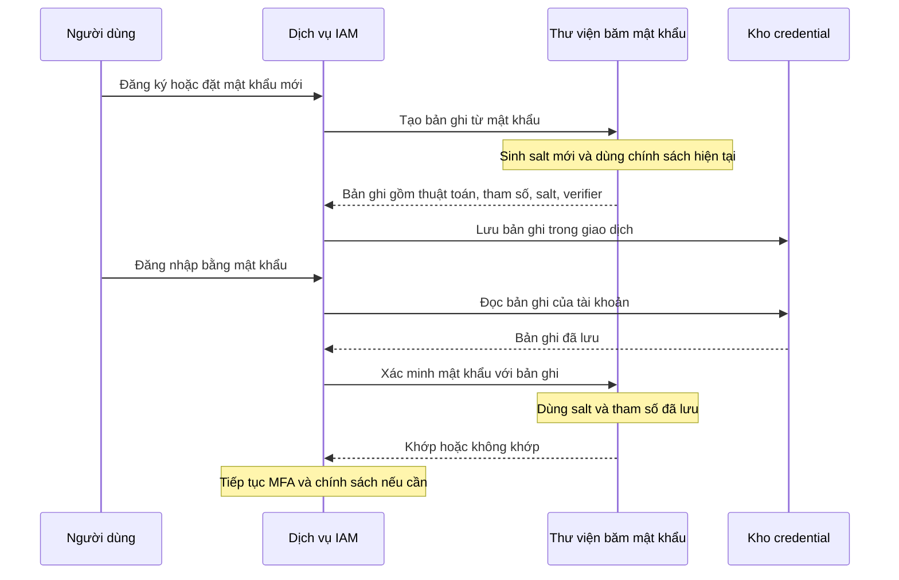

# Password salt

Trong xác thực bằng mật khẩu, **salt** là dữ liệu được đưa vào hàm băm mật khẩu để mỗi bản ghi thông tin xác thực có một phép tính riêng. Salt thường được sinh ngẫu nhiên khi tạo bản ghi và lưu cùng kết quả băm. Hai người chọn cùng mật khẩu vẫn có thể có hai kết quả băm khác nhau nhờ hai salt khác nhau.

Trong nền tảng IAM, salt thuộc lớp bảo vệ thông tin xác thực được lưu trữ. Nó hỗ trợ bảo vệ tài khoản khi dữ liệu bị đánh cắp, nhưng quyết định cấp quyền vẫn thuộc RBAC, ABAC hoặc chính sách truy cập. Xác minh mật khẩu thành công cũng chưa đồng nghĩa đã hoàn thành MFA hay được phép thực hiện mọi hành động.

Sau bài này, người học có thể giải thích tác dụng của salt, nhận ra cách dùng salt sai, mô tả dữ liệu cần lưu để xác minh mật khẩu và theo dõi vòng đời salt trong một dịch vụ đăng nhập Java.

## 1. Salt tham gia vào phép tính nào?

Mô hình khái niệm của một bản ghi mật khẩu là:

```text
verifier = PasswordKDF(password, salt, parameters)

storedRecord = {
    algorithm,
    algorithmVersion,
    parameters,
    salt,
    verifier
}
```

Trong đó:

- `password` là mật khẩu người dùng cung cấp, chỉ cần tồn tại trong phạm vi xử lý cần thiết.
- `salt` là đầu vào riêng cho bản ghi đang được tạo.
- `parameters` quy định chi phí tính toán của thuật toán, chẳng hạn bộ nhớ, số lượt xử lý hoặc số vòng lặp.
- `verifier` là kết quả dùng để đối chiếu khi đăng nhập, không phải bản mã để giải mã lấy lại mật khẩu.

`PasswordKDF` ở đây chỉ hàm dẫn xuất dành cho mật khẩu hoặc hàm băm mật khẩu chuyên dụng. Nó không đại diện cho phép gọi `SHA-256` một lần. Khi triển khai mới, có thể dùng một thư viện hỗ trợ Argon2id và quản lý định dạng bản ghi; cần lựa chọn tham số theo hướng dẫn hiện hành và năng lực máy chủ. OWASP phân biệt rõ các hàm băm mật khẩu có chi phí với hàm băm nhanh dùng cho mục đích khác. [OWASP Password Storage Cheat Sheet](https://cheatsheetseries.owasp.org/cheatsheets/Password_Storage_Cheat_Sheet.html)

Công thức `H(password || salt)` đôi khi được dùng để minh họa vai trò của salt. Công thức đó không phải hướng dẫn tự thiết kế thuật toán lưu mật khẩu bằng cách nối chuỗi. API mật mã nhận các đầu vào theo quy tắc riêng; ứng dụng nên truyền salt vào đúng tham số mà thư viện yêu cầu.

## 2. Vấn đề khi nhiều tài khoản dùng cùng mật khẩu

Giả sử hệ thống có hai tài khoản:

| Tài khoản | Mật khẩu minh họa | Bản ghi không có salt riêng |
|---|---|---|
| An | `mat-khau-minh-hoa` | `H(mat-khau-minh-hoa)` |
| Bình | `mat-khau-minh-hoa` | `H(mat-khau-minh-hoa)` |

Nếu cùng thuật toán và tham số được dùng, hai đầu ra giống nhau. Người có bản sao dữ liệu có thể nhận ra các nhóm tài khoản trùng verifier. Họ cũng có thể tính kết quả cho một mật khẩu ứng viên rồi đối chiếu kết quả đó với nhiều tài khoản.

Với salt riêng:

```text
An:
    salt_A = randomBytes(16)
    verifier_A = PasswordKDF(password, salt_A, parameters)

Bình:
    salt_B = randomBytes(16)
    verifier_B = PasswordKDF(password, salt_B, parameters)
```

Khi hai salt khác nhau, đầu vào của hai phép tính khác nhau. Với hàm mật mã phù hợp, hai verifier sẽ khác nhau với xác suất rất cao. Không nên diễn đạt thành một bảo đảm toán học rằng đầu ra hữu hạn tuyệt đối không thể va chạm.

Người tấn công biết cả hai salt vẫn phải tính với `salt_A` để kiểm tra bản ghi của An và tính với `salt_B` để kiểm tra bản ghi của Bình. Kết quả đã tính cho bản ghi này không trực tiếp dùng để đối chiếu bản ghi kia.

Đây cũng là lý do salt làm giảm giá trị của bảng băm tính sẵn, bao gồm rainbow table: bảng tạo cho một tập đầu vào không salt hoặc một salt cố định không áp dụng trực tiếp cho mọi salt ngẫu nhiên. Salt không làm những mật khẩu phổ biến biến mất khỏi danh sách mà kẻ tấn công sẽ thử.

## 3. Mô hình đe dọa: đọc được database vẫn đọc được salt

Một mô hình thiết kế hữu ích là giả định kẻ tấn công đã lấy được bản sao bảng thông tin xác thực, bao gồm thuật toán, tham số, salt và verifier.

Đối với một tài khoản cụ thể, họ có thể thực hiện:

```text
for candidate in passwordCandidates:
    value = PasswordKDF(candidate, stolenSalt, stolenParameters)
    if value matches stolenVerifier:
        candidate có thể là mật khẩu của tài khoản
```

Đây là thử đoán ngoại tuyến: mỗi lần thử không cần gửi yêu cầu tới API đăng nhập. Vì vậy, giới hạn tốc độ của API không trực tiếp chặn vòng lặp này trên máy của kẻ tấn công.

Salt tạo sự khác biệt giữa các bản ghi; chi phí của hàm băm làm từng lần thử đắt hơn; mật khẩu khó đoán làm tăng số ứng viên cần kiểm tra. Ba yếu tố đóng vai trò khác nhau.

Ví dụ suy luận: nếu danh sách chứa `D` mật khẩu ứng viên và có `U` bản ghi với salt độc lập, việc kiểm tra đầy đủ mọi ứng viên trên mọi bản ghi cần xấp xỉ `D × U` lần gọi KDF. Đây là mô hình đơn giản để thấy khả năng tái sử dụng kết quả bị hạn chế, không phải dự báo thời gian phá mật khẩu. Kẻ tấn công có thể chọn một số tài khoản, dừng sớm, dùng phần cứng song song và ưu tiên mật khẩu thường gặp.

Salt không ngăn được các tình huống sau:

| Tình huống | Vì sao vẫn cần biện pháp khác? |
|---|---|
| Phishing lấy mật khẩu | Kẻ tấn công có mật khẩu thật và có thể thử đăng nhập |
| Credential stuffing | Cặp tài khoản và mật khẩu từ dịch vụ khác được gửi tới API |
| Mã độc ghi lại phím bấm | Mật khẩu bị lấy trước khi đến bước băm |
| Chiếm phiên đăng nhập | Session hoặc token bị đánh cắp có vòng đời riêng |
| Chiếm quyền thực thi trong dịch vụ xác thực | Kẻ tấn công có thể quan sát dữ liệu trong quá trình xử lý |

Vì vậy, một dịch vụ IAM vẫn cần bảo vệ kênh truyền, kiểm soát thử đăng nhập, MFA phù hợp và quản lý phiên. Không dùng salt như bằng chứng rằng toàn bộ cơ chế đăng nhập đã an toàn.

## 4. Những thuộc tính cần có của salt

### 4.1. Sinh bằng nguồn ngẫu nhiên dành cho mật mã

Trong Java, dùng `SecureRandom` để lấy byte ngẫu nhiên. API này cung cấp bộ sinh ngẫu nhiên mạnh về mật mã và có cơ chế lấy seed từ nguồn entropy của triển khai khi được dùng theo cách thông thường. Không tự đặt seed bằng giờ hệ thống hoặc một hằng số. [Java SE 21 — SecureRandom](https://docs.oracle.com/en/java/javase/21/docs/api/java.base/java/security/SecureRandom.html)

Tránh dùng các giá trị thuận tiện nhưng có cấu trúc dễ đoán làm salt, chẳng hạn số tăng dần, timestamp, email hoặc mã tenant. Email còn có thể thay đổi trong vòng đời tài khoản. Việc lấy salt trực tiếp từ email khiến quy trình đổi email dễ tác động nhầm vào xác minh mật khẩu.

### 4.2. Đủ dài để xác suất trùng nhỏ

Một lựa chọn cụ thể cho ví dụ trong bài là **16 byte ngẫu nhiên, tương đương 128 bit**. RFC 9106 khuyến nghị salt dài 16 byte cho ứng dụng băm mật khẩu với Argon2 và nêu yêu cầu salt nên riêng cho từng mật khẩu. Đây là độ dài của dữ liệu byte, không phải số ký tự hiển thị. [RFC 9106, mục 3.1](https://www.rfc-editor.org/rfc/rfc9106.html#section-3.1)

Nếu sinh đều trong không gian `2^b` giá trị, xác suất có ít nhất một cặp trùng giữa `n` salt có thể được ước lượng khi xác suất còn nhỏ:

```text
P(collision) ≈ n × (n - 1) / (2 × 2^b)
```

Ví dụ toán học với `n = 1.000.000.000` và `b = 128` cho kết quả khoảng `1,47 × 10^-21`. Con số này phụ thuộc giả thiết các lần sinh độc lập và phân bố tốt; nó không cứu được chương trình luôn trả về cùng một mảng byte vì lỗi khởi tạo.

Không cần quét toàn bộ bảng tài khoản để chọn salt chưa từng xuất hiện nếu đã dùng bộ sinh phù hợp và không gian đủ lớn. Ngược lại, nhiều bản ghi có salt giống hệt nhau là tín hiệu cần điều tra lỗi sinh hoặc sao chép dữ liệu.

### 4.3. Riêng cho mỗi lần tạo bản ghi mật khẩu

Sinh salt mới khi đăng ký, khi đặt lại mật khẩu, khi đổi mật khẩu và khi chủ động tạo bản ghi hash thay thế. Hai tài khoản cùng tenant hoặc hai môi trường triển khai không nên dùng chung một salt cấu hình.

Khi xác minh một bản ghi đã lưu, phải dùng lại salt thuộc bản ghi đó. Nếu sinh salt mới cho mỗi lần thử đăng nhập rồi so sánh với verifier cũ, phép tính sẽ dùng sai đầu vào.

Salt cũng không cần đổi chỉ vì thời gian trôi qua. Mọi lần thay salt phải đi cùng việc tạo verifier tương ứng; không thể đổi riêng cột salt và giữ verifier nguyên vẹn.

### 4.4. Không cần giữ bí mật, nhưng cần giữ đúng

Salt có thể nằm trong cùng bảng hoặc cùng chuỗi mã hóa với verifier. Tách salt sang một bảng khác trong cùng cơ sở dữ liệu không tự tạo ra một bí mật độc lập.

Dữ liệu không bí mật vẫn cần kiểm soát tính toàn vẹn. Nếu salt bị sửa, mật khẩu đúng có thể không xác minh được. Nếu kẻ tấn công được thay cả salt lẫn verifier, họ có thể thay thông tin xác thực của tài khoản. Quyền ghi bảng credential vì thế phải được giới hạn cho thành phần có trách nhiệm.

## 5. Vòng đời từ đăng ký đến đăng nhập



### Khi tạo thông tin xác thực

1. Dịch vụ nhận mật khẩu qua kênh bảo vệ và áp dụng chính sách đầu vào.
2. Thư viện sinh salt mới hoặc nhận salt mới từ thành phần được chỉ định rõ.
3. Thư viện tính verifier với thuật toán và tham số hiện tại.
4. Ứng dụng lưu đủ dữ liệu để tái lập phép xác minh trong một lần cập nhật nhất quán.
5. Luồng xử lý kết thúc mà không ghi mật khẩu vào log, trace hoặc sự kiện nghiệp vụ.

### Khi xác minh

1. Tìm bản ghi credential của tài khoản.
2. Đọc thuật toán, phiên bản, tham số và salt từ bản ghi đó.
3. Dùng thư viện để xác minh mật khẩu ứng viên.
4. Nếu không khớp, trả kết quả thất bại theo chính sách xác thực.
5. Nếu khớp, đánh giá có cần nâng cấp bản ghi hay không rồi tiếp tục các bước xác thực còn lại.

NIST mô tả việc lưu mật khẩu ở dạng có salt và được băm bằng cơ chế phù hợp, đồng thời lưu salt và kết quả để xác minh. Việc quản lý thông tin thuật toán và chi phí cũng giúp hệ thống chuyển đổi phương án bảo vệ theo thời gian. [NIST SP 800-63B-4 — Password Verifiers](https://pages.nist.gov/800-63-4/sp800-63b.html#passwordver)

## 6. Lưu salt và định dạng bản ghi

Một thiết kế có thể tách các trường:

```text
credential_id
account_id
algorithm
algorithm_version
cost_parameters
salt_bytes
verifier_bytes
credential_version
```

Một thiết kế khác lưu một chuỗi do thư viện xuất ra, trong đó đã có định danh thuật toán, phiên bản, tham số, salt và verifier. Khi dùng định dạng này, API xác minh đọc lại các thành phần từ chuỗi. Không tự tách rồi ghép lại bằng một định dạng không tương thích.

Ví dụ cấu trúc khái niệm của chuỗi Argon2, **không phải giá trị hợp lệ để nhập vào thư viện**:

```text
$argon2id$v=19$m=<memory>,t=<passes>,p=<parallelism>$<salt>$<verifier>
```

Những điểm cần phân biệt:

- `credential_version` là phiên bản bản ghi của ứng dụng để kiểm soát cập nhật đồng thời, khác với phiên bản thuật toán.
- Salt và verifier có thể lưu dạng nhị phân hoặc được mã hóa thành văn bản; phải giải mã về đúng byte khi API yêu cầu byte.
- Base64 và hex chỉ biểu diễn dữ liệu, không bổ sung entropy hay che giấu salt.
- Salt 16 byte có 32 ký tự hex; Base64 chuẩn có padding thường có 24 ký tự, còn Base64 URL không padding có 22 ký tự.
- Phải tính độ dài cột theo toàn bộ định dạng bản ghi và khả năng thay thuật toán, không chỉ theo độ dài verifier hiện tại.

Mất salt khiến hệ thống mất một đầu vào cần thiết cho xác minh. Bản sao lưu phải giữ salt, verifier và tham số tương ứng. Sao lưu chỉ verifier rồi sinh salt mới lúc khôi phục sẽ làm bản ghi không dùng được.

Salt không phải dữ liệu đăng nhập cần gửi riêng cho trình duyệt trong mô hình thông thường này. Giao thức xác thực có challenge hoặc cơ chế dẫn xuất ở phía khách là thiết kế khác và cần được phân tích theo chính giao thức đó.

## 7. Ví dụ Java: sinh salt và bảo toàn dữ liệu byte

Đoạn mã sau chỉ minh họa việc sinh salt và biểu diễn nó bằng Base64. Nó không triển khai hàm băm mật khẩu hay một dịch vụ xác thực hoàn chỉnh.

```java
import java.security.SecureRandom;
import java.util.Arrays;
import java.util.Base64;

public final class PasswordSaltExample {
    private static final SecureRandom RANDOM = new SecureRandom();
    private static final int SALT_BYTES = 16;

    private PasswordSaltExample() {
    }

    public static byte[] newSalt() {
        byte[] salt = new byte[SALT_BYTES];
        RANDOM.nextBytes(salt);
        return salt;
    }

    public static void main(String[] args) {
        byte[] salt = newSalt();
        String storedSalt = Base64.getEncoder().encodeToString(salt);
        byte[] restoredSalt = Base64.getDecoder().decode(storedSalt);

        if (!Arrays.equals(salt, restoredSalt)) {
            throw new IllegalStateException("Salt round-trip failed");
        }

        System.out.println("Salt length in bytes: " + salt.length);
        System.out.println("Base64 length: " + storedSalt.length());
        System.out.println("Round-trip preserves bytes: true");
    }
}
```

Kết quả độ dài của ví dụ là 16 byte và 24 ký tự Base64. `Arrays.equals` ở đây kiểm tra việc mã hóa rồi giải mã **salt không bí mật**. Không suy từ ví dụ này rằng nên tự thay cơ chế so sánh verifier của thư viện bằng phép so sánh tùy ý.

Lỗi triển khai thường gặp là bỏ quên `RANDOM.nextBytes(salt)`. Lệnh `new byte[16]` chỉ tạo 16 byte bằng không. Nó có độ dài đúng nhưng không có tính ngẫu nhiên cần thiết.

Một lỗi khác là lấy byte của chuỗi Base64 làm salt khi đăng nhập:

```text
Sai luồng dữ liệu:
    salt gốc -> Base64 text -> byte của chính văn bản Base64

Đúng luồng dữ liệu:
    salt gốc -> Base64 text -> Base64 decode -> salt gốc
```

Nếu thư viện đã tự sinh và đóng gói salt, ứng dụng gọi API tạo bản ghi của thư viện. Không nối thêm salt thủ công vào mật khẩu rồi giả định rằng quy trình vẫn tương đương với cấu hình chuẩn.

## 8. Tích hợp bằng API của thư viện

Mã giả dưới đây dùng các thao tác khái niệm. Tên hàm không đại diện cho API của một thư viện Java cụ thể:

```text
createCredential(accountId, password):
    encodedRecord = passwordLibrary.create(password, currentPolicy)
    credentialStore.insert(accountId, encodedRecord)

verifyPassword(accountId, candidate):
    record = credentialStore.find(accountId)
    nếu không có record:
        xử lý theo chính sách chống dò tài khoản của dịch vụ
        trả thất bại

    matched = passwordLibrary.verify(candidate, record.encodedRecord)
    nếu không matched:
        trả thất bại

    nếu passwordLibrary.needsUpgrade(record.encodedRecord, currentPolicy):
        replacement = passwordLibrary.create(candidate, currentPolicy)
        credentialStore.replaceIfVersionMatches(
            accountId,
            record.credentialVersion,
            replacement
        )

    trả mật khẩu hợp lệ; tiếp tục kiểm tra MFA nếu được yêu cầu
```

Ở bước xác minh, thư viện lấy salt cũ từ `encodedRecord`. Ở bước tạo `replacement`, thư viện tạo bản ghi mới với salt mới.

Điều kiện phiên bản tránh ghi đè một mật khẩu vừa được người dùng thay ở yêu cầu khác. Nếu cập nhật có điều kiện thất bại, dịch vụ phải xử lý xung đột theo chính sách xác thực; không ghi đè bản ghi mới bằng bản thay thế được tạo từ mật khẩu cũ. Đây là vấn đề đồng thời của ứng dụng, không phải thuộc tính mà salt tự cung cấp.

Các tham số được đọc từ bản ghi cũng cần được thư viện kiểm tra hợp lệ và nằm trong giới hạn vận hành mà dịch vụ chấp nhận. Một bản ghi hỏng hoặc bị thay đổi không nên khiến dịch vụ cấp phát bộ nhớ hay chạy số vòng lặp không giới hạn.

## 9. Salt khác pepper và khóa mã hóa thế nào?

| Thành phần | Vai trò | Có cần bí mật? | Phạm vi và nơi quản lý |
|---|---|---|---|
| Salt | Tạo đầu vào riêng cho bản ghi mật khẩu | Không | Riêng từng bản ghi, thường lưu cùng verifier |
| Pepper | Bổ sung một bí mật vào thiết kế bảo vệ mật khẩu | Có | Có thể dùng cho nhiều bản ghi, quản lý tách khỏi kho verifier |
| Khóa mã hóa | Cho phép mã hóa và giải mã theo một thuật toán | Có | Quản lý bằng cơ chế quản lý khóa phù hợp |
| Tham số chi phí | Quy định tài nguyên cần cho mỗi phép tính | Không | Lưu cùng bản ghi để xác minh và nâng cấp |

Một chuỗi cấu hình cố định dùng chung cho mọi tài khoản không phải salt riêng, dù biến trong mã nguồn mang tên `salt`. Nếu chuỗi đó là bí mật dùng trong một thiết kế pepper, vẫn cần salt riêng cho từng bản ghi và cơ chế quản lý bí mật đúng cách.

Pepper có vòng đời khóa riêng. Trong thiết kế mà việc tính lại verifier cần cả mật khẩu và pepper, không thể đổi pepper bằng cách sửa mỗi một trường cấu hình rồi mong mọi bản ghi cũ tiếp tục xác minh được. Phải thiết kế khả năng chuyển tiếp hoặc đặt lại mật khẩu tương ứng.

Salt trong băm mật khẩu cũng không được xem như một IV hoặc nonce có thể thay thế tùy ý trong thuật toán mã hóa. Mỗi thuật toán quy định đầu vào và điều kiện sử dụng riêng. RFC 8018 trình bày salt như một tham số trong cơ chế dẫn xuất từ mật khẩu; không có một phép nối chuỗi chung áp dụng cho mọi giao thức. [RFC 8018, mục 4.1](https://www.rfc-editor.org/rfc/rfc8018.html#section-4.1)

## 10. Đổi mật khẩu, nâng cấp hash và phục hồi dữ liệu

### Đổi hoặc đặt lại mật khẩu

Khi người dùng đặt mật khẩu mới, tạo một bản ghi mới hoàn chỉnh. Ngay cả khi mật khẩu mới tình cờ giống mật khẩu trước đó, quy trình tạo bản ghi vẫn sinh salt mới. Việc cấm dùng lại mật khẩu, nếu có, là chính sách riêng; không thể suy ra bằng cách so sánh trực tiếp hai verifier có salt khác nhau.

Không thay salt vào đầu mỗi lần người dùng đăng nhập. Một lần đăng nhập thông thường chỉ đọc salt đã lưu. Chỉ khi tạo bản ghi nâng cấp sau xác minh thành công mới cần salt mới.

### Nâng cấp thuật toán hoặc chi phí

Một dịch vụ có thể xác minh bản ghi cũ bằng thuật toán và tham số đã ghi lại, sau đó dùng mật khẩu vừa xác minh để tạo bản ghi theo chính sách mới. Cách này đòi hỏi ứng dụng phân biệt được định dạng cũ và mới.

Không thể chuyển mọi bản ghi `SHA-256(password)` sang `Argon2id(password, newSalt)` chỉ từ các giá trị SHA-256 đã lưu. Hệ thống không có `password` để làm đầu vào. Cần luồng đăng nhập thành công để nâng cấp hoặc quy trình đặt lại mật khẩu. Bọc thêm một hàm bên ngoài verifier cũ tạo ra một cấu trúc khác, không tương đương phép tính trên mật khẩu gốc.

### Khôi phục hoặc chuyển hệ thống

Khi chuyển credential sang dịch vụ khác, phải bảo toàn thuật toán, phiên bản, tham số, salt, verifier và quy tắc chuyển đổi đầu vào. Đổi encoding của salt, làm mất padding khi bộ giải mã không hỗ trợ, cắt ngắn chuỗi hoặc nhầm đơn vị tham số đều có thể làm đăng nhập thất bại.

Một dịch vụ SSO dựa trên IdP cũng cần xác định nơi nào thực sự sở hữu mật khẩu. Nếu ứng dụng chỉ là relying party nhận kết quả OIDC, không tạo thêm bảng mật khẩu cục bộ chỉ để có chỗ lưu salt. Mật khẩu, phiên đăng nhập và token liên kết danh tính có chủ thể quản lý và quy trình bảo vệ khác nhau.

## 11. Phân tích ba tình huống triển khai

### Tình huống A: có cột salt nhưng mọi tài khoản đều giống nhau

Nhóm phát triển đặt `PASSWORD_SALT` trong cấu hình triển khai rồi dùng giá trị này cho toàn bộ tài khoản. Hai tài khoản chọn cùng mật khẩu và dùng cùng tham số sẽ có cùng verifier. Thiết kế này không tạo đầu vào riêng cho từng bản ghi.

Hướng sửa là dùng cơ chế tạo salt cho từng bản ghi và lưu salt tương ứng. Với tài khoản cũ, cần chiến lược xác minh định dạng cũ rồi nâng cấp hoặc đặt lại mật khẩu. Không sửa hàng loạt cột salt mà bỏ qua việc tính lại verifier.

### Tình huống B: đăng ký thành công nhưng đăng nhập luôn thất bại

Khi đăng ký, ứng dụng sinh `salt_1`; khi đăng nhập, ứng dụng sinh `salt_2` rồi tính lại. Dù mật khẩu nhập đúng, hai phép tính dùng hai đầu vào salt khác nhau.

Hướng sửa là lấy salt từ bản ghi đã lưu khi xác minh. Nếu thư viện lưu salt bên trong chuỗi hash, truyền cả chuỗi đó vào API xác minh thay vì tự bóc tách theo suy đoán.

### Tình huống C: salt đúng nhưng tài khoản vẫn bị chiếm

Hệ thống sinh salt riêng, dùng hàm băm mật khẩu có chi phí, nhưng mật khẩu thật bị lấy qua trang phishing và tài khoản không có bước xác thực bổ sung. Kẻ tấn công đăng nhập qua luồng hợp lệ, nên không cần phá verifier ngoại tuyến.

Kết luận của tình huống là phải xác định đúng điểm bị tấn công. Cải thiện salt không thay thế việc bảo vệ người dùng khỏi phishing, quản lý MFA, kiểm tra rủi ro đăng nhập và thu hồi phiên khi cần.

## 12. Kiểm tra hiểu biết bằng các bất biến

Khi đọc thiết kế hoặc mã của dịch vụ xác thực, có thể tự kiểm tra các bất biến sau:

1. Mỗi lần tạo một bản ghi mật khẩu mới đều có salt mới từ nguồn phù hợp.
2. Xác minh một bản ghi dùng đúng salt, thuật toán và tham số của bản ghi đó.
3. Salt được mã hóa rồi giải mã phải giữ nguyên dữ liệu byte.
4. Đổi salt luôn đi cùng tạo verifier tương ứng.
5. Hai lần tạo bản ghi cho cùng mật khẩu thường cho kết quả khác nhau, nhưng cả hai phải xác minh được mật khẩu đó.
6. Mật khẩu sai phải bị từ chối, kể cả khi bản ghi có cấu trúc hợp lệ.
7. Bản ghi sao lưu có đủ dữ liệu để xác minh sau khôi phục.
8. Việc nâng cấp không ghi đè một thay đổi credential mới hơn.

Ví dụ thứ năm kiểm tra đồng thời hai đặc điểm: quá trình tạo bản ghi có đầu vào ngẫu nhiên, còn quá trình xác minh có thể tái lập phép tính từ dữ liệu đã lưu. Không so sánh hai chuỗi hash để quyết định hai mật khẩu có bằng nhau; hãy dùng API xác minh của thư viện đối với bản ghi cần kiểm tra.

Trong vận hành IAM, sự kiện kiểm toán có thể ghi nhận tài khoản, thời điểm đổi credential, phiên bản chính sách và kết quả thao tác. Không đưa mật khẩu hoặc toàn bộ bản ghi verifier vào log chỉ để xác nhận salt đã được tạo. Kho credential và luồng kiểm toán cần có quyền truy cập phù hợp với chức năng của từng thành phần.
