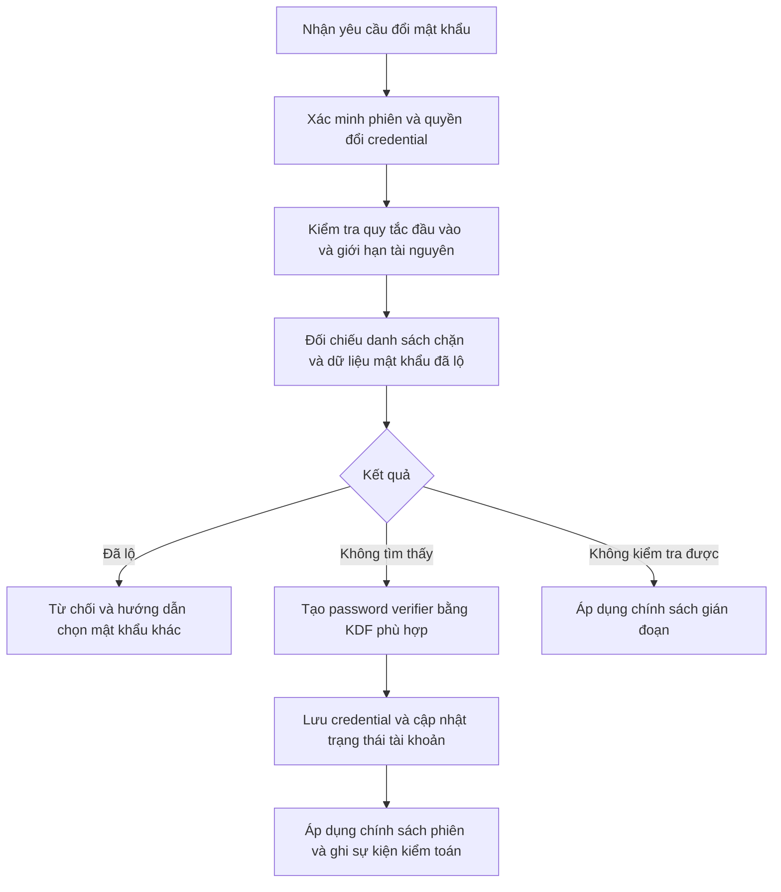

# Password breach check — Kiểm tra mật khẩu đã bị lộ

## 1. Vì sao IAM cần kiểm tra mật khẩu đã lộ?

Một người dùng tạo tài khoản trên cổng học tập bằng mật khẩu dài, có chữ hoa, chữ thường, số và ký tự đặc biệt. Mật khẩu vượt qua bộ kiểm tra độ phức tạp, nhưng người đó đã dùng chính mật khẩu ấy ở một dịch vụ từng bị rò rỉ dữ liệu. Kẻ tấn công có thể thử lại thông tin đăng nhập đã thu thập được mà không cần phá thuật toán băm của cổng học tập.

**Password breach check** là việc đối chiếu mật khẩu ứng viên với tập mật khẩu đã biết là bị lộ. Trong hệ thống quản lý danh tính và quyền truy cập, kiểm tra này giúp ngăn một bí mật đã bị công khai tiếp tục trở thành thông tin xác thực hợp lệ.

Bài học thuộc chương Password authentication của nền tảng IAM. Phạm vi là bảo vệ việc thiết lập và sử dụng mật khẩu trong vòng đời tài khoản, đồng thời kết nối quyết định đó với MFA, quản lý phiên, khôi phục tài khoản và kiểm toán. Việc mật khẩu vượt qua kiểm tra không quyết định người dùng được cấp vai trò hay quyền truy cập nào; RBAC, ABAC và nguyên tắc ít quyền nhất vẫn được áp dụng độc lập.

Sau bài học, người học có thể:

- Phân biệt kiểm tra mật khẩu đã lộ với kiểm tra độ mạnh và tìm kiếm tài khoản trong vụ rò rỉ.
- Mô tả cách tra cứu bằng một phần giá trị băm để hạn chế tiết lộ bí mật.
- Thiết kế kết quả kiểm tra có trạng thái lỗi rõ ràng.
- Đặt bước kiểm tra đúng vị trí trong đăng ký, đổi và đặt lại mật khẩu.
- Xây dựng chính sách vận hành khi nguồn dữ liệu hoặc dịch vụ tra cứu không sẵn sàng.

## 2. Kết quả kiểm tra nói lên điều gì?

### 2.1. Ba câu hỏi khác nhau

| Cơ chế | Câu hỏi được trả lời | Giới hạn |
|---|---|---|
| Kiểm tra độ mạnh | Mật khẩu có dễ đoán theo các mẫu đã nhận diện không? | Ước lượng độ mạnh không chứng minh mật khẩu chưa bị lộ. |
| Kiểm tra mật khẩu đã lộ | Giá trị mật khẩu này có nằm trong nguồn dữ liệu đang kiểm tra không? | Không xác định tài khoản nào đã dùng nó. |
| Tìm email trong dữ liệu rò rỉ | Địa chỉ email có liên quan đến vụ rò rỉ đã biết không? | Không chứng minh mật khẩu hiện tại trùng mật khẩu bị lộ. |

Một mật khẩu được tìm thấy trong tập dữ liệu có thể đã được nhiều người sử dụng. Không suy diễn rằng chính người dùng hiện tại đã gây ra sự cố, rằng tài khoản của họ chắc chắn bị chiếm, hoặc rằng hệ thống của mình vừa bị rò rỉ.

Ngược lại, không tìm thấy chỉ phản ánh giới hạn của nguồn dữ liệu tại thời điểm kiểm tra. Một mật khẩu mới bị đánh cắp, mật khẩu yếu chưa xuất hiện trong tập dữ liệu, hoặc mật khẩu chứa thông tin cá nhân dễ đoán vẫn có thể vượt qua bước này.

### 2.2. Mô hình kết quả cần có ba trạng thái

| Trạng thái | Điều kiện | Ý nghĩa đối với nghiệp vụ |
|---|---|---|
| `KNOWN_COMPROMISED` | Đã đối chiếu thành công và tìm thấy bản ghi thật khớp mật khẩu | Từ chối dùng làm mật khẩu mới. |
| `NOT_FOUND` | Đã đối chiếu thành công, dữ liệu hợp lệ và không tìm thấy | Chuyển sang hoặc tiếp tục các kiểm tra còn lại. |
| `UNAVAILABLE` | Timeout, lỗi mạng, lỗi nguồn dữ liệu hoặc phản hồi không hợp lệ | Áp dụng chính sách gián đoạn đã định nghĩa. |

Một hàm chỉ trả về `true` hoặc `false` rất dễ gộp lỗi dịch vụ vào kết quả không tìm thấy. Khi đó hệ thống có thể chấp nhận mật khẩu mà thực tế chưa kiểm tra được.

Nếu nguồn có số lần xuất hiện, con số đó là dữ liệu về tập quan sát. Nó không phải xác suất tài khoản bị chiếm và không phải số lần đăng nhập trái phép vào ứng dụng. Với chính sách chặn mật khẩu đã lộ, một kết quả khớp thật đã đủ để từ chối; không cần chờ đạt một ngưỡng phổ biến cao.

## 3. Đặt bước kiểm tra trong vòng đời mật khẩu

Theo [NIST SP 800-63B, mục 3.1.1.2](https://pages.nist.gov/800-63-4/sp800-63b.html#passwordver), khi thiết lập hoặc đổi mật khẩu, hệ thống đối chiếu toàn bộ mật khẩu ứng viên với danh sách chặn gồm các giá trị thông dụng, dự kiến hoặc đã bị lộ. Nếu bị chặn, người dùng cần được giải thích lý do và hướng dẫn chọn giá trị khác. Đây là cơ sở để xem dữ liệu mật khẩu đã lộ như một đầu vào của chính sách mật khẩu, cùng với các quy tắc phù hợp khác.

### 3.1. Những thời điểm nên kiểm tra

| Luồng IAM | Mật khẩu cần kiểm tra | Lưu ý về thứ tự |
|---|---|---|
| Đăng ký tài khoản | Mật khẩu mới | Kiểm tra trước khi lưu credential và hoàn tất kích hoạt. |
| Đổi mật khẩu | Mật khẩu mới | Xác minh quyền thực hiện thay đổi trước, rồi đánh giá ứng viên. |
| Đặt lại mật khẩu | Mật khẩu mới | Xác minh token hoặc bằng chứng khôi phục trước khi chấp nhận thay đổi. |
| Quản trị viên cấp mật khẩu tạm | Giá trị được cấp, nếu mô hình có sử dụng | Chính sách tập trung cần bao phủ cả đường quản trị. |
| Đăng nhập thành công | Mật khẩu vừa được xác minh, nếu có chính sách kiểm tra lại | Quy định rõ cách hạn chế phiên và yêu cầu khắc phục khi phát hiện rủi ro. |

Kiểm tra ở giao diện giúp phản hồi sớm, nhưng backend phải thực thi quyết định cuối cùng. Một ứng dụng di động, endpoint quản trị hoặc API cũ có thể bỏ qua logic trên trình duyệt.

### 3.2. Luồng đổi mật khẩu minh họa



Chỉ đi đến bước lưu credential khi toàn bộ kiểm tra bắt buộc đã đạt. Nếu quyết định tạm hoãn, mật khẩu hiện tại tiếp tục có hiệu lực theo trạng thái tài khoản; hệ thống không ghi một nửa thay đổi rồi chờ dịch vụ tra cứu phục hồi.

Không giữ giao dịch cơ sở dữ liệu hoặc khóa bản ghi trong thời gian chờ một lời gọi mạng bên ngoài nếu kiến trúc có thể tránh được. Sau khi kiểm tra xong, bước ghi cần xác nhận phiên, quyền và phiên bản credential vẫn còn hợp lệ, để một yêu cầu cũ không ghi đè thay đổi mới hơn.

### 3.3. Trường hợp SSO và workload

Với tài khoản chỉ đăng nhập qua SSO, mật khẩu thường do identity provider quản lý. Relying party không cần thu thập thêm mật khẩu chỉ để thực hiện breach check. Chính sách này nên được thực thi tại nơi sở hữu credential; các đường đăng nhập cục bộ dự phòng, nếu có, vẫn phải được kiểm soát.

Danh tính workload dùng API key, client secret hoặc chứng thư cần cơ chế quản lý bí mật, phát hiện lộ và luân chuyển riêng. Không coi một tập dữ liệu mật khẩu người dùng là công cụ xác nhận API key hay private key còn an toàn.

## 4. Tra cứu bằng k-anonymity

### 4.1. Ví dụ giao thức Pwned Passwords

[Pwned Passwords](https://haveibeenpwned.com/API/v3#SearchingPwnedPasswordsByRange) hỗ trợ tra cứu theo SHA-1 của mật khẩu mã hóa UTF-8: gửi 5 ký tự hex đầu, nhận các hậu tố và số lần xuất hiện, rồi so khớp tại ứng dụng. Request có dạng:

```http
GET /range/{prefix} HTTP/1.1
Host: api.pwnedpasswords.com
Add-Padding: true
```

SHA-1 có 40 ký tự hex, nên phần giữ lại để đối chiếu gồm 35 ký tự. API này không cần API key. Phản hồi HTTP 200 có thể chứa nhiều ứng viên; phải tìm hậu tố khớp. Header padding thêm bản ghi có count bằng 0; bỏ qua chúng. HTTP 404 không phải kết quả “mật khẩu sạch” của range API. Không truy vấn sau từng ký tự người dùng nhập. Các chi tiết giao thức này được mô tả trong [tài liệu API chính thức](https://haveibeenpwned.com/API/v3#PwnedPasswords).

### 4.2. Tách thông tin gửi đi và thông tin giữ cục bộ

```text
Mật khẩu ứng viên
       |
       v
Biểu diễn UTF-8 theo quy tắc nhất quán của hệ thống
       |
       v
SHA-1 dùng riêng cho tra cứu
       |
       +---- prefix ----> Dịch vụ range ----> Tập suffix:count
       |
       +---- suffix giữ tại ứng dụng ------> So khớp chính xác
```

Mục đích của việc chia prefix và suffix là để nhiều ứng viên cùng chia sẻ một giá trị tra cứu. Dịch vụ không nhận trực tiếp toàn bộ giá trị cần đối chiếu. Đây là giảm lượng thông tin tiết lộ; mức riêng tư còn phụ thuộc vào lưu lượng, nhật ký và khả năng liên kết các truy vấn.

Không gắn email, username hoặc ID tài khoản vào URL, header tùy chỉnh hay metadata gửi đến dịch vụ tra cứu. Những thông tin đó không cần thiết để đối chiếu mật khẩu nhưng có thể nối kết một truy vấn với danh tính cụ thể.

### 4.3. Băm tra cứu và băm lưu trữ phục vụ hai mục đích

| Giá trị | Mục đích | Thời gian tồn tại mong muốn |
|---|---|---|
| SHA-1 phục vụ tra cứu | Tạo khóa tra cứu theo giao thức nguồn dữ liệu | Chỉ trong thời gian xử lý cần thiết. |
| Password verifier có salt và KDF phù hợp | Xác minh mật khẩu cho lần đăng nhập sau | Theo vòng đời credential trong kho xác thực. |

Không lấy SHA-1 dùng cho tra cứu làm password verifier trong cơ sở dữ liệu. Tốc độ tính nhanh thuận tiện cho tra cứu không đem lại khả năng chống đoán ngoại tuyến mà việc lưu mật khẩu cần có.

Cũng không thay SHA-1 trong giao thức bằng đầu ra Argon2id, bcrypt hay một hash có salt của ứng dụng: đó là biểu diễn khác, không khớp khóa của tập dữ liệu đang tra cứu. Lựa chọn KDF lưu trữ cần theo chính sách mật mã và ràng buộc triển khai của hệ thống; bài này tập trung vào điểm tích hợp breach check.

## 5. Nhất quán biểu diễn mật khẩu và bảo vệ bí mật

### 5.1. Kiểm tra đúng giá trị mà hệ thống sẽ xác thực

Nếu bước kiểm tra tự ý `trim()`, chuyển chữ thường hoặc bỏ dấu, nó có thể đối chiếu một giá trị khác với credential thực sự được lưu. Hệ thống sẽ đưa ra quyết định về sai bí mật.

Cần xác định một quy tắc biểu diễn thống nhất cho đăng ký, đổi mật khẩu, đặt lại và đăng nhập. Nếu hệ thống có chuẩn hóa Unicode, bước đối chiếu và bước tạo verifier phải áp dụng chính sách đó một cách nhất quán. Với tài khoản cũ, thay đổi quy tắc biểu diễn cần kế hoạch chuyển đổi để tránh làm mất khả năng đăng nhập.

Ví dụ, dấu cách cuối mật khẩu có thể là ký tự người dùng cố ý chọn. Một endpoint loại bỏ nó trong khi endpoint khác giữ nguyên sẽ khiến hành vi đăng ký và đăng nhập không khớp. Tương tự, không thêm ký tự xuống dòng khi chuyển mật khẩu thành dữ liệu băm.

### 5.2. Giới hạn nơi bí mật xuất hiện

- Chỉ xử lý mật khẩu ở thành phần cần thực hiện xác thực hoặc thay đổi credential.
- Che trường mật khẩu trong request log, APM, trace, báo cáo lỗi và công cụ ghi lại phiên người dùng.
- Không ghi toàn bộ hash tra cứu hoặc suffix của ứng viên vào log, hàng đợi hay bảng lịch sử.
- Không đưa mật khẩu vào query string của API ứng dụng, vì URL thường bị ghi lại ở nhiều lớp.
- Giới hạn thời gian giữ dữ liệu trong bộ nhớ; tránh sao chép sang các đối tượng không cần thiết.

Prefix cũng là dữ liệu liên quan đến bí mật. Một prefix đơn lẻ chưa xác định đầy đủ mật khẩu, nhưng nhật ký chứa prefix, user ID, thời gian và nhiều lần thử có thể cung cấp thêm thông tin. Vì thế, không dùng prefix làm nhãn metric hoặc trường mặc định của sự kiện kiểm toán.

### 5.3. Frontend hỗ trợ trải nghiệm, backend sở hữu chính sách

Nếu giao diện kiểm tra trước, nó cần đợi người dùng hoàn tất giá trị ứng viên và tránh ghi lại các giá trị trung gian. Backend vẫn tự thực hiện hoặc xác minh bước kiểm tra theo cơ chế đáng tin cậy. Một cờ `passwordChecked=true` do client gửi lên không đủ làm bằng chứng.

Không trả về tập hash range cho các thành phần không có nhu cầu sử dụng. Với kiến trúc có dịch vụ chính sách tập trung, giao diện chỉ cần nhận quyết định và thông báo nghiệp vụ đã được lọc.

## 6. Ví dụ Java: tách bộ kiểm tra khỏi HTTP client

Ví dụ Java 17 dưới đây minh họa việc tạo khóa tra cứu, phân tích kết quả và giữ riêng trạng thái lỗi. `RangeLookup` là cổng giao tiếp; adapter HTTP hoặc nguồn dữ liệu nội bộ triển khai cổng này. Mật khẩu truyền vào đã qua kiểm tra kích thước và quy tắc biểu diễn thống nhất của ứng dụng.

```java
import java.io.IOException;
import java.nio.charset.StandardCharsets;
import java.security.MessageDigest;
import java.security.NoSuchAlgorithmException;
import java.util.Arrays;
import java.util.HexFormat;
import java.util.Objects;
import java.util.regex.Pattern;

public final class PasswordBreachChecker {
    public enum Verdict {
        KNOWN_COMPROMISED,
        NOT_FOUND,
        UNAVAILABLE
    }

    public record Result(Verdict verdict, long occurrences) {
        static Result unavailable() {
            return new Result(Verdict.UNAVAILABLE, 0);
        }
    }

    @FunctionalInterface
    public interface RangeLookup {
        // Chỉ nhận prefix; không nhận mật khẩu hoặc định danh tài khoản.
        // Adapter phải giới hạn kích thước và xác minh phản hồi thành công.
        String fetch(String prefix) throws IOException, InterruptedException;
    }

    private static final Pattern RANGE_LINE =
            Pattern.compile("[0-9A-Fa-f]{35}:[0-9]+");

    private final RangeLookup lookup;

    public PasswordBreachChecker(RangeLookup lookup) {
        this.lookup = Objects.requireNonNull(lookup);
    }

    public Result check(String candidate) {
        Objects.requireNonNull(candidate);
        String hash = sha1ForLookup(candidate);
        String prefix = hash.substring(0, 5);
        String suffix = hash.substring(5);

        try {
            return parseRange(lookup.fetch(prefix), suffix);
        } catch (InterruptedException ex) {
            Thread.currentThread().interrupt();
            return Result.unavailable();
        } catch (IOException ex) {
            return Result.unavailable();
        }
    }

    static Result parseRange(String body, String targetSuffix) {
        if (body == null || body.isBlank()) {
            return Result.unavailable();
        }

        long matchedCount = 0;
        boolean hasRecord = false;

        for (String line : body.split("\\R")) {
            if (line.isBlank()) {
                continue;
            }
            if (!RANGE_LINE.matcher(line).matches()) {
                return Result.unavailable();
            }

            hasRecord = true;
            long count;
            try {
                count = Long.parseLong(line.substring(36));
            } catch (NumberFormatException ex) {
                return Result.unavailable();
            }

            if (line.substring(0, 35).equalsIgnoreCase(targetSuffix)) {
                matchedCount = Math.max(matchedCount, count);
            }
        }

        if (!hasRecord) {
            return Result.unavailable();
        }
        if (matchedCount > 0) {
            return new Result(Verdict.KNOWN_COMPROMISED, matchedCount);
        }
        return new Result(Verdict.NOT_FOUND, 0);
    }

    private static String sha1ForLookup(String candidate) {
        byte[] encoded = candidate.getBytes(StandardCharsets.UTF_8);
        byte[] digest = null;
        try {
            digest = MessageDigest.getInstance("SHA-1").digest(encoded);
            return HexFormat.of().withUpperCase().formatHex(digest);
        } catch (NoSuchAlgorithmException ex) {
            throw new IllegalStateException("Lookup digest unavailable", ex);
        } finally {
            Arrays.fill(encoded, (byte) 0);
            if (digest != null) {
                Arrays.fill(digest, (byte) 0);
            }
        }
    }
}
```

### 6.1. Những quyết định trong ví dụ

`parseRange` duyệt toàn bộ phản hồi trước khi kết luận. Nếu đã gặp một dòng khớp nhưng phần còn lại sai định dạng, kết quả vẫn là `UNAVAILABLE`. Cách xử lý này tránh coi một phản hồi lỗi hoặc một trang HTML trả về nhầm là nguồn dữ liệu hợp lệ.

Count bằng 0 không tạo kết quả `KNOWN_COMPROMISED`. Dữ liệu số quá lớn để biểu diễn bằng `long` cũng được xem là phản hồi không hợp lệ. Mẫu không dùng thao tác tìm chuỗi con, vì một đoạn hash xuất hiện ở vị trí bất kỳ chưa chứng minh có bản ghi khớp.

Mẫu giữ lại cờ ngắt luồng sau `InterruptedException`, để lớp điều phối có thể xử lý hủy tác vụ đúng cách. Lỗi cấu hình thiếu thuật toán được tách khỏi lỗi I/O; ứng dụng nên phát hiện và cảnh báo loại lỗi cấu hình này khi khởi động.

Việc xóa các mảng byte chỉ giảm một phần dữ liệu tồn tại. `String` mật khẩu, hash và các đối tượng tạm trong Java không thể được đảm bảo xóa tức thì bằng đoạn code này. Trong hệ thống thực tế, cần hạn chế số bản sao, thời gian giữ tham chiếu và khả năng thu thập dữ liệu bộ nhớ ngoài nhu cầu vận hành.

### 6.2. Hợp đồng của adapter HTTP

Adapter triển khai `RangeLookup` phải đảm bảo:

1. Chỉ gọi endpoint HTTPS đã cấu hình và xác minh TLS bình thường.
2. Giới hạn thời gian kết nối, thời gian chờ và kích thước phản hồi trước khi chuyển thành `String`.
3. Xử lý HTTP status khác thành công thành lỗi, kể cả phản hồi HTML hoặc redirect không mong đợi.
4. Phát hiện lỗi đọc hoặc phản hồi bị cắt ở tầng truyền tải; một phần dữ liệu có cú pháp đúng vẫn có thể thiếu hậu tố cần tìm.
5. Áp dụng giới hạn đồng thời và ngân sách retry để lỗi upstream không chiếm hết luồng phục vụ.
6. Lọc thông tin nhạy cảm trong log, trace và exception; không đưa nội dung request nghiệp vụ vào request tra cứu.

Đoạn code chỉ minh họa lõi đối chiếu, chưa cung cấp adapter, cache, giới hạn lưu lượng hoặc tích hợp kho credential. `NOT_FOUND` có ý nghĩa khi adapter và parser cùng hoàn thành hợp đồng. Parser không thể tự chứng minh tính đầy đủ hoặc độ mới của dữ liệu chỉ bằng việc các dòng đều đúng cú pháp.

### 6.3. Lớp nghiệp vụ quyết định có chấp nhận hay không

Lõi kiểm tra trả về bằng chứng; lớp chính sách quyết định hành động theo luồng. Ví dụ mã giả cho đăng ký:

```text
result = breachChecker.check(candidate)

KNOWN_COMPROMISED:
    từ chối ứng viên
    phản hồi lý do và hướng dẫn chọn mật khẩu khác

NOT_FOUND:
    tiếp tục các điều kiện mật khẩu còn lại
    chỉ lưu credential khi mọi điều kiện bắt buộc đều đạt

UNAVAILABLE:
    dùng nguồn nội bộ còn hợp lệ nếu có
    nếu vẫn thiếu kết quả bắt buộc, tạm hoãn hoàn tất đăng ký
    trả thông báo thử lại, không báo mật khẩu đã lộ
```

Không đưa `occurrences` vào thông báo như một mức điểm an toàn. Nếu cần lưu lý do quyết định, chỉ lưu trạng thái đã lọc và phiên bản chính sách phù hợp.

## 7. Chọn nguồn dữ liệu và xử lý gián đoạn

### 7.1. Nguồn tra cứu từ xa và nguồn nội bộ

| Cách triển khai | Lợi ích | Trách nhiệm vận hành |
|---|---|---|
| Dịch vụ tra cứu từ xa | Giảm công quản lý tập dữ liệu | Kiểm soát egress, riêng tư, timeout và phụ thuộc mạng. |
| Tập dữ liệu nội bộ | Chủ động độ trễ và giảm truy vấn ra ngoài | Cập nhật, kiểm tra nguồn, quản lý dung lượng và theo dõi độ mới. |
| Cache hoặc mô hình kết hợp | Giảm tải và giảm phụ thuộc theo từng request | Định nghĩa TTL, nguồn dự phòng và điều kiện dùng dữ liệu cũ. |

Nguồn nội bộ cần được phát hành như dữ liệu vận hành có phiên bản. Tải hoặc xây chỉ mục ở vùng chuẩn bị, kiểm tra thành công rồi chuyển phiên bản đang phục vụ theo cách nguyên tử. Một tệp tải dở không được trở thành tập dữ liệu chính thức.

Nếu dùng Bloom filter để sàng lọc, cần hiểu kết quả “có thể có” có thể là dương tính giả. Khi chính sách cần kết luận chính xác, xác nhận bằng tập đối chiếu thích hợp trước khi nói mật khẩu đã xuất hiện trong nguồn. Tính không có âm tính giả của Bloom filter chỉ áp dụng cho những phần tử đã nạp đúng, không bao phủ dữ liệu mới chưa cập nhật.

### 7.2. Cache đúng đối tượng

Cache tập kết quả theo prefix có thể phục vụ nhiều ứng viên cùng nhóm mà không giữ mật khẩu của từng người dùng. Cache vẫn cần giới hạn kích thước, TTL, phân quyền và hạn chế liên kết với định danh tài khoản.

Không lưu plaintext hoặc toàn bộ SHA-1 ứng viên để làm cache cá nhân. Một bảng `user_id → password_sha1` phục vụ kiểm tra lại làm xuất hiện thêm một kho giá trị băm nhanh, dễ bị dùng để đoán mật khẩu ngoại tuyến nếu bị lộ.

Cache quá hạn phản ánh dữ liệu tại thời điểm cũ. Nếu chính sách cho phép dùng tạm, đó phải là quyết định có giới hạn về độ cũ, có thể quan sát được và không được báo cáo như một lần đối chiếu mới thành công.

### 7.3. Chính sách gián đoạn phải gắn với hành động

| Hành động | Ví dụ chính sách | Điều cần bảo toàn |
|---|---|---|
| Đặt mật khẩu mới cho tài khoản đặc quyền | Tạm hoãn nếu không có nguồn kiểm tra còn hợp lệ | Không kích hoạt credential khi thiếu điều kiện bắt buộc. |
| Đăng ký tài khoản thông thường | Dùng nguồn nội bộ còn hạn; nếu không có thì yêu cầu thử lại | Không đổi `UNAVAILABLE` thành `NOT_FOUND`. |
| Đăng nhập bằng credential hiện có | Đánh giá theo chính sách đăng nhập và tín hiệu rủi ro khác | Tránh biến gián đoạn nguồn tra cứu thành sự cố khóa toàn bộ người dùng. |
| Đổi mật khẩu sau dấu hiệu chiếm quyền | Ưu tiên nguồn dự phòng đã chuẩn bị và luồng khôi phục kiểm soát | Không trì hoãn khắc phục vô thời hạn hoặc hạ điều kiện một cách âm thầm. |

Các hàng trên là ví dụ thiết kế, không phải một chính sách chung cho mọi tổ chức. Nếu một hệ thống cho phép hoàn tất một số thao tác trong thời gian gián đoạn, nó phải ghi nhận đúng rằng kiểm tra chưa thành công và xác định mức rủi ro được chấp nhận. Không tuyên bố đã đáp ứng yêu cầu kiểm tra bắt buộc khi không có bằng chứng.

Không đưa plaintext vào hàng đợi để kiểm tra lại sau. Một phương án kiểm tra lại có thể là lúc người dùng nhập mật khẩu trong lần xác thực hợp lệ tiếp theo, với chính sách xử lý rõ ràng; không thể mặc định rằng mọi mật khẩu đã lưu đều có thể được khôi phục từ verifier.

## 8. Phản hồi người dùng và xử lý credential hiện hữu

### 8.1. Khi từ chối mật khẩu mới

Thông báo phù hợp:

> Mật khẩu này đã xuất hiện trong dữ liệu mật khẩu bị lộ. Hãy chọn một mật khẩu khác, riêng cho tài khoản này. Bạn có thể dùng trình quản lý mật khẩu để tạo và lưu mật khẩu mới.

Nếu không kiểm tra được:

> Hiện chưa thể hoàn tất bước kiểm tra mật khẩu. Vui lòng thử lại sau.

Không gợi ý chỉ thêm một số hoặc ký tự vào mật khẩu đã bị chặn. Không hiển thị nguyên mật khẩu trong thông báo, email hỗ trợ hay màn hình xác nhận. Với endpoint công khai có liên quan đến định danh tài khoản, phản hồi cũng cần tránh vô tình tiết lộ tài khoản có tồn tại hay không.

### 8.2. Khi phát hiện mật khẩu hiện tại đã lộ

Nếu chính sách kiểm tra lại sau xác thực hợp lệ phát hiện rủi ro, hệ thống có thể đưa người dùng vào luồng khắc phục: yêu cầu bằng chứng bổ sung thích hợp, đặt mật khẩu khác và điều chỉnh phiên. Tài khoản đặc quyền có thể cần hạn chế thao tác nhạy cảm trong thời gian khắc phục.

Việc thu hồi phiên phải đi cùng mô hình phiên thực tế. Đổi password verifier không tự động vô hiệu hóa mọi cookie, refresh token hoặc access token đã phát hành. Cần xác định rõ phiên nào bị thu hồi và cơ chế nào thực thi quyết định đó.

Không khóa tài khoản chỉ vì một người chưa xác thực gửi đến endpoint một mật khẩu có trong danh sách. Nếu làm vậy, kẻ tấn công có thể sử dụng chính chức năng kiểm tra để gây từ chối dịch vụ cho tài khoản người khác.

MFA giảm một phần rủi ro khi mật khẩu bị biết, nhưng không làm cho mật khẩu đã lộ trở thành lựa chọn phù hợp. Việc thay credential cũng không thay thế kiểm toán hoạt động đáng ngờ, bảo vệ cơ chế khôi phục hoặc quản lý quyền theo nguyên tắc ít quyền nhất.

## 9. Kiểm toán và theo dõi vận hành

Hệ thống cần đủ dữ liệu để biết chính sách có được thực thi và nguồn kiểm tra có đang hoạt động. Một sự kiện nội bộ có thể chứa:

```text
event_type: PASSWORD_POLICY_EVALUATED
operation: PASSWORD_CHANGE
decision: REJECTED
reason: KNOWN_COMPROMISED
policy_version: iam-password-policy-v3
source_version: internal-corpus-release-17
```

Đây là ví dụ cấu trúc sự kiện, không phải yêu cầu lưu mọi lần gõ mật khẩu. Chỉ gắn định danh nội bộ khi cần cho nghiệp vụ kiểm toán, áp dụng thời hạn lưu và quyền đọc phù hợp. Giá trị phiên bản nguồn chỉ ghi khi hệ thống thực sự biết; không tự tạo độ chính xác cho nguồn từ xa.

Metric hữu ích gồm tỷ lệ ba trạng thái, độ trễ theo luồng, số lần dùng nguồn dự phòng và độ cũ của dữ liệu nội bộ. Nhãn metric nên có số lượng giá trị hữu hạn, chẳng hạn `operation`, `verdict`, `source`; tránh user ID, hash và prefix.

Một giai đoạn không có lần từ chối nào chưa chắc là tốt: có thể parser hỏng và đang luôn trả không tìm thấy. Ngược lại, `UNAVAILABLE` tăng là dấu hiệu cần điều tra lỗi mạng, adapter hoặc nguồn dữ liệu, thay vì tăng mức khó của chính sách mật khẩu.

## 10. Các tình huống cần kiểm chứng khi triển khai

Những tình huống dưới đây là tiêu chí cho phần tích hợp, có thể thực hiện bằng dữ liệu giả lập và adapter giả. Không cần gửi mật khẩu thật của người dùng đến môi trường kiểm thử.

| Tình huống | Kết quả mong đợi |
|---|---|
| Hậu tố khớp ở đầu, giữa hoặc cuối phản hồi, count dương | `KNOWN_COMPROMISED`. |
| Không có hậu tố khớp trong phản hồi đầy đủ và hợp lệ | `NOT_FOUND`. |
| Hậu tố chỉ khớp bản ghi count bằng 0 | Không coi bản ghi đó là bằng chứng đã lộ. |
| Phản hồi dùng CRLF hoặc LF | Parser đọc các dòng đúng. |
| Phản hồi rỗng, HTML, suffix sai độ dài hoặc count sai định dạng | `UNAVAILABLE`. |
| Count vượt giới hạn số hoặc truyền tải bị cắt | `UNAVAILABLE`. |
| Timeout, ngắt luồng hoặc HTTP status không thành công | Lỗi được phân loại; không biến thành kết quả âm tính. |
| Mật khẩu có Unicode hoặc dấu cách cuối | Giá trị đối chiếu nhất quán với quy tắc tạo và xác minh credential. |
| Cùng mật khẩu đi qua web, mobile, API và quản trị | Chính sách backend được áp dụng theo phạm vi đã định nghĩa. |
| Nguồn từ xa lỗi và cache hết hạn | Thực hiện đúng chính sách gián đoạn của thao tác. |
| Phát hiện đã lộ trong lúc đổi mật khẩu | Không lưu credential mới hoặc tiêu thụ trạng thái khôi phục trái với thiết kế giao dịch. |
| Bật request log, trace và báo lỗi | Không xuất hiện plaintext hoặc hash ứng viên trong dữ liệu thu thập. |

Với unit test của parser, có thể dùng hậu tố giả gồm 35 ký tự hex và các count tự chọn. Với kiểm thử adapter, dùng HTTP server giả để kiểm soát status, độ trễ, kích thước và phản hồi bị cắt. Kết quả kiểm thử nghiệp vụ phải quan sát được cả quyết định lẫn việc credential có thực sự được ghi hay không.

## 11. Những lỗi thiết kế thường gặp

| Lỗi | Hệ quả | Cách xử lý |
|---|---|---|
| Gửi mật khẩu hoặc toàn bộ hash cho dịch vụ không cần chúng | Tiết lộ thêm thông tin liên quan đến bí mật | Chọn giao thức giảm dữ liệu hoặc nguồn nội bộ. |
| Hiểu HTTP 200 là mật khẩu đã lộ | Từ chối sai hàng loạt ứng viên | Phân tích tập kết quả và đối chiếu chính xác. |
| Bắt mọi exception rồi trả `NOT_FOUND` | Âm thầm bỏ qua kiểm tra khi nguồn lỗi | Giữ trạng thái `UNAVAILABLE` và chính sách riêng. |
| Chỉ kiểm tra ở frontend | Các đường API khác bỏ qua chính sách | Thực thi tại nơi chấp nhận credential. |
| Lưu SHA-1 ứng viên để quét nền | Tạo thêm dữ liệu có thể hỗ trợ đoán mật khẩu | Hạn chế dữ liệu lưu và thiết kế thời điểm kiểm tra lại. |
| Xem không tìm thấy là bảo đảm an toàn | Bỏ qua mật khẩu yếu, tái sử dụng hoặc dữ liệu mới bị lộ | Kết hợp nhiều lớp bảo vệ và nêu đúng giới hạn kết quả. |
| Thay verifier nhưng bỏ qua phiên | Phiên đã phát hành vẫn có thể tồn tại | Gắn luồng khắc phục với cơ chế quản lý phiên. |

## 12. Bài tập thiết kế

Một cổng quản trị dùng mật khẩu và MFA, có API đổi mật khẩu riêng cho quản trị viên. Dịch vụ tra cứu bên ngoài gián đoạn, còn nguồn nội bộ đã quá thời hạn cập nhật mà chính sách cho phép. Hãy mô tả hành vi của ba luồng: đăng nhập hiện hữu, đổi mật khẩu thông thường và khôi phục sau nghi ngờ chiếm quyền.

Trong thiết kế, làm rõ bằng chứng xác thực cần có trước mỗi thay đổi, điều kiện chấp nhận mật khẩu mới, cách thông báo gián đoạn, cách xử lý phiên và dữ liệu kiểm toán được ghi. Giải thích vì sao một kết quả `UNAVAILABLE` không thể tự động trở thành bằng chứng rằng mật khẩu chưa bị lộ.

Một thiết kế đạt yêu cầu cần bảo vệ bí mật xuyên suốt luồng, áp dụng quyết định nhất quán ở backend và có cách vận hành khi nguồn dữ liệu lỗi. Kết quả breach check là đầu vào cho chính sách credential; hiệu quả cuối cùng phụ thuộc vào cả xác thực, khôi phục, phiên, MFA và kiểm soát quyền trong hệ thống IAM.
