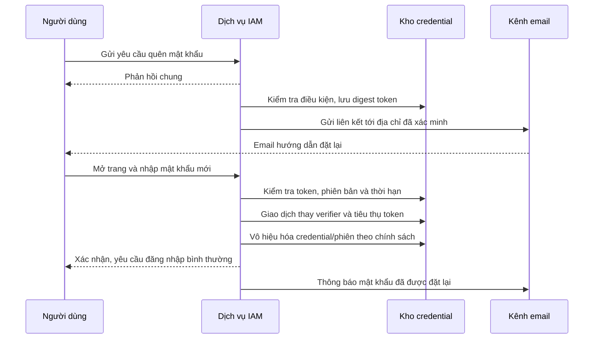
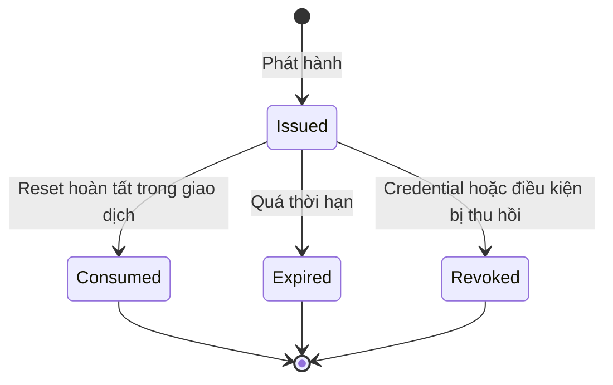

# Password reset — Đặt lại mật khẩu trong hệ thống IAM

## 1. Password reset là cấp lại một thông tin xác thực

Password reset là quá trình cho phép chủ tài khoản tạo mật khẩu mới khi không thể sử dụng mật khẩu hiện tại. Hệ thống không tìm lại mật khẩu cũ: một kho mật khẩu được thiết kế đúng chỉ giữ verifier đã băm, không giữ bản rõ để gửi lại.

Trong nền tảng IAM, reset là một thao tác thay đổi credential. Người có khả năng hoàn tất nó có thể tạo mật khẩu mà họ biết, nên đường reset cần được bảo vệ tương xứng với quyền truy cập tài khoản. Chỉ biết email hoặc username chưa chứng minh quyền kiểm soát danh tính.

Sau bài học, người học có thể thiết kế vòng đời reset token, phân biệt reset với recovery MFA, xử lý hai yêu cầu đổi mật khẩu đồng thời và xác định phiên nào phải mất hiệu lực sau khi reset.

| Tình huống | Bằng chứng có thể sử dụng | Phạm vi thao tác |
| --- | --- | --- |
| Đổi mật khẩu khi còn đăng nhập | Xác thực lại theo chính sách, có thể cần MFA | Thay credential hiện tại |
| Quên mật khẩu nhưng còn phương thức xác minh đã đăng ký | Token qua kênh đã xác minh hoặc authenticator còn dùng được | Cấp lại mật khẩu theo chính sách |
| Mất cả mật khẩu và các yếu tố cần thiết | Quy trình account recovery đã được thiết kế | Khôi phục quyền kiểm soát tài khoản |
| Quản trị viên hỗ trợ người dùng | Thẩm quyền hỗ trợ và bằng chứng phục hồi được phê duyệt | Khởi tạo quy trình hỗ trợ có kiểm toán |

NIST phân biệt việc thay mật khẩu đã quên khi người dùng còn có thể xác thực bằng authenticator khác với việc khôi phục tài khoản do mất khả năng xác thực cần thiết. Cách phân loại này ảnh hưởng đến bằng chứng và mức bảo đảm phải yêu cầu. Xem [NIST SP 800-63B-4 — Authenticator Event Management](https://pages.nist.gov/800-63-4/sp800-63b/events/).

## 2. Mô hình đe dọa và các ranh giới tin cậy

Giả sử cổng học tập cho phép nhập email tại trang “Quên mật khẩu”. Một đối thủ biết địa chỉ của giảng viên có thể gửi yêu cầu thay họ. Điều này không được phép làm thay đổi mật khẩu, khóa tài khoản hoặc tắt MFA của giảng viên.

Những tình huống cần xem xét gồm:

- Đối thủ dùng phản hồi để kiểm tra email nào có tài khoản.
- Bot gửi nhiều yêu cầu làm đầy hộp thư hoặc tiêu tốn dịch vụ gửi mail.
- Reset token lọt vào log, công cụ phân tích, lịch sử trình duyệt hoặc một URL chuyển hướng.
- Hai request cùng dùng một token để đặt hai mật khẩu khác nhau.
- Token cũ vẫn còn tác dụng sau khi chủ tài khoản đã đổi mật khẩu hoặc đổi địa chỉ khôi phục.
- Người chiếm hộp thư sử dụng đường reset để vượt luôn MFA.
- Nhân viên hỗ trợ có quá nhiều quyền, tự đổi email khôi phục rồi chiếm tài khoản.

Một reset token thường là **bearer secret**: người có token có thể thực hiện quyền mà token đại diện, trong các điều kiện còn lại của quy trình. Nó phải có phạm vi hẹp, ví dụ chỉ được đặt lại mật khẩu của một tài khoản tại một tenant, không được gọi API nghiệp vụ hoặc sửa role.

Gắn token với IP một cách tuyệt đối không phải giải pháp mặc định. Người dùng có thể mở email trên điện thoại và hoàn tất bằng máy tính; mạng cũng có thể đổi giữa chừng. IP và thiết bị hữu ích cho đánh giá rủi ro, nhưng không thay thế việc xác minh token và bằng chứng bắt buộc.

## 3. Luồng tổng thể: yêu cầu, chứng minh, thay đổi, đăng nhập lại

Ví dụ dưới đây dùng liên kết gửi đến email khôi phục đã được xác minh. Đây là một thiết kế minh họa cho hệ thống có mật khẩu cục bộ; tài khoản đặc quyền hoặc có yêu cầu bảo đảm cao có thể cần thêm bằng chứng trước khi được thay credential.



### 3.1. Tiếp nhận yêu cầu

Sau khi kiểm tra định dạng và giới hạn lưu lượng, trả thông báo như:

> Nếu thông tin phù hợp với một tài khoản có thể khôi phục, chúng tôi sẽ gửi hướng dẫn đến kênh đã đăng ký.

Thông báo này áp dụng cho cả email có và không có tài khoản. Không trả riêng “email chưa đăng ký”, “tài khoản đã khóa” hoặc “người dùng thuộc tenant khác”. Thời gian phản hồi và hành vi của hàng đợi cũng cần được thiết kế để hạn chế lộ thông tin, không chỉ thay nội dung văn bản.

### 3.2. Xác định đúng tài khoản và kênh

Tra cứu trong đúng tenant hoặc miền danh tính. Chỉ gửi đến địa chỉ đã được đăng ký và xác minh theo quy trình của hệ thống. Không nhận thêm một trường `sendResetTo` tùy ý rồi dùng nó thay cho địa chỉ trong hồ sơ.

Việc phát hành token cần gắn với trạng thái hiện tại của credential và cấu hình khôi phục. Nếu người dùng đổi địa chỉ khôi phục sau đó, token phát hành cho cấu hình cũ phải được đánh giá lại hoặc vô hiệu hóa theo chính sách.

### 3.3. Hoàn tất thay đổi

Chỉ khi bằng chứng hợp lệ và các điều kiện tài khoản được thỏa mãn, hệ thống mới tạo verifier mật khẩu mới, tiêu thụ token và cập nhật trạng thái phiên. Sau đó người dùng đăng nhập bằng luồng thông thường, bao gồm MFA nếu tài khoản yêu cầu.

OWASP khuyến nghị token có thời hạn, dùng một lần, phản hồi yêu cầu nhất quán và đăng nhập lại theo luồng thường sau reset. Xem [OWASP Forgot Password Cheat Sheet](https://cheatsheetseries.owasp.org/cheatsheets/Forgot_Password_Cheat_Sheet.html).

## 4. Thiết kế reset token

### 4.1. Độ ngẫu nhiên và thời hạn

Một lựa chọn minh họa là sinh 32 byte bằng nguồn ngẫu nhiên mật mã rồi mã hóa Base64 URL-safe không padding. Token này có 256 bit ngẫu nhiên nếu nguồn sinh và cách xử lý đúng. Không tạo token từ timestamp, account ID, bộ đếm hoặc một chuỗi có thể đoán trước.

Có thể chọn thời hạn 15 phút cho một sản phẩm cụ thể sau khi cân nhắc độ trễ email và rủi ro. Đây là ví dụ chính sách, không phải thời hạn bắt buộc cho mọi hệ thống. Máy chủ quyết định thời điểm hết hạn; đồng hồ trên trình duyệt chỉ phục vụ hiển thị.

Điều kiện hợp lệ có thể diễn đạt như sau:

```text
purpose == PASSWORD_RESET
AND token thuộc đúng account và tenant
AND consumed_at IS NULL
AND revoked_at IS NULL
AND thời_gian_máy_chủ < expires_at
AND issued_credential_version == account.credential_version
AND issued_recovery_version == account.recovery_version
AND các bằng chứng bổ sung đã được đáp ứng
```

Không sử dụng token xác minh email hoặc token đăng nhập như reset token chỉ vì chúng cùng có dạng chuỗi ngẫu nhiên. Mục đích sử dụng là một phần của việc cấp quyền.

### 4.2. Lưu digest thay vì token bản rõ

Đối với token dài, ngẫu nhiên và khó đoán, có thể lưu digest SHA-256 của token thay vì bản rõ. Khi người dùng gửi token, máy chủ tính lại digest để tra bản ghi.

Điều này khác với băm mật khẩu: mật khẩu do con người chọn thường có entropy thấp và cần password KDF có chi phí phù hợp. Token 256 bit ngẫu nhiên không có cùng không gian đoán nhỏ, nên một digest nhanh có thể phù hợp để nhận diện token mà không giữ bearer secret trong bảng reset.

Không áp dụng lập luận này cho mã OTP sáu chữ số. Sáu chữ số chỉ có một triệu khả năng; nếu chỉ lưu SHA-256, người có database có thể thử hết không gian nhỏ đó. Mã ngắn cần mô hình bảo vệ lưu trữ, hạn dùng và giới hạn số lần thử phù hợp, có thể sử dụng phép kiểm tra có khóa do máy chủ quản lý.

### 4.3. Dữ liệu tối thiểu

| Trường | Vai trò |
| --- | --- |
| `id` | Định danh nội bộ để kiểm toán, không thay token |
| `token_digest` | Digest có unique index để tra cứu |
| `tenant_id`, `account_id` | Chủ thể duy nhất được phép thay mật khẩu |
| `purpose` | Phân biệt reset với các hành động khác |
| `issued_at`, `expires_at` | Vòng đời theo thời gian máy chủ |
| `issued_credential_version` | Ràng buộc với phiên bản credential lúc phát hành |
| `issued_recovery_version` | Ràng buộc với cấu hình kênh/bằng chứng khôi phục |
| `consumed_at`, `revoked_at` | Trạng thái đã dùng hoặc đã thu hồi |

Nếu cho phép nhiều liên kết chưa hết hạn cùng tồn tại, giới hạn số lượng và quy định rõ liên kết nào được dùng. Khi một lần reset thành công, vô hiệu hóa các yêu cầu còn lại cho cùng mục đích. Không cần đổi mật khẩu hoặc thu hồi phiên chỉ vì một người bất kỳ gửi yêu cầu reset.

### 4.4. Trạng thái vòng đời



`Expired` có thể là trạng thái suy ra từ thời gian, không bắt buộc có một job chuyển cờ đúng từng giây. Việc kiểm tra hạn dùng phải diễn ra ở endpoint hoàn tất, kể cả khi tác vụ dọn bản ghi chưa chạy.

JWT có chữ ký không tự giải quyết yêu cầu dùng một lần. Nếu cần ngăn replay trước thời điểm hết hạn, vẫn cần trạng thái như token ID đã dùng hoặc phiên bản credential có thể thay đổi trên máy chủ. Với luồng đơn giản, token opaque và bản ghi server thường dễ kiểm soát hơn.

## 5. Ví dụ Java: sinh token và tính digest

Đoạn mã sau minh họa riêng phần token. Nó không gửi email, không xác minh quyền recovery và không thay mật khẩu. Base64 chỉ là cách biểu diễn byte, không phải mã hóa bí mật.

```java
import java.nio.charset.StandardCharsets;
import java.security.GeneralSecurityException;
import java.security.MessageDigest;
import java.security.SecureRandom;
import java.util.Arrays;
import java.util.Base64;

public final class PasswordResetToken {
    private static final int TOKEN_BYTES = 32;
    private static final int TOKEN_TEXT_LENGTH = 43;
    private static final SecureRandom RANDOM = new SecureRandom();
    private static final Base64.Encoder ENCODER =
            Base64.getUrlEncoder().withoutPadding();
    private static final Base64.Decoder DECODER = Base64.getUrlDecoder();
    private static final byte[] DOMAIN =
            "password-reset:v1:".getBytes(StandardCharsets.US_ASCII);

    private PasswordResetToken() {}

    public static String generate() {
        byte[] randomBytes = new byte[TOKEN_BYTES];
        RANDOM.nextBytes(randomBytes);
        try {
            return ENCODER.encodeToString(randomBytes);
        } finally {
            Arrays.fill(randomBytes, (byte) 0);
        }
    }

    public static byte[] digest(String token)
            throws GeneralSecurityException {
        if (token == null || token.length() != TOKEN_TEXT_LENGTH
                || !token.matches("[A-Za-z0-9_-]{43}")) {
            throw new IllegalArgumentException("Invalid token format");
        }

        byte[] decoded = DECODER.decode(token);
        try {
            if (decoded.length != TOKEN_BYTES
                    || !ENCODER.encodeToString(decoded).equals(token)) {
                throw new IllegalArgumentException("Non-canonical token");
            }
            MessageDigest sha256 = MessageDigest.getInstance("SHA-256");
            sha256.update(DOMAIN);
            return sha256.digest(decoded);
        } finally {
            Arrays.fill(decoded, (byte) 0);
        }
    }
}
```

`SecureRandom` cung cấp nguồn sinh số ngẫu nhiên mật mã, còn `Base64.getUrlEncoder()` dùng bảng ký tự thích hợp cho URL. Tham khảo [Java SecureRandom](https://docs.oracle.com/en/java/javase/25/docs/api/java.base/java/security/SecureRandom.html) và [Java Base64](https://docs.oracle.com/en/java/javase/25/docs/api/java.base/java/util/Base64.html).

Việc mã hóa lại để kiểm tra tính canonical giúp cùng một dãy byte không được chấp nhận dưới nhiều cách viết khác nhau. Prefix `password-reset:v1:` phân biệt miền sử dụng của digest; nó không phải pepper hoặc secret. Tầng dữ liệu vẫn phải kiểm tra trường `purpose` và chủ thể liên quan.

Khi phát hành, ứng dụng tạo token, lưu digest và metadata rồi gửi bản rõ cho đúng kênh nhận. Không ghi token vào log hoặc `toString()` của đối tượng dùng chung. Nếu hệ thống gửi email qua hàng đợi cần giữ token trong payload, payload đó là dữ liệu bí mật: cần giới hạn người đọc, bảo vệ lưu trữ và giữ trong thời gian ngắn. Không coi mọi hàng đợi hoặc dead-letter queue là vùng log an toàn.

Giới hạn chuỗi trước khi decode giúp tránh cấp phát theo một đầu vào tùy ý. Lỗi định dạng được chuyển thành phản hồi reset không hợp lệ tại tầng dịch vụ, không trả stack trace cho client.

## 6. Token dùng một lần phải được thực thi bằng giao dịch

### 6.1. Vì sao kiểm tra rồi mới cập nhật có thể sai?

Giả sử request A và B cùng mang token T:

```text
A: đọc T → chưa dùng
B: đọc T → chưa dùng
A: ghi mật khẩu P1
B: ghi mật khẩu P2
A và B: đều đánh dấu T đã dùng, đều trả thành công
```

Mỗi request đều “đã kiểm tra token”, nhưng tính dùng một lần bị phá vỡ do khoảng trống giữa đọc và ghi. Cần làm cho việc tiêu thụ token và thay credential cùng thành công hoặc cùng thất bại.

### 6.2. Một trình tự xử lý có kiểm soát

Trước giao dịch ghi, kiểm tra kích thước đầu vào, định dạng token, giới hạn lưu lượng và chính sách mật khẩu mới. Có thể tra token sơ bộ để loại yêu cầu không hợp lệ trước khi chạy password KDF tốn tài nguyên. Tạo verifier mới ngoài vùng khóa dài, rồi **kiểm tra lại toàn bộ điều kiện** trong giao dịch trước khi cập nhật.

Trong giao dịch, một thiết kế có thể khóa hàng credential của tài khoản trước, sau đó tiêu thụ token có điều kiện. Mọi đường đổi mật khẩu và cập nhật cấu hình recovery phải dùng quy tắc khóa/phiên bản tương thích. Điều này còn ngăn hai token khác nhau cùng thay mật khẩu một cách không kiểm soát.

SQL dưới đây minh họa ý tưởng với PostgreSQL. Các tham số đến từ dịch vụ đã định vị chủ thể bằng token; không lấy `account_id` từ một trường client rồi tin vô điều kiện.

```sql
BEGIN;

SELECT credential_version, recovery_version, local_password_enabled
FROM account_credentials
WHERE tenant_id = :tenant_id AND account_id = :account_id
FOR UPDATE;

-- Dịch vụ kiểm tra account còn đủ điều kiện và lấy hai phiên bản đã khóa.
UPDATE password_reset_requests
SET consumed_at = clock_timestamp()
WHERE token_digest = :token_digest
  AND tenant_id = :tenant_id
  AND account_id = :account_id
  AND purpose = 'PASSWORD_RESET'
  AND consumed_at IS NULL
  AND revoked_at IS NULL
  AND expires_at > clock_timestamp()
  AND issued_credential_version = :locked_credential_version
  AND issued_recovery_version = :locked_recovery_version
RETURNING id;

-- Bắt buộc nhận đúng một hàng; nếu không, ROLLBACK và từ chối.
UPDATE account_credentials
SET password_verifier = :new_password_verifier,
    credential_version = credential_version + 1,
    session_version = session_version + 1,
    password_changed_at = clock_timestamp()
WHERE tenant_id = :tenant_id AND account_id = :account_id
  AND credential_version = :locked_credential_version;

-- Bắt buộc cập nhật đúng một hàng; lỗi ở bất kỳ bước nào phải ROLLBACK.
UPDATE password_reset_requests
SET revoked_at = clock_timestamp()
WHERE tenant_id = :tenant_id AND account_id = :account_id
  AND purpose = 'PASSWORD_RESET'
  AND consumed_at IS NULL AND revoked_at IS NULL;

INSERT INTO security_outbox (tenant_id, account_id, event_type)
VALUES (:tenant_id, :account_id, 'PASSWORD_RESET_COMPLETED');

COMMIT;
```

Đây là đoạn minh họa có các kiểm tra do tầng dịch vụ thực hiện, không phải script độc lập có thể chạy nguyên vẹn để có một reset endpoint. Những bằng chứng bổ sung, điều kiện trạng thái tài khoản và ràng buộc dữ liệu phải được kiểm tra trong triển khai thật.

`FOR UPDATE` giữ khóa hàng đến khi giao dịch kết thúc, giúp tuần tự hóa các thao tác cập nhật theo cùng quy ước. Tính đúng còn phụ thuộc vào isolation level, cách xử lý lỗi và thứ tự khóa; xem [PostgreSQL — Row-Level Locks](https://www.postgresql.org/docs/current/explicit-locking.html#LOCKING-ROWS).

Ví dụ sử dụng `clock_timestamp()` để kiểm tra thời gian thực tế tại thời điểm thực thi sau khi chờ khóa. Không vô tình dùng thời điểm bắt đầu một giao dịch kéo dài rồi chấp nhận token đã hết hạn trong lúc chờ.

Nếu ghi verifier thất bại, việc đánh dấu token đã dùng cũng phải rollback. Chỉ trả thành công sau commit. Email thông báo có thể được gửi từ outbox sau commit, giúp lỗi gửi mail không làm rơi mất sự kiện đã thay đổi credential.

### 6.3. Khi client không biết giao dịch đã thành công hay chưa

Nếu mạng đứt sau commit, người dùng có thể nhấn gửi lại. Request lặp phải thất bại theo trạng thái token đã dùng và không được đổi mật khẩu lần thứ hai. Giao diện có thể hướng dẫn đăng nhập bằng mật khẩu vừa chọn hoặc xin liên kết mới, thay vì khuyến khích tiếp tục gửi token cũ.

Nếu cần trải nghiệm idempotent chi tiết hơn, phải thiết kế định danh thao tác và phản hồi phù hợp. Không giải quyết bằng cách cho phép token đã tiêu thụ được sử dụng lại.

## 7. Thiết kế HTTP và bảo vệ liên kết reset

Một API minh họa có thể gồm:

```http
POST /auth/password-reset/requests
Content-Type: application/json

{"email":"an@example.test"}
```

```http
HTTP/1.1 202 Accepted
Cache-Control: no-store

{"message":"Nếu thông tin phù hợp, hướng dẫn sẽ được gửi qua kênh đã đăng ký."}
```

```http
POST /auth/password-reset/complete
Content-Type: application/json

{"token":"<reset-token>","newPassword":"<mật-khẩu-mới>"}
```

Mã `202` ở ví dụ thể hiện việc tiếp nhận yêu cầu, không chứng minh có tài khoản hoặc email đã được gửi thành công. Lỗi hạ tầng gửi mail cần được theo dõi nội bộ mà không biến thành kênh dò tài khoản.

### 7.1. Tạo đúng URL

Dùng origin HTTPS từ cấu hình tin cậy hoặc miền tenant đã được xác minh. Không ghép link từ `Host`, `Forwarded` hoặc `X-Forwarded-Host` do request cung cấp mà chưa có kiểm soát tin cậy. Một link hợp lệ gửi đến email thật vẫn nguy hiểm nếu nó dẫn đến máy chủ của đối thủ.

```text
https://identity.example.test/password-reset?token=<token>
```

Không nhận `returnUrl` tùy ý để chuyển tiếp người dùng và token đến một origin khác. Nếu cần quay về ứng dụng, dùng danh sách đích được phép và không đính kèm reset token vào URL đích. OWASP nêu rõ rủi ro tạo link từ Host header trong [hướng dẫn URL token](https://cheatsheetseries.owasp.org/cheatsheets/Forgot_Password_Cheat_Sheet.html#url-tokens).

### 7.2. Mở liên kết không đồng nghĩa thay mật khẩu

Email gateway có thể tự mở liên kết để quét. Vì vậy, `GET` hiển thị trang không được đổi mật khẩu hoặc tiêu thụ quyền reset cuối cùng chỉ vì URL được truy cập. Bước thay đổi phải yêu cầu một thao tác chủ động như gửi biểu mẫu bằng `POST` và thỏa mãn các kiểm tra liên quan.

Có thể đổi token trong link thành một phiên recovery ngắn hạn, có phạm vi chỉ đặt lại mật khẩu. Khi đó việc đổi token và tạo phiên phải được thiết kế tránh replay; phiên recovery không phải phiên đăng nhập thông thường. Nếu trang dùng cookie, cần kiểm soát CSRF, thuộc tính cookie và session fixation theo mô hình triển khai.

### 7.3. Hạn chế token rời khỏi trang

Trang reset nên trả các header phù hợp, ví dụ:

```http
Cache-Control: no-store
Referrer-Policy: no-referrer
```

Không tải công cụ phân tích, quảng cáo hoặc nội dung bên thứ ba không cần thiết trên trang chứa token. Rà soát việc ghi URL tại reverse proxy, CDN, APM và công cụ ghi lại phiên trình duyệt; chuyển token sang POST không tự xóa bản sao trong log URL ban đầu.

Frontend có thể bỏ token khỏi thanh địa chỉ sau khi tiếp nhận an toàn bằng cơ chế lịch sử trình duyệt. Thao tác này giảm một số dấu vết về sau nhưng không thu hồi token đã bị một thành phần khác ghi lại. Thiết kế vẫn cần hạn dùng, dùng một lần và kiểm soát truy cập.

## 8. Chống dò tài khoản và lạm dụng dịch vụ

Phản hồi chung chỉ giải quyết một phần account enumeration. Sự khác nhau về status code, thời gian, kích thước phản hồi hoặc cách áp dụng quota cũng có thể tiết lộ tài khoản.

Ví dụ, endpoint trả sau 10 ms cho email không tồn tại nhưng chờ dịch vụ mail 800 ms cho email có tài khoản vẫn lộ tín hiệu dù văn bản giống nhau. Một thiết kế có thể tách xử lý email khỏi phản hồi HTTP bằng hàng đợi có giới hạn. Không coi việc thêm một khoảng sleep cố định là bằng chứng đã loại bỏ mọi kênh thời gian.

Giới hạn lưu lượng cần xét nhiều chiều:

- Theo nguồn truy cập và dấu hiệu tự động hóa để hạn chế bot.
- Theo định danh được yêu cầu và kênh nhận để tránh gửi mail dồn dập.
- Theo toàn hệ thống hoặc tenant để bảo vệ dung lượng dịch vụ gửi mail.
- Theo thử token hoặc recovery code để giảm đoán trực tuyến.

Đừng khóa tài khoản chỉ vì nhiều yêu cầu “quên mật khẩu”: đối thủ có thể gây từ chối dịch vụ cho người dùng. Tương tự, việc luôn hủy mọi link trước đó mỗi khi nhận yêu cầu mới có thể khiến chủ tài khoản không bao giờ kịp dùng email của mình. Cần một chính sách giới hạn/cooldown và vòng đời link rõ ràng.

Không chạy password KDF cho mọi chuỗi token rác. Kiểm tra định dạng, giới hạn lưu lượng và tra trạng thái token trước, rồi mới thực hiện phần tốn tài nguyên. Sau khi tính verifier mới, vẫn phải kiểm tra lại token trong giao dịch để xử lý hết hạn hoặc cập nhật đồng thời.

CAPTCHA hoặc thử thách bổ sung có thể phục vụ chống lạm dụng theo rủi ro, nhưng không phải bằng chứng sở hữu tài khoản. Người vượt CAPTCHA vẫn phải cung cấp bằng chứng reset hợp lệ.

## 9. Chính sách mật khẩu mới và điều kiện hoàn tất

Mật khẩu mới đi qua cùng chính sách và encoder như khi tạo/đổi mật khẩu thông thường. Không xây một bộ kiểm tra yếu hơn chỉ dành cho reset. Giới hạn đầu vào phải nhất quán, không cắt im lặng, và cần hỗ trợ cách nhập/mã hóa ký tự đã chọn của hệ thống.

Mỗi lần tạo verifier mới phải dùng salt mới và cấu hình hashing hiện hành. Không lưu mật khẩu tạm trong database hoặc gửi mật khẩu mới qua email để người dùng “xác nhận lại”. Việc nhập hai lần ở UI giúp giảm lỗi gõ, không thay thế bằng chứng khôi phục.

Nếu phải xác minh thêm MFA hoặc có thời gian chờ với tài khoản nhạy cảm, token email hợp lệ chỉ mở bước tiếp theo. Quyền thay đổi credential chỉ được thực hiện khi toàn bộ bằng chứng bắt buộc đã đạt và được ràng buộc với cùng tài khoản, mục đích và thao tác.

Tài khoản bị đình chỉ, bị xóa hoặc đã chuyển sang chỉ dùng SSO không được tự phục hồi quyền hoạt động chỉ vì reset token còn đúng. Đặt lại mật khẩu và mở khóa tài khoản là các quyền khác nhau.

## 10. Phiên, refresh token và MFA sau reset

### 10.1. Đổi mật khẩu không tự thu hồi mọi phiên

Một session cookie có thể vẫn trỏ đến phiên hợp lệ sau khi verifier được thay. Access token JWT đã ký cũng không tự mất chữ ký chỉ vì password hash thay đổi. Hệ thống cần quyết định và thực thi chính sách thu hồi.

Trong ví dụ giao dịch, `session_version` được tăng. Cơ chế này chỉ có tác dụng nếu nơi kiểm tra phiên/token đối chiếu phiên bản đó hoặc một trạng thái thu hồi tương đương. Nếu resource server chỉ kiểm chữ ký JWT và không đọc trạng thái, việc tăng version trong database không thu hồi ngay access token đang có.

Một phương án có thể kết hợp hủy phiên phía server, thu hồi refresh token và giới hạn thời gian sống của access token. Nếu yêu cầu vô hiệu hóa ngay, cần cơ chế kiểm tra trạng thái phù hợp trên đường truy cập. Khi dùng cache, phải xác định độ trễ lan truyền và cửa sổ token cũ còn được chấp nhận.

### 10.2. Không biến reset thành bỏ qua MFA

Sau reset, người dùng đăng nhập theo quy trình thông thường. Không tự tắt TOTP, gỡ passkey hoặc phát một phiên có quyền đầy đủ chỉ vì người dùng nhấp link email.

Nếu người dùng đồng thời mất yếu tố thứ hai, chuyển sang luồng recovery dành cho authenticator đó với bằng chứng thích hợp. Một lần reset mật khẩu không mặc nhiên có thẩm quyền đăng ký lại mọi yếu tố.

Tài khoản đặc quyền có thể cần bằng chứng mạnh hơn, xác nhận độc lập hoặc thời gian chờ theo phân tích rủi ro. Email reset đơn lẻ không phải căn cứ để tuyên bố đã đáp ứng mọi mức bảo đảm xác thực; các yêu cầu recovery phụ thuộc vào bối cảnh danh tính và AAL áp dụng.

### 10.3. Không sửa quyền nghiệp vụ

Reset thành công thay credential, không tự cấp thêm role RBAC, sửa policy ABAC hoặc kích hoạt lại quyền quản trị đã bị thu hồi. Đường hỗ trợ cũng phải tuân thủ nguyên tắc ít quyền nhất: nhân viên được hỗ trợ recovery không mặc nhiên được xem verifier hay đổi quyền của người dùng.

## 11. Tài khoản SSO, email khôi phục và hỗ trợ thủ công

### Tài khoản xác thực tại IdP

Nếu ứng dụng chỉ là relying party của OIDC/SSO và không quản lý mật khẩu cục bộ, việc reset thường thuộc IdP. Không tự tạo một mật khẩu local chỉ vì email OIDC trùng với email người đang yêu cầu recovery; điều đó có thể mở một đường đăng nhập ngoài chính sách tổ chức.

Trong môi trường nhiều tenant, ánh xạ email, issuer và subject cần được xử lý đúng. Email là thuộc tính liên hệ, không phải lúc nào cũng là định danh bất biến hoặc duy nhất trên mọi nhà cung cấp.

### Thay đổi kênh khôi phục

Cho phép thay email khôi phục ngay trên trang “Quên mật khẩu”, rồi gửi token đến email mới, sẽ đảo ngược quan hệ tin cậy. Kênh mới phải được thiết lập bằng luồng thay đổi thông tin có xác thực phù hợp, kèm xác minh và thông báo.

Một thiết kế dùng `recovery_version` tăng phiên bản khi thay cấu hình recovery nhạy cảm. Token phát hành dưới phiên bản cũ sẽ không còn thỏa điều kiện. Chính sách này cần được áp dụng nhất quán cho cả phát hành, hoàn tất và các thao tác hỗ trợ.

### Help desk và danh tính workload

Nhân viên hỗ trợ nên khởi tạo một quy trình có kiểm toán thay vì chọn mật khẩu mà họ biết rồi gửi qua chat. Các câu hỏi như ngày sinh, tên trường hoặc thông tin công khai không phải bằng chứng mạnh chỉ vì chúng được gọi là “câu hỏi bảo mật”.

Danh tính workload cần cơ chế cấp lại credential, xoay khóa hoặc tái liên kết riêng. Không dùng hộp thư cá nhân của một nhân viên làm đường reset mặc định cho mọi service account có đặc quyền.

## 12. Thông báo, kiểm toán và vận hành

Sau khi reset hoàn tất, gửi thông báo đến kênh đã được tin cậy, có thời gian sự kiện và cách báo cáo nếu người dùng không thực hiện. Không đính kèm mật khẩu mới, verifier hoặc một liên kết “hoàn tác” có thể tự khôi phục credential cũ chỉ bằng một lần nhấp.

Log kiểm toán có thể chứa:

```text
event_type=PASSWORD_RESET_COMPLETED
tenant_id=tenant-7
account_id=u-104
request_id=req-opaque-id
credential_version=18
result=SUCCESS
```

Không đưa token, digest token, mật khẩu hoặc toàn bộ request body vào log. Dùng ID nội bộ riêng để liên kết sự kiện. Audit log cần quyền truy cập và thời gian lưu phù hợp vì vẫn chứa dữ liệu danh tính và dấu vết hoạt động.

Các chỉ số vận hành hữu ích gồm số yêu cầu, số email gửi thành công, số lần hoàn tất, số token hết hạn, tỷ lệ bị giới hạn và độ trễ gửi mail. Những thay đổi bất thường có thể chỉ ra bot, lỗi đường gửi thư hoặc việc người dùng gặp khó khăn trong quy trình.

Outbox của sự kiện hoàn tất giúp tách việc commit credential khỏi việc gửi thông báo. Worker gửi thông báo cần xử lý lặp theo event ID để retry không tạo một loạt email trùng. Tuy nhiên, việc retry thông báo không được lặp lại thao tác thay mật khẩu.

Job dọn dữ liệu có thể xóa bản ghi token hết hạn sau thời gian lưu đã chọn. Việc dọn không thay thế kiểm tra hạn dùng tại endpoint. Nếu có sự cố lộ token, cần có đường thu hồi các token liên quan mà không chờ chúng tự hết hạn.

## 13. Phân tích tình huống và lỗi thiết kế

| Tình huống | Kết quả cần có |
| --- | --- |
| Một email không có tài khoản yêu cầu reset | Phản hồi chung, không tiết lộ danh tính |
| Người dùng chỉ mở link do email gateway quét trước | Không tự thay mật khẩu hoặc hoàn tất reset |
| Token hết hạn trong lúc tính password hash | Kiểm tra cuối giao dịch từ chối và không thay credential |
| Hai request cùng sử dụng token hợp lệ | Tối đa một giao dịch thay credential thành công |
| Hai token khác nhau cùng reset một tài khoản | Quy tắc phiên bản/khóa ngăn cập nhật không kiểm soát |
| Chủ tài khoản đổi mật khẩu trước khi link cũ được dùng | Link cũ bị từ chối theo phiên bản hoặc thu hồi |
| Database lỗi sau khi đánh dấu token đã dùng | Rollback cả token và thay đổi credential |
| Email thông báo lỗi sau commit | Credential giữ trạng thái đã đổi, thông báo được retry riêng |
| Token email hợp lệ nhưng thiếu MFA bắt buộc | Không bỏ qua bằng chứng còn thiếu |
| Ứng dụng chỉ dùng SSO nhận yêu cầu reset | Theo chính sách IdP, không tự tạo đường mật khẩu local |
| Token bị gửi đến endpoint thay role | Bị từ chối vì sai mục đích và phạm vi quyền |

Ví dụ thực hành: một nền tảng đang cho phép link reset có hạn 15 phút, nhưng chỉ đánh dấu token đã dùng sau khi cập nhật mật khẩu bằng một transaction khác. Hệ thống cũng giữ refresh token cũ và tự đăng nhập sau reset.

Hãy đề xuất thiết kế thay thế, nêu rõ nơi đặt ranh giới giao dịch, cách chống replay, cách xử lý request đồng thời và chính sách phiên/MFA. Phương án cần giải thích được vì sao người chỉ biết email không gây đổi credential, và vì sao một token đã hoàn tất không thể dùng lại để thay mật khẩu lần nữa.
