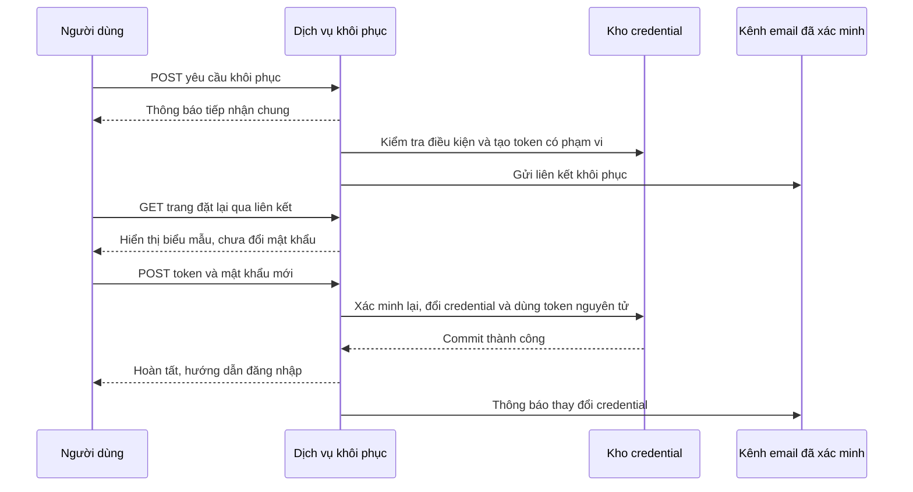

# Password recovery — Khôi phục quyền truy cập khi quên mật khẩu

Một người dùng quên mật khẩu nhưng vẫn kiểm soát địa chỉ email đã xác minh. Nút “Quên mật khẩu” cho phép họ thiết lập một bí mật mới mà không biết bí mật cũ. Chính khả năng này khiến luồng khôi phục trở thành một đường có thể dẫn đến quyền kiểm soát tài khoản, dù nó không nằm trên màn hình đăng nhập thông thường.

Trong hệ thống quản lý danh tính và quyền truy cập (IAM), khôi phục mật khẩu là một phần của vòng đời credential: xác định bằng chứng được chấp nhận, cấp quyền thay đổi có phạm vi hẹp, cập nhật mật khẩu và xử lý những phiên đã tồn tại. Nó cần phối hợp với MFA, SSO, kiểm toán và trạng thái tài khoản, đồng thời giữ nguyên ranh giới phân quyền RBAC hoặc ABAC.

Sau bài học, người học có thể thiết kế luồng đặt lại mật khẩu, quản lý token dùng một lần, xử lý hai yêu cầu đồng thời và giải thích vì sao đổi mật khẩu không đồng nghĩa với khôi phục MFA hay thu hồi mọi quyền truy cập.

## 1. Khôi phục mật khẩu thực chất là thiết lập mật khẩu mới

Hệ thống xác thực nên lưu password verifier bằng phép biến đổi một chiều phù hợp, thay vì giữ mật khẩu ở dạng có thể đọc lại. `PasswordEncoder` của Spring Security là một ví dụ về giao diện phục vụ cách lưu và đối chiếu này. Người dùng nhập mật khẩu, hệ thống xác minh với verifier; không cần giải mã để lấy lại bí mật ban đầu. [Nguồn: Spring Security — Password Storage](https://docs.spring.io/spring-security/reference/features/authentication/password-storage.html)

Vì vậy, tính năng thường gọi là “lấy lại mật khẩu” nên được hiểu là **chứng minh đủ quyền rồi đặt mật khẩu khác**, không phải gửi mật khẩu cũ qua email.

| Thao tác | Bối cảnh | Bằng chứng cần xem xét |
| --- | --- | --- |
| Đổi mật khẩu | Người dùng đang truy cập được tài khoản | Phiên, độ mới của xác thực, mật khẩu hiện tại hoặc yếu tố phù hợp |
| Đặt lại mật khẩu khi quên | Người dùng không biết mật khẩu hiện tại | Bằng chứng thay thế được chính sách khôi phục chấp nhận |
| Khôi phục MFA | Người dùng mất yếu tố MFA | Chính sách phục hồi hoặc thay thế yếu tố, không chỉ quyền đặt mật khẩu |
| Khôi phục tài khoản | Người dùng mất khả năng xác thực cần thiết | Quy trình lấy lại khả năng kiểm soát tài khoản theo mức bảo đảm yêu cầu |

Theo NIST SP 800-63B-4, nếu người dùng quên mật khẩu nhưng vẫn xác thực được bằng authenticator khác, việc thay mật khẩu được xem là gắn authenticator mới. Account recovery áp dụng khi mất khả năng xác thực cần thiết; phương thức khôi phục phụ thuộc mức bảo đảm và có yêu cầu thông báo. Không thể kết luận rằng một liên kết email tự đáp ứng mọi mức AAL. [Nguồn: NIST — Account Recovery](https://pages.nist.gov/800-63-4/sp800-63b.html#account-recovery)

Trong bài này, luồng email là một **thiết kế minh họa cho mật khẩu local**. Việc dùng nó cho tài khoản đặc quyền hoặc hệ thống có yêu cầu bảo đảm cụ thể cần được đối chiếu với chính sách của hệ thống đó.

## 2. Đường khôi phục tạo ra những rủi ro nào?

Nếu endpoint đăng nhập có mật khẩu dài, MFA và giới hạn tần suất nhưng helpdesk có thể đổi credential chỉ từ tên và ngày sinh, kẻ tấn công có thể chọn đường helpdesk. Tính an toàn của đường chính không bù được một đường khôi phục yếu.

MITRE mô tả cơ chế khôi phục mật khẩu yếu trong CWE-640, gồm các vấn đề như câu hỏi bảo mật dễ đoán hoặc lỗi làm gửi thông tin khôi phục tới địa chỉ sai. [Nguồn: CWE-640](https://cwe.mitre.org/data/definitions/640.html)

| Nguy cơ | Ví dụ | Điều cần bảo vệ |
| --- | --- | --- |
| Dò tài khoản | Endpoint trả “email chưa đăng ký” cho một địa chỉ | Thông tin tài khoản có tồn tại hay không |
| Đánh cắp token | Link xuất hiện trong log hoặc công cụ phân tích | Quyền đặt lại mật khẩu mà token mang theo |
| Đoán hoặc phát lại | Thử nhiều mã, dùng lại link đã hoàn tất | Tính khó đoán, hạn sử dụng và trạng thái một lần |
| Chuyển hướng nơi nhận | Client tự gửi địa chỉ email mới kèm yêu cầu reset | Ràng buộc giữa tài khoản và kênh đã xác minh |
| Cạnh tranh đồng thời | Hai request cùng vượt qua kiểm tra token | Một quyết định thay credential có hiệu lực duy nhất |
| Phá MFA | Reset mật khẩu đồng thời xóa yếu tố MFA | Phạm vi quyền của luồng khôi phục |
| Giữ phiên bị đánh cắp | Đổi mật khẩu nhưng refresh token cũ còn dùng được | Khả năng truy cập sau khi thay credential |
| Gây từ chối dịch vụ | Gửi liên tục yêu cầu quên mật khẩu cho nạn nhân | Khả năng đăng nhập và nhận thư bình thường |

Token reset thường hoạt động như một bí mật mang quyền: bên có token hợp lệ có thể thực hiện hành động trong phạm vi của nó. Token không cần chứa vai trò quản trị để trở nên nhạy cảm; quyền thay mật khẩu đã đủ để ảnh hưởng đến quyền kiểm soát tài khoản.

## 3. Tách yêu cầu khôi phục khỏi hành động đặt lại

Một luồng cơ bản có hai pha: tiếp nhận yêu cầu và hoàn tất thay đổi. Nhập email vào pha đầu không phải bằng chứng cho phép thay credential.



### Pha yêu cầu

Ví dụ API công khai:

```http
POST /password-recovery/requests
Content-Type: application/json

{"identifier":"nguoi-dung@example.invalid"}
```

Một phản hồi chung có thể là:

> Nếu thông tin phù hợp với một tài khoản đủ điều kiện, hướng dẫn khôi phục sẽ được gửi qua kênh đã đăng ký.

OWASP khuyến nghị thông báo và thời gian phản hồi nhất quán cho tài khoản tồn tại hoặc không tồn tại, token ngẫu nhiên đủ dài, được lưu an toàn, có hạn và chỉ dùng một lần. Việc nhận yêu cầu quên mật khẩu chưa cho phép thay đổi tài khoản. [Nguồn: OWASP — Forgot Password](https://cheatsheetseries.owasp.org/cheatsheets/Forgot_Password_Cheat_Sheet.html)

Trong thiết kế minh họa, API có thể trả `202 Accepted` cho cả hai trường hợp. Tuy nhiên, chỉ dùng cùng status chưa che được sự khác biệt nếu nội dung, header, độ trễ hoặc cách rate limit vẫn phụ thuộc rõ vào việc tài khoản có tồn tại.

Tách công việc gửi thư khỏi request công khai giúp giảm sự khác biệt do gọi nhà cung cấp email. Cần quan sát phân bố độ trễ thực tế; thêm một lệnh chờ cố định không chứng minh đã loại bỏ được kênh dò thông tin.

### Pha gửi liên kết

Địa chỉ nhận phải lấy từ dữ liệu khôi phục đã được thiết lập và xác minh của tài khoản. Không lấy một trường `newEmail` do request chưa xác thực đưa lên rồi gửi link tới đó.

Nếu người dùng mất cả mật khẩu lẫn quyền truy cập email, họ cần một phương thức khôi phục khác đã được thiết kế. Endpoint đặt lại mật khẩu không nên tự biến thành endpoint thay email dựa trên lời khai của người yêu cầu.

Việc phát hành token không làm mật khẩu hiện tại mất hiệu lực, không xóa MFA, không mở lại tài khoản đã bị vô hiệu hóa và không cấp một phiên ứng dụng đầy đủ.

## 4. Thiết kế token và quyền mà nó cấp

### 4.1. Một token chỉ phục vụ một mục đích

Một bản ghi khôi phục có thể chứa các trường sau. Đây là mô hình dữ liệu minh họa, không phải schema bắt buộc:

| Trường | Vai trò |
| --- | --- |
| `id` | Định danh nội bộ của bản ghi |
| `token_fingerprint` | Giá trị dẫn xuất dùng tra cứu; không phải token gửi cho người dùng |
| `user_id`, `tenant_id` | Tài khoản và phạm vi tổ chức mà token được cấp cho |
| `purpose` | Chẳng hạn `PASSWORD_RESET`, không dùng cho chức năng khác |
| `expires_at` | Thời điểm hết hạn theo đồng hồ phía server |
| `consumed_at`, `revoked_at` | Trạng thái đã dùng hoặc bị thu hồi |
| `credential_version` | Phiên bản credential tại thời điểm phát hành |
| `recovery_channel_version` | Phiên bản kênh khôi phục để kiểm soát thay đổi địa chỉ |

Server xác định tài khoản từ bản ghi đã ràng buộc với token. Không để request gửi thêm `user_id` khác rồi dùng token hợp lệ của tài khoản A để đổi mật khẩu tài khoản B.

Một token `PASSWORD_RESET` cũng không được chấp nhận như access token, mã xác minh email, mã đổi số điện thoại hoặc bằng chứng cho phép gỡ MFA. Đó là cách áp dụng nguyên tắc ít quyền nhất ngay trong luồng khôi phục.

### 4.2. Độ ngẫu nhiên và thời hạn

Ví dụ của bài dùng 32 byte từ bộ sinh ngẫu nhiên mật mã, tương đương 256 bit đầu vào ngẫu nhiên. Base64 URL không padding biểu diễn 32 byte đó bằng 43 ký tự. Chiều dài biểu diễn không có nghĩa là entropy tăng lên.

Có thể chọn thời hạn 15 phút cho một sản phẩm cụ thể, nhưng đây là **tham số minh họa**. Thời hạn phải tính đến độ trễ gửi thư, môi trường sử dụng và yêu cầu bảo đảm; không xem 15 phút là một con số chuẩn cho mọi phương thức khôi phục.

Token cần bị từ chối nếu đã hết hạn ngay tại thời điểm hoàn tất. Việc người dùng mở trang trước hạn không mặc nhiên kéo dài quyền đặt lại sau hạn. Nếu hệ thống đổi token lấy một phiên recovery riêng, phiên đó phải có phạm vi, hạn sử dụng và quy tắc thu hồi rõ ràng.

### 4.3. Lưu dấu vân tay thay cho token gốc

Với token ngẫu nhiên có không gian đủ lớn, có thể lưu SHA-256 của token để tra cứu, thay vì lưu nguyên token trong bảng khôi phục. Người đọc được bảng này không thể dùng ngay fingerprint như link reset nếu endpoint chỉ chấp nhận token gốc.

Điều này không có nghĩa SHA-256 đơn thuần là lựa chọn phù hợp để lưu mật khẩu người dùng. Token ở đây được sinh ngẫu nhiên với entropy cao; mật khẩu do con người chọn có phân bố khác và cần cơ chế lưu chuyên dụng. Nếu thay token dài bằng mã số ngắn, không thể giữ nguyên lập luận chống đoán ngoại tuyến này.

### 4.4. Có cần JWT không?

JWT được ký có thể chứng minh nội dung chưa bị sửa, nhưng chữ ký không tự làm token chỉ dùng một lần. Muốn vô hiệu hóa ngay sau khi dùng hoặc khi mật khẩu thay đổi, hệ thống vẫn cần trạng thái như bản ghi tiêu thụ, phiên bản credential hoặc cơ chế tương đương.

JWT chỉ ký cũng không che giấu payload. Với một hành động ngắn hạn cần kiểm soát trạng thái, token opaque ngẫu nhiên thường làm ranh giới và việc thu hồi dễ theo dõi hơn. Đây là lựa chọn thiết kế của ví dụ, không phải kết luận cấm dùng JWT.

## 5. Ví dụ Java: sinh token và fingerprint

`SecureRandom` cung cấp bộ sinh số ngẫu nhiên mạnh về mật mã trong Java. Mẫu dưới dùng API đó để sinh byte; không tự đặt seed từ timestamp hay thông tin tài khoản. [Nguồn: Java SE 21 — SecureRandom](https://docs.oracle.com/en/java/javase/21/docs/api/java.base/java/security/SecureRandom.html)

```java
import java.nio.charset.StandardCharsets;
import java.security.MessageDigest;
import java.security.NoSuchAlgorithmException;
import java.security.SecureRandom;
import java.util.Arrays;
import java.util.Base64;
import java.util.HexFormat;
import java.util.regex.Pattern;

public final class ResetTokenFactory {
    private static final SecureRandom RANDOM = new SecureRandom();
    private static final Pattern TOKEN_FORMAT =
            Pattern.compile("[A-Za-z0-9_-]{43}");

    private ResetTokenFactory() {
    }

    public record IssuedToken(String rawToken, String fingerprint) {
        @Override
        public String toString() {
            return "IssuedToken[redacted]";
        }
    }

    public static IssuedToken issue() {
        byte[] randomBytes = new byte[32];
        RANDOM.nextBytes(randomBytes);
        try {
            String raw = Base64.getUrlEncoder()
                    .withoutPadding()
                    .encodeToString(randomBytes);
            return new IssuedToken(raw, fingerprint(raw));
        } finally {
            Arrays.fill(randomBytes, (byte) 0);
        }
    }

    public static String fingerprint(String raw) {
        if (raw == null || !TOKEN_FORMAT.matcher(raw).matches()) {
            throw new IllegalArgumentException("Reset token không hợp lệ.");
        }

        byte[] encoded = raw.getBytes(StandardCharsets.US_ASCII);
        byte[] digest = null;
        try {
            digest = MessageDigest.getInstance("SHA-256").digest(encoded);
            return HexFormat.of().formatHex(digest);
        } catch (NoSuchAlgorithmException ex) {
            throw new IllegalStateException("Thiếu thuật toán fingerprint", ex);
        } finally {
            Arrays.fill(encoded, (byte) 0);
            if (digest != null) {
                Arrays.fill(digest, (byte) 0);
            }
        }
    }
}
```

Khi phát hành, kho khôi phục chỉ lưu `fingerprint` cùng metadata; `rawToken` được dùng để tạo liên kết gửi tới người dùng. Khi nhận yêu cầu hoàn tất, server tính fingerprint của token được trình bày rồi tìm bản ghi tương ứng.

Mẫu không chứa gửi email, truy cập cơ sở dữ liệu, kiểm tra hết hạn hoặc tính dùng một lần. Có được fingerprint khớp chỉ là một phần của điều kiện cho phép reset.

Việc ghi đè `toString()` tránh để record tự in ra token khi đối tượng bị log trực tiếp. Nó không ngăn framework serialization, APM hoặc lời gọi log vào `rawToken()`. Tương tự, xóa mảng byte không bảo đảm xóa mọi bản sao `String` khỏi bộ nhớ Java; vẫn phải hạn chế nơi dữ liệu đi qua.

Nếu dịch vụ dùng hàng đợi để gửi thư, thành phần gửi cần tiếp cận token gốc trong một khoảng thời gian. Có thể sinh token tại worker gửi hoặc bảo vệ payload giao nhận bằng mã hóa, quyền đọc hẹp và TTL ngắn. Không mặc định đưa token vào một hàng đợi hay bảng outbox được nhiều dịch vụ đọc như dữ liệu nghiệp vụ thông thường.

## 6. Tính dùng một lần phải được thực thi nguyên tử

Lỗi thường gặp là kiểm tra token còn hạn, cập nhật mật khẩu rồi đánh dấu token đã dùng trong các thao tác độc lập:

```text
Request A: thấy token chưa dùng
Request B: thấy token chưa dùng
Request A: ghi mật khẩu mới A
Request B: ghi mật khẩu mới B
```

Cả hai request có thể vượt qua bước kiểm tra dù token được gọi là “one-time”. Điều cần bảo đảm là **chỉ một lần chuyển trạng thái được commit**, không phải chỉ có một lần đọc dữ liệu.

### Gợi ý luồng giao dịch

Để tránh giữ khóa khi gọi mạng hoặc tính KDF nặng, một triển khai có thể tách phần chuẩn bị và phần commit:

```text
Ngoài giao dịch ghi:
    1. Giới hạn kích thước, định dạng và lưu lượng request.
    2. Tính fingerprint; tìm bản ghi token để kiểm tra sơ bộ.
    3. Xác định tài khoản từ bản ghi, không từ user_id do client chọn.
    4. Kiểm tra chính sách mật khẩu mới và dữ liệu mật khẩu bị chặn.
    5. Tạo password verifier mới bằng KDF đã cấu hình.

Trong một giao dịch:
    6. Khóa bản ghi tài khoản; đọc trạng thái hiện hành.
    7. Đọc/khóa lại bản ghi token theo thứ tự khóa thống nhất.
    8. Xác minh purpose, tenant, tài khoản, hạn và trạng thái chưa dùng.
    9. Xác minh phiên bản credential và kênh recovery vẫn phù hợp.
   10. Xác minh tài khoản vẫn được phép thay mật khẩu.
   11. Ghi verifier mới; tăng credential_version.
   12. Đánh dấu token đã dùng và vô hiệu hóa các token reset còn lại.
   13. Áp dụng trạng thái thu hồi phiên theo thiết kế.
   14. Ghi sự kiện thông báo/kiểm toán không chứa bí mật vào outbox.
   15. Commit.

Sau commit:
   16. Gửi thông báo và hướng dẫn người dùng đăng nhập bình thường.
```

Mọi đường thay credential cạnh tranh với reset, kể cả thay đổi từ quản trị hoặc từ một phiên đang đăng nhập, phải phối hợp với cơ chế phiên bản và khóa này. Nếu một đường bỏ qua việc tăng phiên bản, token cũ có thể tiếp tục hiệu lực trái với thiết kế.

Thời điểm hết hạn cần được kiểm tra lại trong pha quyết định cuối cùng. Một request bắt đầu lúc còn hạn nhưng chờ tính KDF quá lâu không nên được coi là hợp lệ chỉ dựa trên lần kiểm tra sơ bộ.

Có thể dùng cập nhật có điều kiện hoặc mức cô lập phù hợp thay cho đúng chuỗi khóa trên, nhưng phải chứng minh được cùng bất biến. Một câu `UPDATE ... WHERE consumed_at IS NULL` riêng lẻ chưa đủ nếu cập nhật credential không nằm trong cùng quyết định giao dịch.

### Phát hành nhiều liên kết

Chỉ cho phép link mới nhất làm mô hình dễ hiểu, nhưng người chưa xác thực có thể liên tục yêu cầu link mới khiến link của nạn nhân mất tác dụng. Một lựa chọn khác là giữ một tập nhỏ token chưa hết hạn trong giới hạn phát hành; khi một token được sử dụng thành công, tất cả token cho phiên bản credential cũ đều bị vô hiệu hóa.

Mỗi lựa chọn có đánh đổi. Chính sách phát hành, giới hạn tần suất và hành vi khi yêu cầu lại phải được thiết kế cùng nhau, thay vì chỉ thêm một lệnh xóa token cũ vào endpoint công khai.

## 7. Bảo vệ liên kết và trang đặt lại

### 7.1. Địa chỉ đích phải do server kiểm soát

Một liên kết minh họa có dạng:

```text
https://identity.example.invalid/password-reset?token=<opaque-token>
```

Origin được lấy từ cấu hình đã tin cậy hoặc danh sách tenant đã xác minh. Không ghép URL trực tiếp từ `Host`, `X-Forwarded-Host` hay `redirect_uri` bất kỳ do request đưa lên. Nếu dùng reverse proxy, phải định nghĩa rõ proxy nào được tin và các header nào nó được phép xác lập.

OWASP lưu ý nguy cơ Host header injection khi tạo link reset và khuyến nghị HTTPS, cùng cách hạn chế rò rỉ qua referrer. [Nguồn: OWASP — URL Tokens](https://cheatsheetseries.owasp.org/cheatsheets/Forgot_Password_Cheat_Sheet.html#url-tokens)

### 7.2. GET không hoàn tất hành động đổi mật khẩu

RFC 9110 định nghĩa các phương thức an toàn, trong đó có GET, theo ngữ nghĩa không yêu cầu thay đổi trạng thái nghiệp vụ. [Nguồn: RFC 9110, mục 9.2.1](https://www.rfc-editor.org/rfc/rfc9110.html#section-9.2.1)

Vận dụng vào luồng này, mở liên kết chỉ nên dẫn tới trang hoặc bước kiểm tra thích hợp. Không đổi mật khẩu, đăng nhập hoàn toàn hoặc tiêu thụ quyền reset chỉ vì nhận một GET: bộ quét email, tính năng xem trước và trình duyệt có thể truy cập link trước người dùng.

Thay đổi cuối cùng cần một POST thể hiện ý định, mang token hoặc phiên recovery có phạm vi đúng cùng mật khẩu mới. Nếu biểu mẫu dựa vào cookie, cần bảo vệ CSRF và kiểm tra nguồn request theo mô hình triển khai; token reset không phải lý do để tắt mọi kiểm soát của endpoint.

### 7.3. Giảm nơi token có thể bị ghi lại

Trang reset có thể trả:

```http
Referrer-Policy: no-referrer
Cache-Control: no-store
```

`no-referrer` yêu cầu không gửi thông tin referrer trong các request chịu policy đó. Nó không xóa token đã có trong log đầu vào hoặc lịch sử trình duyệt. [Nguồn: W3C — Referrer Policy](https://www.w3.org/TR/referrer-policy/#referrer-policy-no-referrer)

Trong thiết kế trang, cần xem cả reverse proxy, CDN, access log, công cụ ghi phiên, analytics và báo cáo exception. Không nhúng tài nguyên bên thứ ba không cần thiết vào trang mang quyền recovery. Nếu ứng dụng đọc token rồi bỏ nó khỏi thanh địa chỉ, đó chỉ giảm một phần khả năng lưu lại; request ban đầu vẫn phải được xử lý và lọc log phù hợp.

Không lưu token vào local storage để dùng lại lâu dài. Khi đổi token lấy cookie recovery, cookie cần được bảo vệ phù hợp bằng HTTPS, `HttpOnly`, `SameSite`, đường dẫn và thời hạn hẹp. Quyền từ cookie này chỉ phục vụ luồng khôi phục, không có quyền gọi API nghiệp vụ.

## 8. Mật khẩu mới, MFA và phiên sau khôi phục

### Chính sách mật khẩu vẫn được áp dụng

Luồng reset phải dùng cùng định nghĩa đầu vào, độ dài và kiểm tra mật khẩu bị chặn mà backend áp dụng khi thiết lập credential. Một endpoint phụ bỏ qua policy sẽ tạo ra cách đặt mật khẩu yếu dù form đăng ký đã chặn.

Thông báo lỗi mật khẩu mới có thể giải thích điều kiện cần sửa sau khi bằng chứng recovery hợp lệ. Không đưa nguyên mật khẩu hoặc token vào phản hồi. Khi token không có, sai, hết hạn hoặc đã dùng, thông báo công khai nên hướng dẫn lấy link khác mà không tiết lộ thông tin tài khoản không cần thiết.

### Reset mật khẩu không tự reset MFA

Nếu người dùng đặt mật khẩu mới thành công nhưng vẫn thiếu yếu tố MFA, họ có thể vẫn chưa đủ điều kiện đăng nhập. Đây là hệ quả của phạm vi bằng chứng, không phải lỗi cần “sửa” bằng cách xóa MFA tự động.

Tài khoản đặc quyền có thể cần thêm authenticator còn lại, recovery code hoặc quy trình xác minh phù hợp. Thẩm quyền helpdesk cũng cần giới hạn: quyền hỗ trợ đặt mật khẩu không mặc nhiên bao gồm quyền thay kênh recovery, gỡ MFA và khôi phục quyền quản trị trong một lần thao tác.

### Reset mật khẩu không tự hủy mọi phiên

Một password verifier mới chỉ làm thay đổi việc đối chiếu mật khẩu. Các cookie phiên, refresh token và access token đã được phát hành có cơ chế hiệu lực riêng.

Trong ví dụ của bài, reset làm tăng phiên bản credential và yêu cầu thu hồi các phiên được policy bao phủ. Nhưng tăng một cột trong cơ sở dữ liệu chỉ có tác dụng nếu thành phần xác minh phiên thực sự kiểm tra nó.

| Loại trạng thái truy cập | Điều phải xác định |
| --- | --- |
| Phiên lưu ở server | Cách xóa hoặc đánh dấu không còn hợp lệ |
| Refresh token | Cách thu hồi grant hoặc họ token liên quan |
| Access token tự chứa | Thành phần nào kiểm tra thu hồi, phiên bản hoặc thời hạn còn lại |
| Phiên tại ứng dụng SSO | IdP và relying party phối hợp kết thúc phiên theo cơ chế nào |
| API key hoặc credential workload | Có thuộc phạm vi xử lý sự cố riêng hay không |

Không tuyên bố “đã đăng xuất mọi thiết bị” nếu access token vẫn được chấp nhận tới khi hết hạn mà không có kiểm tra thu hồi. Giao diện và quy trình vận hành cần mô tả đúng khả năng thực thi.

Thiết kế minh họa hướng người dùng về luồng đăng nhập bình thường sau reset. Quyền recovery được kết thúc; việc cấp phiên mới phải đi qua các yếu tố xác thực mà tài khoản yêu cầu.

## 9. Ranh giới với SSO, vòng đời quyền và hỗ trợ thủ công

Với người dùng chỉ xác thực qua SSO, ứng dụng sử dụng danh tính không nên tạo mật khẩu local để “giúp đăng nhập lại”. Credential thuộc IdP cần được phục hồi tại nơi quản lý nó. Nếu có tài khoản local dự phòng, phải quản lý như một đường xác thực riêng với quyền và chính sách rõ ràng.

Trong mô hình nhiều tenant, cả tìm tài khoản, tạo token lẫn hoàn tất phải giữ đúng tenant. Không cho một domain hoặc tổ chức khác tùy ý chọn tài khoản đích nhờ trùng username.

Trạng thái tài khoản cũng cần được kiểm tra lại trước commit. Nếu bộ phận nhân sự vừa kết thúc quyền của một nhân viên, một link recovery còn hạn không được tự mở lại tài khoản đó. Reset không cấp lại vai trò đã bị thu hồi, không thay nhóm RBAC và không bỏ qua điều kiện ABAC.

Với hỗ trợ thủ công, quy trình nên xác định những bằng chứng có thể kiểm chứng, người có thẩm quyền duyệt và điều kiện cần kiểm soát bổ sung. Ví dụ, một tổ chức có thể yêu cầu hai người duyệt khi thay kênh recovery của tài khoản quản trị. Đây là lựa chọn theo rủi ro của tổ chức, không phải con số bắt buộc cho mọi hệ thống.

Nhân viên hỗ trợ không cần biết mật khẩu hiện tại hoặc mật khẩu mới. Họ cần công cụ cấp một hành động khôi phục có giới hạn, cùng dấu vết ai đã phê duyệt và thực hiện điều gì.

## 10. Vận hành, sự cố và kiểm toán

### Giới hạn lạm dụng mà không khóa người dùng

Cần kiểm soát cả số yêu cầu gửi hướng dẫn và số lần trình bày token. Có thể phối hợp giới hạn theo nguồn gửi, định danh được xử lý an toàn, tenant và tải toàn hệ thống. Một giới hạn chỉ theo IP có thể không chặn được nguồn phân tán; giới hạn chỉ theo tài khoản có thể bị dùng để làm người khác không nhận được thư.

Không khóa tài khoản hoặc vô hiệu hóa mật khẩu hiện tại chỉ vì có người gửi yêu cầu quên mật khẩu. Theo dõi tình trạng gửi thư dồn dập cũng cần tách khỏi việc kết luận chủ tài khoản đang bị chiếm quyền.

### Lỗi gửi thư và lỗi sau commit

Nếu gửi hướng dẫn thất bại, request công khai không nên chuyển sang một phản hồi làm lộ sự tồn tại tài khoản. Nội bộ cần có trạng thái gửi, retry có giới hạn và cách yêu cầu lại.

Nếu transaction đổi mật khẩu đã commit nhưng thông báo email thất bại, không nên phục hồi mật khẩu cũ hoặc mở lại token chỉ để retry gửi thư. Sự kiện outbox không chứa bí mật có thể được xử lý lại để gửi thông báo sau.

Nếu response thành công bị mất trên mạng, lần POST lặp lại với token cũ phải tránh tạo thêm một lần thay credential. Giao diện có thể hướng người dùng thử đăng nhập hoặc yêu cầu link khác. Không kéo dài hiệu lực token đã dùng để che đi mọi lỗi mạng.

### Ghi bằng chứng mà không tạo kho bí mật mới

Một sự kiện kiểm toán minh họa:

```text
event_type: PASSWORD_RESET_COMPLETED
operation_id: internal-operation-reference
account_ref: internal-account-reference
recovery_method: VERIFIED_EMAIL_LINK
policy_version: recovery-policy-v2
credential_version: 18
session_action: REVOKE_POLICY_SCOPED_SESSIONS
```

Không ghi mật khẩu mới, token gốc, URL reset đầy đủ hoặc fingerprint vào log chẩn đoán thông thường. Dữ liệu định danh nội bộ, địa chỉ mạng và dấu vết thiết bị cũng cần quyền đọc, mục đích và thời hạn lưu phù hợp.

Chỉ số hữu ích gồm tỷ lệ gửi thành công, độ trễ giao thư, số token hết hạn trước khi dùng, số lần bị từ chối và số tranh chấp hoàn tất đồng thời. Metric nên dùng nhãn hữu hạn như loại luồng và kết quả; tránh đưa tài khoản hoặc token vào nhãn.

## 11. Các tình huống cần kiểm chứng

Bảng sau là tiêu chí cho phần tích hợp khi xây hệ thống, không phải khẳng định đoạn code sinh token ở mục 5 đã triển khai đầy đủ luồng recovery.

| Tình huống | Hành vi mong đợi |
| --- | --- |
| Định danh không tồn tại | Phản hồi công khai không tiết lộ khác biệt tài khoản |
| Client đưa địa chỉ nhận mới vào request | Không thay kênh đã ràng buộc với tài khoản |
| Token sai định dạng hoặc không có bản ghi | Không cập nhật credential hoặc cấp phiên đầy đủ |
| Token đúng nhưng hết hạn, bị thu hồi hoặc đã dùng | Từ chối hoàn tất |
| Hai POST dùng cùng token đồng thời | Chỉ một thay đổi credential được commit |
| Hai token khác nhau của cùng phiên bản credential | Sau một lần reset thành công, token còn lại không đổi tiếp mật khẩu |
| Mật khẩu hoặc email recovery đã thay đổi sau lúc cấp link | Kiểm tra phiên bản làm token cũ mất hiệu lực theo thiết kế |
| Bộ quét email mở link bằng GET | Không tiêu thụ quyền reset hoặc thay mật khẩu |
| Host hoặc forwarded header bị giả | Link gửi đi vẫn thuộc origin đã tin cậy |
| Mật khẩu mới bị policy từ chối | Không ghi verifier mới hoặc hoàn tất token sai giai đoạn |
| Tài khoản bị vô hiệu hóa trước commit | Không được mở lại bởi luồng reset |
| Reset thành công trên tài khoản có MFA | MFA vẫn được yêu cầu theo policy |
| Cookie hoặc refresh token cũ được sử dụng lại | Thành phần xác minh thực thi đúng hành động thu hồi đã công bố |
| Thông báo sau reset lỗi | Credential đã commit giữ trạng thái đúng; thông báo được retry riêng |
| Tài khoản chỉ dùng SSO | Không vô tình được cấp một mật khẩu local mới |
| Bật log, trace, proxy và analytics | Không làm lộ bí mật recovery hoặc mật khẩu |

Đặc biệt, kiểm tra cạnh tranh cần chạy qua kho dữ liệu thật với cơ chế transaction của ứng dụng. Một unit test lần lượt gọi hàm hai lần chưa chứng minh được tính một lần khi hai request cùng đọc trạng thái ban đầu.

## 12. Tình huống tổng hợp

Một nhân viên quên mật khẩu cổng quản trị, vẫn nhận được email nhưng đã mất điện thoại MFA. Nhân viên hỗ trợ nhận đề nghị “gửi link rồi bỏ MFA giúp tôi”.

Luồng đặt mật khẩu mới có thể xử lý phần mật khẩu nếu bằng chứng và chính sách cho phép, nhưng link email không tự cấp quyền gỡ MFA. Cần chuyển phần mất yếu tố sang quy trình recovery tương ứng. Nếu tài khoản đang bị đình chỉ hoặc đặc quyền đã bị thu hồi, cả hai luồng đều không tự cấp lại quyền đó.

Trong lúc nhân viên mở link, một phiên cũ có hành động đáng ngờ. Đổi mật khẩu mới chưa đủ để kết luận phiên đó đã kết thúc. Nhóm vận hành phải kiểm tra cơ chế thu hồi cookie, refresh token và access token, đồng thời lưu bằng chứng sự kiện và thông báo cho chủ tài khoản qua kênh được quản lý.

Một thiết kế đầy đủ phải trả lời được: bằng chứng nào cho phép thay credential, token cấp đúng quyền gì, khi nào quyền đó kết thúc và trạng thái truy cập nào còn tồn tại sau khi hoàn tất. Đó là mối liên hệ giữa password recovery với toàn bộ vòng đời danh tính trong IAM.

## Tài liệu tham khảo

- [OWASP Forgot Password Cheat Sheet](https://cheatsheetseries.owasp.org/cheatsheets/Forgot_Password_Cheat_Sheet.html)
- [NIST SP 800-63B-4 — Account Recovery](https://pages.nist.gov/800-63-4/sp800-63b.html#account-recovery)
- [CWE-640 — Weak Password Recovery Mechanism for Forgotten Password](https://cwe.mitre.org/data/definitions/640.html)
- [Java SE 21 — SecureRandom](https://docs.oracle.com/en/java/javase/21/docs/api/java.base/java/security/SecureRandom.html)
- [Spring Security — Password Storage](https://docs.spring.io/spring-security/reference/features/authentication/password-storage.html)
- [RFC 9110 — Safe Methods](https://www.rfc-editor.org/rfc/rfc9110.html#section-9.2.1)
- [W3C — Referrer Policy](https://www.w3.org/TR/referrer-policy/)
