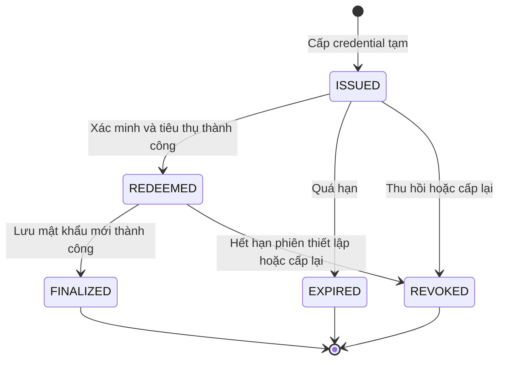

# Temporary password — Mật khẩu tạm thời trong IAM

## 1. Mật khẩu tạm thời là gì?

**Temporary password** là mật khẩu được cấp để hỗ trợ một bước chuyển tiếp trong vòng đời tài khoản, thường là lần đăng nhập đầu tiên hoặc một quy trình khôi phục được kiểm soát. Người nhận dùng nó để thiết lập credential của mình theo các điều kiện do hệ thống áp dụng.

Ví dụ, bộ phận vận hành tạo tài khoản cho nhân viên mới trên cổng quản trị nội bộ. Tại thời điểm này, nhân viên chưa có mật khẩu do mình chọn. Hệ thống có thể cấp một mật khẩu tạm, yêu cầu nhân viên đổi sang mật khẩu mới và hoàn tất những bước còn lại như đăng ký MFA trước khi truy cập nghiệp vụ.

Từ “tạm thời” không tự tạo ra đặc tính bảo mật. Một mật khẩu được đánh dấu tạm nhưng có thể đăng nhập nhiều tháng, dùng lại nhiều lần và lấy access token đầy đủ vẫn là một đường chiếm tài khoản có giá trị cao. Cần xác định riêng thời hạn, số lần sử dụng, quyền được cấp và điều kiện hoàn tất.

Trong nền tảng IAM, mật khẩu tạm nằm tại giao điểm của cấp phát tài khoản, xác thực, khôi phục, quản lý phiên và kiểm toán. Nó không tự cấp quyền quản trị. Các quyền nghiệp vụ vẫn phải được kiểm soát bằng RBAC, ABAC và nguyên tắc ít quyền nhất.

Sau bài học, người học có thể:

- Phân biệt mật khẩu tạm với OTP, token đặt lại mật khẩu và mật khẩu mặc định.
- Mô tả vòng đời từ cấp phát đến đổi mật khẩu, hết hạn hoặc thu hồi.
- Thiết kế phiên giới hạn để người dùng hoàn tất thiết lập credential.
- Xử lý cấp lại, sử dụng đồng thời và lỗi giữa chừng.
- Xác định trách nhiệm của quản trị viên, IdP và ứng dụng nghiệp vụ.

## 2. Phân biệt các loại bí mật có thời hạn

| Cơ chế | Mục đích chính | Điều cần kiểm tra |
| --- | --- | --- |
| Mật khẩu tạm | Hỗ trợ bắt đầu một luồng xác thực hoặc thiết lập mật khẩu | Có thực sự hết hạn, phải đổi và bị giới hạn quyền hay không |
| OTP | Chứng minh một yếu tố xác thực bằng mã dùng một lần | Nguồn sinh mã, cửa sổ hiệu lực và chống phát lại |
| Token đặt lại mật khẩu | Cho phép thực hiện một hành động khôi phục cụ thể | Ràng buộc tài khoản, mục đích, thời hạn và số lần dùng |
| Lời mời kích hoạt | Bắt đầu onboarding theo một lời mời đã cấp | Người nhận, phạm vi kích hoạt và bằng chứng cần bổ sung |
| Mật khẩu mặc định | Giá trị ban đầu của thiết bị hoặc sản phẩm | Có bị dùng chung, đoán được hoặc bỏ quên sau triển khai hay không |
| Mật khẩu của tài khoản ngắn hạn | Credential của một tài khoản chỉ tồn tại trong thời gian nhất định | Thời hạn tài khoản và quyền của tài khoản, ngoài thời hạn credential |

Một chuỗi sáu chữ số có thời hạn không tự trở thành một mật khẩu thích hợp cho luồng đăng nhập bằng mật khẩu. Nếu thiết kế là mã khôi phục hoặc OTP, cần áp dụng mô hình và kiểm soát tương ứng thay vì chỉ đổi tên trường dữ liệu.

Tương tự, yêu cầu “đổi ở lần đăng nhập tiếp theo” không đồng nghĩa “bí mật chỉ được dùng một lần”. Một sản phẩm có thể cho phép lặp lại bước đăng nhập bằng mật khẩu tạm cho đến khi hoàn tất đổi mật khẩu. Nếu yêu cầu một lần sử dụng thực sự, phải có trạng thái chống phát lại hoặc cơ chế tương đương.

### Liên hệ với hướng dẫn và sản phẩm thực tế

NIST cho phép mật khẩu được người dùng chọn hoặc được nhà cung cấp cấp ngẫu nhiên. Mật khẩu dùng như yếu tố xác thực duy nhất vẫn thuộc yêu cầu độ dài tương ứng; việc gọi nó là “tạm” không tạo ngoại lệ. Tham khảo [NIST SP 800-63B-4 — Passwords](https://pages.nist.gov/800-63-4/sp800-63b/authenticators/#passwords).

Trong Keycloak, tùy chọn mật khẩu tạm yêu cầu người dùng đổi mật khẩu ở lần đăng nhập tiếp theo. Đây là một ví dụ về required action của IdP. Không suy ra từ tùy chọn này rằng mọi sản phẩm đều có cùng thời hạn hoặc cơ chế tiêu thụ một lần. Xem [Keycloak — Resetting a user's password](https://www.keycloak.org/docs/latest/server_admin/index.html#_resetting_a_users_password).

## 3. Xác định đúng tình huống cấp phát

### 3.1. Onboarding tài khoản mới

Với nhân viên mới, hệ thống cần biết ai được phép tạo tài khoản, tài khoản thuộc tenant nào, người nhận đã được xác minh bằng cách nào và khi nào tài khoản được kích hoạt. Credential tạm chỉ là một phần của quá trình đó.

Ví dụ, quản trị viên tạo tài khoản nhưng chưa gán quyền vận hành sản xuất. Nhân viên đổi mật khẩu, đăng ký MFA và hoàn tất phê duyệt truy cập. Chỉ khi các điều kiện áp dụng đều đạt, hệ thống mới cho phép phiên nghiệp vụ với đúng quyền được duyệt.

Nếu tổ chức hỗ trợ lời mời thiết lập mật khẩu, có thể để người dùng tự chọn bí mật ngay trong luồng kích hoạt. Khi đó người cấp tài khoản không cần biết mật khẩu đăng nhập ban đầu. Đây là lựa chọn kiến trúc cần cân nhắc khi thiết kế onboarding.

### 3.2. Khôi phục tài khoản đã có

Khôi phục có rủi ro khác onboarding: tài khoản có thể đang có phiên hoạt động, phương thức MFA và thông tin khôi phục đã đăng ký. Cấp một mật khẩu tạm mới không tự chứng minh người nhận là chủ tài khoản.

Một endpoint công khai nhận email không nên lập tức thay mật khẩu hiện hành bằng mật khẩu tạm. Kẻ tấn công có thể gửi yêu cầu liên tục để làm người dùng hợp lệ mất quyền truy cập. Quy trình cần kiểm tra bằng chứng hoặc quyền khôi phục trước khi thay đổi credential.

OWASP khuyến nghị token hoặc mã khôi phục được sinh an toàn, hết hạn và dùng một lần; thông báo sau đặt lại không chứa mật khẩu. Tham khảo [OWASP Forgot Password](https://cheatsheetseries.owasp.org/cheatsheets/Forgot_Password_Cheat_Sheet.html).

### 3.3. Tài khoản đặc quyền và danh tính workload

Việc cấp lại credential cho quản trị viên có thể dẫn đến thay đổi dữ liệu, cấp quyền và truy cập hệ thống nhạy cảm. Quyền cấp phát cần được giới hạn theo vai trò, tenant, nhóm tài khoản và quy trình phê duyệt áp dụng. Không mặc định mọi nhân viên hỗ trợ đều được đặt mật khẩu cho mọi quản trị viên.

Với workload, client secret, khóa API hoặc danh tính máy, không nên áp dụng máy móc luồng “đăng nhập rồi đổi mật khẩu trên giao diện”. Cần dùng cơ chế cấp credential và luân chuyển phù hợp với máy, ưu tiên credential ngắn hạn hoặc danh tính do nền tảng quản lý khi đáp ứng yêu cầu.

## 4. Các thuộc tính phải được định nghĩa riêng

Một thiết kế mật khẩu tạm cần trả lời các câu hỏi cụ thể sau:

| Thuộc tính | Câu hỏi cần trả lời |
| --- | --- |
| Ràng buộc danh tính | Bí mật này chỉ dùng cho account và tenant nào? |
| Mục đích | Dùng cho onboarding, khôi phục hay hành động khác? |
| Thời hạn | Thời điểm hết hiệu lực được tính từ lúc nào và do server nào xác định? |
| Số lần sử dụng | Bị tiêu thụ khi xác minh thành công hay sau khi đổi mật khẩu? |
| Quyền sau xác minh | Được đổi mật khẩu, hay đã có thể truy cập API nghiệp vụ? |
| Cấp lại | Bản cũ và phiên thiết lập cũ có bị thu hồi không? |
| MFA | Cần yếu tố nào trước khi đổi credential hoặc truy cập nghiệp vụ? |
| Hoàn tất | Khi nào cờ bắt buộc đổi và trạng thái tạm được kết thúc? |
| Gián đoạn | Nếu trình duyệt đóng hoặc mạng lỗi giữa chừng thì khôi phục bằng cách nào? |
| Kiểm toán | Ai đã cấp, cấp cho ai, vì lý do gì và được dùng khi nào? |

Tài khoản bị vô hiệu hóa vẫn phải bị từ chối dù mật khẩu tạm chưa hết hạn. Không tạo một đường onboarding có thể bỏ qua quyết định thu hồi quyền của hệ thống IAM.

## 5. Sinh và bảo vệ mật khẩu tạm

### 5.1. Sinh ngẫu nhiên cho từng lần cấp

Một thiết kế phù hợp sinh giá trị riêng cho từng lần cấp, không lấy từ tên người dùng, ngày sinh, mã nhân viên hoặc công thức theo ngày. Mật khẩu chung cho cả một đợt nhân viên mới làm tăng phạm vi ảnh hưởng khi chỉ một người tiết lộ giá trị đó.

Ví dụ Java dưới đây sinh 24 byte ngẫu nhiên rồi mã hóa Base64 URL không padding. Đầu ra có 32 ký tự ASCII, từ 192 bit dữ liệu ngẫu nhiên đầu vào. Con số này mô tả cách sinh trong ví dụ, không phải yêu cầu độ dài chung cho mọi sản phẩm IAM.

```java
import java.security.SecureRandom;
import java.util.Arrays;
import java.util.Base64;

public final class TemporaryPasswordGenerator {
    private static final SecureRandom RANDOM = new SecureRandom();

    private TemporaryPasswordGenerator() {
    }

    public static String generate() {
        byte[] randomBytes = new byte[24];
        try {
            RANDOM.nextBytes(randomBytes);
            return Base64.getUrlEncoder()
                    .withoutPadding()
                    .encodeToString(randomBytes);
        } finally {
            Arrays.fill(randomBytes, (byte) 0);
        }
    }
}
```

`SecureRandom` là API sinh số ngẫu nhiên có tính chất mật mã của Java. Không thay nó bằng `Random`, timestamp hoặc một seed cố định để làm đầu ra dễ tái tạo. Tham khảo [Java — SecureRandom](https://docs.oracle.com/en/java/javase/25/docs/api/java.base/java/security/SecureRandom.html).

Xóa mảng byte trong ví dụ chỉ giảm thời gian tồn tại của một bản sao. Chuỗi `String` đã tạo vẫn là đối tượng bất biến; không khẳng định toàn bộ bí mật đã được xóa khỏi bộ nhớ. Tránh giữ lâu, sao chép không cần thiết hoặc ghi đầu ra vào log.

Giá trị được sinh vẫn đi qua các điều kiện chấp nhận credential của hệ thống. Nếu có kiểm tra blocklist bắt buộc, quy trình sinh phải tích hợp bước đó và có xử lý lỗi rõ ràng. Đừng tự thêm ngoại lệ chỉ vì xác suất trùng một giá trị đã biết là rất thấp.

### 5.2. Lưu verifier và metadata riêng

Khi được dùng như mật khẩu, bí mật tạm cần được bảo vệ bằng cơ chế lưu mật khẩu phù hợp, với salt và tham số hash do thư viện đáng tin cậy quản lý. Không lưu plaintext hoặc dùng SHA-256 đơn thuần như thay thế cho password hashing. Xem [OWASP Password Storage](https://cheatsheetseries.owasp.org/cheatsheets/Password_Storage_Cheat_Sheet.html).

Metadata phục vụ điều khiển vòng đời có thể gồm:

```text
temporary_credential_id
account_id
tenant_id
purpose
password_verifier
state
issued_at
expires_at
redeemed_at
generation
row_version
issued_by
reason_code
```

Đây là mô hình minh họa. `password_verifier` là kết quả phục vụ xác minh mật khẩu, không phải mật khẩu có thể xem lại. `generation` giúp phân biệt các đợt cấp, còn `row_version` hỗ trợ kiểm soát cạnh tranh.

### 5.3. Phân phối bí mật

Cần chọn kênh giao phù hợp với mức bảo đảm và khả năng xác minh người nhận. Một trang quản trị hiển thị bí mật phải có kiểm soát quyền, truyền qua TLS và tránh cache nội dung nhạy cảm. Dữ liệu bí mật không được xuất hiện trong audit event, ticket hỗ trợ, tham số URL hoặc bản ghi request.

Nếu chỉ lưu verifier, hệ thống không thể hiển thị lại nguyên mật khẩu sau đó. Khi người dùng không nhận được hoặc làm mất bí mật, quy trình thông thường là cấp giá trị mới và thu hồi giá trị cũ. Không giải quyết bằng cách thêm cột plaintext để nhân viên hỗ trợ “tra cứu lại”.

Việc gửi hai phần thông tin qua cùng một hộp thư không tự tạo thành MFA. Quyền kiểm soát kênh nhận và bằng chứng nhận dạng phải được đánh giá theo luồng thực tế.

## 6. Vòng đời minh họa có tiêu thụ một lần

Phần này thiết kế một luồng riêng để làm rõ các quyết định. Nó không mô tả hành vi mặc định của mọi IdP.

### 6.1. Các trạng thái của credential tạm



Ở đây, `REDEEMED` nghĩa là mật khẩu tạm không còn được dùng để mở một phiên thiết lập khác. Người dùng tiếp tục bằng một phiên thiết lập riêng. `FINALIZED` chỉ kết thúc vòng đời credential tạm; tài khoản có thể vẫn còn bước MFA hoặc phê duyệt trước khi dùng nghiệp vụ.

Nếu phiên thiết lập bị mất, người dùng cần đi qua quy trình cấp lại thích hợp. Không chuyển trạng thái về `ISSUED` một cách tự động để tái sử dụng cùng bí mật.

### 6.2. Ví dụ thời hạn

Giả sử luồng minh họa chọn:

- Credential tạm hết hạn sau 30 phút kể từ lúc cấp.
- Phiên thiết lập có thời hạn tối đa 10 phút, đồng thời không vượt quá thời điểm hết hạn của đợt cấp.
- Chỉ một đợt cấp hiện hành cho cùng account và mục đích.

Các mốc này là lựa chọn thiết kế của ví dụ. Hệ thống thực tế cần cân bằng thời gian nhận bí mật, rủi ro và khả năng hỗ trợ người dùng.

Thời điểm hết hiệu lực được tính và kiểm tra tại server. Bộ đếm trên trình duyệt chỉ hỗ trợ trải nghiệm. Không phụ thuộc một tác vụ dọn dữ liệu chạy đúng giờ mới làm bí mật hết hiệu lực: tại mỗi lần sử dụng, backend phải kiểm tra thời hạn.

### 6.3. Tiêu thụ và tạo phiên phải phối hợp nguyên tử

Sau khi xác minh hash, hai request đồng thời có thể đều nghĩ credential còn dùng được. Vì vậy bước chuyển trạng thái phải có khóa hoặc cập nhật có điều kiện tương đương.

Ví dụ SQL minh họa phần cập nhật có điều kiện:

```sql
UPDATE temporary_credentials
SET state = 'REDEEMED',
    redeemed_at = CURRENT_TIMESTAMP,
    row_version = row_version + 1
WHERE id = :credential_id
  AND account_id = :account_id
  AND tenant_id = :tenant_id
  AND purpose = :expected_purpose
  AND generation = :observed_generation
  AND row_version = :observed_row_version
  AND state = 'ISSUED'
  AND expires_at > CURRENT_TIMESTAMP;
```

Chỉ request có đúng một hàng được cập nhật mới được tiếp tục. Việc lưu phiên thiết lập và chuyển trạng thái cần cùng giao dịch hoặc có cơ chế phối hợp đảm bảo tính chất tương đương. Nếu lưu phiên thất bại, không để credential bị tiêu thụ nhưng hệ thống vẫn báo đã tạo phiên thành công.

SQL trên là một phần của luồng, chưa thay thế việc kiểm tra tài khoản còn hiệu lực, thế hệ credential hiện hành, quyền của thao tác và các yếu tố xác thực cần thiết. Khi có cấp lại đồng thời, quyết định cuối cùng phải kiểm tra được trạng thái hiện tại thay vì chỉ tin snapshot đã đọc trước lúc hash.

Việc hash có thể thực hiện trước giao dịch để tránh giữ khóa lâu; sau đó giao dịch cần kiểm chứng lại phiên bản và các điều kiện có thể thay đổi. Toàn bộ request vẫn cần giới hạn lưu lượng và bảo vệ trước thử đoán.

## 7. Phiên thiết lập chỉ có quyền cần thiết

Lỗi nghiêm trọng là cấp một phiên nghiệp vụ đầy đủ rồi chỉ chuyển giao diện sang trang “đổi mật khẩu”. Người dùng hoặc kẻ tấn công có thể gọi API trực tiếp, bỏ qua giao diện đó.

Sau khi xác minh credential tạm, thiết kế minh họa cấp một **phiên thiết lập** có mục đích riêng. Nó chỉ cho phép đặt mật khẩu mới và các bước chuẩn bị được xác định rõ. Phía backend từ chối phiên này tại API nghiệp vụ, API quản trị và nơi cấp token thông thường.

| Thuộc tính phiên | Giá trị hoặc cách xử lý trong ví dụ |
| --- | --- |
| Subject | Account và tenant của credential đã được xác minh |
| Purpose | `INITIAL_PASSWORD_SETUP` |
| Phạm vi | `password:initialize` |
| Thời hạn | Ngắn, kiểm tra tại server |
| Ràng buộc đợt cấp | Gắn `generation` hiện hành |
| Quyền nghiệp vụ | Không được cấp bởi phiên thiết lập |
| Khả năng thu hồi | Kiểm tra trạng thái server và vô hiệu hóa khi cấp lại |

Tên purpose và scope ở đây là quy ước minh họa, không phải scope chuẩn của OAuth. Nếu dùng token có chữ ký, chữ ký hợp lệ vẫn chưa đủ: nơi nhận phải kiểm tra loại token, audience, mục đích và các điều kiện thu hồi áp dụng. Không dùng một JWT thiết lập như access token của ứng dụng.

Nếu truyền phiên bằng cookie, cần thiết kế thuộc tính bảo vệ cookie và chống CSRF cho thao tác thay đổi credential. Nếu truyền bằng bearer token, tránh đặt nó trong URL và bảo vệ nơi lưu ở client. Token của phiên thiết lập cũng là một bí mật có quyền thay đổi credential.

### MFA và mức bảo đảm

Một mật khẩu tạm do nhân viên hỗ trợ biết không tự chứng minh quyền sở hữu tài khoản. Với khôi phục tài khoản đã có MFA, cần quy định khi nào phải dùng phương thức đã đăng ký hoặc bằng chứng khôi phục được chấp nhận.

Với tài khoản mới chưa có MFA, đăng ký MFA là một bước onboarding cần bảo vệ. Nếu kẻ tấn công chiếm kênh nhận bí mật đầu tiên và đăng ký authenticator của mình, việc hệ thống báo “đã bật MFA” không sửa được lỗi ràng buộc danh tính ban đầu.

## 8. Hoàn tất đổi mật khẩu

Luồng hoàn tất của thiết kế minh họa gồm:

1. Xác minh phiên thiết lập còn hiệu lực, đúng account, tenant, purpose và generation.
2. Kiểm tra tài khoản vẫn được phép tiếp tục và các bằng chứng bắt buộc đã đạt.
3. Kiểm tra mật khẩu mới bằng chính sách chấp nhận credential hiện hành, gồm blocklist nếu áp dụng.
4. Từ chối việc dùng lại chính mật khẩu tạm làm mật khẩu lâu dài của luồng này.
5. Tạo verifier của mật khẩu mới bằng thư viện phù hợp.
6. Lưu credential mới, hoàn tất trạng thái tạm và tiêu thụ phiên thiết lập theo cách nguyên tử.
7. Xử lý phiên cũ theo mục đích onboarding hoặc khôi phục, thông báo kết quả và yêu cầu đăng nhập thông thường.

Trong ví dụ, verifier tạm có thể được giữ trong trạng thái không còn cho phép xác thực đến khi hoàn tất, nhằm kiểm tra ứng viên mới có trùng bí mật đã cấp hay không. Nó được loại bỏ theo quy trình lưu trữ khi không còn cần thiết. Không cần lưu lại plaintext để kiểm tra trường hợp này.

Nếu mật khẩu mới chưa đạt chính sách, phiên thiết lập hợp lệ có thể cho người dùng nhập lại trong thời hạn cho phép. Không kích hoạt lại mật khẩu tạm và không tạo phiên nghiệp vụ trong lúc chờ.

Khi hai request cùng hoàn tất bằng cùng phiên thiết lập, chỉ một lần cập nhật được chấp nhận. Cập nhật hash, kết thúc trạng thái bắt buộc đổi và tiêu thụ quyền thiết lập phải nhất quán; tránh tình huống một request lưu hash còn request khác ghi đè sau đó.

### Tác động đến session và token đã có

Đổi mật khẩu không tự làm mọi session cookie, refresh token hoặc access token mất hiệu lực. Khi khôi phục sau nghi ngờ chiếm quyền, phải xử lý phiên đang tồn tại theo thiết kế thu hồi của hệ thống, đồng thời xem xét phương thức MFA và thông tin khôi phục.

Nếu tài khoản đăng nhập qua SSO, ứng dụng cần hiểu việc thu hồi tại IdP ảnh hưởng đến phiên của ứng dụng như thế nào. Một phiên local của ứng dụng có thể vẫn còn nếu không có cơ chế cập nhật quyết định thu hồi.

## 9. Cấp lại, thu hồi và lỗi giữa chừng

### 9.1. Cấp lại tạo một đợt mới

Giả sử người dùng yêu cầu cấp lại vì mất mật khẩu tạm. Hệ thống kiểm tra quyền thực hiện, sinh bí mật mới, chuyển đợt cũ sang trạng thái không còn hiệu lực và tăng generation.

Trong thiết kế minh họa, các phiên thiết lập thuộc generation cũ cũng bị thu hồi. Nếu chỉ vô hiệu hóa mật khẩu tạm cũ, một người đã đổi nó thành phiên thiết lập vẫn có thể tiếp tục thay mật khẩu.

Yêu cầu cấp lại cần giới hạn tần suất để tránh lạm dụng và làm ngập kênh nhận. Với yêu cầu công khai, phản hồi không nên làm lộ tài khoản có tồn tại hay không. Trạng thái hệ thống chỉ được thay đổi theo bằng chứng và quyền phù hợp.

### 9.2. Thứ tự giao bí mật và lưu trạng thái

Lưu verifier thành công chưa đảm bảo người nhận đã nhận được bí mật. Gửi thành công ở một dịch vụ trung gian cũng chưa đảm bảo đúng người đã nhận. Hai kết quả này cần được phân biệt trong vận hành.

Nếu giao bí mật thất bại sau khi cấp, có thể cần thu hồi đợt đó và cấp một đợt mới qua quy trình được phép. Không ghi bí mật vào log để nhân viên hỗ trợ tự gửi lại.

Một hạ tầng giao nhận có cơ chế retry cần thiết kế bảo vệ payload nhạy cảm riêng: quyền truy cập, mã hóa, thời gian giữ và xử lý bản sao. Không dùng yêu cầu retry làm lý do lưu plaintext vô thời hạn trong hàng đợi.

### 9.3. Các nhánh thất bại điển hình

| Sự kiện | Hành vi cần xác định |
| --- | --- |
| Mật khẩu tạm đã hết hạn | Từ chối tại backend, hướng đến quy trình cấp lại |
| Mật khẩu đúng nhưng account bị vô hiệu hóa | Từ chối, không tạo phiên thiết lập |
| Xác minh thành công nhưng phản hồi mạng bị mất | Không cho dùng lại bí mật đã tiêu thụ; có phương án tiếp tục hoặc cấp lại theo thiết kế |
| Phiên thiết lập hết hạn | Không cho đặt mật khẩu mới bằng phiên đó |
| Cấp lại trong lúc phiên thiết lập cũ đang mở | Phiên cũ không được hoàn tất bằng generation cũ |
| Blocklist không sẵn sàng | Thực hiện chính sách gián đoạn, không giả vờ đã kiểm tra thành công |
| Giao dịch lưu mật khẩu mới thất bại | Không báo hoàn tất; trạng thái credential và phiên phải nhất quán |
| Người dùng đã hoàn tất nhưng client gửi lại request | Không dùng lại quyền thiết lập để ghi đè credential |

## 10. Kiểm toán và quan sát vận hành

Sự kiện kiểm toán có thể ghi việc cấp, thu hồi, hết hạn, sử dụng và hoàn tất. Một cấu trúc minh họa:

```text
event_type: TEMPORARY_CREDENTIAL_ISSUED
actor_id: internal-support-identity
subject_id: target-account-id
tenant_id: target-tenant-id
credential_reference: opaque-reference
purpose: INITIAL_PASSWORD_SETUP
generation: 4
reason_code: APPROVED_ONBOARDING
result: SUCCESS
```

Không ghi mật khẩu tạm, hash verifier, session token hoặc nội dung giao bí mật trong sự kiện. Định danh actor và subject là dữ liệu cần phân quyền đọc và thời hạn lưu thích hợp. Credential reference chỉ phục vụ đối chiếu, không được tự nó trở thành bằng chứng xác thực.

Các chỉ số vận hành hữu ích gồm số lần cấp, tỷ lệ hết hạn chưa dùng, số lần cấp lại, lỗi giao nhận, lỗi hoàn tất và thời gian từ cấp đến thiết lập mật khẩu mới. Tránh đưa account ID hoặc token vào nhãn metric có số lượng giá trị không giới hạn.

Ví dụ, tỷ lệ hết hạn tăng mạnh có thể phản ánh kênh giao chậm hoặc hướng dẫn onboarding không rõ. Không nên tự động kéo dài thời hạn mọi credential mà chưa xác định nguyên nhân và tác động đến rủi ro.

## 11. Những tình huống cần kiểm chứng khi triển khai

Bảng dưới đây là tiêu chí thiết kế và kiểm thử tích hợp cho luồng minh họa, không phải báo cáo chạy thử một ứng dụng:

| Tình huống | Điều kiện cần xác minh |
| --- | --- |
| Credential chưa dùng và còn hạn | Có thể đi vào đúng luồng thiết lập sau các bước xác minh cần thiết |
| Cùng bí mật nhưng account hoặc tenant khác | Không được xác thực chéo |
| Đã tới thời điểm hết hạn | Backend từ chối dù trình duyệt còn hiển thị thời gian |
| Hai request tiêu thụ đồng thời | Chỉ một request tạo được phiên thiết lập |
| Dùng lại credential đã tiêu thụ | Không mở được phiên mới |
| Phiên thiết lập gọi API nghiệp vụ | Bị từ chối tại backend |
| Client sửa cờ must-change hoặc bỏ qua trang đổi mật khẩu | Không bỏ qua được điều kiện server |
| Cấp lại khi phiên cũ còn sống | Credential và phiên thuộc đợt cũ không còn dùng được |
| Mật khẩu mới trùng bí mật tạm | Bị từ chối theo chính sách của luồng minh họa |
| Mật khẩu mới không đạt chính sách | Không lưu credential mới; cho sửa trong phiên còn hạn |
| Tài khoản bị vô hiệu hóa giữa quá trình | Không hoàn tất dựa trên trạng thái cũ |
| Lưu credential hoặc phiên thất bại | Không có trạng thái thành công một phần gây mất kiểm soát |
| Khôi phục tài khoản có phiên cũ | Chính sách thu hồi thực sự có hiệu lực ở các thành phần liên quan |
| Bật request log và APM | Bí mật không xuất hiện trong dữ liệu thu thập |

Các ca cạnh tranh cần quan sát dữ liệu cuối cùng và quyền được cấp, không chỉ status HTTP. Một giao diện hiển thị “bắt buộc đổi mật khẩu” chưa chứng minh API đã thực thi điều kiện đó.

## 12. Bài tập thiết kế

Một cổng vận hành có tài khoản nhân viên mới và tài khoản quản trị viên đã bật MFA. Bộ phận hỗ trợ có thể khởi tạo onboarding cho nhân viên và tiếp nhận yêu cầu khôi phục của quản trị viên. Hệ thống đang dùng mật khẩu tạm với cờ bắt buộc đổi, nhưng vẫn cấp access token nghiệp vụ ngay sau khi mật khẩu tạm được xác minh.

Hãy thiết kế lại hai luồng, làm rõ:

1. Quyền nào cho phép bộ phận hỗ trợ cấp credential trong từng trường hợp?
2. Bằng chứng nào ràng buộc người nhận với tài khoản?
3. Thời hạn và số lần sử dụng được kiểm soát tại đâu?
4. Phiên nào chỉ được thiết lập mật khẩu và phiên nào được truy cập nghiệp vụ?
5. Cấp lại tác động đến credential và phiên cũ như thế nào?
6. Khi khôi phục quản trị viên, MFA và các phiên đã cấp cần được xử lý ra sao?
7. Những sự kiện kiểm toán nào chứng minh luồng đã hoàn tất mà không lưu bí mật?

Một thiết kế đạt yêu cầu cần thể hiện rằng bí mật tạm chỉ mở ra bước chuyển tiếp được phép. Việc truy cập nghiệp vụ chỉ diễn ra sau khi hoàn tất các điều kiện xác thực, vòng đời tài khoản và phân quyền tương ứng.
