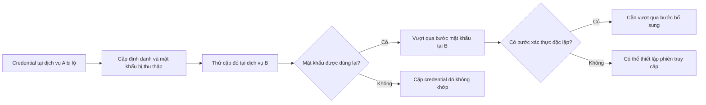

# Password reuse

**Password reuse** là việc sử dụng lại cùng một mật khẩu trong nhiều tài khoản, nhiều dịch vụ hoặc nhiều giai đoạn của cùng một tài khoản. Rủi ro xuất hiện khi một bí mật bị lộ ở nơi này vẫn mở được quyền truy cập ở nơi khác, hoặc một mật khẩu đã bị thay thế lại trở thành mật khẩu đang hoạt động.

Trong IAM, cần phân biệt phạm vi mà hệ thống có thể kiểm soát: ứng dụng có thể kiểm tra một số mật khẩu trước đây của chính tài khoản đó nếu có chính sách lịch sử, nhưng thường không biết mật khẩu người dùng đang dùng tại các dịch vụ độc lập. Bảo vệ khỏi tái sử dụng vì thế cần kết hợp thiết kế credential, trải nghiệm người dùng và phòng vệ ở luồng đăng nhập.

Sau bài này, người học có thể phân biệt các dạng tái sử dụng, giải thích quan hệ với credential stuffing, mô tả kiểm tra lịch sử mật khẩu đúng cách và nhận ra những giới hạn mà salt, blocklist hoặc MFA không tự giải quyết.

## 1. Những dạng tái sử dụng cần phân biệt

| Dạng | Ví dụ minh họa | Phạm vi có thể xử lý |
|---|---|---|
| Giữa dịch vụ độc lập | Cùng mật khẩu cho email cá nhân và diễn đàn | Mật khẩu riêng từng dịch vụ, trình quản lý mật khẩu, phòng vệ đăng nhập |
| Giữa các tài khoản trong tổ chức | Tài khoản thường và tài khoản quản trị dùng cùng bí mật | Chính sách danh tính, tách tài khoản đặc quyền, MFA và quản trị credential |
| Theo thời gian trong cùng tài khoản | Đổi từ A sang B rồi quay về A | Chính sách lịch sử có giới hạn nếu hệ thống cần áp dụng |
| Chia sẻ một mật khẩu giữa nhiều người | Cả nhóm dùng một tài khoản và cùng biết mật khẩu | Cấp danh tính riêng, phân quyền và kiểm toán theo từng người |
| Dùng biến thể dễ đoán | Thay một số hoặc thêm tên dịch vụ vào cùng một mẫu | Hướng dẫn chọn mật khẩu độc lập; không xem biến thể nhỏ là bảo đảm an toàn |

Biến thể dễ đoán không nhất thiết là tái sử dụng **chính xác từng ký tự**, nhưng vẫn liên quan đến rủi ro suy đoán. Ví dụ mật khẩu cũ và mới khác nhau ở một chữ số có thể vượt qua kiểm tra bằng nhau mà vẫn nằm trong nhóm ứng viên dễ thử.

Chia sẻ tài khoản còn gây vấn đề truy vết: log chỉ biết một danh tính chung, không biết cá nhân nào đã thực hiện hành động. Đổi mật khẩu chung sau mỗi lần có người rời nhóm cũng không thay thế quy trình thu hồi quyền theo từng danh tính.

## 2. Tại sao sự cố ở một dịch vụ có thể lan sang dịch vụ khác?

Giả sử An có hai tài khoản độc lập ở diễn đàn A và cổng nhân sự B. An dùng cùng địa chỉ email và cùng mật khẩu ở cả hai nơi.



Hệ thống B có thể chưa bị lộ database. Kẻ tấn công chỉ gửi một thông tin đăng nhập đang hợp lệ qua endpoint bình thường của B. Bảo vệ kho hash ở B vẫn cần thiết, nhưng không trực tiếp ngăn được việc người dùng đã chọn cùng bí mật ở A.

Nếu tài khoản email bị chiếm, tác động có thể rộng hơn vì email còn được dùng để nhận thông báo hoặc khôi phục các tài khoản khác. Không nên giả định kênh email chắc chắn còn an toàn chỉ vì sự cố ban đầu được phát hiện tại một ứng dụng khác.

Đây là một ví dụ về phạm vi ảnh hưởng: cùng một bí mật xuất hiện ở nhiều ranh giới tin cậy làm một lần lộ có nhiều nơi sử dụng tiếp. Mật khẩu độc lập giúp giảm quan hệ phụ thuộc đó.

## 3. Credential stuffing khác password spraying thế nào?

| Kiểu tấn công | Đầu vào chính |
|---|---|
| Credential stuffing | Những cặp định danh và mật khẩu lấy từ một vụ lộ khác |
| Password spraying | Một hoặc một số mật khẩu yếu được thử trên nhiều tài khoản |
| Đoán mật khẩu một tài khoản | Nhiều ứng viên được thử cho một tài khoản đích |

OWASP phân biệt ba dạng này theo cách tổ chức dữ liệu thử. Password reuse giữa dịch vụ tạo cơ hội đặc biệt cho credential stuffing: kẻ tấn công có một cặp từng đúng ở nơi khác. [OWASP Credential Stuffing Prevention Cheat Sheet](https://cheatsheetseries.owasp.org/cheatsheets/Credential_Stuffing_Prevention_Cheat_Sheet.html)

Việc từ chối dùng lại ba mật khẩu cũ của tài khoản không biết được một mật khẩu mới có đang được dùng tại diễn đàn khác hay không. Ngược lại, người dùng có thể dùng mật khẩu riêng cho từng website nhưng vẫn quay lại mật khẩu cũ trong một website. Hai vấn đề cần các biện pháp khác nhau.

Khi mô tả khả năng của sản phẩm, tránh dùng một nhãn chung như “chống tái sử dụng hoàn toàn” nếu tính năng thực tế chỉ kiểm tra lịch sử cục bộ.

## 4. Salt và hash không chứng minh mật khẩu là duy nhất

Một hệ thống lưu mật khẩu thường có mô hình:

```text
verifier = PasswordKDF(password, salt, parameters)
```

Salt riêng làm đầu vào băm khác nhau giữa các bản ghi. Nó hỗ trợ bảo vệ dữ liệu đã lưu, chứ không làm mật khẩu mà người dùng nhập trở thành một bí mật khác khi đăng nhập dịch vụ khác.

Ví dụ:

```text
Dịch vụ A:
    mật khẩu P, salt A -> verifier A

Dịch vụ B:
    mật khẩu P, salt B -> verifier B

verifier A và verifier B thường khác nhau.
Mật khẩu người dùng cung cấp cho cả hai vẫn là P.
```

OWASP khuyến nghị salt riêng và hàm băm mật khẩu có chi phí phù hợp để bảo vệ thông tin xác thực được lưu. Các biện pháp này làm giảm khả năng dùng kết quả tính sẵn và tăng chi phí thử đoán ngoại tuyến; chúng không phải phép kiểm tra tính độc lập của mật khẩu giữa các dịch vụ. [OWASP Password Storage Cheat Sheet](https://cheatsheetseries.owasp.org/cheatsheets/Password_Storage_Cheat_Sheet.html)

Từ đó có hai hệ quả khi xây dựng kiểm tra lịch sử:

1. Hai chuỗi hash khác nhau không chứng minh hai mật khẩu khác nhau.
2. Muốn biết một mật khẩu ứng viên có khớp bản ghi cũ hay không, phải dùng API xác minh với bản ghi cũ đó.

Không khắc phục bằng cách dùng chung một salt cho toàn bộ người dùng để chuỗi hash dễ so sánh. Cách đó làm mất mục đích tạo đầu vào riêng cho từng bản ghi và tạo thêm khả năng đối chiếu không cần thiết giữa các tài khoản.

## 5. Password history chỉ kiểm tra một phạm vi hữu hạn

**Password history** là tập bản ghi verifier cũ được giữ lại để kiểm tra mật khẩu mới theo một chính sách cụ thể. Tính năng này cần có mục tiêu và giới hạn rõ ràng, vì giữ thêm verifier cũng tăng lượng dữ liệu credential phải bảo vệ.

Ví dụ chính sách minh họa:

```text
Kiểm tra mật khẩu hiện tại.
Kiểm tra tối đa H mật khẩu đã bị thay thế gần nhất.
Không xem H là số được áp dụng chung cho mọi hệ thống.
```

Trong định nghĩa này, `H = 3` nghĩa là tối đa ba bản ghi cũ, **ngoài** bản ghi hiện tại. Tổng số bản ghi có thể cần xác minh là bốn. Cần ghi rõ cách đếm để đội giao diện, backend và kiểm thử hiểu cùng một phạm vi.

Lịch sử không bảo đảm cấm quay về một mật khẩu mãi mãi. Khi bản ghi đã rời khỏi cửa sổ lưu giữ, hệ thống không còn dữ liệu lịch sử đó để kiểm tra. Một blocklist độc lập vẫn có thể chặn giá trị này nếu nó thuộc danh sách bị từ chối.

Một lịch sử dài hơn cũng có chi phí lớn hơn: cần thêm phép băm mật khẩu khi kiểm tra, thêm dữ liệu nhạy cảm và thêm yêu cầu quản lý thuật toán cũ. Không chọn độ sâu chỉ vì số lớn tạo cảm giác an toàn hơn.

### Dữ liệu cần giữ

Mỗi bản ghi cũ phải có đủ thông tin cho phép xác minh:

```text
subject_id
encoded_password_record
superseded_at
history_order hoặc khóa sắp xếp ổn định
```

`encoded_password_record` có thể bao gồm thuật toán, tham số, salt và verifier do thư viện đóng gói. Không cần và không được lưu mật khẩu dạng rõ để phục vụ tính năng này.

Nếu bản ghi cũ dùng pepper, ứng dụng còn phụ thuộc vào khả năng xác minh với phiên bản pepper tương ứng. Không thể xóa khóa cũ rồi mặc nhiên coi mọi mật khẩu mới là chưa từng dùng chỉ vì các bản ghi lịch sử không còn xác minh được. Việc thay đổi cơ chế khóa và thời gian giữ lịch sử cần được thiết kế cùng nhau.

## 6. Kiểm tra lịch sử bằng thư viện Java

Trong Spring Security, `PasswordEncoder.matches(rawPassword, encodedPassword)` dùng để xác minh một mật khẩu ứng viên với bản ghi đã mã hóa một chiều. Encoder phải được cấu hình để hiểu những định dạng mà hệ thống còn cần xác minh. [Spring Security — Password Storage](https://docs.spring.io/spring-security/reference/features/authentication/password-storage.html)

Ví dụ dưới đây là một phương thức kiểm tra cục bộ, không phải toàn bộ luồng đổi mật khẩu:

```java
import java.util.List;
import org.springframework.security.crypto.password.PasswordEncoder;

public final class PasswordReuseCheck {
    private PasswordReuseCheck() {
    }

    public static boolean wasUsed(
            CharSequence candidate,
            String currentEncoded,
            List<String> previousEncoded,
            PasswordEncoder encoder) {

        if (encoder.matches(candidate, currentEncoded)) {
            return true;
        }

        for (String previous : previousEncoded) {
            if (encoder.matches(candidate, previous)) {
                return true;
            }
        }

        return false;
    }
}
```

Giả định đầu vào đã được xác thực cấu trúc, `previousEncoded` đã được giới hạn theo chính sách và mọi bản ghi đều thuộc đúng tài khoản. Kết quả `true` chỉ có nghĩa ứng viên khớp với ít nhất một bản ghi trong tập kiểm tra này.

Không dùng phép so sánh sau:

```text
encode(candidate).equals(previousEncoded)
```

Lần `encode` mới có thể sinh salt mới nên hai chuỗi sẽ khác nhau dù cùng mật khẩu. Cũng không hash lại một verifier cũ rồi coi đó là bản ghi của mật khẩu gốc theo thuật toán mới.

Nếu bản ghi lịch sử bị hỏng, thiếu khóa cần thiết hoặc dùng định dạng không được hỗ trợ, phải xử lý lỗi xác minh. Không chuyển mọi exception thành `false`, vì điều đó biến dữ liệu lỗi thành quyền bỏ qua chính sách.

Đoạn mã dừng khi tìm thấy bản ghi khớp nên thời gian xử lý có thể khác nhau theo vị trí khớp. Cần đánh giá điều này trong ngữ cảnh một luồng đã xác thực, giới hạn thông tin lỗi và tài nguyên phù hợp; không xem đây là một cơ chế chống timing attack hoàn chỉnh.

### Chi phí tính toán

Nếu không tìm thấy bản ghi khớp, số lần xác minh tối đa theo ví dụ là `H + 1`. Với chi phí mỗi lần xác minh xấp xỉ `C`, tổng chi phí gần bằng:

```text
historyCheckCost ≈ (H + 1) × C
```

Đây là ước lượng để thiết kế tài nguyên, không phải thời gian cố định. Các bản ghi có thể dùng tham số khác nhau. Cần giới hạn kích thước lịch sử, kích thước đầu vào và tần suất yêu cầu trước khi cho một khách thực hiện nhiều phép băm đắt tiền.

## 7. Cập nhật credential và lịch sử trong cùng giao dịch

Kiểm tra đúng nhưng lưu không nhất quán vẫn có thể làm chính sách sai. Ví dụ ứng dụng thay mật khẩu hiện tại nhưng lỗi trước khi đưa bản ghi cũ vào lịch sử. Một mật khẩu vừa dùng có thể bị bỏ sót trong lần đổi tiếp theo.

Một luồng minh họa:

```text
1. Xác minh người yêu cầu và quyền thay credential.
2. Đọc nhất quán credential hiện tại, lịch sử cần kiểm tra và version.
3. Kiểm tra chính sách mật khẩu mới và blocklist.
4. Xác minh ứng viên với bản ghi hiện tại và các bản ghi lịch sử.
5. Nếu khớp bản ghi bị cấm dùng lại: từ chối.
6. Tạo bản ghi mới với salt mới.

begin transaction
    kiểm tra trạng thái tài khoản và bằng chứng còn hợp lệ
    thay credential hiện tại với expectedVersion
    nếu version không khớp: rollback và báo xung đột
    thêm credential vừa bị thay thế vào lịch sử
    chỉ giữ tối đa H bản ghi cũ theo thứ tự xác định
    cập nhật trạng thái phiên/thu hồi theo chính sách
    ghi sự kiện cần thiết không chứa bí mật
commit
```

Các thành phần ghi credential và lịch sử phải dùng cùng quy ước khóa hoặc phiên bản để bảo toàn tập dữ liệu đã kiểm tra. Nếu mọi thay đổi lịch sử đều được phối hợp qua phiên bản credential, việc kiểm tra phiên bản giúp phát hiện rằng snapshot đã cũ. Chỉ kiểm tra một version không liên quan đến các thay đổi lịch sử thì chưa đủ.

Hai yêu cầu đồng thời có thể cùng vượt qua kiểm tra dựa trên trạng thái cũ. Cập nhật có điều kiện hoặc khóa phù hợp giúp chỉ một yêu cầu hoàn tất trên trạng thái đó. Không tự retry bằng cách đổi version rồi bỏ qua kiểm tra lại tập lịch sử mới.

Luồng đặt lại mật khẩu và luồng đổi mật khẩu cần có quy tắc nhất quán về lịch sử. Nếu khôi phục tài khoản có ngoại lệ nghiệp vụ, ngoại lệ phải được thiết kế rõ; không để một endpoint bỏ kiểm tra chỉ vì được viết bởi nhóm khác.

Nâng cấp hash cho cùng một mật khẩu không nên tự bị tính thành một lần đổi sang mật khẩu mới trong lịch sử. Nếu mỗi lần nâng cấp tạo thêm một mục, cửa sổ lịch sử có thể bị chiếm bởi nhiều verifier của cùng một bí mật và mất ý nghĩa mong muốn.

## 8. Lịch sử mật khẩu khác blocklist mật khẩu bị lộ

| Cơ chế | Câu hỏi được trả lời | Giới hạn |
|---|---|---|
| Lịch sử cục bộ | Ứng viên có khớp những bản ghi trước của tài khoản này không? | Chỉ biết dữ liệu lịch sử còn giữ |
| Blocklist | Ứng viên có nằm trong tập giá trị bị từ chối không? | Phụ thuộc tập dữ liệu và thời điểm cập nhật |
| Kiểm tra đăng nhập bất thường | Yêu cầu sử dụng credential có dấu hiệu rủi ro không? | Không chứng minh mật khẩu có được dùng ở nơi khác |

NIST yêu cầu kiểm tra mật khẩu được thiết lập hoặc thay đổi với blocklist những giá trị phổ biến, có thể đoán hoặc đã bị xâm phạm. Đây là một yêu cầu khác với lưu toàn bộ lịch sử cá nhân của người dùng. [NIST SP 800-63B-4 — Password Verifiers](https://pages.nist.gov/800-63-4/sp800-63b.html#passwordver)

Một mật khẩu có trong dữ liệu rò rỉ không chứng minh chính tài khoản đang xét đã bị lộ: nhiều người có thể độc lập chọn cùng một chuỗi. Ngược lại, không tìm thấy mật khẩu trong dữ liệu đã biết không chứng minh nó chưa từng bị lộ hoặc không đang được dùng tại dịch vụ khác.

### Kiểm tra mà không gửi mật khẩu rõ cho bên ngoài

Có thể dùng tập dữ liệu cục bộ hoặc cơ chế tra cứu hạn chế dữ liệu gửi đi. Ví dụ Pwned Passwords nhận tiền tố năm ký tự của hash SHA-1 và trả các hậu tố để phía gọi đối chiếu. Tài liệu khuyến cáo tránh tra cứu sau từng phím gõ. [Pwned Passwords API](https://haveibeenpwned.com/API/v3#SearchingPwnedPasswordsByRange)

SHA-1 trong phép tra cứu này là định dạng đối chiếu tập dữ liệu, không phải lựa chọn để lưu mật khẩu đăng nhập. Cơ chế tiền tố giảm dữ liệu tiết lộ nhưng không phải bảo đảm ẩn danh tuyệt đối.

Một hệ thống tích hợp bên ngoài cần xác định cách xử lý timeout, cập nhật dữ liệu và lỗi nhà cung cấp. Khi tra cứu thất bại, không gắn kết quả “chưa bị lộ” cho một kiểm tra thực tế chưa hoàn thành. Có thể yêu cầu thử lại hoặc dùng nguồn cục bộ dự phòng theo chính sách đã chọn.

Không gửi mật khẩu người dùng sang các website khác để thử đăng nhập nhằm kiểm tra tái sử dụng. Hành vi đó vượt khỏi chức năng của ứng dụng, làm lộ bí mật và có thể tạo truy cập không được phép. Hệ thống chỉ cần xử lý các dữ liệu và nguồn kiểm tra được thiết kế cho mục đích của mình.

## 9. Vì sao đổi theo lịch hoặc cấm dùng lại không giải quyết tất cả?

Một người bị buộc thay mật khẩu thường xuyên có thể quay vòng giữa một số giá trị hoặc chỉ thay hậu tố. Kiểm tra bằng nhau phát hiện một chuỗi cũ nhưng không đo được độ độc lập của mọi biến thể mới.

NIST không yêu cầu thay mật khẩu định kỳ theo một lịch tùy ý và yêu cầu buộc thay khi có bằng chứng authenticator bị xâm phạm. Không diễn giải thành phải đổi mỗi vài chục ngày để hệ thống được coi là an toàn. [NIST SP 800-63B-4 — Password Verifiers](https://pages.nist.gov/800-63-4/sp800-63b.html#passwordver)

Nếu tổ chức có yêu cầu giữ lịch sử, cần xác định cụ thể mục tiêu và cửa sổ áp dụng. Không gán một độ sâu hoặc khoảng chờ tối thiểu giữa hai lần đổi như thông số bắt buộc chung của IAM.

Khoảng chờ có thể hạn chế việc đổi liên tục để đẩy một mật khẩu ra khỏi lịch sử, nhưng cũng có thể cản người vừa phát hiện lộ mật khẩu cần thay ngay. Một thiết kế có điều kiện khôi phục phải giải quyết tình huống này mà không bỏ qua xác minh danh tính.

Cũng không nên lưu mật khẩu rõ để kiểm tra “mật khẩu mới khác mật khẩu cũ ít nhất bao nhiêu ký tự”. Lưu hash một chiều không cho phép khôi phục chuỗi cũ để tính khoảng cách ký tự. Nếu có thêm quy tắc về mẫu mật khẩu, phải đánh giá giá trị và dữ liệu cần thiết, thay vì tạo ra kho mật khẩu có thể đọc lại.

## 10. Các lớp phòng vệ phù hợp với từng phạm vi

### Mật khẩu riêng cho từng dịch vụ

Trình quản lý mật khẩu có thể giúp người dùng tạo và điền các bí mật độc lập, tránh phải nhớ nhiều mẫu có liên quan. Dịch vụ cần hỗ trợ hành vi này thay vì chặn dán hoặc buộc những giới hạn khiến người dùng quay về mật khẩu ngắn dễ nhớ.

Đối với tài khoản email chính và tài khoản quản trị, việc tách bí mật giúp tránh một tài khoản thông thường mở đường trực tiếp vào một danh tính có tác động lớn hơn. Việc tách quyền vẫn cần thực hiện bằng chính sách cấp quyền, không chỉ bằng mật khẩu khác nhau.

### MFA và phương thức không dùng mật khẩu

Một yếu tố xác thực độc lập có thể ngăn một cặp mật khẩu bị dùng lại đủ để hoàn tất đăng nhập. Mật khẩu thứ hai hoặc câu hỏi bí mật vẫn thuộc nhóm bằng chứng kiến thức; không tự trở thành MFA chỉ vì có thêm một màn hình nhập.

Passkey có thể loại bỏ việc gửi một mật khẩu dùng lại tại các dịch vụ hỗ trợ, nhưng thiết kế vẫn phải bảo vệ thiết bị, cơ chế đồng bộ, đăng ký phương thức và khôi phục tài khoản. Nếu một đường khôi phục yếu cho phép lấy lại toàn bộ quyền, phương thức đăng nhập mạnh không tự loại bỏ đường đó.

### Phòng vệ tại endpoint đăng nhập

Áp dụng giới hạn và phát hiện bất thường theo nhiều tín hiệu: tài khoản, nguồn yêu cầu, phiên, thiết bị và hành vi tổng thể. Một bot có thể dùng nhiều địa chỉ IP nên chỉ giới hạn trên một IP không phản ánh toàn bộ cuộc tấn công.

Không khóa cứng mọi tài khoản chỉ vì người ngoài gửi nhiều lần sai; chính cơ chế khóa có thể bị dùng để gây gián đoạn. Cần phản hồi phù hợp với rủi ro và có đường khôi phục được bảo vệ.

### Bảo vệ phiên sau khi credential bị lộ

Nếu kẻ tấn công đã thiết lập phiên, đổi mật khẩu không tự bảo đảm phiên đó hết hiệu lực. Cần chính sách thu hồi session, refresh token và các bằng chứng liên quan, đồng thời biết thành phần nào kiểm tra trạng thái thu hồi.

Một access token tự chứa có thể còn được nơi nhận chấp nhận đến hạn nếu không có cơ chế nhận biết thu hồi sớm. Việc xử lý sự cố cần tính đến giới hạn này, thay vì chỉ nhìn trạng thái cột mật khẩu.

## 11. SSO, tài khoản đặc quyền và danh tính workload

### SSO là tập trung xác thực, không phải sao chép mật khẩu

Trong một thiết kế SSO qua OIDC, các ứng dụng nhận kết quả xác thực từ IdP theo giao thức. Chúng không cần cùng lưu một bản sao mật khẩu người dùng để có trải nghiệm đăng nhập chung.

Chính sách lịch sử mật khẩu thuộc nơi quản lý credential, thường là IdP nếu IdP sở hữu mật khẩu. Ứng dụng nhận kết quả không nên yêu cầu mật khẩu IdP chỉ để kiểm tra xem có trùng mật khẩu cục bộ hay không.

Tập trung xác thực giảm nhu cầu tạo nhiều mật khẩu cho các ứng dụng liên quan, đồng thời làm IdP trở thành thành phần cần được bảo vệ chặt. Phân quyền, MFA, khả năng thu hồi phiên và khôi phục vẫn phải được thiết kế tương ứng.

### Tài khoản đặc quyền

Không nên dùng cùng bí mật cho tài khoản làm việc thường ngày và tài khoản quản trị nếu hai danh tính được tách để giảm phạm vi ảnh hưởng. Một lần lộ ở bối cảnh ít tin cậy không nên tự mở được bối cảnh quản trị.

Chính sách ít quyền nhất còn yêu cầu quản lý quyền được cấp, thời gian sử dụng và người phê duyệt. Đặt hai mật khẩu khác nhau nhưng giữ quyền quản trị thường trực cho mọi tác vụ không giải quyết đầy đủ rủi ro đặc quyền.

### Workload

Chia sẻ một mật khẩu tĩnh cho nhiều dịch vụ cũng tạo quan hệ phụ thuộc: khi lộ hoặc cần xoay vòng, nhiều thành phần bị tác động và khó xác định ai đang dùng bí mật. Nên cấp danh tính và credential phù hợp cho từng workload khi kiến trúc hỗ trợ.

Quy trình xoay vòng bí mật của máy phải theo loại credential và thành phần phụ thuộc. Không áp nguyên xi cửa sổ lịch sử mật khẩu của người dùng vào token ngắn hạn, chứng chỉ hoặc danh tính workload liên kết.

## 12. Giám sát và xử lý khi nghi ngờ dùng lại mật khẩu bị lộ

Các tín hiệu cần được diễn giải trong ngữ cảnh. Ví dụ nhiều tài khoản có lần đăng nhập mật khẩu hợp lệ từ nguồn lạ nhưng thất bại ở MFA có thể gợi ý credential đã bị biết. Đây là tín hiệu điều tra, không tự chứng minh nguồn rò rỉ hay việc dùng lại tại một website cụ thể.

Một luồng xử lý có thể gồm xác minh chủ tài khoản, thay mật khẩu bị ảnh hưởng, kiểm tra phương thức khôi phục và thu hồi các phiên cần thiết. Nếu nghi email cũng bị chiếm, không dựa duy nhất vào một thông báo gửi đến chính email đó để kết luận sự cố đã được giải quyết.

Kiểm toán có thể lưu loại chính sách, kết quả từ chối và mã đối chiếu yêu cầu:

```text
eventType: PASSWORD_CHANGE_REJECTED
reason: LOCAL_HISTORY_MATCH
subjectId: định danh nội bộ của tài khoản
requestId: mã đối chiếu
policyVersion: phiên bản chính sách đang áp dụng
```

Không ghi mật khẩu ứng viên, verifier lịch sử, hash tra cứu đầy đủ hoặc toàn bộ kết quả nhạy cảm vào log. Số lượng lần từ chối có ích cho đánh giá chính sách; giữ bí mật người dùng để phân tích hành vi tái sử dụng không phải điều kiện cần.

Giới hạn đọc dữ liệu lịch sử cho đúng thành phần xác minh. Nhân viên hỗ trợ chỉ cần thấy kết quả hoặc trạng thái cần thiết, không cần quyền lấy toàn bộ verifier cũ. Khi xóa lịch sử theo chính sách, cần hiểu dữ liệu có thể còn trong bản sao lưu theo vòng đời sao lưu riêng; không hứa xóa tức thời mọi bản sao nếu hệ thống không có khả năng đó.

## 13. Các tình huống giúp kiểm tra hiểu biết

1. **Hai bản ghi khác salt nhưng cùng mật khẩu:** chuỗi hash có thể khác nhau; API xác minh vẫn phải nhận ra ứng viên khớp từng bản ghi.
2. **Mật khẩu mới chưa có trong lịch sử nhưng đã có trong blocklist:** kiểm tra lịch sử đạt không có nghĩa toàn bộ chính sách đạt.
3. **Mật khẩu không có trong blocklist:** không thể kết luận chưa bị lộ hoặc không được dùng tại nơi khác.
4. **Đã lưu H bản ghi cũ:** phải biết H có tính bản ghi hiện tại hay không và kiểm tra đúng phạm vi đã công bố.
5. **Bản ghi cũ không còn xác minh được:** cần xử lý lỗi hoặc chuyển đổi chính sách rõ ràng, không mặc nhiên coi là không trùng.
6. **Hai yêu cầu đổi đồng thời:** cập nhật phải nhất quán giữa credential và lịch sử, không ghi đè từ snapshot cũ.
7. **Tài khoản đã bật MFA:** mật khẩu bị lộ vẫn cần được xử lý; MFA là một lớp phòng vệ bổ sung.
8. **Hệ thống chỉ là ứng dụng SSO:** không thu thập mật khẩu IdP để tự xây lịch sử cục bộ không thuộc trách nhiệm của mình.

Khi đánh giá một cơ chế chống tái sử dụng, hãy xác định chính xác tập dữ liệu nó biết và quyết định nó được phép đưa ra. Lịch sử cục bộ, blocklist, mật khẩu độc lập và phòng vệ đăng nhập giải quyết những phần khác nhau của vòng đời credential; kết quả của một cơ chế không thay thế kết quả của tất cả cơ chế còn lại.
