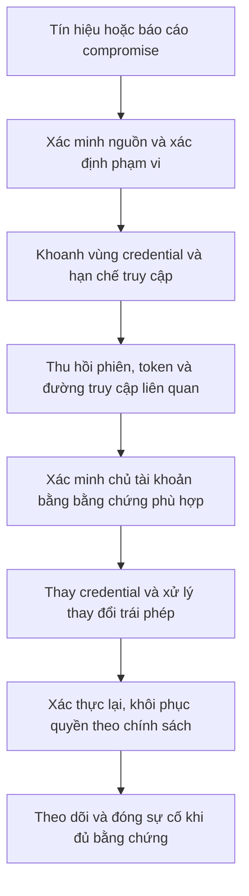

# Password compromise — Xử lý khi mật khẩu bị lộ hoặc bị chiếm dụng

## 1. Password compromise là gì?

**Password compromise** là tình huống tính bí mật hoặc quyền kiểm soát hợp lệ đối với mật khẩu không còn được bảo đảm. Một bên không được phép có thể đã biết, sao chép hoặc sử dụng mật khẩu đó. Người dùng vẫn có thể đăng nhập bình thường trong khi kẻ tấn công cũng sở hữu cùng bí mật.

Ví dụ, một nhân viên nhập mật khẩu vào trang đăng nhập giả. Sau đó họ đổi mật khẩu trên hệ thống thật, nhưng trước thời điểm đổi, kẻ tấn công đã tạo một phiên đăng nhập và bổ sung phương thức khôi phục. Nếu ứng dụng chỉ thay giá trị băm mật khẩu, các đường truy cập này có thể còn tồn tại.

Trong nền tảng quản lý danh tính và quyền truy cập, xử lý password compromise liên quan đến toàn bộ vòng đời credential: phát hiện, đánh giá bằng chứng, hạn chế truy cập, vô hiệu hóa thông tin xác thực, xác minh lại chủ tài khoản và theo dõi sau khôi phục. Nó cũng liên quan đến MFA, phiên, OAuth/OIDC, SSO, đặc quyền và kiểm toán.

Sau bài học, người học có thể:

- Phân biệt mật khẩu bị lộ, password verifier bị lộ và phiên bị đánh cắp.
- Đánh giá tín hiệu nghi ngờ mà không tự động kết luận tài khoản đã bị chiếm.
- Thiết kế luồng khoanh vùng và khôi phục có kiểm soát.
- Giải thích vì sao đổi mật khẩu chưa đủ để thu hồi mọi quyền truy cập đã phát hành.
- Áp dụng trạng thái tài khoản và phiên bản xác thực để hạn chế phiên cũ.
- Xác định bằng chứng cần có trước khi mở lại quyền truy cập thông thường.

## 2. Phân biệt các loại tài sản bị ảnh hưởng

### 2.1. Mật khẩu, verifier và phiên có vai trò khác nhau

| Tài sản | Khi bị lộ, điều gì có thể xảy ra? | Phạm vi cần xem xét |
|---|---|---|
| Mật khẩu dạng rõ | Bên khác có thể thử đăng nhập bằng đúng mật khẩu | Tài khoản hiện tại và những nơi tái sử dụng cùng mật khẩu. |
| Password verifier trong cơ sở dữ liệu | Có thể bị đoán mật khẩu ngoại tuyến, tùy thuật toán, tham số và độ mạnh mật khẩu | Tập tài khoản có verifier bị đọc, cùng hạ tầng liên quan. |
| Session cookie hoặc bearer access token | Có thể bị dùng để truy cập mà không cần nhập lại mật khẩu | Phiên, token, phạm vi quyền và thời hạn còn lại. |
| Refresh token | Có thể cho phép tiếp tục lấy access token theo chính sách máy chủ | Authorization grant hoặc nhóm token liên quan. |
| Reset token hoặc recovery code | Có thể cho phép thay credential hoặc khôi phục tài khoản | Luồng khôi phục và các bằng chứng được chấp nhận. |
| Email khôi phục hoặc yếu tố MFA | Có thể làm suy yếu kiểm tra bổ sung và khả năng lấy lại tài khoản | Các authenticator, kênh liên lạc và lịch sử thay đổi. |

Password verifier là biểu diễn dùng để xác minh mật khẩu, thường gồm đầu ra KDF và thông tin salt, tham số liên quan. Nó không phải bản mã có thể giải mã để lấy lại mật khẩu theo cách thông thường. Tuy nhiên, không được coi việc bị lộ verifier là vô hại: kẻ tấn công có thể thử nhiều ứng viên ngoại tuyến.

Một lần đánh cắp session cookie không tự chứng minh mật khẩu đã bị biết. Ngược lại, mật khẩu đã bị biết chưa chứng minh kẻ tấn công đã vượt qua MFA hay thực hiện thao tác trái phép. Phản ứng cần dựa trên tài sản và bằng chứng thực tế.

### 2.2. Các con đường dẫn đến compromise

Những tình huống điển hình gồm nhập mật khẩu vào trang giả, tái sử dụng mật khẩu đã lộ ở dịch vụ khác, mã độc trên thiết bị, chia sẻ credential, lộ trong log hoặc cấu hình, và truy cập trái phép kho xác thực.

Credential stuffing tận dụng thông tin đăng nhập đã bị lộ để thử lại ở hệ thống khác. Brute force hoặc password spraying lại dựa trên việc thử các ứng viên có khả năng đúng. Các cơ chế có thể cùng xuất hiện, nhưng nguồn bằng chứng và phạm vi ảnh hưởng không nhất thiết giống nhau.

MFA làm tăng yêu cầu đối với lần đăng nhập; nó không xóa việc mật khẩu đã bị lộ. Nếu thiết bị hoặc phiên cũng bị chiếm, việc đổi mật khẩu trên chính thiết bị chưa được làm sạch có thể khiến mật khẩu mới tiếp tục bị thu thập.

## 3. Từ tín hiệu nghi ngờ đến quyết định ứng phó

### 3.1. Không gộp mọi cảnh báo thành một kết luận

| Tín hiệu | Điều có thể suy ra | Điều chưa thể khẳng định |
|---|---|---|
| Nhiều lần đăng nhập sai | Có hoạt động thử credential hoặc người dùng gặp lỗi | Mật khẩu đã bị đoán đúng. |
| Đăng nhập từ thiết bị hoặc vị trí mới | Bối cảnh khác thường cần đánh giá | Chắc chắn là kẻ tấn công; VPN và thay đổi mạng có thể gây nhiễu. |
| Mật khẩu hiện tại khớp dữ liệu mật khẩu đã lộ | Bí mật đó không nên tiếp tục được sử dụng | Chính ứng dụng này đã bị rò rỉ hoặc đã có đăng nhập trái phép. |
| Người dùng xác nhận nhập mật khẩu vào trang giả | Có căn cứ mạnh về khả năng tiết lộ mật khẩu | Các phiên, MFA và dữ liệu nghiệp vụ đều chưa bị ảnh hưởng. |
| Thêm MFA hoặc đổi email khôi phục không được chủ tài khoản công nhận | Có dấu hiệu mất quyền kiểm soát tài khoản | Phạm vi đã dừng ở một phương thức khôi phục. |
| Xác nhận truy cập trái phép cơ sở dữ liệu credential | Có sự cố ảnh hưởng kho xác thực | Mọi mật khẩu đã được khôi phục thành dạng rõ. |

Một cảnh báo cần có nguồn, thời điểm quan sát, đối tượng liên quan và mức độ tin cậy. Tín hiệu mới có thể làm tăng hoặc giảm đánh giá ban đầu. Không nên chỉ lưu một cờ `compromised=true` mà thiếu lý do, phạm vi và hành động đã thực hiện.

### 3.2. Cân bằng khoanh vùng và khả năng bị lạm dụng

Nếu chỉ cần gửi một yêu cầu công khai là có thể khóa tài khoản bất kỳ, kẻ tấn công có thể biến chức năng bảo vệ thành công cụ gây gián đoạn. Một báo cáo compromise cần đi qua cơ chế tiếp nhận và xác minh phù hợp với mức độ rủi ro.

Đồng thời, chờ đủ bằng chứng về mọi thiệt hại rồi mới hạn chế một credential đã xác nhận bị lộ có thể kéo dài cửa sổ truy cập trái phép. Hệ thống cần định nghĩa trước mức tín hiệu nào cho phép tăng xác minh, tạm hạn chế, hoặc vô hiệu hóa credential.

Theo [NIST SP 800-63B](https://pages.nist.gov/800-63-4/sp800-63b.html), bằng chứng authenticator bị compromise là căn cứ để buộc thay mật khẩu và nhanh chóng đình chỉ hoặc vô hiệu hóa authenticator liên quan. Tài liệu cũng phân biệt việc này với yêu cầu đổi mật khẩu định kỳ. Đây là quyết định theo sự kiện và bằng chứng, không phải chỉ theo lịch.

### 3.3. Hai phạm vi ứng phó khác nhau

**Sự cố một tài khoản:** tập trung vào các phiên, credential, phương thức khôi phục, hoạt động và quyền của tài khoản đó. Cần kiểm tra xem có tái sử dụng bí mật ở nơi khác, nhưng không tự thay credential của tài khoản không liên quan.

**Sự cố kho credential hoặc hạ tầng xác thực:** xác định tập tài khoản bị ảnh hưởng, khả năng truy cập dữ liệu và tính toàn vẹn hệ thống. Trước khi thu thập mật khẩu mới, cần kiểm soát đường rò rỉ; nếu môi trường vẫn bị chiếm thì các bí mật thay mới có thể tiếp tục bị lộ. Tập tài khoản cần xử lý dựa trên phạm vi có căn cứ, không chỉ dựa vào số người đã báo mất tài khoản.

## 4. Quy trình ứng phó trong IAM

### 4.1. Các giai đoạn và kết quả cần đạt



Các giai đoạn có thể chồng lấp về thời gian. Chẳng hạn, việc thu hồi phiên và điều tra lịch sử truy cập có thể diễn ra song song. Sơ đồ thể hiện quan hệ điều kiện, không yêu cầu chờ điều tra xong mọi chi tiết trước khi khoanh vùng.

| Giai đoạn | Kết quả cần quan sát được |
|---|---|
| Tiếp nhận và đánh giá | Có hồ sơ sự kiện, nguồn tín hiệu và phạm vi ban đầu. |
| Khoanh vùng | Credential không còn được dùng để tạo truy cập thông thường theo quyết định đã ban hành. |
| Thu hồi | Các loại phiên và token trong phạm vi được xử lý, kèm bằng chứng thực thi. |
| Khôi phục | Chủ tài khoản được xác minh, credential thay mới và đường kiểm soát trái phép được xử lý. |
| Theo dõi | Không còn nghĩa vụ khắc phục chưa xử lý; các dấu hiệu tái xâm nhập được theo dõi. |

### 4.2. Giữ bằng chứng mà không giữ bí mật

Ghi nhận các sự kiện đăng nhập, thay đổi authenticator, đổi phương thức khôi phục, cấp token, thay đổi quyền và thao tác nhạy cảm liên quan. Đối chiếu thời gian giữa các hệ thống và giữ định danh sự kiện để truy vết.

Không yêu cầu người dùng gửi lại mật khẩu đã lộ để làm bằng chứng. Không đưa mật khẩu, OTP, reset token hoặc bearer token vào ticket. Một event ID hoặc định danh phiên nội bộ được bảo vệ có thể hỗ trợ điều tra mà không làm tăng số bản sao bí mật.

## 5. Trạng thái tài khoản và quyền trong lúc khắc phục

### 5.1. Mô hình trạng thái minh họa

```text
ACTIVE
  | có quyết định khoanh vùng từ nguồn được phép
  v
RECOVERY_REQUIRED
  | hoàn tất các điều kiện khôi phục và xác thực lại
  v
ACTIVE

DISABLED: trạng thái đình chỉ theo chính sách riêng;
không tự mở lại chỉ vì đã đặt được mật khẩu mới.
```

`RECOVERY_REQUIRED` là một thiết kế có thể sử dụng, không phải tên trạng thái bắt buộc của giao thức IAM. Trạng thái này giúp phân biệt việc tài khoản còn tồn tại với việc credential và phiên hiện hữu có được phép sử dụng hay không.

Các quyết định chuyển trạng thái cần được thực hiện qua hành động có phân quyền. Dữ liệu client gửi như `isCompromised=false` hoặc `recoveryComplete=true` không phải bằng chứng để tự mở tài khoản.

### 5.2. Phiên khôi phục có phạm vi hẹp

Một phiên phục vụ khôi phục chỉ nên gọi những thao tác cần thiết cho luồng đã được phê duyệt. Ví dụ, nó có thể cho phép hoàn tất bước chứng minh quyền kiểm soát và đặt credential mới, nhưng chưa được xuất dữ liệu, tạo API key hoặc cấp vai trò.

| Thao tác | Phiên thông thường hợp lệ | Phiên khôi phục |
|---|---|---|
| Truy cập dữ liệu nghiệp vụ | Theo RBAC/ABAC và trạng thái tài khoản | Mặc định không được phép. |
| Thực hiện bước khôi phục đã cấp | Theo chính sách tương ứng | Chỉ đúng bước và đúng mục đích. |
| Thêm MFA, đổi email khôi phục | Cần xác minh và chính sách riêng | Không tự cho phép chỉ vì đang giữ reset token. |
| Cấp quyền quản trị | Theo luồng quản lý đặc quyền | Không được cấp từ quyền khôi phục mật khẩu. |

Quyền khôi phục credential không đồng nghĩa với quyền sửa toàn bộ danh tính. Đây là ứng dụng của nguyên tắc ít quyền nhất trong giai đoạn tài khoản có rủi ro cao.

### 5.3. Không tự xóa hoặc nâng quyền nghiệp vụ

Việc hạn chế truy cập thường nên được biểu diễn bằng trạng thái hoặc chính sách chặn rõ ràng, thay vì xóa hàng loạt role rồi cố gắng khôi phục từ trí nhớ. Nếu phát hiện quyền đã bị cấp trái phép, cần xem xét và thu hồi theo bằng chứng.

Sau khôi phục, hệ thống vẫn áp dụng RBAC, ABAC, chính sách đặc quyền và điều kiện tài khoản. Một tài khoản bị đình chỉ bởi lý do khác không được tự trở lại `ACTIVE` chỉ vì người dùng thay thành công mật khẩu.

## 6. Khôi phục quyền kiểm soát tài khoản

### 6.1. Chứng minh ai đang yêu cầu khôi phục

Yêu cầu nhập lại chính mật khẩu đã xác định bị lộ không đủ làm bằng chứng duy nhất cho quyền đổi credential. Cần dựa vào phương thức còn đáng tin cậy và phù hợp với mức bảo đảm của tài khoản.

Phương án có thể gồm authenticator khác đã liên kết từ trước, recovery code còn hợp lệ, hoặc quy trình hỗ trợ đã có kiểm soát. Việc kết hợp bằng chứng phải theo chính sách tài khoản; một kênh email đơn lẻ không mặc nhiên đáp ứng mức bảo đảm cho mọi tài khoản đặc quyền.

[OWASP về khôi phục sau nghi ngờ compromise](https://cheatsheetseries.owasp.org/cheatsheets/Forgot_Password_Cheat_Sheet.html#account-recovery-after-suspected-compromise) nhấn mạnh việc xem xét phiên còn hoạt động, thông tin khôi phục và MFA đã thay đổi. Không nên chỉ tin kênh vừa được bổ sung. Các thay đổi phải được đối chiếu với chủ tài khoản đã xác minh; địa chỉ cũ cũng không được tự khôi phục nếu có khả năng đã mất an toàn.

### 6.2. Reset token chỉ chứng minh quyền hạn được cấp cho nó

Token khôi phục cần được ràng buộc với tài khoản, mục đích, thời hạn và trạng thái sử dụng. Bản ghi có thể chứa verifier của token ngẫu nhiên thay cho token dạng rõ. Khi tiêu thụ, kiểm tra và đánh dấu đã dùng cần diễn ra nguyên tử để hai request đồng thời không cùng thành công.

Một thiết kế có thể ràng buộc token với phiên bản xác thực của tài khoản. Khi tài khoản bị khoanh vùng hoặc hoàn tất thay credential, token thuộc phiên bản cũ không còn được chấp nhận. Quy tắc này cần được áp dụng cả ở các endpoint khôi phục cũ.

URL có token cần được bảo vệ khỏi log, analytics và rò rỉ qua tài nguyên bên thứ ba. Trang đặt lại mật khẩu không cần tải thành phần không liên quan đến khôi phục. Không gửi mật khẩu mới qua email hay cung cấp cho nhân viên hỗ trợ để họ đặt hộ theo dạng rõ.

### 6.3. Thay credential và kiểm tra các đường quay lại

Mật khẩu mới cần qua chính sách mật khẩu, bao gồm kiểm tra giá trị đã biết bị lộ, rồi được lưu bằng password verifier có salt và KDF phù hợp. Người dùng nên chọn bí mật riêng cho dịch vụ, ưu tiên sử dụng trình quản lý mật khẩu.

Rà soát những thay đổi liên quan trong cửa sổ sự cố: yếu tố MFA, recovery code, email, số điện thoại, thiết bị tin cậy và các ủy quyền đã cấp. Chỉ loại bỏ các liên kết không còn đáng tin hoặc đã xác định trái phép; việc xóa mọi yếu tố xác thực mà chưa chuẩn bị đường khôi phục có thể làm chủ tài khoản mất quyền truy cập lâu dài.

Sau khi hoàn tất, hướng người dùng qua luồng xác thực thông thường với yêu cầu MFA tương ứng. Tránh biến reset token thành phiên có đủ quyền nghiệp vụ. Chỉ đánh dấu khôi phục xong khi các điều kiện bổ sung của sự cố đã đạt, thay vì chỉ kiểm tra mật khẩu mới đã được lưu.

## 7. Thu hồi phiên, token và truy cập liên kết

### 7.1. Đổi mật khẩu không tự thay đổi mọi trạng thái xác thực

Mật khẩu thường được kiểm tra khi tạo phiên hoặc thực hiện xác minh lại. Các request sau có thể chỉ mang cookie hay token. Nếu máy chủ chỉ xác minh cookie hoặc chữ ký token mà không kiểm tra trạng thái thu hồi, việc cập nhật password verifier sẽ không tác động đến request đó.

Theo [OWASP Session Management](https://cheatsheetseries.owasp.org/cheatsheets/Session_Management_Cheat_Sheet.html#manual-session-expiration), kết thúc phiên cần được thực thi phía máy chủ. Xóa cookie trên một trình duyệt không vô hiệu hóa bản sao đã bị lấy cắp. Các sự kiện rủi ro và khôi phục cũng cần được gắn với yêu cầu xác thực lại phù hợp.

| Loại truy cập | Hành động cần thiết kế | Giới hạn cần hiểu |
|---|---|---|
| Phiên lưu trên máy chủ | Đánh dấu thu hồi hoặc xóa bản ghi phiên trong phạm vi sự cố | Xóa phiên của trình duyệt hiện tại không bao phủ các thiết bị khác. |
| Cookie “ghi nhớ đăng nhập” | Vô hiệu hóa verifier hoặc bản ghi tương ứng | Cookie này có thể tái tạo phiên sau khi phiên thông thường đã bị xóa. |
| Refresh token | Thu hồi token hoặc nhóm token theo mô hình máy chủ | Ngăn cấp mới chưa đồng nghĩa access token cũ đã bị chặn. |
| Access token dạng opaque | Tra cứu trạng thái hoặc introspection theo thiết kế | Cache kết quả còn hiệu lực tạo ra độ trễ thu hồi. |
| Access token dạng JWT | Có cơ chế kiểm tra trạng thái, phiên bản, denylist hoặc giới hạn hiệu lực phù hợp | Chỉ kiểm tra chữ ký và `exp` không nhận biết được sự kiện compromise. |
| Reset link và recovery token | Vô hiệu hóa những token còn tồn đọng trong phạm vi cần thu hồi | Nếu còn hợp lệ, chúng có thể khôi phục lại quyền truy cập đã bị chặn. |

Không dùng việc xoay khóa ký JWT toàn hệ thống như hành động mặc định cho một tài khoản bị lộ mật khẩu. Khóa ký là tài sản khác, có phạm vi ảnh hưởng khác; việc xử lý khóa cần dựa trên bằng chứng và kế hoạch riêng.

### 7.2. OAuth: xác định phạm vi thu hồi

[RFC 7009](https://www.rfc-editor.org/rfc/rfc7009.html#section-2.1) quy định cơ chế thu hồi token OAuth và mô tả quan hệ giữa token bị thu hồi với các token hoặc grant liên quan theo chính sách authorization server. Không giả định mọi token của người dùng bị thu hồi chỉ từ một lời gọi cho một refresh token.

Trong thiết kế ứng phó, cần lập danh mục client, grant và các token nằm trong phạm vi. Theo dõi lỗi và độ trễ lan truyền, đồng thời kiểm tra việc từ chối ở resource server. Một thông báo “đã gửi yêu cầu thu hồi” chưa phải bằng chứng rằng mọi nơi tiêu thụ token đã thực thi quyết định.

Các ủy quyền và API key được tạo trong khoảng thời gian tài khoản bị chiếm cần được xem xét riêng. Chúng có thể tồn tại ngoài phiên đăng nhập ban đầu. Ngược lại, không tự động thu hồi mọi tích hợp hợp lệ của người dùng mà không đánh giá phạm vi và tác động nghiệp vụ.

### 7.3. SSO và liên kết danh tính

Trong SSO, mật khẩu có thể thuộc identity provider, còn mỗi ứng dụng giữ phiên cục bộ riêng. Xử lý ở IdP và xử lý ở relying party là những trách nhiệm liên quan nhưng không đồng nhất.

Ví dụ, đổi mật khẩu và kết thúc phiên IdP chưa bảo đảm ứng dụng đã kết thúc phiên cục bộ nếu hai bên không có cơ chế phối hợp tương ứng. Ngược lại, đăng xuất một ứng dụng chưa chắc ngăn trình duyệt dùng phiên IdP còn hoạt động để đăng nhập trở lại.

Một hồ sơ sự cố nên chỉ rõ bên sở hữu credential, nơi lưu phiên và giao thức thông báo thu hồi hoặc logout được hỗ trợ. Kiểm tra bằng hành vi thực tế ở ứng dụng, thay vì chỉ dựa vào nhãn “đã logout toàn bộ” trên giao diện quản trị.

Nếu ứng dụng cho phép liên kết thêm tài khoản đăng nhập, cần rà soát các liên kết được tạo trong cửa sổ sự cố. Một identity liên kết trái phép có thể trở thành đường quay lại dù mật khẩu ban đầu đã đổi.

## 8. Ví dụ Java: kiểm tra trạng thái và phiên bản xác thực

### 8.1. Ý tưởng `authEpoch`

Một thiết kế có thể lưu số nguyên `authEpoch` trên tài khoản. Khi cấp phiên thông thường, phiên nhận phiên bản hiện tại. Khi cần vô hiệu hóa tập phiên cũ, máy chủ tăng phiên bản và các phiên mang giá trị cũ sẽ không qua được cổng kiểm tra.

```text
Tài khoản ban đầu: state=ACTIVE, authEpoch=7
Phiên A: purpose=NORMAL, authEpoch=7

Sau quyết định khoanh vùng:
Tài khoản: state=RECOVERY_REQUIRED, authEpoch=8
Phiên A: vẫn mang authEpoch=7 -> bị từ chối

Sau hoàn tất khôi phục theo chính sách:
Tài khoản: state=ACTIVE, authEpoch=9
Đăng nhập mới tạo phiên B: purpose=NORMAL, authEpoch=9
```

Các số trong ví dụ chỉ minh họa. `authEpoch` là dữ liệu ứng dụng tự định nghĩa, không phải claim chuẩn có sẵn mà mọi JWT hay nhà cung cấp OIDC đều hiểu. Cần thiết kế nơi phát hành và mọi nơi kiểm tra cùng thực thi quy tắc.

### 8.2. Cổng kiểm tra minh họa bằng Java 17

```java
import java.time.Instant;
import java.util.Objects;

public final class CompromiseGate {
    public enum AccountState {
        ACTIVE,
        RECOVERY_REQUIRED,
        DISABLED
    }

    public enum SessionPurpose {
        NORMAL,
        RECOVERY
    }

    public record AccountSnapshot(
            String subjectId,
            AccountState state,
            long authEpoch) {
        public AccountSnapshot {
            Objects.requireNonNull(subjectId);
            Objects.requireNonNull(state);
            if (authEpoch < 0) {
                throw new IllegalArgumentException("Invalid auth epoch");
            }
        }
    }

    // Chỉ tạo từ phiên phía server hoặc token đã được xác minh đầy đủ.
    public record SessionProof(
            String subjectId,
            SessionPurpose purpose,
            long authEpoch,
            Instant expiresAt) {
        public SessionProof {
            Objects.requireNonNull(subjectId);
            Objects.requireNonNull(purpose);
            Objects.requireNonNull(expiresAt);
            if (authEpoch < 0) {
                throw new IllegalArgumentException("Invalid auth epoch");
            }
        }
    }

    public boolean permitsNormalAction(
            SessionProof proof,
            AccountSnapshot current,
            Instant now) {
        Objects.requireNonNull(proof);
        Objects.requireNonNull(current);
        Objects.requireNonNull(now);

        return proof.subjectId().equals(current.subjectId())
                && proof.purpose() == SessionPurpose.NORMAL
                && current.state() == AccountState.ACTIVE
                && proof.authEpoch() == current.authEpoch()
                && now.isBefore(proof.expiresAt());
    }
}
```

Cổng này chỉ trả lời liệu trạng thái tài khoản và phiên có cho phép tiếp tục đường truy cập thông thường hay không. Nó chưa thay thế xác minh chữ ký, issuer, audience, thời hạn và các ràng buộc token; cũng chưa thay thế kiểm tra RBAC/ABAC cho tài nguyên cụ thể.

`SessionProof` không được tạo từ các trường JSON chưa được xác thực do client gửi. `AccountSnapshot` phải lấy từ nguồn trạng thái đáng tin cậy và đúng tài khoản. Nếu hệ thống đa tenant có thể trùng `subjectId`, cần đưa tenant hoặc namespace của identity vào định danh và đối chiếu tương ứng.

Một phiên có `purpose=RECOVERY` sẽ bị từ chối ở cổng này dù tài khoản đã trở lại `ACTIVE` và phiên bản trùng nhau. Các endpoint khôi phục cần bộ kiểm tra riêng cho mục đích, bước đã cấp và bằng chứng; không dùng kết quả cổng truy cập thông thường để cấp quyền khôi phục.

### 8.3. Cập nhật trạng thái cần tính nguyên tử và tính lặp an toàn

Mã giả cho quyết định khoanh vùng một tài khoản:

```text
bắt đầu transaction
    xác minh người hoặc dịch vụ ra quyết định có quyền thực hiện
    đọc và khóa trạng thái tài khoản hiện tại

    nếu incident_action_id đã được áp dụng cho tài khoản này:
        trả kết quả đã lưu, không áp dụng lại

    tăng authEpoch
    nếu trạng thái hiện tại không phải DISABLED:
        chuyển sang RECOVERY_REQUIRED

    ghi quyết định và phiên bản mới vào audit
    ghi sự kiện thu hồi vào outbox trong cùng transaction
kết thúc transaction

consumer xử lý sự kiện thu hồi với cơ chế chống áp dụng trùng
theo dõi từng hệ thống đích cho tới khi có kết quả thực thi
```

Khóa chống trùng cần bao gồm đúng hành động sự cố và tài khoản. Nếu một sự cố mới xuất hiện sau khi tài khoản đã được khôi phục, hệ thống phải có thể thực hiện lần khoanh vùng mới. Không dùng một cờ “đã từng xử lý” để bỏ qua mọi sự kiện về sau.

Outbox giúp tránh khoảng trống giữa cập nhật cơ sở dữ liệu và phát sự kiện, nhưng không làm mọi dịch vụ thu hồi tức thì. Cần theo dõi tuổi sự kiện, lần thử, lỗi và kết quả ở nơi thực thi. Không đánh dấu ứng phó hoàn tất chỉ vì đã ghi thành công vào outbox.

### 8.4. Cache và request đang chạy

Nếu dịch vụ cache `AccountSnapshot` quá lâu, phiên cũ vẫn có thể được chấp nhận trong cửa sổ cache. Phải định nghĩa giới hạn lan truyền, cơ chế cập nhật và cách xử lý khi không đọc được trạng thái. Với thao tác nhạy cảm, có thể cần đọc nguồn nhất quán hơn thay vì dùng snapshot chưa được xác nhận còn mới.

Một request có thể đã qua cổng trước lúc `authEpoch` tăng. Tăng phiên bản không tự hủy tác vụ đang chạy, kết nối WebSocket hoặc công việc nền đã nhận. Tùy rủi ro, cần kiểm tra lại trước khi thực hiện tác động nhạy cảm, gắn phiên bản vào lệnh đã xếp hàng hoặc chủ động kết thúc kết nối liên quan.

Đối với thay credential, kiểm tra phiên bản và ghi thay đổi phải có kiểm soát đồng thời. Hai luồng khôi phục cùng vượt qua bước kiểm tra sơ bộ không được cùng tiêu thụ một token hoặc ghi đè kết quả của nhau. Có thể dùng khóa bản ghi, cập nhật có điều kiện theo phiên bản hoặc cơ chế giao dịch tương đương.

## 9. Tình huống xuyên suốt: tài khoản quản trị bị phishing

Một quản trị viên báo đã nhập mật khẩu vào trang giả. Hệ thống có phiên web, ứng dụng di động, refresh token cho một client và chức năng liên kết thêm tài khoản SSO.

| Thời điểm tương đối | Sự kiện và phản ứng |
|---|---|
| T0 | Tiếp nhận báo cáo qua kênh đã thiết kế; ghi nhận tài khoản, thời gian và nguồn bằng chứng. |
| T1 | Xác minh căn cứ, hạn chế tài khoản, tăng phiên bản xác thực và ngăn tạo phiên thông thường bằng credential bị ảnh hưởng. |
| T2 | Thu hồi các phiên và token trong phạm vi; kiểm tra cả cơ chế ghi nhớ đăng nhập và các kết nối còn mở. |
| T3 | Đối chiếu hoạt động quanh cửa sổ sự cố: cấp quyền, tạo API key, thêm MFA, thay email và liên kết identity. |
| T4 | Xác minh chủ tài khoản bằng bằng chứng phù hợp còn đáng tin; thay credential và xử lý những thay đổi trái phép. |
| T5 | Xác nhận kết quả thu hồi tại các hệ thống liên quan, hoàn tất điều kiện khôi phục rồi yêu cầu đăng nhập lại. |
| T6 | Theo dõi truy cập và hành vi nhạy cảm; đóng sự cố khi các nghĩa vụ xử lý đã hoàn tất. |

Nếu phát hiện một identity liên kết trái phép, việc đổi mật khẩu cục bộ sẽ không tự gỡ liên kết đó. Nếu phát hiện một API key mới tạo, việc kết thúc phiên web cũng không chứng minh key đã hết hiệu lực. Mỗi đường truy cập cần có chủ sở hữu và hành động xử lý riêng.

Nếu kiểm tra phát hiện tài khoản chỉ đăng nhập qua IdP, nơi đổi mật khẩu chính là IdP. Ứng dụng vẫn phải xử lý phiên của mình và phối hợp kiểm tra các đường truy cập liên quan. Không yêu cầu người dùng cung cấp mật khẩu IdP cho ứng dụng để “xác minh sự cố”.

Với tài khoản đặc quyền, cần xem lại hành động quản trị trong khoảng bị ảnh hưởng. Khôi phục credential không hoàn tác các thay đổi quyền, tải dữ liệu hoặc cấu hình mà kẻ tấn công đã thực hiện.

## 10. Giao tiếp, kiểm toán và điều kiện đóng sự cố

### 10.1. Thông báo đúng mức và qua kênh phù hợp

Thông báo nên nêu hành động đã thực hiện, điều người dùng cần làm và cách phản hồi nếu không nhận ra sự kiện. Không yêu cầu trả lời email bằng mật khẩu, OTP hoặc recovery code. Hướng người dùng truy cập ứng dụng hoặc trang khôi phục đã biết thay vì tin một liên kết bất kỳ trong thông điệp.

Nếu nghi email khôi phục đã bị chiếm, không chỉ gửi mọi bằng chứng cần thiết vào chính kênh đó. Dùng phương án thông báo và xác minh đã được tổ chức thiết kế, tránh bổ sung kênh mới chỉ từ lời khai của người đang yêu cầu hỗ trợ.

Ví dụ nội dung sau khi đã có quyết định khoanh vùng:

> Chúng tôi đã hạn chế truy cập thông thường của tài khoản sau một sự kiện bảo mật. Hãy mở ứng dụng chính thức và làm theo quy trình khôi phục. Nếu bạn không nhận ra sự kiện này, liên hệ bộ phận hỗ trợ qua kênh đã công bố. Không cung cấp mật khẩu hoặc mã xác thực cho người liên hệ với bạn.

Không khẳng định “toàn bộ truy cập đã bị chặn” khi vẫn đang chờ kết quả thu hồi từ một hệ thống. Thông báo cần phản ánh đúng trạng thái đã quan sát được.

### 10.2. Sự kiện kiểm toán cần mô tả quyết định

Ví dụ dữ liệu đã lọc cho một sự kiện:

```text
event_type: ACCOUNT_CONTAINMENT_APPLIED
incident_id: incident-example-42
subject_id: internal-subject-reference
actor_type: SECURITY_WORKFLOW
reason: VERIFIED_PASSWORD_EXPOSURE
state_after: RECOVERY_REQUIRED
auth_epoch_after: 8
revocation_delivery: PENDING
```

Đây là minh họa, không phải schema bắt buộc. Cần ghi nhận actor có thẩm quyền, lý do, phiên bản trạng thái, thời điểm và kết quả xử lý. Nhật ký phải có kiểm soát quyền đọc, thời hạn lưu và bảo vệ tính toàn vẹn phù hợp.

Không ghi raw token, mật khẩu cũ, mật khẩu mới hoặc toàn bộ request khôi phục. Metrics có thể theo dõi thời gian từ xác minh compromise đến hạn chế truy cập, độ trễ thu hồi và số sự cố khôi phục còn tồn. Tránh dùng email hay user ID làm nhãn metric có số lượng giá trị không giới hạn.

### 10.3. Đóng sự cố theo kết quả, không chỉ theo thao tác

Điều kiện đóng cần tương ứng phạm vi đã xác minh. Với tình huống một tài khoản, có thể bao gồm credential bị ảnh hưởng đã vô hiệu, chủ tài khoản đã được xác minh, phiên và token liên quan đã xử lý, thay đổi trái phép đã được xem xét, và thông báo đã được thực hiện theo chính sách.

Với sự cố hạ tầng, còn cần xác nhận đường rò rỉ đã được kiểm soát và kế hoạch xử lý các tài khoản liên quan đã hoàn tất. Không dùng việc một người dùng đăng nhập thành công làm bằng chứng rằng toàn bộ sự cố kho credential đã kết thúc.

## 11. Những sai lầm thường gặp

| Sai lầm | Hệ quả | Hướng xử lý |
|---|---|---|
| Chỉ cập nhật password verifier | Phiên, token hoặc đường khôi phục cũ có thể còn dùng được | Kiểm kê và xử lý các đường truy cập trong phạm vi. |
| Khóa tài khoản từ mọi request báo mất mật khẩu công khai | Có thể bị lạm dụng gây gián đoạn | Phân biệt yêu cầu reset với quyết định khoanh vùng có căn cứ. |
| Dùng mật khẩu đã lộ làm bằng chứng duy nhất để khôi phục | Kẻ biết bí mật có thể chiếm luồng đổi credential | Dùng bằng chứng phù hợp khác còn đáng tin. |
| Tin email hoặc MFA vừa được thay đổi | Có thể trao quyền khôi phục cho bên đã chiếm tài khoản | Đối chiếu nguồn gốc thay đổi và xác minh độc lập. |
| Tự mở lại tài khoản `DISABLED` sau reset | Vượt qua một quyết định đình chỉ khác | Bảo toàn trạng thái và yêu cầu phê duyệt mở lại tương ứng. |
| Cho rằng JWT có chữ ký hợp lệ luôn được chấp nhận | Không phản ánh thu hồi và trạng thái hiện tại | Bổ sung cơ chế thực thi trạng thái phù hợp mô hình token. |
| Có event thu hồi nhưng không theo dõi consumer | Không biết hệ thống đích đã áp dụng hay chưa | Ghi nhận kết quả, retry có kiểm soát và cảnh báo lỗi tồn. |
| Yêu cầu người dùng thay mật khẩu trên thiết bị đang bị chiếm | Bí mật mới có thể tiếp tục bị lấy | Kết hợp xử lý thiết bị và sử dụng môi trường đáng tin. |
| Tự cấp lại mọi quyền từng tồn tại | Có thể khôi phục cả quyền đã được cấp trái phép | Đánh giá quyền theo nguồn chuẩn và bằng chứng sự cố. |

## 12. Các tình huống cần kiểm chứng khi triển khai

Các tình huống dưới đây giúp kiểm tra thiết kế ứng phó bằng tài khoản và dữ liệu giả lập. Chúng là tiêu chí cho phần triển khai, không đòi hỏi sử dụng mật khẩu hoặc token thật của người dùng.

| Tình huống | Kết quả mong đợi |
|---|---|
| Phiên có epoch cũ sau quyết định khoanh vùng | Truy cập thông thường bị từ chối tại những nơi cần thực thi. |
| Phiên khôi phục gọi API xuất dữ liệu hoặc cấp role | Bị từ chối vì sai mục đích và thiếu quyền. |
| Tài khoản `DISABLED` hoàn tất đặt lại mật khẩu | Không tự được mở lại. |
| Hai request cùng tiêu thụ một reset token | Tối đa một lần thay credential thành công theo giao dịch. |
| Lặp lại cùng hành động khoanh vùng do retry | Không tạo thêm tác động ngoài thiết kế; có kết quả chống trùng. |
| Một sự cố mới xuất hiện sau lần khôi phục trước | Có thể thực hiện lần khoanh vùng mới với định danh hành động mới. |
| Sự kiện thu hồi tới một dịch vụ bị chậm | Có thể quan sát độ trễ; không báo hoàn tất sai. |
| Resource server còn cache trạng thái cũ | Cửa sổ thu hồi được đo và đáp ứng chính sách đã định nghĩa. |
| Request nhạy cảm đã bắt đầu trước sự kiện | Cơ chế kiểm tra lại hoặc hủy tác vụ được thực thi theo thiết kế. |
| IdP đã logout nhưng ứng dụng còn phiên | Phiên ứng dụng vẫn được xử lý và kiểm tra độc lập. |
| Có MFA hoặc identity liên kết trái phép | Được xem xét và loại bỏ đúng phạm vi trước khi đóng sự cố. |
| Quy trình hỗ trợ và log lỗi được bật | Không xuất hiện mật khẩu, raw reset token hoặc bearer token trong dữ liệu thu thập. |

## 13. Bài tập thiết kế

Một nền tảng học tập có tài khoản thường và tài khoản quản trị. Người dùng đăng nhập bằng mật khẩu cùng MFA; hệ thống phát phiên web và refresh token cho ứng dụng di động. Một quản trị viên báo đã nhập mật khẩu vào trang giả. Nhật ký cho thấy có thêm phương thức MFA và một API key được tạo sau thời điểm đó.

Hãy thiết kế quy trình từ tiếp nhận đến đóng sự cố. Làm rõ bằng chứng cần xác minh, phạm vi truy cập bị hạn chế, cách thu hồi phiên và token, cách xử lý MFA và API key mới tạo, cùng điều kiện mở lại truy cập quản trị.

Giải thích thêm hành vi khi dịch vụ thu hồi token không sẵn sàng, khi hai yêu cầu khôi phục chạy đồng thời và khi tài khoản đang bị đình chỉ vì một lý do độc lập. Một thiết kế đầy đủ phải cho biết hệ thống quan sát kết quả thực thi ở đâu, thay vì chỉ liệt kê các API đã gọi.
