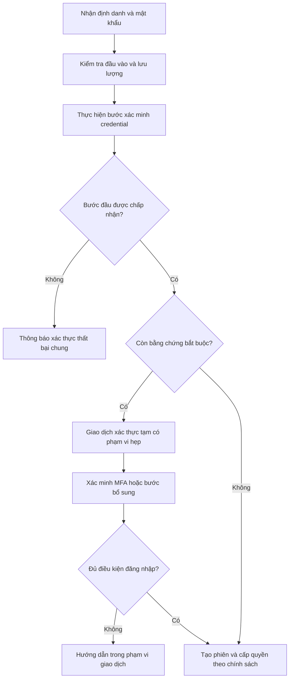

# Thông báo lỗi đăng nhập an toàn

## 1. Thông báo lỗi là một phần của cơ chế xác thực

Trong một hệ thống IAM, thông báo khi đăng nhập thất bại vừa hướng dẫn người dùng, vừa cung cấp thông tin cho người đang thử tấn công. Một câu như “Email đã tồn tại nhưng mật khẩu sai” giúp đối thủ xác nhận danh tính có trong hệ thống mà không cần đăng nhập thành công.

Mục tiêu là cung cấp đủ thông tin để người dùng tiếp tục thao tác, trong khi không tiết lộ trạng thái tài khoản hoặc dữ liệu xác thực cho người chưa có bằng chứng phù hợp. Việc này áp dụng cho cả giao diện web, API, ứng dụng di động và luồng SSO được tích hợp vào nền tảng.

Sau bài học, người học có thể thiết kế thông báo lỗi chung, phân biệt thông tin công khai với nguyên nhân nội bộ, nhận diện kênh rò rỉ qua HTTP và thời gian, và xử lý lỗi trong luồng mật khẩu kết hợp MFA.

Giả sử nền tảng có ba trường hợp:

```text
A. Không có tài khoản mang định danh được nhập.
B. Có tài khoản, nhưng mật khẩu ứng viên không đúng.
C. Có tài khoản, nhưng tài khoản đang bị vô hiệu hóa.
```

Ở bước đăng nhập công khai bằng mật khẩu, cả ba có thể cùng nhận:

> Không thể đăng nhập bằng thông tin đã cung cấp. Hãy kiểm tra lại hoặc sử dụng chức năng khôi phục tài khoản.

Không cần nói “mật khẩu sai” khi nguyên nhân thực tế có thể khác. Đồng thời, thông báo chung không có nghĩa mọi lỗi hạ tầng đều bị ghi nhận thành sai mật khẩu; đội vận hành vẫn cần phân biệt nguyên nhân bằng dữ liệu nội bộ có kiểm soát.

OWASP mô tả việc sử dụng phản hồi chung cho các trường hợp sai thông tin, tài khoản không tồn tại hoặc bị khóa/vô hiệu hóa, nhằm giảm khả năng dò tài khoản. Xem [OWASP Authentication Cheat Sheet — Authentication Responses](https://cheatsheetseries.owasp.org/cheatsheets/Authentication_Cheat_Sheet.html#authentication-responses).

## 2. Đối thủ có thể học được gì từ một lần thất bại?

### 2.1. Dò sự tồn tại của tài khoản

Account enumeration là việc xác định định danh nào được hệ thống chấp nhận là tài khoản. Danh sách này có thể phục vụ password spraying, credential stuffing, phishing hoặc dò thành viên của một tổ chức.

Ví dụ, nếu hai địa chỉ nhận hai câu trả lời khác nhau:

```text
an@example.test → Mật khẩu không đúng.
vy@example.test → Không tìm thấy người dùng.
```

Đối thủ biết địa chỉ nào đáng tiếp tục thử. Dữ liệu bị lộ có thể còn nhạy cảm hơn sự tồn tại: một dịch vụ y tế, một cổng nội bộ hoặc một nhóm quản trị có thể để lộ quan hệ của một người với tổ chức.

### 2.2. Dò trạng thái hoặc phương thức xác thực

Các thông báo như “Tài khoản này dùng SSO”, “Bạn chưa bật MFA”, “Tài khoản quản trị đã bị khóa” có thể tiết lộ kiến trúc hoặc trạng thái bảo mật. Chỉ nhập username chưa phải bằng chứng để được nhận những thông tin đó.

Một số hệ thống doanh nghiệp chủ động định tuyến theo domain để đưa người dùng đến IdP. Đây là lựa chọn sản phẩm có phạm vi tiết lộ được xác định, không phải bằng chứng rằng có thể công khai mọi trạng thái của từng tài khoản. Cần phân biệt thông tin tổ chức công khai với dữ liệu riêng của người dùng.

### 2.3. Kênh rò rỉ không chỉ là câu chữ

| Thành phần quan sát được | Ví dụ rò rỉ |
| --- | --- |
| Nội dung HTML/JSON | `reason: USER_NOT_FOUND` dù thông báo hiển thị là chung |
| Mã HTTP | Định danh không tồn tại trả một mã, sai mật khẩu trả mã khác |
| Header và cookie | Chỉ tài khoản tồn tại mới nhận cookie hoặc header riêng |
| URL chuyển hướng | `/login?error=locked` khác với `/login?error=bad-password` |
| Kích thước phản hồi | Một nhánh chứa thêm hướng dẫn riêng hoặc dữ liệu hồ sơ |
| Thời gian | Không có tài khoản thì trả ngay, có tài khoản thì chạy KDF |
| Lưu lượng bên ngoài | Một nhánh gọi email/SMS đồng bộ trước khi phản hồi |

Đổi một câu trên giao diện không loại bỏ thông tin nằm trong JSON hoặc redirect. Chính sách phải bao phủ toàn bộ hợp đồng phản hồi ở cùng giai đoạn xác thực.

## 3. Phân loại thông tin trước khi chọn cách phản hồi

Không phải mọi thông báo chi tiết đều nguy hiểm. “Vui lòng nhập mật khẩu” mô tả dữ liệu request đang thiếu, không khẳng định tài khoản có tồn tại. Ngược lại, “Người dùng này bị khóa đến 10:30” tiết lộ trạng thái phía máy chủ.

| Nhóm lỗi | Người gọi đã biết điều gì? | Cách phản hồi phù hợp |
| --- | --- | --- |
| Thiếu trường bắt buộc, JSON sai cú pháp | Nội dung họ vừa gửi | Có thể chỉ rõ trường thiếu hoặc định dạng không được chấp nhận |
| Credential bị từ chối ở bước công khai | Chưa chứng minh quyền kiểm soát tài khoản | Dùng kết quả xác thực thất bại chung |
| Quá nhiều yêu cầu từ nguồn đang gọi | Lưu lượng của chính bên gọi | Có thể hướng dẫn chờ; tránh công khai trạng thái bộ đếm tài khoản |
| Giao dịch MFA đã được thiết lập hợp lệ | Đã hoàn tất bước trước, chưa hoàn tất đăng nhập | Hướng dẫn đúng bước trong phạm vi giao dịch |
| Dịch vụ xác thực tạm thời không sẵn sàng | Không thể kết luận credential đúng hay sai | Thông báo sự cố chung và ghi nguyên nhân vận hành riêng |
| Người đã đăng nhập thiếu quyền tài nguyên | Có danh tính/phiên được xác minh | Xử lý authorization theo chính sách tài nguyên |

Tầng validation không được biến thành một truy vấn tài khoản trá hình. Ví dụ, “Định danh không thuộc định dạng được hỗ trợ” có thể kiểm tra trước tra cứu; “Địa chỉ này chưa được xác minh” phải dựa trên dữ liệu hồ sơ và cần xem xét quyền tiết lộ.

Không áp chính sách độ mạnh của mật khẩu mới vào bước kiểm tra mật khẩu cũ. Một mật khẩu cũ có thể không còn thỏa chính sách tạo mới nhưng vẫn cần được xác minh theo kế hoạch migration. Việc báo “mật khẩu phải có ký tự đặc biệt” tại login có thể gây hiểu nhầm và làm người dùng không đăng nhập được.

## 4. Thiết kế hợp đồng HTTP và thông điệp công khai

### 4.1. Một mã ổn định cho nhóm credential bị từ chối

Với endpoint đăng nhập do ứng dụng tự thiết kế, chọn một kết quả công khai ổn định cho các nguyên nhân mà người chưa xác thực không được phân biệt. Mã máy đọc được có thể là `AUTHENTICATION_FAILED`, còn câu chữ được dịch theo locale.

Ví dụ sau minh họa API riêng dùng `400` để biểu diễn bộ thông tin đăng nhập bị từ chối. Đây là lựa chọn hợp đồng của ví dụ, không phải schema lỗi OAuth hoặc yêu cầu mọi API login dùng cùng mã này.

```http
HTTP/1.1 400 Bad Request
Content-Type: application/json
Cache-Control: no-store

{
  "code": "AUTHENTICATION_FAILED",
  "message": "Không thể đăng nhập bằng thông tin đã cung cấp.",
  "requestId": "6d1adc67-9c38-4c3d-8abc-13ef02f24c45"
}
```

`requestId` do máy chủ cấp, dùng để hỗ trợ tra cứu, không chứa username, account ID, lý do từ chối hoặc token. Mọi request trong nhóm thất bại này đều có cùng cấu trúc, bất kể tài khoản có tồn tại hay không.

Không đưa dữ liệu nội bộ dưới các khóa như `debug`, `details`, `accountExists` hoặc `exceptionClass`. Việc frontend không hiển thị những khóa đó không ngăn người gọi đọc response bằng công cụ mạng.

### 4.2. Dùng đúng ngữ nghĩa của giao thức

Nếu endpoint dùng `401`, RFC 9110 yêu cầu phản hồi có `WWW-Authenticate` với challenge áp dụng được cho tài nguyên. Không thêm bừa một challenge `Bearer` chỉ để đủ header khi endpoint thực tế đang nhận một cơ chế khác. `403` diễn đạt việc máy chủ từ chối thực hiện request; mã này không phải cách mặc định thông báo tài khoản có tồn tại nhưng bị khóa.

Tham khảo [RFC 9110, mục 15.5.2 và 15.5.4](https://www.rfc-editor.org/rfc/rfc9110.html#name-401-unauthorized). Với OAuth/OIDC hoặc cơ chế đăng nhập do framework quản lý, giữ đúng hợp đồng của giao thức và cấu hình ánh xạ lỗi tại ranh giới được hỗ trợ.

Sự nhất quán cần có giữa các nguyên nhân nhạy cảm trong cùng một bước. Không cần cố biến request sai cú pháp, credential thất bại, giới hạn lưu lượng và toàn hệ thống bị quá tải thành một mã duy nhất. Tuy vậy, cách phân loại không được phụ thuộc vào sự tồn tại của tài khoản một cách quan sát được.

### 4.3. Header, URL và cache

Tránh đưa định danh, mật khẩu hoặc nguyên nhân nội bộ vào query string của URL lỗi. URL có thể được giữ trong lịch sử, access log và hệ thống phân tích. Nếu dùng redirect sau gửi biểu mẫu, các nhánh từ chối nhạy cảm nên về cùng một đích công khai và không đính kèm `userExists=true`.

Phản hồi chứa trạng thái xác thực hoặc dữ liệu nhạy cảm cần chính sách cache phù hợp, ví dụ `Cache-Control: no-store`. Nếu giao diện cần một anonymous cookie hoặc token CSRF, cách cấp chúng không được vô tình trở thành dấu hiệu chỉ xuất hiện cho tài khoản có thật.

## 5. Giảm khác biệt thời gian trong bước kiểm tra mật khẩu

### 5.1. Nhánh trả về sớm thường gặp

Đoạn giả mã sau tạo chênh lệch rõ ràng:

```text
account = findAccount(identifier)
if account không tồn tại:
    return lỗi chung

if verifyPassword(password, account.verifier) == false:
    return lỗi chung
```

Nhánh không có tài khoản không chạy password KDF. Trong khi đó, nhánh có tài khoản phải tính Argon2id, bcrypt hoặc PBKDF2. Đối thủ có thể gửi nhiều mẫu và phân tích phân bố thời gian, dù một lần đo có nhiễu mạng.

### 5.2. Dummy verifier và đường xử lý tương đương

Một kỹ thuật thường dùng là chuẩn bị một dummy verifier hợp lệ trước khi phục vụ request. Nó được tạo với cấu hình hashing được chọn, không gắn với một tài khoản thật và không được phép tạo phiên.

```text
kiểm tra kích thước request và giới hạn lưu lượng
account = findAccount(tenant, identifier)
verifier = account có verifier cục bộ hợp lệ
           ? account.verifier
           : precomputedDummyVerifier

passwordMatches = passwordEncoder.matches(candidatePassword, verifier)

if account không tồn tại
   OR account không có cơ chế mật khẩu cục bộ
   OR passwordMatches == false
   OR account không được phép đăng nhập:
    ghi nhận kết quả nội bộ phù hợp
    return AUTHENTICATION_FAILED

tiếp tục đánh giá bước MFA hoặc tạo phiên theo chính sách
```

Dummy verifier được tính sẵn, không tạo một hash mới ở mỗi request. Ngay cả nếu mật khẩu ứng viên tình cờ khớp dummy verifier, điều kiện tài khoản tồn tại và cơ chế đăng nhập vẫn bắt buộc, nên không được coi là xác thực thành công.

Không kiểm tra trạng thái khóa rồi trả ngay trước KDF nếu điều đó tạo chênh lệch cần che giấu. Thứ tự cụ thể có thể do framework quyết định; cần hiểu và cấu hình cơ chế có sẵn thay vì thêm một lớp handler chỉ đổi văn bản sau khi phần rò rỉ đã xảy ra.

### 5.3. Giới hạn của kỹ thuật

Dummy verifier giảm một chênh lệch lớn, không chứng minh toàn endpoint chạy constant-time. Database cache, truy vấn tenant, hash legacy có tham số khác nhau và lệnh gọi bên ngoài vẫn có thể tạo khác biệt.

Giả sử tài khoản mới dùng Argon2id còn tài khoản cũ dùng bcrypt. Một dummy profile duy nhất có thể không khớp thời gian với cả hai nhóm. Cần đánh giá tập profile được hỗ trợ, kế hoạch nâng cấp và mức rủi ro, không tuyên bố đã che mọi tín hiệu chỉ vì hai nhánh cùng gọi hàm `matches`.

Không tùy tiện cộng một `sleep` cố định hay jitter rồi coi vấn đề đã được giải quyết. Độ trễ ngẫu nhiên có thể bị giảm tác động bằng nhiều phép đo, trong khi việc giữ worker/thread chờ làm tăng chi phí phục vụ. Kiểm soát lưu lượng và giới hạn số KDF đồng thời vẫn cần thiết.

## 6. Ví dụ Java: tách nguyên nhân nội bộ khỏi dữ liệu công khai

Đoạn mã sau dành cho Java 17 trở lên, minh họa một mapper hẹp. Nó không thực hiện đăng nhập và không quyết định danh tính đã được xác thực hay chưa.

```java
import java.util.Objects;
import java.util.UUID;

public final class PublicLoginErrors {
    public enum InternalDenial {
        UNKNOWN_ACCOUNT,
        PASSWORD_MISMATCH,
        ACCOUNT_LOCKED,
        ACCOUNT_DISABLED,
        LOCAL_PASSWORD_NOT_AVAILABLE
    }

    public record ErrorBody(String code, String message, String requestId) {}

    public record ErrorResponse(int status, ErrorBody body) {}

    private PublicLoginErrors() {}

    public static ErrorResponse credentialsRejected(
            InternalDenial reason, UUID serverRequestId) {
        Objects.requireNonNull(reason);
        Objects.requireNonNull(serverRequestId);

        // reason chỉ dùng ở nhánh audit nội bộ, không được serialize ra client.
        return new ErrorResponse(
                400,
                new ErrorBody(
                        "AUTHENTICATION_FAILED",
                        "Không thể đăng nhập bằng thông tin đã cung cấp.",
                        serverRequestId.toString()));
    }
}
```

Mọi giá trị `InternalDenial` đều ánh xạ sang cùng status, code và thông báo. `requestId` khác nhau theo request, nhưng không mã hóa nguyên nhân. Controller chỉ serialize `ErrorBody` với status được chọn, thay vì serialize đối tượng chứa exception hoặc toàn bộ account.

Tầng audit nhận `reason` bằng một giao diện riêng có quyền truy cập phù hợp. Không đưa enum nội bộ vào response rồi trông chờ frontend che nó. Không dùng `exception.getMessage()` làm thông báo công khai: nội dung exception có thể chứa username, câu SQL, đường dẫn hoặc dữ liệu provider.

Mapper này chỉ áp dụng cho nhóm từ chối credential đã xác định. Lỗi CSRF, timeout dịch vụ, lỗi chữ ký token và sự cố gửi challenge cần đi qua hợp đồng xử lý tương ứng; việc ánh xạ không được vô tình tạo thành công hoặc bỏ qua bước bắt buộc.

Khi sử dụng Spring Security, `DaoAuthenticationProvider` kết hợp dịch vụ tải người dùng với `PasswordEncoder` trong luồng xác thực. Việc đổi handler hoặc bật trả lỗi chi tiết phải được xem xét cùng hành vi provider, không chỉ cùng giao diện. Xem [Spring Security — DaoAuthenticationProvider](https://docs.spring.io/spring-security/reference/servlet/authentication/passwords/dao-authentication-provider.html).

## 7. Thông báo thay đổi theo bằng chứng và giai đoạn xác thực

Thông tin được phép tiết lộ phụ thuộc vào trạng thái được máy chủ xác minh, không phụ thuộc một tham số client tự khai như `passwordVerified=true`.



### 7.1. Tại màn hình mật khẩu công khai

Chưa xác minh được quyền kiểm soát tài khoản thì không hiển thị danh sách yếu tố đã đăng ký, số điện thoại đầy đủ, trạng thái khóa hoặc tên đơn vị nội bộ. Link “Quên mật khẩu” và “Liên hệ hỗ trợ” có thể hiện cho tất cả người dùng, không chỉ khi tra cứu thấy tài khoản.

Một gợi ý như “Kiểm tra bộ gõ hoặc trạng thái Caps Lock” dựa trên thao tác nhập có thể hữu ích. Tránh phản hồi “Mật khẩu gần đúng” hoặc “Chỉ sai một ký tự”, vì việc đó cung cấp thêm dữ liệu về secret.

### 7.2. Khi bước MFA đã được thiết lập hợp lệ

Sau khi máy chủ chấp nhận bước đầu, hệ thống có thể hướng dẫn người dùng nhập mã hoặc sử dụng authenticator đã được chọn. Giao dịch tạm phải gắn với đúng tài khoản, client, bước xác thực, hạn dùng và trạng thái chống replay theo thiết kế.

Ví dụ thông báo:

> Không thể xác minh mã. Hãy kiểm tra lại hoặc dùng một phương thức khôi phục đã đăng ký.

Không cần phân biệt chi tiết mã sai, đã hết hạn hay đã sử dụng nếu việc đó không phục vụ quyết định hữu ích cho người dùng. Không trả seed TOTP, mã dự kiến hoặc số lần thử còn lại chính xác trong response.

Việc đã vào màn hình MFA không phải là đăng nhập hoàn tất. Không cấp access token có quyền nghiệp vụ, gán role hoặc gọi API nhạy cảm chỉ dựa trên giao dịch tạm. Lỗi gửi SMS cũng không phải lý do tự bỏ qua yếu tố thứ hai.

### 7.3. Khi cần thay credential hoặc có hạn chế tài khoản

Nếu chính sách yêu cầu đổi mật khẩu sau khi bước xác minh phù hợp thành công, tạo một luồng có phạm vi chỉ thực hiện thay đổi đó. Không biến việc biết username thành quyền được đọc trạng thái “mật khẩu đã hết hạn”.

Với tài khoản bị đình chỉ hoặc cần hỗ trợ, hệ thống có thể cung cấp hướng dẫn chi tiết qua phiên đã được phép, một kênh đã xác minh hoặc quy trình hỗ trợ có thẩm quyền. Không mặc định rằng chỉ biết đúng mật khẩu đã đủ để đọc toàn bộ lý do xử lý nhân sự, gian lận hoặc đặc quyền.

### 7.4. Sau khi có danh tính và phiên hợp lệ

Người đã đăng nhập gọi API nhưng thiếu role RBAC hoặc không thỏa policy ABAC đang gặp lỗi cấp quyền. Có thể thông báo “Bạn không có quyền thực hiện thao tác này” theo chính sách tài nguyên, thay vì nói sai mật khẩu.

Ngay cả ở giai đoạn này, không cần công khai tên policy nội bộ, danh sách role đặc quyền hoặc sự tồn tại của tài nguyên mà người gọi không được biết. Tính chi tiết tăng theo quyền và nhu cầu thực tế, không tăng chỉ vì request đã có một chuỗi token.

## 8. Phối hợp với giới hạn lưu lượng và chống khóa tài khoản

Thông báo chung làm giảm thông tin của mỗi lần thử, nhưng không ngăn đối thủ gửi hàng triệu request. Cần phối hợp với rate limiting, phát hiện password spraying và kiểm soát tài nguyên KDF.

NIST yêu cầu cơ chế hạn chế số lần xác thực thất bại theo các quy định áp dụng cho authenticator. Xem [NIST SP 800-63B-4 — Rate Limiting](https://pages.nist.gov/800-63-4/sp800-63b.html#throttle). Ngưỡng và hành động cụ thể cần được thiết kế theo cơ chế xác thực và yêu cầu của hệ thống.

### 8.1. Không biến quota thành bộ dò người dùng

Giả sử chỉ username có thật mới nhận `429`, trong khi username không tồn tại luôn nhận lỗi credential. Đối thủ có thể lặp request đến khi phân biệt được hai nhóm. Việc đồng nhất câu “Đăng nhập thất bại” không che được tín hiệu đó.

Một thiết kế cần xem xét cả giới hạn theo nguồn và theo định danh đang được gửi, kể cả định danh chưa tìm thấy tài khoản. Khóa giới hạn có thể dựa trên một biểu diễn đã chuẩn hóa theo đúng quy tắc của hệ thống; kho bộ đếm phải có TTL và giới hạn dung lượng để đầu vào ngẫu nhiên không làm đầy bộ nhớ.

Không trả về tổng số lần thử của một tài khoản hoặc thời điểm khóa chính xác chỉ dựa trên username. Nếu có `Retry-After` hoặc hướng dẫn thời gian chờ, cách phát sinh cần phù hợp với loại giới hạn công khai và không tiết lộ riêng trạng thái tài khoản phía sau.

### 8.2. Tránh hỗ trợ tấn công từ chối dịch vụ

Thông báo “Tài khoản đã bị khóa do bạn nhập sai năm lần” có thể vừa xác nhận sự tồn tại, vừa cho biết cách đối thủ ngăn chủ tài khoản đăng nhập. Chính sách throttling cần cân nhắc rủi ro khóa người dùng hợp lệ, không chỉ số lần thử của một IP.

Có thể kết hợp giới hạn nguồn, giới hạn theo định danh, thử thách theo rủi ro và giới hạn tài nguyên tổng. Không dùng một nguồn tín hiệu duy nhất để suy ra mọi người dùng sau cùng một NAT là cùng một đối thủ.

Không vô hiệu hóa kiểm soát lưu lượng chỉ để làm phản hồi đều nhau. Thứ tự hợp lý thường là kiểm tra request và kiểm soát lưu lượng trước công việc tốn tài nguyên; sau đó bảo đảm các nhánh cùng loại không để lộ trạng thái nhạy cảm qua hợp đồng phản hồi.

## 9. Viết thông báo hữu ích và dễ tiếp cận

Một thông báo an toàn vẫn cần trả lời được người dùng nên làm gì tiếp theo. Câu quá ngắn như “Có lỗi” không giúp họ phân biệt việc cần kiểm tra thông tin với việc chờ dịch vụ hoạt động trở lại.

| Tình huống công khai | Ví dụ thông điệp |
| --- | --- |
| Chưa nhập định danh | “Vui lòng nhập tên đăng nhập hoặc email.” |
| Chưa nhập mật khẩu | “Vui lòng nhập mật khẩu.” |
| Credential bị từ chối | “Không thể đăng nhập bằng thông tin đã cung cấp. Hãy kiểm tra lại hoặc khôi phục tài khoản.” |
| Lưu lượng bị hạn chế | “Có quá nhiều yêu cầu. Vui lòng chờ trước khi thử lại.” |
| Dịch vụ đang không sẵn sàng | “Dịch vụ đăng nhập tạm thời chưa sẵn sàng. Vui lòng thử lại sau.” |
| Không hoàn tất MFA | “Không thể xác minh. Hãy thử lại hoặc dùng phương thức khôi phục đã đăng ký.” |

Các câu ví dụ cần được gắn với đúng điều kiện máy chủ, không dùng câu “dịch vụ chưa sẵn sàng” chỉ cho tài khoản có thật. Với người dùng đã có phiên, có thể cung cấp hướng dẫn cụ thể hơn trong phạm vi họ được phép biết.

### Hiển thị trên giao diện

Đặt thông báo ở nơi dễ nhận biết, dùng văn bản thay vì chỉ một biểu tượng hoặc màu đỏ. Khi cập nhật lỗi mà không tải lại trang, bảo đảm công nghệ hỗ trợ nhận được thay đổi. W3C mô tả việc dùng live region hoặc `role="alert"` để thông báo lỗi động tại [WCAG Technique ARIA19](https://www.w3.org/WAI/WCAG22/Techniques/aria/ARIA19).

Không gắn riêng lỗi credential chung vào trường mật khẩu theo cách khẳng định username đúng. Có thể đặt một thông báo chung cho nhóm đăng nhập, còn lỗi thiếu trường được liên kết với trường tương ứng.

Cho phép người dùng sử dụng password manager, dán mật khẩu và kiểm tra việc nhập theo thiết kế giao diện. Không ghi lại nội dung mật khẩu vào analytics, event bàn phím hoặc công cụ quay lại phiên trình duyệt. Thông báo lỗi cũng không được hiển thị lại mật khẩu vừa nhập.

### Dịch và hỗ trợ người dùng

Giữ code máy đọc được ổn định, ví dụ `AUTHENTICATION_FAILED`, và dịch message ở lớp phù hợp. Bản dịch không được vô tình tiết lộ thêm “tài khoản tồn tại” trong khi bản gốc dùng câu chung.

Không chèn username chưa được xử lý an toàn vào HTML lỗi. Nếu cần giữ định danh người dùng vừa nhập để tiện sửa, biểu diễn nó như dữ liệu được escape đúng ngữ cảnh, không dùng `innerHTML` với chuỗi ghép từ request.

Có thể hiển thị mã hỗ trợ là request ID. Nhân viên hỗ trợ dùng mã đó để tìm sự kiện nội bộ theo quyền; người gọi không được dùng request ID như một bearer token để đọc hồ sơ hoặc kết quả xác thực chi tiết.

## 10. Giữ nguyên nhân thật ở kênh nội bộ có kiểm soát

Đội vận hành cần phân biệt tài khoản không tồn tại, sai mật khẩu, credential lỗi định dạng, tài khoản bị khóa, database timeout và IdP không phản hồi. Nếu gộp mọi nguyên nhân thành “sai mật khẩu” ngay trong hệ thống quan sát, việc phát hiện sự cố và tấn công sẽ khó hơn.

Một sự kiện nội bộ minh họa:

```text
event_type=AUTHENTICATION_DENIED
stage=PASSWORD
internal_reason=PASSWORD_MISMATCH
request_id=6d1adc67-9c38-4c3d-8abc-13ef02f24c45
tenant_id=tenant-7
account_id=u-104
```

Nếu không tìm thấy tài khoản, không tự tạo một account ID giả có thể bị nhầm với dữ liệu thật. Tùy nhu cầu điều tra, có thể lưu tham chiếu định danh dưới dạng giả danh hóa hoặc dữ liệu được bảo vệ theo chính sách. Một SHA-256 không khóa của email vẫn có thể bị dò bằng từ điển email, nên không mặc nhiên coi nó là dữ liệu ẩn danh.

Không ghi mật khẩu ứng viên, hash mật khẩu, mã MFA, reset token, session cookie, access token hoặc header Authorization. Bộ lọc log phải bao phủ reverse proxy, ứng dụng, APM và công cụ hỗ trợ, không chỉ logger của controller. OWASP trình bày việc ghi sự kiện bảo mật và loại trừ secret trong [Logging Cheat Sheet](https://cheatsheetseries.owasp.org/cheatsheets/Logging_Cheat_Sheet.html).

Thông tin nguồn như IP, thiết bị và định danh tài khoản cũng cần giới hạn truy cập và thời gian lưu phù hợp. Log nội bộ không được trở thành một API tra cứu công khai hoặc dashboard mà mọi nhân viên đều có thể xem.

Các trường do client gửi cần được xử lý để tránh log injection. Dùng structured logging, giới hạn độ dài và không tin một `requestId` tự do chứa dòng mới hoặc dữ liệu khác. Có thể nhận correlation ID theo hợp đồng đã kiểm soát, nhưng dùng ID máy chủ làm khóa hỗ trợ chính sẽ dễ quản lý hơn.

Với sự cố toàn hệ thống, trả thông báo tạm thời không sẵn sàng và cảnh báo đội vận hành theo nguyên nhân thật. Lỗi hash của một bản ghi riêng lẻ cũng cần được xử lý mà không trả stack trace hoặc biến tài khoản đó thành một nhánh công khai dễ nhận biết.

## 11. Giữ chính sách nhất quán qua các điểm vào IAM

### Khôi phục và đăng ký tài khoản

Nếu login dùng câu chung nhưng chức năng “Quên mật khẩu” trả “Email này chưa đăng ký”, đối thủ vẫn có đường dò tương đương. Cần xem cả hành trình: đăng nhập, đăng ký, reset, gửi lại email xác minh và kiểm tra lời mời.

Một thông báo recovery có thể là “Nếu thông tin phù hợp, hướng dẫn sẽ được gửi đến kênh đã đăng ký”. Không công khai số điện thoại hoặc địa chỉ khôi phục chỉ vì người gọi nhập đúng username. Gửi email nên được thiết kế để thời gian phản hồi và lỗi nhà cung cấp không làm lộ kết quả tra cứu.

### SSO và liên kết danh tính

Ở ranh giới OIDC/SSO, thông báo người dùng nên tách khỏi mã chẩn đoán và lỗi kỹ thuật IdP. Không hiển thị access token, authorization code, nội dung assertion hoặc chi tiết xác minh chữ ký trong trang lỗi.

Nếu có trang lỗi sau callback, việc xử lý vẫn phải tôn trọng kiểm tra giao dịch như `state` và các ràng buộc giao thức áp dụng. Không “xử lý lỗi thân thiện” bằng cách bỏ qua kiểm tra rồi tạo phiên với thông tin chưa được xác minh.

Các hệ thống có thể phải trả những code lỗi được giao thức quy định cho client đã đăng ký. Mục tiêu bảo mật là không đính kèm thêm trạng thái tài khoản nhạy cảm ngoài yêu cầu và quyền của bên nhận, không tự sửa mọi lỗi chuẩn thành một JSON tùy ý.

### Quyền, đặc quyền và workload identity

Lỗi đăng nhập công khai không cần nêu “Đây là tài khoản root”, “Thiếu role SUPER_ADMIN” hoặc danh sách quyền PAM. Những thông tin này không giúp người chưa xác thực khắc phục bước nhập mật khẩu một cách an toàn.

Thông báo cho workload identity hoặc API client cần theo đúng cơ chế credential của nó. Dùng mã lỗi máy đọc được ổn định, nhưng không đưa client secret, chứng chỉ riêng, khóa ký hoặc chi tiết tra cứu danh tính ra ngoài. Không áp nguyên văn UX mật khẩu người dùng lên mọi cơ chế xác thực máy.

## 12. Các tình huống để đánh giá thiết kế

Việc đánh giá cần so sánh những nhánh có cùng mức bằng chứng. Đăng nhập thành công có thể khác thất bại; vấn đề là những nguyên nhân thất bại mà người gọi chưa được biết lại có dấu hiệu riêng.

| Tình huống | Điều cần xác nhận trong triển khai |
| --- | --- |
| Username không tồn tại và username tồn tại nhưng sai mật khẩu | Cùng code, cấu trúc, thông báo và loại phản hồi công khai |
| Tài khoản bị khóa hoặc vô hiệu hóa | Không lộ trạng thái qua redirect, cookie hoặc chi tiết lỗi |
| Request thiếu mật khẩu | Validation rõ ràng nhưng không cần tra trạng thái tài khoản |
| Không có tài khoản và tài khoản có verifier | Không có khác biệt trả sớm quá rõ do bỏ qua KDF |
| Các profile hash legacy khác nhau | Hiểu chênh lệch thời gian và kế hoạch nâng cấp |
| Nhiều lần thử định danh không tồn tại | Quota và dung lượng bộ đếm vẫn được kiểm soát |
| Rate limit được kích hoạt | Không trở thành dấu hiệu chỉ dành cho tài khoản có thật |
| Bước mật khẩu đúng nhưng MFA chưa đạt | Chỉ có giao dịch tạm, không có quyền nghiệp vụ |
| IdP hoặc database gặp lỗi | Phản hồi không lộ chi tiết, quan sát nội bộ phân biệt được sự cố |
| Bản dịch hoặc mobile client khác | Không có bản nào trả thêm mã nguyên nhân nhạy cảm |
| Log và telemetry thu thập request | Credential và token được loại khỏi dữ liệu ghi nhận |

Với thời gian phản hồi, một lần đo không đủ để kết luận. Khi đánh giá trên hệ thống được phép kiểm tra, cần xét nhiều mẫu, trạng thái cache, tải đồng thời và phân bố độ trễ. Không công bố “constant-time” chỉ từ việc hai lần gọi có thời gian gần nhau.

Bài tập vận dụng: một ứng dụng hiển thị cùng câu “Đăng nhập thất bại”, nhưng trả `404` khi username không tồn tại, `403` khi bị khóa và `400` khi sai mật khẩu. Nhánh không tồn tại còn trả nhanh hơn vì không chạy password KDF.

Hãy đề xuất một hợp đồng phản hồi thay thế cho bước mật khẩu, vị trí xử lý dummy verifier, quy tắc thông báo ở bước MFA và dữ liệu được ghi vào audit. Phương án cần chỉ rõ cách người dùng nhận hướng dẫn hữu ích mà người chưa xác thực vẫn không dò được trạng thái tài khoản qua những khác biệt rõ ràng đó.
