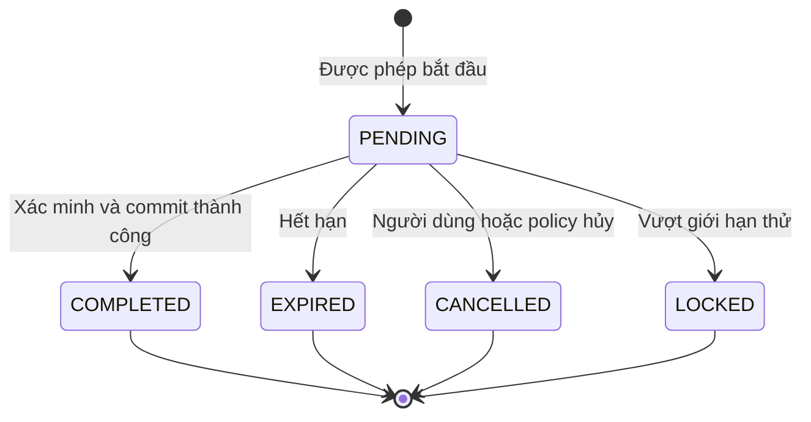

# MFA enrollment — Đăng ký yếu tố xác thực đa yếu tố

Một người dùng đăng nhập bằng mật khẩu, mở phần bảo mật và quét mã QR bằng ứng dụng xác thực. Nếu server đánh dấu “đã bật MFA” ngay khi hiển thị QR, người dùng có thể bị yêu cầu một yếu tố mà họ chưa cài đặt thành công. Nếu bất kỳ phiên đăng nhập nào cũng được phép thêm yếu tố mới, kẻ đánh cắp cookie có thể đăng ký authenticator của chính mình vào tài khoản nạn nhân.

**MFA enrollment** là quy trình đăng ký và ràng buộc một authenticator với đúng tài khoản, sau khi kiểm tra thẩm quyền và bằng chứng sử dụng authenticator đó. Quy trình hoàn tất cần tạo ra một phương thức xác thực dùng được, có thể quản lý trong vòng đời tài khoản và có dấu vết kiểm toán.

Trong nền tảng quản lý danh tính và quyền truy cập (IAM), enrollment nối việc cấp tài khoản với xác thực, quản lý phiên, recovery và bảo vệ đặc quyền. Nó không tự cấp vai trò, không thay đổi điều kiện ABAC và không biến một danh tính workload thành người dùng có MFA.

Sau bài học, người học có thể thiết kế trạng thái enrollment, mô tả luồng TOTP và WebAuthn, kiểm soát việc thêm hoặc thay yếu tố và xác định những bằng chứng cần có trước khi kích hoạt.

## 1. Đăng ký authenticator khác với thực hiện MFA

MFA kết hợp các loại yếu tố khác nhau, chẳng hạn điều người dùng biết và thứ người dùng kiểm soát. Hai bí mật cùng thuộc loại kiến thức, như mật khẩu và PIN nhập cho server, không tự trở thành hai loại yếu tố độc lập. [Nguồn: OWASP — Multifactor Authentication](https://cheatsheetseries.owasp.org/cheatsheets/Multifactor_Authentication_Cheat_Sheet.html)

Authenticator là phương tiện cụ thể tham gia xác thực: ứng dụng giữ TOTP seed, khóa bảo mật, hoặc credential khóa công khai được quản lý bởi authenticator. Enrollment thiết lập quan hệ giữa phương tiện đó và tài khoản; authentication kiểm chứng việc sử dụng nó trong một giao dịch xác thực.

| Hoạt động | Câu hỏi cần trả lời |
| --- | --- |
| Enrollment | Có được phép gắn authenticator mới vào tài khoản này không? |
| Xác nhận authenticator mới | Bên đăng ký có thể cung cấp bằng chứng đúng từ authenticator vừa thiết lập không? |
| Authentication | Bằng chứng hiện tại có đáp ứng yêu cầu đăng nhập hoặc step-up không? |
| Recovery | Khi mất phương tiện cần thiết, bằng chứng thay thế nào được chấp nhận? |
| Authorization | Sau xác thực, danh tính được làm những hành động nào? |

Một tài khoản có hai authenticator đã đăng ký chưa chứng minh mọi phiên của tài khoản đều được xác thực bằng MFA. Ngược lại, một authenticator có cơ chế xác minh người dùng phù hợp có thể tham gia một phương thức đa yếu tố mà không cần hai màn hình nhập mã riêng biệt.

Ví dụ, PIN hoặc sinh trắc học dùng cục bộ để mở khóa credential trên authenticator không giống một trường PIN gửi đến server. Khi đánh giá phương thức, cần xem giao thức, yêu cầu user verification và chính sách bảo đảm, thay vì đếm số lần người dùng bấm nút.

## 2. Phân biệt ba tình huống enrollment

### 2.1. Đăng ký yếu tố đầu tiên

Người dùng mới chưa có MFA nên không thể bị yêu cầu xác thực bằng một yếu tố MFA đã tồn tại. Hệ thống cần một đường bootstrap rõ ràng: phiên khởi tạo tài khoản, xác thực hiện có và các điều kiện cấp phát phù hợp với mô hình danh tính.

Nếu tổ chức bắt buộc MFA trước khi dùng ứng dụng, phiên bootstrap có thể chỉ cho phép hoàn tất enrollment và những thao tác hỗ trợ cần thiết. Nó không được tự có quyền gọi API nghiệp vụ chỉ vì tài khoản đã được gán vai trò quản trị từ trước.

Bootstrap cũng là thời điểm nhạy cảm: kẻ đã lấy mật khẩu trước khi chủ tài khoản đăng ký MFA có thể tìm cách gắn authenticator của mình. Việc bật MFA về sau không chứng minh toàn bộ quá trình khởi tạo trước đó đáng tin cậy.

### 2.2. Thêm authenticator dự phòng

Người dùng đã có phương thức xác thực, nay thêm một khóa bảo mật hoặc ứng dụng khác. Đây là thay đổi tập credential của tài khoản, không chỉ là thêm một tùy chọn giao diện.

NIST SP 800-63B-4 yêu cầu xác thực khi gắn authenticator mới ở mức thấp hơn giữa AAL tối đa hiện có của tài khoản và AAL tối đa mà authenticator mới sẽ dùng. Ví dụ, gắn phương tiện phù hợp AAL2 thường cần AAL2, trừ khi tài khoản hiện chỉ có khả năng AAL1. NIST cũng yêu cầu thông báo độc lập với giao dịch gắn authenticator. [Nguồn: NIST — Binding an Additional Authenticator](https://pages.nist.gov/800-63-4/sp800-63b.html#binding-an-additional-authenticator)

Khi áp dụng vào sản phẩm, bằng chứng phải được server đánh giá theo chính sách; một cờ `recentlyVerified=true` do client gửi không có giá trị thay thế.

### 2.3. Thay thế authenticator

Người dùng đổi điện thoại nhưng còn sử dụng được thiết bị cũ thì có thể đi qua đường thêm và xác nhận phương tiện mới, rồi thu hồi phương tiện cũ theo chính sách.

Nếu người dùng đã mất mọi phương thức được yêu cầu, đó là tình huống recovery. Không bỏ qua yêu cầu xác thực chỉ vì họ bấm vào nút “thay điện thoại”.

OWASP khuyến nghị xác thực lại bằng yếu tố đã đăng ký, không chỉ tin phiên đang hoạt động, và coi thay yếu tố là thao tác rủi ro cao. [Nguồn: OWASP — Changing MFA Factors](https://cheatsheetseries.owasp.org/cheatsheets/Multifactor_Authentication_Cheat_Sheet.html#changing-mfa-factors)

## 3. Chọn phương thức trước khi thiết kế màn hình

Mỗi loại authenticator cần bằng chứng enrollment khác nhau. Một endpoint chung chỉ nhận tên thiết bị rồi đánh dấu active sẽ bỏ qua các khác biệt này.

| Phương thức | Dữ liệu chính tại server | Bằng chứng hoặc thao tác cần xử lý |
| --- | --- | --- |
| TOTP | Shared secret được bảo vệ, tham số thuật toán và trạng thái chống phát lại | Mã hợp lệ từ ứng dụng giữ cùng secret |
| WebAuthn/passkey | Credential ID, khóa công khai và metadata cần thiết | Kết quả registration ceremony được server xác minh |
| SMS hoặc cuộc gọi | Kênh liên lạc đã ràng buộc và metadata phương thức | Xác minh kênh theo luồng có kiểm soát |
| Push qua ứng dụng | Quan hệ giữa tài khoản và ứng dụng/thiết bị được chấp thuận | Quy trình ghép cặp và xác nhận phù hợp |

TOTP thuận tiện cho nhiều hệ thống, nhưng mã người dùng nhập có thể bị lừa chuyển tiếp. WebAuthn có cơ chế ràng buộc với relying party; việc đáp ứng mức bảo đảm cụ thể vẫn phụ thuộc cấu hình và đặc tính authenticator. SMS có rủi ro riêng của số điện thoại và hạ tầng viễn thông. Hỗ trợ nhiều phương thức không có nghĩa chúng được chấp nhận thay thế nhau trong mọi hành động.

Chính sách có thể cho phép TOTP đối với người dùng thông thường, đồng thời yêu cầu phương thức chống phishing cho thao tác quản trị. Trong trường hợp đó, “đã đăng ký một phương thức bất kỳ” không phải điều kiện đủ để cấp quyền thực hiện thao tác quản trị.

## 4. Trạng thái enrollment phải tách khỏi credential đang có hiệu lực

Một lần đăng ký có thể được mô hình hóa bằng một **enrollment attempt**. Attempt giữ ngữ cảnh và vật liệu tạm; credential chỉ được đưa vào tập sử dụng sau khi hoàn tất điều kiện.



`COMPLETED` là trạng thái của attempt, còn `ACTIVE` hoặc `REVOKED` là trạng thái của credential được quản lý sau đó. Tách hai khái niệm giúp tránh hiểu việc hủy một attempt là tắt authenticator đang hoạt động.

Một bản ghi attempt minh họa:

```text
attempt_id: opaque-enrollment-reference
subject_id: internal-subject-reference
tenant_id: internal-tenant-reference
purpose: ENROLL_TOTP
state: PENDING
initiating_session_id: server-side-session-reference
authorization_context_id: server-side-proof-reference
security_version: 12
expires_at: server-controlled-expiration
failed_attempts: 0
pending_secret_ref: protected-secret-reference
```

Không dùng `attempt_id` như bằng chứng duy nhất cho phép hoàn tất. Server còn phải kiểm tra tài khoản, tenant, phiên hoặc quyền enrollment được cấp, thời hạn và trạng thái hiện hành.

Trong ví dụ, attempt có thể hết hạn sau 10 phút. Đây là lựa chọn sản phẩm để giới hạn thời gian giữ vật liệu chờ, không phải thời hạn bắt buộc của mọi giao thức MFA.

Mở nhiều tab cũng cần có hành vi xác định. Nếu hệ thống chỉ cho một attempt TOTP đang chờ, việc tạo attempt mới phải làm attempt cũ mất hiệu lực một cách nhất quán; mã từ QR cũ không được kích hoạt secret mới.

## 5. Luồng đăng ký TOTP

TOTP tạo mã từ shared secret và giá trị thời gian theo bước. RFC 6238 mô tả mô hình này, mặc định bước thời gian 30 giây và yêu cầu không chấp nhận lại OTP đã được xác minh thành công trong cùng bước. Cửa sổ lệch thời gian phải được giới hạn. [Nguồn: RFC 6238](https://www.rfc-editor.org/rfc/rfc6238.html)

### 5.1. Bắt đầu bằng một ngữ cảnh đã được cho phép

Người dùng yêu cầu bắt đầu enrollment. Server lấy tài khoản từ ngữ cảnh đã xác thực và xác định policy cho trường hợp đầu tiên, thêm mới hoặc thay thế.

```http
POST /me/mfa/enrollments/totp
```

Không nhận `userId` tùy ý rồi gắn secret vào tài khoản đó. Với chức năng quản trị thay người dùng, cần một quyền và luồng riêng, có kiểm toán; không tái sử dụng endpoint tự phục vụ mà bỏ qua kiểm tra chủ thể.

Nếu ngữ cảnh chưa đủ mức hoặc quá cũ theo policy, server yêu cầu reauthentication hoặc step-up trước khi cấp quyền bắt đầu. Bằng chứng mới phải phục vụ đúng tài khoản và hành động nhạy cảm này.

### 5.2. Tạo secret tạm và chuyển cho ứng dụng

Server sinh secret bằng bộ sinh ngẫu nhiên mật mã, chọn bộ tham số được thư viện và ứng dụng hỗ trợ, rồi tạo dữ liệu provisioning để hiển thị dưới dạng QR hoặc khóa nhập tay. Vật liệu đó được gắn với đúng attempt ở trạng thái `PENDING`.

QR provisioning chứa dữ liệu cho phép ứng dụng tạo mã; nó không phải hình ảnh vô hại. Bên sao chép được seed có thể tạo các mã tương ứng. Không gửi seed qua công cụ analytics, log, ticket hỗ trợ hoặc email chẩn đoán.

Một seed được quét vào hai ứng dụng tạo ra hai bản sao của cùng bí mật. Server không thể chỉ từ một mã TOTP kết luận nó đến từ bản sao vật lý nào. Vì vậy, tên hiển thị như “điện thoại cá nhân” chỉ là nhãn quản lý, không phải bằng chứng định danh thiết bị.

### 5.3. Xác nhận bằng mã từ secret đang chờ

Người dùng nhập mã được ứng dụng tạo ra. Request minh họa:

```http
POST /me/mfa/enrollments/<attempt-id>/confirm
Content-Type: application/json

{"otp":"<ma-tu-ung-dung-xac-thuc>"}
```

Server xác định secret từ attempt, không dùng một secret do request xác nhận gửi lên để thay vật liệu đã cấp. OTP được giữ dưới dạng chuỗi để bảo toàn chữ số 0 đầu; định dạng và số chữ số phải khớp phương thức được cấu hình.

Việc người dùng đã mở trang, tải QR hay bấm “đã quét” không phải bằng chứng đủ. Một mã đúng chứng minh khả năng tạo mã từ shared secret tại thời điểm đó; nó không tự chứng minh nguồn gốc danh tính ngoài thẩm quyền enrollment đã được kiểm tra.

Sai mã không được dẫn tới kích hoạt. Giới hạn thử cần có tác dụng xuyên các node ứng dụng; tạo lại attempt không được trở thành cách vô hạn hóa ngân sách đoán cho cùng hành động.

### 5.4. Kích hoạt sau khi xác minh và commit

Nếu đủ điều kiện, server tạo credential hoạt động từ secret đã xác nhận và đánh dấu attempt hoàn tất trong cùng quyết định giao dịch. Trạng thái chống phát lại của credential mới cần ghi nhận bước thời gian đã được dùng để xác nhận.

Điều này có thể khiến người dùng phải chờ mã kế tiếp nếu ngay sau enrollment họ thực hiện một giao dịch xác thực riêng. Không xóa trạng thái chống phát lại chỉ để chấp nhận lại mã vừa dùng.

Nếu attempt hết hạn hoặc người dùng hủy, vật liệu tạm cần bị vô hiệu hóa và được dọn theo chính sách lưu. Một QR cũ không được tiếp tục là cách kích hoạt credential trong tương lai.

## 6. Bảo vệ TOTP seed khác với bảo vệ OTP

TOTP verifier cần shared secret để tính và đối chiếu mã. Chỉ lưu một hash không thể đảo ngược của seed sẽ không cung cấp vật liệu cần thiết cho cách xác minh TOTP thông thường.

Một thiết kế có thể lưu seed dưới dạng mã hóa bằng cơ chế quản lý khóa của hệ thống, giới hạn quyền giải mã cho thành phần xác thực và ghi phiên bản khóa. Nếu dùng mã hóa có xác thực, ngữ cảnh ràng buộc như tài khoản, tenant và loại credential cần được đưa vào thiết kế để hạn chế tráo vật liệu giữa các bản ghi.

| Dữ liệu | Nhu cầu xử lý | Điều cần tránh |
| --- | --- | --- |
| Seed đang chờ | Provisioning và xác nhận trong thời gian ngắn | Giữ vô thời hạn sau khi attempt kết thúc |
| Seed của credential active | Tính và xác minh TOTP | Plaintext trong cơ sở dữ liệu, log hoặc bản xuất hỗ trợ |
| OTP người dùng gửi | Đối chiếu cho một giao dịch | Log request body, lưu lịch sử OTP không cần thiết |
| Bước thời gian đã dùng | Kiểm soát phát lại | Chỉ giữ trong bộ nhớ của một node |
| Tham chiếu khóa mã hóa | Tìm đúng phiên bản khóa | Nhầm tham chiếu với việc lưu luôn khóa giải mã cạnh ciphertext |

Backup kho seed cũng chứa dữ liệu nhạy cảm và phải có kiểm soát tương ứng. Mã hóa ổ đĩa đơn thuần không thay thế phân quyền ứng dụng: một tài khoản dịch vụ có thể đọc và giải mã mọi seed vẫn tạo ra phạm vi ảnh hưởng lớn nếu bị chiếm.

Khi kho khóa hoặc thành phần xác minh không sẵn sàng, không bỏ qua bước xác nhận rồi đánh dấu enrollment thành công. Lỗi hạ tầng cần được phân biệt với mã sai để vận hành, nhưng cả hai đều không tạo credential đã xác minh.

## 7. Luồng đăng ký WebAuthn/passkey

WebAuthn registration sử dụng challenge do server cấp và kết quả từ `navigator.credentials.create()`. Server xác minh giao dịch trước khi lưu credential khóa công khai. Các kiểm tra gồm loại giao dịch, challenge, origin, RP ID, cờ user presence/user verification theo yêu cầu, thuật toán và attestation theo policy. [Nguồn: W3C WebAuthn — Registering a New Credential](https://www.w3.org/TR/webauthn-3/#sctn-registering-a-new-credential)

Luồng triển khai minh họa:

1. Server xác minh thẩm quyền enrollment rồi tạo attempt và challenge mới.
2. Client nhận creation options do server kiểm soát và yêu cầu authenticator tạo credential.
3. Client chuyển kết quả về server, gắn với attempt đang chờ.
4. Thư viện verifier thực hiện quy trình WebAuthn và policy tương ứng.
5. Server lưu credential hợp lệ, tiêu thụ challenge và hoàn tất attempt nguyên tử.

Danh sách trên mô tả điểm tích hợp, không thay thế đầy đủ thuật toán xác minh trong đặc tả. Giải mã được JSON hoặc nhận một `credentialId` từ trình duyệt chưa có nghĩa đã đăng ký hợp lệ.

### Ràng buộc cần giữ đúng

Challenge phải thuộc đúng phiên/ngữ cảnh đăng ký, tài khoản và tenant. Việc hoàn tất attempt A bằng response của attempt B phải bị từ chối, dù cả hai challenge từng được server cấp.

Origin và RP ID được xác định từ cấu hình tin cậy của ứng dụng. Không lấy origin kỳ vọng trực tiếp từ một trường do client cung cấp rồi đối chiếu với chính trường đó. Nếu sản phẩm có nhiều domain hoặc iframe, cần cấu hình những trường hợp được hỗ trợ và verifier phù hợp, không nới kiểm tra để “mọi domain đều chạy”.

Khi policy yêu cầu user verification, client yêu cầu tính năng đó và server phải xác minh bằng chứng tương ứng. Một thuộc tính giao diện như `userVerification: required` không tự bảo vệ được backend nếu backend không kiểm tra kết quả.

Khóa riêng thuộc mô hình quản lý của authenticator hoặc nhà cung cấp passkey, có thể bao gồm đồng bộ tùy loại credential. Không tự khẳng định mọi passkey là khóa gắn cứng với một thiết bị, hoặc rằng mọi credential được tạo thành công đều đáp ứng cùng mức bảo đảm.

Tại server, credential ID và khóa công khai phải được ràng buộc đúng tài khoản trong phạm vi RP. Không cho cùng một credential đã thuộc một tài khoản khác được chuyển chủ chỉ bằng một request đăng ký mới.

## 8. Hoàn tất nguyên tử và xử lý nhiều request

Thao tác nhạy cảm cần được kiểm tra lại tại thời điểm ghi. Giữa lúc bắt đầu và xác nhận, tài khoản có thể bị vô hiệu hóa, phiên có thể bị thu hồi hoặc chính sách có thể thay đổi.

Mã giả cho một lần xác nhận TOTP:

```text
Nhận attempt_id và OTP từ request đã được bảo vệ phù hợp.
Áp dụng giới hạn lưu lượng trước các thao tác tốn tài nguyên.

Trong giao dịch, theo thứ tự khóa thống nhất:
    Khóa/đọc tài khoản và attempt.
    Kiểm tra tài khoản, tenant và thẩm quyền hiện hành.
    Kiểm tra attempt còn PENDING và chưa hết hạn.
    Kiểm tra ngữ cảnh enrollment và phiên bản bảo mật còn hợp lệ.
    Lấy đúng secret đang chờ; xác minh OTP bằng thư viện được chọn.

    Nếu OTP sai:
        Ghi số lần thất bại một cách có hiệu lực.
        Chuyển LOCKED nếu đạt giới hạn.
        Không tạo credential active.

    Nếu OTP đúng:
        Kiểm tra giới hạn/điều kiện thêm credential của tài khoản.
        Tạo credential active với secret đã xác nhận.
        Lưu bước thời gian đã dùng để chống phát lại.
        Đánh dấu attempt COMPLETED và kết thúc quyền xác nhận của nó.
        Tăng phiên bản bảo mật nếu thiết kế dùng cơ chế đó.
        Ghi sự kiện thông báo/kiểm toán không chứa secret.

Commit trước khi trả thành công.
```

Nhánh ghi thất bại cần thực sự được lưu. Nếu tăng bộ đếm rồi ném exception làm rollback toàn transaction, giới hạn thử có thể không bao giờ tăng. Có thể tách cập nhật có điều kiện hoặc xử lý kết quả thay vì exception theo thiết kế framework.

Nếu giải mã hoặc xác minh phải gọi một dịch vụ từ xa, không mặc nhiên giữ khóa cơ sở dữ liệu trong toàn bộ thời gian chờ. Có thể chuẩn bị bằng chứng ngoài giao dịch rồi kiểm tra lại trạng thái, phiên bản và tính chưa sử dụng trước khi commit. Cơ chế cụ thể phải giữ được cùng bất biến, nhất là với hai request cạnh tranh.

Hai request cùng xác nhận một attempt chỉ được tạo một credential. Cần khóa, cập nhật có điều kiện, ràng buộc duy nhất hoặc cơ chế tương đương trong kho dữ liệu; kiểm tra `state == PENDING` ở tầng ứng dụng rồi ghi rời rạc chưa đủ.

Nếu transaction đã commit nhưng response bị mất, retry không được tạo credential thứ hai hoặc phát hành lại bí mật. Endpoint có thể trả trạng thái hoàn tất khi ngữ cảnh được phép xem kết quả, trong khi vẫn giữ attempt không thể thực hiện lại hành động.

## 9. Sẵn sàng recovery trước khi người dùng mất thiết bị

Enrollment nên hướng người dùng chuẩn bị cách quay lại khi phương tiện chính không còn dùng được. Có thể là authenticator dự phòng, recovery code hoặc quy trình khác theo chính sách. Việc này không có nghĩa cho phép bất kỳ phương thức yếu hơn nào thay thế trong mọi tình huống.

Một recovery code không phải TOTP seed. Code được sử dụng theo quy tắc recovery và tính một lần riêng; seed cho phép tạo nhiều mã TOTP theo thời gian. Không đưa QR provisioning cho người dùng rồi coi đó là bộ recovery code đã được quản lý.

Nếu cấp recovery code, cần sinh bằng cơ chế ngẫu nhiên phù hợp, bảo vệ biểu diễn lưu tại server và hạn chế việc hiển thị. Thiết kế lưu phụ thuộc entropy và phương thức code; không áp dụng máy móc một hash nhanh cho mọi mã số ngắn.

Khi tạo batch code mới, phải xác định lúc nào batch cũ mất hiệu lực và bảo đảm việc thay thế nhất quán. Nếu response hiển thị bị mất, hệ thống cần một đường cấp lại được xác thực, không mở một API trả plaintext của mọi code cũ cho bất kỳ phiên nào.

Giao diện cần hướng dẫn người dùng lưu phương án dự phòng ở nơi phù hợp. Một ô “tôi đã lưu” chỉ phản ánh thao tác giao diện, không chứng minh người dùng thực sự có bản sao khôi phục được.

Thay điện thoại khi thiết bị cũ vẫn hoạt động nên ưu tiên hoàn tất và kiểm tra phương tiện mới trước khi thu hồi phương tiện cũ. Trường hợp phát hiện lộ hoặc bị đánh cắp cần quyết định vô hiệu hóa khẩn cấp theo rủi ro; không duy trì credential đã lộ chỉ để giữ đủ số lượng phương tiện.

## 10. Sau enrollment: phiên, SSO và đặc quyền

### Không nâng mọi phiên bằng một cờ tài khoản

`mfa_enabled` có thể là dữ liệu tổng hợp để hiển thị tài khoản đã có phương thức hợp lệ. Nó không phải bằng chứng MFA của một phiên cụ thể.

Giả sử người dùng có một phiên cũ chỉ dùng mật khẩu và một phiên mới vừa hoàn tất enrollment. Việc thêm credential không tự khiến phiên cũ đã thực hiện yếu tố mới. Các quyết định yêu cầu step-up phải dựa vào bằng chứng, độ mới và ngữ cảnh xác thực của đúng phiên.

Tương tự, không chỉ nhìn tên trường `amr` hoặc `acr` trong một token rồi suy ra ý nghĩa tùy ý. Ứng dụng phải hiểu các giá trị và cam kết từ issuer được tin cậy. Ghi nhận kết quả enrollment và cấp một phiên xác thực đáp ứng policy là hai quyết định cần được liên kết có chủ đích.

### Tập trung tại nơi quản lý authenticator

Nếu IdP quản lý MFA trong mô hình SSO, ứng dụng sử dụng SSO thường không cần thu thập thêm TOTP seed của cùng người dùng. Ứng dụng cần yêu cầu và đánh giá mức xác thực theo hợp đồng tích hợp với IdP.

Nếu vẫn có đường local dự phòng, đường đó phải có policy riêng. Một tài khoản SSO không được âm thầm có thêm cách đăng nhập local chỉ vì người dùng vào trang cài đặt bảo mật.

Với API key, chứng thư hoặc danh tính workload, không áp mô hình quét QR của con người như thể nó thay thế quản lý secret. Quyền thao tác enrollment cho tài khoản con người và quyền cấp credential cho workload cần được tách theo chức năng.

### Giữ nguyên vòng đời quyền

Hoàn tất enrollment không mở lại tài khoản đã ngừng hoạt động, không thêm vai trò RBAC và không bỏ điều kiện ABAC. Nếu một tài khoản quản trị bị thu hồi quyền trong lúc attempt còn chờ, lúc commit vẫn phải dùng trạng thái hiện tại.

Thông báo về authenticator mới nên cho chủ tài khoản biết loại thay đổi, thời điểm và cách báo cáo nếu không phải họ thực hiện. Chỉ hiển thị “thành công” ngay trên phiên vừa thay đổi không đủ để người có phiên bị đánh cắp phát hiện hành vi đó.

## 11. Trải nghiệm người dùng và kiểm toán

Giao diện nên nói rõ phương thức đang đăng ký, tài khoản/tenant hiện tại và bước nào chưa hoàn tất. Với TOTP, cần có hướng dẫn quét QR hoặc nhập tay, giải thích mã có thời gian ngắn và cho phép thử lại trong giới hạn đã định.

Không hiển thị “MFA đã bật” trong khi credential còn chờ xác nhận. Nếu server hết hạn attempt, màn hình phải hướng người dùng bắt đầu lại và dùng vật liệu mới; không tiếp tục hiển thị QR cũ như còn hiệu lực.

Tên thiết bị nên có ích cho quản lý, nhưng không dùng nhãn do người dùng nhập để quyết định mức tin cậy. Các nhãn như “khóa công ty” hoặc “thiết bị an toàn” không chứng minh đặc tính kỹ thuật của authenticator.

Một sự kiện nội bộ minh họa:

```text
event_type: AUTHENTICATOR_ENROLLMENT_COMPLETED
subject_ref: internal-subject-reference
tenant_ref: internal-tenant-reference
authenticator_type: TOTP
attempt_ref: internal-attempt-reference
authorization_method: POLICY_APPROVED_REAUTHENTICATION
policy_version: mfa-enrollment-policy-v2
result: SUCCESS
```

Không đưa OTP, seed, QR provisioning, recovery code hoặc payload nhạy cảm đầy đủ vào log. Tham chiếu nội bộ cũng cần giới hạn quyền đọc và thời gian lưu, thay vì được xuất sang mọi công cụ phân tích.

Metric có thể theo dõi tỷ lệ bắt đầu/hoàn tất, lỗi xác nhận, attempt hết hạn, độ trễ dịch vụ khóa và loại phương thức. Không dùng user ID, secret hoặc challenge làm nhãn metric.

Khi tỷ lệ xác nhận thất bại tăng, cần phân biệt lỗi giờ hệ thống, không tương thích tham số, lỗi kho khóa và thử đoán. Mở rộng cửa sổ chấp nhận mã vô hạn không phải cách xử lý chung cho mọi lỗi trải nghiệm.

## 12. Các tình huống cần kiểm chứng khi triển khai

| Tình huống | Kết quả cần đạt |
| --- | --- |
| Bắt đầu lần đầu trong phiên bootstrap | Chỉ có quyền được policy cấp; chưa tự truy cập nghiệp vụ yêu cầu MFA |
| Thêm yếu tố bằng phiên đã quá cũ hoặc thiếu bằng chứng | Yêu cầu xác thực lại/step-up phù hợp |
| Client thay tài khoản hoặc tenant trong request | Không gắn credential sang chủ thể khác |
| Người dùng chỉ xem hoặc tải QR | Attempt còn chờ; credential chưa được kích hoạt |
| OTP đúng với secret khác attempt | Không xác nhận secret đang chờ |
| OTP có số 0 đầu | Đối chiếu theo chuỗi đúng định dạng, không làm mất chữ số |
| OTP sai nhiều lần qua nhiều node hoặc nhiều attempt | Giới hạn thử vẫn có hiệu lực |
| Hết hạn trước lúc commit | Không hoàn tất enrollment |
| Hai request xác nhận cùng lúc | Tạo nhiều nhất một credential cho attempt |
| Gọi lại sau khi response thành công bị mất | Không tái tạo credential hoặc phát hành lại secret |
| Dùng lại bước TOTP vừa xác nhận | Không bỏ qua trạng thái chống phát lại |
| WebAuthn sai challenge, origin, RP ID hoặc thiếu bằng chứng bắt buộc | Verifier từ chối; không lưu credential active |
| Credential đã thuộc tài khoản khác trong cùng phạm vi RP | Không chuyển chủ trái phép |
| Kho khóa hoặc dịch vụ xác minh lỗi | Không báo enrollment thành công |
| Hủy enrollment khi đã có yếu tố cũ | Không vô tình xóa credential cũ |
| Tài khoản bị vô hiệu hóa trong lúc đang đăng ký | Không mở lại hoặc cấp thêm quyền |
| Một phiên cũ không có MFA tiếp tục gọi API nhạy cảm | Vẫn phải đáp ứng policy của chính phiên đó |
| Bật log, trace, ghi phiên và báo lỗi | Không làm lộ vật liệu xác thực |

Các tình huống đồng thời cần được kiểm tra qua cơ chế giao dịch và kho trạng thái thực tế. Một màn hình chạy đúng khi thao tác lần lượt không chứng minh được khả năng chống replay hoặc race giữa nhiều request.

## 13. Tình huống tổng hợp

Một công ty bắt buộc MFA cho cổng quản trị. Nhân viên mới nhận tài khoản, đăng nhập lần đầu bằng credential đã được cấp theo quy trình của công ty và được đưa vào phiên bootstrap. Phiên này chỉ cho phép thiết lập authenticator và xem hướng dẫn liên quan.

Người dùng bắt đầu TOTP nhưng đóng trình duyệt trước khi xác nhận. Server để attempt hết hạn và không ghi rằng tài khoản đã sẵn sàng MFA. Lần sau, người dùng tạo attempt mới, quét QR mới và nhập mã đúng; backend xác minh, kích hoạt credential và gửi thông báo.

Sau một thời gian, người dùng thêm khóa bảo mật. Hệ thống yêu cầu bằng chứng từ phương thức đã đăng ký theo policy trước khi cho phép tạo credential mới. Khóa được xác minh qua WebAuthn rồi mới xuất hiện trong danh sách phương tiện sử dụng được.

Nếu sau đó điện thoại bị mất, người dùng còn khóa dự phòng để xác thực và xử lý credential TOTP bị mất. Nếu mọi phương tiện đều mất, họ đi vào recovery; helpdesk không tự xóa MFA chỉ dựa vào việc người gọi biết username.

Thiết kế này cần giữ ba mối ràng buộc: đúng người có thẩm quyền yêu cầu thay đổi, đúng authenticator được xác nhận và đúng trạng thái truy cập được cấp sau khi hoàn tất. Enrollment là điểm bắt đầu của vòng đời authenticator, không phải kết thúc trách nhiệm quản lý nó.

## Tài liệu tham khảo

- [NIST SP 800-63B-4 — Authenticator Binding](https://pages.nist.gov/800-63-4/sp800-63b.html#authenticator-binding)
- [OWASP Multifactor Authentication Cheat Sheet](https://cheatsheetseries.owasp.org/cheatsheets/Multifactor_Authentication_Cheat_Sheet.html)
- [RFC 6238 — TOTP: Time-Based One-Time Password Algorithm](https://www.rfc-editor.org/rfc/rfc6238.html)
- [W3C Web Authentication — Registering a New Credential](https://www.w3.org/TR/webauthn-3/#sctn-registering-a-new-credential)
