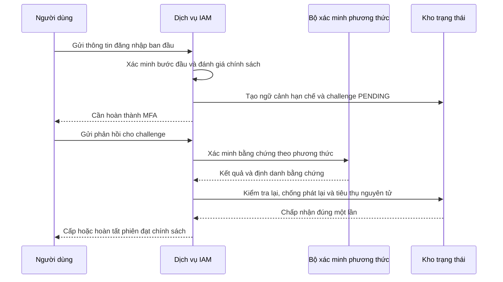
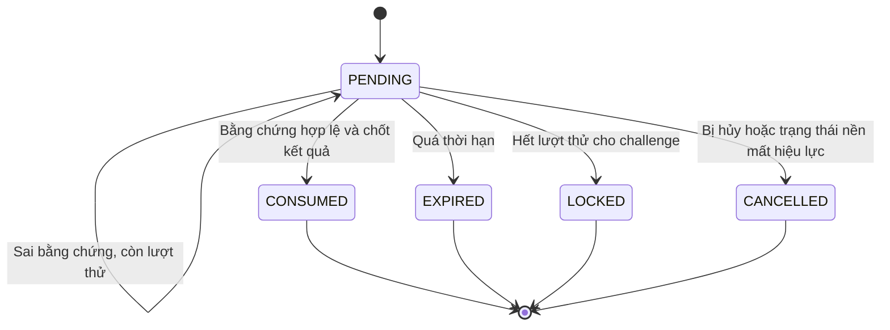

# MFA challenge

**MFA challenge** là một bước yêu cầu và xác minh bằng chứng xác thực trong một giao dịch đang chờ đạt chính sách đa yếu tố. Ví dụ, sau khi mật khẩu hợp lệ, hệ thống yêu cầu người dùng cung cấp mã từ ứng dụng xác thực hoặc sử dụng khóa bảo mật đã đăng ký trước khi cấp phiên đăng nhập đầy đủ.

Challenge không chỉ là màn hình nhập mã. Phía máy chủ phải biết ai đang được xác thực, yêu cầu thuộc phiên nào, dùng cho mục đích gì, chấp nhận phương thức nào và bằng chứng có còn hiệu lực hay chưa. Một mã đúng nhưng được dùng cho sai giao dịch không được xem là thành công.

Trong IAM, kết quả MFA bổ sung độ tin cậy của việc xác thực danh tính. Quyền thực hiện hành động vẫn cần được kiểm tra bằng vai trò, thuộc tính hoặc chính sách cấp quyền tương ứng. Hoàn thành MFA không tự cấp quyền quản trị hay bỏ qua giới hạn của tài khoản.

Sau bài này, người học có thể mô tả vòng đời challenge, phân biệt các loại bằng chứng, thiết kế ràng buộc và chống phát lại, đồng thời nhận ra giới hạn của luồng khôi phục hoặc SSO.

## 1. Hai nghĩa khác nhau của từ challenge

Trong ứng dụng IAM, từ này có thể chỉ hai đối tượng:

| Nghĩa | Nội dung | Ví dụ |
|---|---|---|
| Giao dịch xác thực đang chờ | Trạng thái do máy chủ quản lý để theo dõi một lần xác minh | Yêu cầu MFA sau bước mật khẩu |
| Challenge mật mã | Dữ liệu mới mà một giao thức dùng để tạo phản hồi mật mã | Byte ngẫu nhiên trong một yêu cầu WebAuthn |

Hai đối tượng có thể xuất hiện cùng lúc nhưng không phải là một. Ứng dụng có thể quản lý `challengeId` cho giao dịch và thêm `protocolChallenge` làm đầu vào WebAuthn.

TOTP là ví dụ quan trọng: mã được tạo từ bí mật dùng chung và bước thời gian, không phải bằng cách ký `challengeId` mà máy chủ vừa cấp. Ứng dụng vẫn có thể tạo một giao dịch MFA chờ nhập TOTP, nhưng không được suy rằng mã TOTP đã tự gắn về mặt mật mã với giao dịch đó.

MFA cũng không đơn giản là hỏi hai lần. Hai mật khẩu hoặc một mật khẩu cộng câu hỏi bí mật vẫn là các bằng chứng thuộc nhóm kiến thức. Cần xác định các yếu tố được sử dụng và mức bảo đảm mà cả quy trình đạt được. NIST phân biệt authenticator đơn yếu tố, đa yếu tố và việc nâng mức xác thực trong một phiên. [NIST SP 800-63B-4](https://pages.nist.gov/800-63-4/sp800-63b.html)

## 2. Khi nào cần tạo challenge?

Một chính sách IAM có thể yêu cầu MFA trong các tình huống:

- Thiết lập phiên đăng nhập cho tài khoản đã được yêu cầu MFA.
- Đăng nhập vào tài khoản đặc quyền hoặc từ ngữ cảnh rủi ro cao.
- Thực hiện hành động nhạy cảm khi phiên hiện tại chưa có bằng chứng đủ mạnh hoặc đủ mới.
- Thay phương thức xác thực, thay thông tin khôi phục hoặc quản lý khóa bảo mật.

Việc yêu cầu thêm bằng chứng trong một phiên đang hoạt động thường được gọi là **step-up authentication**. Ví dụ người dùng được xem hồ sơ bằng phiên hiện có, nhưng phải xác thực lại trước khi đổi phương thức MFA.

Không phải mọi hành động đều nên liên tục tạo một challenge mới. Tần suất và độ mới cần dựa trên mục đích, mức rủi ro và chính sách phiên. Tạo quá nhiều lời nhắc dễ khiến người dùng phê duyệt theo thói quen và làm trải nghiệm khó sử dụng.

Máy chủ quyết định chính sách. Một trường `requireMfa: false` hoặc `isTrustedDevice: true` do trình duyệt tự gửi không được tự tắt yêu cầu. Nếu có cơ chế ghi nhớ thiết bị, bằng chứng đó cần được xác minh và có vòng đời riêng.

Challenge xác thực dùng một phương thức **đã được đăng ký và còn hiệu lực**. Đăng ký một thiết bị mới là luồng khác: phải chứng minh đủ quyền trước khi coi thiết bị đó là yếu tố của tài khoản. Không cho người vừa biết mật khẩu tự thêm thiết bị rồi dùng chính thiết bị đó để vượt yêu cầu MFA bảo vệ việc đăng nhập.

## 3. Luồng đăng nhập và ngữ cảnh trước xác thực đầy đủ

Một luồng dùng mật khẩu trước rồi đến yếu tố bổ sung có thể diễn ra như sau:



Trong thời gian chờ MFA, người dùng có thể có một cookie hoặc token **trước xác thực đầy đủ** để tiếp tục giao dịch. Ngữ cảnh này chỉ nên cho phép những hành động cần cho quá trình đang chờ, chẳng hạn xem trạng thái và gửi bằng chứng MFA.

Không cấp một access token có quyền truy cập thông thường rồi trông chờ giao diện tự chặn các màn hình khác. API phải kiểm tra trạng thái và mức xác thực của bằng chứng truy cập.

Khi hoàn tất đăng nhập, cần xử lý phiên theo thiết kế chống session fixation: tạo hoặc luân chuyển định danh phiên phù hợp, không để một định danh tiền xác thực do kẻ tấn công kiểm soát trở thành phiên đầy đủ có thể tái sử dụng.

Với step-up, phiên hiện tại có thể tiếp tục thực hiện các hành động ở mức đã được phép, trong khi hành động nhạy cảm vẫn bị giữ lại. Cần tránh dùng một cờ toàn cục trong tài khoản làm mọi phiên khác đồng thời được nâng mức.

## 4. Dữ liệu cần ràng buộc vào giao dịch

Một bản ghi minh họa có thể chứa:

```text
challengeId
subjectId
tenantId
boundContextId
purpose
allowedAuthenticators hoặc allowedMethods
protocolChallenge nếu giao thức cần
resourceBinding nếu cần gắn một hành động cụ thể
securityEpoch
policyVersion
createdAt
expiresAt
attemptCount
status
rowVersion
```

Đây là mô hình ứng dụng để giải thích trách nhiệm, không phải schema chuẩn bắt buộc của một giao thức.

| Thành phần | Điều nó giúp ngăn chặn |
|---|---|
| Chủ thể và tenant | Mang challenge của tài khoản hoặc tổ chức này sang nơi khác |
| Ngữ cảnh phiên hoặc tiền xác thực | Gắn kết quả vào một phiên không sở hữu giao dịch |
| Mục đích | Dùng bằng chứng đăng nhập để thay MFA hoặc duyệt việc khác ngoài phạm vi |
| Phương thức được chấp nhận | Tự hạ cấp sang phương thức yếu hơn |
| Thời hạn và trạng thái | Dùng giao dịch hết hạn, đã hủy hoặc đã tiêu thụ |
| Thế hệ trạng thái bảo mật | Tiếp tục dùng challenge sau thay đổi credential hoặc thu hồi liên quan |
| Tài nguyên hoặc hành động | Mang xác nhận của một thao tác sang một thao tác khác |

`challengeId` cần được tạo khó đoán và không nên chứa dữ liệu cá nhân có thể đọc trực tiếp. Tuy nhiên, khó đoán không thay thế kiểm tra quyền sở hữu. Biết ID của challenge không đủ để xác minh hoặc nhận phiên của tài khoản đó.

`securityEpoch` trong ví dụ là một số do ứng dụng quản lý, tăng khi cần làm mất hiệu lực các bằng chứng cũ. Nó không phải claim chuẩn có sẵn cho mọi hệ thống. Mọi thành phần chấp nhận challenge phải thực sự đối chiếu số này nếu thiết kế dựa vào nó.

Nếu challenge bảo vệ một giao dịch nghiệp vụ, phải xác định rõ nội dung nào đã được xác nhận. Sau khi thay người nhận hoặc số tiền, một bằng chứng gắn với giao dịch cũ không tự áp dụng cho nội dung mới. Gắn ở máy chủ là cần thiết; việc giao thức có hiển thị và ràng buộc nội dung cho người dùng hay không còn phụ thuộc thiết kế xác nhận giao dịch.

## 5. Vòng đời challenge và ý nghĩa dùng một lần

Một máy trạng thái tối giản:



`CONSUMED` nghĩa giao dịch đã được sử dụng để tạo kết quả theo đúng phạm vi. Hệ thống không tiếp tục nhận một bằng chứng mới cho cùng bản ghi như thể đó là giao dịch đang chờ.

Không bắt buộc phải có trạng thái lưu riêng `VERIFIED`. Nếu có, cần bảo đảm trạng thái trung gian không cho phép nhiều yêu cầu cùng đổi nó thành nhiều kết quả cấp phiên. Một thiết kế có thể xác minh, tiêu thụ và ghi kết quả trong cùng một giao dịch thay vì để các bước tách rời không được điều phối.

Challenge hết hạn phải bị từ chối khi xử lý yêu cầu, kể cả khi tác vụ dọn bản ghi chưa chạy. Thời hạn có hiệu lực về logic, không phụ thuộc việc hàng dữ liệu đã bị xóa hay chưa.

Trạng thái `LOCKED` ở sơ đồ chỉ nói về challenge. Không tự suy ra toàn bộ tài khoản phải bị khóa vô thời hạn. Cần phối hợp giới hạn trên tài khoản và phương thức để vừa ngăn đoán mã vừa tránh việc người ngoài dễ gây mất quyền truy cập.

## 6. TOTP: mã theo thời gian và hai lớp chống phát lại

TOTP tạo mã từ bí mật dùng chung và một giá trị thời gian đã chia thành các bước. Trong một bước thời gian, người dùng có thể nhìn thấy cùng một mã nhiều lần.

RFC 6238 yêu cầu không chấp nhận lại OTP sau khi nó đã được xác minh thành công trong thời gian còn hiệu lực. Việc một mã vẫn xuất hiện trên màn hình không làm nó trở thành mã được phép dùng lại. [RFC 6238, mục 5.2](https://www.rfc-editor.org/rfc/rfc6238.html#section-5.2)

Vì vậy, cần phân biệt:

1. **Chống phát lại giao dịch:** một `challengeId` chỉ được hoàn tất theo đúng quy tắc dùng một lần.
2. **Chống phát lại bằng chứng:** một OTP đã được chấp nhận không được dùng lại qua một challenge khác khi vẫn còn hiệu lực.

Chỉ đánh dấu challenge cũ là đã dùng chưa đủ nếu kẻ tấn công có thể tạo challenge mới rồi gửi lại mã TOTP vừa được chấp nhận. Bộ xác minh cần phối hợp trạng thái sử dụng ở phạm vi authenticator, chẳng hạn theo bước thời gian đã được chấp nhận trong thiết kế triển khai.

Việc chấp nhận một khoảng lệch thời gian cũng có đánh đổi. Cửa sổ rộng hơn làm tăng số mã có thể được chấp nhận và khoảng thời gian một mã bị đánh cắp có thể còn hữu ích. Cần giới hạn phù hợp và đồng bộ thời gian máy chủ; không mở rộng cửa sổ vô hạn để xử lý mọi lỗi đồng hồ.

Một mã ngắn có không gian đoán hữu hạn. Chẳng hạn mã sáu chữ số có một triệu giá trị trước khi xét cửa sổ và quy tắc cụ thể. Hết hạn nhanh không thay thế giới hạn số lần thử, đặc biệt khi kẻ tấn công có thể gửi nhiều yêu cầu song song hoặc tạo challenge mới.

TOTP dùng bí mật mà bộ xác minh cần bảo vệ để tính hoặc kiểm tra mã. Không coi seed như mật khẩu có thể chỉ lưu hash một chiều rồi vẫn tự tính mã bình thường. Quyền đọc seed, mã hóa khi lưu và cơ chế quản lý khóa là phần của thiết kế authenticator.

TOTP cũng không tự chống phishing thời gian thực. Một trang giả có thể lấy mã rồi chuyển ngay sang dịch vụ thật trong lúc mã còn hữu ích. Challenge gắn với phiên phía máy chủ giúp điều phối giao dịch nhưng không biến TOTP thành cơ chế ràng buộc origin như WebAuthn.

## 7. WebAuthn: xác minh cả giao thức, không chỉ một ID

Với WebAuthn, máy chủ tạo challenge mới và xác minh assertion bằng khóa công khai đã đăng ký. Kiểm tra gồm challenge mong đợi, origin, RP ID, chữ ký, credential phù hợp và các yêu cầu về sự hiện diện hoặc xác minh người dùng. Cần dùng thư viện thực hiện đầy đủ quy trình tương ứng. [WebAuthn — Verifying an Authentication Assertion](https://www.w3.org/TR/webauthn-3/#sctn-verifying-assertion)

Nhận được một `credentialId` hoặc một trường `success: true` từ trình duyệt không chứng minh người dùng đã xác thực. Máy chủ phải xác minh phản hồi giao thức và gắn credential vào đúng chủ thể của giao dịch.

Không đồng nhất user presence với user verification. Việc chạm khóa và việc authenticator xác minh người dùng có ý nghĩa khác nhau; chính sách cần kiểm tra kết quả phù hợp.

Tên gọi “passkey” cũng chưa đủ để tự gán một mức bảo đảm cho mọi lần sử dụng. Phải đánh giá phương thức, yêu cầu xác minh người dùng và bối cảnh triển khai thực tế.

## 8. Push, mã qua kênh khác và nguy cơ hạ cấp

### Push approval

Với push, người dùng nhận lời nhắc trên thiết bị đã đăng ký. Phản hồi chấp nhận cần đến từ một kênh hoặc nhà cung cấp đã được máy chủ xác minh, đồng thời phải ánh xạ về đúng giao dịch.

Không nhận một body `approved: true` từ trình duyệt rồi cấp phiên. Khi dùng callback của bên cung cấp, cần xác minh nguồn, tính toàn vẹn và định danh giao dịch theo cơ chế tích hợp được hỗ trợ. Callback đến muộn sau khi challenge bị hủy hoặc hết hạn vẫn phải bị từ chối.

Gửi liên tục nhiều lời nhắc có thể khiến người dùng phê duyệt chỉ để chúng ngừng xuất hiện. OWASP mô tả dạng MFA fatigue này và đề xuất giới hạn push, theo dõi bất thường và dùng cơ chế như number matching để giảm phê duyệt mù. Number matching không tự thay thế một phương thức chống phishing. [OWASP Multifactor Authentication Cheat Sheet](https://cheatsheetseries.owasp.org/cheatsheets/Multifactor_Authentication_Cheat_Sheet.html#mfa-fatigue-push-notification-bombing)

### Mã được gửi qua kênh khác

Mã do máy chủ tạo và gửi qua một kênh có các yêu cầu riêng về sinh, lưu, thời hạn và giới hạn thử. Dữ liệu kiểm tra phải gắn với giao dịch và kênh nhận đã được thiết lập đúng cách.

Không để khách đổi số điện thoại nhận mã ngay trong yêu cầu đăng nhập rồi coi mã gửi đến số mới là yếu tố đã đăng ký của chủ tài khoản. SMS còn có rủi ro chiếm số hoặc chuyển SIM; việc lựa chọn phương thức phải theo mức bảo đảm yêu cầu.

Một mã gửi qua email không tự chứng minh yếu tố độc lập trong mọi tình huống. Cần xem email được bảo vệ bằng gì và chính sách nào cho phép sử dụng nó. Không gọi mọi bước có mã xác nhận là MFA đạt cùng một mức.

### Hạ cấp phương thức

Nếu tài khoản yêu cầu phương thức mạnh, việc chọn “thử cách khác” không được tự mở một đường yếu hơn không được chính sách cho phép. Các phương thức thay thế phải được máy chủ xác định từ đăng ký, chính sách và ngữ cảnh đã xác minh.

## 9. API minh họa và ranh giới tin cậy

Sau bước ban đầu, máy chủ có thể trả một phản hồi hạn chế:

```json
{
  "status": "MFA_REQUIRED",
  "challengeId": "opaque-random-id",
  "methods": ["TOTP", "WEBAUTHN"],
  "expiresAt": "server-defined-expiry"
}
```

Đây là ví dụ schema ứng dụng, không phải thông điệp OIDC chuẩn. Danh sách `methods` phải xuất phát từ chính sách phía máy chủ. Không cần trả seed TOTP, khóa riêng hoặc toàn bộ thông tin liên hệ của người dùng.

Một yêu cầu TOTP có thể có dạng:

```http
POST /api/auth/mfa/verify HTTP/1.1
Content-Type: application/json
Cookie: pre_auth={bound-pre-auth-context}

{
  "challengeId": "opaque-random-id",
  "method": "TOTP",
  "code": "{user-entered-code}"
}
```

Máy chủ phải kiểm tra ngữ cảnh `pre_auth` thật sự sở hữu giao dịch. Tài khoản đích lấy từ challenge và ngữ cảnh đáng tin cậy, không từ một `subjectId` tùy ý trong body.

Trong triển khai dùng cookie, cần bảo vệ yêu cầu khỏi CSRF theo mô hình của ứng dụng. Toàn bộ luồng dùng kênh truyền được bảo vệ; không đặt mã, bí mật tiền xác thực hoặc phản hồi nhạy cảm vào URL dễ bị ghi lại.

Các endpoint xem trạng thái hoặc gửi lại cũng cần kiểm tra quyền sở hữu. Không để người biết ID bất kỳ xem giao dịch của tài khoản khác hay kích hoạt hàng loạt lời nhắc đến thiết bị của họ.

## 10. Hoàn tất nguyên tử và xử lý yêu cầu song song

Hai yêu cầu có thể cùng gửi một mã đúng gần như đồng thời. Nếu mỗi yêu cầu chỉ đọc `PENDING`, kiểm tra mã rồi cấp phiên trước khi cập nhật trạng thái, cả hai có thể thành công ngoài ý muốn.

Một mô hình xử lý khái niệm:

```text
challenge = loadBoundChallenge(request.challengeId, trustedContext)
checkPurposeAndAllowedMethod(challenge, request.method)
applyRateLimits(trustedContext, challenge)

verification = verifyWithAuthenticatorLibrary(
    trustedAuthenticator,
    request.response,
    expectedProtocolContext
)

nếu bằng chứng không hợp lệ:
    tăng số lần thất bại nguyên tử và áp dụng trạng thái phù hợp
    trả thất bại

begin transaction
    đọc/khóa hoặc kiểm tra version của challenge và trạng thái liên quan
    yêu cầu challenge vẫn PENDING, còn thời hạn và đúng chủ thể
    kiểm tra securityEpoch, authenticator và chính sách còn hợp lệ
    ghi nhận bằng chứng dùng một lần; từ chối nếu đã được chấp nhận
    tiêu thụ challenge đúng một lần
    tạo bản ghi kết quả có ràng buộc chủ thể, phiên và mục đích
commit

hoàn tất cấp phiên hoặc bằng chứng step-up từ kết quả đã chốt
```

Các bước chống phát lại của authenticator và tiêu thụ challenge phải được điều phối bằng cơ chế nhất quán. Một cặp thao tác đọc rồi ghi không nguyên tử trên hai máy chủ khác nhau có thể để cùng OTP được chấp nhận hai lần.

Nếu xác minh mật mã được thực hiện trước giao dịch để tránh giữ khóa lâu, tại thời điểm commit vẫn cần kiểm tra lại trạng thái challenge, phiên bản credential và quyền sử dụng authenticator. Một khóa vừa bị thu hồi không nên tiếp tục được chấp nhận chỉ vì phép tính chữ ký đã bắt đầu sớm hơn.

Bản ghi kết quả có thể gắn duy nhất với challenge để tránh phát sinh nhiều kết quả khi khách retry. Nếu commit thành công nhưng phản hồi bị mất, cơ chế retry phải tham chiếu kết quả đã chốt trong đúng ngữ cảnh; không tạo một lần xác thực mới hoặc trả phiên cho một khách chỉ biết challenge ID.

Mã giả trên mô tả trách nhiệm, không phải mã triển khai hoàn chỉnh. Khi kho challenge, bộ xác minh và dịch vụ cấp token tách nhau, cần thiết kế giao thức điều phối và tính dùng một lần tương ứng.

## 11. Thời hạn, gửi lại và giới hạn thử

Thời hạn của giao dịch MFA và thời hạn bằng chứng là hai điều khác nhau. Một challenge còn chờ không cho phép dùng lại OTP đã hết cửa sổ hoặc đã được sử dụng. Ngược lại, bằng chứng mật mã hợp lệ không cứu được giao dịch đã bị hủy.

Các giới hạn cần phối hợp theo nhiều phạm vi:

| Phạm vi | Mục tiêu |
|---|---|
| Một challenge | Chặn thử quá nhiều phản hồi vào cùng giao dịch |
| Một tài khoản hoặc authenticator | Ngăn tạo challenge mới để đặt lại ngân sách đoán |
| Một ngữ cảnh phiên | Hạn chế luồng tiền xác thực bị lạm dụng |
| Nguồn yêu cầu và hệ thống | Hạn chế tự động hóa và cạn tài nguyên |
| Gửi lại hoặc push | Hạn chế spam thiết bị, SMS hoặc nhà cung cấp |

Không tự tăng thời hạn chỉ vì người dùng bấm gửi lại. Với mã do máy chủ phát hành, phải định nghĩa rõ mã cũ còn hiệu lực hay bị thay thế; tránh để nhiều mã cũ không được quản lý cùng tồn tại. Với TOTP, nút gửi lại không sinh ra một bí mật TOTP mới theo cách gửi SMS.

Thời gian đếm ngược trên giao diện chỉ giúp người dùng theo dõi. Quyết định còn hạn dựa trên thời gian đáng tin cậy của máy chủ và quy tắc giao thức, không dựa vào giá trị `expiresAt` mà khách sửa rồi gửi lại.

Nếu một phương thức hoặc nhà cung cấp bị lỗi, không tự cấp phiên ở mức MFA như thể bước đó đã đạt. Có thể chuyển sang phương thức đã được cho phép, yêu cầu thử lại hoặc đi qua khôi phục; mỗi đường đều cần giữ đúng yêu cầu xác minh.

## 12. Kết quả MFA trong phiên, SSO và cấp quyền

Một hệ thống có thể lưu trong phiên các dữ liệu do máy chủ xác lập: phương thức đã dùng, thời điểm xác thực, lớp bảo đảm và phạm vi kết quả step-up. Cần phân biệt một kết quả cho phép tiếp tục phiên với một kết quả chỉ dành cho một thao tác.

Trong OIDC, `amr` mô tả phương thức xác thực, `acr` biểu diễn lớp ngữ cảnh xác thực và `auth_time` cho biết thời điểm xác thực người dùng. Các claim này cần được hiểu theo IdP và thỏa thuận tin cậy. `iat` là thời điểm phát hành token, không thay thế `auth_time`. [OpenID Connect Core — ID Token](https://openid.net/specs/openid-connect-core-1_0.html#IDToken)

RP phải xác minh ID Token và kiểm tra kết quả đáp ứng chính sách thực tế. Việc gửi `acr_values` hoặc nhận một token mới không tự chứng minh mức mong muốn đã đạt. Nếu claim cần thiết thiếu hoặc không đáp ứng yêu cầu, ứng dụng không tự suy đoán rằng MFA đã hoàn thành.

Không nhận một cờ MFA từ tham số URL hoặc body rồi đưa thẳng vào phiên. Cũng không coi việc khách tự giải mã payload JWT là đủ để tin dữ liệu; phải thực hiện xác minh token theo giao thức.

Sau khi xác thực đủ mạnh, API vẫn cần kiểm tra tài khoản còn hoạt động, quyền trên tài nguyên, tenant và điều kiện nghiệp vụ. Một nhân viên đã vượt MFA nhưng không có vai trò duyệt chi vẫn không được duyệt chi.

Với danh tính workload, luồng chứng minh khóa, token hoặc chứng chỉ của máy có mô hình riêng. Không bắt một dịch vụ nền mô phỏng màn hình OTP của người dùng để gọi đó là MFA.

## 13. Recovery, kiểm toán và những tình huống cần xác minh

### Khôi phục không phải nút bỏ qua challenge

Khi mất thiết bị, người dùng cần một quy trình khôi phục có bằng chứng phù hợp, chẳng hạn mã dự phòng đã cấp hoặc thủ tục xác minh được thiết kế từ trước. Một yêu cầu hỗ trợ kèm tên và email không tự đủ để gỡ MFA.

Không cho luồng recovery tự gắn `mfaVerified = true` vào mọi phiên. Sau khôi phục, cần xác định quyền tạm thời, việc đăng ký lại phương thức, thu hồi thiết bị cũ và ảnh hưởng đến challenge đang chờ.

Mã dự phòng dùng một lần cần được tiêu thụ có điều phối như các bằng chứng dùng một lần khác. Nếu hai yêu cầu song song dùng cùng mã mà cả hai đều được chấp nhận, hệ thống chưa bảo đảm tính dùng một lần.

### Dấu vết kiểm toán

Một sự kiện có thể ghi:

```text
eventType: MFA_CHALLENGE_COMPLETED
subjectId: định danh nội bộ
challengeReference: mã đối chiếu không dùng làm bí mật truy cập
purpose: LOGIN hoặc mục đích đã định nghĩa
method: phương thức đã được máy chủ xác minh
result: SUCCESS
occurredAt: thời điểm chốt kết quả
requestId: mã tương quan kỹ thuật
```

Không ghi OTP, seed, recovery code, cookie hoặc token đầy đủ vào log. Giới hạn quyền truy cập cả dữ liệu xác minh và dữ liệu kiểm toán. Một nhân viên cần xem kết quả hỗ trợ không mặc nhiên cần quyền đọc bí mật authenticator.

Các chỉ số hữu ích gồm số challenge được tạo, thất bại, hết hạn, bị hủy, bị từ chối do phát lại và số push gửi đến người dùng. Cần phân biệt lỗi người dùng, lỗi nhà cung cấp và dấu hiệu tấn công để tránh dùng cùng một hành động xử lý cho mọi trường hợp.

### Tình huống kiểm chứng

1. Mật khẩu đúng nhưng chưa hoàn thành MFA: không truy cập được API yêu cầu phiên đầy đủ.
2. Bằng chứng đúng của tài khoản A gửi vào challenge của B: bị từ chối.
3. Challenge của phiên này gửi từ ngữ cảnh khác: không được cấp phiên hoặc nâng mức.
4. Challenge hết hạn nhưng bản ghi chưa được dọn: vẫn bị từ chối.
5. Hai yêu cầu cùng dùng một bằng chứng: chỉ kết quả được chính sách cho phép mới được chốt.
6. TOTP đã chấp nhận được gửi qua challenge mới trong cùng cửa sổ: bộ xác minh phát hiện dùng lại.
7. Callback push đến sau khi hủy: không làm challenge sống lại.
8. Khách đổi sang phương thức không được cho phép: không thể hạ cấp yêu cầu.
9. Authenticator bị thu hồi trong lúc xác minh: điều kiện tại thời điểm chốt ngăn tiếp tục sử dụng.
10. Hoàn tất MFA nhưng thiếu quyền trên tài nguyên: API vẫn từ chối hành động.

Các tình huống này thể hiện điều kiện cốt lõi của một MFA challenge: bằng chứng phải hợp lệ, thuộc đúng chủ thể và giao dịch, còn được phép sử dụng và chỉ tạo kết quả trong phạm vi mà chính sách đã xác định.
