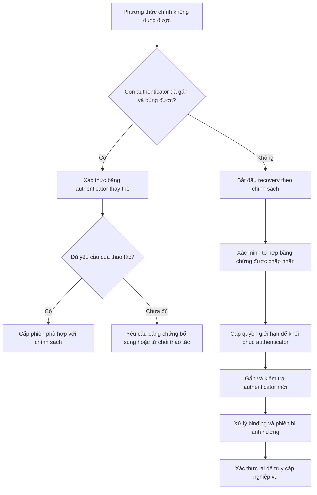

# MFA backup factor — Phương thức xác thực dự phòng

## 1. Vì sao MFA cần phương án dự phòng?

Một người dùng biết đúng mật khẩu nhưng không thể đăng nhập vì điện thoại chứa ứng dụng xác thực đã hỏng. Nếu hệ thống không có phương án dự phòng, tài khoản có thể bị khóa ngoài trong thời gian dài. Nếu nhân viên hỗ trợ chỉ cần nghe câu “tôi mất điện thoại” rồi tắt MFA, kẻ tấn công có thể sử dụng chính quy trình đó để chiếm tài khoản.

**MFA backup factor** thường được dùng để chỉ phương thức xác thực thay thế đã chuẩn bị trước, giúp người dùng tiếp tục chứng minh quyền kiểm soát tài khoản khi phương thức thường dùng không khả dụng. Trong thực tế, cách gọi này có thể bao gồm authenticator dự phòng, mã dự phòng hoặc một cơ chế recovery. Cần phân biệt vai trò của từng loại thay vì coi chúng tương đương.

Ví dụ, một quản trị viên dùng khóa bảo mật A hằng ngày và đã đăng ký khóa B từ trước. Khi A bị thất lạc, người đó có thể dùng B trong một luồng xác thực đáp ứng chính sách, rồi thu hồi A. Trường hợp này khác với việc người đó mất mọi authenticator và phải chứng minh lại quyền sở hữu tài khoản qua recovery.

Trong IAM, phương án dự phòng cần phục vụ đồng thời hai mục tiêu: duy trì khả năng truy cập hợp lệ và giữ đúng mức bảo đảm xác thực. Sau khi xác thực, quyền nghiệp vụ vẫn được kiểm soát bằng RBAC, ABAC và nguyên tắc ít quyền nhất.

Sau bài học, người học có thể:

- Phân biệt yếu tố xác thực, authenticator, bản sao credential và phương thức recovery.
- Đánh giá tính độc lập của một phương án dự phòng.
- Thiết kế luồng đăng ký, sử dụng, thay thế và thu hồi authenticator dự phòng.
- Ngăn fallback trở thành đường bỏ qua MFA.
- Liên hệ quyết định dự phòng với phiên, SSO, kiểm toán và vòng đời quyền.

## 2. Phân biệt factor, authenticator và recovery

### 2.1. Nhiều thiết bị chưa chắc tạo nhiều yếu tố

**Factor** là loại bằng chứng, chẳng hạn điều người dùng biết, vật họ kiểm soát hoặc đặc điểm sinh trắc. **Authenticator** là phương tiện cụ thể dùng để cung cấp bằng chứng trong một cơ chế xác thực.

Hai mật khẩu vẫn thuộc cùng nhóm bằng chứng kiến thức. Hai khóa bảo mật cùng được dùng như bằng chứng sở hữu cũng không tự biến thành hai loại yếu tố. Một authenticator có thể hỗ trợ nhiều yếu tố trong một cơ chế được triển khai phù hợp, ví dụ credential mật mã kết hợp xác minh người dùng cục bộ. Không quyết định số yếu tố bằng cách đếm số màn hình hoặc số thiết bị.

Vì vậy, “khóa B dự phòng cho khóa A” thường có nghĩa B thay thế vai trò của A trong một luồng xác thực. Người dùng không nhất thiết phải trình cả hai khóa ở mỗi lần đăng nhập.

### 2.2. Bốn khái niệm hay bị trộn lẫn

| Khái niệm | Ví dụ | Ý nghĩa đối với thiết kế |
| --- | --- | --- |
| Authenticator bổ sung | Khóa bảo mật thứ hai được đăng ký riêng | Có binding riêng với tài khoản, có thể quản lý và thu hồi riêng |
| Bản sao của cùng credential | Cùng một seed TOTP được đưa vào hai ứng dụng | Tăng khả năng sử dụng, nhưng các bản sao chia sẻ bí mật |
| Credential được đồng bộ | Một passkey có mặt trên nhiều thiết bị qua cơ chế đồng bộ | Khả năng phục hồi phụ thuộc cả hệ sinh thái quản lý credential |
| Phương thức recovery | Mã khôi phục hoặc quy trình xác minh lại được chuẩn bị trước | Giúp khôi phục khi không đủ khả năng xác thực theo mức yêu cầu |

Trong một số sản phẩm, mã dự phòng có thể tham gia trực tiếp vào luồng xác thực; trong sản phẩm khác, nó chỉ mở một bước khôi phục. Chính sách cần nêu rõ trường hợp nào được hỗ trợ. Không mặc định một mã khôi phục có cùng thuộc tính với authenticator thường dùng.

NIST khuyến khích duy trì ít nhất hai phương tiện xác thực riêng biệt để giảm nhu cầu recovery và yêu cầu cho phép gắn nhiều authenticator vào một tài khoản. Việc gắn thêm cần được xác thực ở mức phù hợp và có thông báo độc lập. Tham khảo [NIST — Binding an Additional Authenticator](https://pages.nist.gov/800-63-4/sp800-63b/events/#binding-an-additional-authenticator).

## 3. Đánh giá tính độc lập của phương án dự phòng

Hai phương thức có tên khác nhau vẫn có thể mất cùng lúc. Một dự phòng tốt cần được đánh giá theo sự cố cụ thể mà nó phải chịu được.

### 3.1. Những phụ thuộc cần kiểm kê

| Phụ thuộc chung | Ví dụ | Sự cố có thể làm mất cả phương thức chính và dự phòng |
| --- | --- | --- |
| Thiết bị | TOTP và SMS đều dùng trên một điện thoại | Mất hoặc hỏng điện thoại |
| Vị trí lưu giữ | Hai khóa bảo mật nằm trong cùng một túi | Mất túi hoặc trộm cắp |
| Tài khoản đồng bộ | Hai ứng dụng lấy credential từ cùng một tài khoản cloud | Mất quyền truy cập tài khoản đồng bộ |
| Bí mật nền tảng | Hai ứng dụng TOTP dùng cùng seed | Seed bị lộ, cần thay thế đồng thời |
| Kênh khôi phục | Email và phương thức dự phòng đều cần mở khóa cùng một điện thoại | Không thể truy cập kênh để khôi phục thiết bị |
| Hạ tầng tổ chức | Mọi phương thức đều phụ thuộc một dịch vụ xác thực nội bộ | Dịch vụ chung ngừng hoạt động |

Ví dụ, việc lưu ảnh recovery code trong thư viện ảnh của chính điện thoại chứa TOTP có thể không giúp ích khi điện thoại mất và tài khoản ảnh cũng cần TOTP đó để đăng nhập. Đây là một vòng phụ thuộc trong recovery.

Tính độc lập có nhiều mức. Cất một khóa thứ hai ở vị trí khác giúp chống mất thiết bị cùng lúc, nhưng không giải quyết sự cố của IdP đang quản lý cả hai khóa. Không nên tuyên bố “đã có dự phòng” mà không nói rõ dự phòng cho nguy cơ nào.

### 3.2. Tính sẵn sàng và khả năng chống chiếm quyền

Một phương thức rất thuận tiện khi mất điện thoại có thể làm tăng nguy cơ chiếm quyền nếu dễ bị giả mạo hoặc thay đổi. Quyết định dự phòng cần xem cả:

- Người dùng hợp lệ có sử dụng được khi gặp sự cố dự kiến không?
- Kẻ tấn công cần chiếm những gì để sử dụng đường thay thế đó?
- Đường thay thế có được phép thực hiện cùng thao tác nhạy cảm như phương thức chính không?
- Khi một thành phần bị nghi ngờ, có thể thu hồi đúng phần liên quan không?

Với tài khoản đặc quyền, hệ thống có thể yêu cầu một authenticator dự phòng đáp ứng cùng yêu cầu chống phishing như phương thức chính. Một luồng khôi phục riêng vẫn có thể tồn tại, nhưng không tự động được cấp mọi quyền quản trị sau một bằng chứng yếu hơn.

## 4. Các phương án dự phòng phổ biến

### 4.1. Khóa bảo mật được đăng ký riêng

Người dùng đăng ký một khóa sử dụng thường xuyên và một khóa dự phòng. Mỗi credential cần có định danh rõ trong hệ thống để có thể xem trạng thái, xác định lần dùng và thu hồi đúng binding.

Khóa dự phòng cần tương thích với thiết bị và phần mềm sẽ dùng trong sự cố. Ví dụ, một khóa chỉ có cổng USB không phù hợp với một thiết bị dự phòng không có cổng tương ứng, trừ khi đã chuẩn bị cách kết nối được hỗ trợ.

Sở hữu khóa không tự xác định đầy đủ mức bảo đảm. Hệ thống vẫn phải kiểm tra cơ chế xác thực, các bằng chứng kết hợp, yêu cầu xác minh người dùng và chính sách của thao tác. Chạm để xác nhận hiện diện không đồng nghĩa đã thực hiện xác minh người dùng bằng PIN hoặc sinh trắc.

### 4.2. Passkey và đồng bộ credential

Passkey có thể cải thiện khả năng tiếp tục truy cập khi một thiết bị không còn dùng được. Tuy nhiên, một credential được đồng bộ qua nhiều thiết bị không nhất thiết tương đương nhiều credential độc lập do ứng dụng quản lý riêng.

WebAuthn phân biệt khả năng credential được sao lưu và trạng thái sao lưu hiện tại qua thông tin backup eligibility và backup state. Các thông tin này không phải bằng chứng rằng người dùng đã có hai phương án độc lập hoặc rằng thiết bị dự phòng đang ở vị trí an toàn. Tham khảo [W3C WebAuthn — Credential Backup State](https://www.w3.org/TR/webauthn-3/#sctn-credential-backup).

Trong một thiết kế dự phòng, cần xem xét cách người dùng khôi phục tài khoản của nhà cung cấp đồng bộ, credential có sẵn khi mất thiết bị chính hay không và hậu quả khi chính tài khoản đồng bộ bị chiếm quyền.

Không suy ra rằng passkey đồng bộ tự mất thuộc tính chống phishing chỉ vì có cơ chế đồng bộ. Cần đánh giá riêng giao thức xác thực, bảo vệ credential và rủi ro của đường khôi phục hệ sinh thái.

### 4.3. TOTP dự phòng

Một số hệ thống cho phép đăng ký nhiều authenticator TOTP với seed riêng. Nếu có hỗ trợ này, mỗi binding có thể được xác minh và quản lý riêng theo chính sách.

Nếu người dùng sao chép cùng một seed sang hai ứng dụng, cả hai đều có thể sinh mã cho cùng credential. Đây là dự phòng về khả năng sử dụng, nhưng không phải tách biệt về bí mật. Khi seed đó bị lộ, việc xóa một bản sao trên một điện thoại không làm bản sao khác hoặc kẻ tấn công mất khả năng sinh mã.

TOTP cần được đánh giá đúng giới hạn chống phishing của nó. Cho phép TOTP làm fallback cho một thao tác yêu cầu phương thức chống phishing là thay đổi mức bảo đảm, dù giao diện vẫn hiển thị “MFA”.

### 4.4. Mã dự phòng hoặc recovery code

Mã chuẩn bị trước có ích khi thiết bị không dùng được, nhưng cần được bảo quản như bí mật có quyền tác động đến tài khoản. Không gửi mã cho nhân viên hỗ trợ hoặc nhập vào trang không thuộc hệ thống hợp lệ.

Một thiết kế có thể lưu verifier thay cho mã gốc, giới hạn thử, tiêu thụ mã khi chấp nhận và thay thế bộ mã theo quy trình được phép. Nếu tạo bộ mã mới để thay bộ cũ, cần vô hiệu hóa bộ cũ theo hợp đồng của sản phẩm. Không báo “đã đổi mã” nhưng vẫn chấp nhận những mã cũ chưa dùng.

Trong luồng minh họa của bài, recovery code được dùng để hỗ trợ khôi phục và ràng buộc authenticator mới, cùng bằng chứng bổ sung mà chính sách yêu cầu. Nó không tự cấp phiên quản trị đầy đủ.

### 4.5. SMS, email và hỗ trợ thủ công

Độ tiện lợi không đủ để quyết định đây là phương thức dự phòng thích hợp. Cần đánh giá nguy cơ chiếm số điện thoại, kiểm soát hộp thư, phụ thuộc cùng thiết bị và khả năng bị lừa trong quy trình hỗ trợ.

Không biến việc biết email, số điện thoại hoặc một số thông tin cá nhân thành quyền tắt MFA. Cũng không đăng ký một số điện thoại mới trong lúc recovery rồi ngay lập tức dùng chính số mới đó làm bằng chứng duy nhất rằng người gọi là chủ tài khoản.

Nếu có quy trình hỗ trợ thủ công, các bằng chứng, quyền của nhân viên, phê duyệt và phạm vi truy cập sau khôi phục cần được định nghĩa trước. Một tài khoản hỗ trợ bị chiếm không nên có quyền âm thầm thay mọi authenticator của mọi quản trị viên.

## 5. Đăng ký phương thức dự phòng khi còn quyền truy cập

### 5.1. Chuẩn bị trước sự cố

Thời điểm thuận lợi để đăng ký phương thức dự phòng là khi người dùng vẫn có khả năng xác thực hợp lệ bằng phương thức đã gắn. Chờ đến lúc mất mọi phương thức mới bắt đầu tìm cách thêm một authenticator khác sẽ đẩy hệ thống sang bài toán recovery khó hơn.

Luồng đăng ký minh họa:

1. Người dùng mở phần quản lý phương thức xác thực trong phiên hợp lệ.
2. Backend yêu cầu xác thực lại đủ mới và đủ mức cho việc thêm authenticator.
3. Backend tạo giao dịch đăng ký gắn với account, tenant, mục đích và thời hạn.
4. Người dùng thực hiện bước chứng minh kiểm soát authenticator mới theo giao thức tương ứng.
5. Backend xác minh bằng chứng và chỉ kích hoạt binding sau khi thành công.
6. Hệ thống thông báo qua kênh đã thiết lập, hiển thị cách nhận biết và thu hồi nếu đăng ký trái phép.
7. Người dùng thử một lần xác thực bằng phương thức mới trước khi cất giữ dự phòng.

OWASP xem thay đổi MFA là thao tác có rủi ro, khuyến nghị xác thực lại bằng phương thức đã đăng ký và không chỉ dựa vào phiên đang mở. Tham khảo [OWASP — Changing MFA Factors](https://cheatsheetseries.owasp.org/cheatsheets/Multifactor_Authentication_Cheat_Sheet.html#changing-mfa-factors).

### 5.2. Không tin cờ trạng thái từ client

Client có thể gửi một tên hiển thị như “khóa dự phòng”, nhưng tên đó không chứng minh loại authenticator, đặc tính bảo mật hoặc việc đăng ký đã hoàn tất. Backend phải lấy kết luận từ giao thức và dữ liệu đã xác minh.

Ví dụ, giao diện báo thành công sau khi hiển thị QR TOTP chưa có nghĩa người dùng đã cài đặt và kiểm soát seed. Binding cần hoàn tất bước kiểm tra tương ứng trước khi được tính là phương án sẵn sàng.

Một metadata minh họa cho binding:

```text
binding_id
account_id
tenant_id
method_family
display_label
status
registered_at
last_successful_use_at
verified_capabilities
revoked_at
revocation_reason
```

`display_label` là thông tin nhận diện cho người dùng, không phải đầu vào quyết định mức bảo đảm. `verified_capabilities` cần phản ánh dữ liệu đáng tin cậy mà hệ thống thực sự có, không phải những thuộc tính do client tự khai.

### 5.3. Bảo vệ dữ liệu đúng theo loại credential

Public-key credential cho phép server xác minh bằng khóa công khai; TOTP cần bí mật dùng chung để tính mã; mã khôi phục có thể được kiểm tra bằng verifier theo thiết kế. Không dùng một quy tắc lưu trữ duy nhất cho mọi loại dữ liệu.

Không lưu seed TOTP, mã dự phòng hoặc nội dung bí mật trong audit log và hệ thống phân tích. Tên gọi “backup” không làm dữ liệu bớt nhạy cảm.

## 6. Chọn đúng đường khi phương thức chính không khả dụng



Nhánh dùng authenticator thay thế vẫn phải kiểm tra đủ các bằng chứng cần thiết. Ví dụ, nếu luồng yêu cầu mật khẩu cộng khóa bảo mật, việc chuyển từ khóa chính sang khóa dự phòng không tự bỏ bước mật khẩu.

Ngược lại, nếu một authenticator đáp ứng nhiều yếu tố trong cơ chế được chấp nhận, không cần tự thêm một yếu tố khác chỉ vì người dùng đang dùng thiết bị dự phòng. Quyết định dựa trên chính sách và kết quả xác minh, không dựa trên nhãn “primary” hoặc “backup”.

### Recovery không đồng nghĩa đăng nhập thông thường

Trong ví dụ của bài, một phiên recovery chỉ có quyền thực hiện những bước khôi phục đã xác định. Nó không được đọc dữ liệu nghiệp vụ, cấp quyền hay gọi API quản trị chỉ vì người gọi đã trình một recovery code hợp lệ.

Backend phải thực thi giới hạn này. Chuyển giao diện sang màn hình “khôi phục MFA” nhưng vẫn cấp một access token có đầy đủ quyền là không đủ.

Sau khi gắn phương thức mới, cần đánh giá lại trạng thái tài khoản, các yêu cầu xác thực và quyền truy cập. Việc khôi phục credential không tự khôi phục một vai trò đã bị thu hồi trước đó.

## 7. Ví dụ chính sách cho cổng vận hành nội bộ

Giả sử cổng vận hành yêu cầu MFA chống phishing cho các thao tác quản trị. Mỗi quản trị viên được hướng dẫn đăng ký một khóa sử dụng hằng ngày và một khóa dự phòng giữ ở vị trí khác.

Khi mất khóa chính, khóa dự phòng có thể tham gia luồng quản trị nếu bằng chứng xác minh đáp ứng chính sách. Khi mất cả hai khóa, người dùng đi qua recovery có kiểm soát. Recovery code, nếu có, chỉ là một phần của tổ hợp bằng chứng được yêu cầu cho tài khoản đặc quyền.

Cấu hình dưới đây là mô hình do bài học đặt ra, không phải schema của một sản phẩm IAM cụ thể:

```yaml
mfaBackupPolicy:
  version: internal-operators-v1
  accountScope: privileged-human-accounts

  login:
    requiredControl: phishing-resistant-mfa
    allowRegisteredSpareAuthenticator: true
    allowWeakerFallbackForPrivilegedActions: false

  enrollment:
    requireRecentReauthentication: true
    verifyNewAuthenticatorBeforeActivation: true
    notifyEstablishedChannels: true

  recovery:
    purpose: authenticator-rebind
    requireAdditionalVerifiedEvidence: true
    grantLifetimeSeconds: 600
    issueFullApplicationSession: false

  lifecycle:
    preventUncontrolledRemovalOfLastMethod: true
    revokeReportedCompromisedBindings: true
```

Thời hạn 600 giây là lựa chọn minh họa. Trường `requireAdditionalVerifiedEvidence` không tự xác định bằng chứng nào đủ: tài liệu vận hành và phần thực thi phải nêu rõ tổ hợp bằng chứng, người có quyền phê duyệt và điều kiện áp dụng.

Chính sách cũng cần xử lý người dùng không có thiết bị tương thích hoặc có nhu cầu hỗ trợ tiếp cận. Giải pháp thay thế phải được đánh giá và triển khai thành một luồng có trách nhiệm rõ ràng, thay vì để nhân viên tự tạo ngoại lệ không được ghi nhận.

## 8. Mất thiết bị, thay thế và thu hồi

### 8.1. Mất phương thức chính nhưng còn dự phòng

Ví dụ, quản trị viên mất khóa A và vẫn có khóa B đã đăng ký:

1. Xác thực bằng B trong luồng đáp ứng chính sách.
2. Xác định đúng binding của A và báo mất hoặc nghi ngờ bị chiếm.
3. Thu hồi A theo quy trình phù hợp; không cần đợi sử dụng lại A để xác nhận việc mất.
4. Kiểm tra phiên và hoạt động đáng ngờ nếu có dấu hiệu lạm dụng.
5. Đăng ký khóa C để khôi phục khả năng dự phòng.
6. Kiểm tra C dùng được và thông báo thay đổi cho chủ tài khoản.

Nếu A và B là hai bản sao của cùng một bí mật TOTP, việc “thu hồi A” tại server có thể không tách riêng được từng bản sao. Cần thay seed và xử lý mọi nơi giữ seed cũ theo thiết kế. Đổi mật khẩu tài khoản không làm seed TOTP cũ tự mất hiệu lực.

### 8.2. Thay thiết bị theo kế hoạch

Khi thiết bị cũ chưa có dấu hiệu bị xâm phạm, có thể đăng ký và xác minh thiết bị mới trước khi gỡ thiết bị cũ để tránh khóa ngoài. Khi có bằng chứng credential đã bị chiếm, ưu tiên ngăn sử dụng credential đó và dùng phương án recovery phù hợp nếu cần.

Hai tình huống này có thứ tự xử lý khác nhau. Một quy tắc luôn đợi thiết bị thay thế sẵn sàng rồi mới thu hồi credential bị chiếm có thể kéo dài thời gian kẻ tấn công còn truy cập được.

### 8.3. Gỡ phương thức cuối cùng

Gỡ authenticator cuối cùng có thể khiến tài khoản không còn đáp ứng chính sách MFA. Backend cần chặn việc gỡ ngoài quy trình cho phép hoặc đưa người dùng vào luồng thay thế được kiểm soát.

Không chỉ ẩn nút xóa trên giao diện: API quản trị, ứng dụng di động và các đường đồng bộ cũng cần thực thi cùng quyết định. Với nhân viên hỗ trợ, quyền xóa binding cuối cùng phải được giới hạn và kiểm toán theo mức nhạy cảm của tài khoản.

### 8.4. Phiên đã cấp không tự mất hiệu lực

Thu hồi authenticator ngăn những lần xác thực mới bằng binding đó, nhưng không tự chứng minh mọi phiên đã cấp từ trước đã bị hủy. Cần xem xét session cookie, refresh token, phiên tại IdP và phiên local của các ứng dụng.

Trong SSO, IdP thường quản lý binding MFA. Ứng dụng dựa vào kết quả xác thực và hợp đồng về mức bảo đảm, thời điểm xác thực và thu hồi phiên. Một lần recovery ở IdP không phải lý do để ứng dụng bỏ kiểm tra quyền truy cập của chính nó.

## 9. Mã dự phòng và quyền khôi phục dùng một lần

Mã dự phòng cần chống việc dùng lại sau khi đã chấp nhận. Hai request đồng thời không được cùng tiêu thụ thành công một mã và tạo ra hai quyền khôi phục độc lập.

Một mô hình xử lý minh họa:

```text
1. Kiểm tra account, tenant, mục đích và giới hạn thử.
2. Xác minh mã và các bằng chứng bổ sung được chính sách yêu cầu.
3. Kiểm tra mã thuộc bộ hiện hành và chưa bị sử dụng hoặc thu hồi.
4. Trong một giao dịch:
   - Đánh dấu mã đã tiêu thụ bằng cập nhật có điều kiện.
   - Tạo quyền recovery giới hạn, gắn đúng account và mục đích.
5. Chỉ báo thành công khi giao dịch hoàn tất.
```

Nếu bước tạo quyền recovery thất bại, trạng thái tiêu thụ phải nhất quán với kết quả trả về. Không coi kiểm tra mã thành công trong bộ nhớ là đủ để kết luận toàn bộ luồng đã hoàn tất.

Quyền recovery cũng phải có thời hạn, phạm vi và khả năng thu hồi. Mất mã hoặc nghi ngờ bị lộ có thể đòi hỏi thay thế bộ mã; không dùng chính một mã đã bị thu hồi để xác thực yêu cầu cấp mã mới.

NIST phân biệt các lớp phương thức recovery và yêu cầu thông báo khi account recovery diễn ra. Khi áp dụng một tiêu chuẩn cụ thể, cần kiểm tra đúng yêu cầu của lớp mã và mức bảo đảm được chọn, thay vì gộp mọi loại “backup code” vào một cấu hình. Xem [NIST — Account Recovery](https://pages.nist.gov/800-63-4/sp800-63b/events/#account-recovery).

## 10. Trải nghiệm người dùng và kiểm toán

### 10.1. Hướng dẫn có thể thực hiện được

Giao diện nên giúp người dùng biết đang có những phương thức nào, phương thức nào đã xác minh và cách xử lý khi mất thiết bị. Tên hiển thị như “khóa mang theo” và “khóa cất dự phòng” giúp phân biệt, nhưng không cần tiết lộ bí mật.

Sau khi đăng ký, hướng dẫn người dùng kiểm tra phương thức dự phòng trước khi cất giữ. Không yêu cầu họ xóa phương thức đang dùng chỉ để thử phương án mới. Với mã recovery, cần có hướng dẫn bảo quản và sử dụng qua đúng kênh, tránh tạo phụ thuộc vòng với thiết bị cần khôi phục.

Nút “thử cách khác” chỉ nên đưa đến những phương thức hợp lệ theo chính sách. Một lựa chọn fallback hiển thị được không có nghĩa nó được quyền mở mọi chức năng của tài khoản.

### 10.2. Sự kiện kiểm toán

Ví dụ sự kiện đăng ký authenticator dự phòng:

```text
event_type: AUTHENTICATOR_BOUND
actor_id: internal-subject-id
account_id: target-account-id
tenant_id: target-tenant-id
binding_reference: opaque-binding-id
method_family: WEBAUTHN
purpose: ADDITIONAL_AUTHENTICATOR
policy_version: internal-operators-v1
result: SUCCESS
```

Tên trường là mô hình minh họa. `binding_reference` dùng để đối chiếu, không được trở thành một bí mật đủ để đăng nhập. Không ghi seed, recovery code, OTP hoặc token của phiên recovery trong sự kiện.

Ngoài đăng ký, cần quan sát việc sử dụng phương thức thay thế, thu hồi, thay bộ mã, recovery thất bại và thay đổi qua tài khoản hỗ trợ. Thông báo bảo mật nên đi qua kênh đã thiết lập; một kênh vừa được thêm trong cùng giao dịch không tự tạo ra sự kiểm chứng độc lập.

### 10.3. Chỉ số vận hành

Các chỉ số có thể gồm tỷ lệ tài khoản có phương án dự phòng đã xác minh, tỷ lệ đăng nhập thay thế thất bại, số lần recovery và thời gian khôi phục. Có thể đo độ lâu chưa sử dụng phương thức dự phòng để hỗ trợ nhắc kiểm tra, nhưng không tự kết luận nó đã mất hiệu lực chỉ vì lâu chưa dùng.

Số lượng binding cao không đủ chứng minh khả năng phục hồi tốt: ba bản sao phụ thuộc cùng một thiết bị hoặc tài khoản đồng bộ vẫn có thể mất cùng lúc. Việc đánh giá tính độc lập cần dựa vào thông tin thực tế và giới hạn những gì server có thể quan sát.

## 11. Những tình huống cần kiểm chứng khi triển khai

Bảng này là tiêu chí cho thiết kế và kiểm thử tích hợp, không phải báo cáo chạy thử của một ứng dụng:

| Tình huống | Điều kiện cần xác minh |
| --- | --- |
| Phương thức chính không dùng được, dự phòng hợp lệ | Luồng thay thế vẫn thực thi đủ yêu cầu xác thực |
| Dự phòng không đạt yêu cầu của thao tác quản trị | Không cấp quyền chỉ dựa trên nhãn đã bật MFA |
| Có phiên cũ nhưng chưa xác thực lại đủ mức | Không âm thầm thêm authenticator mới |
| Đăng ký bị gián đoạn trước bước xác minh | Binding chưa hoàn tất không được tính là sẵn sàng |
| Client đổi tên hoặc loại phương thức trong request | Backend không tin các thuộc tính tự khai |
| Cùng binding được gửi cho account hoặc tenant khác | Không xác thực chéo tài khoản |
| Hai request dùng cùng recovery code | Chỉ một lần tiêu thụ thành công |
| Bộ mã cũ đã bị thay thế | Mã của bộ cũ không được dùng lại |
| Credential bị thu hồi giữa lúc xác minh | Quyết định cuối cùng kiểm tra trạng thái hiện hành |
| Xóa authenticator cuối cùng qua API | Không bỏ qua chính sách thay thế và recovery |
| Phiên recovery gọi API nghiệp vụ | Backend từ chối quyền ngoài phạm vi |
| TOTP seed đã thay nhưng điện thoại cũ còn ứng dụng | Mã từ seed cũ không được chấp nhận |
| Thu hồi authenticator sau nghi ngờ bị chiếm | Xử lý phiên và token theo chính sách thực tế |
| Bật log, trace và hỗ trợ chẩn đoán | Không lộ seed, mã hoặc token nhạy cảm |

Khi thử phương án dự phòng, cần kiểm tra cả đường thành công và quyền thực tế sau đó. Một response đăng nhập thành công chưa chứng minh hệ thống đã giữ đúng mức bảo đảm của thao tác tiếp theo.

## 12. Bài tập thiết kế

Một quản trị viên có passkey trên điện thoại, TOTP trên cùng điện thoại và recovery code lưu trong một ứng dụng chỉ mở được bằng tài khoản đồng bộ của điện thoại. Cổng quản trị yêu cầu MFA chống phishing cho thao tác cấp quyền. Người này mất điện thoại trong chuyến công tác.

Hãy phân tích:

1. Những phương thức nào phụ thuộc chung vào thiết bị hoặc tài khoản đồng bộ?
2. Phương thức nào thực sự còn dùng được khi mất điện thoại?
3. Có thể dùng TOTP hoặc recovery code để cấp ngay phiên quản trị hay không, và quyết định phụ thuộc chính sách nào?
4. Nếu không còn authenticator đáp ứng yêu cầu, luồng recovery cần xác minh gì trước khi gắn thiết bị mới?
5. Credential và phiên cũ nào cần thu hồi khi nghi ngờ điện thoại đã bị truy cập trái phép?
6. Sau khôi phục, nên chuẩn bị thêm phương án nào để tránh lặp lại điểm phụ thuộc chung?

Một thiết kế đạt yêu cầu cần chỉ ra được khả năng dùng phương án dự phòng khi có sự cố, mức bảo đảm mà nó cung cấp và cách kết thúc quyền recovery. Mục tiêu là giúp người dùng hợp lệ tiếp tục truy cập trong khi mọi đường thay thế vẫn được quản lý như một phần của hệ thống IAM.
