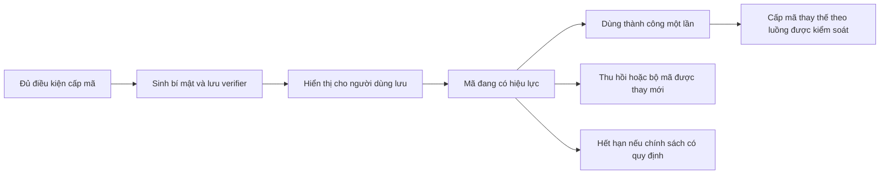

# MFA recovery code — Mã khôi phục khi mất phương thức MFA

## 1. Mã khôi phục giải quyết vấn đề gì?

Một người dùng vẫn nhớ mật khẩu nhưng mất điện thoại đang lưu ứng dụng TOTP. Nếu hệ thống chỉ có hai lựa chọn là nhập TOTP hoặc nhờ hỗ trợ tắt MFA, người dùng có thể mất quyền truy cập, còn bộ phận hỗ trợ trở thành một đường vượt qua kiểm soát xác thực.

**MFA recovery code** là bí mật dự phòng được cấp để sử dụng trong một luồng khôi phục đã định nghĩa. Người dùng giữ mã ở nơi an toàn và xuất trình khi không sử dụng được phương thức MFA thông thường. Hệ thống phải xác định mã đó chứng minh điều gì, cần kết hợp với bằng chứng nào và cho phép thực hiện hành động nào.

Trong nền tảng IAM, mã khôi phục là một phần của vòng đời danh tính và credential. Nó liên quan đến xác thực, quản lý phiên, đăng ký lại MFA, xử lý mất thiết bị, kiểm toán và nguyên tắc ít quyền nhất. Một cơ chế đăng nhập mạnh vẫn có thể bị suy yếu nếu đường khôi phục cho phép bất kỳ người nào biết mật khẩu tắt MFA.

Sau bài học, người học có thể:

- Phân biệt mã khôi phục đã lưu với TOTP, mã gửi qua email/SMS và reset token.
- Thiết kế quá trình cấp phát, lưu verifier, tiêu thụ và thu hồi mã.
- Giải thích entropy, giới hạn số lần thử và chống sử dụng lại.
- Xử lý request đồng thời để một mã chỉ tạo một kết quả khôi phục hợp lệ.
- Giới hạn quyền của phiên khôi phục và đăng ký lại phương thức MFA đúng cách.
- Xây dựng trải nghiệm lưu mã và theo dõi sự kiện mà không làm lộ bí mật.

## 2. Các khái niệm dễ bị nhầm lẫn

### 2.1. Mã dự phòng không đồng nhất với mọi loại OTP

| Cơ chế | Cách có được giá trị | Vòng đời điển hình | Điều cần phân biệt |
|---|---|---|---|
| Saved recovery code | Cấp trước, người dùng lưu lại | Có thể tồn tại dài hơn một phiên; dùng một lần | Cần bảo vệ bản lưu và quản lý thu hồi. |
| TOTP | Sinh từ seed và thời gian | Giá trị thay đổi theo cửa sổ thời gian | Seed cần cho việc tạo nhiều mã tiếp theo. |
| Mã khôi phục được gửi khi có yêu cầu | Gửi qua kênh đã thiết lập | Có thời hạn cho lần khôi phục | Phụ thuộc quyền kiểm soát kênh nhận. |
| Password reset token | Cấp cho yêu cầu đặt lại mật khẩu | Ngắn hạn và giới hạn mục đích | Không mặc nhiên cho phép thay MFA hoặc cấp quyền nghiệp vụ. |
| Recovery code của trình quản lý mật khẩu | Do sản phẩm khác quản lý | Theo chính sách sản phẩm đó | Không tự trở thành mã khôi phục của ứng dụng đang xây dựng. |

Bài học tập trung vào **saved recovery code**: mã ngẫu nhiên được cấp trước và giữ để sử dụng khi cần. Từ “backup code” thường được dùng cho cơ chế tương tự, nhưng tên gọi trên giao diện không đủ để xác định mức bảo đảm hay quyền được cấp.

Không áp dụng máy móc thời hạn của một mã OTP gửi qua SMS cho mã dự phòng được in và cất giữ. Ngược lại, một mã tồn tại lâu dài cần đủ khó đoán và có cách thay mới khi bị lộ, thất lạc hoặc không còn đáng tin.

### 2.2. Recovery code không phải quyền tắt mọi kiểm soát

Biết một mã hợp lệ chưa có nghĩa được sửa email, bỏ MFA, tạo API key, liên kết một identity mới và mở lại tài khoản bị đình chỉ. Các hành động đó có mức rủi ro và yêu cầu bằng chứng riêng.

Cũng không suy ra rằng hai mã cùng một bộ tương đương hai phương thức độc lập. Nếu toàn bộ bộ mã bị sao chép, bên lấy được chúng sở hữu cả hai giá trị. Số ô nhập mã không quyết định số yếu tố hoặc mức bảo đảm của luồng.

### 2.3. Đối chiếu yêu cầu NIST đúng phạm vi

[NIST SP 800-63B, mục Account Recovery](https://pages.nist.gov/800-63-4/sp800-63b.html#accountrecovery) yêu cầu saved recovery code có ít nhất 64 bit ngẫu nhiên, lưu dưới dạng băm, giới hạn thử, vô hiệu sau sử dụng và cấp mã thay thế. Tài liệu còn quy định tổ hợp bằng chứng theo mức bảo đảm: tại AAL2, một lựa chọn là mã khôi phục kết hợp authenticator một yếu tố đã liên kết; hai mã cần đến từ các phương thức khác nhau. Không tự công bố đáp ứng AAL2 chỉ vì có một màn hình nhập recovery code.

Các thiết kế và con số minh họa trong bài giúp phân tích cơ chế. Việc đáp ứng một tiêu chuẩn còn phụ thuộc toàn bộ quy trình xác thực, khôi phục, mật mã và thông báo của hệ thống.

## 3. Đặt mã khôi phục trong mô hình rủi ro

### 3.1. Những tình huống cần dự phòng

- Mất hoặc hỏng điện thoại chứa TOTP.
- Mất khóa bảo mật và chưa có khóa thay thế sử dụng được.
- Thiết bị đang sửa chữa hoặc phương thức MFA tạm thời không truy cập được.
- Cần thay phương thức xác thực sau một sự kiện mất an toàn.

Trước khi dùng mã, hệ thống có thể cho phép người dùng chọn một authenticator còn hợp lệ đã liên kết từ trước. Có nhiều phương thức phù hợp giúp giảm số lần cần đi qua luồng khôi phục. Tuy nhiên, các phương thức bổ sung vẫn cần được đánh giá rủi ro; thêm một lựa chọn yếu có thể làm giảm hiệu quả bảo vệ chung.

### 3.2. Những kẻ tấn công có thể nhắm tới

| Tình huống | Điều cơ chế cần bảo vệ |
|---|---|
| Bên khác chỉ biết mật khẩu | Không được tự cấp bộ mã mới hoặc tắt MFA từ bằng chứng đó. |
| Bên khác lấy được một mã | Giới hạn tác động, kết hợp bằng chứng và phát hiện sử dụng bất thường. |
| Bị đọc cơ sở dữ liệu recovery code | Không có sẵn plaintext có thể dùng trực tiếp. |
| Hai request cùng dùng một mã | Chỉ một kết quả tiêu thụ được chấp nhận. |
| Phiên trình duyệt bị chiếm | Không cho phép xem hoặc thay bộ mã chỉ dựa vào phiên cũ. |
| Bộ mã bị lộ toàn bộ | Có thể thu hồi cả bộ và cấp lại với phiên bản mới. |
| Helpdesk bị tác động bằng lời khai giả | Không dùng việc “không còn mã” làm lý do bỏ qua xác minh. |

Recovery code dạng chuỗi có thể bị nhập vào trang giả. Tính dùng một lần không làm nó trở thành cơ chế chống phishing: một mã chưa dùng vẫn có thể bị lấy và sử dụng trước chủ tài khoản.

## 4. Vòng đời của một bộ mã

### 4.1. Các trạng thái cần phân biệt



Một mã đã dùng, đã thu hồi hoặc hết hạn không được tự hoạt động lại khi người dùng đăng nhập, đổi mật khẩu hay khởi động lại máy chủ. Nếu có phiên bản bộ mã, mọi endpoint phải kiểm tra mã thuộc phiên bản còn hiệu lực.

### 4.2. Cấp bộ mã cần xác minh lại

Cấp hoặc thay mới recovery code là thao tác nhạy cảm vì nó tạo đường khôi phục tài khoản. Một phiên đăng nhập cũ không đủ để mặc định người đang thao tác vẫn là chủ tài khoản.

[OWASP Multifactor Authentication](https://cheatsheetseries.owasp.org/cheatsheets/Multifactor_Authentication_Cheat_Sheet.html#changing-mfa-factors) khuyến nghị xác minh lại khi thay đổi yếu tố MFA và không chỉ dựa vào phiên đang hoạt động. Áp dụng tư duy này cho việc quản lý mã: xác định bằng chứng cần có, kiểm tra rủi ro và thông báo thay đổi qua kênh phù hợp.

Tại thời điểm đăng ký MFA ban đầu, cần xác nhận phương thức MFA mới thực sự hoạt động trước khi hoàn tất quy trình theo thiết kế. Nếu giao diện cung cấp bộ mã dự phòng, giải thích rõ người dùng đang lưu một bí mật có thể mở đường khôi phục, không phải một bản ghi tham khảo vô hại.

### 4.3. Thay mới toàn bộ bộ mã

Một thiết kế phổ biến là nhóm mã theo `generation_id`. Khi cấp bộ mới, hệ thống thu hồi bộ cũ. Thao tác đổi phiên bản và lưu các verifier mới phải được thực hiện nguyên tử, tránh trạng thái đã thu hồi mã cũ nhưng chưa có bộ mới có hiệu lực do lỗi ghi.

Giao diện cần báo trước: mã chưa dùng của bộ cũ cũng có thể bị vô hiệu khi người dùng chọn tạo bộ mới. Không âm thầm giữ nhiều bộ đang hoạt động nếu chính sách chỉ cho phép một bộ.

Nếu chính sách cấp mã thay thế sau mỗi lần dùng, phải chỉ rõ mã thay thế thuộc bộ đang hoạt động hay một bộ mới. Không lặp lại bí mật vừa tiêu thụ. Việc bổ sung hoặc thay mới vẫn cần gắn với phiên khôi phục và trạng thái tài khoản đáng tin cậy.

## 5. Sinh mã đủ khó đoán

### 5.1. Entropy nằm ở quá trình sinh

Mã cần được tạo bằng bộ sinh ngẫu nhiên dùng cho mật mã. Không lấy từ thời gian hiện tại, số thứ tự người dùng, số điện thoại, UUID tự ghép hoặc `Random` thông thường rồi gọi đó là mã an toàn.

Một thiết kế minh họa dùng 16 byte ngẫu nhiên, tức 128 bit, cho mỗi mã. Nếu biểu diễn bằng hex thì có 32 ký tự; dấu phân nhóm chỉ giúp đọc, không tạo thêm entropy.

```text
16 byte ngẫu nhiên -> 32 ký tự hex -> nhóm hiển thị dễ đọc

Mẫu hình thức:
XXXX-XXXX-XXXX-XXXX-XXXX-XXXX-XXXX-XXXX
```

Ký tự `X` chỉ minh họa định dạng. Không tạo mã thực từ chuỗi mẫu hoặc các ví dụ có sẵn trong tài liệu.

Nếu có `m` mã hợp lệ độc lập, mỗi mã có `b` bit entropy và có `q` lần đoán độc lập, xác suất đoán trúng xấp xỉ bị chặn trên bởi:

```text
P(thành công) <= q × m / 2^b
```

Giới hạn này chỉ có ý nghĩa khi các giá trị ngẫu nhiên đủ tốt và không có đường rò rỉ khác; khi biểu thức lớn hơn 1 thì giới hạn xác suất vẫn tối đa là 1. Tăng số mã hợp lệ làm tăng số giá trị có thể đoán trúng. Entropy cao vẫn cần đi cùng giới hạn thử, kiểm soát lưu lượng và chống sử dụng lại.

### 5.2. Chuẩn hóa đầu vào có quy tắc

Với định dạng hex đã thiết kế, có thể cho phép chữ hoa/chữ thường và bỏ dấu gạch ngang ASCII hoặc dấu cách ASCII. Sau chuẩn hóa, chỉ nhận đúng 32 ký tự thuộc `0-9`, `A-F`.

Không sao chép quy tắc này sang định dạng khác một cách máy móc. Chẳng hạn, dấu `-` có thể là thành phần hợp lệ trong alphabet Base64URL; xóa nó sẽ thay đổi bí mật. Quy tắc hiển thị, chuẩn hóa và tính verifier phải được thiết kế đồng bộ.

Giới hạn kích thước đầu vào trước khi phân tích. Từ chối ký tự không được hỗ trợ thay vì cố đoán ý người dùng qua nhiều phép sửa lỗi không rõ ràng.

## 6. Lưu verifier thay vì lưu mã dạng rõ

### 6.1. Dữ liệu vận hành cần thiết

Một mô hình bản ghi có thể gồm:

| Trường | Ý nghĩa |
|---|---|
| `tenant_id`, `subject_id` | Tài khoản sở hữu mã trong đúng phạm vi danh tính. |
| `generation_id` | Phiên bản bộ mã. |
| `code_id` | Định danh nội bộ phục vụ cập nhật và kiểm toán, không phải bí mật. |
| `verifier` | Biểu diễn một chiều dùng để đối chiếu. |
| `created_at` | Thời điểm cấp. |
| `consumed_at` | Thời điểm dùng thành công, ban đầu rỗng. |
| `revoked_at` | Thời điểm thu hồi, nếu có. |
| `expires_at` | Thời hạn theo chính sách, nếu áp dụng. |

Không cần lưu plaintext chỉ để hỗ trợ chức năng “xem lại mã”. Với thiết kế chỉ lưu verifier, việc xem lại toàn bộ bí mật cũ không còn khả thi; giao diện có thể cho xem số mã còn lại và cho tạo bộ mới khi đủ điều kiện.

### 6.2. Hàm băm và đặc tính của bí mật

Mật khẩu do người dùng chọn thường có phân bố dễ đoán, nên cần KDF lưu trữ phù hợp. Một recovery code ngẫu nhiên có entropy cao có đặc tính khác. Có thể thiết kế verifier bằng hàm băm mật mã phù hợp cho bí mật ngẫu nhiên đủ dài, hoặc dùng HMAC với khóa được quản lý riêng.

Điều kiện quan trọng là độ ngẫu nhiên thực tế. Băm một mã sáu chữ số không biến nó thành bí mật 128 bit: nếu dữ liệu băm bị đọc, không gian ứng viên vẫn nhỏ. Không giảm độ dài mã rồi cho rằng hàm băm đã bù được phần thiếu.

Ràng buộc verifier với tenant, tài khoản, mục đích và phiên bản giúp tránh dùng nhầm cùng biểu diễn ở ngữ cảnh khác. Khi ghép các trường, dùng encoding không nhập nhằng, chẳng hạn ghi độ dài từng trường; nối chuỗi tùy tiện có thể làm hai bộ dữ liệu khác nhau tạo cùng thông điệp đầu vào.

Nếu chọn HMAC hoặc pepper, phải có cơ chế bảo vệ khóa, quản lý phiên bản và kế hoạch khi khóa bị lộ. Việc đổi khóa không tự tính lại verifier từ mã cũ khi hệ thống không giữ plaintext. Thiết kế phải xác định có chấp nhận khóa cũ tạm thời hay yêu cầu cấp lại mã.

### 6.3. Hiển thị và chuyển giao an toàn

Chỉ trả mã qua kênh đã xác thực và được bảo vệ. Phản hồi chứa mã cần được xử lý như dữ liệu bí mật: hạn chế cache, loại khỏi log, APM, analytics và các công cụ ghi lại giao diện.

Không tự gửi toàn bộ bộ mã qua email hoặc ghi vào ticket hỗ trợ. Cho phép tải hoặc in mã là lựa chọn trải nghiệm cần được cân nhắc cùng nơi lưu file, lịch sử tải và thiết bị dùng chung. “Hiển thị một lần” không ngăn người dùng hoặc phần mềm trên thiết bị chụp lại màn hình.

## 7. Ví dụ Java: sinh mã và tạo verifier theo ngữ cảnh

Đoạn Java 17 dưới đây minh họa định dạng hex 128 bit và verifier SHA-256 được ràng buộc với ngữ cảnh. Đây là phần xử lý bí mật ngẫu nhiên; việc phân quyền, giới hạn thử và tiêu thụ mã phải được triển khai ở lớp khác.

```java
import java.nio.ByteBuffer;
import java.nio.charset.StandardCharsets;
import java.security.MessageDigest;
import java.security.NoSuchAlgorithmException;
import java.security.SecureRandom;
import java.util.Arrays;
import java.util.HexFormat;
import java.util.Locale;
import java.util.Objects;

public final class RecoveryCodeCodec {
    private static final SecureRandom RANDOM = new SecureRandom();

    private RecoveryCodeCodec() {
    }

    public static String generate() {
        byte[] randomBytes = new byte[16];
        RANDOM.nextBytes(randomBytes);

        try {
            String hex = HexFormat.of()
                    .withUpperCase()
                    .formatHex(randomBytes);
            StringBuilder displayed = new StringBuilder(39);

            for (int offset = 0; offset < hex.length(); offset += 4) {
                if (offset > 0) {
                    displayed.append('-');
                }
                displayed.append(hex, offset, offset + 4);
            }
            return displayed.toString();
        } finally {
            Arrays.fill(randomBytes, (byte) 0);
        }
    }

    public static String canonicalize(String submitted) {
        if (submitted == null || submitted.length() > 64) {
            throw new IllegalArgumentException("Invalid recovery code");
        }

        String canonical = submitted
                .replace("-", "")
                .replace(" ", "")
                .toUpperCase(Locale.ROOT);

        if (!canonical.matches("[0-9A-F]{32}")) {
            throw new IllegalArgumentException("Invalid recovery code");
        }
        return canonical;
    }

    public static byte[] verifier(
            String tenantId,
            String subjectId,
            String generationId,
            String submitted) throws NoSuchAlgorithmException {
        String canonical = canonicalize(submitted);
        MessageDigest digest = MessageDigest.getInstance("SHA-256");

        updateField(digest, "IAM:RECOVERY-CODE:V1");
        updateField(digest, tenantId);
        updateField(digest, subjectId);
        updateField(digest, generationId);
        updateField(digest, canonical);
        return digest.digest();
    }

    private static void updateField(MessageDigest digest, String value) {
        byte[] encoded = Objects.requireNonNull(value)
                .getBytes(StandardCharsets.UTF_8);
        try {
            byte[] length = ByteBuffer.allocate(Integer.BYTES)
                    .putInt(encoded.length)
                    .array();
            digest.update(length);
            digest.update(encoded);
        } finally {
            Arrays.fill(encoded, (byte) 0);
        }
    }
}
```

### 7.1. Cách sử dụng trong thiết kế

Khi cấp mã, máy chủ gọi `generate()`, tính verifier với tenant, tài khoản và bộ mã tương ứng, rồi lưu verifier. Bí mật hiển thị chỉ được chuyển cho người dùng qua luồng đã xác thực; không đưa vào một đối tượng có thể bị ghi log tự động.

Khi nhận mã, máy chủ lấy ngữ cảnh từ trạng thái phía server và tính lại verifier. Không để client tùy chọn `subjectId` hoặc `generationId` rồi coi đó là ngữ cảnh đã được chứng minh. Nếu so sánh các mảng verifier trong Java, dùng cơ chế so sánh phù hợp như `MessageDigest.isEqual`; tính nguyên tử khi tiêu thụ vẫn phải do kho trạng thái bảo đảm.

Chuẩn hóa không làm giảm độ ngẫu nhiên vì mã đã được tạo từ 16 byte độc lập, còn các biến thể về dấu phân cách và chữ hoa chỉ là cách biểu diễn. Các `String` trong Java không thể được đảm bảo xóa ngay; xóa mảng byte chỉ giảm một phần bản sao trong bộ nhớ. Cần hạn chế lưu giữ và tránh làm phát sinh bản sao ngoài nhu cầu.

Đoạn code không chứng minh cấu hình mật mã của một hệ thống đã đáp ứng mọi tiêu chuẩn. Nó cũng không xử lý lưu trữ, giao dịch, thông báo, khôi phục phiên hay sinh lại bộ mã; các trách nhiệm đó được mô tả dưới đây.

## 8. Tiêu thụ mã đúng một lần

### 8.1. Vì sao “đọc rồi đánh dấu” chưa đủ?

Một triển khai dễ sai làm như sau:

```text
đọc bản ghi -> thấy chưa dùng -> tạo phiên -> đánh dấu đã dùng
```

Hai request đồng thời đều có thể đọc trạng thái chưa dùng trước khi một request ghi cập nhật. Kết quả là một mã tạo ra nhiều phiên hoặc nhiều quyền khôi phục.

Điều kiện cần bảo đảm là: chỉ một thao tác chuyển mã từ trạng thái còn hiệu lực sang đã tiêu thụ được thành công, và chỉ thao tác đó được tạo kết quả khôi phục tương ứng.

### 8.2. Giao dịch minh họa

```text
trước bước kiểm tra mã:
    kiểm tra giới hạn thử và ghi nhận lần thử theo chính sách
    xác minh flow khôi phục, bằng chứng bổ sung và tài khoản đích

bắt đầu transaction ngắn
    khóa bản ghi tài khoản dùng chung cho quản lý bộ mã
    kiểm tra trạng thái tài khoản và phiên bản flow vẫn hợp lệ
    lấy generation đang có hiệu lực
    tính verifier theo đúng ngữ cảnh

    cập nhật có điều kiện bản ghi mã:
        đúng tài khoản, generation và verifier
        chưa consumed, chưa revoked, chưa hết hạn
        chuyển sang consumed

    nếu số bản ghi cập nhật khác 1:
        không cấp quyền khôi phục
        kết thúc theo nhánh thất bại

    tạo recovery grant giới hạn mục đích, thời hạn và bước thực hiện
    gắn grant với flow và mã vừa được tiêu thụ
    ghi audit và sự kiện thông báo qua outbox
commit

chỉ sau commit thành công mới trả kết quả khôi phục
```

Thao tác thay mới bộ mã phải sử dụng cùng quy tắc khóa hoặc cơ chế tuần tự tương đương. Nếu cấp lại và tiêu thụ chỉ kiểm tra generation ở những snapshot độc lập, một mã cũ có thể được chấp nhận trong lúc bộ mới đang được kích hoạt.

Giới hạn thử phải còn hiệu lực khi việc kiểm tra thất bại. Nếu mọi cập nhật bộ đếm đều nằm trong transaction bị rollback, các lần đoán sai sẽ biến mất khỏi bộ đếm. Thiết kế cần có cơ chế ghi nhận lần thử bền vững và an toàn khi nhiều request cùng chạy.

Trong kiến trúc phân tán, kết quả giao dịch cần được xác định tại nguồn có thẩm quyền. Một thao tác compare-and-set hoặc ràng buộc dữ liệu phù hợp có thể thay cho khóa, nhưng không dùng cache eventual consistency làm nguồn duy nhất cho tính dùng một lần.

### 8.3. Retry và phản hồi bị mất

Nếu mã đã được tiêu thụ nhưng phản hồi bị mất do lỗi mạng, không tự đổi mã về trạng thái chưa dùng. Việc đó có thể cho phép replay khi một kết quả thành công thực sự đã được cấp.

Có thể thiết kế khả năng tiếp tục cùng flow bằng một trạng thái đã xác thực và ràng buộc request phù hợp. Tính lặp an toàn phải gắn với tài khoản, flow và kết quả đã tạo; một chuỗi idempotency tùy ý do người gọi cung cấp không đủ để nhận lại quyền khôi phục của người khác.

Nếu không có bằng chứng để tiếp tục an toàn, hướng người dùng dùng mã khác hoặc phương án khôi phục đã định nghĩa. Không hạ điều kiện xác minh vì hệ thống gặp lỗi truyền tải.

## 9. Giới hạn thử và phản hồi lỗi

### 9.1. Giới hạn theo nhiều phạm vi

Giới hạn thử có thể kết hợp tài khoản, flow, nguồn truy cập và toàn hệ thống. Chỉ giới hạn theo IP không đủ khi có nhiều nguồn truy cập, còn khóa tài khoản vĩnh viễn sau một số request công khai có thể bị lạm dụng gây gián đoạn.

Các giá trị như số lần thử, độ trễ tăng dần và thời gian tạm dừng phải được chọn theo mô hình rủi ro và khả năng hỗ trợ người dùng. Không coi entropy cao là lý do cho phép gọi endpoint không giới hạn.

Giới hạn phải được chia sẻ giữa các instance hoặc có cơ chế phối hợp phù hợp. Không để kẻ gọi được một ngân sách mới chỉ bằng cách chuyển node, mở flow khác hoặc dùng ứng dụng di động thay giao diện web.

### 9.2. Phản hồi đủ dùng và tránh tạo oracle

Một phản hồi khi kiểm tra không thành công có thể là:

> Không thể dùng mã này để hoàn tất bước khôi phục. Hãy kiểm tra mã đang nhập hoặc chọn phương thức khôi phục khác.

Phản hồi không cần phân biệt công khai mã thuộc tài khoản khác, mã đã dùng hay mã chưa từng tồn tại. Trong một phiên đã xác thực đúng mức, giao diện quản lý có thể hiển thị số mã còn lại hoặc lịch sử sử dụng theo chính sách.

Tách lỗi nghiệp vụ với lỗi vận hành. Cơ sở dữ liệu hoặc dịch vụ xác minh không sẵn sàng không phải bằng chứng mã đã sai. Trong trường hợp đó, không cấp grant và trả thông báo thử lại phù hợp; nhật ký nội bộ cần cho phép nhận ra sự cố mà không ghi bí mật.

## 10. Sau khi mã được chấp nhận

### 10.1. Cấp quyền theo mục đích đã định nghĩa

Một lựa chọn là cấp phiên `RECOVERY` có thời hạn, chỉ cho phép hoàn tất việc liên kết authenticator thay thế đã được phê duyệt. Các API nghiệp vụ cần từ chối phiên này nếu chưa có đủ điều kiện xác thực và quyền truy cập tương ứng.

| Quyền | Phiên khôi phục có nên tự được cấp? |
|---|---|
| Tiếp tục bước chứng minh quyền kiểm soát đã được cấp | Có, trong đúng flow và thời hạn. |
| Liên kết MFA thay thế | Chỉ sau khi đạt các điều kiện của quy trình. |
| Tắt toàn bộ MFA | Không mặc định. |
| Đổi email khôi phục hoặc liên kết identity | Cần kiểm soát riêng cho hành động nhạy cảm. |
| Tạo API key, tải dữ liệu hoặc cấp role | Không từ một recovery grant đơn thuần. |

Một sản phẩm có thể dùng recovery code như phương thức dự phòng trong đăng nhập. Khi đó cần định nghĩa rõ bằng chứng kết hợp, mức bảo đảm và các thao tác cần xác minh thêm. Không gắn nhãn phiên có mức bảo đảm cao hơn những gì thực tế đã thực hiện.

### 10.2. Đăng ký lại MFA cần được xác nhận hoạt động

Việc gửi QR TOTP hoặc bắt đầu đăng ký khóa mới chưa chứng minh authenticator đã được liên kết thành công. Cần hoàn thành bước xác nhận đúng với phương thức đang sử dụng trước khi coi việc thay thế hoàn tất.

Nếu thiết bị cũ bị mất hoặc nghi bị chiếm, xác định có cần thu hồi authenticator cũ và những phiên liên quan hay không. Việc thêm một authenticator mới không tự vô hiệu seed TOTP cũ, khóa cũ, session cookie hoặc refresh token.

Khi khôi phục sau nghi ngờ compromise, cần xem xét thay đổi MFA, recovery address, identity liên kết và các đường truy cập khác. [OWASP Forgot Password](https://cheatsheetseries.owasp.org/cheatsheets/Forgot_Password_Cheat_Sheet.html#account-recovery-after-suspected-compromise) lưu ý rằng thay một bí mật chưa chắc khôi phục đầy đủ quyền kiểm soát nếu phiên hoặc thông tin khôi phục của kẻ tấn công vẫn tồn tại.

### 10.3. Cấp mã thay thế và thông báo

Luồng cần thực hiện nghĩa vụ cấp mã thay thế theo chính sách hoặc tiêu chuẩn áp dụng. Nếu đã chọn thay toàn bộ bộ mã, thông báo rõ bộ cũ không còn dùng được. Không hoàn tất giao diện mà bỏ quên việc người dùng chưa có đường dự phòng cho lần mất thiết bị sau.

Gửi thông báo sự kiện sử dụng mã hoặc thay bộ mã qua các kênh phù hợp đã thiết lập. Thông báo nên cho biết thời gian, loại hành động và cách báo lại nếu người dùng không nhận ra sự kiện. Không chứa mã đã dùng, mã mới hoặc liên kết có thể tự cấp thêm quyền mà không kiểm soát.

## 11. Trải nghiệm lưu mã và phạm vi áp dụng

### 11.1. Đặt bản dự phòng ở một nơi còn truy cập được

Nếu mã chỉ được chụp và lưu trong chính điện thoại đang chứa TOTP, mất điện thoại có thể làm mất cả phương thức chính lẫn dự phòng. Hướng dẫn lưu mã cần tính đến cùng một nguyên nhân làm mất nhiều thành phần.

Có thể dùng bản in cất giữ an toàn hoặc kho lưu bí mật được bảo vệ mà người dùng vẫn truy cập được khi phương thức chính mất. Lưu mật khẩu và recovery code trong cùng một kho có đánh đổi: thuận tiện nhưng việc kho đó bị chiếm có thể ảnh hưởng cả hai. Quyết định tùy mô hình rủi ro, khả năng của sản phẩm và phương án dự phòng khác.

[GitHub Docs](https://docs.github.com/en/authentication/securing-your-account-with-two-factor-authentication-2fa/configuring-two-factor-authentication-recovery-methods) là một ví dụ sản phẩm có mã khôi phục dùng một lần và hướng dẫn lưu chúng an toàn, đồng thời khuyến nghị có nhiều phương thức xác thực. Chi tiết giao diện của sản phẩm đó không phải schema bắt buộc cho ứng dụng đang xây dựng.

### 11.2. Khi hết mã hoặc làm mất cả bộ

Nếu người dùng vẫn có authenticator phù hợp, cho phép xác minh lại để tạo bộ mới theo chính sách. Nếu họ mất mọi authenticator và không còn mã, chuyển sang quy trình khôi phục thay thế đã thiết kế; không cung cấp đường tắt chỉ dựa vào tên, ngày sinh hoặc lời khai trong cuộc gọi.

Nhân viên hỗ trợ cần biết mình được xác minh và thực hiện những gì. Họ không cần xem plaintext của bộ mã hoặc yêu cầu người dùng đọc mã để ghi vào ticket. Quyền can thiệp của hỗ trợ và quản trị viên cần được giới hạn, có kiểm toán và có bước phê duyệt khi cần.

### 11.3. SSO và tài khoản đặc quyền

Nếu MFA do IdP quản lý, recovery code thường thuộc vòng đời credential của IdP. Ứng dụng relying party không nên tạo một đường khôi phục cục bộ có thể bỏ qua chính sách IdP mà không có thiết kế và thẩm quyền rõ ràng.

Tài khoản đặc quyền có thể yêu cầu thêm bằng chứng, thời gian chờ, phê duyệt hoặc authenticator phù hợp trước khi khôi phục thao tác quản trị. RBAC và ABAC vẫn được kiểm tra sau xác thực; việc sở hữu mã không cấp thêm role.

Danh tính workload dùng client secret, chứng thư hoặc token liên kết cần quy trình quản lý credential riêng. Không dùng bộ recovery code của một người làm cơ chế luân chuyển bí mật chung cho service account.

## 12. Kiểm toán và các tình huống cần kiểm chứng

### 12.1. Ghi sự kiện mà không ghi mã

```text
event_type: RECOVERY_CODE_CONSUMED
subject_id: internal-subject-reference
generation_id: recovery-generation-12
code_id: internal-code-reference
flow_purpose: MFA_REBIND
result: SUCCESS
notification_state: PENDING
```

Đây là ví dụ sự kiện đã lọc. Không thêm submitted code, verifier hoặc toàn bộ body request vào log. Verifier cũng không cần xuất hiện trong sự kiện kiểm toán chỉ để truy vết; `code_id` và định danh flow đã có thể phục vụ liên kết nội bộ.

Theo dõi số lần thử thất bại, độ trễ kiểm tra, số lần dùng mã, số mã còn lại và sự kiện cấp bộ mới ở phạm vi phù hợp. Không dùng bí mật, email hay user ID làm nhãn metric không giới hạn. Thông tin kiểm toán có thể tiết lộ hoạt động tài khoản nên vẫn cần quyền đọc và thời hạn lưu.

### 12.2. Các tình huống triển khai

| Tình huống | Kết quả mong đợi |
|---|---|
| Nhập đúng mã với định dạng được hỗ trợ | So khớp cùng verifier sau chuẩn hóa. |
| Nhập ký tự lạ hoặc chuỗi quá dài | Bị từ chối trước xử lý tốn tài nguyên. |
| Mã thuộc tenant, tài khoản hoặc generation khác | Không được chấp nhận trong flow hiện tại. |
| Dùng mã lần thứ hai | Không tạo grant mới. |
| Hai request đồng thời dùng cùng mã | Chỉ một thao tác tiêu thụ và kết quả tương ứng thành công. |
| Tiêu thụ mã chạy đồng thời với thay bộ mã | Kết quả tuân theo thứ tự nguyên tử; bộ cũ không tự có hiệu lực lại. |
| Tiêu thụ mã thành công nhưng phản hồi bị mất | Không khôi phục trạng thái chưa dùng để phục vụ retry tùy ý. |
| Thử sai qua nhiều node hoặc nhiều flow | Ngân sách thử không bị nhân lên ngoài thiết kế. |
| Lỗi database hoặc hệ thống xác minh | Không cấp grant; lỗi được phân loại đúng. |
| Phiên khôi phục gọi API nghiệp vụ | Bị từ chối theo mục đích và quyền. |
| Đã cấp bộ mới nhưng thử mã chưa dùng của bộ cũ | Bị từ chối nếu chính sách chỉ cho phép bộ mới. |
| Bật logging, tracing và ghi lại giao diện | Không thu thập mã hoặc verifier. |
| Đã thêm MFA mới nhưng chưa xác nhận thành công | Không coi quy trình liên kết đã hoàn tất. |
| Có yêu cầu tuân thủ tiêu chuẩn recovery | Kiểm tra đủ tổ hợp bằng chứng, thay mã và thông báo; không chỉ kiểm tra độ dài. |

Các tiêu chí có thể kiểm tra bằng tài khoản giả, bí mật được tạo riêng cho môi trường kiểm thử và khả năng điều khiển request đồng thời. Không dùng mã thật của người dùng trong ảnh chụp, báo cáo lỗi hay ví dụ công khai.

## 13. Những lỗi thiết kế thường gặp

| Lỗi | Hệ quả | Cách xử lý |
|---|---|---|
| Lưu plaintext để hỗ trợ xem lại mã | Bên đọc được kho dữ liệu có thể dùng trực tiếp | Lưu verifier và thiết kế cấp lại khi đủ điều kiện. |
| Sinh từ timestamp hoặc bộ đếm | Mã có thể đoán theo cấu trúc | Dùng nguồn ngẫu nhiên mật mã và đủ entropy. |
| Tạo bộ mã mới chỉ cần biết mật khẩu | Có thể biến mật khẩu bị lộ thành quyền vượt MFA | Xác minh lại và áp dụng chính sách quản lý credential. |
| Kiểm tra rồi mới đánh dấu qua hai thao tác độc lập | Race condition cho phép dùng nhiều lần | Tiêu thụ có điều kiện và cấp grant trong giao dịch phù hợp. |
| Chấp nhận mọi generation còn bản ghi | Mã cũ vẫn hoạt động sau thay bộ | Kiểm tra phiên bản hiệu lực tại nguồn có thẩm quyền. |
| Tự tắt MFA ngay sau khi nhận một mã | Quyền phục hồi bị mở quá rộng | Giới hạn mục đích và hoàn tất quy trình đăng ký lại. |
| Cho rằng mã dùng một lần chống phishing | Mã chưa dùng vẫn có thể bị đánh cắp | Bảo vệ luồng và nêu đúng giới hạn phương thức. |
| Áp dụng băm nhanh cho mã ngắn rồi bỏ giới hạn thử | Không gian đoán vẫn nhỏ | Đánh giá entropy, lưu verifier phù hợp và giới hạn xác minh. |
| Cho rằng hai mã cùng bộ là hai bằng chứng độc lập | Đánh giá sai mức bảo đảm | Phân tích phương thức và nguồn kiểm soát thực tế. |

## 14. Bài tập thiết kế

Một cổng quản trị sử dụng mật khẩu, TOTP và bộ 8 recovery code ngẫu nhiên. Người dùng mất điện thoại, vẫn nhớ mật khẩu và còn bản in mã. Hệ thống có ba instance xác thực, các API nghiệp vụ và chức năng cấp API key.

Hãy mô tả quá trình từ chọn phương thức khôi phục đến đăng ký lại TOTP. Làm rõ bằng chứng kết hợp, nơi lưu verifier, cách chống dùng cùng mã ở hai instance, quyền của phiên khôi phục và điều kiện cho phép truy cập quản trị trở lại.

Tiếp theo, xét hai biến thể: toàn bộ bộ mã bị lộ, và request thay mới bộ mã chạy đồng thời với request dùng mã cũ. Thiết kế cần nêu nguồn trạng thái có thẩm quyền, thứ tự cập nhật, cách thu hồi, thông báo và hành vi khi phản hồi thành công bị mất. Không xem việc mã khớp là kết thúc của toàn bộ quy trình khôi phục danh tính.
