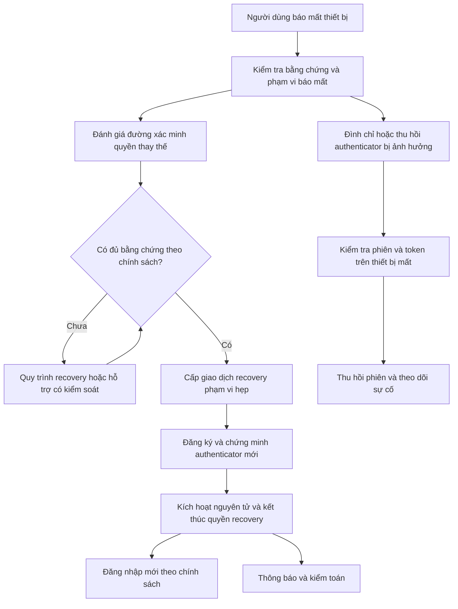

# MFA device loss — Xử lý mất thiết bị xác thực đa yếu tố

## 1. Mất thiết bị MFA là sự kiện vòng đời authenticator

Một điện thoại bị mất có thể đồng thời giữ ứng dụng TOTP, passkey, email khôi phục và nhiều phiên đã đăng nhập. Vì vậy, xử lý mất thiết bị MFA không chỉ là bật nút “Tắt xác thực hai bước”. Hệ thống cần bảo vệ quyền kiểm soát tài khoản, ngăn thiết bị cũ tiếp tục được sử dụng và giúp chủ tài khoản đăng ký phương thức thay thế bằng bằng chứng phù hợp.

Trong nền tảng IAM, danh tính tài khoản, authenticator và phiên là những đối tượng liên quan nhưng khác nhau. Mất một authenticator không nhất thiết làm mất toàn bộ danh tính. Ngược lại, thu hồi authenticator không tự bảo đảm mọi phiên trên thiết bị đã mất đều bị thu hồi.

Sau bài học, người học có thể phân loại hậu quả của việc mất điện thoại hoặc khóa bảo mật, lựa chọn đường recovery, thiết kế quyền recovery có phạm vi hẹp và xác định điều kiện để kích hoạt authenticator mới.

| Khái niệm | Ý nghĩa trong tình huống mất thiết bị |
| --- | --- |
| Danh tính tài khoản | Chủ thể cùng hồ sơ và quyền truy cập được quản lý |
| Authenticator | Thành phần dùng để chứng minh quyền kiểm soát tài khoản |
| Credential record | Bản ghi phía hệ thống để xác minh hoặc quản lý authenticator |
| Phiên | Trạng thái truy cập đã được tạo sau một lần xác thực |
| Recovery | Quá trình phục hồi khả năng kiểm soát khi không còn đủ phương thức cần thiết |

Ví dụ: Lan đăng nhập bằng mật khẩu và TOTP trên điện thoại. Khi điện thoại bị mất, Lan vẫn biết mật khẩu nhưng không còn yếu tố TOTP. Biết mật khẩu không tự tạo quyền bỏ qua yêu cầu MFA hoặc đăng ký một seed mới.

## 2. Hai quyết định phải tách biệt: ngăn sử dụng và cho phép thay thế

### 2.1. Báo mất và hạn chế thiệt hại

Mục tiêu của báo mất là ngăn authenticator nghi bị lộ tiếp tục được dùng. Một hệ thống có thể hỗ trợ tạm đình chỉ hoặc thu hồi authenticator sau khi kiểm tra bằng chứng báo mất theo chính sách.

Không cho phép một request công khai chỉ chứa username tự xóa toàn bộ yếu tố của người khác. Nếu không, đối thủ có thể gây khóa tài khoản hàng loạt. Tuy nhiên, cũng không buộc người dùng phải sử dụng chính thiết bị đã mất mới được báo mất.

NIST cho phép thiết kế đường báo mất với bằng chứng phù hợp, có thể nhẹ hơn điều kiện để ràng buộc authenticator thay thế; đồng thời yêu cầu xử lý authenticator bị compromise kịp thời. Xem [NIST SP 800-63B-4 — Loss, Theft, Damage, and Compromise](https://pages.nist.gov/800-63-4/sp800-63b/events/#loss-theft-damage-and-compromise).

### 2.2. Cấp quyền đăng ký phương thức mới

Đăng ký authenticator mới là một hành động nhạy cảm: ai hoàn tất được nó có thể tạo một yếu tố mà họ kiểm soát. Bằng chứng đủ để yêu cầu tạm đình chỉ một thiết bị không mặc nhiên đủ để được thay bằng thiết bị của người yêu cầu.

Đường thay thế cần một trong các cơ sở đã được thiết kế: xác thực bằng phương thức dự phòng còn hợp lệ, recovery code kết hợp bằng chứng cần thiết, hoặc quy trình phục hồi có xác minh danh tính phù hợp. Không tự cho phép nhân viên hỗ trợ chọn cách đơn giản hơn chỉ vì tình huống được mô tả là khẩn cấp.

### 2.3. Thu hồi phiên là quyết định liên quan nhưng riêng biệt

Điện thoại có thể đang giữ một session cookie hoặc refresh token. Kẻ giữ điện thoại có thể dùng phiên đó mà không cần nhập TOTP lần nữa. Vì vậy, kế hoạch xử lý cần xem cả authenticator lẫn phiên, token và phương thức khôi phục trên cùng thiết bị.

## 3. Phân loại đúng loại thiết bị và credential bị ảnh hưởng

| Trường hợp | Rủi ro cần xem xét | Hành động phía IAM |
| --- | --- | --- |
| Mất điện thoại chứa TOTP | Seed có thể còn trên máy hoặc đã được sao chép | Thu hồi/đình chỉ credential TOTP liên quan; cấp seed mới khi đủ quyền |
| Mất khóa bảo mật đã đăng ký riêng | Credential trên khóa cũ có thể bị sử dụng theo điều kiện của authenticator | Thu hồi credential ID của khóa đó, giữ khóa dự phòng hợp lệ |
| Mất thiết bị có passkey đồng bộ | Credential có thể còn trên thiết bị khác và bản sao trên máy mất | Đánh giá credential và phiên; phân biệt thu hồi credential với loại thiết bị khỏi tài khoản đồng bộ |
| Mất thiết bị giữ passkey gắn với thiết bị | Có thể không còn bản sao sử dụng được | Dùng authenticator độc lập hoặc recovery để đăng ký credential mới |
| Mất điện thoại nhận SMS | SIM, số điện thoại hoặc hộp thư thoại có thể bị chiếm | Xử lý kênh viễn thông và trạng thái authenticator theo chính sách |
| Điện thoại hỏng không thể truy cập | Người dùng mất khả năng sử dụng; tình trạng bí mật không chắc chắn | Không mặc định credential còn an toàn chỉ vì máy không bật được |

### 3.1. TOTP có thể có nhiều bản sao của cùng seed

Nếu hai ứng dụng được thiết lập bằng cùng QR code, chúng thường sinh cùng chuỗi mã TOTP. Hệ thống không biết mã đến từ điện thoại A hay B chỉ dựa vào mã đó. Xóa nhãn “điện thoại A” trên giao diện mà vẫn chấp nhận seed cũ không vô hiệu hóa được bản sao trên máy mất.

Khi seed nghi bị lộ, cần ngừng chấp nhận seed cũ và thiết lập seed mới theo quy trình. Nếu sản phẩm hỗ trợ nhiều authenticator TOTP độc lập, mỗi bản ghi có seed riêng sẽ cho phép quản lý riêng; không đánh đồng cách đó với sao chép một seed sang nhiều thiết bị.

### 3.2. Passkey đồng bộ và credential riêng trên từng khóa

Passkey có thể được đồng bộ qua nhà cung cấp hoặc được giữ trên một thiết bị/khóa cụ thể. Khả năng truy cập từ thiết bị khác phụ thuộc mô hình đã sử dụng. FIDO trình bày sự khác nhau giữa passkey đồng bộ và passkey gắn với thiết bị tại [FIDO Alliance — Passkeys](https://fidoalliance.org/passkeys/).

Ở phía relying party, thu hồi một WebAuthn credential thường là không chấp nhận credential record tương ứng nữa. Nếu nhiều bản sao đồng bộ cùng đại diện cho credential đó, việc thu hồi ở relying party ảnh hưởng đến các bản sao của credential, không chỉ chiếc điện thoại bị mất.

Ngược lại, loại chiếc điện thoại khỏi tài khoản đồng bộ của nhà cung cấp không tự bảo đảm phiên tại mọi ứng dụng đã bị đóng. Cần xử lý từng lớp: tài khoản đồng bộ, credential tại dịch vụ và phiên/token đã cấp.

### 3.3. Sinh trắc học và mã mở khóa thiết bị

Vân tay hoặc mã PIN có thể là yếu tố kích hoạt authenticator cục bộ. Chúng không làm mất nhu cầu quản lý credential phía máy chủ. Không suy từ việc điện thoại có khóa màn hình rằng mọi secret và phiên trên đó chắc chắn chưa thể bị sử dụng.

## 4. Xác định người dùng còn phương thức nào độc lập

Điểm đầu tiên trong recovery là kiểm kê **khả năng còn sử dụng được**, không chỉ nhìn số lượng phương thức đã đăng ký.

```text
Mật khẩu + TOTP + email cùng nằm trong một điện thoại
→ Có nhiều cơ chế, nhưng cùng chịu một sự cố mất thiết bị.

Khóa bảo mật dự phòng ở nơi khác + recovery code ngoại tuyến
→ Có các đường dự phòng ít phụ thuộc vào chiếc điện thoại bị mất hơn.
```

Hai authenticator dự phòng cùng loại giúp tăng khả năng tiếp tục sử dụng, nhưng không tự tạo hai loại yếu tố độc lập cho một lần xác thực. Hai bản sao TOTP cũng không trở thành “hai yếu tố” chỉ vì có hai ứng dụng.

### 4.1. Còn authenticator dự phòng hợp lệ

Nếu người dùng còn một phương thức đã được đăng ký và thỏa chính sách, họ có thể xác thực lại bằng phương thức đó để quản lý authenticator. Hệ thống kiểm tra mức bảo đảm, độ mới của lần xác thực và hành động đang xin thực hiện.

Ví dụ, một khóa bảo mật dự phòng có thể được dùng theo luồng đã hỗ trợ để xác thực, báo mất khóa chính và đăng ký thiết bị thay thế. Không cho phép khóa mới tự chứng minh quyền của chính nó trước khi được ràng buộc đúng với tài khoản.

### 4.2. Còn recovery code và bằng chứng bổ sung

Recovery code được cấp trước là một bí mật cần bảo vệ. Một cách triển khai có thể yêu cầu code hợp lệ kết hợp với mật khẩu hoặc authenticator còn lại, tùy chính sách bảo đảm áp dụng.

Code dùng một lần phải được tiêu thụ nguyên tử; hai request đồng thời không được cùng sử dụng một code. Nếu code cấp quyền cho một giao dịch recovery, request gửi lại cần tiếp tục giao dịch có kiểm soát, không làm code có tác dụng vô hạn.

Không nói rằng mọi recovery code đều tương đương một authenticator chống phishing. Cách cấp, lưu, xác minh và bằng chứng kết hợp quyết định ý nghĩa của nó trong hệ thống.

### 4.3. Không còn đủ phương thức để tự phục hồi

Khi mất tất cả bằng chứng cần thiết, chuyển sang quy trình recovery đã được phê duyệt. Tùy bối cảnh, đó có thể là bằng chứng khôi phục được thiết lập trước, recovery contact hoặc xác minh lại danh tính nếu hệ thống đã có nền tảng để thực hiện.

NIST quy định yêu cầu recovery phụ thuộc vào mức bảo đảm và bối cảnh danh tính; một link email đơn lẻ không tự chứng minh mọi tài khoản đã đủ điều kiện phục hồi. Xem [NIST SP 800-63B-4 — Account Recovery](https://pages.nist.gov/800-63-4/sp800-63b/events/#account-recovery).

Không thể “xác minh lại” một thuộc tính chưa từng được xác minh đáng tin cậy chỉ bằng cách hỏi lại nó. Tên hiển thị, ngày sinh hoặc thông tin công khai không tự trở thành bằng chứng mạnh khi được hỏi bởi help desk.

## 5. Quy trình xử lý mất thiết bị từ đầu đến cuối



### Bước 1: Tiếp nhận báo mất mà không lộ tài khoản

Trang công khai có thể hướng dẫn người dùng chọn phương thức còn dùng được hoặc bắt đầu recovery. Tránh hiển thị “Tài khoản này có ba khóa bảo mật” chỉ sau khi nhập email. Áp dụng giới hạn lưu lượng cho yêu cầu công khai và thông báo chung khi cần.

### Bước 2: Xác định phạm vi ảnh hưởng

Ghi nhận loại thiết bị, authenticator liên quan, phiên có thể còn mở và khả năng kênh khôi phục cũng nằm trên thiết bị đó. Thông tin người dùng cung cấp là đầu vào đánh giá, không tự thay thế bằng chứng xác thực.

### Bước 3: Ngăn credential cũ được dùng theo chính sách

Khi đã đủ căn cứ để xử lý báo mất, đình chỉ hoặc thu hồi credential bị ảnh hưởng. Không chờ đến lúc người dùng mua điện thoại mới mới hạn chế credential nghi bị lộ.

Nếu hỗ trợ trạng thái tạm đình chỉ, việc kích hoạt lại sau khi tìm được thiết bị cần xác minh và kiểm tra rủi ro riêng. Với secret đã có khả năng bị sao chép, tìm lại chiếc máy không chứng minh các bản sao đã biến mất.

### Bước 4: Xác minh quyền phục hồi

Chọn đường có sẵn theo chính sách, kiểm tra bằng chứng và các điều kiện tài khoản. Không thay đổi email hoặc số điện thoại nhận bằng chứng ngay trong cùng request chưa xác thực rồi dùng kênh mới đó để “xác minh” người yêu cầu.

### Bước 5: Đăng ký phương thức thay thế

Tạo credential mới ở trạng thái pending. Với TOTP, sinh seed mới và yêu cầu một mã chứng minh ứng dụng mới đã thiết lập đúng. Với WebAuthn, xác minh registration ceremony theo thư viện và yêu cầu của relying party, gồm challenge và các ràng buộc liên quan.

Một nhãn “điện thoại mới” hoặc ảnh chụp màn hình ứng dụng authenticator không phải bằng chứng mật mã rằng credential mới đã được đăng ký đúng.

### Bước 6: Kích hoạt và đóng đường recovery

Kích hoạt credential mới bằng một cập nhật có kiểm soát, kết thúc quyền recovery và xử lý các phiên cần thu hồi. Người dùng đăng nhập mới theo chính sách. Không tự cấp phiên đặc quyền chỉ vì nhân viên hỗ trợ đã đánh dấu ticket là hoàn tất.

### Bước 7: Thông báo và kiểm tra sau sự kiện

Thông báo việc báo mất, thu hồi hoặc thêm authenticator đến kênh phù hợp đã được tin cậy. Hướng dẫn cách báo cáo nếu không phải chủ tài khoản thực hiện. Không đưa seed, recovery code hoặc token vào thông báo.

OWASP xem việc thay thế/reset MFA là hành động rủi ro cao, cần tái xác thực, kiểm tra theo rủi ro và thông báo phù hợp. Xem [OWASP Multifactor Authentication Cheat Sheet](https://cheatsheetseries.owasp.org/cheatsheets/Multifactor_Authentication_Cheat_Sheet.html).

## 6. Quyền recovery phải có phạm vi hẹp và có thời hạn

Sau khi bằng chứng được chấp nhận, người dùng có thể cần một khoảng thời gian để thiết lập thiết bị mới. Thay vì cấp một phiên ứng dụng đầy đủ, hệ thống tạo một giao dịch recovery hoặc một quyền tạm chỉ cho phép các thao tác đã phê duyệt.

Một bản ghi nội bộ minh họa:

```json
{
  "grantId": "rg-internal-id",
  "tenantId": "tenant-7",
  "accountId": "u-104",
  "purpose": "REPLACE_LOST_AUTHENTICATOR",
  "allowedOperations": ["ENROLL_REPLACEMENT_AUTHENTICATOR"],
  "lostAuthenticatorId": "auth-old-id",
  "expectedFactorVersion": 12,
  "state": "APPROVED",
  "expiresAt": "<server-assigned-expiration>",
  "consumedAt": null
}
```

Đây là dữ liệu server quản lý, không phải JSON mà client gửi lên là được tin. `grantId` là định danh bản ghi, không tự là bằng chứng quyền truy cập. Nếu dùng bearer token hoặc cookie để tiếp tục giao dịch, phải bảo vệ chúng và ánh xạ đến bản ghi server còn hiệu lực.

Quyền tạm không được dùng để:

- Gọi API nghiệp vụ hoặc quản trị người dùng khác.
- Đổi email/điện thoại khôi phục ngoài phạm vi được phê duyệt.
- Tắt toàn bộ chính sách MFA của tài khoản.
- Thêm role RBAC hoặc thay policy ABAC.
- Phát access token có mức bảo đảm mà bằng chứng hiện tại chưa đạt.

Một thời hạn như 15 phút có thể là lựa chọn của sản phẩm, không phải quy tắc chung cho mọi hệ thống. Thời gian phải đủ cho thao tác dự kiến và được kiểm tra lại ở bước commit, không chỉ khi người dùng mở trang.

Nếu recovery code được tiêu thụ để tạo quyền tạm, việc tiêu thụ code và tạo quyền nên cùng thành công hoặc cùng thất bại. Khi người dùng nhập sai mã xác minh của thiết bị mới, họ có thể tiếp tục giao dịch còn hiệu lực theo giới hạn; không cần biến recovery code đã dùng thành code chưa dùng để retry.

Khi quyền tạm hết hạn, bị hủy hoặc bị thu hồi, một request cũ không được tiếp tục đăng ký authenticator. Cookie “remember this device” hoặc một phiên cũ cũng không tự cung cấp bằng chứng bổ sung mà chính sách đang thiếu.

## 7. Kích hoạt credential mới và xử lý cập nhật đồng thời

### 7.1. Pending không phải active

Credential mới nên có trạng thái chờ đến khi hoàn tất bằng chứng đăng ký. Một seed TOTP vừa được hiển thị nhưng chưa chứng minh đã thiết lập đúng không nên mặc nhiên trở thành authenticator hoạt động. Seed ở trạng thái pending cũng là secret và cần được bảo vệ, có hạn dùng và được dọn khi giao dịch kết thúc.

Với WebAuthn, relying party cần xác minh dữ liệu đăng ký theo yêu cầu của ceremony, thay vì nhận một public key tùy ý rồi gắn ngay vào account. Challenge, origin, RP ID và các điều kiện xác minh liên quan phải được xử lý bằng thư viện phù hợp. Tham khảo [W3C Web Authentication](https://www.w3.org/TR/webauthn-3/).

### 7.2. Gắn quyền thay thế với phiên bản inventory

Giả sử giao dịch recovery được phê duyệt lúc danh sách authenticator có phiên bản 12. Trong lúc người dùng đang thiết lập máy mới, một quản trị viên thu hồi credential hoặc phát hiện compromise và tăng phiên bản thành 13. Giao dịch cũ không nên tự ghi đè trạng thái mới.

Một trường như `factor_version` cho phép kiểm tra điều này. Phiên bản phải được tăng và kiểm tra nhất quán trên mọi đường thêm, thu hồi hoặc thay đổi nhạy cảm, bao gồm cả thao tác hỗ trợ.

### 7.3. Ranh giới giao dịch minh họa

```text
Xác minh bằng chứng đăng ký mới và gắn kết quả với giao dịch recovery.

BEGIN TRANSACTION
    Khóa hàng trạng thái bảo mật của tài khoản.
    Khóa và đọc lại recovery grant.
    Kiểm tra tenant, account, purpose, quyền thao tác và thời hạn hiện tại.
    Kiểm tra grant chưa dùng, chưa bị thu hồi và còn ở trạng thái được phép.
    Kiểm tra factor_version khớp phiên bản đã được phê duyệt.
    Kiểm tra credential pending thuộc cùng giao dịch và đã chứng minh hợp lệ.
    Kích hoạt credential mới.
    Bảo đảm credential bị mất không còn được chấp nhận theo quyết định xử lý.
    Tăng factor_version và phiên bản thu hồi phiên theo chính sách.
    Tiêu thụ recovery grant và kết thúc giao dịch recovery.
    Ghi sự kiện thông báo vào outbox.
COMMIT

Gửi thông báo và thực hiện các tác vụ ngoài database từ sự kiện đã commit.
```

Đây là giả mã thiết kế, không phải một thư viện xác thực hoàn chỉnh. Thứ tự khóa và cách kiểm tra trạng thái cần thống nhất để tránh xung đột hoặc deadlock. Chỉ trả hoàn tất sau khi giao dịch thành công.

Hai request đồng thời không được cùng dùng một grant để kích hoạt hai phương thức ngoài phạm vi được phép. Nếu request thứ nhất đã commit, request thứ hai phải thấy grant đã dùng hoặc phiên bản đã đổi và không được lặp lại hành động.

Nếu xác minh đăng ký được làm trước giao dịch để tránh giữ khóa lâu, phải ràng buộc kết quả với đúng challenge, pending credential và giao dịch. Trong giao dịch vẫn kiểm tra lại trạng thái, quyền và hạn dùng. Không tin một cờ `registrationVerified=true` do trình duyệt gửi.

Khi email thông báo lỗi sau commit, không khôi phục credential cũ chỉ để gửi lại thông báo. Outbox có thể retry riêng; thao tác kích hoạt không được lặp lại theo mỗi lần retry gửi mail.

## 8. Phiên và token trên thiết bị mất

### 8.1. Thu hồi authenticator không thu hồi mọi quyền đã cấp

Một phiên đã được tạo trước lúc báo mất có thể tiếp tục hợp lệ nếu ứng dụng không kiểm tra trạng thái thu hồi. Điều này đặc biệt đáng chú ý khi điện thoại bị mất đang mở email, ứng dụng quản trị hoặc trình duyệt đã đăng nhập.

Hệ thống cần quyết định thu hồi phiên của thiết bị cụ thể hay tất cả phiên theo mức rủi ro và khả năng nhận diện đáng tin cậy. Không chỉ dựa vào tên thiết bị tự khai hoặc User-Agent để kết luận đã tìm đúng toàn bộ phiên bị ảnh hưởng.

Nếu dùng `session_version` hoặc `security_epoch`, nơi xác minh phiên/token phải đối chiếu phiên bản đó hoặc cơ chế tương đương. Tăng một số trong database không làm JWT đang lưu trên máy mất tự thay đổi hoặc mất chữ ký.

Có thể kết hợp hủy session server-side, thu hồi refresh token, hạn dùng access token và cơ chế kiểm tra trạng thái. Nếu yêu cầu vô hiệu hóa ngay, cần có kiểm tra trên đường truy cập thực tế; cache và đồng bộ sự kiện có thể tạo độ trễ cần được xác định.

### 8.2. Recovery không tự là một phiên có đầy đủ MFA

Một giao dịch phục hồi có thể đủ quyền đăng ký lại yếu tố nhưng chưa phải một lần đăng nhập thỏa mọi điều kiện sử dụng tài nguyên. Sau khi kích hoạt phương thức mới, yêu cầu đăng nhập mới hoặc xác thực theo chính sách trước khi truy cập dữ liệu nhạy cảm.

Không gán `amr` hoặc `acr` thể hiện bằng chứng mạnh hơn những gì đã thực sự được xác minh. Ứng dụng nhận assertion từ IdP cần hiểu cam kết và chính sách tương ứng, không chỉ nhìn việc claim có mặt.

### 8.3. Phạm vi SSO và liên kết danh tính

Nếu MFA được quản lý ở IdP, việc thay thế cần đi qua IdP hoặc quy trình quản trị được phép. Một ứng dụng relying party không được mở đường bypass bằng cách đặt `mfaEnabled=false` trong hồ sơ local rồi tiếp tục tin đó là kết quả IdP.

Thu hồi authenticator hoặc phiên IdP không tự bảo đảm mọi phiên ứng dụng liên kết đã bị đóng. Cần xác định cơ chế logout, sự kiện thu hồi hoặc chính sách phiên riêng của từng relying party. Phạm vi khôi phục phải phản ánh kiến trúc thực tế.

## 9. Help desk, tài khoản đặc quyền và chống social engineering

Đối thủ có thể giả làm chủ tài khoản, quản lý hoặc người đang đi công tác để xin gỡ MFA. Sự khẩn cấp, quyền hạn được tự khai và việc biết thông tin hồ sơ không tự chứng minh danh tính.

Một quy trình hỗ trợ có kiểm soát cần xác định rõ:

- Nhân viên nào được tiếp nhận, xem bằng chứng và phê duyệt từng loại thao tác.
- Bằng chứng nào được chấp nhận cho từng nhóm tài khoản.
- Khi nào cần người phê duyệt độc lập hoặc thời gian chờ.
- Phạm vi thay đổi, thời hạn quyền tạm và cách thu hồi.
- Cách thông báo đến chủ tài khoản qua kênh đã được thiết lập.

Không dùng số điện thoại hoặc địa chỉ email mới do người đang yêu cầu cung cấp làm kênh xác minh duy nhất. Nếu cần liên hệ lại, kênh phải được lấy từ nguồn tin cậy theo quy trình, không chỉ bấm gọi lại số trong chữ ký email.

Với tài khoản đặc quyền, có thể cần kiểm soát chặt hơn, phê duyệt độc lập và theo dõi sau recovery. Phê duyệt của quản lý có thể là một phần quy trình tổ chức, nhưng không tự thay mọi bằng chứng kỹ thuật hoặc yêu cầu bảo đảm đang áp dụng.

Nếu tổ chức có cơ chế truy cập khẩn cấp, cần thiết kế trước với phạm vi, thời hạn và kiểm toán rõ ràng. Không tạo một mật khẩu dùng chung hoặc bỏ MFA vô thời hạn ngay trong lúc xử lý sự cố để giải quyết nhanh.

Theo nguyên tắc ít quyền nhất, người có quyền hỗ trợ recovery không mặc nhiên được xem seed TOTP, private key, recovery code bản rõ hoặc cấp thêm role. Không gửi ảnh QR của seed qua ticket hoặc chia sẻ màn hình với người không có thẩm quyền.

Danh tính workload và service account cần quy trình cấp lại credential, xoay khóa hoặc tái liên kết riêng. Không coi mất điện thoại của một nhân viên là lý do để cấp rộng quyền truy cập mọi workload mà họ từng quản trị.

## 10. Thông báo, audit và vận hành sự cố

Các sự kiện cần theo dõi có thể gồm:

```text
AUTHENTICATOR_LOSS_REPORTED
AUTHENTICATOR_SUSPENDED
RECOVERY_EVIDENCE_ACCEPTED
REPLACEMENT_AUTHENTICATOR_ACTIVATED
AUTHENTICATOR_REVOKED
RECOVERY_COMPLETED
SESSIONS_REVOKED
```

Audit nên ghi chủ thể, tenant, tác nhân thực hiện, ID giao dịch/ticket, loại bằng chứng đã kiểm tra, quyết định và thời gian. Không ghi bí mật bằng chứng như seed, mã TOTP, recovery code, private key hoặc bearer token.

Các bản sao giấy tờ hoặc dữ liệu xác minh danh tính có thể nhạy cảm hơn một log kỹ thuật thông thường. Chỉ thu thập dữ liệu cần thiết, bảo vệ quyền truy cập và thời gian lưu theo chính sách áp dụng. Không đưa tài liệu phục hồi trực tiếp vào log ứng dụng hoặc nhóm chat hỗ trợ chung.

Thông báo không được phụ thuộc duy nhất vào đúng chiếc điện thoại đã mất. Thiết kế trước kênh thông báo thay thế và cách người dùng báo cáo thay đổi trái phép. Mọi link xử lý sự cố cũng cần quyền và hạn dùng phù hợp, không tự thực hiện một thao tác nhạy cảm chỉ bằng GET.

Các chỉ số hữu ích gồm thời gian từ báo mất đến đình chỉ credential, thời gian hoàn tất recovery, số grant hết hạn, số lần từ chối do thay đổi phiên bản và lỗi lan truyền thu hồi phiên. Tăng đột biến yêu cầu gỡ MFA cho tài khoản quản trị là một dấu hiệu cần điều tra.

Nếu authenticator cũ xuất hiện trở lại sau khi đã thu hồi, hệ thống phải từ chối theo trạng thái server và có thể ghi nhận sự kiện rủi ro. Không tự kích hoạt lại chỉ vì có một mã TOTP hợp lệ theo seed cũ hoặc một chữ ký đúng từ credential đã bị thu hồi.

## 11. Chuẩn bị trước để tránh mất toàn bộ đường truy cập

Khả năng recovery hiệu quả bắt đầu từ lúc đăng ký, không phải khi đã mất thiết bị.

Người dùng nên được hướng dẫn đăng ký phương thức dự phòng đáp ứng chính sách và giữ ở nơi ít cùng chịu một sự cố. Ví dụ, một khóa bảo mật dự phòng được cất riêng sẽ có ý nghĩa khác với việc để cả hai khóa trong cùng túi.

Recovery code nên được cấp và lưu theo cơ chế bảo mật phù hợp, có hướng dẫn dùng một lần và cách thay thế. Không lưu bản duy nhất của mọi code trong chính điện thoại cần dự phòng. Khi nghi code đã lộ, cần vô hiệu hóa các code liên quan và cấp lại sau khi đủ quyền.

Nếu dùng passkey đồng bộ, người dùng và tổ chức cần hiểu cách khôi phục tài khoản đồng bộ, thiết bị nào có thể truy cập và giới hạn của mô hình. Đồng bộ giúp khả năng tiếp tục sử dụng trong một số tình huống, nhưng không thay thế mọi chính sách recovery hoặc yêu cầu credential không xuất được.

Một phiên trình duyệt còn mở có thể giúp người dùng đến được trang hỗ trợ, nhưng không nên là căn cứ duy nhất để thêm authenticator mới. Cần tái xác thực hoặc recovery theo mức rủi ro của hành động.

Tài khoản đã lâu không dùng, nhân viên chuyển bộ phận và thay điện thoại là những thời điểm dễ làm thông tin recovery lỗi thời. Việc rà soát phương thức dự phòng cần đi cùng vòng đời danh tính và quyền, tránh giữ một đường phục hồi thuộc về số điện thoại hoặc hộp thư không còn được kiểm soát.

## 12. Tình huống thực hành: mất điện thoại có TOTP và email

Lan là giảng viên, có quyền duyệt nội dung. Điện thoại bị mất đang giữ TOTP, email và phiên trên ứng dụng học tập. Lan còn biết mật khẩu và giữ một recovery code ngoại tuyến. Tài khoản của Lan có chính sách cho phép kết hợp hai bằng chứng này trong đường recovery đã được phê duyệt.

Một phương án xử lý có thể là:

1. Lan dùng kênh chính thức để báo mất. Hệ thống xác minh bằng chứng báo mất và đình chỉ credential liên quan theo phạm vi cho phép.
2. Hệ thống đánh giá các phiên và token có thể còn trên điện thoại, đồng thời hướng dẫn bảo vệ kênh email/thiết bị qua nhà cung cấp tương ứng.
3. Lan chứng minh các bằng chứng recovery được yêu cầu. Code được tiêu thụ một lần để tạo giao dịch có thời hạn và chỉ được đăng ký authenticator thay thế.
4. Seed TOTP mới được tạo, ứng dụng mới cung cấp mã xác minh và hệ thống kiểm tra ràng buộc với đúng giao dịch.
5. Hệ thống kích hoạt credential mới, bảo đảm seed cũ không còn được chấp nhận, kết thúc quyền recovery và áp dụng chính sách thu hồi phiên.
6. Lan đăng nhập mới bằng các yếu tố theo chính sách. Quyền duyệt nội dung giữ theo nguồn cấp quyền hiện hành, không được tự tăng hoặc phục hồi quyền đã bị thu hồi.

Đường này không được áp dụng máy móc cho một tài khoản khác chỉ vì người đó cũng biết mật khẩu. Nếu không còn code hoặc bằng chứng cần thiết, cần dùng đường recovery khác đã được thiết kế. Một email “Tôi là Lan, hãy tắt MFA” không có cùng giá trị với các bằng chứng trong ví dụ.

## 13. Những lỗi thiết kế cần nhận ra

| Lỗi | Hậu quả | Nguyên tắc xử lý |
| --- | --- | --- |
| Chỉ cần username để gỡ MFA | Đối thủ khóa hoặc chiếm tài khoản người khác | Xác minh riêng quyền báo mất và quyền thay thế |
| Gửi bằng chứng đến email mới do người yêu cầu chọn | Đối thủ tự tạo kênh xác minh | Dùng kênh đã tin cậy hoặc quy trình thay đổi được phép |
| Sao chép lại seed TOTP cũ sang máy mới | Thiết bị mất vẫn có cùng secret | Dùng seed mới khi secret cũ bị ảnh hưởng |
| Xóa nhãn thiết bị nhưng vẫn chấp nhận credential | Thu hồi chỉ có tác dụng trên giao diện | Thực thi trạng thái ở nơi xác minh |
| Coi mọi bản sao passkey là credential độc lập | Thu hồi sai phạm vi hoặc khóa cả các bản sao còn dùng | Hiểu credential ID và mô hình đồng bộ |
| Cấp phiên đầy đủ ngay sau một bước recovery | Bỏ qua bằng chứng hoặc MFA còn thiếu | Dùng quyền tạm hẹp và đăng nhập theo chính sách |
| Chỉ thu hồi authenticator, bỏ qua session | Thiết bị mất vẫn truy cập bằng phiên cũ | Xử lý cả phiên, token và độ trễ thu hồi |
| Hai request cùng dùng grant | Kích hoạt ngoài phạm vi hoặc ghi đè trạng thái mới | Tiêu thụ nguyên tử và kiểm tra phiên bản |
| Help desk vừa tự xác minh vừa tự cấp mọi quyền | Khó ngăn lạm dụng và social engineering | Giới hạn thẩm quyền và tách phê duyệt khi cần |
| Mọi phương thức dự phòng ở cùng điện thoại | Một sự cố làm mất tất cả đường phục hồi | Chuẩn bị phương thức ít cùng chịu rủi ro |

Hãy thiết kế phương án cho ba trường hợp: mất một khóa trong hai khóa đã đăng ký độc lập; mất điện thoại có passkey đồng bộ nhưng còn thiết bị tin cậy khác; và mất toàn bộ authenticator cùng recovery code. Với mỗi trường hợp, xác định bằng chứng còn dùng được, phạm vi thu hồi, quyền tạm được cấp và điều kiện để tài khoản trở lại sử dụng bình thường.
