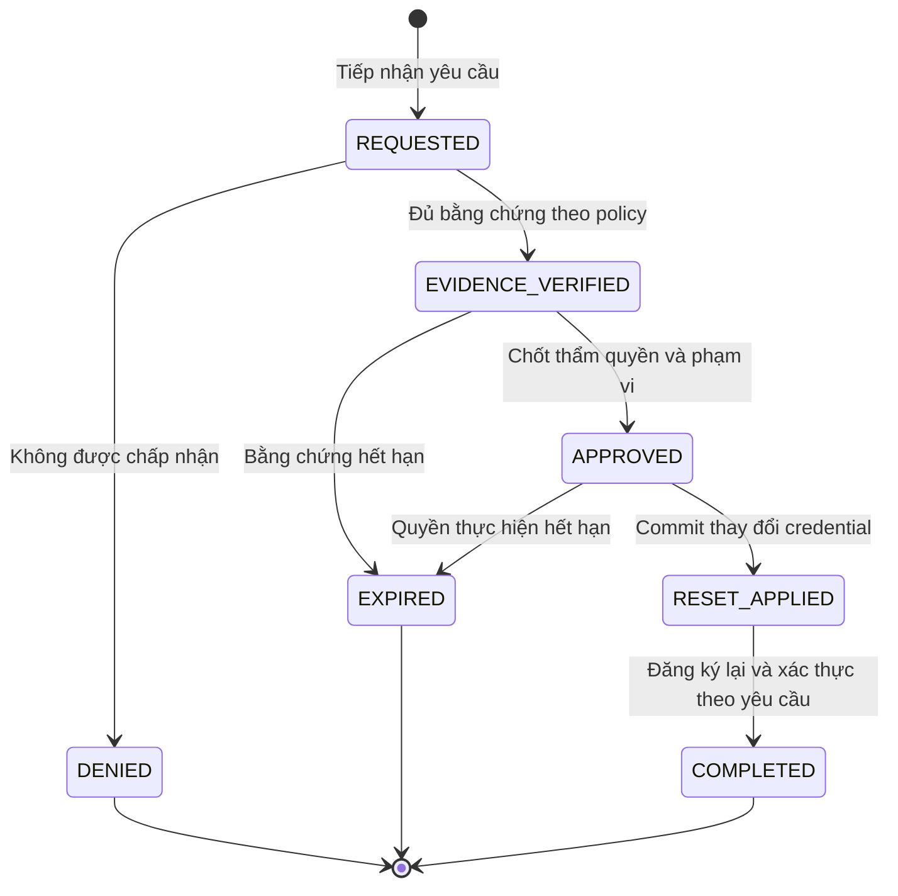

# MFA reset — Đặt lại yếu tố xác thực đa yếu tố

Một nhân viên mất điện thoại chứa ứng dụng xác thực. Họ vẫn nhớ mật khẩu nhưng không còn tạo được mã TOTP. Nhân viên hỗ trợ tìm thấy tài khoản rồi bấm “Reset MFA”. Nếu thao tác đó chỉ xóa seed và cho phép đăng nhập bằng mật khẩu, hệ thống vừa tạo ra một đường bỏ qua yêu cầu MFA vốn dùng để bảo vệ tài khoản.

**MFA reset** là quy trình thay đổi hoặc vô hiệu hóa các authenticator đã được gắn với tài khoản, dựa trên thẩm quyền và bằng chứng được chấp nhận, đồng thời kiểm soát cách người dùng đăng ký lại. Kết quả cần là một trạng thái truy cập xác định và có thể kiểm toán, không chỉ là việc xóa một bản ghi credential.

Trong quản lý danh tính và quyền truy cập (IAM), thao tác này liên quan đến vòng đời credential, recovery, quản lý phiên, SSO và đặc quyền. Reset không tự khôi phục vai trò đã bị thu hồi, không mở lại tài khoản bị đình chỉ và không thay thế việc xử lý một sự cố chiếm quyền.

Sau bài học, người học có thể xác định phạm vi reset, chọn đường xác minh phù hợp, thiết kế quyền đăng ký lại có giới hạn và giải thích cách kiểm soát phiên cũ sau thay đổi.

## 1. “Reset MFA” cần được định nghĩa thành hành động cụ thể

Một nút chung có thể che giấu nhiều thao tác khác nhau. Trước khi triển khai API hoặc cấp quyền cho helpdesk, cần biết thao tác tác động lên credential nào và chính sách nào vẫn còn hiệu lực.

| Tình huống | Hành động có thể cần | Điều không được mặc định |
| --- | --- | --- |
| Đổi điện thoại, thiết bị cũ vẫn dùng được | Đăng ký và xác nhận phương tiện mới, rồi thu hồi phương tiện cũ | Phải xóa toàn bộ phương thức trước khi thêm mới |
| Mất một authenticator nhưng còn phương tiện dự phòng | Xác thực bằng phương tiện còn lại và xử lý credential bị mất | Cần hạ toàn bộ tài khoản xuống một yếu tố |
| Mất mọi phương tiện cần thiết | Account recovery theo chính sách, sau đó cấp quyền thiết lập lại | Biết mật khẩu là đủ cho mọi tài khoản |
| Nghi seed hoặc khóa đã bị lộ | Vô hiệu hóa credential bị ảnh hưởng và xử lý trạng thái truy cập liên quan | Chờ người dùng cài xong phương tiện mới mới được vô hiệu hóa |
| TOTP không khớp do giờ hoặc cấu hình | Chẩn đoán nguyên nhân trong phạm vi được phép | Mọi lỗi mã đều cần reset |
| Quản trị viên yêu cầu tắt MFA lâu dài | Thay đổi chính sách hoặc ngoại lệ có thẩm quyền riêng | Cùng quyền với hỗ trợ khôi phục một lần |

Đổi mật khẩu và reset MFA cũng là hai thay đổi khác nhau. Đặt mật khẩu mới không tự vô hiệu hóa TOTP seed, passkey hoặc khóa bảo mật. Ngược lại, xóa một yếu tố MFA không tự làm mật khẩu đã bị lộ trở nên an toàn.

Với passkey hoặc authenticator có thể tự đáp ứng phương thức đa yếu tố, không nên hình dung reset chỉ là “xóa yếu tố thứ hai”. Phạm vi có thể là một credential cụ thể hoặc toàn bộ tập phương tiện được chính sách chấp nhận.

## 2. Bằng chứng nào cho phép reset?

### 2.1. Người dùng còn phương tiện xác thực phù hợp

Nếu người dùng còn khóa dự phòng hoặc một phương thức được chấp nhận khác, họ có thể thực hiện xác thực lại theo yêu cầu của thao tác quản lý credential. Server cần kiểm tra bằng chứng, độ mới và ngữ cảnh của đúng giao dịch.

Một cookie còn hạn không tự chứng minh người đang giữ cookie là chủ tài khoản. OWASP khuyến nghị xác thực lại bằng yếu tố đã đăng ký khi thay đổi MFA, xem xét rủi ro và thông báo qua kênh độc lập. [Nguồn: OWASP — Changing MFA Factors](https://cheatsheetseries.owasp.org/cheatsheets/Multifactor_Authentication_Cheat_Sheet.html#changing-mfa-factors)

Ví dụ, một phiên được tạo hôm trước có thể vẫn xem được thông tin thông thường nhưng cần step-up trước khi xóa khóa bảo mật. Client không được tự gửi `mfaVerified=true` để thay thế bằng chứng mà server quản lý.

### 2.2. Người dùng mất khả năng xác thực cần thiết

Khi không còn phương tiện đáp ứng yêu cầu, hệ thống chuyển sang recovery. Những lựa chọn có thể gồm recovery code, phương thức dự phòng, recovery contact hoặc quy trình hỗ trợ xác minh được thiết lập trước. OWASP nêu các phương án này và yêu cầu quy trình hỗ trợ kiểm tra danh tính chặt chẽ. [Nguồn: OWASP — Resetting MFA](https://cheatsheetseries.owasp.org/cheatsheets/Multifactor_Authentication_Cheat_Sheet.html#resetting-mfa)

Theo NIST SP 800-63B-4, khôi phục tài khoản có AAL tối đa AAL2 cần một trong ba cách: hai recovery code từ các phương pháp khác nhau; một recovery code kết hợp authenticator một yếu tố đã gắn với tài khoản; hoặc lặp lại identity proofing nếu tài khoản đã được proofing. Không coi hai mã cùng phương pháp là hai phương pháp khác nhau. [Nguồn: NIST — Recovery at AAL2](https://pages.nist.gov/800-63-4/sp800-63b.html#recovery-at-aal2)

Đây là yêu cầu trong phạm vi hướng dẫn NIST, không phải khẳng định mọi ứng dụng có cùng nghĩa vụ. Tuy nhiên, một thiết kế chỉ gửi link email không thể tự tuyên bố đáp ứng mọi mức bảo đảm.

### 2.3. Báo mất và cấp quyền khôi phục là hai quyết định

Một báo cáo đáng tin về mất thiết bị có thể cần xử lý bảo vệ sớm. NIST yêu cầu đình chỉ, vô hiệu hóa hoặc hủy authenticator bị compromise kịp thời sau phát hiện. [Nguồn: NIST — Loss, Theft, Damage, and Compromise](https://pages.nist.gov/800-63-4/sp800-63b.html#loss-theft-damage-and-compromise)

Nhưng được phép yêu cầu khóa một phương tiện bị mất không đồng nghĩa được phép gắn phương tiện mới và lấy lại toàn bộ quyền truy cập. Hai hành động có hậu quả khác nhau nên có thể cần bằng chứng và giới hạn khác nhau.

Endpoint công khai nhận một lời khai “tôi mất điện thoại” cũng không được lập tức xóa credential của bất kỳ username nào. Nếu làm vậy, kẻ tấn công có thể gây khóa người dùng hàng loạt.

## 3. Tách phạm vi reset khỏi chính sách bắt buộc MFA

Giả sử tài khoản có:

```text
authentication_policy: MFA_REQUIRED
active_authenticators:
    - TOTP credential A
    - Security key credential B
```

Nếu chỉ điện thoại chứa credential A bị mất, quyết định có thể là thu hồi A và giữ B, sau khi xác minh phù hợp. Không nhất thiết xóa cả khóa B hoặc hủy mọi recovery code nếu không có căn cứ cho phạm vi đó.

Nếu mọi credential được chấp nhận đều phải bị thu hồi, tài khoản có thể chuyển sang:

```text
authentication_policy: MFA_REQUIRED
active_authenticators: []
access_state: REENROLLMENT_REQUIRED
```

Chính sách vẫn bắt buộc MFA. Người dùng chỉ được cấp đường thiết lập lại sau khi hoàn thành recovery hợp lệ; họ chưa có quyền dùng ứng dụng như một phiên đã đáp ứng MFA.

Đây là điểm khác với:

```text
authentication_policy: PASSWORD_ONLY
```

Việc vô hiệu hóa credential và việc miễn yêu cầu MFA không phải cùng một quyết định. Một trường `mfa_enabled=false` dùng chung cho cả trạng thái phương tiện lẫn chính sách dễ khiến hệ thống bỏ qua sự phân biệt này.

Nguyên tắc ít quyền nhất được áp dụng vào cả công cụ hỗ trợ: quyền “reset TOTP của một người dùng trong tenant được quản lý” không tự bao gồm quyền miễn MFA vĩnh viễn, thay email recovery hoặc mở lại tài khoản bị vô hiệu hóa.

## 4. Một quy trình reset có kiểm soát

Mô hình dưới đây minh họa reset dẫn tới đăng ký lại. Một số trường hợp tự phục vụ có thể được phê duyệt tự động theo policy; không phải mọi yêu cầu đều cần nhân viên duyệt thủ công.



Đây là trạng thái quy trình, không phải toàn bộ trạng thái tài khoản. Sau `RESET_APPLIED`, tài khoản có thể còn ở `REENROLLMENT_REQUIRED`. Nếu quyền đăng ký lại hết hạn, không tự phục hồi credential đã bị thu hồi để quay về trạng thái cũ.

### Bước 1: Tiếp nhận và phân loại

Request có thể mô tả thiết bị bị mất hoặc phương thức gặp lỗi. Những thông tin đó phục vụ phân loại, chưa phải bằng chứng cho phép reset.

Đối với cổng công khai, phản hồi cần tránh tiết lộ tài khoản có tồn tại hoặc có phương thức nào. Có thể trả thông báo chung rằng yêu cầu sẽ được xử lý nếu thông tin phù hợp với tài khoản đủ điều kiện. Giới hạn lưu lượng cần bao phủ cả hành vi gửi yêu cầu và thử bằng chứng.

### Bước 2: Xác minh và đánh giá điều kiện hiện hành

Server xác định chủ thể từ bằng chứng đã xác minh, kiểm tra tenant, trạng thái tài khoản và yêu cầu theo loại đặc quyền. Nguồn bằng chứng phải được ràng buộc với đúng quy trình, không chỉ là một ghi chú “đã xác minh” trong ticket.

Tài khoản đặc quyền có thể cần phê duyệt bổ sung hoặc kiểm soát khác. Nếu doanh nghiệp yêu cầu hai người duyệt, đó là lựa chọn policy phải được thực thi; không phải một quy định tự có cho mọi hệ thống.

### Bước 3: Chốt chính xác hành động được phép

Một quyết định phê duyệt nên nêu được:

- Tài khoản và tenant đích.
- Credential hoặc tập credential bị tác động.
- Lý do và phiên bản chính sách áp dụng.
- Thời hạn quyền thực hiện.
- Những phiên, recovery artifact hoặc attempt phải mất hiệu lực.
- Quyền giới hạn nào được cấp để đăng ký lại.

Không để người thực hiện đổi từ “reset một TOTP” sang “xóa mọi yếu tố và đổi email” sau khi yêu cầu ban đầu đã được duyệt. Nếu phạm vi thay đổi, phải đánh giá lại thẩm quyền tương ứng.

### Bước 4: Áp dụng và ghi bằng chứng

Thay đổi phải được áp dụng qua chức năng có kiểm soát, có kiểm tra cuối cùng và có trạng thái giao dịch xác định. Người dùng nhận hướng dẫn thiết lập lại nếu đủ điều kiện; chủ tài khoản nhận thông báo về hành động đã xảy ra qua kênh được quản lý.

### Bước 5: Hoàn tất đăng ký lại

Authenticator mới cần qua enrollment và xác nhận đúng phương thức. Quét QR, tải ứng dụng hoặc đặt tên thiết bị chưa đủ để hoàn tất. Sau đó, hệ thống đánh giá việc cấp phiên mới theo policy xác thực thay vì mặc nhiên coi cả quá trình recovery là một lần đăng nhập đầy đủ.

## 5. Quyền reset và quyền đăng ký lại cần có phạm vi hẹp

Một phiên hoặc grant recovery chỉ nên cho phép những hành động cần để hoàn tất quá trình. Nó không mang toàn bộ quyền RBAC của chủ tài khoản vào một ngữ cảnh có bằng chứng chưa đáp ứng yêu cầu truy cập thông thường.

Ví dụ mô hình nội bộ cho quyền thực hiện reset:

```text
grant_id: opaque-operation-reference
purpose: MFA_RESET
subject_ref: internal-subject-reference
tenant_ref: internal-tenant-reference
approved_target_set: protected-credential-reference-set
approved_security_version: 24
evidence_ref: verified-evidence-reference
decision_ref: policy-decision-reference
expires_at: server-controlled-expiration
consumed_at: null
```

Các tham chiếu trên không phải bằng chứng nếu client có thể tự chọn hoặc thay chúng. Server tạo và bảo vệ quyết định; request chỉ trình bày artifact tương ứng và ý định thực hiện trong phạm vi được cấp.

Nếu dùng bearer token opaque, cần sinh đủ ngẫu nhiên, giới hạn hạn sử dụng, bảo vệ giá trị lưu và thực thi dùng một lần. Nếu dùng token có chữ ký, chữ ký không tự tạo tính dùng một lần hoặc khả năng thu hồi ngay; vẫn cần thiết kế trạng thái tương ứng.

Sau reset, quyền `MFA_REENROLLMENT` có thể cho phép bắt đầu và xác nhận authenticator mới, nhưng không được phép:

- Đọc dữ liệu nghiệp vụ chỉ vì chủ tài khoản là quản trị viên.
- Đổi chủ thể, tenant hoặc kênh recovery tùy ý.
- Tạo API key dài hạn hoặc cấp thêm vai trò.
- Tự mở rộng thời hạn hoặc chuyển thành miễn MFA vĩnh viễn.

Trong ví dụ, quyền đăng ký lại có thể sống 10 phút. Đây là tham số minh họa của sản phẩm, không phải thời hạn chuẩn cho mọi recovery grant. Hết hạn thì tiếp tục qua đường được xác minh lại; không mở quyền truy cập thông thường để người dùng “có thời gian cài ứng dụng”.

Nếu xác thực bằng cookie, endpoint thực hiện phải có bảo vệ CSRF phù hợp. GET từ một link email hoặc chức năng xem trước không được tự thực hiện hành động thay đổi credential.

## 6. Kiểm tra cuối cùng và cập nhật nguyên tử

Giữa phê duyệt và thực hiện, người dùng có thể đã thêm phương tiện khác, tài khoản có thể bị vô hiệu hóa hoặc quyết định có thể bị thu hồi. Vì vậy, không chỉ dựa vào kết quả kiểm tra từ lúc tạo ticket.

OWASP Transaction Authorization khuyến nghị một cổng kiểm tra cuối gắn với lúc thực hiện để tránh bỏ qua thẩm quyền hoặc lỗi kiểm tra trước, dùng sau. [Nguồn: OWASP — Transaction Authorization, mục 2.8](https://cheatsheetseries.owasp.org/cheatsheets/Transaction_Authorization_Cheat_Sheet.html#28-system-should-check-each-transaction-execution-and-make-sure-it-has-been-properly-authorized)

Mã giả cho một reset đã được cho phép:

```text
Nhận bằng chứng/quyền thao tác và request có định dạng hợp lệ.
Kiểm tra sơ bộ và giới hạn lưu lượng trước công việc tốn tài nguyên.

Trong giao dịch, theo thứ tự khóa thống nhất:
    Đọc/khóa tài khoản, yêu cầu và quyền reset.
    Xác minh đúng chủ thể, tenant, purpose và trạng thái tài khoản.
    Xác minh quyết định chưa bị hủy, quyền còn hạn và chưa dùng.
    Kiểm tra security_version và tập credential được phê duyệt.
    Kiểm tra người thực hiện vẫn có thẩm quyền tại thời điểm này.

    Vô hiệu hóa đúng những credential đã được cho phép.
    Tăng security_version theo thiết kế.
    Vô hiệu hóa enrollment attempt và grant cũ thuộc phạm vi policy.
    Đánh dấu quyền reset đã dùng và lưu RESET_APPLIED.
    Giữ nguyên chính sách MFA_REQUIRED nếu chính sách đó vẫn áp dụng.
    Đặt trạng thái truy cập phù hợp, ví dụ REENROLLMENT_REQUIRED.
    Ghi trạng thái thu hồi phiên theo cơ chế được chọn.

    Nếu được phép đăng ký lại:
        Tạo quyền enrollment hẹp gắn với phiên bản bảo mật mới.

    Ghi sự kiện kiểm toán/thông báo không chứa bí mật vào outbox.
Commit trước khi trả thành công.
```

Quyền đăng ký lại phải được gắn với phiên bản **sau** thay đổi. Nếu vô tình cấp nó cho phiên bản cũ rồi tăng version, người dùng có thể vừa nhận hướng dẫn đã không còn dùng được; ngược lại, bỏ kiểm tra version để sửa lỗi đó sẽ tạo vấn đề thu hồi.

Hai request cùng dùng một quyền reset phải dẫn tới nhiều nhất một lần chuyển trạng thái có hiệu lực. Cần cơ chế giao dịch, khóa hoặc cập nhật có điều kiện phù hợp trong kho trạng thái, không chỉ một kiểm tra Boolean tại tầng HTTP.

Nếu version thay đổi vì một thao tác khác, hệ thống nên đánh giá lại phạm vi hiện hành. Không tự xóa cả credential mới được thêm sau lúc phê duyệt chỉ vì đã có quyền “reset tất cả” theo một snapshot cũ.

Thao tác gọi IdP hoặc hệ thống bên ngoài không tự nằm trong transaction cơ sở dữ liệu local. Khi có nhiều hệ thống tham gia, cần trạng thái xử lý từng phần, retry có kiểm soát và điều kiện chốt kết quả. Không báo “thu hồi toàn bộ” khi mới chỉ ghi một sự kiện chờ hệ thống khác xử lý.

## 7. Xử lý đúng theo loại authenticator

| Loại credential hoặc artifact | Tác động cần xác định |
| --- | --- |
| TOTP | Credential/seed cũ không còn được chấp nhận ở mọi verifier liên quan |
| WebAuthn/passkey | Bỏ hiệu lực binding của đúng credential ID tại relying party |
| Push | Hủy quan hệ thiết bị hoặc credential được chọn; không chỉ xóa nhãn hiển thị |
| Số điện thoại dùng làm phương thức | Xử lý việc thay số như thay kênh/phương tiện nhạy cảm, có xác minh riêng |
| Recovery code | Xác định code đã dùng hoặc batch nào cần vô hiệu hóa và khi nào cấp lại |
| Enrollment attempt đang chờ | Không để QR hoặc challenge cũ hoàn tất sau reset trái policy |
| Thiết bị ghi nhớ | Đánh giá artifact “remember this device” có tiếp tục được miễn thử thách hay không |

### TOTP: xóa trên giao diện chưa vô hiệu hóa secret

TOTP seed có thể đang được cache tại nhiều node. Nếu một node vẫn chấp nhận seed cũ sau khi reset, việc xóa bản ghi chính chưa có hiệu lực như thông báo cho người dùng.

Cần kiểm soát cache, phiên bản và đường xác minh thực tế. Không gửi lại seed cũ cho người dùng qua email như một cách “khôi phục app”, đặc biệt khi nguyên nhân reset là mất hoặc nghi lộ seed.

### Passkey: thu hồi tại server không xóa mọi bản sao phía client

Vô hiệu hóa binding tại RP làm credential cũ không được RP đó chấp nhận theo thiết kế. Nó không bảo đảm xóa khóa riêng trên thiết bị, bản đồng bộ hoặc credential của các dịch vụ khác.

Không cho cùng một credential đã bị thu hồi được đưa trở lại qua một endpoint yếu chỉ bằng credential ID. Việc đăng ký mới cần đúng luồng enrollment và policy của tài khoản.

### Recovery code: tính một lần và thay batch

Một code được dùng để chứng minh quyền recovery phải được tiêu thụ theo cách không cho hai request cùng thành công. Quy tắc có thu hồi cả batch hay giữ các code chưa dùng cần được định nghĩa theo trường hợp và policy.

Nếu nghi toàn bộ bản lưu code đã lộ, chỉ đánh dấu code vừa nhập là đã dùng có thể chưa đủ cho phạm vi xử lý sự cố. Ngược lại, reset một thiết bị không phải lý do tự động xóa mọi phương tiện dự phòng còn tin cậy mà không có quyết định tương ứng.

## 8. Phiên cũ có thể giữ quyền truy cập sau reset

Một authenticator bị vô hiệu hóa không nhất thiết làm các phiên đã tạo bằng nó mất hiệu lực. Server có thể không gọi lại bộ xác minh TOTP hay khóa công khai trong mỗi request.

OWASP khuyến nghị xác thực lại sau các sự kiện rủi ro như account recovery và thay đổi thông tin quan trọng. [Nguồn: OWASP — Session Management, Reauthentication After Risk Events](https://cheatsheetseries.owasp.org/cheatsheets/Session_Management_Cheat_Sheet.html#reauthentication-after-risk-events)

Trong một thiết kế reset, cần xác định hành động đối với từng loại trạng thái:

| Trạng thái truy cập | Câu hỏi cần trả lời |
| --- | --- |
| Session cookie | Có hủy session ở server hoặc buộc reauthentication không? |
| Refresh token | Có thu hồi grant hoặc họ token nào? |
| Access token tự chứa | Verifier có kiểm tra thu hồi/version hay chỉ chờ hết hạn? |
| Cookie thiết bị tin cậy | Có được dùng tiếp để bỏ thử thách MFA không? |
| Phiên tại IdP và ứng dụng SSO | Hệ thống nào thực thi kết thúc hoặc hạ quyền phiên? |
| Recovery/enrollment grant | Grant nào bị hủy, grant nào mới được cấp có giới hạn? |

Ví dụ, tăng `security_version` trong database không làm token cũ mất hiệu lực nếu resource server không bao giờ đối chiếu version đó. Cần triển khai cơ chế kiểm tra và giới hạn độ trễ cập nhật, hoặc mô tả đúng khoảng thời gian token còn có thể được chấp nhận.

Đối với sự cố nghi chiếm quyền, phạm vi có thể rộng hơn việc thu hồi một phương tiện. Khi đó cần xem lại phiên, mật khẩu, kênh recovery và hoạt động nhạy cảm. Không mặc định reset MFA đã giải quyết tất cả các thành phần này.

Người dùng cũng không được tự hưởng trạng thái “đã xác thực bằng MFA” chỉ vì quy trình reset đã hoàn tất. Bằng chứng của phiên mới phải đáp ứng policy thực tế, thay vì gán sẵn một nhãn mức bảo đảm cao.

## 9. Helpdesk và quản trị viên là một phần của mô hình bảo vệ

Một người gọi hỗ trợ có thể biết username, phòng ban, quản lý trực tiếp hoặc thông tin cá nhân có thể tìm công khai. Những dữ liệu này có thể giúp định vị hồ sơ, nhưng không mặc nhiên chứng minh quyền thay credential.

Quy trình hỗ trợ cần phân biệt:

- Người tiếp nhận yêu cầu.
- Thành phần hoặc nhân sự xác minh bằng chứng.
- Người hoặc policy phê duyệt phạm vi.
- Chủ thể thực hiện thao tác kỹ thuật.

Một tổ chức có thể gộp một số vai trò cho trường hợp rủi ro thấp và tách chúng cho tài khoản đặc quyền. Điều cần bảo đảm là những quyền được cấp có phạm vi rõ và việc phê duyệt không thể bị bỏ qua chỉ bằng một ghi chú tự nhập.

Ví dụ quyền thao tác nội bộ có thể giới hạn theo tenant, nhóm người dùng, loại authenticator và thời gian được cấp. Quyền reset tài khoản quản trị không nên nằm sẵn trong mọi tài khoản hỗ trợ chỉ vì họ cần xử lý ticket thông thường.

Nếu người thao tác đã được phân quyền RBAC nhưng request vi phạm điều kiện ABAC, chẳng hạn ngoài tenant được quản lý, hệ thống vẫn phải từ chối. Sở hữu một vai trò hỗ trợ không phải quyền thay mọi yếu tố trên mọi tài khoản.

Không yêu cầu người dùng đọc OTP đang đăng nhập, gửi ảnh QR provisioning, seed hoặc toàn bộ recovery code cho nhân viên hỗ trợ qua chat. Nếu cần dùng một recovery code, nó được trình bày cho bộ xác minh trong luồng được thiết kế, không trở thành nội dung ticket được nhiều người đọc.

Thông báo thay đổi nên được gửi tới những kênh đã được quản lý trước đó. Nếu cùng một quy trình vừa đổi địa chỉ liên hệ vừa reset MFA, cần đánh giá khả năng kẻ tấn công kiểm soát luôn kênh nhận thông báo; không coi email mới do người yêu cầu cung cấp là bằng chứng độc lập.

## 10. SSO, tài khoản bị thu hồi và danh tính workload

### Reset tại nơi sở hữu credential

Nếu IdP quản lý MFA, ứng dụng sử dụng SSO cần phối hợp với IdP thay vì chỉ xóa cờ local. Một thay đổi ở ứng dụng không chứng minh authenticator ở IdP đã bị thu hồi.

Ngược lại, IdP reset thành công không tự kết thúc mọi session local của ứng dụng. Cần biết hệ thống nào giữ session, token nào còn sống và cơ chế thông báo/thu hồi nào được hỗ trợ.

Nếu có đường đăng nhập local dự phòng, đường đó phải chịu chính sách phù hợp. Không tự tạo mật khẩu local hoặc bỏ MFA local để bù cho việc người dùng đang không vào được SSO.

### Không phục hồi quyền đã hết hạn

Một nhân viên đã nghỉ việc có thể vẫn còn email cá nhân từng dùng làm recovery. Khôi phục khả năng giữ một credential không làm thay đổi quyết định chấm dứt quyền của danh tính đó.

Trạng thái tài khoản và quyền được kiểm tra lại trước thực hiện và trước cấp phiên mới. Reset không mở khóa một tài khoản bị đình chỉ bởi quy trình khác, trừ khi có thẩm quyền rõ ràng cho hành động mở lại đó.

### Workload dùng quy trình credential riêng

API key, client secret, chứng thư và service account không được sửa bằng một nút reset MFA của người dùng. Chúng cần quy trình luân chuyển, cấp lại hoặc thu hồi riêng với thẩm quyền tương ứng.

Nếu tài khoản con người có quyền quản lý workload, recovery của người đó cần giữ giới hạn truy cập trong thời gian thiết lập lại. Một recovery grant không được dùng để tạo secret dài hạn rồi bỏ qua bước xác thực mới mà policy yêu cầu.

## 11. Lỗi, retry và kiểm toán

### Không tự hạ bảo đảm khi nguồn xác minh lỗi

Timeout của dịch vụ xác minh, lỗi kho khóa hoặc lỗi IdP phải được phân biệt với kết quả bằng chứng hợp lệ. Không chuyển lỗi sang phê duyệt chỉ để người dùng thoát khỏi màn hình chờ.

Một thời gian chờ trước thực hiện có thể là một phần của kiểm soát rủi ro, nhưng không tạo thêm bằng chứng danh tính. “Đã chờ 24 giờ” không tự tương đương với việc biết ai đang yêu cầu reset.

### Không phục hồi credential nguy hiểm để sửa lỗi trải nghiệm

Nếu reset đã commit mà người dùng không nhận được response hoặc hướng dẫn, hệ thống cần đường kiểm tra trạng thái và cấp lại quyền hẹp sau kiểm tra phù hợp. Không tự kích hoạt lại seed đã bị thu hồi hoặc phát lại nguyên recovery grant đã dùng.

Nếu chỉ thông báo bị lỗi, có thể retry gửi thông báo từ outbox mà không lặp lại việc xóa credential. Dữ liệu sự kiện cần tách khỏi bí mật quyền recovery.

Trong quy trình phân tán, có thể còn việc chờ IdP hoặc cache xác nhận hiệu lực. Trạng thái nội bộ cần thể hiện điều đó; người vận hành không được nhận một thông báo “mọi nơi đã thu hồi” chỉ vì request đầu tiên được tiếp nhận.

### Kiểm toán quyết định và kết quả

Một sự kiện minh họa:

```text
event_type: MFA_RESET_APPLIED
operation_ref: internal-operation-reference
subject_ref: internal-subject-reference
tenant_ref: internal-tenant-reference
actor_ref: internal-actor-reference
actor_type: SUPPORT_OPERATOR
decision_ref: verified-policy-decision-reference
scope: SELECTED_AUTHENTICATORS
resulting_access_state: REENROLLMENT_REQUIRED
policy_version: mfa-reset-policy-v3
session_action: POLICY_SCOPED_REVOCATION
```

Nên ghi được ai yêu cầu, bằng chứng được xác minh theo loại nào, ai hoặc policy nào duyệt, phạm vi thực hiện và kết quả. Không ghi token recovery, seed, OTP, mã dự phòng hoặc toàn bộ giấy tờ xác minh vào log kỹ thuật thông thường.

Nếu cần giữ hồ sơ xác minh, nó thuộc kho có mục đích, quyền truy cập và thời hạn lưu riêng. Một link tới ticket hoặc mã operation không tự chứng minh quy trình đã kiểm tra đúng.

Metric có thể theo dõi tỷ lệ reset theo loại luồng, số bị từ chối, thời gian đến khi đăng ký lại và lỗi lan truyền thu hồi. Nhãn metric cần hữu hạn; tránh đưa tài khoản, token hoặc bằng chứng cá nhân vào nhãn.

## 12. Những tình huống cần kiểm chứng

| Tình huống | Kết quả mong đợi |
| --- | --- |
| Người chưa xác thực gửi yêu cầu cho username bất kỳ | Không lập tức xóa MFA hoặc khóa tài khoản đó |
| Phiên còn hạn nhưng thiếu bằng chứng theo policy | Không được reset chỉ dựa vào cookie |
| Đã mất mọi phương tiện | Chuyển recovery; không giả vờ xác thực được bằng yếu tố cũ |
| Recovery code được dùng đồng thời ở hai request | Chỉ một lần tiêu thụ có hiệu lực |
| Client đổi tenant hoặc subject sau xác minh | Không reset tài khoản khác |
| Client mở rộng phạm vi sau phê duyệt | Từ chối hoặc yêu cầu đánh giá lại |
| Credential mới được thêm sau lúc chốt phạm vi | Không xóa theo snapshot cũ mà bỏ qua kiểm tra version |
| Hai request cùng dùng quyền reset | Nhiều nhất một lần áp dụng thay đổi |
| Hết hạn hoặc hủy quyết định trước commit | Không thực hiện |
| Tài khoản bị đình chỉ trong lúc chờ | Không mở lại hay cấp phiên mới trái policy |
| Xóa mọi authenticator trên tài khoản bắt buộc MFA | Giữ yêu cầu MFA và chuyển sang trạng thái thiết lập lại phù hợp |
| Recovery grant gọi API quản trị hoặc tạo API key | Bị từ chối ngoài phạm vi |
| TOTP seed cũ tồn tại trong cache verifier | Cơ chế thu hồi/version ngăn tiếp tục chấp nhận theo cam kết |
| Enrollment attempt có QR/challenge được tạo trước reset | Không hoàn tất trái với trạng thái và policy mới |
| Access token hoặc cookie thiết bị tin cậy cũ được dùng | Thực thi đúng giới hạn và hành động thu hồi đã công bố |
| Gửi thông báo thất bại sau commit | Retry thông báo, không reset lần nữa |
| IdP hoặc kho xác minh lỗi | Không chuyển lỗi thành quyền recovery hợp lệ |
| Nhân viên hỗ trợ ngoài tenant được giao | Không được thực hiện dù có vai trò hỗ trợ chung |
| Bật log, trace và công cụ hỗ trợ | Không làm lộ vật liệu authenticator hoặc recovery |

Kiểm tra đồng thời cần đi qua kho dữ liệu và cơ chế giao dịch thực tế. Kiểm tra thu hồi cần đi qua đường xác minh của resource server hoặc ứng dụng đích, không chỉ đọc rằng database đã đổi một cột.

## 13. Tình huống tổng hợp

Một quản trị viên mất điện thoại chứa TOTP và còn một khóa bảo mật dự phòng. Thay vì tắt MFA cho toàn tài khoản, hệ thống yêu cầu xác thực phù hợp bằng phương tiện còn lại, cho phép xử lý đúng credential TOTP bị mất và áp dụng chính sách đối với các phiên liên quan.

Nếu khóa dự phòng cũng mất, yêu cầu chuyển sang recovery dành cho tài khoản đặc quyền. Helpdesk không được thay bằng câu hỏi về phòng ban hoặc gửi link tới một email mới do người gọi cung cấp. Khi đủ bằng chứng và phê duyệt, reset được thực hiện, nhưng tài khoản vẫn giữ yêu cầu MFA.

Người dùng nhận quyền có giới hạn để đăng ký authenticator mới. Trong thời gian này, họ chưa thể dùng quyền quản trị để cấp thêm tài khoản hoặc tạo secret workload. Phương tiện mới chỉ hoạt động sau xác nhận, còn phiên mới được cấp theo yêu cầu xác thực hiện hành.

Nếu sau đó phát hiện một phiên cũ đã tạo API key trong thời gian bị chiếm quyền, việc reset MFA chưa đủ để kết thúc sự cố. Nhóm vận hành cần điều tra và thu hồi artifact bị ảnh hưởng theo quy trình riêng, đồng thời bảo toàn bằng chứng kiểm toán.

MFA reset được hoàn tất có kiểm soát khi hệ thống biết đúng ai được phép thực hiện, credential nào đã bị tác động, quyền đăng ký lại còn giới hạn ra sao và trạng thái truy cập nào thực sự còn hiệu lực.

## Tài liệu tham khảo

- [NIST SP 800-63B-4 — Account Recovery](https://pages.nist.gov/800-63-4/sp800-63b.html#account-recovery)
- [NIST SP 800-63B-4 — Loss, Theft, Damage, and Compromise](https://pages.nist.gov/800-63-4/sp800-63b.html#loss-theft-damage-and-compromise)
- [OWASP Multifactor Authentication Cheat Sheet](https://cheatsheetseries.owasp.org/cheatsheets/Multifactor_Authentication_Cheat_Sheet.html)
- [OWASP Session Management Cheat Sheet](https://cheatsheetseries.owasp.org/cheatsheets/Session_Management_Cheat_Sheet.html)
- [OWASP Transaction Authorization Cheat Sheet](https://cheatsheetseries.owasp.org/cheatsheets/Transaction_Authorization_Cheat_Sheet.html)
