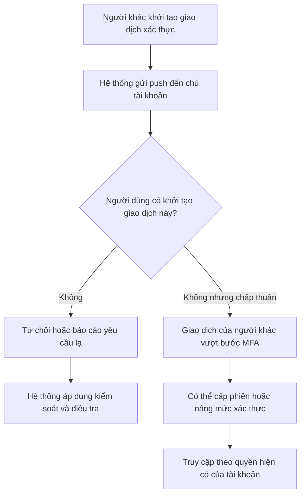

# MFA fatigue

**MFA fatigue** là tình trạng người dùng bị làm phiền, mất tập trung hoặc hình thành thói quen chấp thuận do nhận quá nhiều yêu cầu xác thực đa yếu tố. Trong một cuộc tấn công **push bombing**, kẻ tấn công cố tình tạo các lời nhắc MFA liên tiếp, hy vọng người dùng chấp thuận một yêu cầu không phải do mình khởi tạo.

Điểm bị khai thác nằm ở cách hệ thống yêu cầu và diễn giải sự chấp thuận. Kẻ tấn công có thể không cần phá thuật toán mật mã hay lấy khóa trong thiết bị; họ tìm cách khiến chủ thiết bị xác nhận một giao dịch của người khác. Vì vậy, tính năng đã bật MFA chưa đủ để kết luận mọi luồng xác thực đều chống được kiểu tấn công này.

Trong IAM, phòng vệ cần phối hợp thiết kế challenge, kiểm soát lượng lời nhắc, phương thức xác thực, giám sát và khôi phục tài khoản. Sau bài này, người học có thể nhận diện MFA fatigue, giải thích vai trò và giới hạn của number matching, đồng thời mô tả cách xử lý một yêu cầu phê duyệt ngoài ý muốn.

## 1. Cơ chế tác động vào sự chấp thuận

Một trường hợp thường gặp là kẻ tấn công đã có mật khẩu của người dùng và đưa nó vào luồng đăng nhập dùng push MFA. Mỗi lần tiếp tục luồng, thiết bị của chủ tài khoản lại nhận một yêu cầu.

Người dùng có thể chấp thuận vì:

- Tưởng lời nhắc thuộc một ứng dụng đang tự đăng nhập lại.
- Chạm nhầm trong lúc đang làm việc khác.
- Muốn các thông báo liên tiếp dừng lại.
- Bị người giả danh bộ phận hỗ trợ thuyết phục rằng cần xác nhận để sửa lỗi.

OWASP mô tả MFA fatigue là việc gửi lặp các push, có thể kết hợp social engineering, để khiến người dùng cuối cùng phê duyệt. Các biện pháp được nêu gồm challenge-response như number matching, giới hạn push và theo dõi bất thường. [OWASP Multifactor Authentication Cheat Sheet](https://cheatsheetseries.owasp.org/cheatsheets/Multifactor_Authentication_Cheat_Sheet.html#mfa-fatigue-push-notification-bombing)

Không phải mọi hệ thống đều yêu cầu mật khẩu trước khi phát push. Một số luồng passwordless hoặc khởi tạo xác thực có cách bắt đầu khác. Vì vậy, lời nhắc ngoài ý muốn là tín hiệu cần điều tra, nhưng chưa đủ để kết luận chắc chắn mật khẩu đã bị lộ trong mọi kiến trúc.

Cũng không phải mọi chuỗi lời nhắc đều do tấn công. Ứng dụng lỗi, vòng lặp SSO hoặc cơ chế retry thiếu kiểm soát có thể tạo trải nghiệm tương tự. Hệ thống cần phân biệt nguyên nhân mà vẫn bảo vệ người dùng trước yêu cầu chưa được xác minh.

## 2. Chuỗi sự kiện và phạm vi ảnh hưởng



Một lần chấp thuận có thể tạo phiên đăng nhập, hoàn tất step-up hoặc cho phép một hành động nhạy cảm, tùy mục đích challenge. Rủi ro không chỉ nằm ở số thông báo đã gửi mà còn nằm ở kết quả được cấp sau khi người dùng chấp thuận.

MFA thành công không tự tạo vai trò mới. Tuy nhiên, nếu tài khoản đã có quyền quản trị rộng, một phiên bị chiếm có thể sử dụng chính những quyền đó. Nguyên tắc ít quyền nhất và quản lý đặc quyền giúp giảm phạm vi thiệt hại khi một bước xác thực bị vượt qua.

Nếu kẻ tấn công đã có phiên hợp lệ, đổi mật khẩu chưa chắc làm phiên đó mất hiệu lực. Xử lý sự cố phải xem xét session, refresh token, thiết bị được ghi nhớ và các thay đổi sau đăng nhập, thay vì chỉ thay một cột mật khẩu.

## 3. Phân biệt với các vấn đề MFA khác

| Vấn đề | Cơ chế chính | Quan hệ với MFA fatigue |
|---|---|---|
| Push bombing | Tạo nhiều lời nhắc để gây chấp thuận ngoài ý muốn | Là cách khai thác điển hình |
| Phishing thời gian thực | Dẫn người dùng qua luồng giả và chuyển tiếp thông tin xác thực | Có thể vượt một số phương thức dù không gửi nhiều push |
| Đánh cắp mã OTP | Lấy mã rồi dùng khi còn hiệu lực | Không cần người dùng bấm chấp thuận push |
| SIM swap | Chiếm quyền nhận mã hoặc cuộc gọi qua số điện thoại | Tác động vào kênh liên lạc |
| Chiếm phiên | Lấy bằng chứng phiên sau xác thực | Có thể không cần tạo challenge mới |
| Lặp đăng nhập do lỗi ứng dụng | Tạo lại yêu cầu vì lỗi tích hợp hoặc retry | Gây mệt mỏi nhưng không tự chứng minh có kẻ tấn công |

TOTP thường không có nút chấp thuận push cho mỗi lần đăng nhập, nên không có đúng cơ chế phê duyệt mù đó. Nhưng người dùng vẫn có thể bị lừa cung cấp mã. Thay một phương thức bằng TOTP cần đánh giá toàn bộ chính sách, không gọi đó là miễn nhiễm với mọi tấn công MFA.

Ngược lại, một màn hình có chữ “Approve” cũng chưa đủ để kết luận thiết kế có cùng rủi ro với push từ xa không ràng buộc. Phải xét cách yêu cầu được khởi tạo, gắn với thiết bị và xác minh giao dịch.

## 4. Number matching giúp giảm phê duyệt mù thế nào?

Trong một luồng number matching điển hình:

1. Người dùng chủ động bắt đầu đăng nhập trên một giao diện.
2. Giao diện hiển thị một giá trị đối chiếu cho giao dịch đó.
3. Ứng dụng xác thực yêu cầu người dùng nhập hoặc chọn giá trị tương ứng theo cơ chế của nhà cung cấp.
4. Máy chủ xác minh phản hồi với đúng giao dịch, thiết bị và thời hạn.

Nếu chỉ nhận một push ngoài ý muốn, người dùng không có giao diện đăng nhập do mình khởi tạo để đối chiếu. Điều này tạo thêm điều kiện cho sự chấp thuận, thay vì chỉ bấm một nút theo thói quen.

CISA đề xuất number matching để giảm MFA fatigue khi tổ chức chưa thể triển khai MFA chống phishing. Tài liệu giải thích việc đối chiếu buộc người dùng tương tác với thông tin ở giao diện đăng nhập thay vì chỉ chấp thuận lời nhắc. [CISA — Implementing Number Matching in MFA Applications](https://www.cisa.gov/sites/default/files/publications/fact-sheet-implement-number-matching-in-mfa-applications-508c.pdf)

Giá trị đối chiếu không phải mật khẩu mới, mã dự phòng hay một yếu tố độc lập chỉ vì có thêm ô nhập. Nó thuộc giao dịch xác thực và phải được kiểm tra theo cơ chế đã thiết kế. Không tự xây một phép so sánh vài chữ số rồi tuyên bố tương đương một giải pháp MFA hoàn chỉnh.

### Giới hạn cần hiểu

Number matching không tự ràng buộc việc xác thực với origin hợp lệ theo cách của WebAuthn. Người dùng vẫn có thể bị lừa tương tác với một giao dịch do kẻ tấn công kiểm soát hoặc chuyển tiếp. Vì vậy, không đồng nhất “có number matching” với “chống phishing”.

Trải nghiệm cụ thể còn phụ thuộc thiết bị và tích hợp. Ví dụ tài liệu Microsoft mô tả một số luồng trên cùng thiết bị có thể dùng Yes/No với ràng buộc của luồng đó, còn luồng trình duyệt có cách nhập số tương ứng. Khi kiểm tra triển khai, phải xem hành vi thực tế và tài liệu của nhà cung cấp thay vì chỉ nhìn tên nút. [Microsoft Learn — Number matching in Authenticator](https://learn.microsoft.com/en-us/entra/identity/authentication/how-to-mfa-number-match)

## 5. Phòng vệ tại nơi tạo và gửi challenge

Kiểm soát cần bắt đầu **trước khi** thông báo đến thiết bị. Chỉ giới hạn số lần nhập mã sai không ngăn được hệ thống liên tục phát push mới.

### Giới hạn nhiều phạm vi

| Phạm vi | Mục đích |
|---|---|
| Một giao dịch hoặc ý định đăng nhập | Không gửi lại chỉ vì khách retry cùng yêu cầu |
| Một tài khoản | Ngăn đổi phiên hoặc địa chỉ IP để tiếp tục làm phiền cùng người dùng |
| Một authenticator hoặc thiết bị nhận | Tránh một thiết bị bị dồn quá nhiều thông báo |
| Một nguồn yêu cầu | Hạn chế tự động hóa và lượng yêu cầu bất thường |
| Một ứng dụng hoặc tích hợp | Phát hiện ứng dụng lỗi tạo challenge liên tục |
| Toàn dịch vụ hoặc nhà cung cấp | Bảo vệ tài nguyên, hàng đợi và chi phí gửi |

NIST nêu rằng bộ xác minh ngoài băng gửi push nên giới hạn hợp lý tốc độ hoặc tổng số thông báo kể từ lần xác thực thành công gần nhất. Việc sinh bí mật mới cũng không được dùng để đặt lại bộ đếm thất bại trong cơ chế liên quan. [NIST SP 800-63B-4 — Out-of-Band Authenticators](https://pages.nist.gov/800-63-4/sp800-63b.html#oob)

Không có một ngưỡng duy nhất phù hợp cho mọi sản phẩm. Cần chọn theo hành vi sử dụng hợp lệ, loại tài khoản, rủi ro và khả năng khôi phục. Một giới hạn chỉ theo IP dễ bỏ sót lưu lượng phân tán và có thể làm nhiều người dùng chung mạng bị ảnh hưởng.

### Cooldown và giới hạn challenge đang chờ

Cooldown là khoảng thời gian cần chờ trước khi được gửi thêm lời nhắc theo chính sách. Giới hạn challenge đang chờ giúp tránh nhiều yêu cầu đồng thời làm người dùng không biết đang chấp thuận lần nào.

Hai cơ chế cần có phạm vi rõ. Nếu áp một khóa duy nhất quá rộng cho cả tài khoản, người ngoài có thể giữ người dùng hợp lệ trong trạng thái không đăng nhập được. Hệ thống cần cách tiếp tục bằng phương thức được cho phép hoặc đi qua hỗ trợ đã xác minh mà không tự hạ yêu cầu xác thực.

Không để tạo một `challengeId` mới, đổi ứng dụng khách hoặc bấm “gửi lại” đặt lại toàn bộ ngân sách gửi. Bộ đếm phải sống đủ lâu và có phạm vi phù hợp để nhận ra hành vi tiếp diễn.

### Tính nguyên tử và retry

Nếu nhiều máy chủ cùng đọc “còn một lượt gửi” rồi cùng phát push, giới hạn có thể bị vượt. Việc kiểm tra và giữ phần ngân sách cần được thực hiện nguyên tử trong cơ chế lưu trạng thái dùng chung.

Một retry của cùng ý định không nên luôn tạo một thông báo mới. Có thể dùng khóa idempotency gắn với đúng chủ thể, ngữ cảnh và mục đích để trả trạng thái của giao dịch đã tạo. Không gộp challenge của hai phiên khác nhau chỉ vì chúng cùng thuộc một tài khoản.

## 6. Mô hình xử lý gửi push ở phía dịch vụ

Mã giả dưới đây mô tả trách nhiệm điều phối, không phải một API nhà cung cấp cụ thể:

```text
requestMfaPush(trustedAuthenticationContext, requestIntent):
    xác minh ngữ cảnh và điều kiện khởi tạo theo chính sách
    xác định tài khoản, tenant, thiết bị và mục đích ở phía máy chủ
    kiểm tra phương thức push được cho phép

    nếu cùng ý định hợp lệ đã có giao dịch:
        trả trạng thái giao dịch đó, không tự phát push mới

    đánh giá tín hiệu từ chối, báo cáo gian lận và rủi ro hiện tại
    nếu không được phép tiếp tục:
        không gửi push; trả hướng xử lý theo chính sách

    giữ ngân sách gửi và tạo challenge bằng thao tác có điều phối
    gắn challenge với chủ thể, ngữ cảnh, mục đích và thời hạn
    gửi qua tích hợp đã cấu hình với kiểm soát retry
    ghi nhận kết quả gửi hoặc trạng thái chưa xác định
    trả trạng thái đang chờ; chưa cấp phiên đầy đủ
```

Việc nhà cung cấp nhận yêu cầu không chứng minh người dùng đã nhận hay đã chấp thuận. Cần phân biệt ít nhất các sự kiện: tạo challenge, thử gửi, được nhà cung cấp chấp nhận, được người dùng phản hồi và hoàn tất giao dịch.

Timeout khi gọi nhà cung cấp có thể để lại kết quả chưa rõ: thông báo có thể đã được gửi dù phía gọi chưa nhận phản hồi. Không retry vô hạn. Khi có hỗ trợ idempotency, dùng theo hợp đồng của nhà cung cấp; nếu không có, thiết kế phải tính khả năng gửi trùng và giới hạn cả các lần thử giao hàng.

Nếu dùng hàng đợi hoặc outbox, giao hàng lặp vẫn có thể xảy ra. Lưu sự kiện bền vững không tự bảo đảm một thông báo vật lý chỉ xuất hiện đúng một lần. Cần phối hợp trạng thái gửi, khả năng khử trùng của tích hợp và ngân sách thực hiện tác vụ bên ngoài.

Phản hồi chấp thuận phải được kiểm tra từ kênh đáng tin cậy của thiết bị hoặc nhà cung cấp, không từ một body `approved: true` do trình duyệt tự gửi. Challenge đã hết hạn, bị từ chối hoặc bị hủy không được sống lại vì callback đến muộn.

## 7. Thiết kế trải nghiệm để người dùng phân biệt yêu cầu

Một lời nhắc nên giúp trả lời: **Tôi có đang chủ động thực hiện việc này không?** Tùy khả năng của phương thức, giao diện có thể hiển thị:

- Tên ứng dụng hoặc dịch vụ đang yêu cầu xác thực.
- Loại thao tác, chẳng hạn đăng nhập hay thay phương thức xác thực.
- Thời điểm và thông tin thiết bị có ích cho đối chiếu.
- Cách từ chối hoặc báo cáo khi không phải người dùng thực hiện.

Vị trí từ IP chỉ là một tín hiệu gần đúng. VPN, mạng di động hoặc cổng truy cập tổ chức có thể làm vị trí hiển thị khác nơi người dùng đang đứng. Không dùng “địa điểm có vẻ quen” như một bằng chứng mật mã rằng yêu cầu là hợp lệ.

Thông điệp cần ngắn và rõ, ví dụ:

```text
Bạn có đang đăng nhập vào cổng quản lý tài khoản không?
Chỉ tiếp tục với yêu cầu do bạn chủ động bắt đầu.
Nếu không phải bạn, từ chối và dùng chức năng báo cáo.
```

Không hướng dẫn người dùng chấp thuận để dừng thông báo hoặc để “xác minh rằng yêu cầu là giả”. Một yêu cầu hỗ trợ qua điện thoại cũng không tự chứng minh người gọi có quyền yêu cầu phê duyệt.

Từ chối một yêu cầu và báo cáo gian lận nên có ý nghĩa khác nhau. Người dùng có thể từ chối vì đăng nhập nhầm hoặc không muốn tiếp tục; báo cáo không phải mình khởi tạo là tín hiệu rủi ro mạnh hơn. Hệ thống cần giải thích hành động mà nó sẽ thực hiện, tránh khiến người dùng sợ báo cáo vì nghĩ tài khoản sẽ bị khóa vĩnh viễn.

Khi phát hiện cụm lời nhắc bất thường, không tiếp tục gửi thêm vô hạn email hoặc push cảnh báo cho cùng sự kiện. Cảnh báo cũng cần gộp và giới hạn để không trở thành một nguồn mệt mỏi khác.

## 8. Ưu tiên phương thức chống phishing và quản lý đường thay thế

Number matching và giới hạn push giảm cơ hội phê duyệt ngoài ý muốn, nhưng tổ chức còn cần lộ trình tới phương thức chống phishing phù hợp, chẳng hạn FIDO2/WebAuthn được triển khai đúng.

WebAuthn có cơ chế ràng buộc với RP và origin, thay vì chỉ nhận một sự chấp thuận push chung. Việc đạt mức bảo đảm cụ thể còn phụ thuộc kiểm tra giao thức, yêu cầu xác minh người dùng và cách đăng ký credential. Không chỉ đổi nhãn giao diện sang “passkey” rồi bỏ qua các điều kiện đó.

Đường thay thế và recovery phải được xem cùng phương thức chính. Một tài khoản yêu cầu phương thức mạnh nhưng dễ dàng chuyển sang một cuộc gọi chấp thuận yếu hoặc thủ tục hỗ trợ chỉ hỏi thông tin công khai vẫn có đường bị hạ cấp.

Khi phương thức chính gặp lỗi, các lựa chọn có thể gồm một authenticator khác đã đăng ký và được chính sách cho phép, mã dự phòng được bảo vệ hoặc quy trình khôi phục đã xác minh. Không tự bỏ MFA cho người đang bị làm phiền để giải quyết số lượng thông báo.

Tài khoản quản trị có thể cần yêu cầu mạnh hơn cùng quy trình hỗ trợ chặt hơn. Đồng thời, cần chuẩn bị trước phương thức dự phòng hợp lệ để sự cố thiết bị không trở thành lý do mở một ngoại lệ tùy tiện.

Với workload, nên dùng danh tính và credential của máy theo kiến trúc tương ứng. Không tạo tài khoản dịch vụ phải nhờ con người bấm push thường xuyên rồi coi việc tắt MFA là giải pháp vận hành lâu dài.

## 9. Phát hiện bằng chuỗi sự kiện, không chỉ tổng số push

Số lượng push tăng là tín hiệu, nhưng bản thân nó không cho biết yêu cầu đến từ người dùng hay kẻ tấn công. Cần liên kết các sự kiện qua challenge, phiên, tài khoản và ứng dụng.

Ví dụ các chuỗi đáng xem xét:

| Chuỗi quan sát | Ý nghĩa cần điều tra |
|---|---|
| Nhiều push nhưng không có thao tác đăng nhập do người dùng xác nhận | Có thể là gửi trái ý muốn hoặc lỗi khởi tạo |
| Nhiều lần từ chối rồi một lần chấp thuận | Có thể là người dùng bị làm phiền hoặc bị thuyết phục |
| Người dùng báo cáo gian lận nhưng hệ thống vẫn tiếp tục gửi | Kiểm soát xử lý phản hồi có thể chưa có hiệu lực |
| Chấp thuận rồi lập tức đổi MFA hoặc thông tin khôi phục | Có thể là thao tác duy trì quyền truy cập sau chiếm tài khoản |
| Một ứng dụng tạo lại challenge đều đặn sau lỗi callback | Có thể là lỗi tích hợp hoặc retry |
| Lưu lượng thấp từ nhiều nguồn cùng hướng vào một tài khoản | Một giới hạn theo IP có thể không phản ánh toàn bộ sự kiện |

Các chuỗi trên là giả thuyết điều tra, không phải bằng chứng khẳng định trong mọi trường hợp. Ví dụ người dùng có thể từ chối lần đầu vì đang chọn lại ứng dụng rồi đăng nhập hợp lệ ở lần sau.

Chỉ số vận hành có thể gồm:

```text
challenge_created
push_delivery_attempted
push_rate_limited
user_denied
user_reported_fraud
challenge_expired
approval_received
authentication_completed
approval_after_prior_denials
provider_delivery_error
```

Tách `approval_received` khỏi `authentication_completed` giúp thấy phản hồi đã đến nhưng giao dịch có thể bị từ chối vì hết hạn, sai ràng buộc hoặc thay đổi trạng thái bảo mật.

Không chỉ tối ưu tỷ lệ chấp thuận. Một tỷ lệ cao hơn có thể do giao diện dễ bấm nhầm hơn. Cần quan sát cả báo cáo ngoài ý muốn, sự cố chiếm tài khoản và khả năng người dùng hợp lệ hoàn thành đăng nhập mà không bị làm phiền quá mức.

## 10. Xử lý khi người dùng nhận lời nhắc ngoài ý muốn

### Khi chưa chấp thuận

Người dùng nên từ chối yêu cầu không do mình khởi tạo và dùng chức năng báo cáo nếu có. Nếu cần hỗ trợ, họ nên mở kênh chính thức đã biết thay vì làm theo người vừa gọi hoặc liên kết lạ liên quan đến chuỗi thông báo.

Đội vận hành cần đối chiếu giao dịch, trạng thái bước xác thực trước đó, nguồn yêu cầu và các sự kiện bảo mật. Nếu có dấu hiệu mật khẩu bị biết, cần xử lý credential theo quy trình. Nếu nguyên nhân là ứng dụng lặp đăng nhập, phải sửa nguyên nhân tạo lời nhắc, không chỉ yêu cầu người dùng kiên nhẫn hơn.

Không yêu cầu người dùng gửi mật khẩu, mã OTP, giá trị number matching hoặc recovery code cho nhân viên hỗ trợ để “xác nhận lỗi”. Những dữ liệu đó có thể trực tiếp giúp hoàn tất một giao dịch của người khác.

### Khi đã chấp thuận nhầm

Phải coi đây là khả năng đã cấp quyền truy cập, không chỉ là một thông báo bị bấm sai. Một quy trình có thể bao gồm:

1. Xác minh chủ tài khoản qua kênh và bằng chứng phù hợp.
2. Xác định giao dịch đã tạo phiên hoặc kết quả step-up nào.
3. Thu hồi những phiên, refresh token hoặc quyền truy cập liên quan theo phạm vi sự cố.
4. Thay mật khẩu nếu có dấu hiệu bị lộ và kiểm tra các credential mới được thêm.
5. Kiểm tra phương thức MFA, thiết bị, thông tin khôi phục và các thay đổi nhạy cảm sau đăng nhập.
6. Xác nhận các biện pháp đã có hiệu lực ở những ứng dụng liên quan.

Thứ tự và phạm vi thực tế cần theo mức rủi ro. Một số thao tác có thể thực hiện song song trong quy trình ứng phó, nhưng không được bỏ qua việc xác minh chủ tài khoản trước khi cho họ thay đổi lại thông tin nhạy cảm.

Token tự chứa có thể vẫn được một API chấp nhận đến hạn nếu API chỉ kiểm tra chữ ký và thời hạn. Vì vậy, đội vận hành cần biết cơ chế thu hồi và khoảng trễ của từng loại bằng chứng, không chỉ nhìn trạng thái đăng xuất ở giao diện.

Nếu thông tin khôi phục đã bị sửa, không tự dựa duy nhất vào kênh mới được thêm. Cần điều tra thay đổi và dùng bằng chứng đáng tin cậy theo quy trình phục hồi tài khoản.

## 11. Ba tình huống thiết kế điển hình

### Tình huống A: mỗi lần retry đều gửi một push mới

Ứng dụng khách bị timeout và tự lặp yêu cầu tạo MFA. Backend coi mỗi lần lặp là giao dịch mới, còn worker gửi thông báo cũng retry khi chưa biết kết quả từ nhà cung cấp. Một thao tác hợp lệ có thể tạo nhiều lời nhắc.

Cần điều phối retry ở cả hai lớp, gắn idempotency đúng ngữ cảnh và kiểm soát tác vụ gửi. Một vòng lặp do lỗi cũng làm người dùng quen với việc chấp thuận mà không quan sát, tạo môi trường thuận lợi cho yêu cầu độc hại sau này.

### Tình huống B: có giới hạn theo IP nhưng cùng người dùng vẫn bị làm phiền

Mỗi nguồn chỉ tạo ít yêu cầu, nhưng nhiều nguồn cùng hướng đến một tài khoản. Tổng số lời nhắc của chủ tài khoản vẫn tăng trong khi không nguồn nào vượt ngưỡng riêng.

Cần kiểm soát theo chủ thể và thiết bị nhận, kết hợp với ngữ cảnh và tín hiệu rủi ro. Đồng thời phải tránh để một người ngoài tự khóa tài khoản hợp lệ chỉ bằng việc liên tục gửi yêu cầu.

### Tình huống C: có number matching nhưng hỗ trợ cho phép bỏ qua

Người nhận push liên tục liên hệ hỗ trợ. Luồng hỗ trợ chỉ dựa vào tên, email và nội dung yêu cầu rồi gỡ phương thức MFA. Chính sách mạnh ở bước đăng nhập đã bị vô hiệu hóa bởi đường recovery yếu.

Giải pháp nằm ở quản lý toàn bộ vòng đời authenticator: xác minh trước khi thay phương thức, phân quyền hỗ trợ, ghi lý do và kiểm toán, đồng thời chuẩn bị cách khôi phục hợp lệ. Không chỉ đánh giá màn hình đăng nhập riêng lẻ.

## 12. Kiểm toán, phân quyền và điều kiện kiểm chứng

Một sự kiện kiểm toán có thể giữ các trường:

```text
eventType: MFA_PUSH_REJECTED_BY_POLICY
subjectId: định danh tài khoản nội bộ
challengeReference: mã tương quan kỹ thuật
clientApplication: ứng dụng đã được xác định
reason: PUSH_BUDGET_EXCEEDED
policyVersion: phiên bản chính sách
occurredAt: thời điểm xử lý
```

Không ghi OTP, seed, cookie, token đầy đủ hoặc giá trị number matching vào log để phục vụ phân tích fatigue. Dữ liệu kiểm toán cần đủ để nối sự kiện nhưng phải được phân quyền theo nhu cầu công việc.

Quyền tạm ngừng thông báo, thu hồi phiên, thay phương thức xác thực và gỡ yêu cầu MFA là các khả năng khác nhau. Một nhân viên hỗ trợ được xem lịch sử challenge không mặc nhiên được tắt MFA của tài khoản quản trị.

Các tình huống sau giúp đánh giá thiết kế:

1. Retry cùng ý định không làm phát sinh thông báo mới ngoài quy tắc đã định.
2. Đổi `challengeId`, ứng dụng khách hoặc nguồn yêu cầu không tự đặt lại ngân sách của tài khoản.
3. Nhiều máy chủ cùng gửi không vượt giới hạn do tranh chấp bộ đếm.
4. Người dùng từ chối hoặc báo cáo gian lận được hệ thống xử lý theo chính sách, không tiếp tục nhắc vô hạn.
5. Callback đến sau khi challenge bị hủy không tạo phiên mới.
6. Giao diện đối chiếu giúp nhận biết đúng giao dịch và không chỉ cung cấp nút chấp thuận mù.
7. Đường thay thế không tự hạ yêu cầu khi phương thức chính đang gặp lỗi hoặc bị lạm dụng.
8. Đội hỗ trợ xử lý được chấp thuận nhầm mà không yêu cầu người dùng cung cấp bí mật xác thực.
9. Ứng dụng SSO và API liên quan nhận được tác động thu hồi theo khả năng và khoảng trễ đã thiết kế.
10. Số cảnh báo, mức gián đoạn và sự cố thực tế cùng được theo dõi khi đánh giá hiệu quả phòng vệ.

Phòng vệ MFA fatigue đòi hỏi một sự chấp thuận có chủ đích, được gắn đúng giao dịch và nằm trong một luồng không cho phép gây áp lực bằng thông báo vô hạn. Chất lượng của phương thức, chính sách gửi và khả năng phục hồi đều ảnh hưởng đến việc giữ quyền kiểm soát danh tính cho người dùng.
