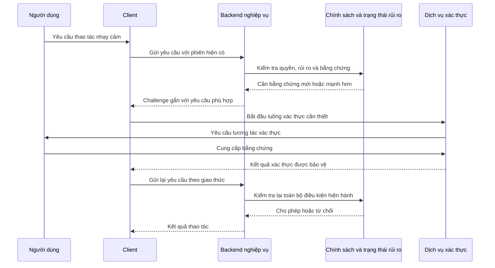

# Step-up sau sự kiện rủi ro

## 1. Vì sao một phiên đăng nhập hợp lệ chưa đủ?

Một quản trị viên đăng nhập vào buổi sáng, sau đó đi qua quy trình khôi phục tài khoản vì mất thiết bị MFA. Đến lúc thay đổi phương thức khôi phục, trình duyệt vẫn có một phiên hoặc access token chưa hết hạn. Nếu backend chỉ kiểm tra “đã đăng nhập”, nó có thể cho phép thao tác nhạy cảm mà không đánh giá tác động của sự kiện recovery vừa xảy ra.

**Step-up authentication** là việc yêu cầu bằng chứng xác thực đáp ứng điều kiện cao hơn điều kiện hiện có của yêu cầu, chẳng hạn mạnh hơn, mới hơn hoặc phù hợp hơn với ngữ cảnh. Sau một sự kiện rủi ro, hệ thống dùng step-up để kiểm tra lại trước khi tiếp tục các hoạt động cần bảo vệ.

Ví dụ, phiên đọc tài liệu nội bộ có thể không cần xác thực lại ngay. Nhưng thao tác thêm khóa bảo mật, đổi email khôi phục hoặc cấp vai trò quản trị có thể cần bằng chứng mới và một phương thức chống phishing theo chính sách.

Trong IAM, quyết định này liên quan đến xác thực, MFA, recovery, vòng đời credential, quản lý phiên và kiểm toán. Nó vẫn phải kết hợp với RBAC, ABAC và nguyên tắc ít quyền nhất. Người không có quyền cấp vai trò không được cấp vai trò chỉ vì đã hoàn tất step-up.

Sau bài học, người học có thể:

- Phân biệt xác thực lại, nâng mức bảo đảm và quyết định cấp quyền.
- Xác định sự kiện nào làm thay đổi mức tin cậy đối với phiên.
- Thiết kế điều kiện về phương thức, thời điểm và phạm vi của bằng chứng.
- Tích hợp step-up tại backend và trong hệ thống OAuth/OIDC.
- Xử lý thu hồi phiên, thất bại và thay đổi rủi ro trong lúc xác thực.

## 2. Các quyết định cần phân biệt

| Cơ chế | Câu hỏi được trả lời | Điều không tự suy ra |
| --- | --- | --- |
| Xác thực ban đầu | Ai đang chứng minh quyền kiểm soát danh tính? | Phiên luôn đủ tin cậy cho mọi hành động sau đó |
| Reauthentication | Người dùng có vừa xác thực lại theo điều kiện yêu cầu không? | Phương thức mới mạnh hơn phương thức trước |
| Step-up | Bằng chứng hiện tại có đạt yêu cầu mới hoặc cao hơn không? | Người dùng có thêm quyền nghiệp vụ |
| Refresh access token | Có thể cấp token tiếp theo theo quyền được ủy quyền không? | Người dùng vừa tương tác để xác thực lại |
| Authorization | Chủ thể có quyền thực hiện thao tác trên tài nguyên này không? | Mức bảo đảm xác thực đã đủ cho thao tác |
| Xác nhận giao dịch | Người dùng đã chấp thuận nội dung giao dịch cụ thể chưa? | Mọi giao dịch khác đều được chấp thuận |

Nếu một phiên đã dùng phương thức mạnh nhưng bằng chứng quá cũ, yêu cầu xác thực lại có thể chỉ nhằm tăng độ mới. Nếu phiên hiện chỉ có mật khẩu, step-up có thể yêu cầu thêm yếu tố hoặc dùng một cơ chế MFA phù hợp. Không phải mọi step-up đều là thêm một màn hình OTP.

OWASP nêu account recovery, đặt lại mật khẩu và hành vi đáng ngờ là những ngữ cảnh cần xem xét xác thực lại. Xem [OWASP — Re-authentication After Risk Events](https://cheatsheetseries.owasp.org/cheatsheets/Authentication_Cheat_Sheet.html#reauthentication-after-risk-events).

## 3. Nhận diện sự kiện và tác động của nó

### 3.1. Sự kiện rủi ro không chỉ là đổi địa chỉ IP

| Sự kiện hoặc tín hiệu | Điều cần đánh giá | Ví dụ phản ứng theo chính sách |
| --- | --- | --- |
| Hoàn tất recovery | Quyền kiểm soát tài khoản đã được khôi phục bằng bằng chứng nào? | Hạn chế thao tác nhạy cảm cho đến khi đủ bằng chứng cần thiết |
| Đặt lại mật khẩu | Credential và phiên cũ có còn đáng tin không? | Vô hiệu hóa những phiên liên quan và yêu cầu xác thực phù hợp |
| Thêm, thay hoặc gỡ MFA | Có thể xảy ra việc kẻ tấn công gắn authenticator của mình không? | Xác thực lại trước thay đổi, thông báo qua kênh đã thiết lập |
| Đổi email hoặc thông tin khôi phục | Kênh dùng để chứng minh quyền kiểm soát có thay đổi không? | Kiểm tra bằng chứng độc lập và giới hạn hành động tiếp theo |
| Thiết bị hoặc vị trí khác thường | Tín hiệu có đáng tin và có thể giải thích hợp lệ không? | Kết hợp tín hiệu, có thể yêu cầu xác thực mạnh hoặc mới hơn |
| Nhiều lần thất bại hoặc hành vi tự động | Có đang thử chiếm quyền hoặc gây gián đoạn không? | Giới hạn thử và đánh giá rủi ro của yêu cầu |
| Xác nhận session token bị đánh cắp | Kẻ tấn công có thể đang giữ quyền của phiên không? | Thu hồi phiên bị ảnh hưởng và xử lý sự cố |

Các phản ứng trong bảng là ví dụ thiết kế. Không phải mọi lần IP thay đổi đều là xâm nhập, cũng không phải mọi sự cố đều có thể giải quyết bằng cách yêu cầu thêm OTP.

Nếu đã biết một phiên bị chiếm, việc thêm cờ “cần MFA” nhưng vẫn giữ nguyên mọi quyền của phiên là không đủ. Có thể phải thu hồi, buộc tạo phiên mới qua đường được phép và xử lý các credential liên quan.

### 3.2. Đánh giá tín hiệu trong ngữ cảnh

Địa chỉ IP có thể thay đổi khi dùng mạng di động, VPN hoặc di chuyển. Thông tin trình duyệt do client khai có thể bị giả mạo. Tên thiết bị quen thuộc không phải bằng chứng mật mã rằng đó vẫn là thiết bị cũ.

Hệ thống nên phân biệt tín hiệu hỗ trợ quyết định với bằng chứng xác thực. Một risk engine có thể dùng nhiều tín hiệu, nhưng không nên cho client tự gửi `risk=LOW` rồi bỏ qua điều kiện backend.

Mặt khác, tín hiệu mới không nhất thiết chỉ liên quan một phiên. Một vụ lộ credential có thể tác động nhiều phiên của tài khoản; thay đổi quyền có thể tác động thao tác trên nhiều ứng dụng. Cần xác định phạm vi của sự kiện: request, session, account, tenant hoặc hệ thống.

## 4. Chính sách step-up cần chỉ rõ điều gì?

### 4.1. Phương thức, độ mới và điều kiện còn hiệu lực

Một chính sách có thể yêu cầu đồng thời:

1. Phiên và tài khoản vẫn hợp lệ, chưa bị thu hồi hoặc vô hiệu hóa.
2. Chủ thể hiện có quyền thực hiện hành động theo RBAC hoặc ABAC.
3. Bằng chứng đến từ nguồn xác thực được tin cậy.
4. Phương thức đạt mức bảo đảm cần thiết, chẳng hạn MFA chống phishing.
5. Xác thực còn đủ mới theo giới hạn của thao tác.
6. Bằng chứng không có trước một thay đổi bảo mật đã làm nó mất giá trị.
7. Bằng chứng hoặc quyền xác nhận được ràng buộc đúng tài khoản và ngữ cảnh sử dụng.
8. Trạng thái rủi ro hiện tại vẫn cho phép hành động.

Các điều kiện là một phép kết hợp, không phải lựa chọn một trong nhiều điều kiện. Bằng chứng rất mới nhưng không đạt yêu cầu phương thức vẫn có thể bị từ chối.

### 4.2. Đừng chỉ kiểm tra tuổi token

Giả sử người dùng xác thực lúc 08:00, token được refresh lúc 09:00 và thao tác nhạy cảm xảy ra lúc 09:01. Token có thể mới được cấp một phút, nhưng người dùng không nhất thiết vừa xác thực lại.

Cần tách thời điểm xác thực người dùng khỏi thời điểm phát hành token và thời điểm token hết hạn. Một token còn hạn chỉ cho biết nó chưa vượt giới hạn thời gian theo cách kiểm tra đó; không chứng minh nó đủ mới sau một sự kiện recovery.

### 4.3. Bằng chứng phải phù hợp sau sự kiện

Trong một thiết kế, account có thể mang `security_epoch` tăng mỗi khi có sự kiện khiến bằng chứng trước đó cần được đánh giá lại. Một quyền step-up ghi nhận epoch mà nó đã được cấp. Backend kiểm tra epoch hiện hành trước khi cho thực thi.

Đây là kỹ thuật minh họa của ứng dụng, không phải claim chuẩn của OIDC. Nó giúp tránh chỉ dựa vào so sánh timestamp, đặc biệt khi hai sự kiện xảy ra gần nhau hoặc hệ thống có nhiều node.

Việc epoch khớp cũng không tự chứng minh authenticator đáng tin. Một authenticator vừa được kẻ tấn công đăng ký trong quá trình recovery trái phép không trở thành bằng chứng tốt chỉ vì nó mới. Cần kiểm tra cả nguồn gốc ràng buộc và kết quả quy trình khôi phục.

## 5. Ví dụ chính sách sau recovery

Giả sử cổng vận hành cho phép một phiên recovery chỉ thực hiện các bước khôi phục đã xác định. Sau khi recovery hoàn tất, người dùng vẫn cần xác thực đáp ứng chính sách trước khi thay đổi phương thức khôi phục hoặc quản lý quyền.

Cấu hình sau là mô hình do bài học đặt ra, không phải cấu hình của một sản phẩm cụ thể:

```yaml
riskStepUpPolicy:
  version: operator-risk-v1

  triggers:
    - ACCOUNT_RECOVERY_COMPLETED
    - AUTHENTICATOR_REPLACED
    - RECOVERY_CONTACT_CHANGED

  protectedActions:
    - CHANGE_RECOVERY_CONTACT
    - BIND_AUTHENTICATOR
    - GRANT_PRIVILEGED_ROLE

  requiredEvidence:
    authenticationClass: phishing-resistant-mfa
    maximumAgeSeconds: 300
    currentSecurityEpochRequired: true

  actionGrant:
    lifetimeSeconds: 120
    singleUse: true
    bindToSubjectTenantAndAction: true

  failure:
    allowProtectedActionWithoutEvidence: false
```

Giới hạn 300 và 120 giây là lựa chọn minh họa. `authenticationClass` là tên nội bộ; phần thực thi cần ánh xạ nó đến những cơ chế và bằng chứng thực sự được chấp nhận.

Chính sách này không khẳng định mọi trường hợp recovery có thể ngay lập tức đạt yêu cầu. Nếu người dùng chưa có authenticator phù hợp hoặc chưa hoàn tất bằng chứng khôi phục, hệ thống tiếp tục luồng khôi phục được phép hoặc từ chối thao tác nhạy cảm.

Một trường hợp cần phân biệt là quyền quản trị vừa bị thu hồi. Dù người dùng có thể xác thực mạnh và mới, hành động `GRANT_PRIVILEGED_ROLE` vẫn bị từ chối nếu không có quyền nghiệp vụ tương ứng.

## 6. Luồng xử lý tại backend



### 6.1. Challenge chưa phải là quyền thực thi

Backend chưa thực hiện hành động nhạy cảm trước khi gửi challenge. Một client tự khai `step_up_complete=true` không đủ để tiếp tục. Kết quả phải được xác minh bằng trạng thái server hoặc bằng chứng từ nguồn tin cậy theo giao thức.

Challenge cần có mục đích, thời hạn và ràng buộc đến đúng ngữ cảnh. Khi quay lại từ dịch vụ xác thực, backend cần tránh việc nhầm tài khoản hoặc tenant, đặc biệt nếu người dùng có nhiều tài khoản trong cùng trình duyệt.

### 6.2. Kiểm tra lại ngay trước thao tác

Thời gian người dùng hoàn tất step-up có thể đủ để quyền của họ bị thu hồi, account bị khóa hoặc xuất hiện thêm sự kiện rủi ro. Vì vậy, lần kiểm tra trước challenge không thay thế lần kiểm tra tại thời điểm thực thi.

Một trình tự minh họa:

```text
receive protected request
validate session or access token
load current account, authorization and risk state
deny if account or request is not permitted
evaluate authentication evidence against current policy
return challenge if required evidence is missing
validate action-specific grant if the action requires one
recheck mutable conditions at commit boundary
consume single-use grant and apply protected change consistently
record result without authentication secrets
```

Các hàm xác minh trong mô hình này là trách nhiệm của backend. Không dùng kết quả risk score, danh sách phương thức hoặc thời gian do client tự khai như dữ liệu đã được xác thực.

## 7. OAuth/OIDC: yêu cầu mức xác thực và độ mới

### 7.1. Challenge cho API được bảo vệ

RFC 9470 định nghĩa cách resource server báo rằng sự kiện xác thực gắn với access token chưa đáp ứng yêu cầu. Ví dụ dưới đây dùng tên lớp xác thực do hệ thống giả định tự định nghĩa:

```http
HTTP/1.1 401 Unauthorized
WWW-Authenticate: Bearer error="insufficient_user_authentication",
  acr_values="urn:example:auth:phishing-resistant-mfa",
  max_age="300"
Cache-Control: no-store
```

`acr_values` biểu thị lớp xác thực yêu cầu; `max_age` biểu thị giới hạn độ cũ của lần xác thực chủ động. Client có thể bắt đầu authorization request phù hợp. Tham khảo [RFC 9470 — Authentication Challenge](https://www.rfc-editor.org/rfc/rfc9470.html#section-3).

Không tự ánh xạ tên ACR trên thành một mức NIST AAL. Các giá trị ACR và ý nghĩa cụ thể cần được thống nhất giữa authorization server, client và resource server.

### 7.2. Những trường OIDC có vai trò khác nhau

| Thành phần | Vai trò cần hiểu |
| --- | --- |
| `max_age` | Yêu cầu giới hạn thời gian từ lần xác thực chủ động |
| `auth_time` | Thời điểm xác thực người dùng |
| `acr` | Tham chiếu lớp ngữ cảnh xác thực đã đạt |
| `amr` | Thông tin về phương thức, theo profile áp dụng |
| `iat` | Thời điểm phát hành token |
| `prompt=login` | Yêu cầu xác thực lại; không tự yêu cầu một phương thức MFA cụ thể |

OIDC yêu cầu có `auth_time` trong ID Token khi dùng `max_age`. Yêu cầu gửi đi không thay thế việc kiểm tra kết quả trả về. Tham khảo [OpenID Connect Core — Authentication Request](https://openid.net/specs/openid-connect-core-1_0.html#AuthRequest).

Không so sánh ACR như một số thứ tự tùy ý, chẳng hạn kết luận chuỗi có số lớn hơn luôn mạnh hơn. Cần ánh xạ lớp được chấp nhận theo hợp đồng tin cậy. Tương tự, sự xuất hiện của một giá trị trong `amr` chưa đủ để tự suy ra toàn bộ chính sách của thao tác đã được đáp ứng.

### 7.3. Resource server lấy bằng chứng từ đâu?

Theo mô hình RFC 9470, thông tin xác thực có thể được truyền trong access token hoặc qua introspection theo profile tương ứng. Refresh token không tạo một lần xác thực chủ động mới chỉ vì nó cấp access token mới. Xem [RFC 9470 — Authentication Information Conveyed via Access Token](https://www.rfc-editor.org/rfc/rfc9470.html#section-6).

Trong tích hợp cụ thể, resource server cần có nguồn dữ liệu được xác minh để đánh giá lớp và thời điểm xác thực. Không nhận một bản JSON do client tự giải mã rồi gửi lại như bằng chứng, cũng không mặc định access token của mọi nhà cung cấp đều có đủ thông tin cần thiết.

ID Token được client dùng trong ngữ cảnh OIDC; không đưa nó sang API như một access token thay thế. Nếu API thiếu bằng chứng cần kiểm tra, cần sửa hợp đồng tích hợp hoặc dùng nguồn xác minh được hỗ trợ. Không suy diễn “đủ mạnh” từ một token hợp lệ nhưng thiếu dữ liệu.

Nếu dịch vụ xác thực không thể đáp ứng yêu cầu, client cần kết thúc luồng bằng phản hồi thích hợp. Tránh vòng lặp nhận token chưa đủ điều kiện rồi tự động gửi lại challenge vô hạn.

## 8. Ràng buộc bằng chứng với hành động nhạy cảm

### 8.1. Xác thực mạnh chưa phải là chấp thuận mọi nội dung

Một lần xác thực lại để đổi email khôi phục không tự cho phép đổi người nhận thanh toán hoặc cấp một vai trò khác. Với hành động có nội dung quan trọng, cần xác định người dùng đang chấp thuận điều gì.

Ví dụ, backend chuẩn bị yêu cầu cấp vai trò cho account đích trong tenant cụ thể. Nếu client đổi account đích sau khi người dùng xác thực, bằng chứng cũ không nên tự chấp thuận nội dung mới.

OWASP phân biệt xác thực với việc chấp thuận giao dịch và nhấn mạnh bảo vệ dữ liệu quan trọng của giao dịch. Tham khảo [OWASP Transaction Authorization](https://cheatsheetseries.owasp.org/cheatsheets/Transaction_Authorization_Cheat_Sheet.html).

### 8.2. Quyền hành động ngắn hạn

Một thiết kế có thể cấp quyền hành động sau khi step-up thành công:

```text
action_grant_id
subject_id
tenant_id
session_reference
action_type
target_reference
action_payload_reference
authentication_event_reference
security_epoch
policy_version
expires_at
used_at
```

Đây là trạng thái nội bộ minh họa. Backend cần gắn quyền với nội dung đã được xác định đáng tin cậy; nếu dùng digest, phải có quy tắc chuẩn hóa và tính digest ở phía được tin cậy. Một hash do client tùy ý gửi không tự bảo vệ nội dung.

Quyền chỉ dùng một lần cần được tiêu thụ có điều kiện và phối hợp với thay đổi nghiệp vụ để tránh hai request cùng thành công. Cơ chế retry cũng phải được thiết kế rõ: gửi lại request sau lỗi mạng không được vô tình tạo hai thay đổi hoặc tái sử dụng quyền cho nội dung khác.

### 8.3. Sự kiện mới có thể vô hiệu hóa kết quả vừa đạt

Giả sử một challenge được tạo ở epoch 12. Trong lúc người dùng xác thực, tài khoản phát sinh recovery mới và chuyển sang epoch 13. Backend không nên hoàn tất hành động chỉ vì chữ ký của bằng chứng hợp lệ; nó còn phải đánh giá trạng thái đã thay đổi.

Nếu dùng quyền nâng mức cho một nhóm thao tác trong một khoảng thời gian, cần định nghĩa phạm vi rõ. Đừng biến một lần step-up cho một hành động thành cờ toàn tài khoản có giá trị vô hạn.

## 9. Quản lý phiên sau sự kiện và sau step-up

### 9.1. Xoay phiên và xử lý thu hồi

Khi chuyển từ trạng thái chưa đủ tin cậy sang trạng thái đã xác thực theo điều kiện mới, cần bảo vệ quá trình chuyển phiên, tránh tiếp tục sử dụng một session identifier mà kẻ tấn công đã cố định hoặc chiếm giữ.

Thiết kế phải nêu rõ session nào còn hợp lệ, session nào bị thay thế và token nào cần thu hồi. Không giả định đổi mật khẩu, gỡ một MFA hoặc hoàn tất step-up tự động cập nhật mọi access token đã phát hành.

Với JWT được xác minh cục bộ, thay đổi một cờ trong cơ sở dữ liệu chỉ có hiệu lực ngay nếu resource server có cơ chế kiểm tra hoặc nhận thông tin thay đổi tương ứng. Thời hạn token, introspection, trạng thái phiên và cơ chế phân phối thu hồi cần được xem xét theo kiến trúc thực tế.

### 9.2. Tách phiên recovery và phiên nghiệp vụ

Một phiên recovery có thể chỉ đủ quyền gắn authenticator mới hoặc hoàn tất bước khôi phục. Không nâng nó thành phiên nghiệp vụ đầy đủ chỉ vì một thao tác thiết lập đã thành công.

Tài khoản có thể còn phải qua xác thực phù hợp, hoàn tất phê duyệt hoặc chờ một điều kiện kiểm soát rủi ro. Khi đã có bằng chứng cần thiết, quyền được cấp vẫn là quyền hiện hành của chủ thể.

### 9.3. Phạm vi người dùng và workload

Luồng tương tác step-up trong bài áp dụng cho danh tính người dùng. Một workload không thể tự đáp ứng màn hình MFA như con người. Khi request của workload gặp điều kiện rủi ro, cần chính sách credential, quyền và khôi phục phù hợp với danh tính máy.

Không dùng client credential mạnh hơn để giả vờ rằng người dùng đã xác thực lại. Bằng chứng về ứng dụng đang gọi và bằng chứng về người dùng là những đầu vào khác nhau.

## 10. Xử lý thất bại và giảm gián đoạn hợp lý

| Tình huống | Hành vi cần xác định |
| --- | --- |
| Người dùng hủy xác thực | Giữ hành động nhạy cảm chưa được thực hiện |
| Phương thức cần thiết không khả dụng | Đưa vào phương án dự phòng hoặc recovery được chính sách chấp nhận |
| IdP hoặc dịch vụ xác thực gián đoạn | Không âm thầm bỏ điều kiện của hành động được bảo vệ |
| Bằng chứng còn mới nhưng sai lớp | Yêu cầu phương thức đáp ứng hoặc từ chối |
| Bằng chứng đủ mạnh nhưng quá cũ | Yêu cầu xác thực chủ động mới |
| Tài khoản bị thu hồi quyền trong lúc step-up | Từ chối hành động dù xác thực thành công |
| Có bằng chứng phiên bị chiếm | Thu hồi và xử lý sự cố theo phạm vi cần thiết |
| Tín hiệu vị trí khác thường có thể hợp lệ | Đánh giá thêm ngữ cảnh, tránh khóa ngoài chỉ dựa một tín hiệu yếu |

Giới hạn retry, thời hạn challenge và giới hạn gửi thông báo giúp tránh lạm dụng. Nếu dùng push, không để kẻ tấn công tạo yêu cầu xác nhận liên tục đến mức người dùng chấp nhận vì mệt mỏi.

Thông báo nên giúp người dùng hiểu hành động đang được bảo vệ, chẳng hạn: “Cần xác thực lại để thay đổi email khôi phục.” Không cần tiết lộ toàn bộ quy tắc risk engine hoặc ghi bí mật vào thông báo lỗi.

Có thể cho tiếp tục chức năng ít nhạy cảm nếu chính sách cho phép và phiên vẫn hợp lệ. Việc một hành động cần step-up không nhất thiết đòi hỏi khóa mọi chức năng. Ngược lại, khi đã có bằng chứng xâm phạm rõ ràng, không giữ truy cập chỉ để tránh gián đoạn.

## 11. Kiểm toán và các tình huống cần kiểm chứng

### 11.1. Sự kiện có thể đối chiếu

Một sự kiện nội bộ minh họa:

```text
event_type: STEP_UP_DECISION
subject_id: internal-account-id
tenant_id: target-tenant-id
action_type: CHANGE_RECOVERY_CONTACT
trigger: ACCOUNT_RECOVERY_COMPLETED
policy_version: operator-risk-v1
required_authentication_class: phishing-resistant-mfa
decision: CHALLENGE_REQUIRED
reason: EVIDENCE_NOT_CURRENT
correlation_id: opaque-request-reference
```

Kết quả xác thực thành công và kết quả thao tác nghiệp vụ là hai sự kiện khác nhau. Cần biết người dùng đã hoàn tất challenge nhưng hành động bị từ chối do mất quyền, thay vì ghi chung thành “step-up lỗi”.

Không ghi OTP, cookie, access token, recovery code hoặc nội dung credential trong audit event. Chỉ lưu định danh và metadata cần thiết theo quyền truy cập, mục đích và thời hạn lưu phù hợp.

### 11.2. Các tình huống triển khai

Đây là tiêu chí kiểm tra cho một phần tích hợp, không phải báo cáo chạy thử ứng dụng:

| Tình huống | Điều kiện cần xác minh |
| --- | --- |
| Token còn hạn nhưng xác thực trước sự kiện rủi ro | Không được coi là đủ chỉ vì token hợp lệ |
| Refresh token cấp access token mới | Không làm giả độ mới của xác thực người dùng |
| Bằng chứng đúng lớp và còn mới | Vẫn phải qua kiểm tra quyền và trạng thái hiện hành |
| Bằng chứng của tài khoản hoặc tenant khác | Không được dùng để hoàn tất hành động |
| Client gửi cờ đã step-up | Backend chỉ chấp nhận nguồn bằng chứng được xác minh |
| Token thiếu dữ liệu về lớp hoặc thời điểm xác thực | Không tự suy ra đã đáp ứng chính sách |
| Challenge hết hạn hoặc đã hủy | Không được dùng để cấp quyền thực thi |
| Sự kiện rủi ro mới xuất hiện khi đang xác thực | Đánh giá lại theo trạng thái mới |
| Nội dung hành động bị đổi sau challenge | Bằng chứng cũ không tự chấp thuận nội dung mới |
| Hai request dùng cùng quyền hành động | Không cho phép hai lần tiêu thụ thành công |
| Người dùng mất quyền trước thời điểm ghi dữ liệu | Xác thực thành công không vượt qua quyết định phân quyền |
| IdP trả kết quả chưa đạt yêu cầu | Không tạo vòng lặp challenge vô hạn hoặc tự hạ yêu cầu |
| Thu hồi phiên tại IdP nhưng ứng dụng còn phiên local | Kiểm tra hiệu lực thực tế của cơ chế thu hồi |
| Logging và trace hoạt động | Không xuất hiện bí mật xác thực |

Các ca về cạnh tranh và thu hồi cần kiểm tra trạng thái cuối cùng, không chỉ thông báo trên giao diện. Một màn hình báo “MFA thành công” chưa chứng minh hành động được thực hiện đúng người, đúng quyền và đúng ngữ cảnh.

## 12. Bài tập thiết kế

Một quản trị viên vừa khôi phục tài khoản và thay thiết bị MFA. Trình duyệt còn phiên ứng dụng cũ, trong khi một access token mới được cấp qua refresh token. Người dùng yêu cầu đổi email khôi phục và cấp vai trò quản trị cho tài khoản khác. Trong lúc step-up diễn ra, quyền cấp vai trò của người này bị thu hồi.

Hãy thiết kế hành vi của hệ thống và giải thích:

1. Sự kiện nào khiến bằng chứng cũ cần được đánh giá lại?
2. Vì sao access token mới chưa chứng minh người dùng vừa xác thực chủ động?
3. Thao tác nào cần phương thức, độ mới và quyền nghiệp vụ tương ứng?
4. Backend lấy bằng chứng đáng tin từ đâu trong một triển khai OAuth/OIDC?
5. Làm thế nào để kết quả step-up không được dùng cho account đích hoặc nội dung khác?
6. Nếu xuất hiện sự kiện rủi ro mới hoặc quyền bị thu hồi trước khi ghi dữ liệu, hành động nào phải bị từ chối?
7. Những phiên nào cần được xử lý và sự kiện kiểm toán nào giúp điều tra?

Một thiết kế đạt yêu cầu phải thể hiện được thời điểm hệ thống cần bằng chứng mới, cách xác minh bằng chứng đó và điều kiện thực thi tại backend. Step-up chỉ phát huy tác dụng khi nó gắn với trạng thái rủi ro hiện hành, quản lý phiên và quyền truy cập thực tế.
