# Recovery không làm yếu assurance

## 1. Recovery phải phục hồi quyền kiểm soát có căn cứ

Trong IAM, recovery giúp người dùng lấy lại khả năng kiểm soát tài khoản khi mất mật khẩu, authenticator hoặc các phương thức cần thiết. Đây cũng là một đường mà đối thủ có thể khai thác: nếu đăng nhập yêu cầu khóa bảo mật nhưng chỉ cần một email bất kỳ để gỡ khóa, đối thủ sẽ chọn đường recovery.

“Recovery không làm yếu assurance” không có nghĩa người dùng phải xuất trình chính thiết bị đã mất. Nó có nghĩa quy trình phải có bằng chứng phục hồi được thiết kế phù hợp, ràng buộc authenticator mới đúng chủ thể, và chỉ cấp phiên/quyền theo những gì đã thực sự được xác minh.

Một hệ thống có thể cho phép bắt đầu recovery bằng thông tin công khai, nhưng không vì thế mà cho phép thay credential hoặc truy cập nghiệp vụ. Quyền được yêu cầu hỗ trợ khác với quyền được kiểm soát tài khoản.

Sau bài học, người học có thể nhận diện đường bypass trong recovery, thiết kế các cổng kiểm soát từ bằng chứng đến phiên mới, và kiểm tra việc ứng dụng phía sau sử dụng đúng ngữ cảnh xác thực.

Ví dụ xuyên suốt: một người duyệt nội dung dùng passkey chống phishing. Khi mất thiết bị, hệ thống cho phép một quy trình recovery đã được phê duyệt. Kết quả recovery có thể cho phép đăng ký credential thay thế; nó không tự cho phép API duyệt nội dung nhận một phiên yếu hơn yêu cầu ban đầu.

## 2. Phân biệt các loại bảo đảm và quyền truy cập

Assurance là mức tin cậy có căn cứ vào quá trình và kiểm soát đã thực hiện. Nó không phải một cờ `verified=true` hoặc số lượng màn hình người dùng đã đi qua.

| Khái niệm | Câu hỏi được trả lời |
| --- | --- |
| Identity proofing / IAL khi áp dụng | Danh tính đã được xác minh đến mức nào? |
| Authentication / AAL khi áp dụng | Sự kiện xác thực chứng minh quyền kiểm soát authenticator với mức bảo đảm nào? |
| Federation / FAL khi áp dụng | Việc truyền và sử dụng assertion giữa các bên được bảo vệ như thế nào? |
| Authorization | Chủ thể được phép làm gì với tài nguyên cụ thể? |
| Recovery authorization | Bằng chứng hiện có cho phép thực hiện bước phục hồi nào? |

Một role quản trị không làm một phiên mật khẩu đơn lẻ trở thành phiên chống phishing. Ngược lại, một lần đăng nhập mạnh cũng không tự cấp role quản trị. Việc cấp quyền cần cả nguồn quyền lẫn điều kiện xác thực theo chính sách tài nguyên.

AAL không nên được gán chỉ bằng cách đếm hai đầu vào. Hai mã gửi đến cùng một hộp thư không tự tạo thành hai yếu tố độc lập. Một authenticator nhiều yếu tố cũng có thể đáp ứng yêu cầu thông qua các yếu tố tích hợp, thay vì bắt buộc có hai thiết bị vật lý.

NIST đặt việc lựa chọn mức bảo đảm trong quản lý rủi ro danh tính. Các đặc tính như chống phishing hoặc khóa không xuất được cần được xem xét đúng theo yêu cầu áp dụng, không suy từ nhãn “MFA”. Tham khảo [NIST SP 800-63-4 — Digital Identity Risk Management](https://pages.nist.gov/800-63-4/sp800-63/dirm/).

Trong bài, các tên như `PRIVILEGED_ACCESS` là profile nội bộ minh họa. Chúng không tự chứng minh hệ thống đạt một mức NIST cụ thể hoặc một yêu cầu tuân thủ nào.

## 3. Vì sao recovery có thể phá vỡ thiết kế MFA?

### 3.1. Authenticator mới rất mạnh nhưng được gắn cho nhầm người

Giả sử đối thủ chiếm email khôi phục, dùng nó để gỡ MFA rồi đăng ký một khóa bảo mật mới. Sau đó đối thủ có thể tạo những lần đăng nhập có chữ ký mật mã hoàn toàn hợp lệ.

Vấn đề không nằm ở thuật toán của khóa mới, mà ở việc recovery đã cho phép người sai ràng buộc khóa của họ với tài khoản nạn nhân. Do đó, kiểm tra đăng nhập mạnh sau recovery là cần thiết nhưng không sửa được một quyết định khôi phục danh tính sai từ đầu.

### 3.2. Gán nhãn mạnh hơn bằng chứng thật

Một hệ thống đánh dấu `mfa=true` chỉ vì help desk đã đóng ticket, hoặc giữ nguyên `acr` của phiên trước khi mất thiết bị, có thể làm ứng dụng phía sau tin sai mức bảo đảm.

Không được biến sự kiện “đã được phép đăng ký lại” thành sự kiện “đã xác thực bằng authenticator mới”. Hai sự kiện cần được ghi nhận và đánh giá riêng.

### 3.3. Ngoại lệ tạm thời trở thành đường truy cập lâu dài

Ví dụ, một nhân viên được bỏ MFA trong 24 giờ để khôi phục, nhưng refresh token cấp trong khoảng đó sống thêm nhiều tuần. Dù cờ bỏ MFA hết hạn, quyền truy cập yếu hơn vẫn tồn tại qua token đã phát hành.

Giới hạn thời gian ở màn hình quản trị không đủ nếu session, token hoặc cache không thực thi cùng giới hạn.

### 3.4. Kênh và người phê duyệt không độc lập như tưởng tượng

Email, SMS, trình quản lý mật khẩu và TOTP có thể cùng nằm trong một điện thoại. Hai người phê duyệt cũng có thể cùng dựa vào một email giả mạo. Nhiều bước không tự tạo nhiều bằng chứng độc lập.

Một câu hỏi hữu ích là: đối thủ phải chiếm thêm quyền kiểm soát nào để vượt từng bước? Nếu mọi bước đều dựa vào một nguồn đã bị chiếm, cần đánh giá lại khả năng bảo vệ của cả chuỗi.

## 4. Các bất biến cần giữ trong toàn bộ chuỗi phục hồi

Một thiết kế có thể sử dụng các bất biến sau làm cơ sở đánh giá:

1. Mọi bằng chứng và quyết định recovery gắn với đúng tenant, tài khoản và mục đích.
2. Quyền thay credential chỉ được cấp sau khi thỏa phương án recovery được phê duyệt cho tài khoản đó.
3. Quyền recovery có phạm vi và thời hạn, không tự là quyền truy cập nghiệp vụ.
4. Authenticator mới được chứng minh và ràng buộc theo yêu cầu của profile sử dụng.
5. Phiên mới phản ánh đúng phương thức, thời gian và điều kiện xác thực đã thực hiện.
6. API nhạy cảm vẫn kiểm tra quyền, ngữ cảnh xác thực, độ mới và trạng thái thu hồi.
7. Trạng thái credential/phiên cũ được xử lý phù hợp, các sự kiện quan trọng được kiểm toán và thông báo.

Các bất biến bổ sung cho nhau. Chỉ có token recovery dùng một lần vẫn không đủ nếu token được gửi đến địa chỉ do đối thủ tự chọn. Chỉ có khóa mới mạnh vẫn không đủ nếu không kiểm tra quyền đăng ký nó.

## 5. Thiết kế phương án bằng chứng phục hồi

### 5.1. Chọn theo bối cảnh tài khoản

Cần biết tài khoản đã có authenticator nào, có dữ liệu identity proofing đáng tin cậy hay không, yêu cầu của tài nguyên là gì và người dùng còn kiểm soát phương thức nào. Không áp một link email chung cho mọi tài khoản từ người học đến quản trị viên hệ thống.

NIST SP 800-63B-4 mô tả các phương án recovery theo bối cảnh. Với tài khoản có mức xác thực tối đa AAL2, các lựa chọn bao gồm hai recovery code từ các phương thức khác nhau, một recovery code kết hợp authenticator một yếu tố đã ràng buộc, hoặc xác minh lại danh tính khi đã có identity proofing phù hợp. Xem [NIST — Recovery Requirements by IAL/AAL](https://pages.nist.gov/800-63-4/sp800-63b/events/).

Đây là yêu cầu theo phạm vi của tiêu chuẩn, không phải cách diễn đạt “bất kỳ hai OTP nào cũng đủ”. Các phương thức, cách cấp, giới hạn thử và điều kiện liên quan phải được đáp ứng đầy đủ trong triển khai.

### 5.2. Tách thay authenticator khi còn xác thực được khỏi account recovery

Người còn authenticator dự phòng đủ mạnh có thể xác thực theo chính sách rồi thêm thiết bị mới. Đó là tình huống khác với người đã mất toàn bộ khả năng xác thực cần thiết.

Nếu chỉ còn một phiên cũ, cần kiểm tra nó có đủ điều kiện để cho phép ràng buộc credential mới hay cần tái xác thực. Sự tồn tại của cookie không tự chứng minh chủ thể hiện tại còn kiểm soát authenticator.

### 5.3. Không tự nâng giá trị của bằng chứng yếu

| Bằng chứng hoặc tín hiệu | Điều không được suy ra tự động |
| --- | --- |
| Nhập đúng email/username | Người yêu cầu là chủ tài khoản |
| Nhấp một link email | Mọi yêu cầu recovery và MFA đã được thỏa mãn |
| Trả lời thông tin công khai | Danh tính đã được xác minh mạnh |
| IP hoặc thiết bị quen thuộc | Authenticator vẫn thuộc quyền kiểm soát của người dùng |
| Quản lý đồng ý qua chat | Có thể bỏ qua mọi bằng chứng kỹ thuật |
| Chờ hết thời gian trì hoãn | Bằng chứng xác thực đã tự trở nên mạnh hơn |

IP, thiết bị, phê duyệt và thời gian chờ có thể là kiểm soát bổ sung hữu ích. Chúng không tự thay thế những bằng chứng bắt buộc đã được chọn trong chính sách.

### 5.4. Đường fallback cũng thuộc cùng bài toán

Một luồng chính có kiểm tra chặt chẽ vẫn bị phá nếu nút “Tôi không còn truy cập email” dẫn đến việc gỡ MFA chỉ bằng vài câu hỏi hồ sơ. Liệt kê toàn bộ fallback, kể cả help desk, công cụ quản trị, API nội bộ và truy cập khẩn cấp.

Nếu không còn phương án bằng chứng được chấp nhận, không tự bịa một phương án yếu hơn tại thời điểm xử lý. Hệ thống cần hướng dẫn người dùng theo các đường hỗ trợ chính thức và thừa nhận giới hạn phục hồi của thiết kế đã có.

## 6. Bốn cổng kiểm soát từ recovery đến truy cập nghiệp vụ

```mermaid
flowchart LR
    A[Bằng chứng phục hồi] --> B[Cổng 1: phê duyệt quyền recovery]
    B --> C[Quyền tạm có phạm vi hẹp]
    C --> D[Cổng 2: ràng buộc authenticator mới]
    D --> E[Credential mới hợp lệ]
    E --> F[Cổng 3: xác thực mới theo profile]
    F --> G[Phiên có ngữ cảnh xác thực thực tế]
    G --> H[Cổng 4: kiểm tra tại tài nguyên]
    H --> I[Thao tác nghiệp vụ được phép]
```



### Cổng 1: Quyền phục hồi

Kiểm tra nguồn bằng chứng, hạn dùng, tính dùng một lần, account và tenant. Nếu cần kết hợp nhiều bằng chứng, chúng phải thuộc cùng giao dịch và thỏa yêu cầu kết hợp; không ghép kết quả của hai người hoặc hai tài khoản khác nhau.

Kết quả là quyền thực hiện một tập thao tác recovery được xác định, không phải một phiên đăng nhập có đầy đủ quyền.

### Cổng 2: Ràng buộc authenticator

Xác minh credential mới theo cơ chế tương ứng. Ví dụ, một WebAuthn registration cần được kiểm tra đầy đủ theo thư viện và chính sách; một cấu hình TOTP mới cần chứng minh thiết lập và bảo vệ seed.

Authenticator được chọn phải phù hợp profile tương lai. Nếu tài nguyên yêu cầu chống phishing, việc gắn một yếu tố chỉ tạo OTP không thể tự đáp ứng thuộc tính đó.

### Cổng 3: Sự kiện xác thực mới

Sau khi hoàn tất phục hồi và ràng buộc, thực hiện xác thực theo yêu cầu để tạo phiên mới. Không chỉ sao chép trạng thái “MFA đã đạt” của phiên hoặc tài khoản trước sự cố.

Nếu đăng ký và xác thực được tích hợp trong một ceremony được hỗ trợ, hệ thống vẫn phải chứng minh đã thỏa từng yêu cầu tương ứng. Không mặc định mọi registration thành công đều có thể dùng như login thành công.

### Cổng 4: Quyết định tại tài nguyên

API kiểm tra subject, tenant, quyền RBAC/ABAC, đối tượng truy cập, ngữ cảnh xác thực, độ mới và trạng thái cần thiết. Không tin rằng “IdP vừa cấp một token” đồng nghĩa mọi profile nghiệp vụ đã đạt.

Tài nguyên có thể yêu cầu step-up nếu phiên chưa đủ mạnh hoặc quá cũ. Việc quay về từ trang recovery không phải ngoại lệ mặc định cho điều kiện này.

## 7. Quyền recovery không được trở thành access token đa năng

### 7.1. Trạng thái nằm trên máy chủ

Một bản ghi quyền tạm có thể giữ:

```json
{
  "grantId": "rg-internal-id",
  "tenantId": "tenant-7",
  "subjectId": "u-104",
  "purpose": "ACCOUNT_RECOVERY_BINDING",
  "allowedOperations": ["ENROLL_REPLACEMENT_AUTHENTICATOR"],
  "targetProfile": "PRIVILEGED_ACCESS",
  "policyVersion": "recovery-policy-v3",
  "expectedSecurityVersion": 18,
  "expectedRecoveryContactVersion": 4,
  "evidenceReferences": ["ev-internal-1", "ev-internal-2"],
  "state": "APPROVED",
  "expiresAt": "<server-assigned-expiration>",
  "consumedAt": null
}
```

Các giá trị này được máy chủ tạo và kiểm tra từ bằng chứng đã xác minh. Một client gửi cùng JSON không được coi là đã có quyền. ID bản ghi không tự là bearer secret và cũng không thay thế kiểm tra truy cập đối tượng.

Nếu dùng một token hoặc cookie để tiếp tục recovery, nó chỉ được nhận ở các endpoint đúng mục đích. API nghiệp vụ phải từ chối token recovery ngay cả khi token có chữ ký hợp lệ. Ranh giới này cần được thực thi ở backend, không chỉ bằng việc ẩn menu trên giao diện.

### 7.2. Không cho thay mục tiêu trong quá trình phục hồi

Grant phê duyệt cho tài khoản A không được dùng để thêm factor cho B. Một request không được tự sửa tenant, đổi địa chỉ nhận bằng chứng, tăng thời hạn hoặc đổi `targetProfile` sang profile yếu hơn.

Khi account, credential hoặc cấu hình recovery thay đổi nhạy cảm, kiểm tra lại phiên bản và hiệu lực của grant. Nếu chính sách đã đổi hoặc tài khoản vừa được cấp đặc quyền mới, không tự áp dụng quyết định cũ mà bỏ qua yêu cầu hiện hành.

Snapshot policy giúp điều tra quyết định, nhưng không phải lý do bỏ qua một thay đổi an ninh bắt buộc có hiệu lực. Hệ thống cần quy tắc rõ về việc tiếp tục, đánh giá lại hoặc hủy các recovery đang mở khi policy thay đổi.

### 7.3. Tiêu thụ nguyên tử

Các kiểm tra cuối cùng và cập nhật nhạy cảm cần một ranh giới giao dịch phù hợp:

```text
BEGIN
    Đọc và khóa trạng thái tài khoản và recovery grant theo thứ tự thống nhất.
    Kiểm tra quyền caller đối với grant, account và tenant.
    Kiểm tra trạng thái, thời hạn hiện tại và bằng chứng còn hiệu lực.
    Kiểm tra phiên bản bảo mật và yêu cầu policy hiện hành.
    Kiểm tra pending credential thuộc đúng giao dịch và đã được xác minh.
    Kích hoạt credential mới đáp ứng profile đã phê duyệt.
    Thu hồi credential cũ hoặc thực thi quyết định xử lý liên quan.
    Cập nhật phiên bản bảo mật và trạng thái thu hồi phiên theo chính sách.
    Tiêu thụ grant và ghi sự kiện hoàn tất vào outbox.
COMMIT
```

Nếu request thứ nhất đã tiêu thụ grant, request thứ hai không được dùng lại để thêm một authenticator khác. Nếu giao dịch rollback, không được trả thành công hoặc để credential mới hoạt động độc lập với trạng thái grant.

Các tác vụ ngoài database như gửi thông báo hoặc lan truyền sự kiện thu hồi cần xử lý riêng, có retry và kiểm soát lặp. Việc gửi mail lỗi không được làm một grant đã dùng trở thành dùng lại được.

## 8. Giữ ngữ cảnh xác thực trung thực khi dùng SSO/OIDC

### 8.1. Claim mô tả kết quả, không tạo ra kết quả

OpenID Connect có các claim và tham số phục vụ biểu diễn ngữ cảnh xác thực:

| Thành phần | Ý nghĩa cần hiểu |
| --- | --- |
| `acr` | Tham chiếu lớp ngữ cảnh xác thực đã được đáp ứng |
| `amr` | Các phương thức xác thực được báo cáo |
| `auth_time` | Thời điểm người dùng thực hiện xác thực |
| `iat` | Thời điểm token được phát hành, khác với thời điểm xác thực |
| `max_age` | Yêu cầu giới hạn tuổi của sự kiện xác thực |
| `acr_values` | Các lớp ngữ cảnh được yêu cầu theo thứ tự ưu tiên |

Ý nghĩa các claim nằm trong [OpenID Connect Core 1.0](https://openid.net/specs/openid-connect-core-1_0.html#IDToken). Các giá trị `acr` cần có thỏa thuận ngữ nghĩa giữa bên phát và bên nhận; không so sánh chúng như một thang số hoặc coi mọi giá trị có chữ “mfa” là tương đương.

`acr_values` là yêu cầu ưu tiên, không tự là bằng chứng rằng ngữ cảnh mong muốn đã đạt. Relying party cần kiểm tra kết quả thực tế theo cơ chế hỗ trợ. Một token mới được refresh cũng không tự làm `auth_time` trở thành thời điểm hiện tại.

Ví dụ sai:

```text
Help desk phê duyệt recovery
→ đặt session.mfa = true
→ phát token với profile chống phishing
→ API cho phép thay đổi đặc quyền
```

Trong chuỗi này chưa có sự kiện xác thực chứng minh profile được phát. Chữ ký hợp lệ chỉ chứng minh bên phát đã ký dữ liệu, không khiến nội dung claim sai trở thành đúng.

### 8.2. Relying party và resource server có vai trò riêng

Relying party xác minh ID Token theo OIDC rồi tạo hoặc cập nhật phiên ứng dụng theo chính sách. ID Token không được dùng thay access token để gọi API chỉ vì nó có các claim hấp dẫn.

Resource server xác minh access token theo profile được hỗ trợ. Nếu token opaque hoặc không chứa ngữ cảnh cần thiết, cần cơ chế lấy trạng thái hoặc hợp đồng khác đã được thiết kế; không tự suy `acr` từ role hay từ email của subject.

Một phiên ứng dụng cũ cũng có thể giữ ngữ cảnh trước sự cố. Cần xác định khi nào phiên phải bị thu hồi hoặc yêu cầu xác thực lại sau recovery, thay vì tiếp tục dùng dữ liệu cache không còn phù hợp.

### 8.3. Step-up khi bằng chứng hoặc độ mới chưa đủ

Resource server có thể yêu cầu xác thực mạnh hơn hoặc mới hơn theo giao thức được triển khai. RFC 9470 mô tả challenge OAuth dùng `insufficient_user_authentication`, cùng `acr_values` và/hoặc `max_age`. Ví dụ minh họa:

```http
HTTP/1.1 401 Unauthorized
WWW-Authenticate: Bearer error="insufficient_user_authentication",
  acr_values="urn:example:authn:phishing-resistant",
  max_age="300"
```

URI `urn:example:authn:phishing-resistant` và mốc 300 giây là dữ liệu ví dụ trong hợp đồng của hệ thống. Không phải mọi authorization server đều hiểu cùng URI này. Xem [RFC 9470 — OAuth 2.0 Step Up Authentication Challenge Protocol](https://www.rfc-editor.org/rfc/rfc9470.html).

Client quay lại luồng xác thực phù hợp; resource server vẫn kiểm tra token mới theo yêu cầu. Không được xử lý challenge bằng cách chỉ đổi một trường ở frontend hoặc phát lại token mang nhãn mạnh hơn.

## 9. Chính sách truy cập phải giữ yêu cầu của tài nguyên

Một policy nội bộ minh họa cho thao tác quản trị có thể yêu cầu:

```yaml
action: change-privileged-role
requiredPermission: identity.role.update
requiredAuthenticationProperties:
  - multifactor
  - phishing-resistant
maxAuthenticationAgeSeconds: 300
allowRecoveryOnlyContext: false
requireCurrentSecurityVersion: true
```

Đây là schema mô tả riêng của ví dụ, không phải cấu hình chuẩn có thể nạp trực tiếp vào một framework. Các thuộc tính phải được suy ra từ kết quả xác minh đáng tin cậy, không từ dữ liệu client tự khai.

Một trình tự đánh giá có thể là:

```text
1. Xác minh credential/token dùng để truy cập API và đúng đối tượng nhận.
2. Kiểm tra subject, tenant và trạng thái bảo mật hiện hành.
3. Từ chối nếu ngữ cảnh chỉ dành cho recovery.
4. Kiểm tra quyền thao tác và tài nguyên theo RBAC/ABAC.
5. Kiểm tra các thuộc tính xác thực cần thiết.
6. Kiểm tra tuổi của sự kiện xác thực, không chỉ tuổi token.
7. Nếu cần, yêu cầu step-up; chỉ cho phép sau khi có kết quả đạt yêu cầu.
```

Recovery không tự thay đổi `requiredPermission` hoặc bỏ yêu cầu chống phishing. Nếu tổ chức chủ động cho phép một chế độ sử dụng hạn chế trong lúc phục hồi, phạm vi đó cần được thiết kế riêng và thực thi trên các API tương ứng.

Một hạn chế như “chưa được đổi email khôi phục trong thời gian xem xét” có thể là kiểm soát bổ sung. Hết thời gian chờ không tự tạo một sự kiện MFA mới hoặc làm quyền tạm trở thành quyền quản trị.

Nếu dữ liệu xác minh hoặc hệ thống trạng thái đang không sẵn sàng, không tự giả định các điều kiện bảo đảm đã đạt. Có thể trả trạng thái tạm thời không phục vụ thao tác nhạy cảm, đồng thời có đường vận hành chính thức để khắc phục sự cố.

## 10. Phiên cũ, credential cũ và các khoảng trống sau recovery

### Credential cũ

Một recovery có thể thay mật khẩu, thay TOTP hoặc thay một credential WebAuthn riêng. Phạm vi thu hồi cần đúng đối tượng bị ảnh hưởng. Không chỉ xóa tên thiết bị trên giao diện mà vẫn chấp nhận secret/credential record cũ.

Với TOTP bị lộ seed, các bản sao của seed cũ vẫn sinh được mã. Với credential đồng bộ, thu hồi cùng một credential có thể ảnh hưởng mọi bản sao của nó. Thiết kế cần hiểu mô hình credential thay vì chỉ dựa vào nhãn thiết bị.

### Phiên và token

Thu hồi authenticator không tự làm session cookie hoặc access token đã cấp mất hiệu lực. Xác định chính sách cho phiên hiện có, refresh token và token truy cập, cùng cơ chế thực thi và độ trễ lan truyền.

Nếu dùng security version/epoch, bên kiểm tra phiên phải thực sự đối chiếu. Nếu chỉ xác minh chữ ký JWT và bỏ qua trạng thái, việc tăng version trong database không thu hồi ngay token đã phát.

### Ngoại lệ hỗ trợ

Nếu có quyền khẩn cấp, quyền đó cần mục đích, người phê duyệt, thời hạn, phạm vi API và khả năng thu hồi rõ ràng. Không giữ một cờ `bypassMfa` không hết hạn hoặc cấp refresh token dài hạn ngoài các ràng buộc đã phê duyệt.

Đặc quyền của chủ tài khoản không phải lý do để giảm kiểm tra. Một tài khoản có quyền càng rộng thì việc gắn nhầm authenticator mới càng có hậu quả lớn.

## 11. Kiểm toán, thông báo và trách nhiệm hỗ trợ

Audit cần cho phép nối chuỗi: ai yêu cầu, bằng chứng nào được xác minh, policy nào được áp dụng, ai phê duyệt, credential nào được ràng buộc và phiên nào được cấp sau đó.

Ví dụ sự kiện nội bộ:

```text
event_type=RECOVERY_BINDING_AUTHORIZED
tenant_id=tenant-7
subject_id=u-104
recovery_case_id=rc-internal-id
evidence_refs=ev-internal-1,ev-internal-2
policy_version=recovery-policy-v3
allowed_operation=ENROLL_REPLACEMENT_AUTHENTICATOR
result=APPROVED
```

Sự kiện này không khẳng định một lần đăng nhập chống phishing đã xảy ra. Khi có sự kiện xác thực mới, ghi nhận riêng phương thức, ngữ cảnh và thời điểm thực tế theo chính sách log.

Không đưa mật khẩu, seed, recovery code, private key hoặc bearer token vào audit. Các tài liệu dùng để xác minh danh tính cần lưu trữ và quyền truy cập phù hợp, không gắn tùy tiện vào log hoặc nhóm chat chung.

Người có quyền tiếp nhận hỗ trợ không mặc nhiên được phê duyệt mọi recovery hay cấp role. Với tài khoản nhạy cảm, có thể tách người kiểm tra bằng chứng khỏi người phê duyệt cuối, theo quy trình đã chọn. Hai chữ ký phê duyệt vẫn cần dựa trên bằng chứng có chất lượng.

Thông báo qua kênh đã được tin cậy giúp chủ tài khoản phát hiện thay đổi trái phép. Thông báo là kiểm soát phát hiện và phản ứng, không thay việc xác minh trước khi cấp quyền. Nếu email gửi thất bại, hệ thống cần theo dõi và xử lý thay vì âm thầm coi mọi bước đã hoàn hảo.

OWASP khuyến nghị xem thay yếu tố MFA là hành động rủi ro cao, tránh chỉ tin phiên đang mở và áp dụng kiểm tra/thông báo phù hợp. Xem [OWASP Multifactor Authentication Cheat Sheet](https://cheatsheetseries.owasp.org/cheatsheets/Multifactor_Authentication_Cheat_Sheet.html).

## 12. Ví dụ: phục hồi tài khoản có quyền duyệt nội dung

Minh có quyền duyệt nội dung và đăng nhập bằng authenticator đáp ứng profile nội bộ chống phishing. Minh mất thiết bị chính, nhưng còn bằng chứng recovery đáp ứng phương án được phê duyệt cho tài khoản.

Một luồng giữ đúng ranh giới có thể là:

1. Tiếp nhận yêu cầu và kiểm tra bằng chứng, tenant, subject, điều kiện tài khoản.
2. Xử lý credential/phiên nghi bị ảnh hưởng theo quyết định sự cố.
3. Cấp grant chỉ cho phép đăng ký authenticator thay thế phù hợp profile.
4. Kiểm tra và kích hoạt credential mới, tiêu thụ grant, ghi audit/thông báo.
5. Yêu cầu xác thực mới để tạo phiên có ngữ cảnh thực tế.
6. Khi Minh duyệt nội dung, API kiểm tra role hiện hành và điều kiện xác thực/độ mới của thao tác.

Nếu Minh chỉ đăng ký được TOTP trong khi thao tác yêu cầu chống phishing, hệ thống không tự sửa profile để cho qua. Có thể tiếp tục đường thiết lập phương thức phù hợp hoặc chỉ cho phép phạm vi hạn chế đã được thiết kế, tùy chính sách.

Nếu quyền duyệt nội dung của Minh đã bị thu hồi trong lúc recovery, việc hoàn tất recovery không cấp lại quyền đó. Phục hồi credential và quản lý vòng đời quyền là các trách nhiệm liên quan nhưng khác nhau.

Nếu đối thủ có email của Minh nhưng thiếu bằng chứng recovery bắt buộc, họ không được phép đăng ký khóa của mình. Chặn tại cổng bằng chứng quan trọng không kém việc kiểm tra chữ ký của khóa mới.

## 13. Nhận diện các điểm assurance bị hạ ngầm

| Dấu hiệu | Vấn đề cần giải quyết |
| --- | --- |
| Reset mật khẩu tự xóa mọi MFA | Recovery trở thành đường bỏ qua yếu tố |
| Email mới do requester nhập được dùng để xác minh | Chủ thể tự chọn kênh chứng minh quyền của mình |
| Help desk đặt `mfa=true` sau khi đóng ticket | Claim/ngữ cảnh không dựa trên sự kiện xác thực |
| TOTP mới được coi như phương thức chống phishing | Thuộc tính credential không khớp yêu cầu profile |
| Grant recovery gọi được API quản trị | Quyền tạm vượt quá mục đích |
| Token vừa refresh được coi là xác thực mới | Nhầm thời điểm phát token với thời điểm xác thực |
| Client gửi `acr_values` là API luôn cho qua | Nhầm yêu cầu với kết quả đã được xác minh |
| Cờ bypass hết hạn nhưng refresh token còn dùng | Ngoại lệ tồn tại ngoài thời hạn qua token |
| Recovery hoàn tất phục hồi luôn role đã thu hồi | Trộn quyền quản lý credential với quyền nghiệp vụ |
| Chỉ khóa chính được bảo vệ, fallback yếu hơn nhiều | Đối thủ chọn đường hỗ trợ dễ nhất |

Hãy phân tích một hệ thống có đăng nhập passkey, nhưng recovery bằng một link email rồi phát ngay access token với `acr` của phiên cũ. Xác định cổng kiểm soát đang thiếu, quyền tạm nên được giới hạn thế nào, khi nào cần sự kiện xác thực mới và API phải kiểm tra những gì trước khi cho thay đổi đặc quyền.
