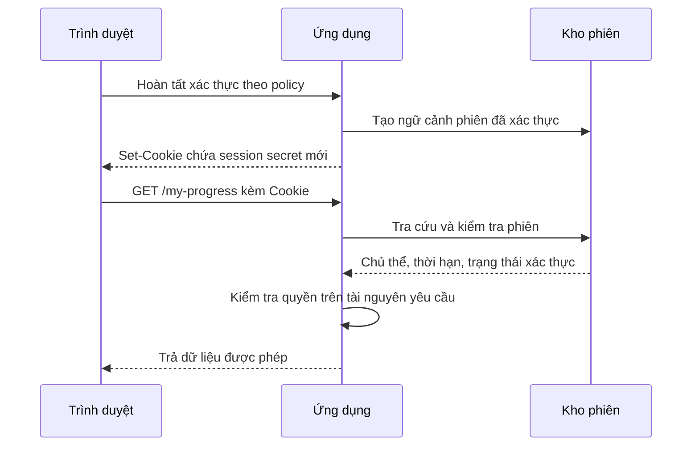

# Session là gì?

Bạn đăng nhập vào một cổng học tập, mở danh sách khóa học rồi xem tiến độ. Mỗi thao tác tạo ra một hoặc nhiều HTTP request, nhưng ứng dụng không yêu cầu nhập lại mật khẩu ở từng request. Thay vào đó, ứng dụng sử dụng một ngữ cảnh truy cập được duy trì qua thời gian: **session**, hay phiên.

Trong IAM, một phiên đã xác thực cho phép ứng dụng tiếp tục nhận biết ngữ cảnh xác thực của bên đang truy cập, trong giới hạn thời gian và chính sách cụ thể. Phiên giúp cân bằng trải nghiệm với việc kiểm soát ai đang sử dụng hệ thống, bằng chứng xác thực còn phù hợp không và quyền nào được phép áp dụng.

Session không chỉ xuất hiện sau đăng nhập. Một giỏ hàng của khách chưa đăng nhập cũng có thể được gắn với phiên. Vì vậy, cần phân biệt khái niệm session nói chung với **authenticated session**, tức phiên mang ngữ cảnh xác thực đã được hệ thống chấp nhận.

Sau bài học, người học có thể mô tả cách một phiên hoạt động qua nhiều request, phân biệt session với cookie và token, giải thích vòng đời phiên và nhận diện vai trò của session trong MFA, SSO và phân quyền.

## 1. Vì sao ứng dụng cần session?

HTTP là giao thức stateless: ngữ nghĩa giao thức không tự duy trì một trạng thái đăng nhập giữa các message. Ứng dụng có thể bổ sung cơ chế trạng thái ở phía trên HTTP. [Nguồn: RFC 9110 — HTTP Semantics](https://www.rfc-editor.org/rfc/rfc9110.html)

Xét ba request:

```http
POST /login

GET /courses

GET /my-progress
```

Nếu request thứ hai chỉ chứa đường dẫn `/courses`, đường dẫn đó không nói ai đang gọi. Ứng dụng cần một cơ chế nối request với ngữ cảnh mà nó đã xác lập trước đó.

Một giải pháp phổ biến là:

1. Người dùng hoàn tất các bước xác thực mà ứng dụng yêu cầu.
2. Server thiết lập ngữ cảnh phiên và cấp một bí mật hoặc phương tiện ràng buộc phiên cho client.
3. Client trình bày phương tiện đó trong các request tiếp theo.
4. Server kiểm tra tính hợp lệ trước khi sử dụng ngữ cảnh của phiên.

NIST mô tả sự liên tục của phiên đã xác thực dựa trên một session secret được phát hành khi xác thực, được trình bày trực tiếp hoặc chứng minh quyền sở hữu bằng cơ chế mật mã. [Nguồn: NIST SP 800-63B-4 — Session Bindings](https://pages.nist.gov/800-63-4/sp800-63b.html#session-bindings)

### Một kết nối không phải một phiên đăng nhập

Giữ nguyên kết nối TCP/TLS không tự chứng minh request thuộc cùng một tài khoản. Ngược lại, người dùng có thể đổi kết nối mạng mà phiên ứng dụng vẫn tiếp tục nếu cơ chế ràng buộc và policy cho phép.

IP, User-Agent hoặc tên thiết bị có thể là tín hiệu để đánh giá rủi ro. Chúng không nên được hiểu như một bí mật xác thực đáng tin cậy tự thân: nhiều người có thể dùng chung IP, còn thiết bị có thể đổi mạng trong lúc sử dụng.

## 2. Các khái niệm dễ bị gọi chung là “session”

| Khái niệm | Ý nghĩa | Ví dụ |
| --- | --- | --- |
| Session | Ngữ cảnh tương tác được ứng dụng duy trì qua nhiều request | Một phiên sử dụng cổng học tập |
| Session state | Dữ liệu mô tả ngữ cảnh đó | Chủ thể, thời điểm xác thực, hạn sử dụng |
| Session ID | Định danh hoặc giá trị tham chiếu tới phiên trong một thiết kế cụ thể | Chuỗi opaque dùng tìm bản ghi phía server |
| Session secret | Bí mật dùng ràng buộc bên gửi với phiên | Giá trị cookie bí mật trong mô hình bearer |
| Cookie | Cơ chế trình duyệt lưu và gửi một giá trị theo phạm vi quy định | Cookie chứa session ID |
| Token | Artifact được phát hành theo một mục đích và quy tắc xác minh | Token truy cập API hoặc token phục vụ phiên |
| User ID | Định danh của tài khoản | ID nội bộ của người học |

Một giá trị session ID có thể đồng thời là bí mật mang quyền nếu ai biết nó cũng có thể trình bày nó để sử dụng phiên. Trong trường hợp đó, tên gọi “ID” không làm nó bớt nhạy cảm.

Cookie không phải toàn bộ session. Nó có thể chỉ chứa một giá trị dùng tra cứu ngữ cảnh phía server. Cookie cũng có thể phục vụ mục đích không liên quan đăng nhập, chẳng hạn lưu tùy chọn giao diện.

Token cũng không phải từ đồng nghĩa với session. Một API access token có mục đích, đối tượng sử dụng và hạn riêng; nó không tự chứng minh người dùng vẫn đang ngồi trước trình duyệt.

### User ID không thay thế được session secret

Giả sử request gửi:

```http
GET /my-progress
X-User-Id: learner-42
```

Nếu server chỉ tin header đó, người gọi có thể thay `learner-42` bằng định danh khác. Biết tên của tài khoản không chứng minh quyền sử dụng tài khoản.

Trong mô hình session opaque, client gửi một bí mật khó đoán; server dùng nó để tìm và kiểm tra ngữ cảnh do chính server quản lý. Việc gắn chủ thể được thực hiện từ nguồn đã được xác minh, không từ lời khai tùy ý của client.

## 3. Một phiên dựa trên trạng thái phía server hoạt động thế nào?

Đây là mô hình minh họa phổ biến, không phải kiến trúc duy nhất:



### 3.1. Server tạo ngữ cảnh sau xác thực

Một bản ghi phiên có thể được hình dung như sau. Đây là dữ liệu mô tả, không phải schema bắt buộc:

```text
session_ref: internal-session-reference
subject_ref: internal-learner-reference
tenant_ref: internal-tenant-reference
state: AUTHENTICATED
authentication_time: server-recorded-time
authentication_methods: policy-verified-methods
created_at: server-recorded-time
last_activity_at: server-recorded-time
overall_expires_at: server-controlled-expiration
revoked_at: null
security_version: 7
```

Không phải ứng dụng nào cũng lưu mọi trường trên. Điểm cần giữ là ngữ cảnh đủ để quyết định phiên nào đang truy cập, bằng chứng nào đã được chấp nhận và điều kiện nào làm phiên mất hiệu lực.

Session state không cần chứa plaintext mật khẩu hoặc TOTP seed. Giữ credential dài hạn trong mỗi bản ghi phiên sẽ mở rộng nơi lưu bí mật mà việc tiếp tục tương tác không cần đến.

### 3.2. Client giữ giá trị ràng buộc phiên

Response minh họa trên HTTPS:

```http
Set-Cookie: __Host-session=<opaque-secret>; Path=/; Secure; HttpOnly; SameSite=Lax
```

Sau đó, trình duyệt gửi cookie phù hợp với các request nằm trong phạm vi của nó:

```http
GET /my-progress HTTP/1.1
Cookie: __Host-session=<opaque-secret>
```

Trong mô hình này, client không cần nhận cả bản ghi quyền và lịch sử xác thực. Nó giữ một giá trị để server liên hệ với ngữ cảnh đã thiết lập.

Các thuộc tính trong ví dụ có ý nghĩa khác nhau: `Secure` giới hạn việc gửi cookie qua kết nối an toàn; `HttpOnly` ngăn JavaScript đọc cookie qua API cookie; `SameSite` ảnh hưởng việc gửi trong bối cảnh cross-site. Tiền tố `__Host-` có các ràng buộc về host và `Path` trên trình duyệt hỗ trợ. [Nguồn: MDN — Set-Cookie](https://developer.mozilla.org/en-US/docs/Web/HTTP/Reference/Headers/Set-Cookie)

Đây là minh họa cơ chế, chưa phải cấu hình đầy đủ cho mọi luồng SSO hoặc triển khai đa domain. `HttpOnly` cũng không ngăn một script độc hại thực hiện hành động trong trang đang mở; còn `SameSite` không thay thế toàn bộ việc chống CSRF.

### 3.3. Mỗi request cần được đánh giá

Với request truy cập tài nguyên được bảo vệ, ứng dụng cần xác định ít nhất:

- Artifact phiên có được chấp nhận và liên hệ với ngữ cảnh hợp lệ không?
- Phiên còn hạn, chưa bị thu hồi và không vượt giới hạn trạng thái không?
- Tài khoản còn được phép truy cập trong phạm vi yêu cầu không?
- Bằng chứng xác thực có đáp ứng hành động hiện tại không?
- Chủ thể có quyền đối với đúng tài nguyên đang yêu cầu không?

Không nhất thiết cả năm câu hỏi đều tạo ra một truy vấn database riêng. Nhưng nếu một câu trả lời được cache hoặc mã hóa trong token, hệ thống phải biết điều kiện cập nhật và giới hạn độ cũ của nó.

## 4. Session liên kết xác thực với phân quyền, không thay thế phân quyền

**Authentication** xác minh bằng chứng danh tính. **Session management** duy trì và kiểm tra ngữ cảnh tương tác theo thời gian. **Authorization** quyết định một chủ thể được thực hiện hành động nào trên tài nguyên nào.

Ví dụ, một phiên hợp lệ xác định người gọi là người học A. Người học A có thể xem tiến độ của mình, nhưng điều đó chưa cho phép họ thay đường dẫn thành tiến độ của người học B.

```text
Phiên hợp lệ
    → xác định chủ thể A
    → yêu cầu xem tiến độ của B
    → kiểm tra quyền trên tài nguyên của B
    → từ chối nếu A không được phép
```

RBAC có thể xác định A là người học hoặc giảng viên. ABAC có thể xét tenant, khóa học, quan hệ với lớp và điều kiện truy cập. Chỉ kiểm tra “đã đăng nhập” là thiếu nếu endpoint cần các điều kiện đó.

Quyền cũng có thể thay đổi khi phiên đang tồn tại. Nếu một vai trò bị thu hồi nhưng session giữ bản sao quyền từ lúc đăng nhập mãi mãi, người dùng có thể tiếp tục dùng quyền cũ. Cách xử lý cần thuộc thiết kế policy và cache, không thể suy ra từ việc session ID vẫn hợp lệ.

Nguyên tắc ít quyền nhất còn áp dụng cho phạm vi phiên. Một phiên recovery có thể được phép đặt lại credential nhưng không được đọc dữ liệu quản trị. Một phiên bootstrap có thể được phép đăng ký MFA nhưng chưa dùng được các chức năng nghiệp vụ yêu cầu MFA.

## 5. Có session không đồng nghĩa đã hoàn tất đăng nhập

Một ứng dụng có thể duy trì nhiều loại ngữ cảnh:

| Ngữ cảnh | Ví dụ quyền được cấp | Điều chưa thể suy ra |
| --- | --- | --- |
| Anonymous | Giữ giỏ hàng hoặc lựa chọn ngôn ngữ | Đã biết danh tính người dùng |
| Đã qua bước đầu, còn chờ MFA | Trình bày thử thách tiếp theo | Đã đáp ứng policy đăng nhập đầy đủ |
| Authenticated | Truy cập chức năng nằm trong quyền và mức xác thực hiện có | Mọi hành động nhạy cảm đều được phép |
| Step-up/recent authentication | Thực hiện một hành động cần bằng chứng mới hoặc mạnh hơn | Toàn bộ quyền trong mọi phiên khác cũng được nâng |
| Recovery hoặc enrollment có giới hạn | Hoàn tất một thay đổi credential được phép | Có phiên nghiệp vụ đầy đủ |

Các tên trạng thái trên là ví dụ mô hình. Điều quan trọng là backend thực thi phạm vi, thay vì chỉ ẩn các nút trên giao diện.

Một tài khoản có `mfa_enabled=true` cũng chưa chứng minh một phiên cụ thể đã thực hiện MFA. Thuộc tính tài khoản mô tả khả năng hoặc cấu hình; ngữ cảnh phiên cần phản ánh bằng chứng của giao dịch xác thực thực tế.

Nếu đã có phiên anonymous trước đăng nhập, phải kiểm soát chuyển tiếp sang phiên authenticated. OWASP khuyến nghị đổi session ID sau thay đổi mức đặc quyền, đặc biệt khi đăng nhập, để chống session fixation. [Nguồn: OWASP — Renew the Session ID After Any Privilege Level Change](https://cheatsheetseries.owasp.org/cheatsheets/Session_Management_Cheat_Sheet.html#renew-the-session-id-after-any-privilege-level-change)

Ý nghĩa là không để một giá trị mà bên tấn công đã biết hoặc áp đặt trước xác thực tiếp tục đại diện cho quyền sau xác thực. Việc giữ lại dữ liệu an toàn như ngôn ngữ giao diện khác với giữ nguyên bí mật ràng buộc phiên.

## 6. Vòng đời: tạo, sử dụng, xác thực lại và kết thúc

Session có khởi đầu và điều kiện kết thúc. Nếu chỉ có một ID không bao giờ hết hạn, thiết kế chưa kiểm soát đầy đủ vòng đời truy cập.

| Giai đoạn | Điều xảy ra |
| --- | --- |
| Tạo | Hệ thống thiết lập ngữ cảnh và artifact ràng buộc phiên |
| Sử dụng | Request trình bày artifact; server kiểm tra trước khi dùng ngữ cảnh |
| Cập nhật | Một số trạng thái được cập nhật theo policy, chẳng hạn hoạt động gần nhất |
| Reauthentication | Người dùng cung cấp lại bằng chứng khi policy yêu cầu |
| Hết hạn | Một giới hạn thời gian làm phiên không còn được chấp nhận |
| Thu hồi | Hệ thống chủ động làm phiên mất hiệu lực trước hạn |
| Logout | Người dùng yêu cầu kết thúc phiên trong phạm vi được hỗ trợ |

### Hai đồng hồ thường gặp

NIST phân biệt giới hạn tổng thời gian phiên với giới hạn không hoạt động. Phiên bị kết thúc khi giới hạn áp dụng hết hạn; các giá trị cụ thể phụ thuộc mức bảo đảm và bối cảnh. [Nguồn: NIST — Reauthentication](https://pages.nist.gov/800-63-4/sp800-63b.html#reauthentication)

Ví dụ một sản phẩm chọn idle timeout 20 phút và overall timeout 8 giờ. Đây là tham số minh họa, không phải khuyến nghị mặc định cho mọi hệ thống.

```text
Phút 0:   xác thực, bắt đầu phiên.
Phút 10:  có hoạt động được policy công nhận.
Phút 31:  gửi request tiếp theo.
          Đã 21 phút không hoạt động → idle timeout đã hết.
```

Cookie vẫn có thể còn trong trình duyệt ở phút 31. Việc còn gửi được cookie không làm server phải tiếp tục chấp nhận phiên.

Nếu người dùng liên tục hoạt động, giới hạn tổng vẫn có thể yêu cầu xác thực lại. Việc “có request đi qua” không nên được hiểu là được kéo dài vô hạn bất chấp policy.

Ứng dụng cũng cần định nghĩa hoạt động nào được tính. Các request nền, polling hoặc tải tài nguyên không luôn phản ánh người dùng còn hiện diện. Đó là quyết định thiết kế cần rõ ràng, đặc biệt với trang để mở lâu trên máy dùng chung.

### Cookie hết hạn và phiên hết hạn khác nhau

Thời hạn cookie điều khiển khả năng lưu/gửi tại trình duyệt. Thời hạn và trạng thái phiên điều khiển việc chấp nhận ở server hoặc verifier. Cả hai cần phối hợp nhưng không thể thay thế nhau.

Không nên chỉ dựa vào một bộ đếm JavaScript để kết thúc quyền truy cập. Người dùng có thể sửa client hoặc gọi API trực tiếp; quyết định từ chối phải được thực thi trên đường phục vụ tài nguyên.

### Logout và thu hồi cần có phạm vi

Xóa cookie tại một trình duyệt khiến trình duyệt đó không còn trình bày giá trị như trước. Nếu bản sao bí mật đã bị lấy ở nơi khác và vẫn được server chấp nhận, việc xóa cookie local chưa vô hiệu hóa bản sao đó.

Đăng xuất phiên hiện tại, đăng xuất mọi thiết bị và kết thúc phiên SSO là các yêu cầu có phạm vi khác nhau. Giao diện cần mô tả đúng điều hệ thống thực thi.

## 7. Trạng thái phía server và trạng thái trong token

Một phiên không bắt buộc được lưu bằng một object trong bộ nhớ của đúng một server. Có nhiều cách biểu diễn và triển khai:

| Mô hình | Client thường giữ gì? | Nơi quyết định/ngữ cảnh được kiểm tra |
| --- | --- | --- |
| Server-side session | Giá trị opaque tham chiếu tới phiên | Kho phiên và logic ứng dụng |
| Artifact có chữ ký mang thông tin | Token chứa các trường được bảo vệ tính toàn vẹn | Verifier kiểm tra mật mã và policy; có thể thêm trạng thái khác |
| Mô hình kết hợp | Cookie phiên, token API hoặc nhiều artifact với vai trò riêng | Nhiều thành phần được phối hợp theo thiết kế |

Mô hình server-side giúp thay đổi trạng thái tại nơi lưu, nhưng còn phải xử lý chia sẻ kho, cache và khả năng sẵn sàng. Một ứng dụng chạy nhiều node không nên mặc định mọi request sẽ trở lại đúng node đang giữ phiên trong RAM.

Mô hình token có thể giảm tra cứu trạng thái cho một số request, nhưng không tự giải quyết logout, thu hồi quyền và thay đổi chính sách tức thời. Nếu cần chấm dứt trước hạn, hệ thống phải có cơ chế thực thi hoặc mô tả rõ thời gian artifact còn được chấp nhận.

JWT là một định dạng có thể tham gia một thiết kế, không phải bằng chứng rằng toàn bộ hệ thống không có trạng thái. Tên định dạng cũng không quyết định token có được dùng cho API nào hoặc đại diện cho bằng chứng gì; verifier phải kiểm tra theo mục đích của artifact.

NIST lưu ý access token và refresh token có thể còn hiệu lực sau khi phiên xác thực đã kết thúc. Không dùng sự hiện diện của access token như bằng chứng độc lập rằng người dùng vẫn còn hiện diện. [Nguồn: NIST — Access Tokens](https://pages.nist.gov/800-63-4/sp800-63b.html#access-tokens)

Vì vậy, câu hỏi “ứng dụng dùng cookie hay token?” chưa đủ để biết thiết kế phiên. Cần hỏi thêm nơi giữ ngữ cảnh, nơi xác minh, hạn sử dụng và cơ chế thu hồi.

## 8. Liên hệ với Java và HttpSession

Trong Jakarta Servlet, `HttpSession` cung cấp cách duy trì dữ liệu qua nhiều request và có thể tồn tại qua nhiều kết nối. Nó là cơ chế session của container, không phải lời khẳng định rằng người dùng đã xác thực. [Nguồn: Jakarta Servlet — HttpSession](https://jakarta.ee/specifications/servlet/6.1/apidocs/jakarta.servlet/jakarta/servlet/http/HttpSession.html)

Hai giá trị sau trả lời hai câu hỏi khác nhau. Đoạn mã giả định đang ở trong quá trình xử lý một `HttpServletRequest` tên `request`:

```java
import jakarta.servlet.http.HttpSession;
import java.security.Principal;

HttpSession currentSession = request.getSession(false);
Principal currentUser = request.getUserPrincipal();
```

`getSession(false)` lấy session hợp lệ hiện có hoặc trả `null`, không yêu cầu tạo mới. `getUserPrincipal()` phản ánh principal theo cơ chế xác thực được container/tích hợp cung cấp. [Nguồn: Jakarta Servlet — HttpServletRequest](https://jakarta.ee/specifications/servlet/6.1/apidocs/jakarta.servlet/jakarta/servlet/http/HttpServletRequest.html)

| Kết quả | Cách hiểu có thể phù hợp |
| --- | --- |
| Có session, chưa có principal | Có trạng thái anonymous hoặc luồng chưa xác thực |
| Có session và principal | Có cả hai ngữ cảnh; vẫn cần kiểm tra quyền |
| Không có session, có principal | Có thể đang dùng cách xác thực không cần HttpSession |
| Không có cả hai | Không có những ngữ cảnh này trong request hiện tại |

Framework có thể quản lý security context bằng cơ chế riêng. Đoạn mã chỉ minh họa sự khác biệt khái niệm, không phải một bộ lọc đăng nhập đầy đủ cho mọi ứng dụng Java.

### Tạo session không phải xác thực người dùng

Lời gọi `request.getSession()` có thể tạo session mới. Nếu viết một điều kiện kiểu “lấy được session thì cho truy cập”, ứng dụng có thể tự tạo session anonymous rồi coi đó là đã đăng nhập.

Tương tự, lưu `loggedIn=true` từ dữ liệu client không tạo bằng chứng. Framework hoặc thành phần xác thực cần thiết lập ngữ cảnh từ quy trình đã kiểm tra, còn ứng dụng áp dụng phân quyền dựa trên ngữ cảnh tin cậy đó.

`HttpSession.invalidate()` kết thúc session tương ứng của container. Nó không tự hủy mọi session của cùng người dùng ở các trình duyệt khác, token API độc lập hoặc phiên của IdP. Việc kết thúc toàn bộ cần chức năng phối hợp riêng.

## 9. Một người dùng có thể có nhiều phiên

Một người có thể dùng laptop, điện thoại và máy tính bảng đồng thời. Mỗi client có thể có phiên và mức xác thực khác nhau. User ID giống nhau không có nghĩa session secret, thời điểm đăng nhập và quyền truy cập hiện hành của mọi phiên đều giống nhau.

Trong cùng một hồ sơ trình duyệt, nhiều tab thường dùng chung cookie phù hợp. Vì vậy, mở tab mới chưa chắc tạo phiên đăng nhập mới. Mô hình chia sẻ này cũng giải thích vì sao đăng xuất ở một tab có thể ảnh hưởng tab khác.

Đóng tab không tự gửi một tín hiệu đáng tin rằng người dùng đã kết thúc tương tác. Kết thúc truy cập nên dựa trên logout và các giới hạn được server thực thi, thay vì phụ thuộc hoàn toàn vào một sự kiện trên trình duyệt.

### SSO có nhiều ngữ cảnh liên quan

Ví dụ, người dùng có phiên tại IdP và phiên local ở cổng học tập. Cổng học tập có thể chuyển hướng đến IdP để nhận kết quả xác thực rồi thiết lập phiên của mình.

Phiên local hết hạn trong khi phiên IdP còn hợp lệ có thể dẫn đến việc người dùng quay lại cổng mà không phải gõ mật khẩu lần nữa. Điều đó không chứng minh session local cũ chưa hết hạn; có thể một quy trình xác thực mới đã sử dụng phiên IdP còn hiệu lực.

Ngược lại, đăng xuất khỏi cổng không tự bảo đảm phiên IdP đã kết thúc. Đây là lý do cần xác định phạm vi khi nói “đăng xuất khỏi ứng dụng” hoặc “đăng xuất khỏi hệ thống SSO”.

Danh tính workload sử dụng client credential hoặc chứng thư có vòng đời truy cập riêng. Không phải mọi lần gọi API của một service đều là một phiên trình duyệt của con người, dù chúng đều cần kiểm soát artifact và quyền.

## 10. Những rủi ro xuất phát từ việc giữ ngữ cảnh truy cập

Session giảm nhu cầu liên tục nhập credential, nhưng tạo ra một artifact có thể bị dùng lại nếu bị đánh cắp hoặc xử lý sai.

| Rủi ro | Hiểu đúng ở mức nền tảng |
| --- | --- |
| Session hijacking | Bên khác lấy được phương tiện sử dụng phiên và tìm cách mạo danh |
| Session fixation | Giá trị đã bị biết/áp đặt trước xác thực tiếp tục mang quyền sau đăng nhập |
| Phiên sống quá lâu | Bằng chứng cũ tiếp tục được dùng ngoài giới hạn mong muốn |
| Quyền trong phiên bị cũ | Bản sao quyền không phản ánh thu hồi hoặc thay đổi hiện hành |
| Chỉ logout phía client | Bản sao artifact ở nơi khác còn có thể được chấp nhận |
| Nhầm ngữ cảnh | Dùng recovery session hoặc phiên chờ MFA như phiên đầy đủ |
| Lộ qua quan sát hệ thống | Session secret xuất hiện trong URL, log, trace hoặc công cụ hỗ trợ |

Session secret trong mô hình bearer cần được bảo vệ như một bí mật mang quyền. MFA đã dùng lúc đăng nhập không tự ngăn một bên khác sử dụng cookie bị lấy sau đó; đó là một phần lý do quản lý phiên vẫn cần thiết khi hệ thống có MFA.

Không đặt mật khẩu, seed hoặc toàn bộ session secret vào log để theo dõi request. Có thể dùng tham chiếu nội bộ hoặc mã tương quan không dùng được để truy cập, kèm kiểm soát quyền đọc dữ liệu vận hành.

Đối với request thay đổi trạng thái qua trình duyệt, cần xem xét cả CSRF lẫn việc bảo vệ cookie. Việc server nhận đúng cookie không luôn chứng minh người dùng chủ động muốn thực hiện hành động đó.

## 11. Tình huống tổng hợp và cách kiểm tra cách hiểu

Một người học mở cổng bằng hai tab và một ứng dụng trên điện thoại. Hai tab dùng chung cookie trong hồ sơ trình duyệt; điện thoại có ngữ cảnh truy cập riêng.

Sau khi hoàn tất xác thực, trình duyệt nhận artifact phiên mới. Server dùng nó để nhận diện người học, nhưng vẫn kiểm tra người học có được xem đúng tiến độ và tài liệu yêu cầu hay không.

Khi người đó chuyển sang chức năng quản lý lớp cần bằng chứng mới, hệ thống yêu cầu step-up cho ngữ cảnh phù hợp. Phiên trên điện thoại không tự nhận cùng mức xác thực chỉ vì cùng tài khoản.

Nếu người quản trị thu hồi quyền quản lý lớp, những request sau cần bị xử lý theo cam kết cập nhật quyền của hệ thống. Cookie còn hạn không phải lý do giữ nguyên đặc quyền đã bị thu hồi.

Khi chọn logout trình duyệt, server kết thúc phiên trong phạm vi được công bố. Nếu chức năng chỉ logout phiên hiện tại, điện thoại có thể vẫn còn phiên riêng. Nếu chọn logout mọi thiết bị, hệ thống phải thực thi đúng phạm vi đó thay vì chỉ xóa cookie ở hai tab.

Các tình huống dưới đây giúp đánh giá hiểu đúng về session:

| Tình huống | Điều cần quan sát |
| --- | --- |
| Chỉ tạo HttpSession trước đăng nhập | Không tự có quyền của người dùng đã xác thực |
| Gửi một session ID tùy ý hoặc user ID | Không tự được gắn với tài khoản được khai |
| Giữ cookie sau khi server cho phiên hết hạn | Request được bảo vệ vẫn bị từ chối |
| Phiên đã xác thực gọi tài nguyên của người khác | Phân quyền tài nguyên vẫn được thực thi |
| Cùng người dùng có hai client | Vòng đời và mức xác thực có thể khác nhau |
| Đổi session ID sau xác thực | Artifact trước đó không tiếp tục đại diện cùng quyền trái thiết kế |
| Tài khoản hoặc quyền bị thu hồi | Ngữ cảnh truy cập được cập nhật/từ chối theo cơ chế đã công bố |
| Đăng xuất một ứng dụng SSO | Phân biệt phiên local với phiên IdP và các ứng dụng khác |

Một mô tả session đầy đủ cần trả lời được: ngữ cảnh thuộc chủ thể nào, client chứng minh sự liên tục bằng gì, server hoặc verifier chấp nhận đến khi nào và sự kiện nào khiến ngữ cảnh không còn được sử dụng. Các chi tiết như cookie, kho phiên hay token đều phục vụ những câu hỏi đó.

## Tài liệu tham khảo

- [RFC 9110 — HTTP Semantics](https://www.rfc-editor.org/rfc/rfc9110.html)
- [NIST SP 800-63B-4 — Session Management](https://pages.nist.gov/800-63-4/sp800-63b.html#session-management)
- [OWASP Session Management Cheat Sheet](https://cheatsheetseries.owasp.org/cheatsheets/Session_Management_Cheat_Sheet.html)
- [MDN — Set-Cookie](https://developer.mozilla.org/en-US/docs/Web/HTTP/Reference/Headers/Set-Cookie)
- [Jakarta Servlet 6.1 — HttpSession](https://jakarta.ee/specifications/servlet/6.1/apidocs/jakarta.servlet/jakarta/servlet/http/HttpSession.html)
- [Jakarta Servlet 6.1 — HttpServletRequest](https://jakarta.ee/specifications/servlet/6.1/apidocs/jakarta.servlet/jakarta/servlet/http/HttpServletRequest.html)
