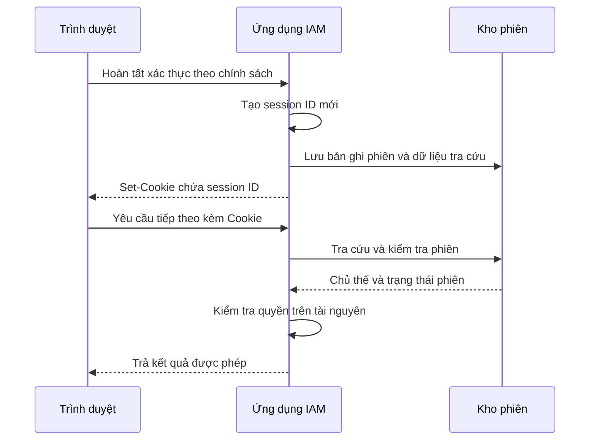

# Session identifier

**Session identifier**, thường viết là **session ID**, là giá trị giúp ứng dụng liên kết một yêu cầu với một phiên đã được thiết lập. Trong mô hình phiên lưu ở máy chủ, trình duyệt giữ session ID còn máy chủ giữ bản ghi tương ứng: chủ thể, trạng thái xác thực, thời điểm và các điều kiện sử dụng phiên.

Với cơ chế bearer thông thường, ai có session ID còn hiệu lực có thể gửi nó để sử dụng phiên. Vì vậy, dù mang tên “định danh”, giá trị này phải được bảo vệ như một bí mật truy cập, khác với mã người dùng có thể hiển thị công khai.

Trong IAM, session ID giúp duy trì việc nhận diện người dùng sau đăng nhập, nhưng không tự chứng minh rằng mọi yêu cầu đều được phép. Máy chủ vẫn cần kiểm tra trạng thái tài khoản, mức xác thực, tenant và quyền trên tài nguyên. Bài này tập trung vào session ID mờ, được máy chủ tra cứu; các loại token có cấu trúc được phân biệt để tránh dùng sai khái niệm.

## 1. Session ID khác các loại định danh nào?

| Giá trị | Định danh điều gì? | Có thể dùng riêng nó để truy cập phiên không? |
|---|---|---|
| User ID | Một người dùng hoặc chủ thể trong phạm vi hệ thống | Không nên; nó không phải bí mật xác thực |
| Session ID dạng bearer | Một phiên đang được máy chủ quản lý | Có thể, nếu phiên còn hợp lệ và chính sách chấp nhận |
| Request ID | Một yêu cầu để đối chiếu log hoặc trace | Không |
| Mã tham chiếu phiên trên giao diện quản lý | Một bản ghi phiên để chọn xem hoặc thu hồi | Không, nếu được thiết kế tách khỏi bí mật truy cập |
| Access token | Bằng chứng truy cập theo cơ chế cấp token | Phụ thuộc loại token và chính sách, không mặc nhiên là session ID |

Một người dùng có thể có nhiều phiên: trình duyệt trên laptop, trình duyệt trên điện thoại và một phiên quản trị riêng. Không dùng `userId` làm session ID, vì như vậy vừa dễ đoán vừa không tách được vòng đời của từng phiên.

Tên cookie cũng không phải giá trị phiên. Trong `session=abc...`, `session` là tên còn `abc...` mới là giá trị cần bảo vệ. Đổi tên cookie không bù được việc giá trị dễ đoán hoặc bị ghi vào log.

Một JWT có thể chứa định danh token như `jti`; RFC 7519 định nghĩa đây là định danh của JWT, không tự quy định nó là một phiên ứng dụng hay cơ chế thu hồi phiên. Một token cũng cần được xác minh đầy đủ thay vì chỉ lấy một trường ID trong payload. [RFC 7519, mục 4.1.7](https://www.rfc-editor.org/rfc/rfc7519.html#section-4.1.7)

## 2. Cách session ID nối các yêu cầu HTTP

HTTP không tự biết hai yêu cầu thuộc cùng một lần đăng nhập. Cookie là một cơ chế trao đổi trạng thái giữa máy chủ và trình duyệt: máy chủ gửi `Set-Cookie`, trình duyệt lưu và gửi lại cookie trong những yêu cầu phù hợp với phạm vi của nó. [RFC 6265 — HTTP State Management Mechanism](https://www.rfc-editor.org/rfc/rfc6265.html)



Trong mô hình này, session ID là một khóa tham chiếu mờ đối với khách. Trình duyệt không cần đọc vai trò, mức MFA hoặc thông tin tài khoản từ chính chuỗi ID.

Ví dụ bản ghi phía máy chủ:

```text
sessionLookupKey
publicSessionReference
subjectId
tenantContext
authenticationState
authenticatedAt
mfaVerifiedAt nếu có
createdAt
lastActivityAt
absoluteExpiresAt
revokedAt nếu có
securityEpoch nếu thiết kế sử dụng
```

Các trường này là mô hình minh họa. Khi dùng framework, cần hiểu dữ liệu nào được framework quản lý và phần nào thuộc chính sách ứng dụng. Không tạo thêm một cơ chế song song chỉ vì ví dụ có tên trường khác.

## 3. Khó đoán quan trọng hơn trông phức tạp

Một session ID tốt cần được sinh từ nguồn ngẫu nhiên dành cho mật mã, có không gian đủ lớn và không để lộ thông tin có ích cho việc đoán. OWASP khuyến nghị ưu tiên cơ chế của framework; nếu tự tạo ID thì dùng CSPRNG với kích thước ít nhất 128 bit và bảo đảm không dùng trùng ID. [OWASP — Session ID Properties](https://cheatsheetseries.owasp.org/cheatsheets/Session_Management_Cheat_Sheet.html#session-id-properties)

Những giá trị sau không thích hợp làm bí mật phiên:

```text
user-10025
username + timestamp
counter tăng dần
Base64(email + thời điểm đăng nhập)
hash của một đầu vào dễ đoán
```

Base64 chỉ thay cách biểu diễn. Băm một số tăng dần bằng SHA-256 tạo ra chuỗi dài nhưng không tự bổ sung entropy cho đầu vào. Người biết quy luật vẫn có thể tính các ứng viên tương ứng.

**Entropy** ở đây phản ánh mức khó đoán của phần ngẫu nhiên. Nếu chuỗi có một tiền tố cố định hoặc phần định tuyến máy chủ, phần đó không được tính như các bit bí mật độc lập. Độ dài nhìn thấy của chuỗi và lượng ngẫu nhiên thực tế là hai điều khác nhau.

Một mô hình ước lượng đơn giản: nếu ID phân bố đều trong không gian `2^b`, có `N` phiên hợp lệ và kẻ tấn công thực hiện `q` lần đoán độc lập, xác suất trúng ít nhất một phiên khi còn rất nhỏ xấp xỉ:

```text
P(hit) ≈ q × N / 2^b
```

Công thức chỉ giúp hiểu quan hệ giữa số bit, số phiên và số lần thử. Nó không mô tả việc cookie bị đánh cắp: khi đã biết đúng giá trị, kẻ tấn công không cần đoán qua không gian đó.

Khả năng trùng ID khi sinh nhiều phiên là một vấn đề khác với đoán trúng. Kho lưu nên có ràng buộc hoặc thao tác tạo mới không ghi đè bản ghi đã tồn tại. Nếu gặp trùng, sinh giá trị khác; không thay chủ thể của phiên cũ thành người vừa đăng nhập.

## 4. Ví dụ Java: sinh một giá trị ngẫu nhiên mờ

Đoạn mã dưới đây minh họa lấy 32 byte ngẫu nhiên và biểu diễn bằng Base64 URL không padding. Đây là ví dụ về dữ liệu đầu vào cho một thiết kế phiên, không phải hệ thống quản lý phiên hoàn chỉnh:

```java
import java.security.SecureRandom;
import java.util.Base64;

public final class SessionIdExample {
    private static final SecureRandom RANDOM = new SecureRandom();
    private static final int RANDOM_BYTES = 32;

    private SessionIdExample() {
    }

    public static String newSessionId() {
        byte[] value = new byte[RANDOM_BYTES];
        RANDOM.nextBytes(value);
        return Base64.getUrlEncoder()
            .withoutPadding()
            .encodeToString(value);
    }
}
```

Với nguồn ngẫu nhiên phù hợp, 32 byte cung cấp 256 bit dữ liệu ngẫu nhiên; biểu diễn này có 43 ký tự. Các bit cố định do cách biểu diễn không tạo thêm entropy. Không cắt chuỗi xuống một độ dài ngắn tùy ý sau khi sinh.

`SecureRandom` là API Java cung cấp bộ sinh ngẫu nhiên mạnh về mật mã. Dùng theo cơ chế seed của triển khai; không tự seed bằng giờ hiện tại hay một hằng số để làm kết quả “dễ kiểm tra”. [Java SE 21 — SecureRandom](https://docs.oracle.com/en/java/javase/21/docs/api/java.base/java/security/SecureRandom.html)

Đoạn mã không in ID ra màn hình. Một giá trị dùng thật không nên xuất hiện trong log, thông báo lỗi hoặc dữ liệu hỗ trợ kỹ thuật. Khi ứng dụng đã có session manager của container hoặc framework, ưu tiên cấu hình và sử dụng cơ chế đó thay vì thay ID của nó bằng hàm minh họa này.

## 5. Cookie mang session ID cần có phạm vi rõ

Ví dụ cho một ứng dụng HTTPS dùng cookie theo host:

```http
Set-Cookie: __Host-session={opaque-session-id}; Path=/; Secure; HttpOnly; SameSite=Lax
Cache-Control: no-store
```

`{opaque-session-id}` là placeholder, không phải giá trị được phép dùng chung cho người dùng.

| Thuộc tính | Tác dụng chính |
|---|---|
| `Secure` | Giới hạn gửi cookie qua kết nối an toàn theo quy tắc trình duyệt |
| `HttpOnly` | Ngăn JavaScript đọc cookie qua các API cookie thông thường |
| `SameSite` | Kiểm soát gửi cookie trong ngữ cảnh cùng site hoặc khác site |
| `Path=/` | Xác định phạm vi đường dẫn gửi cookie |
| Không có `Domain` | Giữ cookie theo host đã đặt nó |

Trên trình duyệt hỗ trợ, tiền tố `__Host-` yêu cầu `Secure`, `Path=/` và không có `Domain`. `HttpOnly` được thêm riêng trong ví dụ. Hỗ trợ thuộc tính và tiền tố vẫn cần được xét theo môi trường khách. [MDN — Set-Cookie](https://developer.mozilla.org/en-US/docs/Web/HTTP/Reference/Headers/Set-Cookie)

`SameSite=Lax` là lựa chọn minh họa, không phải cấu hình đúng cho mọi luồng. Đăng nhập liên kết, frontend khác site hoặc callback theo phương thức khác có thể cần thiết kế riêng. Không đổi mọi cookie sang `SameSite=None` chỉ để chữa một lỗi đăng nhập mà chưa hiểu phạm vi; khi dùng `None` cần `Secure` theo yêu cầu trình duyệt hiện hành.

`HttpOnly` không làm XSS trở nên vô hại: mã chạy trong trang vẫn có thể gửi yêu cầu bằng phiên hiện tại dù không đọc được giá trị cookie. Cookie tự gửi cũng khiến các thao tác thay đổi trạng thái cần biện pháp chống CSRF phù hợp. Thuộc tính cookie bổ sung bảo vệ nhưng không thay thế kiểm soát ứng dụng.

`Path` không phải ranh giới cấp quyền cho tài nguyên. Máy chủ vẫn phải kiểm tra quyền ở endpoint, không coi việc cookie được gửi đến một đường dẫn là bằng chứng người dùng được phép thực hiện mọi thao tác ở đó.

## 6. Chỉ chấp nhận cơ chế truyền ID đã thiết kế

Không đặt session ID trong URL như:

```text
/profile?sessionId={secret}
/account;jsessionid={secret}
```

ID trong URL có thể đi vào lịch sử, liên kết được chia sẻ, bookmark hoặc hệ thống ghi log. URL rewriting cũng có thể tạo thêm cách nhận ID ngoài cookie mà nhóm phát triển không để ý.

Nếu ứng dụng chọn cookie là cơ chế quản lý phiên, cần kiểm tra cả những đường mà framework có thể chấp nhận để tránh vô tình tiếp nhận ID từ query string hoặc đường dẫn. Không chỉ nhìn cơ chế mà giao diện đang sử dụng.

Lưu bearer session ID trong `localStorage` làm nó có thể được JavaScript cùng origin đọc. Nếu không có yêu cầu thực sự cần JavaScript xử lý bí mật đó, một cookie `HttpOnly` được cấu hình phù hợp thường có lợi thế về giới hạn khả năng đọc trực tiếp. Dù chọn mô hình nào, vẫn cần bảo vệ khỏi XSS và quản lý vòng đời phía máy chủ.

Một session ID không nên được gửi cho dịch vụ phân tích, công cụ ghi hình phiên, nền tảng hỗ trợ hoặc bên thứ ba không cần dùng nó. Các lớp reverse proxy, CDN, APM và error tracking cũng cần che cookie hoặc header chứa bí mật.

## 7. Máy chủ phải xác minh điều gì ở mỗi yêu cầu?

Có cookie đúng tên không đồng nghĩa có phiên hợp lệ. Một luồng kiểm tra khái niệm:

```text
rawId = đọc cookie đúng cơ chế đã chọn
nếu thiếu: xử lý như chưa có phiên
nếu sai định dạng hoặc quá dài: từ chối theo chính sách

session = tra cứu từ rawId bằng cơ chế của session manager
nếu không tồn tại: không chấp nhận là phiên đã xác thực
nếu đã thu hồi hoặc hết hạn: từ chối
nếu tài khoản/ngữ cảnh bảo mật mất hiệu lực: xử lý theo chính sách
nếu mức xác thực chưa đủ cho tài nguyên: yêu cầu bước bổ sung

khôi phục chủ thể từ dữ liệu đáng tin cậy
kiểm tra tenant, quyền và điều kiện nghiệp vụ
cập nhật hoạt động hợp lệ theo chính sách
```

Session ID vẫn là đầu vào không đáng tin cậy. Cần giới hạn kích thước, cú pháp và xử lý dữ liệu bằng API an toàn. Không nối nó trực tiếp vào câu SQL, tên file hoặc lệnh hệ thống.

Với ID phân biệt hoa thường, không tự chuyển sang chữ thường hoặc chuẩn hóa tùy tiện. Nếu dùng Base64, quy tắc mã hóa và giải mã phải nhất quán. Việc cắt chuỗi hoặc chấp nhận nhiều dạng không được thiết kế có thể làm sai ánh xạ.

ID lạ không được tự tạo thành một phiên đã xác thực. Một ứng dụng có thể tạo phiên ẩn danh mới cho chức năng công khai, nhưng phải dùng ID do máy chủ sinh và giữ trạng thái ẩn danh. Không gắn quyền của một tài khoản vào ID do khách tự chọn.

Không lấy `subjectId`, vai trò hoặc mức MFA từ dữ liệu khách gửi kèm chỉ vì ID đã tra cứu được. Những giá trị đó phải đến từ bản ghi phiên và cơ chế chính sách đáng tin cậy.

Nếu kho phiên không truy cập được, đó là lỗi hạ tầng chứ chưa chắc là phiên hết hạn. Hệ thống cần xử lý theo thiết kế mà không cấp quyền khi chưa xác minh được. Không dùng dữ liệu tùy ý trong cookie như một phương án dự phòng để cho phép truy cập.

## 8. Lưu session ID và giới hạn lộ dữ liệu phía máy chủ

Kho phiên phải được bảo vệ vì dữ liệu trong đó có thể cho phép mạo danh. Một số hệ thống lưu ID nguyên bản trong kho được kiểm soát chặt; một thiết kế khác lưu một verifier hoặc digest để giảm khả năng dùng lại token khi chỉ lộ dữ liệu đọc.

Ví dụ khái niệm cho một token ngẫu nhiên có entropy cao:

```text
Trình duyệt giữ: rawSessionToken
Máy chủ tra cứu bằng: SHA-256(rawSessionToken)
Máy chủ lưu: dữ liệu phiên và digest, không lưu rawSessionToken cạnh digest
```

Đây là lựa chọn kiến trúc, không phải chỉ thị thay cách lưu nội bộ của mọi framework. OWASP mô tả lưu verifier một chiều cho trường hợp cần giảm tác động của việc lộ kho đọc, và lưu ý hash nhanh có thể phù hợp cho bí mật ngẫu nhiên entropy cao. Điều này khác với mật khẩu do người dùng chọn. [OWASP — Server-Side Session Token Storage](https://cheatsheetseries.owasp.org/cheatsheets/Session_Management_Cheat_Sheet.html#server-side-session-token-storage)

Cần giữ đúng chiều sử dụng: khách gửi token nguyên bản, máy chủ mới tính dữ liệu tra cứu. Nếu máy chủ cũng chấp nhận chính digest như bearer token, việc lộ digest lại đủ để sử dụng phiên và lợi ích thiết kế bị mất.

Lưu một chiều không bảo vệ trước cookie đã bị lấy, quyền ghi vào kho hoặc việc ứng dụng bị chiếm quyền thực thi. Ngoài ra, một bản sao log vô tình ghi raw token cũng có thể làm mất lợi ích của cách lưu này.

Đối với giao diện liệt kê thiết bị hoặc chức năng hỗ trợ, dùng mã tham chiếu riêng không có quyền xác thực. Endpoint thu hồi một phiên bằng mã tham chiếu vẫn phải kiểm tra chủ thể đang thao tác có quyền trên bản ghi đó.

## 9. Đổi ID để ngăn session fixation

**Session fixation** xảy ra khi kẻ tấn công biết hoặc áp đặt một định danh từ trước, sau đó ứng dụng giữ nguyên định danh đó khi nạn nhân xác thực. Nếu ID cũ trở thành bằng chứng cho phiên đã đăng nhập, kẻ biết ID có thể dùng nó.

Một mốc cần bảo vệ là chuyển từ phiên ẩn danh hoặc tiền xác thực sang phiên đầy đủ:

```text
Trước xác thực:
    ID_old -> phiên ẩn danh hoặc chỉ được tiếp tục MFA

Sau khi đủ điều kiện:
    ID_new -> phiên được phép theo kết quả xác thực
    ID_old -> không còn được dùng như phiên đã xác thực
```

Việc đổi ID phải do cơ chế phiên thực hiện cùng với chuyển trạng thái bảo mật. Chỉ đặt cookie mới nhưng vẫn để ID cũ truy cập cùng phiên đầy đủ không giải quyết được việc người khác biết ID cũ.

Sau thay đổi mức đặc quyền hoặc kết quả xác thực nhạy cảm, cần áp dụng chính sách đổi ID và làm mất hiệu lực trạng thái cũ phù hợp. Không dùng một cờ MFA toàn cục khiến tất cả phiên của người dùng đều được nâng mức sau một challenge ở một trình duyệt.

Trong Jakarta Servlet, `HttpServletRequest.changeSessionId()` đổi ID của phiên hiện có và trả ID mới. Gọi khi chưa có phiên sẽ gây lỗi theo hợp đồng API. Đây là thao tác đổi ID, không tự thay thế xác minh tài khoản hay chính sách đăng nhập. [Jakarta Servlet 6.1 — HttpServletRequest](https://jakarta.ee/specifications/servlet/6.1/apidocs/jakarta.servlet/jakarta/servlet/http/HttpServletRequest.html#changeSessionId())

Ví dụ một thao tác API riêng lẻ:

```java
// Chỉ dùng tại điểm chuyển trạng thái đã được luồng xác thực cho phép.
// request phải đang có một HttpSession hợp lệ.
request.changeSessionId();
```

Khi dùng Spring Security, cơ chế chống fixation và lưu trạng thái xác thực phải đi theo session strategy và cấu hình tương ứng. Một controller tự tạo session hoặc tự đặt `subjectId` không mặc nhiên hoàn thành cơ chế đăng nhập của framework. [Spring Security — Authentication Persistence and Session Management](https://docs.spring.io/spring-security/reference/servlet/authentication/session-management.html)

Trong môi trường nhiều yêu cầu song song, đổi ID còn cần xử lý các yêu cầu đang dùng ID cũ. Không duy trì một ánh xạ ID cũ sang phiên đã nâng quyền vô thời hạn để tránh lỗi giao diện. Nếu có khoảng chuyển tiếp, phải đánh giá rõ khả năng truy cập bằng ID cũ và phạm vi mà chính sách cho phép.

## 10. Hết hạn và thu hồi là thuộc tính phía máy chủ

Cookie có thể vẫn nằm trong trình duyệt sau khi bản ghi phiên không còn hợp lệ. Ngược lại, cookie biến mất khỏi một trình duyệt không có nghĩa bản sao session ID ở nơi khác đã bị thu hồi.

Các thời điểm thường cần phân biệt:

| Thời điểm hoặc khoảng thời gian | Ý nghĩa |
|---|---|
| `createdAt` | Phiên gốc được thiết lập lúc nào |
| `idIssuedAt` nếu cần | Định danh hiện tại được sinh hoặc đổi lúc nào |
| Idle timeout | Giới hạn không có hoạt động được chính sách công nhận |
| Absolute timeout | Giới hạn tổng thời gian phiên tồn tại |
| `authenticatedAt` hoặc thời điểm xác minh bổ sung | Độ mới của bằng chứng xác thực |
| `revokedAt` | Phiên đã bị thu hồi chủ động |

Đổi session ID không nên tự đặt lại mốc bắt đầu giới hạn tuyệt đối nếu chính sách không cho phép. Nếu mỗi lần đổi ID kéo dài vô hạn tuổi thọ phiên, giới hạn tuyệt đối mất ý nghĩa.

Kiểm tra idle timeout trước khi cập nhật thời điểm hoạt động. Nếu vừa nhận yêu cầu đã luôn gán `lastActivityAt = now` rồi mới kiểm tra, phiên có thể không bao giờ bị coi là hết hạn do không hoạt động. Cũng cần xác định polling nền có được tính là hoạt động duy trì phiên hay không.

NIST xem việc duy trì phiên dựa trên bí mật phiên và yêu cầu quản lý giới hạn phiên, xác thực lại theo mức bảo đảm tương ứng. Không suy ra việc khách còn giữ cookie là đủ để tiếp tục một phiên đã hết điều kiện. [NIST SP 800-63B-4 — Session Management](https://pages.nist.gov/800-63-4/sp800-63b.html#session)

Cookie không có `Expires` hoặc `Max-Age` có thể được gọi là session cookie theo hành vi trình duyệt, nhưng không nên dùng việc đóng trình duyệt như cơ chế hết hạn bảo mật duy nhất. Khôi phục phiên trình duyệt và các hành vi khách khác cần được tính đến; máy chủ vẫn phải tự thực thi thời hạn.

### Đăng xuất

Một luồng đăng xuất cần làm mất hiệu lực phiên phía máy chủ và xóa cookie với phạm vi phù hợp. Ví dụ thao tác Servlet:

```java
HttpSession session = request.getSession(false);
if (session != null) {
    session.invalidate();
}
```

`invalidate()` làm mất hiệu lực `HttpSession` theo hợp đồng API. Ví dụ không đại diện cho toàn bộ logout của một framework hoặc việc thu hồi token ở hệ thống khác. [Jakarta Servlet 6.1 — HttpSession](https://jakarta.ee/specifications/servlet/6.1/apidocs/jakarta.servlet/jakarta/servlet/http/HttpSession.html#invalidate())

Cookie minh họa được xóa bằng cùng tên và phạm vi đã chọn:

```http
Set-Cookie: __Host-session=; Path=/; Max-Age=0; Secure; HttpOnly; SameSite=Lax
```

Đăng xuất một phiên khác với đăng xuất mọi phiên của tài khoản. Tương tự, làm mất hiệu lực các yêu cầu tiếp theo không tự hoàn tác một giao dịch nghiệp vụ đã được chấp nhận trước thời điểm thu hồi.

## 11. Nhiều máy chủ, nhiều ứng dụng và SSO

Khi ứng dụng chạy trên nhiều node, một session ID hợp lệ phải được diễn giải nhất quán trong phạm vi triển khai. Các lựa chọn có thể là kho phiên dùng chung, sao chép trạng thái hoặc cơ chế định tuyến theo thiết kế.

Sticky session chỉ giúp một khách thường đến cùng node; nó không tự giải quyết sao lưu, thu hồi toàn cụm hoặc trường hợp node đó ngừng hoạt động. Nếu các node giữ cache, cần biết khoảng thời gian một trạng thái đã thu hồi còn có thể được chấp nhận.

Thông tin IP và User-Agent có thể giúp phát hiện bất thường nhưng không phải bằng chứng sở hữu phiên mạnh. IP có thể thay đổi khi chuyển mạng, còn một số thuộc tính có thể bị giả mạo. Ràng buộc cứng theo IP mà không xét bối cảnh dễ làm mất phiên hợp lệ.

Trong SSO, phiên tại IdP và phiên tại mỗi ứng dụng thường là các trạng thái khác nhau. Không cần chia sẻ cùng bearer session ID hoặc mở cookie cho toàn bộ miền cha để có trải nghiệm đăng nhập chung. Luồng liên kết danh tính nên dùng giao thức và cơ chế tương ứng.

Đăng xuất ứng dụng A không tự chứng minh phiên ở IdP, ứng dụng B hoặc access token của API đều đã bị thu hồi. Phải xác định phạm vi logout và cơ chế thông báo giữa các thành phần, rồi diễn đạt kết quả đúng với khả năng thực tế.

## 12. Kiểm toán và những lỗi cần nhận ra

Các sự kiện tạo, đổi, hết hạn và thu hồi phiên giúp theo dõi vòng đời truy cập. Có thể dùng một mã tương quan riêng cho kiểm toán:

```text
eventType: SESSION_REVOKED
sessionReference: mã tham chiếu không dùng làm bearer credential
subjectId: chủ thể của phiên
actorId: chủ thể thực hiện thao tác thu hồi
reason: lý do được định nghĩa
occurredAt: thời điểm xử lý
```

Không ghi toàn bộ session ID, cookie hoặc header xác thực vào log. Nhân viên cần xem lịch sử hỗ trợ không mặc nhiên cần quyền lấy bí mật phiên. Cần kiểm tra cả log ở proxy và công cụ quan sát, không chỉ lệnh ghi log trong mã ứng dụng.

Những tình huống sau giúp kiểm chứng thiết kế:

1. ID do khách tự chọn không được nâng thành phiên đã xác thực.
2. Sau đăng nhập hoặc chuyển mức cần đổi ID, giá trị cũ không dùng được như phiên đầy đủ.
3. Xóa cookie ở một trình duyệt không phải bằng chứng duy nhất cho việc thu hồi phía máy chủ.
4. Cookie còn tồn tại nhưng phiên đã hết hạn vẫn bị từ chối.
5. Hai phiên của cùng tài khoản có thể được phân biệt và thu hồi theo phạm vi chính sách.
6. Một ID hợp lệ không cho phép bỏ qua kiểm tra quyền hoặc vượt tenant.
7. Log, trace, URL và dữ liệu hỗ trợ không chứa bearer session ID dùng thật.
8. Kho phiên gặp lỗi không làm máy chủ chấp nhận một danh tính do khách tự khai.
9. Thu hồi hoặc đổi ID có hành vi rõ trên mọi node và đối với yêu cầu đang chạy song song.
10. Phiên SSO, phiên ứng dụng và token API được quản lý theo đúng ranh giới đã thiết kế.

Một session identifier có giá trị bảo mật khi cả cách sinh, cách truyền và cách chấp nhận nó cùng giữ được điều kiện: khó đoán, không bị tiết lộ và chỉ đại diện cho một phiên còn được phép sử dụng trong phạm vi chính sách.
