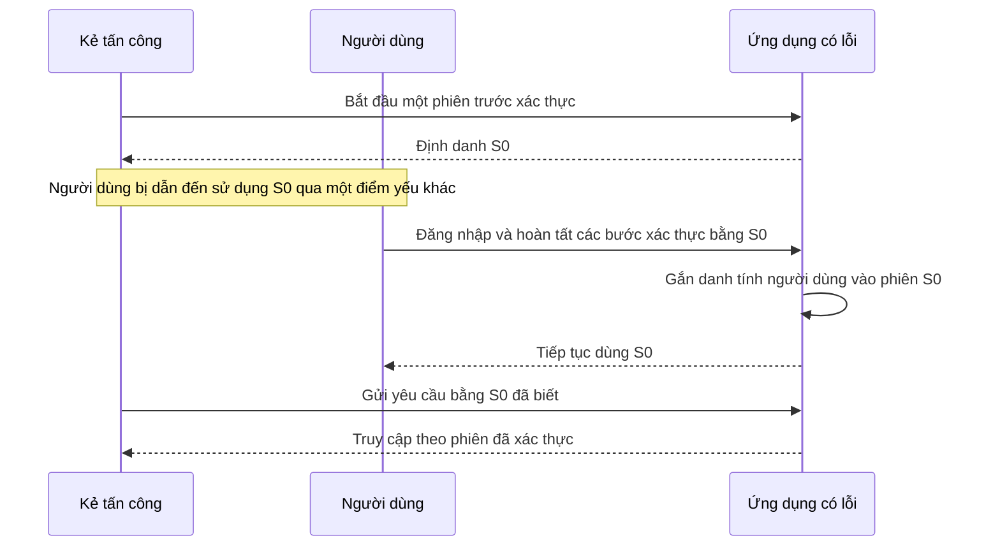

# Session fixation — Cố định định danh phiên

## 1. Session fixation là gì?

**Session fixation** là lỗi trong đó người dùng xác thực thành công nhưng hệ thống tiếp tục dùng một định danh phiên mà kẻ tấn công đã biết hoặc đã tác động để người dùng sử dụng từ trước. Khi quyền của người dùng được gắn vào phiên đó, kẻ tấn công có thể dùng lại định danh đã biết để truy cập dưới danh tính của người dùng.

Ví dụ, cổng quản trị tạo một phiên ẩn danh khi người dùng mở trang đăng nhập. Nếu định danh phiên trước đăng nhập đã được kẻ tấn công biết và backend giữ nguyên nó sau khi người dùng hoàn tất mật khẩu cùng MFA, phiên đã xác thực có thể tiếp tục truy cập được bằng định danh cũ.

Điểm sai không nằm ở việc ứng dụng có phiên ẩn danh. Phiên trước xác thực có thể cần cho giỏ hàng, ngôn ngữ hoặc giao dịch đăng nhập. Sai sót xảy ra khi hệ thống đưa phiên đã biết vào trạng thái có quyền cao hơn mà không đổi định danh và xử lý quyền truy cập qua định danh cũ.

Trong IAM, bảo vệ quá trình xác thực chưa đủ nếu kết quả xác thực bị gắn vào một phiên không được bảo vệ. Quản lý phiên cần phối hợp với MFA, SSO, recovery, RBAC, ABAC và nguyên tắc ít quyền nhất.

Sau bài học, người học có thể:

- Phân biệt session fixation với đánh cắp phiên và CSRF.
- Mô tả điều kiện làm định danh trước đăng nhập trở thành đường chiếm phiên.
- Xác định ranh giới cần thay đổi session ID.
- Áp dụng cơ chế phù hợp của Jakarta Servlet và Spring Security.
- Thiết kế kiểm chứng rằng định danh cũ không nhận được quyền của phiên mới.

## 2. Phân biệt các vấn đề liên quan

| Vấn đề | Đặc điểm chính | Câu hỏi khi điều tra |
| --- | --- | --- |
| Session fixation | Kẻ tấn công biết hoặc tác động định danh trước khi nạn nhân xác thực | Phiên có được đổi định danh khi chuyển sang trạng thái đã xác thực không? |
| Session hijacking | Kẻ tấn công chiếm quyền dùng một phiên hợp lệ | Bí mật phiên đã bị lấy hoặc lạm dụng bằng cách nào? |
| CSRF | Trình duyệt bị dẫn đến gửi yêu cầu không mong muốn cùng quyền của người dùng | Backend có kiểm tra tính hợp lệ và ý định của yêu cầu thay đổi trạng thái không? |
| Login CSRF | Người dùng bị đưa vào phiên đăng nhập của một tài khoản do kẻ khác kiểm soát | Giao dịch đăng nhập có được bảo vệ và gắn đúng với trình duyệt khởi tạo không? |
| Đoán session ID | Kẻ tấn công tìm được định danh hợp lệ do giá trị dễ đoán | Định danh có được sinh an toàn và quản lý đúng không? |

Session fixation có thể dẫn đến chiếm phiên, nhưng không nhất thiết cần lấy một cookie đã xác thực từ trình duyệt nạn nhân. Chính việc định danh đã biết được giữ qua bước xác thực tạo ra rủi ro.

Một session ID dài và khó đoán không tự ngăn fixation: kẻ tấn công có thể đã biết một ID hợp lệ được server cấp, thay vì phải đoán nó.

## 3. Luồng lỗi và ranh giới cần bảo vệ

### 3.1. Luồng dễ bị fixation

Các ký hiệu `S0` và `S1` dưới đây chỉ là nhãn minh họa, không phải session ID để dùng thực tế.



Sơ đồ không giả định mọi liên kết đều có thể đặt cookie của mọi website. Kẻ tấn công cần một đường khiến định danh được chấp nhận trong ngữ cảnh của nạn nhân, chẳng hạn cơ chế tracking qua URL được ứng dụng hỗ trợ hoặc một điểm yếu kiểm soát cookie.

### 3.2. Kết quả cần đạt sau khi sửa

Khi xác thực thành công, ứng dụng chuyển sang định danh mới `S1`, do thành phần quản lý phiên đáng tin cậy tạo. Những yêu cầu trình `S0` không được nhận quyền xác thực hoặc quyền nâng mức của `S1`.

```text
Trước xác thực:
  S0 -> ngữ cảnh ẩn danh hoặc ngữ cảnh giới hạn

Sau xác thực:
  S1 -> danh tính đã xác minh, với quyền được chính sách cho phép
  S0 -> không còn truy cập được ngữ cảnh đã xác thực của S1
```

OWASP khuyến nghị thay session ID khi thay đổi mức đặc quyền, đặc biệt ở bước xác thực, và loại bỏ khả năng dùng ID cũ để truy cập phần được bảo vệ. Tham khảo [OWASP — Renew the Session ID After Any Privilege Level Change](https://cheatsheetseries.owasp.org/cheatsheets/Session_Management_Cheat_Sheet.html#renew-the-session-id-after-any-privilege-level-change).

### 3.3. MFA không tự sửa lỗi gắn phiên

Người dùng hợp lệ có thể tự hoàn tất mật khẩu, OTP hoặc passkey. Nếu backend sau đó gắn kết quả vào cùng `S0` mà kẻ tấn công biết, kẻ tấn công có thể hưởng trạng thái đã xác thực mà không trực tiếp thực hiện những bước đó.

MFA bảo vệ việc chứng minh danh tính; đổi và quản lý định danh phiên bảo vệ cách ứng dụng duy trì kết quả. Cả hai đều cần được tích hợp đúng.

## 4. Những điều kiện thường làm phát sinh lỗi

### 4.1. Chấp nhận định danh do client tùy ý chọn

Nếu server nhận một ID chưa từng cấp rồi tạo phiên có đúng ID đó, client có khả năng tác động vào không gian định danh. Một cơ chế quản lý phiên chặt chẽ không nên biến chuỗi tùy ý của request thành định danh được tin cậy.

Tuy nhiên, chỉ từ chối ID không hợp lệ vẫn chưa đủ. Fixation cũng có thể dùng một phiên hợp lệ đã được server tạo trước đó. Vẫn cần bảo vệ bước chuyển mức xác thực.

### 4.2. Dùng session ID trong URL hoặc tham số

Một số cơ chế theo dõi phiên có thể chấp nhận định danh từ URL, path parameter hoặc form thay vì chỉ cookie. Các đường này có thể làm định danh đi vào lịch sử trình duyệt, log hoặc liên kết được chia sẻ, đồng thời mở thêm khả năng client lựa chọn phiên.

Nếu ứng dụng chọn cookie làm cơ chế duy nhất, cần tắt hoặc từ chối những kênh thay thế không được hỗ trợ. Không chỉ sửa liên kết do frontend sinh ra trong khi backend vẫn nhận ID từ URL.

### 4.3. Cookie có phạm vi quá rộng hoặc bị ghi đè

Cookie được cấu hình cho nhiều subdomain có thể làm ranh giới giữa ứng dụng chính và các host khác trở nên khó kiểm soát. Một host phụ bị xâm phạm có thể ảnh hưởng đến cookie có phạm vi phù hợp; khả năng cụ thể phụ thuộc cấu hình và hành vi trình duyệt.

Ngoài ra, nhiều cookie trùng tên nhưng khác path hoặc domain có thể cùng xuất hiện trong request. Ứng dụng không nên dựa vào một giả định tùy ý rằng framework luôn chọn đúng cookie mong muốn.

### 4.4. Luồng xác thực tùy chỉnh bỏ qua cơ chế của framework

Một controller có thể kiểm tra đúng mật khẩu rồi tự ghi user ID vào session cũ. Nếu không gọi đúng cơ chế quản lý phiên, việc bật Spring Security ở phần khác của ứng dụng chưa chắc bảo vệ được controller này.

Những đường cần kiểm kê gồm đăng nhập thường, đăng nhập API dùng cookie, callback SSO, remember-me, hoàn tất recovery và hoàn tất MFA. Mỗi đường có thể tạo hoặc nâng mức một ngữ cảnh phiên.

## 5. Thiết kế chuyển trạng thái phiên an toàn

### 5.1. Xác định các mức trạng thái

Một mô hình minh họa có thể gồm:

```text
ANONYMOUS
  -> PRIMARY_CREDENTIAL_VERIFIED
  -> MFA_VERIFIED
  -> PRIVILEGED_ACTION_READY
```

Những nhãn này không phải chuẩn của một framework. Chúng giúp nhóm phát triển xác định bước nào làm tăng khả năng truy cập và cần kiểm soát định danh tương ứng.

Phiên đã kiểm tra mật khẩu nhưng chưa hoàn tất MFA không được có sẵn quyền nghiệp vụ vốn yêu cầu MFA. Khi hoàn tất MFA hoặc step-up làm tăng mức tin cậy của ngữ cảnh, cần xem xét đổi định danh hoặc cơ chế chuyển phiên tương đương để không đưa quyền mới vào một bí mật cũ đã biết.

### 5.2. Trình tự tại ranh giới xác thực

Một trình tự thiết kế:

1. Kiểm tra tính hợp lệ của giao dịch đăng nhập và các bằng chứng cần thiết.
2. Quyết định trạng thái xác thực thực sự đạt được.
3. Dùng cơ chế framework để thay định danh hoặc tạo phiên mới phù hợp.
4. Chỉ chuyển những dữ liệu trước xác thực được phép giữ.
5. Gắn ngữ cảnh danh tính và mức bảo đảm đã được xác minh.
6. Lưu trạng thái và gửi cookie mới trước khi response được hoàn tất.
7. Bảo đảm định danh cũ không truy cập được quyền của trạng thái mới.

Nếu bước đổi hoặc lưu phiên thất bại, không tiếp tục trả thành công như thể người dùng đã có phiên mới an toàn. Quyết định lỗi và rollback phải phù hợp với thư viện và kho phiên đang dùng.

### 5.3. Dữ liệu trước đăng nhập vẫn là dữ liệu cần kiểm tra

Đổi ID không có nghĩa mọi thuộc tính trong đối tượng session đã trở nên đáng tin. Một số cơ chế chỉ đổi khóa tra cứu và giữ nguyên attributes.

Ví dụ, ngôn ngữ hiển thị có thể được chuyển theo quy tắc cho phép. Nhưng các thuộc tính như `selectedTenant`, `requestedRole`, `returnUrl` hoặc `checkoutTarget` cần được kiểm tra lại theo mục đích. Người dùng chọn một tenant trước đăng nhập không có nghĩa họ có quyền truy cập tenant đó sau đăng nhập.

Không sao chép toàn bộ session ẩn danh vào phiên mới rồi coi những trường đó là dữ liệu đã được xác thực. Quyền và danh tính phải đến từ nguồn đáng tin cậy của hệ thống IAM.

## 6. Java Servlet và Spring Security

### 6.1. Đổi ID của phiên hiện tại

Jakarta Servlet có `HttpServletRequest.changeSessionId()` để đổi ID của phiên hiện có. Nếu không có phiên gắn với request, lời gọi này phát sinh `IllegalStateException`. Tham khảo [Jakarta Servlet — HttpServletRequest](https://jakarta.ee/specifications/servlet/6.1/apidocs/jakarta.servlet/jakarta/servlet/http/HttpServletRequest.html#changeSessionId()).

Đoạn Java sau chỉ minh họa lựa chọn cơ chế ở thời điểm đã xác minh thành công; nó chưa triển khai toàn bộ đăng nhập hoặc lưu security context:

```java
import jakarta.servlet.http.HttpServletRequest;
import jakarta.servlet.http.HttpSession;

public final class SessionTransition {
    private SessionTransition() {
    }

    public static HttpSession prepareAuthenticatedSession(
            HttpServletRequest request) {
        HttpSession existing = request.getSession(false);

        if (existing == null) {
            return request.getSession(true);
        }

        request.changeSessionId();
        return request.getSession(false);
    }
}
```

Chỉ gọi `request.getSession(true)` không bảo đảm đổi ID: nếu đã có session, API có thể trả lại chính session đó. Tương tự, đổi ID không tự xóa các thuộc tính cũ hoặc tự tính lại quyền.

Nếu thiết kế dùng `invalidate()` rồi tạo phiên mới, cần xác định cách chuyển dữ liệu được phép và ảnh hưởng đến các thành phần giữ tham chiếu session. Không tự viết thêm một lớp sinh session ID nếu container đã có cơ chế phù hợp.

### 6.2. Dùng cơ chế session fixation của Spring Security

Với luồng xác thực Servlet do Spring Security xử lý, có thể thể hiện rõ chiến lược trong cấu hình:

```java
http.sessionManagement(session -> session
        .sessionFixation(fixation -> fixation.changeSessionId()));
```

Đây là đoạn cấu hình bên trong phần xây dựng `SecurityFilterChain`, không phải cấu hình bảo mật đầy đủ. Tài liệu Spring mô tả `changeSessionId` là chiến lược dùng cơ chế Servlet, đồng thời còn có lựa chọn tạo session mới và migration theo nhu cầu. Xem [Spring Security — Session Fixation Attack Protection](https://docs.spring.io/spring-security/reference/servlet/authentication/session-management.html#understanding-session-fixation-attack-protection).

Điểm cần kiểm tra là chiến lược này có thực sự được thực hiện trên đường đăng nhập đang dùng hay không. Việc có đoạn DSL trong một filter chain không chứng minh controller xác thực thủ công đã gọi đúng thành phần quản lý phiên.

Trong cơ chế xác thực tùy chỉnh, cần tích hợp `SessionAuthenticationStrategy` và lưu security context qua `SecurityContextRepository` theo luồng được framework hỗ trợ. Chỉ đặt `Authentication` vào một biến thread-local không tự hoàn tất các trách nhiệm này.

Ví dụ thực tế cần phân biệt đăng nhập qua filter tiêu chuẩn với một endpoint JSON tự viết. Kiểm chứng cả hai nếu cả hai đều tạo phiên dùng cookie. Không giả định đường thứ hai thừa hưởng đầy đủ hành vi của đường thứ nhất.

## 7. Cookie và kênh truyền: các lớp bảo vệ bổ sung

Cookie minh họa cho một ứng dụng HTTPS:

```http
Set-Cookie: __Host-SID=opaque-session-value; Path=/; Secure; HttpOnly; SameSite=Lax
Cache-Control: no-store
```

`opaque-session-value` chỉ là placeholder. Giá trị thật phải được thành phần quản lý phiên tạo và bảo vệ, không dùng chuỗi trong ví dụ.

| Thuộc tính hoặc lựa chọn | Mục đích | Giới hạn cần nhớ |
| --- | --- | --- |
| `Secure` | Hạn chế gửi cookie qua kết nối không được bảo vệ | Không thay thế đổi ID khi xác thực |
| `HttpOnly` | Hạn chế JavaScript đọc cookie qua API cookie | Không chặn mọi hành động do XSS gây ra |
| `SameSite` | Kiểm soát một số trường hợp gửi cookie theo ngữ cảnh site | Cần phù hợp luồng SSO và không thay thế bảo vệ CSRF |
| Không đặt `Domain` nếu không cần | Thu hẹp phạm vi cookie theo host | Vẫn cần kiểm soát ứng dụng và các đường nhận ID |
| Tiền tố `__Host-` | Trình duyệt hỗ trợ yêu cầu HTTPS, `Secure`, `Path=/` và không có `Domain` | Không thay thế kiểm tra và vòng đời phiên tại server |

Tham khảo [MDN — Set-Cookie và cookie prefixes](https://developer.mozilla.org/en-US/docs/Web/HTTP/Reference/Headers/Set-Cookie#cookie_prefixes).

`SameSite=Lax` là lựa chọn minh họa, không phải cấu hình dùng được cho mọi tích hợp SSO. Cần kiểm tra phương thức callback và ngữ cảnh chuyển hướng thực tế. Thay thuộc tính cookie để sửa một lỗi tích hợp cũng cần đánh giá lại tác động bảo mật.

TLS giúp bảo vệ kênh truyền, nhưng một ID đã được kẻ tấn công biết trước vẫn có thể được giữ qua đăng nhập trên HTTPS nếu ứng dụng không đổi nó. Tương tự, `HttpOnly` không sửa lỗi backend gắn danh tính vào phiên cũ.

## 8. Nhiều request, nhiều node và kho phiên dùng chung

### 8.1. Định danh cũ không được trở thành bí danh có quyền

Một cách triển khai có vẻ thuận tiện là chuyển mọi request mang `S0` sang `S1` sau đăng nhập. Nếu `S0` vốn đã bị kẻ tấn công biết, cơ chế chuyển tiếp này có thể giữ nguyên đường truy cập trái phép.

Tại ranh giới từ ẩn danh sang xác thực hoặc nâng quyền, yêu cầu quan trọng là `S0` không truy cập được trạng thái quyền mới. Không dùng một khoảng chấp nhận ID cũ như ngoại lệ mặc định cho ranh giới này.

Các chính sách đổi ID định kỳ trong một phiên đã xác thực có thể có cách xử lý cạnh tranh riêng. Không sao chép cơ chế tương thích đó sang bước đăng nhập mà không phân tích mối đe dọa fixation.

### 8.2. Kho phiên phân tán

Nếu ứng dụng chạy nhiều node, việc đổi định danh cần có hiệu lực ở nơi xử lý request tiếp theo. Một node không được tiếp tục phục vụ mapping cũ với trạng thái đã xác thực chỉ vì dữ liệu chưa được cập nhật.

Những câu hỏi thiết kế cần được giải đáp:

- ID mới và trạng thái xác thực được ghi theo thứ tự nào?
- Mapping cũ bị xóa hoặc mất quyền truy cập ở những node nào?
- Cache cục bộ có thể tiếp tục dùng dữ liệu cũ không?
- Request đang chạy với ID cũ có thể ghi đè trạng thái sau khi đổi ID không?
- Khi response chứa cookie mới bị mất, hệ thống có vô tình phục hồi quyền qua ID cũ không?

Ưu tiên cơ chế phiên của framework và kho dữ liệu có hỗ trợ phù hợp. Với code tùy chỉnh, cần thiết kế phiên bản trạng thái, cập nhật có điều kiện hoặc cơ chế đồng bộ tương ứng, rồi kiểm chứng hành vi thực tế.

### 8.3. Nhiều tab và response về không đúng thứ tự

Các tab cùng trình duyệt thường chia sẻ cookie. Một request nền bắt đầu trước đăng nhập có thể kết thúc sau response đăng nhập. Nếu response cũ ghi lại cookie không phù hợp, người dùng có thể mất phiên hoặc bị đưa vào trạng thái khó dự đoán.

Cách giải quyết không phải là cho ID cũ tiếp tục dùng toàn bộ quyền. Cần kiểm soát thời điểm ghi cookie, hành vi khi nhận ID đã lỗi thời và các request được phép chuyển trạng thái phiên.

## 9. SSO, MFA, recovery và token

### 9.1. Phiên tại IdP và phiên của ứng dụng

Trong SSO, IdP có thể xác thực người dùng đúng cách, nhưng ứng dụng vẫn phải quản lý phiên local khi xử lý callback. Nếu ứng dụng gắn principal từ IdP vào một session ẩn danh đã biết mà không bảo vệ quá trình chuyển trạng thái, kết quả SSO hợp lệ không tự loại bỏ fixation tại ứng dụng.

Giao dịch callback cũng cần được gắn đúng với giao dịch đăng nhập hợp lệ. Bảo vệ phiên local và bảo vệ giao dịch federation là hai trách nhiệm liên quan nhưng khác nhau.

### 9.2. Trạng thái MFA chưa hoàn tất

Sau khi kiểm tra yếu tố đầu tiên, hệ thống có thể giữ trạng thái trung gian để người dùng hoàn tất MFA. Trạng thái đó cần phạm vi quyền rõ ràng và không được truy cập các API vốn yêu cầu MFA đầy đủ.

Khi hoàn tất MFA hoặc chuyển từ phiên recovery sang phiên nghiệp vụ, cần bảo vệ ranh giới tin cậy tương ứng. Việc đặt thêm một cờ `mfa=true` vào session cũ chưa đủ nếu ID của nó đã bị kẻ khác biết.

### 9.3. JWT không tự loại bỏ mọi biến thể của vấn đề

JWT có chữ ký có thể bảo vệ tính toàn vẹn của token, nhưng toàn bộ luồng vẫn có thể có session cookie ở BFF, IdP hoặc thành phần quản lý đăng nhập. Cần xác định bí mật nào thực sự mở quyền truy cập ở mỗi tầng.

Nếu hệ thống dùng token ẩn danh và token đã xác thực, token cũ không được nhận quyền mới chỉ vì server đã cập nhật một mapping chung. Thay `jti` hoặc phát hành JWT mới cũng không tự thu hồi một token cũ vốn đang có quyền; phải đánh giá theo cách xác minh và thu hồi thực tế.

## 10. Kiểm chứng bằng hai ngữ cảnh độc lập

### 10.1. Kịch bản phòng vệ trong môi trường thử nghiệm

Một phép kiểm chứng có ích dùng hai client độc lập trên ứng dụng thử nghiệm do nhóm kiểm soát:

1. Client A nhận một phiên ẩn danh `S0`.
2. Trong phạm vi kiểm thử, client B bắt đầu từ chính trạng thái phiên trước đăng nhập đó.
3. B xác thực bằng tài khoản thử nghiệm và hoàn tất MFA nếu luồng yêu cầu.
4. Xác nhận B được chuyển sang định danh khác `S1`.
5. A tiếp tục trình `S0` khi truy cập tài nguyên được bảo vệ.
6. Xác nhận A không nhận danh tính, dữ liệu hoặc quyền của B.
7. Xác nhận B dùng `S1` vẫn có hành vi đúng với quyền được cấp.

Phản hồi cho A có thể là yêu cầu đăng nhập, redirect hoặc một phiên ẩn danh mới theo thiết kế. Điều cần kiểm tra là không có quyền của B, thay vì chỉ ép mọi framework trả cùng một HTTP status.

Không dùng một cookie jar duy nhất cho cả A và B: client có thể tự nhận cookie mới, khiến phép kiểm tra vô tình bỏ qua ID cũ. Đồng thời, kiểm tra chuỗi ID khác nhau là cần thiết nhưng chưa đủ; phải kiểm tra quyền truy cập bằng ID cũ.

Đây là mô tả phép kiểm chứng, không phải kết quả đã chạy một ứng dụng.

### 10.2. Những trường hợp cần bao phủ

| Tình huống | Điều kiện cần xác minh |
| --- | --- |
| Đăng nhập khi đã có phiên ẩn danh | Có đổi định danh phù hợp và ID cũ không truy cập quyền mới |
| Đăng nhập khi chưa có phiên | Tạo phiên qua cơ chế đáng tin cậy |
| Client gửi ID chưa được server cấp | Không biến chuỗi tùy ý thành phiên được tin cậy |
| ID được đưa qua URL khi ứng dụng chỉ dùng cookie | Không chấp nhận kênh thay thế ngoài chính sách |
| Hoàn tất MFA hoặc step-up | Không nâng quyền của một định danh đã biết theo cách không được bảo vệ |
| Callback SSO | Phiên local cũng được xử lý tại ranh giới xác thực |
| Endpoint xác thực thủ công | Gọi đúng cơ chế quản lý phiên và lưu security context |
| ID cũ được gửi đến node khác | Không phục hồi quyền qua mapping hoặc cache cũ |
| Hai request đồng thời lúc đăng nhập | Không ghi lại trạng thái quyền theo ID đã bị thay thế |
| Có cookie trùng tên khác phạm vi | Hành vi phân tích cookie không tạo đường chọn phiên ngoài ý muốn |
| Chuyển thuộc tính từ phiên ẩn danh | Không tin role, tenant hoặc đích thao tác chỉ vì dữ liệu nằm trong session |
| Logout và đăng nhập tài khoản khác | Không giữ principal hoặc quyền của tài khoản trước |

Với Java, kiểm thử ở mức mock có thể giúp xác nhận luồng gọi API nhưng không thay thế kiểm thử trên container và kho phiên thực tế. Việc đổi cookie, xóa mapping cũ và đồng bộ giữa các node là hành vi cần quan sát tại tầng tích hợp.

## 11. Quan sát vận hành và câu hỏi tự kiểm tra

### 11.1. Ghi sự kiện, không ghi bí mật phiên

Hệ thống có thể ghi các sự kiện tạo phiên, thay định danh, đăng nhập, nâng mức và kết thúc phiên. Một ví dụ metadata:

```text
event_type: SESSION_SECURITY_TRANSITION
transition: ANONYMOUS_TO_AUTHENTICATED
subject_id: internal-subject-id
session_audit_reference: opaque-audit-reference
rotation_result: SUCCESS
authentication_flow: FORM_LOGIN
correlation_id: opaque-request-reference
```

Audit reference là định danh đối chiếu riêng, không phải session ID có thể được dùng để truy cập. Không ghi cookie, session ID thô, access token hoặc toàn bộ header xác thực vào log, trace và báo cáo lỗi.

Một sự kiện “đã đăng nhập” không đủ để chứng minh session fixation đã được xử lý. Cần kiểm chứng riêng quá trình chuyển định danh và hành vi khi dùng ID cũ.

### 11.2. Những hiểu nhầm cần tránh

**Session ID rất dài có ngăn fixation không?** Độ khó đoán bảo vệ trước đoán ID. Fixation còn có thể dùng một ID hợp lệ mà kẻ tấn công đã biết, nên vẫn cần bảo vệ bước chuyển phiên.

**Có HTTPS và HttpOnly thì đã đủ chưa?** Chưa. Các thuộc tính này bảo vệ những mặt khác của kênh và cookie, nhưng không tự đổi cách backend gắn danh tính vào phiên.

**Gọi `getSession(true)` sau đăng nhập có tạo ID mới không?** Không bảo đảm nếu request đã có session. Cần dùng cơ chế đổi hoặc thay phiên phù hợp.

**Đổi ID có xóa mọi dữ liệu cũ không?** Không nhất thiết. Cần hiểu chiến lược giữ attributes và kiểm tra dữ liệu trước xác thực được chuyển tiếp.

**Bật Spring Security có bảo vệ mọi controller đăng nhập tự viết không?** Không thể kết luận chỉ từ việc framework đã có mặt. Cần kiểm tra đường xác thực đó có thực hiện session strategy và lưu context đúng cách không.

**Chỉ cần xác nhận ID mới khác ID cũ trong test là đủ?** Chưa. Cần xác nhận ID cũ không tiếp tục truy cập trạng thái đã xác thực, kể cả qua node khác hoặc cơ chế chuyển tiếp.

### 11.3. Bài tập thiết kế

Một ứng dụng có trang đăng nhập truyền thống, endpoint JSON tự kiểm tra mật khẩu và callback SSO. Cả ba đều lưu thông tin người dùng vào `HttpSession`. Ứng dụng chạy trên hai node dùng kho phiên chung; trước đăng nhập có lưu tenant được người dùng chọn và một URL quay lại.

Hãy mô tả cách xác định ranh giới đổi phiên ở cả ba luồng, cách kiểm tra tenant cùng URL quay lại, cách đảm bảo ID cũ không nhận quyền trên node còn lại và phép kiểm chứng bằng hai client độc lập. Giải thích vì sao MFA thành công và việc có cookie `HttpOnly` chưa chứng minh ứng dụng đã chống session fixation.
