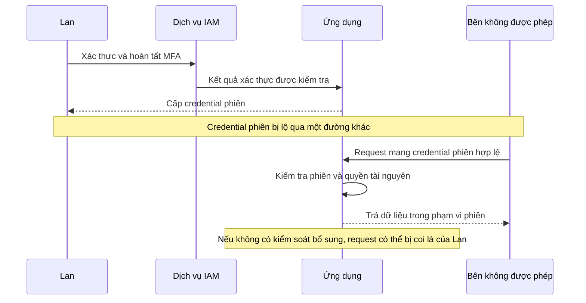

# Session hijacking — Chiếm quyền sử dụng phiên đăng nhập

## 1. Session hijacking là gì?

Session hijacking là việc bên không được phép sử dụng quyền truy cập của một phiên hợp lệ, thường bằng cách lấy được session ID hoặc token đại diện cho phiên. Máy chủ nhận credential phiên hợp lệ nhưng không nhận ra người đang sử dụng nó không phải chủ thể đã thực hiện xác thực ban đầu.

Trong nền tảng IAM, mật khẩu, MFA và phiên giải quyết các giai đoạn khác nhau. Mật khẩu hoặc authenticator giúp thiết lập danh tính trong một sự kiện xác thực; phiên cho phép tiếp tục truy cập mà không thực hiện lại toàn bộ sự kiện đó trên mỗi request.

Nếu credential phiên là bearer secret, bên giữ nó thường có thể sử dụng quyền mà nó đại diện cho đến khi hết hạn, bị thu hồi hoặc không còn đáp ứng điều kiện truy cập. MFA mạnh không tự ngăn việc sử dụng một phiên đã bị đánh cắp sau khi MFA hoàn tất.

Sau bài học, người học có thể phân biệt hijacking với fixation và CSRF, giải thích vai trò của thuộc tính cookie, thiết kế vòng đời phiên và đánh giá phạm vi thu hồi trong ứng dụng Java hoặc hệ thống OAuth/OIDC.

OWASP mô tả việc lộ, dự đoán hoặc cố định session ID là các nguyên nhân có thể dẫn đến chiếm phiên. Tham khảo [OWASP Session Management Cheat Sheet](https://cheatsheetseries.owasp.org/cheatsheets/Session_Management_Cheat_Sheet.html).

## 2. Phiên đại diện cho quyền gì trong hệ thống?

### 2.1. Session ID opaque và trạng thái server-side

Với session server-side, trình duyệt thường giữ một giá trị ngẫu nhiên trong cookie. Server dùng giá trị đó để tìm bản ghi phiên chứa subject, thời điểm xác thực và trạng thái liên quan.

```text
Trình duyệt: cookie __Host-session = <opaque-secret>
Máy chủ:     <opaque-secret> → phiên của subject u-104 trong tenant-7
```

Session ID không cần chứa email, role hoặc dữ liệu hồ sơ. Giá trị khó đoán chỉ bảo vệ trước việc đoán; nó không ngăn người đã lấy được giá trị đó sử dụng lại.

### 2.2. Token tự chứa dữ liệu

Một số kiến trúc dùng token chứa claim, ví dụ JWT được ký. Server kiểm tra token theo profile được hỗ trợ thay vì luôn tra một bản ghi phiên cho mỗi request.

Chữ ký bảo vệ tính toàn vẹn và nguồn phát; nó không bảo đảm người trình token là chủ thể ban đầu nếu token chỉ là bearer credential. JWT có chữ ký cũng không mặc nhiên được mã hóa bí mật.

### 2.3. Phiên không thay thế kiểm tra quyền

Một session hợp lệ chưa đủ để thực hiện mọi thao tác. API vẫn cần kiểm tra tenant, quyền RBAC/ABAC, tài nguyên, ngữ cảnh xác thực và các điều kiện bảo mật hiện hành.

Nếu session bị chiếm, nguyên tắc ít quyền nhất và kiểm tra tại tài nguyên có thể giới hạn phạm vi thiệt hại. Tuy nhiên, chúng không biến việc dùng phiên của nạn nhân thành truy cập hợp lệ về mặt chủ thể.

## 3. Một chuỗi chiếm phiên có thể diễn ra thế nào?

Giả sử Lan đăng nhập cổng học tập bằng mật khẩu và MFA. Ứng dụng tạo phiên cho phép duyệt nội dung. Sau đó credential phiên bị lộ qua một thành phần không được bảo vệ đúng.



Đối thủ không nhất thiết biết mật khẩu hay tạo được mã MFA. Họ tận dụng kết quả của lần xác thực trước. Nếu hệ thống chỉ yêu cầu MFA lúc login rồi giữ phiên rất lâu, khoảng thời gian có thể lạm dụng cũng có thể dài.

Một số đường lộ thường gặp:

- Credential được truyền qua kênh không được bảo vệ hoặc bị lộ ở một điểm kết thúc TLS.
- Script không tin cậy đọc token trong vùng lưu trữ mà JavaScript truy cập được.
- Session ID xuất hiện trong URL, access log, trace, ảnh chụp hoặc ticket hỗ trợ.
- Thiết bị, extension hoặc phần mềm trên máy người dùng bị compromise.
- Kho session hoặc backup chứa dữ liệu có thể dùng để lấy quyền phiên bị truy cập trái phép.
- Ứng dụng chấp nhận session ID do bên ngoài áp đặt và không đổi đúng lúc xác thực.

Hệ thống cần xác định đường lộ thực tế. Chỉ đổi thuộc tính cookie không khắc phục được mọi đường, nhất là khi credential đã được sao chép hoặc máy người dùng đã bị chiếm quyền.

## 4. Phân biệt hijacking, fixation, CSRF và XSS

| Khái niệm | Điều xảy ra | Quan hệ với chiếm phiên |
| --- | --- | --- |
| Session hijacking | Bên khác sử dụng quyền của phiên hợp lệ | Kết quả hoặc hành vi cần ngăn chặn |
| Session fixation | Đối thủ biết/áp đặt ID trước xác thực, rồi ID đó được giữ sau xác thực | Có thể tạo đường chiếm phiên |
| CSRF | Trình duyệt nạn nhân bị khiến gửi request có credential được đính kèm tự động | Không nhất thiết cần lấy được session ID |
| XSS | Mã không tin cậy chạy trong ngữ cảnh ứng dụng | Có thể đọc dữ liệu/token hoặc thao tác qua phiên của nạn nhân |
| Giả mạo token | Tạo hoặc sửa token được hệ thống chấp nhận sai | Khác với dùng lại token hợp lệ đã lấy được |

### 4.1. Vì sao HttpOnly không chặn toàn bộ XSS?

`HttpOnly` ngăn JavaScript truy cập cookie qua API như `document.cookie`. Nhưng script chạy trong origin ứng dụng vẫn có thể gửi request mà trình duyệt tự đính kèm cookie và đọc dữ liệu trong phạm vi được phép của trang.

Vì vậy, HttpOnly giúp giảm khả năng lấy cookie để dùng ngoài trình duyệt; nó không khiến một trang có XSS trở nên an toàn. Vẫn cần phòng chống XSS và kiểm soát thao tác nhạy cảm.

### 4.2. Vì sao CSRF không nhất thiết là đánh cắp cookie?

Trong CSRF, đối thủ có thể chỉ lợi dụng việc trình duyệt tự gửi cookie. Họ không cần đọc cookie hoặc tự tạo request từ một thiết bị khác. Điều đó giải thích vì sao thuộc tính bảo vệ tính bí mật cookie và cơ chế chống CSRF có vai trò khác nhau.

### 4.3. Vì sao xoay ID sau login quan trọng?

Nếu một ID anonymous đã được đối thủ biết lại trở thành ID phiên authenticated mà không thay đổi, đối thủ có thể tiếp tục dùng ID đó. Xoay ID ở ranh giới xác thực làm mất liên hệ có thể bị lạm dụng này khi được thực thi đúng ở server và kho phiên.

## 5. Bảo vệ việc sinh, truyền và lưu credential phiên

### 5.1. Dùng cơ chế session có sẵn và ID khó đoán

Ưu tiên cơ chế session của framework/container đã được duy trì thay vì tự ghép timestamp, username hoặc bộ đếm. Nếu một kiến trúc cần tự sinh opaque ID, có thể chọn 32 byte ngẫu nhiên mật mã làm chính sách thiết kế; không suy độ khó đoán chỉ từ chiều dài chuỗi.

Một chuỗi dài nhưng chứa phần lớn dữ liệu cố định có thể có ít entropy. Ngược lại, mã hóa Base64 không làm tăng lượng ngẫu nhiên đã được sinh.

Không nhận một ID tùy ý từ client rồi tự tạo phiên authenticated tương ứng. Với ID không được máy chủ nhận biết, xử lý như chưa có phiên theo cơ chế chuẩn; không lấy subject từ dữ liệu client gửi kèm.

### 5.2. Không đưa session ID vào URL

URL có thể bị giữ trong lịch sử, bookmark, access log và hệ thống giám sát. Dùng cookie hoặc cơ chế truyền credential đúng với kiến trúc, không đặt session ID vào query string hoặc path.

Trong Java web, cần hiểu và cấu hình cơ chế theo dõi phiên của container nếu có URL rewriting. Đừng chỉ đổi tên cookie rồi bỏ qua khả năng cùng session ID xuất hiện qua một đường truyền khác.

### 5.3. Bảo vệ cả các thành phần trung gian

HTTPS bảo vệ dữ liệu trên các chặng được cấu hình TLS; nó không ngăn proxy, APM hoặc ứng dụng ghi credential vào log sau khi đã nhận request. Tại nơi TLS được kết thúc, giới hạn người đọc dữ liệu và xử lý các chặng nội bộ theo mô hình tin cậy thực tế.

Khi đứng sau reverse proxy, chỉ tin header forwarded từ các proxy được cấu hình tin cậy. Việc cấu hình sai có thể ảnh hưởng cách ứng dụng nhận biết HTTPS, tạo URL hoặc đặt cookie. Không coi mọi `X-Forwarded-*` từ Internet là thông tin do hạ tầng cấp.

### 5.4. Bảo vệ kho phiên

Kho session là một thành phần bảo mật, không chỉ là cache hiệu năng. Giới hạn quyền đọc/ghi, bảo vệ backup và tránh dùng dữ liệu session thật cho môi trường phát triển.

Một tài khoản có quyền sửa trạng thái session có thể làm thay đổi subject hoặc các thuộc tính xác thực nếu thiết kế cho phép. Quyền ghi vì thế có thể nhạy cảm không kém quyền đọc ID. Không dùng session attributes từ request làm nguồn quyết định quyền mà chưa xác minh.

## 6. Cookie an toàn: mỗi thuộc tính giải quyết một vấn đề

Ví dụ cookie phiên cho ứng dụng web cùng site:

```http
Set-Cookie: __Host-session=<opaque-session-id>; Path=/; Secure; HttpOnly; SameSite=Lax
Cache-Control: no-store
```

`<opaque-session-id>` chỉ là ký hiệu minh họa, không phải một giá trị có thể dùng chung. Các thuộc tính cần được đặt ở mọi đường cấp/đổi cookie liên quan.

| Thuộc tính | Vai trò chính |
| --- | --- |
| `Secure` | Chỉ gửi cookie qua kênh HTTPS theo quy tắc trình duyệt |
| `HttpOnly` | Ngăn truy cập cookie trực tiếp từ JavaScript |
| `SameSite` | Kiểm soát việc gửi cookie trong ngữ cảnh cross-site |
| Bỏ `Domain` | Giữ cookie host-only thay vì chủ động chia sẻ cho miền con |
| `Path=/` với prefix `__Host-` | Thỏa ràng buộc của prefix được trình duyệt hỗ trợ |

Prefix `__Host-` yêu cầu Secure, Path=/ và không có Domain ở trình duyệt hỗ trợ. Nó giúp giới hạn cách cookie được đặt/phạm vi host; nó không ràng buộc cookie với một máy vật lý. Tham khảo [MDN — Set-Cookie](https://developer.mozilla.org/en-US/docs/Web/HTTP/Reference/Headers/Set-Cookie).

### 6.1. SameSite không thay mọi biện pháp chống CSRF

`Lax` và `Strict` có hành vi khác nhau; cần chọn theo luồng thực tế. Đặc biệt, không dùng GET để thực hiện thay đổi trạng thái chỉ vì nghĩ SameSite đã chặn mọi request từ bên ngoài.

Site cũng không đồng nghĩa origin. Một miền con bị compromise có thể tạo tình huống khác với một website hoàn toàn không liên quan. Việc chọn cookie host-only và bảo vệ các origin liên quan vẫn cần được xem xét.

Nếu một luồng hợp lệ cần cookie trong ngữ cảnh cross-site, `SameSite=None` cần đi cùng `Secure` trên trình duyệt hiện đại và các kiểm soát phù hợp. Các callback SSO hoặc biểu mẫu cross-site có thể chịu ảnh hưởng; không đặt `Strict` một cách máy móc rồi bỏ qua lỗi giao dịch xác thực.

### 6.2. Hết hạn cookie không phải toàn bộ hết hạn phiên

`Expires` hoặc `Max-Age` điều khiển việc giữ cookie ở trình duyệt. Máy chủ vẫn phải có thời hạn và trạng thái phiên độc lập. Đối thủ có thể đã sao chép credential và không bị buộc tuân theo bộ đếm ở giao diện người dùng.

Đóng trình duyệt cũng không nên được coi là bằng chứng phiên đã bị thu hồi ở server. Khôi phục phiên trình duyệt, nhiều thiết bị và các bản sao credential khiến giả định đó không đáng tin cậy.

## 7. Xoay session ID ở ranh giới xác thực và thay đổi đặc quyền

### 7.1. Anonymous và authenticated không nên dùng nguyên một ID dễ bị cố định

Khi người dùng hoàn tất xác thực, framework cần thực hiện cơ chế chống session fixation. Trong hệ thống nhiều bước, trạng thái chỉ mới xác minh mật khẩu phải được phân biệt với phiên đã hoàn tất MFA.

Không cấp quyền phiên cuối cùng quá sớm rồi chỉ thay đổi giao diện sau MFA. Tương tự, khi nâng lên một ngữ cảnh đặc quyền, cần quản lý lại session và bằng chứng theo thiết kế, không chỉ thêm một role vào đối tượng cũ.

### 7.2. Ví dụ Spring Security

Ví dụ sau minh họa cấu hình form login với chiến lược thay session ID của Servlet container. Nó là cấu hình cơ sở để giải thích fixation, chưa phải một hệ thống MFA hoặc cấu hình hoàn chỉnh cho mọi ứng dụng.

```java
import org.springframework.context.annotation.Bean;
import org.springframework.context.annotation.Configuration;
import org.springframework.security.config.Customizer;
import org.springframework.security.config.annotation.web.builders.HttpSecurity;
import org.springframework.security.config.annotation.web.configuration.EnableWebSecurity;
import org.springframework.security.web.SecurityFilterChain;

@Configuration
@EnableWebSecurity
public class WebSecurityConfig {
    @Bean
    SecurityFilterChain securityFilterChain(HttpSecurity http) throws Exception {
        http
            .authorizeHttpRequests(authorize -> authorize
                .requestMatchers("/login", "/error").permitAll()
                .anyRequest().authenticated())
            .formLogin(Customizer.withDefaults())
            .sessionManagement(session -> session
                .sessionFixation(fixation -> fixation.changeSessionId()));
        return http.build();
    }
}
```

`changeSessionId()` sử dụng chức năng của Servlet container để thay ID, giữ session attributes. Spring Security hỗ trợ chiến lược này và thường đã có bảo vệ fixation theo cấu hình/container phù hợp; không cần tự tạo ID ngẫu nhiên rồi ghi đè cookie bên ngoài cơ chế framework. Xem [Spring Security — Session Fixation Protection](https://docs.spring.io/spring-security/reference/servlet/authentication/session-management.html#ns-session-fixation).

Cấu hình ví dụ không đặt thuộc tính cookie của container, timeout toàn hệ thống hoặc chính sách thu hồi token. Các phần đó phải được cấu hình ở thành phần quản lý tương ứng. Với filter/controller xác thực tự viết, cần tích hợp đúng chiến lược session và lưu security context theo framework, không chỉ gán một thuộc tính tên `user`.

### 7.3. Xử lý thuộc tính và request đồng thời

Thay ID mà giữ mọi thuộc tính không tự làm dữ liệu trước xác thực trở nên đáng tin cậy. Chỉ chuyển tiếp các dữ liệu phù hợp, không giữ role, subject hoặc cờ xác thực do request trước đó tự đặt.

Khi nhiều request chạy đồng thời, kho phiên và các node phải thống nhất ID nào còn hiệu lực. Nếu có khoảng chuyển tiếp để tránh làm hỏng request hợp lệ, khoảng đó cần được giới hạn và đánh giá về replay; không giữ ID cũ như một bí danh có quyền lâu dài.

Rotation không phải cách chắc chắn đuổi một đối thủ đã kiểm soát hoạt động trong phiên. Nếu đối thủ vẫn có thể nhận credential mới hoặc dùng trình duyệt nạn nhân, họ có thể tiếp tục. Khi nghi chiếm phiên, cần thu hồi và xác thực lại phù hợp, đồng thời xử lý đường compromise.

## 8. Hạn chế thời gian và phạm vi lạm dụng phiên

### 8.1. Idle timeout và overall timeout

Idle timeout giới hạn thời gian không có hoạt động được tính là hợp lệ. Overall timeout giới hạn thời gian kể từ mốc xác thực hoặc tái xác thực được chính sách chấp nhận. Hoạt động thông thường không nên tự kéo dài vô hạn overall timeout.

Ví dụ một profile sản phẩm có thể chọn idle 20 phút và overall 8 giờ. Đây là số minh họa, không phải yêu cầu cho mọi mức bảo đảm. Với thao tác đặc quyền, yêu cầu độ mới của lần xác thực có thể ngắn hơn nhiều thời gian sống của phiên.

Một phép kiểm tra khái niệm:

```text
session hợp lệ khi:
    chưa bị thu hồi
    AND server_now < overall_expires_at
    AND server_now < last_accepted_activity_at + idle_limit
    AND phiên bản bảo mật còn được chấp nhận
```

Các mốc do server quản lý. Không dùng một đồng hồ đếm ngược ở frontend làm nguồn quyết định. Việc dọn key hết hạn trong Redis hoặc tác vụ cleanup cũng không thay thế kiểm tra hiệu lực trước khi cho request truy cập.

NIST phân biệt timeout không hoạt động và timeout tổng thể, cùng điều kiện tái xác thực theo bối cảnh. Xem [NIST SP 800-63B-4 — Reauthentication](https://pages.nist.gov/800-63-4/sp800-63b/session/).

### 8.2. Hoạt động của đối thủ có thể giữ idle timeout chưa hết

Idle timeout không bảo đảm một credential bị lấy cắp sẽ sớm hết hiệu lực nếu đối thủ tiếp tục tạo request. Các polling nền cũng có thể làm khó việc xác định sự hiện diện thật của người dùng.

Cần xác định loại hoạt động nào cập nhật mốc idle, kết hợp thời hạn tổng thể và yêu cầu xác thực lại cho thao tác nhạy cảm. Không mặc định rằng mỗi request nền là một bằng chứng chủ tài khoản vẫn đang sử dụng thiết bị.

### 8.3. Kiểm tra lại khi thay đổi trạng thái bảo mật

Khi tài khoản bị đình chỉ, role bị thu hồi, authenticator bị báo mất hoặc recovery hoàn tất, trạng thái session có thể cần bị hạn chế hoặc vô hiệu hóa theo chính sách. Không chờ đến lần login kế tiếp mới phản ánh một quyết định thu hồi quan trọng.

Với WebSocket, stream hoặc kết nối dài, chỉ xác thực lúc bắt đầu kết nối có thể để lại quyền truy cập sau lúc phiên bị thu hồi. Thiết kế cần có cơ chế kiểm tra hoặc đóng kết nối phù hợp với tài nguyên và độ trễ thu hồi yêu cầu.

## 9. Logout và thu hồi phải tác động ở phía thực thi quyền

### 9.1. Xóa cookie chỉ xử lý bản sao trong trình duyệt đó

Nếu ứng dụng chỉ xóa cookie khi logout nhưng để bản ghi session còn hiệu lực, một bản sao session ID vẫn có thể được dùng ở nơi khác. Logout cần vô hiệu hóa trạng thái server phù hợp và xóa cookie ở đúng tên, path và phạm vi đã đặt.

Một thao tác logout có thay đổi trạng thái nên dùng cơ chế phù hợp, có kiểm soát CSRF theo framework, thay vì dựa vào một GET không được bảo vệ. Không chỉ đặt lại biến frontend hoặc chuyển người dùng về trang đăng nhập.

### 9.2. Một phiên và tất cả phiên là hai phạm vi

Người dùng có thể cần “đăng xuất thiết bị này”, “đăng xuất thiết bị bị mất” hoặc “đăng xuất tất cả thiết bị”. Mỗi lựa chọn cần xác định tập session/token bị ảnh hưởng, quyền thực hiện và cách thông báo.

Có thể dùng một phiên bản bảo mật ở cấp tài khoản để từ chối các phiên có version cũ. Tuy nhiên, mọi điểm xác minh cần thực sự kiểm tra hoặc nhận được trạng thái đó. Cache cũ và việc lan truyền không đồng bộ có thể tạo cửa sổ tiếp tục truy cập.

### 9.3. Các request đã bắt đầu

Thu hồi phiên không tự hoàn tác một request đã được chấp nhận hoặc một giao dịch nghiệp vụ đã commit. Với thao tác có hậu quả lớn, cần thiết kế điểm kiểm tra quyền/trạng thái phù hợp trong quá trình thực hiện, không chỉ lúc vào gateway.

Nếu phát hiện thao tác trái phép đã hoàn tất, xử lý bằng quy trình nghiệp vụ và sự cố riêng; không coi một lần logout thành bằng chứng đã xóa mọi tác động của hijacking.

## 10. Phòng XSS/CSRF và giảm việc lộ token ở frontend

### Kiểm soát mã chạy trong origin

Dùng escape theo đúng ngữ cảnh, cơ chế template an toàn và sanitize nội dung HTML không tin cậy khi cần hỗ trợ rich text. Hạn chế script bên thứ ba và xem xét Content Security Policy như một lớp bổ sung, không thay thế việc sửa lỗi XSS.

Với ứng dụng dùng cookie, giữ cơ chế chống CSRF cho các thao tác có thay đổi trạng thái theo mô hình framework. SameSite hữu ích nhưng không thay việc hiểu các origin/site liên quan và những luồng hợp lệ cần gửi credential.

### Chọn nơi giữ credential theo kiến trúc

Token trong `localStorage` hoặc vùng lưu trữ JavaScript truy cập được có thể bị đọc nếu origin bị XSS. Chuyển sang cookie HttpOnly giảm một số đường trích xuất, nhưng trình duyệt vẫn có thể gửi request với cookie và cần bảo vệ CSRF/XSS tương ứng.

Một backend-for-frontend có thể giữ access/refresh token ở server khi browser không cần trực tiếp quản lý chúng. Khi đó cookie giữa browser và backend vẫn là credential phiên cần bảo vệ; việc giữ OAuth token ở server không xóa rủi ro chiếm phiên web.

### Giảm dữ liệu credential đi vào công cụ hỗ trợ

Không thu thập cookie, Authorization header hoặc token từ request body vào analytics/APM theo mặc định. Session replay và công cụ quay lại màn hình có thể ghi dữ liệu nhạy cảm; cần kiểm soát phạm vi thu thập và masking.

Không yêu cầu người dùng gửi nguyên cookie hoặc token để hỗ trợ. Dùng request ID hoặc một mã tham chiếu audit riêng, không có khả năng cấp quyền truy cập.

## 11. Session hijacking trong hệ thống OAuth/OIDC

### 11.1. Phân biệt cookie ứng dụng, access token và refresh token

| Credential | Nơi sử dụng chính | Hậu quả nếu bị lộ |
| --- | --- | --- |
| Cookie phiên ứng dụng | Browser đến ứng dụng | Có thể sử dụng phiên tại ứng dụng |
| Access token | Client đến resource server đúng audience | Có thể truy cập tài nguyên trong scope/điều kiện token |
| Refresh token | Client đến authorization server | Có thể tạo access token mới nếu đáp ứng điều kiện sử dụng |

ID Token phục vụ việc relying party xác minh kết quả xác thực theo OIDC, không được dùng thay access token cho API chỉ vì nó chứa subject. Mỗi credential cần đúng đối tượng nhận, mục đích và cách kiểm tra.

Phiên IdP và phiên ứng dụng relying party cũng có vòng đời riêng. Đăng xuất ở một bên không tự chứng minh mọi phiên ở các bên khác đã kết thúc. Cần cơ chế liên kết logout/thu hồi hoặc chính sách phiên thực tế đã triển khai.

### 11.2. JWT hợp lệ vẫn có thể là token đã bị đánh cắp

Resource server cần xác minh chữ ký, issuer, audience, hạn dùng và các điều kiện theo profile. Các kiểm tra này loại bỏ nhiều token không hợp lệ nhưng không tự phân biệt người giữ bearer token hợp lệ là chủ thể hay đối thủ.

Token sống ngắn làm giảm một cửa sổ sử dụng, không tự thu hồi token ngay khi sự cố được báo. Nếu cần vô hiệu hóa trước hạn, thiết kế phải có cơ chế trạng thái, introspection hoặc thu hồi được thực thi phù hợp.

### 11.3. Refresh token rotation và phát hiện replay

Với rotation, mỗi lần đổi refresh token tạo giá trị mới và giá trị trước không tiếp tục được dùng như token hiện hành. Quan hệ giữa các token giúp authorization server phát hiện việc sử dụng lại token đã thay thế và xử lý grant/token liên quan.

Việc đổi trạng thái cần chống request đồng thời và có quy tắc retry rõ ràng; không chấp nhận token cũ vô hạn chỉ để tránh lỗi khi nhiều tab hoạt động. Thu hồi refresh token cũng không tự thu hồi mọi access token đã phát nếu resource server chưa có cơ chế liên quan.

RFC 9700 nêu các kiểm soát bảo vệ refresh token, gồm rotation hoặc sender-constraining cho public client theo yêu cầu của tài liệu. Tham khảo [RFC 9700 — Refresh Token Protection](https://www.rfc-editor.org/rfc/rfc9700.html#section-4.14).

### 11.4. Sender-constrained token không phải gắn IP

Cơ chế như DPoP ràng buộc việc dùng token với bằng chứng sở hữu khóa, khi cả các thành phần liên quan triển khai đúng. Token bị trích xuất riêng có thể không đủ để sử dụng ở nơi khác.

Điều này khác với so sánh IP hoặc User-Agent. Nếu đối thủ chạy được mã trong ngữ cảnh client và sử dụng được khóa ký, rủi ro vẫn còn. DPoP cũng không tự áp dụng cho một cookie phiên thông thường chỉ bằng cách bật một header. Xem [RFC 9449 — OAuth DPoP](https://www.rfc-editor.org/rfc/rfc9449.html).

## 12. Phát hiện bất thường và phản ứng khi nghi chiếm phiên

### 12.1. Tín hiệu phải được đánh giá theo ngữ cảnh

Một session xuất hiện từ các môi trường rất khác nhau trong thời gian ngắn, có thay đổi hành vi bất thường hoặc thực hiện thao tác đặc quyền ngoài thông lệ có thể cần được kiểm tra.

Tuy nhiên, IP thay đổi không tự chứng minh chiếm phiên: người dùng có thể chuyển mạng di động, dùng VPN hoặc đi qua proxy. User-Agent cũng có thể được sao chép. Không gọi các tín hiệu này là ràng buộc mật mã hoặc căn cứ duy nhất để xác định người dùng.

Có thể kết hợp tín hiệu rủi ro với tái xác thực, hạn chế thao tác nhạy cảm hoặc thu hồi phiên theo chính sách. Với hành động có hậu quả lớn, một authenticator phù hợp và đủ mới có giá trị khác với một heuristic trình duyệt.

### 12.2. Audit không được trở thành nguồn lộ session mới

Log có thể giữ các sự kiện tạo phiên, thay ID, xác thực lại, thu hồi, hết hạn và từ chối do version cũ. Dùng một ID audit riêng hoặc tham chiếu được thiết kế không có khả năng đăng nhập.

Không ghi session ID, cookie header, access token hoặc refresh token bản rõ. Các dữ liệu như account ID, IP và thiết bị cũng cần quyền truy cập/thời gian lưu phù hợp. Dashboard nội bộ không nên mở cho mọi người chỉ vì không phải API công khai.

### 12.3. Phạm vi xử lý sự cố

Khi có bằng chứng hoặc nghi ngờ phù hợp, một quy trình có thể gồm:

1. Xác định session, tài khoản, tenant và khoảng thời gian liên quan bằng dữ liệu audit an toàn.
2. Thu hồi credential phiên/token theo phạm vi được phép, kiểm tra việc lan truyền đến nơi thực thi.
3. Yêu cầu xác thực lại và xử lý credential gốc nếu cũng bị compromise; không mặc định đổi mật khẩu là đủ.
4. Điều tra đường lộ như XSS, log, thiết bị hoặc kho phiên và khắc phục nguyên nhân.
5. Đánh giá các thao tác/dữ liệu đã bị truy cập, thông báo qua kênh phù hợp và theo dõi sau sự cố.

Không tự xoay khóa ký toàn hệ thống chỉ vì một bearer token riêng lẻ bị lộ; đó là phạm vi khác và chỉ phù hợp khi bằng chứng sự cố liên quan đến khóa hoặc quyết định xử lý đã được xác định. Phản ứng cần đúng nguyên nhân và tập đối tượng bị ảnh hưởng.

## 13. Tình huống vận dụng và điểm cần kiểm chứng

Một cổng học tập dùng mật khẩu và MFA lúc đăng nhập, lưu session bằng cookie HttpOnly. Session sống nhiều ngày, logout chỉ xóa cookie ở browser. Ứng dụng ghi toàn bộ header request vào APM để hỗ trợ vận hành.

Thiết kế này vẫn có đường chiếm phiên: người có quyền đọc APM có thể thấy credential nếu không được loại bỏ, và bản sao có thể còn dùng được sau khi người dùng logout. MFA và HttpOnly không xử lý trực tiếp đường lộ này.

Một phương án cải thiện cần bao phủ nguồn lộ, trạng thái server và tài nguyên, thay vì chỉ thêm một thuộc tính cookie:

| Tình huống | Kết quả cần đạt |
| --- | --- |
| ID anonymous được biết trước khi login | ID đó không giữ quyền phiên authenticated sau chuyển trạng thái |
| Request mang một ID chưa được server cấp | Không được tự tạo danh tính/phiên authenticated |
| Cookie bị truy cập từ script | HttpOnly được đặt đúng, đồng thời XSS vẫn được phòng chống |
| Request thay đổi trạng thái từ ngữ cảnh không được phép | Bị kiểm soát CSRF theo thiết kế |
| Người dùng logout, có bản sao ID ở nơi khác | Trạng thái server bị vô hiệu hóa theo phạm vi logout |
| Idle hoặc overall timeout đã hết | Server từ chối, không phụ thuộc việc browser còn cookie |
| Role hoặc trạng thái bảo mật đã bị thu hồi | Nơi thực thi quyền phản ánh thay đổi theo độ trễ đã xác định |
| Refresh token cũ được dùng lại | Hệ thống xử lý replay theo chính sách đã triển khai |
| Thiết bị đổi IP hợp lệ | Không kết luận compromise chỉ từ một tín hiệu |
| Session bị thu hồi khi WebSocket còn mở | Có cơ chế hạn chế/đóng kết nối theo yêu cầu tài nguyên |
| Header được gửi đến APM hoặc log | Credential phiên/token được loại khỏi dữ liệu ghi nhận |

Hãy đề xuất cấu hình cookie, cơ chế chống fixation, hai loại timeout, phạm vi logout và chính sách xác thực lại cho thao tác duyệt nội dung. Với hệ thống SSO, chỉ rõ phiên nào thuộc IdP, phiên nào thuộc ứng dụng và nơi nào chịu trách nhiệm từ chối credential sau thu hồi.
