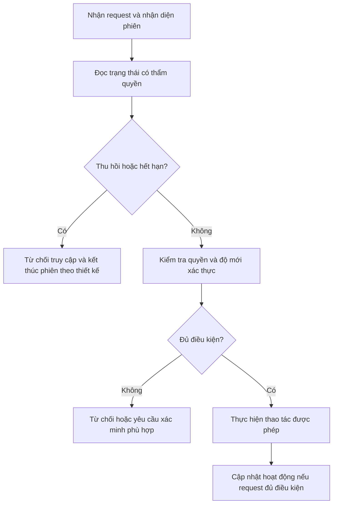

# Session timeout — Thời hạn của phiên xác thực

## 1. Vì sao phiên cần hết hạn?

Một nhân viên đăng nhập cổng quản trị rồi rời máy mà không đăng xuất. Trình duyệt vẫn giữ cookie và ứng dụng tiếp tục nhận request. Nếu phiên không có giới hạn, người khác có thể sử dụng trạng thái đăng nhập đó trong thời gian dài mà không cần chứng minh lại quyền kiểm soát tài khoản.

**Session timeout** là chính sách xác định khi nào một phiên không còn được chấp nhận vì điều kiện thời gian đã hết. Quyết định cần được thực thi ở nơi kiểm tra truy cập, thường là máy chủ hoặc thành phần xác thực đáng tin cậy, thay vì chỉ bằng một đồng hồ đếm ngược trên giao diện.

Trong nền tảng IAM, timeout giới hạn thời gian tiếp tục sử dụng kết quả xác thực trước đó. Nó liên quan đến MFA, trạng thái tài khoản, phiên SSO, token OAuth/OIDC, đặc quyền và kiểm toán. Một phiên chưa hết hạn vẫn phải qua các điều kiện thu hồi và phân quyền RBAC/ABAC; thời gian còn hiệu lực không tự cấp quyền truy cập tài nguyên.

Sau bài học, người học có thể:

- Phân biệt idle timeout, absolute timeout, thời hạn xác thực lại và thời hạn token.
- Tính thời điểm phiên hết hiệu lực trong một chính sách cụ thể.
- Xác định hoạt động nào được phép kéo dài phiên.
- Thực thi kiểm tra phía server mà không vô tình làm sống lại phiên đã hết hạn.
- Xử lý cache, request đồng thời, polling và kết nối kéo dài.
- Thiết kế cảnh báo trước khi hết phiên và luồng đăng nhập lại phù hợp.

## 2. Các loại thời hạn không nên gộp làm một

### 2.1. Bảng khái niệm

| Cơ chế | Mốc tham chiếu | Điều làm thay đổi mốc | Mục đích |
|---|---|---|---|
| Idle timeout | Hoạt động hợp lệ gần nhất | Hoạt động được chính sách công nhận | Kết thúc phiên không còn được sử dụng. |
| Absolute timeout | Bắt đầu phiên logic | Không thay đổi chỉ vì có request hoặc đổi session ID | Giới hạn tuổi tối đa của phiên đang xét. |
| Overall timeout theo mô hình xác thực lại | Lần xác thực hoặc xác thực lại hợp lệ | Xác thực lại thành công theo yêu cầu | Giới hạn thời gian tin cậy vào lần xác thực. |
| Độ mới xác thực cho thao tác nhạy cảm | Bằng chứng xác thực thích hợp gần nhất | Step-up hoặc xác thực lại phù hợp | Yêu cầu bằng chứng mới trước một hành động. |
| Thời hạn cookie | Thời điểm do cookie quy định | Máy chủ phát cookie mới theo cơ chế tương ứng | Quản lý việc trình duyệt giữ hoặc gửi cookie. |
| Thời hạn access/refresh token | Chính sách phát hành token | Cấp hoặc luân chuyển token theo giao thức | Giới hạn hiệu lực credential cấp cho client. |

**Absolute timeout** trong bài được dùng theo nghĩa giới hạn cố định của một phiên logic. Nếu sản phẩm cho phép xác thực lại đặt lại một số bộ đếm, phải định nghĩa rõ bộ đếm nào và có tạo một phiên logic mới hay không.

### 2.2. Hai cách dùng thuật ngữ cần đối chiếu

[OWASP Session Management](https://cheatsheetseries.owasp.org/cheatsheets/Session_Management_Cheat_Sheet.html#automatic-session-expiration) phân biệt idle timeout với giới hạn absolute tính từ lúc tạo phiên. [NIST SP 800-63B](https://pages.nist.gov/800-63-4/sp800-63b.html) mô tả inactivity và overall timeout; xác thực lại thành công trong phiên đặt lại cả hai bộ đếm của mô hình đó.

Vì thế, không chỉ nhìn tên cấu hình `sessionTimeout` rồi cho rằng nó có cùng ý nghĩa ở mọi hệ thống. Cần biết mốc tính, sự kiện đặt lại và nơi thực thi. Một sản phẩm có thể áp dụng thêm giới hạn cứng riêng của phiên bên cạnh thời hạn xác thực lại.

### 2.3. Rotation không phải reauthentication

Đổi session ID giúp quản lý bí mật phiên, nhưng không tự chứng minh người dùng vừa nhập lại mật khẩu hay hoàn tất MFA. Tương tự, phát JWT mới từ refresh token không mặc nhiên là một lần xác thực lại người dùng.

Nếu mỗi lần đổi ID hoặc làm mới token đều đặt lại mốc tuổi phiên, một phiên có thể tồn tại vô thời hạn dù chính sách tuyên bố có absolute timeout. Mốc phiên logic cần được giữ riêng với thời điểm tạo ID hoặc token hiện tại.

## 3. Tính thời điểm hết hạn

### 3.1. Mô hình hai giới hạn

Giả sử ứng dụng chọn chính sách minh họa:

```text
idleTimeout     = 15 phút
absoluteTimeout = 8 giờ

idleDeadline     = lastQualifiedActivityAt + idleTimeout
absoluteDeadline = sessionStartedAt + absoluteTimeout
effectiveDeadline = min(idleDeadline, absoluteDeadline)

Phiên còn hiệu lực theo thời gian khi now < effectiveDeadline.
```

Hai giá trị trên chỉ dùng để giải thích, không phải khuyến nghị áp dụng chung cho mọi hệ thống hoặc tuyên bố đáp ứng một AAL. Tại đúng thời điểm deadline, phiên bị xem là hết hạn trong chính sách này.

Việc phiên còn hiệu lực theo thời gian chỉ là một điều kiện. Trạng thái đã thu hồi, tài khoản bị hạn chế, thiếu mức xác thực hoặc thiếu quyền vẫn có thể khiến request bị từ chối sớm hơn.

### 3.2. Ví dụ theo thời gian

Một phiên bắt đầu lúc 09:00 và có hoạt động hợp lệ cuối cùng lúc 09:10:

| Mốc | Idle deadline | Absolute deadline | Kết quả |
|---|---|---|---|
| 09:10 sau hoạt động hợp lệ | 09:25 | 17:00 | Phiên còn hiệu lực. |
| 09:24 có hoạt động hợp lệ mới | 09:39 | 17:00 | Chỉ idle deadline dịch chuyển. |
| 09:39 không có hoạt động mới | 09:39 | 17:00 | Hết idle timeout. |
| 17:00, giả sử hoạt động liên tục trước đó | Có thể muộn hơn 17:00 | 17:00 | Hết absolute timeout. |

Hai hàng cuối mô tả hai diễn biến khác nhau. Không có chuyện phiên đã hết lúc 09:39 tự sống lại để tiếp tục đến 17:00.

### 3.3. Các mốc nên lưu riêng

Một phiên có thể cần `session_started_at`, `last_qualified_activity_at`, `authenticated_at`, `mfa_verified_at`, `revoked_at` và version. Các trường phục vụ mục đích khác nhau; không dùng một `updated_at` thay cho tất cả.

Chẳng hạn, cập nhật locale hoặc ghi cache không được tự thay đổi thời điểm người dùng hoàn tất MFA. Một thao tác xuất dữ liệu có thể yêu cầu MFA mới dù phiên vẫn đang hoạt động bình thường.

## 4. Hoạt động nào được kéo dài idle timeout?

### 4.1. Hoạt động mạng và sự hiện diện của người dùng

Một ứng dụng có thể gửi polling mỗi phút để lấy thông báo. Nếu mọi request đều làm mới idle timeout, tab đang bỏ quên cũng có thể duy trì phiên liên tục.

| Hoạt động | Cách đánh giá trong chính sách minh họa |
|---|---|
| Người dùng thực hiện thao tác đã xác thực hợp lệ | Có thể cập nhật hoạt động phiên. |
| Polling thông báo hoặc làm mới dữ liệu nền | Không mặc định chứng minh người dùng đang hiện diện. |
| WebSocket ping hoặc heartbeat | Chứng minh kết nối còn hoạt động, chưa chắc có hoạt động người dùng. |
| Refresh token tự động | Không mặc định làm mới thời điểm xác thực hoặc hiện diện người dùng. |
| Tải ảnh, static asset hoặc health check | Không nên trở thành cơ chế giữ phiên do vô tình gắn cookie. |
| Request bị từ chối do thiếu xác thực hoặc phiên hết hạn | Không được dùng để khôi phục phiên. |
| Sự kiện chuột/bàn phím chỉ ở trình duyệt | Hỗ trợ UX; không phải thời gian đáng tin cậy do server tự quan sát. |

Tùy sản phẩm, idle có thể được định nghĩa là không có request gắn phiên hoặc không có loại tương tác đã chọn. Hai cách này cho hành vi khác nhau. Cần ghi rõ quyết định và kiểm tra khả năng của framework trước khi áp dụng.

Nếu framework tự tính mọi request là hoạt động, việc loại polling khỏi idle có thể cần cơ chế riêng. Chỉ bỏ cập nhật một field tự viết không bảo đảm container đã ngừng kéo dài phiên của nó.

### 4.2. Không coi client là nguồn thời gian có thẩm quyền

Không nhận `lastActiveAt` từ JSON rồi lưu làm hoạt động hợp lệ. Client có thể tự khai tương lai, replay hoặc gửi tín hiệu giữ phiên tự động.

Nếu có endpoint “tiếp tục phiên”, máy chủ cần kiểm tra phiên hiện tại, chính sách và các bảo vệ request tương ứng trước khi chấp nhận hoạt động. Nút tiếp tục chỉ có tác dụng nếu phiên còn ở trạng thái cho phép; nó không phải phương thức xác thực lại cho phiên đã hết hạn.

Idle timeout có giới hạn tự nhiên: bên đã đánh cắp phiên có thể tạo hoạt động giống người dùng. Vì vậy cần kết hợp giới hạn cứng, thu hồi, bảo vệ bí mật phiên và xác thực lại cho hành động nhạy cảm.

### 4.3. Nhiều tab và nhiều thiết bị

Nếu các tab chia sẻ cùng cookie và phiên, hoạt động được chấp nhận ở một tab có thể kéo dài idle cho toàn phiên. Một tab đếm ngược riêng có thể không biết tab khác vừa thao tác.

Thiết bị khác thường có phiên khác và deadline riêng. Không tự gộp mọi hoạt động của một user ID thành một mốc idle chung nếu điều đó khiến một thiết bị hoạt động giữ tất cả thiết bị còn đăng nhập.

## 5. Kiểm tra phía server và kết thúc phiên

### 5.1. Luồng xử lý request



Đường ghi hoạt động cần kiểm soát đồng thời với kiểm tra trạng thái. Sơ đồ mô tả điều kiện logic; việc triển khai không được tạo khoảng trống khiến request cũ ghi đè một quyết định thu hồi hoặc kết thúc phiên mới hơn.

### 5.2. Kiểm tra hết hạn trước khi cập nhật hoạt động

Thứ tự sai thường gặp:

```text
nhận request -> lastActivity = now -> kiểm tra now - lastActivity
```

Sau phép gán, khoảng không hoạt động luôn gần bằng 0. Request đầu tiên sau nhiều giờ có thể làm sống lại phiên đáng lẽ đã hết hạn.

Thứ tự cần bảo đảm:

```text
đọc mốc cũ -> kiểm tra mốc cũ và trạng thái hiện tại
    -> chỉ cập nhật hoạt động nếu vẫn hợp lệ và được chính sách cho phép
```

Khi endpoint cần báo phiên đã hết, tránh vô tình tạo phiên mới bằng một API tự khởi tạo session. Phiên ẩn danh mới, nếu ứng dụng cần, phải được phân biệt với phiên xác thực đã kết thúc.

### 5.3. Hết hiệu lực logic khác với dọn dữ liệu

Một tác vụ dọn session có thể chạy theo chu kỳ. Kho lưu vẫn còn bản ghi đã quá deadline không có nghĩa bản ghi đó còn được chấp nhận.

Kiểm tra thời gian trong đường truy cập là điều kiện bảo mật; xóa bản ghi hết hạn còn phục vụ quản lý tài nguyên và dữ liệu. Không chỉ chờ một job chạy mỗi giờ để quyết định lúc nào phiên hết hiệu lực.

Khi kết thúc phiên, vô hiệu trạng thái phía server và xóa cookie phù hợp ở client. Cookie cần đúng phạm vi tên, path và domain để việc xóa đạt hiệu quả. Xóa một cookie không xử lý các token hoặc cơ chế ghi nhớ đăng nhập khác còn tồn tại.

## 6. Ví dụ Java: chính sách idle và absolute timeout

### 6.1. Hàm đánh giá độc lập với kho lưu trữ

Ví dụ Java 17 sau dùng một giới hạn tuổi cứng của phiên logic. Nó không tự đặt lại mốc khi có reauthentication; ứng dụng phải quyết định việc xác thực lại có tạo phiên logic mới hay áp dụng thêm bộ đếm khác.

```java
import java.time.Duration;
import java.time.Instant;
import java.util.Objects;

public final class SessionTimeoutPolicy {
    public enum Decision {
        ACTIVE,
        IDLE_EXPIRED,
        ABSOLUTE_EXPIRED,
        REVOKED,
        INVALID_TIME
    }

    public record Limits(Duration idle, Duration absolute) {
        public Limits {
            Objects.requireNonNull(idle);
            Objects.requireNonNull(absolute);
            if (idle.isZero() || idle.isNegative()
                    || absolute.isZero() || absolute.isNegative()) {
                throw new IllegalArgumentException("Timeout must be positive");
            }
        }
    }

    public record SessionTimes(
            Instant startedAt,
            Instant lastQualifiedActivityAt,
            boolean revoked) {
        public SessionTimes {
            Objects.requireNonNull(startedAt);
            Objects.requireNonNull(lastQualifiedActivityAt);
            if (lastQualifiedActivityAt.isBefore(startedAt)) {
                throw new IllegalArgumentException("Invalid session timeline");
            }
        }
    }

    public Decision evaluate(SessionTimes session, Limits limits, Instant now) {
        Objects.requireNonNull(session);
        Objects.requireNonNull(limits);
        Objects.requireNonNull(now);

        if (session.revoked()) {
            return Decision.REVOKED;
        }
        if (now.isBefore(session.lastQualifiedActivityAt())) {
            return Decision.INVALID_TIME;
        }

        Instant absoluteDeadline = session.startedAt().plus(limits.absolute());
        if (!now.isBefore(absoluteDeadline)) {
            return Decision.ABSOLUTE_EXPIRED;
        }

        Instant idleDeadline = session.lastQualifiedActivityAt()
                .plus(limits.idle());
        if (!now.isBefore(idleDeadline)) {
            return Decision.IDLE_EXPIRED;
        }
        return Decision.ACTIVE;
    }
}
```

Hàm trả về nguyên nhân rõ ràng và không tự sửa timestamp. Nếu cả hai deadline đã qua, ví dụ ưu tiên nguyên nhân absolute; đây là lựa chọn phân loại nội bộ, không làm phiên còn hiệu lực lâu hơn.

`now` phải lấy từ đồng hồ máy chủ đáng tin cậy, có thể cung cấp qua `Clock` để kiểm thử. Cấu hình và timestamp cần được giới hạn hợp lý ở đầu vào để phép cộng thời gian không gặp dữ liệu ngoài miền hỗ trợ.

`INVALID_TIME` là cách xử lý bảo thủ của ví dụ khi thời gian hiện tại lùi trước hoạt động đã lưu. Hệ thống thực tế cần chính sách rõ cho độ lệch và lỗi đồng hồ; không âm thầm cho phép một timestamp tương lai kéo dài phiên không giới hạn.

### 6.2. Hàm đánh giá chưa giải quyết cập nhật đồng thời

Một kết quả `ACTIVE` chỉ mô tả snapshot vừa đọc. Trước khi cập nhật hoạt động hoặc thực hiện tác động nhạy cảm, phải bảo đảm snapshot chưa bị thu hồi hay thay đổi theo cách khiến quyết định cũ không còn đúng.

Lớp lưu trữ có thể dùng khóa, version và cập nhật có điều kiện tương ứng. Không sao chép toàn bộ object snapshot cũ ghi trở lại, vì nó có thể khôi phục cờ `revoked=false` sau khi một tiến trình khác đã thu hồi phiên.

### 6.3. Cấu hình idle timeout trong Jakarta Servlet

Với một `HttpSession` đã được thiết lập đúng, có thể cấu hình khoảng không hoạt động:

```java
// Đơn vị của API này là giây; 15 phút là ví dụ chính sách.
session.setMaxInactiveInterval(15 * 60);
```

[Jakarta Servlet 6.0 HttpSession](https://jakarta.ee/specifications/servlet/6.0/apidocs/jakarta.servlet/jakarta/servlet/http/HttpSession.html) quy định tham số trên tính theo giây; giá trị bằng 0 hoặc âm chỉ phiên không timeout theo cơ chế đó. Cấu hình này không tự cung cấp giới hạn absolute của phiên xác thực.

Container theo dõi request gắn với session; nó không biết chắc hoạt động nào là tương tác của người dùng. Nếu cần idle theo nghiệp vụ, phải phối hợp cơ chế container với chính sách ứng dụng. Cũng không dùng `getCreationTime()` của một session ẩn danh cũ làm mốc đăng nhập mà chưa xác định rõ phiên logic bắt đầu ở đâu.

## 7. TTL, cache và cập nhật trong hệ thống nhiều node

### 7.1. TTL là công cụ, không phải toàn bộ chính sách

Kho session có thể dùng TTL để tự xóa bản ghi. Nếu mỗi request đặt lại TTL thành 15 phút, cơ chế đó chỉ biểu diễn giới hạn trượt; nó chưa bảo đảm phiên kết thúc sau 8 giờ tính từ mốc ban đầu.

Trong mô hình hai giới hạn, thời gian lưu còn lại có thể được tính theo:

```text
remainingIdle     = idleDeadline - now
remainingAbsolute = absoluteDeadline - now
remainingLifetime = min(remainingIdle, remainingAbsolute)
```

Chỉ cập nhật TTL khi phiên vẫn hợp lệ và request đủ điều kiện. Không gán TTL dương cho một phiên mà deadline đã qua. Việc làm tròn đơn vị ở kho lưu cần được hiểu: có thể dọn bản ghi sớm hoặc muộn hơn một chút, nhưng kiểm tra logic không được cho phép truy cập vượt deadline vì bản ghi vẫn tồn tại.

### 7.2. Đồng thời và thứ tự cập nhật hoạt động

Hai request có thể bắt đầu gần nhau và kết thúc ngược thứ tự. Nếu request cũ ghi timestamp nhỏ hơn sau request mới, nó có thể đẩy mốc hoạt động lùi lại và làm người dùng bị hết phiên sớm.

Có thể cập nhật theo giá trị lớn nhất trong các mốc được máy chủ chấp nhận, kết hợp kiểm tra version và trạng thái. Tuy nhiên, phép `max` không đủ nếu nó được áp dụng sau khi phiên đã hết hoặc đã thu hồi; điều kiện còn hiệu lực phải được kiểm tra tại thao tác cập nhật.

```text
tại nguồn trạng thái có thẩm quyền:
    kiểm tra phiên chưa bị thu hồi
    kiểm tra các deadline theo mốc đang lưu
    nếu request đủ điều kiện và phiên còn hiệu lực:
        cập nhật lastActivity theo thời gian máy chủ được chấp nhận
        giữ nguyên mốc absolute của phiên logic
        tăng version hoặc thực hiện cập nhật nguyên tử tương đương
    nếu không:
        không kéo dài phiên
```

Không tính hoạt động từ thời điểm response hoàn tất một cách vô thức. Một request chạy rất lâu có thể kéo dài idle chỉ vì tác vụ hoàn thành muộn. Hãy xác định mốc request được chấp nhận hoặc mốc tương tác thích hợp và áp dụng nhất quán.

### 7.3. Cache trạng thái và lỗi kho lưu

Nếu node A đã kết thúc phiên nhưng node B còn snapshot cũ, node B có thể tiếp tục cho phép truy cập. Cần giới hạn thời gian cache, cơ chế vô hiệu hóa và hành vi kiểm tra phù hợp với độ trễ được chấp nhận.

Khi không đọc được trạng thái phiên bắt buộc, không dùng mặc định `ACTIVE` hoặc tự tạo timestamp mới. Với thao tác cần trạng thái đó, tạm từ chối theo chính sách sự cố và phân loại lỗi vận hành đúng. Lỗi database không chứng minh người dùng đã thực sự hết idle timeout.

Nếu tối ưu bằng cách chỉ ghi hoạt động mỗi vài request hoặc theo khoảng thời gian, phải tính độ lệch tối đa của deadline và hành vi khi tiến trình dừng. Việc giảm số lần ghi cần đi kèm đánh đổi đã được xác định, không làm mất bảo đảm mà chính sách đã hứa.

### 7.4. Đồng hồ và thay đổi cấu hình

Các node cần nguồn thời gian nhất quán đủ cho mức rủi ro. Đồng hồ đi lùi hoặc đi nhanh có thể làm phiên kéo dài hoặc hết sớm. Theo dõi sai lệch và chọn rõ mức dung sai; không thêm “grace period” lớn ở nhiều tầng rồi vô tình cộng dồn thời gian hiệu lực.

Đồng hồ đơn điệu hữu ích để đo khoảng thời gian trong một tiến trình, nhưng giá trị kiểu `nanoTime()` không phải timestamp dùng chung để lưu và so giữa các máy hay sau restart. Cần phân biệt đo thời gian cục bộ với mốc có ý nghĩa trong kho session phân tán.

Khi đổi chính sách timeout, xác định có áp dụng ngay cho phiên hiện hữu hay chỉ cho phiên mới. Có thể lưu phiên bản chính sách hoặc deadline đã tính cùng phiên. Không để một số node áp dụng cấu hình mới trong khi node khác tiếp tục kéo dài theo cấu hình cũ mà không có cách quan sát.

## 8. Cookie, JWT, refresh token và SSO

### 8.1. Thời hạn trình duyệt không thay cho thời hạn server

Cookie còn tồn tại không chứng minh phiên còn hiệu lực. Server phải từ chối phiên hết hạn ngay cả khi browser vẫn gửi đúng session ID.

Cookie đã hết hạn cũng không tự thu hồi bản sao bị lấy cắp. Cơ chế “session cookie” gắn với phiên trình duyệt còn có thể chịu ảnh hưởng của chức năng khôi phục phiên của browser. Đóng cửa sổ hoặc xóa dữ liệu ở một client không phải bằng chứng toàn bộ credential liên quan đã bị vô hiệu.

Nếu có chức năng ghi nhớ đăng nhập, cần xác định nó có thể tái tạo phiên trong trường hợp nào. Nếu mọi phiên idle-expired đều được tự tái tạo bằng credential ghi nhớ mà không có giới hạn phù hợp, trải nghiệm thực tế có thể không còn đúng ý nghĩa timeout mà người dùng hoặc tổ chức mong đợi.

### 8.2. `exp` của JWT không biểu diễn idle timeout

[RFC 7519, mục 4.1.4](https://www.rfc-editor.org/rfc/rfc7519.html#section-4.1.4) quy định `exp` là mốc hết hạn của JWT; tại hoặc sau mốc đó, token không được chấp nhận theo kiểm tra này, với dung sai đồng hồ nhỏ nếu hệ thống lựa chọn áp dụng.

`exp` không tự biết người dùng đã ngừng thao tác bao lâu. Một JWT được phát hành cho 30 phút có thể vẫn còn hạn dù chính sách phiên yêu cầu kết thúc sau 15 phút không hoạt động.

Nếu resource server chỉ xác minh chữ ký và thời hạn JWT mà không nhận được trạng thái phiên cập nhật, nó không thể tự biết một idle timeout cục bộ đã xảy ra. Thiết kế cần chọn cách phối hợp: kiểm tra trạng thái, introspection, thời hạn token phù hợp hoặc mô hình khác có giới hạn hiệu lực rõ ràng.

### 8.3. Refresh token không phải bằng chứng hiện diện

Làm mới access token có thể diễn ra tự động. Nó không tự chứng minh người dùng đang ngồi trước thiết bị hoặc vừa xác thực lại. Không dùng thời điểm refresh làm `mfa_verified_at` hay mốc xác thực mới.

Một mô hình có thể yêu cầu kiểm tra phiên/grant trước khi refresh và chặn refresh khi phiên tương ứng đã kết thúc. Một mô hình khác có thể cho refresh token tồn tại độc lập với phiên web để phục vụ nhu cầu client. Cả hai cần ý nghĩa và giới hạn được công bố trong thiết kế.

Nếu tuyên bố phiên hết hạn sẽ kết thúc mọi truy cập, phải xử lý cả access token đã phát và refresh token liên quan. Nếu chỉ kết thúc phiên web, không mô tả đó là thu hồi toàn bộ truy cập OAuth của người dùng.

### 8.4. Phiên ứng dụng và phiên IdP có thể hết hạn khác nhau

Trong SSO, ứng dụng relying party và IdP có thể giữ phiên riêng. Khi phiên ứng dụng hết, browser có thể được đưa về IdP và nhận assertion mới từ một phiên IdP vẫn còn hợp lệ.

Điều đó không tự bảo đảm người dùng vừa nhập lại mật khẩu hoặc MFA. Relying party cần đánh giá thông tin xác thực được trả về theo chính sách, sử dụng khả năng yêu cầu xác thực mới của giao thức khi phù hợp và xác minh bằng chứng nhận được.

Nếu yêu cầu độ mới xác thực cho thao tác quản trị, chỉ đổi session ID cục bộ hoặc đi qua redirect SSO không đủ. Cần kiểm tra thời điểm và mức xác thực phù hợp thay vì coi mọi callback thành công là bằng chứng mới.

## 9. Trải nghiệm trước và sau khi hết phiên

### 9.1. Cảnh báo trước khi kết thúc

Giao diện có thể hiển thị cảnh báo khi sắp hết idle timeout và cho người dùng lựa chọn tiếp tục nếu chính sách cho phép. Server cung cấp deadline hoặc thời gian còn lại; client dùng chúng để hỗ trợ trải nghiệm, không làm nguồn quyết định cuối cùng.

Một thông báo có thể là:

> Phiên của bạn sắp kết thúc do không hoạt động. Bạn có thể tiếp tục làm việc nếu phiên vẫn còn hiệu lực. Hãy lưu thay đổi trước khi rời trang.

Cảnh báo cần có nội dung dễ hiểu, có thể thao tác bằng bàn phím và phù hợp với công nghệ hỗ trợ. Tránh chỉ dùng màu hoặc bộ đếm nhấp nháy mà không giải thích hành động cần làm.

### 9.2. Nút tiếp tục không được vượt giới hạn

Khi người dùng bấm tiếp tục, backend kiểm tra lại trạng thái. Nếu đã hết idle, absolute hoặc bị thu hồi, không kéo dài phiên chỉ vì giao diện còn hiển thị modal cũ.

Một nút “giữ đăng nhập” gửi tự động theo timer sẽ làm thay đổi ý nghĩa chính sách idle. Nếu sản phẩm có cơ chế bảo trì phiên dựa trên thiết bị hoặc tương tác đặc thù, nó cần được thiết kế và đánh giá riêng, không xuất hiện như một hệ quả vô tình của frontend.

Với absolute timeout cứng, người dùng có hoạt động liên tục vẫn phải đi qua bước thiết lập phiên mới theo yêu cầu. Cảnh báo nên cho biết cần xác thực lại, thay vì hứa rằng một lần nhấn nút luôn gia hạn được.

### 9.3. Đăng nhập lại và dữ liệu đang soạn

Khi phiên hết, ứng dụng nên giữ đường đi hợp lệ để người dùng đăng nhập lại. URL quay về cần được kiểm soát, tránh biến thành redirect tùy ý. Không tự phát lại một thao tác thay đổi trạng thái chỉ vì đăng nhập lại đã thành công.

Nếu cho phép giữ bản nháp, cần đánh giá dữ liệu nhạy cảm, nơi lưu và thời gian lưu. Giữ dữ liệu trong local storage trên máy dùng chung có thể tạo một rủi ro khác; không coi việc duy trì UX là lý do lưu mọi form không giới hạn.

Nhiều tab có thể dùng tín hiệu phía client để đồng bộ cảnh báo hoặc màn hình đăng nhập. Dù cơ chế đó hoạt động hay không, backend vẫn phải kiểm tra phiên trên request tiếp theo.

## 10. Request kéo dài, WebSocket và công việc nền

### 10.1. Request được nhận trước deadline

Một request có thể được chấp nhận lúc 16:59 rồi hoàn thành lúc 17:05, trong khi absolute deadline là 17:00. Timeout không tự hủy luồng đang chạy hoặc rollback mọi tác động đã bắt đầu.

Hệ thống cần xác định chính sách theo hành động. Một thao tác đọc ngắn có thể được đánh giá tại lúc nhận; thao tác xuất dữ liệu nhạy cảm, chuyển quyền hoặc thay credential có thể cần kiểm tra lại trước điểm tạo tác động. Không có một chính sách hủy tác vụ chung phù hợp cho mọi nghiệp vụ.

Nếu yêu cầu bị từ chối ở điểm kiểm tra lại, cần bảo đảm kết quả giao dịch và phản hồi nhất quán. Không tạo tình huống nghiệp vụ đã thực hiện nhưng client được báo như chưa xảy ra mà thiếu cơ chế đối chiếu và xử lý lặp an toàn.

### 10.2. Kết nối còn mở không đồng nghĩa phiên còn hợp lệ

WebSocket hoặc luồng sự kiện có thể tồn tại lâu hơn phiên. Chỉ kiểm tra tại handshake rồi giữ quyền suốt đời kết nối sẽ không thực thi đúng chính sách khi deadline đến.

Cần cơ chế kết thúc kết nối, kiểm tra định kỳ hoặc kiểm tra theo message/action tùy mô hình. Ping/pong mạng không tự chứng minh hiện diện người dùng. Dữ liệu nhạy cảm không nên tiếp tục được gửi sau khi phiên tương ứng không còn được chấp nhận theo thiết kế.

### 10.3. Phân biệt công việc nền với phiên người dùng

Một tác vụ đã được ủy quyền có thể cần chạy sau khi người dùng đóng ứng dụng. Khi đó phải xác định phạm vi ủy quyền, khả năng hủy và bằng chứng cấp quyền riêng. Không giữ phiên người dùng sống vô hạn chỉ để công việc nền tiếp tục.

Danh tính workload, client credential hoặc token của job có vòng đời riêng. Hết phiên người dùng không tự là cơ chế luân chuyển hoặc thu hồi mọi credential của workload, trừ khi kiến trúc đã gắn chúng với phạm vi đó.

## 11. Chọn chính sách và ghi nhận kết quả

### 11.1. Chính sách theo rủi ro và mục đích

| Bối cảnh | Điều cần cân nhắc |
|---|---|
| Cổng quản trị đặc quyền | Máy dùng chung, tác động của thao tác và độ mới MFA. |
| Cổng học tập có thời gian soạn bài dài | Cảnh báo, lưu bản nháp an toàn và tương tác thật so với polling. |
| Thiết bị được quản lý | Ràng buộc thiết bị, khóa màn hình và khả năng duy trì phiên được hỗ trợ. |
| Ứng dụng di động | Hoạt động nền, thời gian offline và token tồn tại độc lập. |
| Luồng khôi phục hoặc step-up | Phạm vi hẹp, thời hạn riêng và điều kiện hoàn tất. |

Thời hạn ngắn hơn có thể giảm cửa sổ sử dụng phiên bị lấy cắp, nhưng timeout quá gắt có thể làm người dùng mất dữ liệu hoặc tìm cách né quy trình. Cần đo hành vi thực tế và kiểm tra tác động, đồng thời bảo toàn yêu cầu bảo mật đã xác định.

### 11.2. Sự kiện và metric

Một sự kiện nội bộ có thể ghi:

```text
event_type: SESSION_TERMINATED
session_ref: internal-session-reference
reason: IDLE_TIMEOUT
policy_version: session-policy-v3
decision_source: session-store
```

`session_ref` là tham chiếu không cấp quyền, không phải session cookie hoặc bearer token. Không ghi credential phiên vào audit, trace hay thông báo lỗi.

Metric có thể theo dõi số phiên kết thúc theo nguyên nhân, lỗi đồng hồ, độ trễ đồng bộ, tỷ lệ xác thực lại và số request gặp lỗi kho phiên. Không dùng raw session ID, email hoặc user ID làm nhãn metric không giới hạn.

Phân biệt phiên bị từ chối với job dọn dữ liệu đã xóa bao nhiêu bản ghi. Nếu cần ghi một sự kiện hết hạn khi không có request, phải có cơ chế quan sát deadline tương ứng; không dùng thời điểm cron dọn bản ghi làm bằng chứng chính xác về lần sử dụng cuối.

## 12. Những tình huống cần kiểm chứng khi triển khai

Các tiêu chí sau có thể kiểm tra bằng đồng hồ điều khiển được, session giả và nhiều request đồng thời. Không cần chờ nhiều giờ theo thời gian thực để kiểm tra các biên.

| Tình huống | Kết quả mong đợi |
|---|---|
| Trước idle deadline một khoảng nhỏ | Còn hợp lệ nếu các điều kiện khác đạt. |
| Tại đúng idle deadline | Bị từ chối theo quy tắc `now >= deadline`. |
| Có hoạt động hợp lệ trước idle deadline | Idle dịch chuyển, mốc absolute giữ nguyên. |
| Hoạt động liên tục đến absolute deadline | Phiên vẫn hết hạn theo giới hạn cứng. |
| Request đầu tiên sau một thời gian quá dài | Không cập nhật hoạt động để làm sống lại phiên. |
| Polling hoặc heartbeat chạy khi người dùng rời máy | Hành vi đúng với định nghĩa hoạt động đã công bố. |
| Request cũ ghi sau request mới | Không làm lùi mốc hoặc khôi phục trạng thái đã thu hồi. |
| TTL dọn trễ hoặc cache còn bản ghi | Kiểm tra logic vẫn từ chối phiên quá hạn. |
| Node khác giữ trạng thái cũ | Cửa sổ không nhất quán được giới hạn và quan sát. |
| Đồng hồ đi lùi hoặc timestamp lưu ở tương lai | Không kéo dài phiên âm thầm; lỗi được xử lý theo chính sách. |
| Đổi session ID hoặc refresh JWT | Không tự đặt lại mốc xác thực hoặc tuổi phiên ngoài thiết kế. |
| Phiên RP hết nhưng IdP còn phiên | Kiểm tra đủ yêu cầu xác thực lại, không chỉ dựa vào redirect thành công. |
| WebSocket còn mở sau deadline | Không tiếp tục truy cập ngoài phạm vi chính sách. |
| Request dài vượt deadline giữa chừng | Hành vi tại điểm kiểm tra và tác động nghiệp vụ đúng thiết kế. |
| Tạm mất kho lưu phiên | Không mặc định cho phép truy cập bằng trạng thái tự tạo. |
| Người dùng bấm tiếp tục sau khi đã hết phiên | Chuyển sang luồng xác thực phù hợp, không gia hạn phiên cũ. |

## 13. Những lỗi thiết kế thường gặp

| Lỗi | Hệ quả | Cách xử lý |
|---|---|---|
| Chỉ dùng JavaScript để đăng xuất | Client có thể bỏ qua hoặc timer không chạy | Thực thi deadline tại backend. |
| Đồng nhất cookie `Max-Age` với phiên server | Credential còn hoặc mất ở client không phản ánh đủ trạng thái | Quản lý riêng hai vòng đời. |
| Cập nhật `lastActivity` trước kiểm tra | Phiên đã hết có thể sống lại | Kiểm tra trạng thái cũ trước cập nhật có điều kiện. |
| Mọi polling đều giữ phiên dù chính sách yêu cầu hiện diện | Tab bỏ quên vẫn hoạt động vô hạn | Định nghĩa hoạt động và phối hợp framework. |
| Mỗi rotation đặt lại mốc absolute | Mất giới hạn tuổi phiên thực sự | Giữ mốc phiên logic độc lập. |
| Coi refresh token là lần MFA mới | Gán mức tin cậy không có bằng chứng | Giữ mốc xác thực và độ mới riêng. |
| Chỉ chờ tác vụ dọn dữ liệu | Có thể chấp nhận phiên quá hạn trước khi cron chạy | Kiểm tra logic trong đường truy cập. |
| Coi timeout thay thế thu hồi | Không phản ứng kịp khi tài khoản bị chiếm | Có cơ chế thu hồi và trạng thái riêng. |
| Không xác định request dài hoặc kết nối kéo dài | Quyền truy cập có thể tồn tại sau thời hạn dự kiến | Thiết kế điểm kiểm tra và kết thúc phù hợp. |

## 14. Bài tập thiết kế

Một cổng quản trị có phiên web với idle timeout 15 phút và giới hạn cứng 8 giờ. Frontend polling mỗi phút, có ba tab dùng chung phiên, một WebSocket nhận sự kiện và chức năng xuất dữ liệu chạy trong 20 phút. Ứng dụng đăng nhập qua IdP và có access token riêng cho API.

Hãy xác định mốc thời gian cần lưu, hoạt động nào được kéo dài idle, cách kiểm tra trước cập nhật và cách giữ giới hạn cứng khi đổi session ID. Làm rõ hành vi khi người dùng bấm tiếp tục sau deadline, khi WebSocket vẫn mở và khi một tab khác vừa có thao tác hợp lệ.

Sau đó mô tả điều kiện xác thực lại qua IdP, phạm vi access token còn được chấp nhận và chính sách cho tác vụ xuất dữ liệu vượt deadline. Thiết kế cần nêu rõ nơi có thẩm quyền quyết định phiên còn hiệu lực, thay vì chỉ cấu hình bộ đếm trên trình duyệt.
