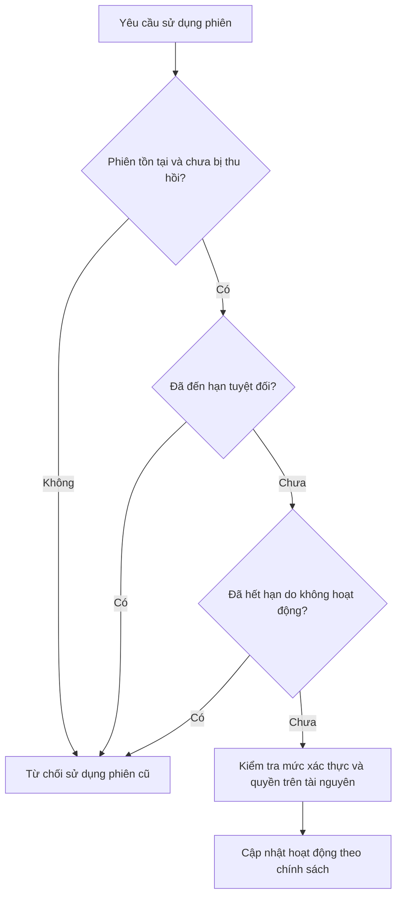

# Absolute timeout

**Absolute timeout** là giới hạn thời gian tối đa của một phiên đã xác thực, tính từ mốc mà chính sách xác định. Trong mô hình phổ biến, khi phiên xác thực được thiết lập, máy chủ chốt một hạn cuối; hoạt động tiếp theo không tự đẩy hạn đó về sau.

Ví dụ, một phiên được thiết lập lúc 09:00 và có giới hạn minh họa bốn giờ sẽ hết điều kiện sử dụng lúc 13:00, kể cả người dùng liên tục gửi yêu cầu. Bốn giờ ở đây chỉ là dữ liệu để giải thích, không phải khuyến nghị chung cho mọi ứng dụng IAM.

Giới hạn này giúp tránh một phiên tồn tại vô hạn chỉ nhờ hoạt động duy trì, đồng thời đặt điểm cần xác thực lại. Nó bổ sung cho bảo vệ session ID, MFA và thu hồi chủ động; không thay thế kiểm tra quyền trên tài nguyên hoặc xử lý sự cố chiếm phiên.

Sau bài này, người học có thể xác định đúng mốc thời gian, phân biệt absolute với idle timeout, phát hiện lỗi gia hạn vòng lặp và mô tả việc thực thi trong ứng dụng Java, token và SSO.

## 1. Absolute timeout giới hạn điều gì?

Giả sử một session ID bị đánh cắp. Nếu hệ thống chỉ hết hạn phiên khi không có hoạt động, người giữ ID có thể gửi yêu cầu định kỳ để phiên tiếp tục sống. Giới hạn tuyệt đối đặt một hạn cuối độc lập với hoạt động đó.

OWASP mô tả absolute timeout là giới hạn tối đa kể từ khi phiên được tạo, áp dụng bất kể hoạt động, sau đó cần xác thực lại để thiết lập phiên mới. Việc thực thi thời hạn phải nằm ở phía máy chủ. [OWASP — Absolute Timeout](https://cheatsheetseries.owasp.org/cheatsheets/Session_Management_Cheat_Sheet.html#absolute-timeout)

Trong mô hình của bài:

```text
absoluteExpiresAt = authenticatedSessionEstablishedAt + absoluteLifetime

absoluteExpired = serverNow >= absoluteExpiresAt
```

`authenticatedSessionEstablishedAt` là mốc máy chủ công nhận việc thiết lập phiên xác thực, không phải một timestamp mà khách tự khai. Tại đúng hạn cuối, ví dụ chọn quy tắc đã hết hạn; cần sử dụng quy tắc biên nhất quán trong mọi thành phần.

Phiên còn thời hạn vẫn có thể bị từ chối trước đó nếu đã bị thu hồi, tài khoản bị vô hiệu hóa hoặc không còn đáp ứng chính sách. Absolute timeout là một giới hạn trên, không phải lời bảo đảm phiên được sử dụng đến hết khoảng đó.

## 2. Phân biệt các đồng hồ của phiên

| Cơ chế | Mốc hoặc dữ liệu chính | Hoạt động bình thường có đẩy hạn về sau không? |
|---|---|---|
| Idle timeout | Hoạt động hợp lệ gần nhất | Có, theo định nghĩa hoạt động của hệ thống |
| Absolute timeout của một phiên xác thực | Mốc thiết lập phiên và giới hạn đã chốt | Không |
| Chu kỳ đổi session ID | Lần cấp hoặc đổi ID | Có thể sinh ID mới, nhưng không tự gia hạn phiên |
| Độ mới của xác thực nhạy cảm | Lần xác thực hoặc xác minh bổ sung được chấp nhận | Chỉ thay đổi sau sự kiện xác thực phù hợp |
| Hạn token | Thời điểm hết hạn của token cụ thể | Token mới có hạn mới, nhưng còn phụ thuộc chính sách phiên hoặc grant |
| Thời hạn cookie | Quy tắc lưu cookie ở trình duyệt | Không thay thế quyết định hiệu lực phía máy chủ |

Một điểm cần thống nhất thuật ngữ: NIST dùng **overall timeout** để giới hạn thời gian kể từ xác thực hoặc lần xác thực lại trước đó. Xác thực lại thành công trong phiên đặt lại cả overall và inactivity timeout theo mô hình NIST. Đây là sự kiện xác thực lại thực sự, khác với một yêu cầu thông thường hoặc đổi token. [NIST SP 800-63B-4 — Reauthentication](https://pages.nist.gov/800-63-4/sp800-63b.html#reauthentication)

Vì vậy, thiết kế phải nói rõ đang áp dụng:

- Một hạn cố định cho một phiên xác thực cụ thể; sau khi hết hạn, thiết lập phiên mới qua xác thực lại.
- Một hạn overall được phép đặt lại sau xác thực lại đáp ứng chính sách.

Không dùng từ “absolute” để vừa nói hạn không trượt theo hoạt động, vừa ngầm cho phép mọi thao tác nền đặt lại nó. Hai cách mô tả sẽ tạo ra hai hành vi khác nhau.

## 3. Một ví dụ theo thời gian

Giả sử phiên có:

```text
Thiết lập phiên xác thực: 09:00
Absolute lifetime:        4 giờ
Idle timeout:            30 phút
Absolute deadline:       13:00
```

Người dùng có hoạt động đều đặn, không vi phạm idle timeout:

| Thời điểm | Sự kiện | Hạn tuyệt đối sau sự kiện |
|---|---|---|
| 09:00 | Hoàn tất xác thực và thiết lập phiên | 13:00 |
| 10:15 | Đọc hồ sơ qua API | 13:00 |
| 11:00 | Đổi session ID theo chính sách | 13:00 |
| 12:50 | Gửi một yêu cầu hợp lệ | 13:00 |
| 12:58 | Làm mới token bằng cơ chế không xác thực lại | 13:00 đối với phiên đang xét |
| 13:00 | Gửi yêu cầu cần phiên hợp lệ | Phiên cũ không còn đáp ứng hạn tuyệt đối |

Sau hoạt động lúc 12:50, idle deadline có thể là 13:20. Tuy nhiên, hạn có hiệu lực sớm hơn vẫn là 13:00:

```text
effectiveDeadline = min(absoluteExpiresAt, idleExpiresAt)
```

Nếu phiên đã không có hoạt động từ 11:00 thì idle timeout có thể kết thúc phiên trước 13:00. Hai điều kiện bổ sung cho nhau; không cần chờ cả hai cùng hết hạn.



## 4. Chọn đúng mốc bắt đầu

Ứng dụng có thể tạo một `HttpSession` từ trước khi người dùng đăng nhập để giữ giỏ hàng, trạng thái CSRF hoặc giao dịch đăng nhập. Thời điểm tạo đối tượng đó không nhất thiết là thời điểm bắt đầu phiên đã xác thực.

Ví dụ:

```text
08:30: tạo phiên ẩn danh để hiển thị trang
09:00: mật khẩu và MFA hoàn tất
09:00: bắt đầu khoảng phiên xác thực theo chính sách
```

Nếu yêu cầu nghiệp vụ giới hạn tuổi thọ từ khi xác thực, lấy mốc 08:30 chỉ vì đó là `HttpSession.getCreationTime()` sẽ tính sai phạm vi. Ngược lại, một hệ thống có chính sách riêng từ khi tạo phiên phải thực thi đúng chính sách đã công bố, không tự thay mốc.

Một mô hình dữ liệu có thể tách:

```text
logicalSessionReference
authenticatedSessionEstablishedAt
absoluteExpiresAt
lastActivityAt
lastReauthenticationAt
currentSessionIdIssuedAt
status
policyVersion
```

Các trường này thuộc máy chủ. `currentSessionIdIssuedAt` thay đổi khi ID được luân chuyển, còn `authenticatedSessionEstablishedAt` không đổi chỉ vì luân chuyển ID.

Tách các mốc giúp tránh ba lỗi:

1. Coi phiên ẩn danh cũ là bằng chứng đã xác thực từ thời điểm trước đó.
2. Coi mỗi ID mới là một lần đăng nhập mới.
3. Coi mỗi token mới là người dùng vừa chứng minh lại danh tính.

Nếu dữ liệu mốc hoặc hạn bị thiếu, cần xử lý theo chính sách dữ liệu lỗi hay di trú. Không tự gán `now` cho mọi bản ghi thiếu rồi làm các phiên cũ được kéo dài ngoài ý định.

## 5. Những thao tác không tự đặt lại hạn tuyệt đối

| Thao tác | Lý do không đủ để mở một khoảng xác thực mới |
|---|---|
| Tải lại trang | Chỉ chứng minh khách tiếp tục gửi yêu cầu |
| Polling hoặc heartbeat | Có thể được thực hiện tự động khi không có người dùng tương tác |
| Ghi một thuộc tính phiên | Là thay đổi dữ liệu ứng dụng |
| Đổi session ID | Là thay đổi định danh của phiên |
| Gia hạn TTL do có hoạt động | Chỉ phù hợp với một phần cơ chế idle nếu không vượt hạn tuyệt đối |
| Refresh token không yêu cầu xác thực lại | Chứng minh quyền sử dụng refresh token, không tự chứng minh sự hiện diện mới |
| Nhận một ID Token vừa phát hành từ SSO | Thời điểm phát hành có thể khác thời điểm người dùng thực sự xác thực |

Đoạn mã sai thường có dạng:

```text
onEveryRequest:
    session.absoluteExpiresAt = now + absoluteLifetime
```

Nếu mỗi yêu cầu đều đặt hạn thành một khoảng mới tính từ hiện tại, cơ chế đã trở thành sliding expiration. Người dùng hoặc người chiếm phiên có thể tiếp tục đẩy hạn về sau.

Một lỗi tương tự xuất hiện khi ID được đổi mỗi khoảng thời gian:

```text
rotateSessionId:
    newId = generateId()
    copiedSession.absoluteExpiresAt = now + absoluteLifetime
```

Cách đúng trong mô hình hạn cố định là giữ hạn của phiên logic khi đổi ID. Chính sách đặt lại hạn chỉ được kích hoạt sau sự kiện xác thực lại được phép, không thông qua nhánh sao chép dữ liệu tiện lợi.

## 6. Thực thi bằng thời gian phía máy chủ

Một luồng xử lý khái niệm:

```text
session = loadSessionFromTrustedStore(request.sessionCredential)
nếu session không tồn tại: xử lý chưa xác thực

now = trustedServerClock()

nếu session đã thu hồi:
    từ chối
nếu now >= session.absoluteExpiresAt:
    đánh dấu/kết thúc phiên theo cơ chế quản lý phiên
    yêu cầu xác thực lại
nếu now >= session.lastActivityAt + idleTimeout:
    kết thúc phiên do không hoạt động
    yêu cầu xác thực lại

kiểm tra tài khoản, mức xác thực và quyền trên tài nguyên
cập nhật hoạt động nếu yêu cầu được chính sách tính là hoạt động
tiếp tục xử lý được phép
```

Không đọc thời gian hiện tại hoặc hạn cuối từ body, query string hay local storage của khách để ra quyết định bảo mật. Countdown trên giao diện chỉ hỗ trợ trải nghiệm.

Thực thi tại đường chấp nhận yêu cầu, không chỉ tại tác vụ dọn dữ liệu chạy định kỳ. Một hàng session còn trong database sau hạn cuối vẫn phải bị coi là không hợp lệ.

Các node cần dùng thời gian được đồng bộ và quy ước lưu trữ thống nhất, chẳng hạn `Instant` biểu diễn một thời điểm tuyệt đối. Lưu UTC tránh nhầm múi giờ nhưng không tự sửa được đồng hồ máy chủ bị lệch.

Nếu có dung sai thời gian, phải định nghĩa và kiểm soát nó như một phần của chính sách. Không tự cộng thêm vài phút ở mỗi lớp rồi làm tổng khoảng dung sai lớn hơn giới hạn mong muốn.

## 7. Ví dụ Java: so sánh hạn cố định

Ví dụ sau minh họa một giá trị hạn cuối được tạo một lần và phép kiểm tra tại biên. Nó không tự thay thế filter, session manager hay cơ chế thu hồi của framework:

```java
import java.time.Clock;
import java.time.Duration;
import java.time.Instant;
import java.util.Objects;

public final class AbsoluteSessionDeadline {
    private final Instant expiresAt;

    private AbsoluteSessionDeadline(Instant expiresAt) {
        this.expiresAt = expiresAt;
    }

    public static AbsoluteSessionDeadline establish(
            Clock clock,
            Duration lifetime) {
        Objects.requireNonNull(clock);
        Objects.requireNonNull(lifetime);
        if (lifetime.isZero() || lifetime.isNegative()) {
            throw new IllegalArgumentException("Lifetime must be positive");
        }

        return new AbsoluteSessionDeadline(clock.instant().plus(lifetime));
    }

    public boolean isExpired(Clock clock) {
        return !Objects.requireNonNull(clock).instant().isBefore(expiresAt);
    }

    public Instant expiresAt() {
        return expiresAt;
    }
}
```

Chỉ gọi `establish` ở điểm thiết lập khoảng xác thực được phép. Nếu tạo lại đối tượng bằng `establish(clock, lifetime)` trong mỗi yêu cầu, hạn lại bị trượt dù bản thân trường `expiresAt` là `final`.

Phép so sánh dùng `!now.isBefore(expiresAt)`, nghĩa là thời gian đúng bằng hạn cuối cũng được xem là hết hạn. Các tình huống cần kiểm tra là ngay trước hạn, đúng hạn và ngay sau hạn.

`Clock` cho phép cung cấp nguồn thời gian thay thế, như `Clock.fixed`, để kiểm tra các mốc mà không cần chờ nhiều giờ. Đây là mục đích mà API Java mô tả cho cơ chế clock có thể thay thế. [Java SE 21 — Clock](https://docs.oracle.com/en/java/javase/21/docs/api/java.base/java/time/Clock.html)

### Chú ý trong Jakarta Servlet

`HttpSession.setMaxInactiveInterval(...)` cấu hình khoảng không hoạt động giữa các yêu cầu. Nó không có nghĩa là “phiên sống tối đa từng đó giây kể từ đăng nhập”. `getCreationTime()` trả thời điểm tạo `HttpSession`, cũng không tự biết mốc xác thực nghiệp vụ của ứng dụng. [Jakarta Servlet 6.1 — HttpSession](https://jakarta.ee/specifications/servlet/6.1/apidocs/jakarta.servlet/jakarta/servlet/http/HttpSession.html)

Cần dùng khả năng của framework hoặc lưu và thực thi mốc xác thực phía máy chủ theo kiến trúc đã chọn. Khi phiên hết hạn, việc vô hiệu hóa phải phối hợp cả bản ghi phiên và trạng thái bảo mật của framework; chỉ xóa một thuộc tính tự đặt có thể chưa kết thúc được phiên đăng nhập.

## 8. TTL, cache và tranh chấp cập nhật

Kho session có thể dùng TTL để xóa dữ liệu. TTL là công cụ lưu trữ; nó chỉ phản ánh chính sách bảo mật nếu được tính đúng và kiểm tra nhất quán.

Với mô hình có cả idle và absolute timeout:

```text
idleExpiresAt = lastActivityAt + idleTimeout
effectiveExpiresAt = min(idleExpiresAt, absoluteExpiresAt)
remainingTtl = max(0, effectiveExpiresAt - now)
```

Không đặt TTL của cả bản ghi thành một khoảng absolute lifetime mới ở mỗi lần truy cập. Khi cần cập nhật idle TTL, vẫn phải chặn tại `absoluteExpiresAt`.

Nếu cache giữ dữ liệu phiên đã hết hạn, nơi chấp nhận yêu cầu vẫn cần kiểm tra hạn trong dữ liệu. Nếu một request đọc phiên trước khi hết hạn nhưng lưu lại sau khi tác vụ hết hạn chạy, thao tác lưu không được làm phiên sống lại.

Ví dụ tranh chấp:

```text
12:59:59: A đọc phiên có hạn 13:00.
13:00:00: B phát hiện hết hạn và vô hiệu hóa phiên.
13:00:01: A ghi lại snapshot cũ sau khi cập nhật hoạt động.

Lỗi: thao tác ghi của A tái tạo phiên như đang hoạt động.
```

Cần dùng quy tắc cập nhật có điều kiện, phiên bản hoặc khả năng của session store để ngăn tái tạo trạng thái đã hết hiệu lực. Chỉ đặt một giá trị `status` trong bộ nhớ của một node không bảo vệ các node còn lại.

Nếu chính sách timeout được siết chặt trong lúc phiên đang hoạt động, cần xác định cách áp dụng cho phiên cũ. Một cách minh họa là lấy hạn sớm hơn giữa hạn đã có và hạn tính từ mốc gốc theo chính sách mới. Không tính lại từ `now` rồi vô tình gia hạn một phiên cũ.

## 9. Cookie, access token và refresh token có hạn riêng

`Max-Age` hoặc `Expires` của cookie điều khiển thời gian lưu cookie ở trình duyệt theo giao thức. Chúng không đủ để làm mất hiệu lực một bản sao session credential mà khách khác đang giữ. Máy chủ vẫn phải kiểm tra thời hạn của phiên. [MDN — Set-Cookie](https://developer.mozilla.org/en-US/docs/Web/HTTP/Reference/Headers/Set-Cookie)

Một access token JWT có claim `exp` dùng để giới hạn thời gian token được chấp nhận theo quy tắc JWT. `exp` của một token không tự thể hiện toàn bộ chính sách tuổi thọ phiên hoặc grant đã sinh ra token. [RFC 7519, mục 4.1.4](https://www.rfc-editor.org/rfc/rfc7519.html#section-4.1.4)

Giả sử sản phẩm yêu cầu mọi quyền truy cập của một phiên chấm dứt tại 13:00. Nếu lúc 12:58 hệ thống cấp access token dùng đến 13:13 và API chỉ kiểm tra token, API có thể vẫn chấp nhận nó sau khi phiên web đã hết hạn.

Để thực hiện yêu cầu đó, kiến trúc có thể chọn một trong những cách phù hợp:

- Giới hạn hạn token theo hạn còn lại của phiên hoặc grant mà chính sách ràng buộc.
- Kiểm tra trạng thái phiên hoặc grant liên quan khi chấp nhận token.
- Sử dụng cơ chế thu hồi, introspection hoặc thông tin trạng thái có khả năng đáp ứng khoảng trễ cho phép.

Ví dụ công thức cho một thiết kế chủ động ràng buộc token vào phiên:

```text
accessTokenExpiresAt = min(now + tokenLifetime, session.absoluteExpiresAt)
```

Đây là lựa chọn thiết kế để đáp ứng yêu cầu trên, không phải quy tắc bắt buộc cho mọi token OAuth. Có những grant được phép tồn tại độc lập với phiên tương tác; khi đó sản phẩm phải mô tả đúng phạm vi kết thúc của phiên.

Refresh token rotation cũng không tự khởi động lại khoảng xác thực của người dùng. Nếu một chuỗi refresh token cứ nhận hạn mới tính từ hiện tại và không giữ mốc giới hạn gốc khi chính sách yêu cầu, vòng lặp có thể kéo dài quyền truy cập ngoài giới hạn dự định.

## 10. SSO và yêu cầu xác thực lại thật sự

Khi phiên tại ứng dụng hết hạn, chuyển người dùng sang IdP có thể lập tức trả kết quả SSO vì phiên IdP vẫn còn. Nhận một assertion hoặc token mới không tự chứng minh người dùng vừa tương tác và xác thực lại.

Trong OIDC, `max_age` yêu cầu giới hạn độ cũ của lần xác thực tại OP; khi dùng tham số này, ID Token phải có `auth_time`. RP cần xác minh token và đánh giá thời điểm xác thực thực tế. `iat` là thời điểm phát hành token, không thay thế `auth_time`. [OpenID Connect Core — Authentication Request](https://openid.net/specs/openid-connect-core-1_0.html#AuthRequest)

Nếu mục tiêu là kiểm tra lại người dùng tại điểm hết overall timeout, cần phối hợp chính sách RP và khả năng IdP. Không gán `lastReauthenticationAt = now` chỉ vì vừa nhận callback thành công mà chưa kiểm tra nó đáp ứng yêu cầu xác thực lại.

Yêu cầu độ mới và yêu cầu mức xác thực cũng là hai điều khác nhau. Một lần xác thực rất mới nhưng yếu hơn mức chính sách cần vẫn có thể chưa đủ. Các giá trị `acr`, `amr` nếu được sử dụng phải được hiểu theo IdP và thỏa thuận tin cậy.

Khi xác thực lại đạt yêu cầu, hệ thống có thể thiết lập phiên xác thực mới hoặc đặt lại khoảng overall theo mô hình được chọn, đồng thời áp dụng quy tắc đổi session ID phù hợp. Đây là một chuyển trạng thái có bằng chứng, không phải gia hạn vì có hoạt động.

Một step-up chỉ để xác nhận một giao dịch cụ thể không mặc nhiên đặt lại toàn bộ hạn của mọi phiên. Phải xác định kết quả đó có được chính sách xem là xác thực lại cho phiên đang xét hay chỉ có phạm vi cho hành động đó.

## 11. Yêu cầu đang chạy và trải nghiệm người dùng

Phiên hết hạn không tự quay ngược thời gian để hủy một thao tác đã được chấp nhận trước đó. Cần xác định điểm kiểm tra theo độ nhạy cảm của nghiệp vụ.

Ví dụ:

- Một yêu cầu đọc ngắn có thể được kiểm tra khi bắt đầu xử lý.
- Một lệnh nhạy cảm có thể cần kiểm tra lại trước điểm chốt không thể thu hồi.
- Một tác vụ nền đã được chấp nhận có thể tiếp tục dưới cơ chế ủy quyền và theo dõi riêng.
- WebSocket hoặc kết nối dài cần chính sách kiểm tra hoặc kết thúc sau hạn, không chỉ kiểm tra ở lần bắt tay.

Không có một phép vô hiệu hóa cookie nào tự hủy mọi công việc đang chạy. Các hành vi trên cần được thiết kế theo quyền hạn và vòng đời tác vụ, tránh làm người dùng tưởng mọi tác động sẽ dừng ngay ở cùng một mili giây.

Giao diện có thể hiển thị cảnh báo trước hạn và cho phép bắt đầu xác thực lại. Nhưng một nút “Tiếp tục” chỉ gửi heartbeat không được dùng để đặt lại absolute timeout nếu không có bằng chứng xác thực được yêu cầu.

Khi người dùng đang điền biểu mẫu, cần cân bằng khả năng lưu nháp và bảo vệ dữ liệu. Không cất mật khẩu, OTP hoặc dữ liệu nhạy cảm vào bộ nhớ trình duyệt chỉ để khôi phục sau đăng nhập. Sau xác thực lại, cũng không tự thực hiện lại một lệnh nhạy cảm nếu chưa bảo đảm ngữ cảnh và ý định vẫn hợp lệ.

Với nhiều tab, hết hạn của cùng một phiên cần có kết quả nhất quán ở máy chủ. Một tab hiển thị còn thời gian do timer bị chậm không được làm API ở tab đó tiếp tục chấp nhận phiên đã quá hạn.

## 12. Kiểm toán và các tình huống cần kiểm chứng

Một sự kiện hết hạn có thể ghi:

```text
eventType: SESSION_EXPIRED
reason: ABSOLUTE_TIMEOUT
sessionReference: mã tham chiếu không dùng làm bearer credential
subjectId: chủ thể phiên
absoluteExpiresAt: hạn đã được áp dụng
observedAt: thời điểm hệ thống phát hiện hoặc xử lý
policyVersion: chính sách liên quan
```

`observedAt` có thể muộn hơn hạn cuối khi không có yêu cầu đúng tại hạn hoặc tác vụ dọn chạy sau đó. Điều này không có nghĩa phiên được phép dùng trong khoảng chờ xử lý. Cần phân biệt hạn logic, thời điểm phát hiện và thời điểm xóa dữ liệu.

Không đưa session ID thật, cookie hoặc token đầy đủ vào log để đối chiếu timeout. Quyền xem kiểm toán và quyền thay chính sách phiên cần được phân biệt theo nguyên tắc ít quyền nhất.

Các tình huống sau giúp kiểm tra hiểu biết:

1. Hoạt động liên tục chỉ cập nhật idle deadline, không đẩy hạn tuyệt đối của phiên đang xét.
2. Tại đúng hạn cuối, mọi node dùng cùng quy tắc chấp nhận hoặc từ chối.
3. Đổi session ID giữ nguyên hạn của phiên logic nếu không có xác thực lại được phép.
4. Cookie còn được trình duyệt gửi nhưng phiên đã quá hạn vẫn bị từ chối.
5. `setMaxInactiveInterval` không bị nhầm là cấu hình tuổi thọ tuyệt đối.
6. TTL hoặc snapshot cũ không làm phiên hết hạn sống lại.
7. Refresh token và access token không vô tình vượt một giới hạn phiên mà sản phẩm cam kết áp dụng cho chúng.
8. Callback SSO mới không tự được tính như một lần xác thực người dùng mới.
9. Xác thực lại hợp lệ thiết lập mốc mới theo chính sách, còn một heartbeat thì không.
10. Yêu cầu dài, tác vụ nền và kết nối lâu được xử lý theo điểm kiểm tra đã thiết kế.

Giá trị của absolute timeout nằm ở việc giữ một ranh giới thời gian có ý nghĩa bảo mật. Mốc đó phải được máy chủ quản lý, không trượt theo hoạt động thông thường và chỉ được thay theo một chuyển trạng thái xác thực mà chính sách thực sự cho phép.
