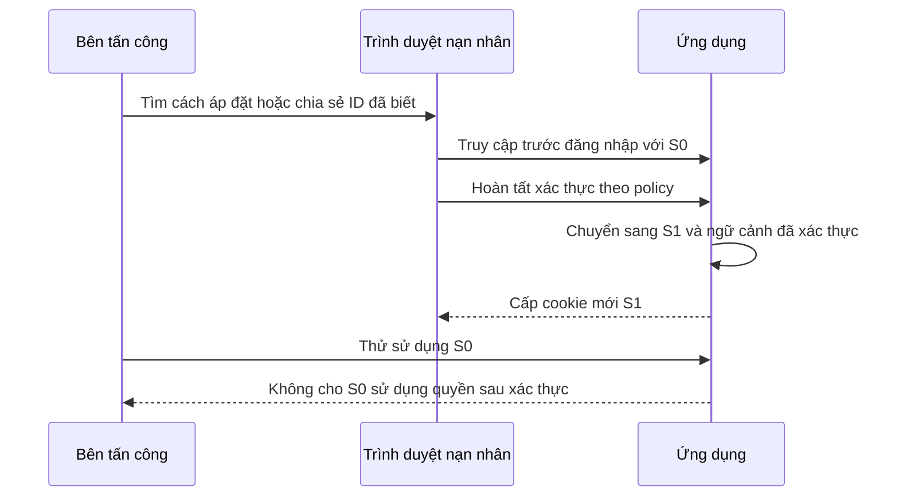

# Session rotation — Luân chuyển định danh phiên

Một ứng dụng tạo session khi khách mở trang đăng nhập. Sau khi người dùng nhập đúng mật khẩu và hoàn tất MFA, ứng dụng tiếp tục dùng nguyên session ID ban đầu. Nếu kẻ tấn công đã biết hoặc áp đặt được giá trị trước đăng nhập, giá trị đó có thể trở thành phương tiện sử dụng phiên đã xác thực của nạn nhân.

**Session rotation** là việc thay giá trị ràng buộc hoặc định danh bí mật của phiên bằng một giá trị mới, đồng thời kiểm soát hiệu lực của giá trị cũ và ngữ cảnh được chuyển tiếp. Trong bài này, trọng tâm là phiên web dùng cookie chứa session ID opaque và có trạng thái phía server.

Trong IAM, rotation bảo vệ ranh giới giữa các mức xác thực và đặc quyền. Nó cần phối hợp với MFA, quản lý thời hạn, thu hồi phiên, SSO và phân quyền. Chỉ thay một chuỗi trên cookie chưa chứng minh rằng quyền truy cập cũ đã mất hiệu lực.

Sau bài học, người học có thể chọn thời điểm rotation, phân biệt nó với gia hạn hoặc xác thực lại, sử dụng cơ chế Servlet/Spring phù hợp và giải thích những lỗi khi nhiều request cạnh tranh.

## 1. Rotation thay đổi gì, và điều gì cần giữ riêng?

Một phiên logic có thể có ngữ cảnh như chủ thể, tenant, thời điểm xác thực và hạn sử dụng. Session secret là giá trị client trình bày để sử dụng ngữ cảnh đó. Rotation có thể thay secret mà vẫn tiếp tục một phần ngữ cảnh phiên.

```text
Trước rotation:
    secret S0 → phiên logic L, thế hệ 0

Sau rotation:
    secret S1 → phiên logic L, thế hệ 1
    secret S0 không còn được dùng theo hiệu lực đã quy định
```

`S0`, `S1` và `L` chỉ là ký hiệu minh họa. Chúng không phải cách sinh giá trị thực. Một tham chiếu nội bộ ổn định như `L` cũng không được vô tình chấp nhận như bí mật thay cho `S1`.

| Thao tác | Điều thay đổi | Điều không thể tự suy ra |
| --- | --- | --- |
| Session rotation | Secret/ID hoặc thế hệ ràng buộc phiên | Người dùng vừa xác thực lại |
| Cập nhật hoạt động | Dữ liệu liên quan idle timeout | Được kéo dài giới hạn tổng tùy ý |
| Reauthentication | Bằng chứng xác thực được cung cấp và kiểm tra lại | Mọi phiên khác cùng tài khoản được nâng mức |
| Step-up | Ngữ cảnh đáp ứng yêu cầu xác thực mới hoặc mạnh hơn | Chỉ cần đổi ID là đạt MFA |
| Logout/revocation | Phiên bị kết thúc trong phạm vi đã chọn | Chỉ thay ID hiện tại là đã thu hồi mọi bản sao |
| Refresh token rotation | Refresh token OAuth được thay trong quy trình cấp token | Cookie phiên ứng dụng hoặc phiên IdP cũng đã đổi |

RFC 9700 mô tả refresh token rotation như một cơ chế bảo vệ refresh token, bao gồm quan hệ giữa các giá trị kế tiếp để phát hiện dùng lại. Đây là đối tượng và quy trình khác với đổi session ID của một ứng dụng web. [Nguồn: RFC 9700, mục 4.14.2](https://www.rfc-editor.org/rfc/rfc9700.html#section-4.14.2)

Một hệ thống có thể dùng cả hai, nhưng phải thực thi từng cơ chế ở đúng nơi. Đổi `JSESSIONID` không tự vô hiệu hóa refresh token đang được authorization server chấp nhận.

## 2. Vì sao rotation quan trọng ở ranh giới đăng nhập?

### 2.1. Session fixation

Trong session fixation, bên tấn công tìm cách làm nạn nhân sử dụng một ID mà họ đã biết trước khi nạn nhân được xác thực. Nếu ID giữ nguyên sau đăng nhập, bí mật đã biết đó có thể tiếp tục mang quyền mới.



OWASP khuyến nghị đổi session ID sau thay đổi mức đặc quyền, đặc biệt trong quá trình đăng nhập, để chống session fixation. ID cũ không được tiếp tục dùng cho ngữ cảnh quyền đã thay đổi. [Nguồn: OWASP — Renew the Session ID After Any Privilege Level Change](https://cheatsheetseries.owasp.org/cheatsheets/Session_Management_Cheat_Sheet.html#renew-the-session-id-after-any-privilege-level-change)

Điểm quan trọng là ranh giới quyền. Nếu ứng dụng đổi cookie sang S1 nhưng vẫn cho S0 tìm tới cùng ngữ cảnh authenticated, rotation chưa cắt được đường truy cập bằng bí mật cũ.

### 2.2. Giới hạn trước session hijacking

Rotation có thể làm một bản sao cũ hết giá trị sử dụng. Tuy nhiên, không nên hứa rằng đổi ID định kỳ sẽ loại bỏ mọi bên tấn công đang giữ phiên.

Nếu bên tấn công vẫn đọc được cookie mới qua malware hoặc một đường rò rỉ tiếp diễn, họ có thể lấy S1. Nếu hệ thống cho bất kỳ bên nào giữ S0 tự đổi lấy S1, họ còn có thể đi theo chuỗi rotation mà không cần đánh cắp lại.

Khi nghi phiên đã bị chiếm, quyết định có thể cần thu hồi và xác thực lại bằng bằng chứng phù hợp. Rotation thuần túy không tạo ra bằng chứng mới về người đang kiểm soát phiên.

## 3. Chọn thời điểm rotation theo sự kiện

| Sự kiện | Điều cần xem xét |
| --- | --- |
| Chuyển từ anonymous sang authenticated | Cấp ràng buộc phiên mới sau các bước xác thực bắt buộc |
| Hoàn tất MFA hoặc step-up | Tách ngữ cảnh trước đó khỏi ngữ cảnh có bằng chứng mới nếu thiết kế yêu cầu |
| Chuyển vào hoặc rời chế độ đặc quyền | Kiểm soát ID, quyền và dữ liệu phiên tại ranh giới thay đổi |
| Chuyển tài khoản, tenant hoặc chế độ impersonation | Làm sạch ngữ cảnh không được phép mang sang, không chỉ đổi ID |
| Renewal định kỳ | Định nghĩa chu kỳ, chuyển giao, xử lý đồng thời và ID cũ |
| Đổi mật khẩu hoặc reset MFA | Xác định phiên nào bị thu hồi/xác thực lại; không chỉ đổi phiên đang mở |
| Logout | Kết thúc phiên và các ID liên quan; không tạo một thế hệ authenticated mới |

Không nhất thiết mỗi sự kiện dùng cùng một hàm hoặc cùng chính sách. Ví dụ, một quy trình đăng nhập nhiều bước có thể có phiên giới hạn trước MFA. Bất kể có bao nhiêu lần thay ID, phiên đó vẫn không được gọi API cần MFA cho đến khi bằng chứng bắt buộc được kiểm tra.

Khi hạ quyền hoặc kết thúc impersonation, cũng cần kiểm soát ngữ cảnh được giữ lại. Chỉ đổi ID nhưng tiếp tục giữ các quyền cũ trong security context sẽ không thực hiện được quyết định hạ quyền.

### Không rotation sau mọi request một cách mặc định

Một trang có thể gửi nhiều request song song. Thay ID ở mọi response có thể tạo nhiều thế hệ cạnh tranh, lỗi cookie đến không đúng thứ tự và tải ghi kho phiên lớn.

Thiết kế cần có lý do cho thời điểm đổi: ranh giới xác thực, đặc quyền hoặc renewal theo policy. Số lần đổi nhiều không tự chứng minh mức bảo vệ cao hơn.

## 4. Rotation không được xóa lịch sử thời gian xác thực

Một ngữ cảnh minh họa có thể tách các mốc:

```text
logical_session_ref: internal-session-reference
generation: 4
subject_ref: internal-subject-reference
authentication_time: thời điểm bằng chứng được xác minh
last_activity_at: thời điểm hoạt động được policy công nhận
last_rotation_at: thời điểm đổi ràng buộc phiên gần nhất
overall_expires_at: hạn tổng được policy xác lập
revoked_at: null
```

Đổi `last_rotation_at` không có nghĩa được đổi `authentication_time`. Tương tự, tạo một record mới để chứa S1 không nên vô tình đặt lại mọi giới hạn như thể người dùng vừa đăng nhập.

NIST phân biệt timeout tổng và timeout không hoạt động; xác thực lại thành công có thể đặt lại cả hai theo quy tắc của hướng dẫn. Rotation của ID tự nó không phải sự kiện reauthentication. [Nguồn: NIST SP 800-63B-4 — Reauthentication](https://pages.nist.gov/800-63-4/sp800-63b.html#reauthentication)

Ví dụ một sản phẩm quy định xác thực lại sau tối đa 8 giờ và renewal ID mỗi 30 phút. Đây là các tham số minh họa, không phải cấu hình chuẩn cho mọi ứng dụng.

```text
Giờ 0:    hoàn tất xác thực.
Giờ 0,5:  đổi S0 → S1, chưa có bằng chứng xác thực mới.
Giờ 1:    đổi S1 → S2, chưa có bằng chứng xác thực mới.
Giờ 8:    vẫn phải thực thi yêu cầu xác thực lại theo policy.
```

Nếu mỗi lần đổi ID lại tính thêm 8 giờ mà không kiểm tra bằng chứng mới, renewal đã làm mất ý nghĩa giới hạn tổng. Một bên giữ được phiên có thể tiếp tục kéo dài truy cập.

Thay `Max-Age` của cookie cũng không sửa được vấn đề này. Thời gian chấp nhận ngữ cảnh phải được verifier hoặc server thực thi, không chỉ do trình duyệt quyết định còn gửi cookie hay không.

## 5. Thiết kế chuyển đổi ở kho phiên

### 5.1. Những bất biến cần bảo toàn

Với một cơ chế rotation tự xây cho phiên opaque, cần xác định các điều kiện như:

- Secret mới được sinh bằng cơ chế ngẫu nhiên mật mã phù hợp, không dẫn xuất dễ đoán từ ID cũ.
- Chỉ ngữ cảnh được phép mới được chuyển sang thế hệ mới.
- ID cũ không tiếp tục truy cập quyền mới trái với chính sách chuyển giao.
- Hạn tổng, dấu vết xác thực và trạng thái thu hồi không bị xóa do rotation.
- Hai thao tác đồng thời không tạo các nhánh cùng có quyền ngoài thiết kế.
- Logout hoặc thu hồi không bị một thao tác rotation đang chờ làm mất hiệu lực.

Trong ứng dụng dùng framework/container, ưu tiên cơ chế mà framework cung cấp và hiểu rõ hợp đồng của nó. Các bất biến vẫn cần được xét ở những phần tích hợp như kho phiên chung, cache hoặc custom authentication.

### 5.2. Mã giả cho một chuyển đổi có điều kiện

Đây là mô hình tư duy cho kho phiên tùy chỉnh, không phải chỉ dẫn thay thế cơ chế nội bộ của Servlet container:

```text
Xác định sự kiện được phép rotation và ngữ cảnh đã được xác minh.
Chuẩn bị một secret mới bằng CSPRNG.

Trong thao tác nguyên tử của kho phiên:
    Đọc phiên logic và thế hệ được request trình bày.
    Kiểm tra còn active, chưa hết hạn và chưa bị thu hồi.
    Kiểm tra đúng thế hệ dự kiến và điều kiện của sự kiện.
    Tạo binding mới gắn với ngữ cảnh được phép.
    Tăng generation và kết thúc hiệu lực binding cũ theo policy.
    Giữ các mốc thời gian không được phép đặt lại.
    Lưu một chuyển trạng thái có kết quả xác định.

Sau khi kho xác nhận thành công:
    Trả cookie mới trên kênh phù hợp.
    Không lộ secret trong log hoặc nội dung chẩn đoán.
```

Nếu ghi S1 thành công nhưng response không đến client, client có thể mất khả năng tiếp tục bằng S0. Hệ thống cần một đường phục hồi có kiểm soát, chẳng hạn xác thực lại, thay vì tự làm S0 có hiệu lực vô hạn để tránh mọi lỗi trải nghiệm.

Khi giữ tombstone hoặc lịch sử thế hệ để phát hiện dùng lại, không cần giữ nguyên plaintext secret trong log. Lịch sử nội bộ phải có giới hạn và không được trở thành một endpoint đổi ID cũ lấy ID mới.

### 5.3. Chỉ đổi khóa tra cứu chưa đủ cho mọi kiến trúc

Trong cụm nhiều node, một node có thể còn cache S0 sau khi kho chính chuyển sang S1. Hệ thống phải biết node nào là nơi quyết định hiệu lực và cache được làm mới theo cách nào.

Sticky session có thể giúp định tuyến nhưng không tự chứng minh hiệu lực thu hồi trên node khác hoặc sau failover. Cần kiểm tra đường phục vụ thật, không chỉ nhìn thấy một record mới trong kho chính.

## 6. Java Servlet: getSession(true) khác changeSessionId()

`HttpServletRequest.changeSessionId()` đổi ID của session hiện đang gắn với request. Phương thức có từ Servlet 3.1 và ném `IllegalStateException` nếu không có session. `getSession(true)` chỉ tạo mới khi cần; nếu session đã có, nó trả session đó. [Nguồn: Jakarta Servlet — HttpServletRequest](https://jakarta.ee/specifications/servlet/6.1/apidocs/jakarta.servlet/jakarta/servlet/http/HttpServletRequest.html#changeSessionId())

Vì vậy, đoạn sau không bảo đảm rotation:

```java
// Có thể trả chính session cũ, với cùng ID.
request.getSession(true);
```

Đoạn minh họa thao tác ID trong một luồng Servlet do ứng dụng quản lý:

```java
import jakarta.servlet.http.HttpSession;

// Giả định các bước xác thực bắt buộc đã được server kiểm tra.
// Đoạn này chỉ minh họa cơ chế session, không triển khai đăng nhập.
HttpSession existing = request.getSession(false);

if (existing == null) {
    request.getSession(true);  // Chưa có session: tạo ngữ cảnh mới.
} else {
    request.changeSessionId(); // Đã có session: đổi định danh.
}
```

Đừng gọi thêm đoạn này trong một success handler chỉ vì muốn “chắc hơn” khi framework đã xử lý rotation. Cần xác định thành phần sở hữu chuyển trạng thái để tránh đổi hai lần và làm sai các tích hợp theo dõi session ID.

### Đổi ID không làm sạch mọi attribute

`changeSessionId()` dùng session hiện có thay vì tạo một session sạch. Các dữ liệu được giữ lại vẫn cần đúng mức tin cậy.

Ví dụ, lựa chọn ngôn ngữ có thể được chuyển tiếp nếu đã kiểm tra hợp lệ. Nhưng một attribute mang quyền, tenant hoặc trạng thái `mfaVerified` không được lấy từ dữ liệu anonymous tùy ý rồi giữ nguyên sau đăng nhập.

Nếu ứng dụng chọn hủy session cũ và tạo session mới, cần quyết định danh sách dữ liệu được phép chuyển. Sao chép mọi attribute có thể kéo theo ngữ cảnh không phù hợp; không sao chép gì cũng có thể làm mất trạng thái nghiệp vụ cần thiết. Đây là quyết định ranh giới dữ liệu, không phải lựa chọn chỉ theo tên API.

Thao tác đổi ID cũng không tự thay thế quản lý principal, security context hoặc phân quyền tài nguyên. Những phần đó phải được thực hiện bởi luồng xác thực/phân quyền phù hợp.

## 7. Spring Security: để chiến lược phiên làm đúng phần việc

Spring Security có cơ chế bảo vệ session fixation trong luồng đăng nhập. Tài liệu mô tả `changeSessionId`, `newSession` và `migrateSession` với cách xử lý session/attribute khác nhau. [Nguồn: Spring Security — Session Fixation Protection](https://docs.spring.io/spring-security/reference/servlet/authentication/session-management.html#ns-session-fixation)

Ví dụ sau minh họa lựa chọn `changeSessionId` trong cấu hình Servlet-based Spring Security. Đoạn bean được đặt trong lớp cấu hình phù hợp; nguồn tài khoản và các thành phần đăng nhập khác được cấu hình riêng.

```java
import org.springframework.context.annotation.Bean;
import org.springframework.security.config.Customizer;
import org.springframework.security.config.annotation.web.builders.HttpSecurity;
import org.springframework.security.web.SecurityFilterChain;

@Bean
SecurityFilterChain applicationSecurity(HttpSecurity http) throws Exception {
    http
        .authorizeHttpRequests(authorize -> authorize
            .requestMatchers("/login", "/assets/**").permitAll()
            .anyRequest().authenticated())
        .formLogin(Customizer.withDefaults())
        .sessionManagement(session -> session
            .sessionFixation(fixation -> fixation.changeSessionId()));

    return http.build();
}
```

Cấu hình này thể hiện chiến lược ở luồng form login, chưa triển khai MFA, phân quyền chi tiết theo tài nguyên hoặc mọi sự kiện step-up của sản phẩm. Không suy ra rằng một custom controller tự gán authentication sẽ đi qua đủ cùng quy trình.

Khi viết luồng xác thực tùy chỉnh, cần tích hợp cơ chế quản lý phiên và lưu security context theo đúng phiên bản framework. Chỉ gán principal trong một request rồi tự sửa cookie không bảo đảm trạng thái được khôi phục đúng ở request sau.

CSRF token cũng là artifact có vòng đời riêng. Việc giữ hay cấp lại nó trong chuyển trạng thái phụ thuộc cách framework quản lý. Cần để biểu mẫu nhận đúng trạng thái hiện hành; không tắt CSRF chỉ để khắc phục một lỗi sau rotation.

## 8. Request đồng thời và response đến sai thứ tự

### 8.1. Hai request cùng cố đổi S0

Một trình duyệt có thể gửi A và B cùng mang S0:

```text
A: đọc S0, generation 5, trạng thái active.
B: đọc S0, generation 5, trạng thái active.
A: muốn chuyển sang S1.
B: muốn chuyển sang S2.
```

Nếu cả hai đều được ghi không có điều kiện, kho có thể giữ hai nhánh còn hiệu lực hoặc response cuối cùng có thể đặt cookie mà kho đã không còn chấp nhận.

Một thiết kế tùy chỉnh có thể dùng compare-and-set theo generation và trạng thái, khóa phù hợp hoặc cơ chế tương đương để chỉ một chuyển đổi thắng. Bên còn lại cần có kết quả xác định; không tự khởi tạo lại một phiên authenticated từ snapshot cũ.

Đối với sự kiện như hoàn tất MFA, phải kiểm soát cả việc tiêu thụ bằng chứng của sự kiện. Không chỉ để một cookie thắng trong khi cùng bằng chứng bị dùng để tạo nhiều ngữ cảnh đặc quyền khác nhau ngoài thiết kế.

### 8.2. Response cũ ghi đè cookie mới

Request B có thể bắt đầu trước rotation nhưng trả response sau A. Nếu B ghi lại cookie cũ hoặc xử lý một lỗi bằng cách xóa cookie mới một cách không phù hợp, người dùng có thể bị mất phiên.

Cần kiểm thử thứ tự response và cách cookie được ghi ở container, proxy và code tùy chỉnh. Điều phối ở client có thể giúp giảm tranh chấp, nhưng quyết định hiệu lực vẫn phải được server bảo vệ vì client không phải nguồn tin cậy.

Một lỗi UX không nên được sửa bằng cách làm mọi ID từng tồn tại đều tiếp tục truy cập được. Nếu cần hỗ trợ chuyển giao, phải có phạm vi và thời hạn rõ.

## 9. Grace period và cuộc đua với logout

### 9.1. Grace period không được mở đường tới quyền mới

Renewal định kỳ có thể được thiết kế với một khoảng chuyển giao ngắn để xử lý các request đang bay. OWASP mô tả safety interval và cũng lưu ý cuộc đua khi bên giữ ID cũ lấy ID mới trước người dùng. [Nguồn: OWASP — Renewal Timeout](https://cheatsheetseries.owasp.org/cheatsheets/Session_Management_Cheat_Sheet.html#renewal-timeout)

Khi đánh giá cơ chế đó, cần trả lời:

- S0 được chấp nhận để làm gì trong khoảng chuyển giao?
- Ai được nhận S1 và cần bằng chứng nào ngoài việc biết S0?
- Khi nào S0 bị loại bỏ chắc chắn?
- Khoảng này có giữ được hạn tổng và trạng thái thu hồi không?

Đặc biệt, S0 từ trước đăng nhập hoặc trước bước nâng mức không được tự đổi lấy S1 mang quyền mới chỉ bằng việc trình bày S0. Nếu làm vậy, ranh giới mà rotation cần bảo vệ đã bị nối lại.

Khoảng chuyển giao còn là một giới hạn đối với tuyên bố bảo vệ. Trong thời gian S0 vẫn được chấp nhận, một bản sao S0 có thể còn giá trị theo phạm vi đó; không báo rằng bí mật cũ đã vô hiệu hóa hoàn toàn.

### 9.2. Rotation không được làm sống lại phiên đã logout

Xét chuỗi sự kiện:

```text
1. A đọc phiên active và chuẩn bị rotation.
2. B thực hiện logout, đánh dấu phiên revoked.
3. A tiếp tục ghi thế hệ mới từ dữ liệu đã đọc ở bước 1.
```

Nếu bước 3 không kiểm tra trạng thái/version hiện hành, phiên đã bị kết thúc có thể được tạo lại. Một lần logout thành công khi đó không còn có ý nghĩa như người dùng mong đợi.

Một cách bảo vệ trong kho tùy chỉnh là cho rotation chỉ ghi khi phiên vẫn active và version vẫn khớp. Logout thay trạng thái/version khiến thao tác từ snapshot cũ thất bại. Không có đường lưu lại session nào được bỏ qua trạng thái kết thúc để tự phục hồi quyền.

Phạm vi logout phải bao phủ các ID của cùng phiên logic theo thiết kế, gồm cả thế hệ còn được chấp nhận trong chuyển giao. Việc chỉ xóa một khóa hiện tại nhưng còn các alias hoặc request renewal đang có thể phát hành lại secret sẽ để lại đường truy cập.

## 10. Ranh giới với SSO, đặc quyền và sự cố

### Phiên local và phiên IdP

Một ứng dụng có thể đổi cookie phiên local sau khi nhận kết quả xác thực từ IdP. Việc này không đồng nghĩa cookie của IdP hay mọi ứng dụng SSO khác đều đã đổi.

Nếu policy yêu cầu bằng chứng mới, một lần nhận assertion hoặc response mới chưa tự chứng minh người dùng vừa nhập lại yếu tố. Ứng dụng cần đánh giá thông tin xác thực được issuer tin cậy cung cấp theo hợp đồng tích hợp, thay vì lấy thời gian rotation local làm thời gian xác thực.

### Quyền RBAC/ABAC

Rotation không tự lấy lại quyền hiện hành từ nguồn policy. Nếu ứng dụng tiếp tục mang một bản sao vai trò đã cũ sang phiên mới, người dùng có thể vẫn giữ đặc quyền đã bị thu hồi.

Khi chuyển tenant hoặc chế độ quản trị, cần xác định những attribute nào được phép dùng lại và những quyền nào phải được đánh giá lại. Một session ID mới không biến dữ liệu quyền do client cung cấp thành đáng tin.

### Reset credential và nghi chiếm quyền

Sau đổi mật khẩu hoặc reset MFA, hệ thống có thể cần thu hồi nhiều phiên và artifact liên quan theo policy. Đổi ID của trình duyệt hiện tại không kết thúc các phiên trên thiết bị khác hoặc access token đã được phát hành.

Nếu nghi secret phiên đã bị lấy, phải đánh giá nguyên nhân rò rỉ. Rotation sẽ không giải quyết việc proxy vẫn log cookie, script độc hại vẫn chạy hoặc một endpoint vẫn trả session secret trong response chẩn đoán.

Credential workload, khóa ký token và API key có vòng đời riêng. Không gọi việc đổi session cookie của con người là đã luân chuyển các bí mật đó.

## 11. Kiểm toán mà không ghi lại bí mật phiên

Một sự kiện rotation có thể chứa tham chiếu nội bộ ổn định và số thế hệ, thay vì session secret:

```text
event_type: SESSION_ROTATED
logical_session_ref: internal-session-reference
subject_ref: internal-subject-reference
reason: AUTHENTICATION_COMPLETED
previous_generation: 5
current_generation: 6
authentication_context_ref: verified-context-reference
policy_version: session-policy-v2
```

Không ghi S0, S1, toàn bộ header `Cookie` hoặc `Set-Cookie` vào log thông thường. Nếu dùng tham chiếu tương quan, phải bảo đảm tham chiếu đó không được chấp nhận như phương tiện đăng nhập.

Metric có thể theo dõi rotation thành công, xung đột generation, dùng ID cũ và lỗi ghi kho. Nhãn nên là lý do và loại kết quả, không phải user ID hoặc secret phiên.

Một request dùng S0 sau rotation có thể là request đang bay hoặc một dấu hiệu dùng lại trái phép. Cần xét ngữ cảnh trước khi kết luận, đồng thời vẫn thực thi đúng hiệu lực đã quy định.

Nếu có cache hoặc nhiều vùng triển khai, cần quan sát thời gian hiệu lực thay đổi tới các verifier. Không thể suy ra cơ chế đã hoạt động ở mọi nơi chỉ từ một log `SESSION_ROTATED` trên node xử lý đăng nhập.

## 12. Các tình huống cần kiểm chứng

| Tình huống | Kết quả cần đạt |
| --- | --- |
| Có session anonymous trước đăng nhập | Sau xác thực, ID trước đó không sử dụng được quyền mới |
| Chỉ gọi `getSession(true)` khi session đã có | Không nhầm việc trả session cũ với rotation |
| Đăng nhập thất bại | Không tạo phiên có quyền authenticated |
| Còn chờ MFA | Mọi ID ở giai đoạn này vẫn chịu giới hạn trước MFA |
| Step-up hoàn tất | Ngữ cảnh mới đúng bằng chứng, ID cũ không tự nhận quyền mới |
| Attribute nhạy cảm tồn tại trước đăng nhập | Không được giữ như dữ liệu quyền đáng tin chỉ vì đã đổi ID |
| Renewal nhiều lần nhưng không reauthentication | Hạn tổng và thời gian xác thực không bị kéo dài sai |
| Hai request cùng rotation | Không tạo nhánh quyền hoặc cookie không xác định trái thiết kế |
| Response cũ đến sau response rotation | Không vô tình ghi đè trạng thái mới bằng dữ liệu cũ |
| Logout cạnh tranh với rotation hoặc session-save | Không tạo lại phiên authenticated sau logout |
| ID cũ nằm trong grace period | Đúng phạm vi/hạn; không được leo sang quyền mới |
| Node khác còn cache ID cũ | Hiệu lực kiểm tra phù hợp với cam kết của kiến trúc |
| Cookie mới không đến client | Có kết quả và đường phục hồi xác định, không giữ ID cũ vô hạn |
| Quyền tài khoản đã bị thu hồi | Rotation không phục hồi bản sao đặc quyền cũ |
| Chỉ đổi cookie local trong SSO | Không tuyên bố mọi phiên IdP hoặc token đã bị đổi/thu hồi |
| Bật trace, access log và xử lý lỗi | Không làm lộ các secret trước/sau rotation |

Các ca cạnh tranh phải đi qua cơ chế container/kho phiên thực tế. Một unit test chỉ kiểm tra rằng hai chuỗi ID khác nhau chưa chứng minh được khả năng chống fixation, thu hồi hoặc phục hồi phiên sau logout.

## 13. Tình huống tổng hợp

Một cổng quản trị có phiên anonymous để lưu ngôn ngữ giao diện. Người dùng hoàn tất đăng nhập và MFA. Hệ thống chuyển sang ràng buộc phiên mới, giữ dữ liệu giao diện hợp lệ nhưng tạo ngữ cảnh quyền từ kết quả xác thực đã kiểm tra.

Trong lúc trang mở nhiều request song song, policy định kỳ yêu cầu renewal ID. Cơ chế phiên bảo đảm một kết quả chuyển đổi xác định, không đặt lại thời điểm MFA và không kéo dài vô hạn hạn tổng.

Người dùng bấm logout khi một request renewal còn đang xử lý. Kho phiên đánh dấu kết thúc theo version hiện hành; request đang chờ không được ghi lại một thế hệ active từ dữ liệu cũ. Những ID có thể dùng cho cùng phiên logic cũng không tiếp tục phục vụ việc đổi lấy secret mới.

Thiết kế đúng cần kiểm soát cả ba phần: secret mới được cấp cho đúng ngữ cảnh, secret cũ mất đúng hiệu lực và mọi chuyển trạng thái tôn trọng thời hạn cũng như quyết định thu hồi. Đó là ý nghĩa thực tế của session rotation trong vòng đời truy cập IAM.

## Tài liệu tham khảo

- [OWASP Session Management Cheat Sheet](https://cheatsheetseries.owasp.org/cheatsheets/Session_Management_Cheat_Sheet.html)
- [Jakarta Servlet 6.1 — HttpServletRequest.changeSessionId](https://jakarta.ee/specifications/servlet/6.1/apidocs/jakarta.servlet/jakarta/servlet/http/HttpServletRequest.html#changeSessionId())
- [Spring Security — Authentication Persistence and Session Management](https://docs.spring.io/spring-security/reference/servlet/authentication/session-management.html)
- [NIST SP 800-63B-4 — Session Management](https://pages.nist.gov/800-63-4/sp800-63b.html#session-management)
- [RFC 9700 — Refresh Token Protection](https://www.rfc-editor.org/rfc/rfc9700.html#section-4.14)
