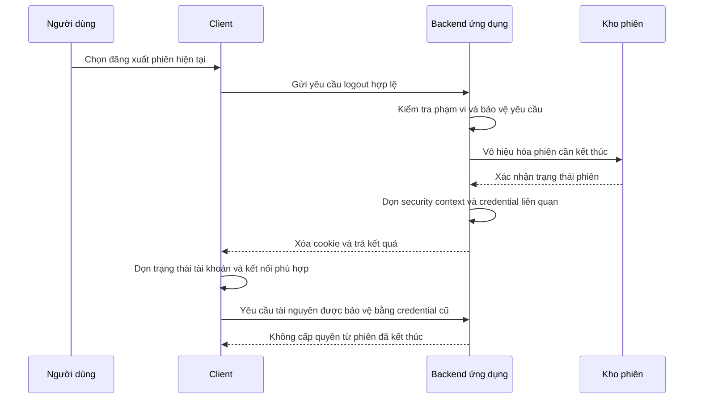

# Logout — Đăng xuất và kết thúc quyền truy cập của phiên

## 1. Logout cần đạt kết quả gì?

**Logout** là quá trình kết thúc khả năng tiếp tục truy cập dựa trên một phiên hoặc một tập credential đã được xác định. Với ứng dụng dùng session ở server, đăng xuất thường bao gồm vô hiệu hóa phiên và xóa dấu vết xác thực tương ứng ở client. Với OAuth hoặc SSO, còn có các token và phiên ở những thành phần khác cần được xem xét theo phạm vi đã chọn.

Ví dụ, người dùng đăng xuất khỏi cổng quản trị. Giao diện chuyển về trang đăng nhập và xóa tên người dùng khỏi thanh điều hướng. Nếu cookie cũ vẫn được backend chấp nhận, thao tác đó mới thay đổi giao diện; quyền của phiên chưa thực sự kết thúc.

Kết quả cần được mô tả cụ thể: định danh phiên cũ có còn truy cập API không, refresh token có còn cấp token mới không, phiên IdP có còn cho phép SSO không và các thiết bị khác có bị ảnh hưởng không.

Trong IAM, logout là một phần của vòng đời phiên, phối hợp với xác thực, MFA, recovery, quản lý token và kiểm toán. Nó không tự xóa tài khoản, thu hồi mọi quyền được gán hoặc hủy mọi credential của danh tính đó.

Sau bài học, người học có thể:

- Xác định phạm vi của các loại logout.
- Thiết kế kết thúc phiên tại backend và dọn trạng thái client.
- Phân biệt logout với thu hồi token và kết thúc phiên SSO.
- Xử lý logout đồng thời với refresh hoặc request đang chạy.
- Kiểm chứng hiệu lực bằng việc thử lại credential cũ.

## 2. Xác định phạm vi trước khi triển khai

| Phạm vi | Điều cần kết thúc | Điều chưa chắc bị ảnh hưởng |
| --- | --- | --- |
| Phiên local hiện tại | Phiên của ứng dụng đang sử dụng | Phiên trên thiết bị khác và phiên IdP |
| Phiên của một thiết bị được chọn | Những phiên hoặc credential thuộc nhóm thiết bị đã xác định | Những thiết bị khác |
| Mọi phiên của tài khoản | Toàn bộ phiên thuộc phạm vi tài khoản theo chính sách | API key, grant hoặc phiên bên ngoài chưa được tích hợp |
| Đăng xuất tại IdP | Phiên xác thực do nhà cung cấp danh tính quản lý | Phiên local của mọi ứng dụng nếu không có cơ chế phối hợp |
| Thu hồi một token hoặc grant | Token và những token liên quan theo chính sách của authority | Mọi loại session cookie trong hệ thống |
| Vô hiệu hóa tài khoản | Khả năng truy cập của danh tính theo quyết định quản trị | Cần cơ chế thực thi để các phiên và dịch vụ nhận biết kịp thời |

Tên trên giao diện cần phản ánh đúng kết quả. “Đăng xuất khỏi ứng dụng này” và “Đăng xuất khỏi mọi thiết bị” không nên trỏ đến cùng một endpoint chỉ xóa cookie hiện tại rồi hiển thị hai thông báo khác nhau.

Một thao tác logout thông thường không cần gỡ vai trò RBAC của người dùng. Khi người dùng đăng nhập hợp lệ lần sau, quyền hiện hành vẫn được đánh giá theo chính sách. Thu hồi quyền hoặc offboarding là các quyết định vòng đời danh tính khác, dù có thể cần kết hợp với việc kết thúc phiên.

## 3. Các lớp trạng thái cần kiểm kê

Một ứng dụng có thể đồng thời có:

```text
Trình duyệt hoặc ứng dụng client
  - Cookie phiên
  - Dữ liệu tài khoản trong bộ nhớ
  - Token hoặc dữ liệu lưu cục bộ, nếu kiến trúc có sử dụng
  - Cache và kết nối đang mở

Backend ứng dụng
  - Session record
  - Security context
  - Remember-me credential
  - Phiên kết nối dài hoặc nhóm subscription

Authorization Server / Identity Provider
  - Refresh token hoặc token family
  - Authorization grant
  - Phiên SSO

Resource Server khác
  - Cache trạng thái token hoặc quyền
  - Kết nối được cấp quyền từ trước
```

Không phải ứng dụng nào cũng có mọi thành phần trong mô hình này. Mục đích là tìm đúng nơi còn giữ khả năng truy cập. Xóa một biến ở frontend không tác động đến một session record ở server; xóa cookie trong một trình duyệt không xóa bản sao token đã bị lấy đi nơi khác.

Với backend-for-frontend giữ token ở server, trình duyệt có thể chỉ biết cookie. Khi logout, backend vẫn phải xử lý token do nó nắm giữ theo chính sách. Với ứng dụng di động, nơi lưu credential và cách thu hồi có thể khác trình duyệt.

## 4. Luồng logout local dùng session cookie

### 4.1. Trình tự cơ bản



Trong ứng dụng phân tán, việc trả kết quả cần gắn với ý nghĩa rõ ràng của bước vô hiệu hóa. Không chỉ gửi một tác vụ không được theo dõi rồi khẳng định mọi nơi đã kết thúc phiên.

OWASP nhấn mạnh việc vô hiệu hóa phiên tại server khi kết thúc phiên, cùng với xử lý session ID phía client. Tham khảo [OWASP Session Management — Session Expiration](https://cheatsheetseries.owasp.org/cheatsheets/Session_Management_Cheat_Sheet.html#session-expiration).

### 4.2. Cookie cần được xóa đúng phạm vi

Ví dụ giao thức dưới đây giả định cookie có tên `JSESSIONID`, path `/` và không có thuộc tính `Domain` khi được cấp:

```http
POST /logout HTTP/1.1
Cookie: JSESSIONID=<session-cookie>
X-CSRF-TOKEN: <csrf-token>
```

Một phản hồi phù hợp với API có thể là:

```http
HTTP/1.1 204 No Content
Set-Cookie: JSESSIONID=; Path=/; Max-Age=0; Secure; HttpOnly; SameSite=Lax
Cache-Control: no-store
```

Các giá trị trong dấu ngoặc nhọn chỉ là placeholder. Cookie thực tế phải được xóa đúng tên, domain và path tương ứng. Nếu cookie được cấp cho path `/portal`, việc chỉ xóa cookie path `/` có thể để lại cookie cũ.

`HttpOnly` không ngăn server xóa cookie bằng response, nhưng JavaScript không thể tự đọc hoặc quản lý cookie đó như cookie thông thường. Vì vậy, một hàm frontend gọi `document.cookie` không thay thế được logout backend. Xem [MDN — Using HTTP cookies](https://developer.mozilla.org/en-US/docs/Web/HTTP/Guides/Cookies#removal_defining_the_lifetime_of_a_cookie).

Khi cần kết thúc một cookie có `Domain`, cấu hình xóa phải phù hợp phạm vi đã cấp. Với nhiều ứng dụng cùng host hoặc domain, tránh xóa mù mọi cookie gây ảnh hưởng ngoài phạm vi mong muốn.

### 4.3. Logout là thay đổi trạng thái

Với endpoint dùng cookie tự động đính kèm, cần bảo vệ yêu cầu logout trước CSRF theo cơ chế của ứng dụng. Một liên kết hoặc ảnh từ trang khác không nên tự ý kết thúc phiên của người dùng.

POST thường phù hợp cho hành động này, nhưng dùng POST tự nó chưa đủ chống CSRF. Backend vẫn cần kiểm tra token hoặc biện pháp tương ứng. Một endpoint dùng bearer token không tự động có cùng mô hình CSRF với cookie; cần đánh giá cách credential thực sự được gửi.

## 5. Ví dụ Java và Spring Security

### 5.1. Dùng luồng logout của framework

Spring Security cung cấp logout endpoint và các thành phần dọn trạng thái. Theo luồng mặc định có CSRF protection, GET `/logout` hiển thị xác nhận, còn POST hợp lệ thực hiện logout. Các handler xử lý HTTP session, security context, remember-me và trạng thái CSRF tương ứng. Tham khảo [Spring Security — Handling Logouts](https://docs.spring.io/spring-security/reference/servlet/authentication/logout.html).

Ví dụ thể hiện rõ một số lựa chọn bên trong cấu hình `HttpSecurity`:

```java
http.logout(logout -> logout
        .logoutUrl("/logout")
        .invalidateHttpSession(true)
        .clearAuthentication(true)
        .logoutSuccessUrl("/login?logout")
        .permitAll());
```

Đây là đoạn cấu hình minh họa, không phải toàn bộ `SecurityFilterChain`. Nó dùng redirect cho luồng web; API có thể dùng một success handler phù hợp để trả phản hồi như `204 No Content` thay vì HTML hoặc redirect.

Không tắt CSRF chỉ để nút logout hoạt động. Cần gửi yêu cầu theo đúng giao thức mà cấu hình bảo mật yêu cầu.

### 5.2. Các trường hợp tùy chỉnh

Nếu ứng dụng có cookie bổ sung, kho remember-me riêng hoặc token được lưu ở backend, cần tích hợp thao tác dọn đúng dữ liệu. Không cho rằng một đoạn DSL tự biết mọi credential do ứng dụng tự tạo.

Một controller chỉ gọi `SecurityContextHolder.clearContext()` có thể mới xóa ngữ cảnh của request hiện tại. Nếu repository hoặc session vẫn lưu authentication, request sau có thể phục hồi trạng thái đăng nhập.

Tương tự, chỉ gọi `session.invalidate()` chưa mô tả toàn bộ tác động đến refresh token, remember-me credential và phiên SSO. Ưu tiên dùng các thành phần logout được framework hỗ trợ, rồi bổ sung những trách nhiệm riêng của kiến trúc.

Không đặt logic thu hồi quan trọng vào một success page chỉ được thực hiện khi trình duyệt đi đến trang đó. Người dùng có thể đóng tab, bỏ qua redirect hoặc gặp lỗi mạng trước bước tiếp theo.

## 6. OAuth token và JWT sau logout

### 6.1. Xóa token ở client và thu hồi token là hai việc khác nhau

Nếu frontend xóa access token khỏi bộ nhớ, client đó không còn dùng bản sao token vừa xóa. Tuy nhiên, một bản sao ở nơi khác có thể vẫn được resource server chấp nhận nếu chưa hết hạn hoặc chưa được thu hồi theo cơ chế áp dụng.

Refresh token có thể tiếp tục cấp access token mới nếu nó còn hiệu lực. Vì vậy, thiết kế cần nêu logout có thu hồi refresh token của phiên hiện tại, cả token family hay một authorization grant cụ thể hay không.

RFC 7009 định nghĩa token revocation endpoint. Phạm vi thu hồi các token liên quan phụ thuộc loại token và chính sách của authorization server; phản hồi thành công không chứng minh mọi phiên SSO hoặc mọi token của tài khoản đã bị thu hồi. Xem [RFC 7009 — OAuth 2.0 Token Revocation](https://www.rfc-editor.org/rfc/rfc7009.html).

### 6.2. JWT xác minh cục bộ cần cơ chế thực thi tương ứng

Một JWT có chữ ký hợp lệ và còn hạn có thể vẫn được chấp nhận ở API chỉ xác minh chữ ký cùng các claim cần thiết, nếu API không có thông tin về việc thu hồi.

Những lựa chọn kiến trúc có thể gồm:

- Token có thời hạn ngắn, với giới hạn thời gian còn chấp nhận được mô tả rõ.
- Introspection hoặc kiểm tra trạng thái phiên theo hợp đồng tin cậy.
- Danh sách thu hồi hoặc phiên bản bảo mật được resource server thực sự kiểm tra.
- Sự kiện thu hồi kết hợp cơ chế cache và đồng bộ phù hợp.

Lựa chọn nào cũng cần kiểm chứng độ trễ và phạm vi thực thi. Thêm một trường `revoked=true` vào cơ sở dữ liệu không làm API khác tự biết nếu nó không đọc hoặc nhận thay đổi đó.

### 6.3. Thu hồi refresh token và request đang cạnh tranh

Giả sử một request logout thu hồi token family, đồng thời một request refresh đang cấp token mới. Nếu phần refresh chỉ tin trạng thái đã đọc trước đó, nó có thể tạo credential mới sau khi logout đã được ghi nhận.

Cần phối hợp trạng thái token family hoặc phiên theo một cơ chế nhất quán. Ví dụ, generation hoặc trạng thái revoked được kiểm tra ở thời điểm commit, không chỉ ở đầu request. Token mới không được vô tình làm sống lại một family đã bị thu hồi.

Không dùng việc đổi mật khẩu làm giả định thay thế cho thu hồi token: tác động thực tế cần được authority và các resource server thực thi.

## 7. Logout trong SSO và OIDC

### 7.1. Phiên ứng dụng và phiên IdP

Một người dùng đăng xuất local khỏi ứng dụng A nhưng vẫn có phiên tại IdP. Lần sau họ chọn đăng nhập, IdP có thể xác thực SSO mà không hỏi lại credential, tùy chính sách. Điều này không tự chứng minh logout local đã thất bại; cần xem phạm vi người dùng đã yêu cầu.

Ngược lại, kết thúc phiên tại IdP chưa chắc xóa phiên local của ứng dụng B nếu B không nhận và thực thi thông tin logout.

### 7.2. RP-Initiated Logout

OpenID Connect RP-Initiated Logout cho phép ứng dụng yêu cầu OpenID Provider đăng xuất người dùng. Tích hợp có thể dùng logout endpoint do provider công bố, `id_token_hint`, địa chỉ quay lại sau logout đã đăng ký và `state` để đối chiếu luồng. Xem [OpenID Connect RP-Initiated Logout](https://openid.net/specs/openid-connect-rpinitiated-1_0.html).

Địa chỉ quay lại phải được kiểm soát, không lấy một URL tùy ý từ request rồi redirect sau logout. Trong triển khai thực tế, cần giữ dữ liệu cần cho yêu cầu tới IdP theo cách an toàn trước khi dọn phiên local, nhưng không vì thế trì hoãn vô hiệu hóa local nếu luồng bên ngoài thất bại.

Không đồng nhất yêu cầu logout OIDC với việc thu hồi mọi authorization grant. Phiên SSO, token và quyền được ủy quyền là các loại trạng thái khác nhau.

### 7.3. Phối hợp nhiều ứng dụng

Back-Channel Logout dùng thông tin logout trực tiếp từ provider đến ứng dụng, thay vì chỉ đi qua trình duyệt. Ứng dụng cần xác minh thông điệp theo đặc tả và ánh xạ đúng đến các phiên local cần kết thúc. Tham khảo [OpenID Connect Back-Channel Logout](https://openid.net/specs/openid-connect-backchannel-1_0.html).

Endpoint nhận thông báo không được coi mọi request chứa một subject ID là lệnh logout đáng tin. Cần kiểm tra nguồn, tính hợp lệ, phạm vi và chống sử dụng lại theo giao thức áp dụng.

Nếu có cơ chế logout qua trình duyệt, việc người dùng đóng tab hoặc trình duyệt không hoàn tất các bước có thể ảnh hưởng kết quả. Hệ thống cần biết ứng dụng nào đã được thông báo, ứng dụng nào thực thi và đâu là giới hạn bảo đảm, thay vì chỉ dựa vào một trang “đã đăng xuất”.

## 8. Dọn trạng thái client, cache và kết nối

### 8.1. Dữ liệu giao diện và nhiều tab

Sau khi logout được xử lý, client cần dọn dữ liệu tài khoản nhạy cảm trong bộ nhớ và kho lưu cục bộ thuộc phạm vi áp dụng. Các tab cùng ứng dụng nên được đồng bộ trạng thái để không tiếp tục hiển thị một tài khoản như đang đăng nhập.

Thông báo giữa các tab hỗ trợ trải nghiệm; backend vẫn là nơi quyết định credential còn dùng được hay không. Một tab không nhận được thông báo cũng không được tiếp tục gọi API bằng phiên đã vô hiệu hóa.

Logout không có nghĩa xóa mọi nội dung mà người dùng từng tải xuống. Dữ liệu đã rời hệ thống cần được nhìn nhận theo chính sách quản lý dữ liệu riêng, không hứa có thể thu hồi chỉ bằng một thao tác session.

### 8.2. Cache và nút Back

Những phản hồi nhạy cảm cần chính sách cache phù hợp, chẳng hạn `Cache-Control: no-store` trong bối cảnh cần tránh lưu response. Frontend cũng cần xem xét cache của thư viện truy vấn, service worker hoặc bộ nhớ ứng dụng nếu có sử dụng.

Trình duyệt có thể hiển thị lại một trạng thái giao diện đã dựng trước đó. Vì vậy, việc nhấn Back thấy nội dung cũ và việc API chấp nhận session cũ cần được kiểm tra riêng. Không dùng một redirect sau logout làm bằng chứng rằng dữ liệu không còn xuất hiện ở mọi lớp cache.

### 8.3. WebSocket và kết nối dài

Một kết nối được xác thực tại thời điểm mở có thể tiếp tục nhận dữ liệu nếu ứng dụng không kiểm tra lại quyền hoặc không kết thúc kết nối khi phiên bị thu hồi.

Thiết kế cần ánh xạ phiên đến các kết nối liên quan hoặc có cơ chế kiểm tra hiệu lực trong quá trình sử dụng. Khi logout, xử lý những kết nối thuộc phạm vi đã chọn, đồng thời ngăn reconnect tự động bằng credential cũ.

Không chỉ đóng socket ở frontend và coi đó là thu hồi: một client khác có credential cũ vẫn có thể thử mở lại kết nối nếu server chưa thực thi quyết định.

## 9. Đăng xuất mọi thiết bị và xử lý sự cố

### 9.1. Phạm vi theo tài khoản

Đăng xuất mọi thiết bị cần có khả năng tìm hoặc vô hiệu hóa toàn bộ phiên thuộc phạm vi tài khoản. Có thể dùng danh mục session, trạng thái token family, phiên bản bảo mật tài khoản hoặc cơ chế tương đương mà các thành phần thực sự kiểm tra.

Một chuỗi user agent không đủ để nhận diện chắc chắn một thiết bị. Giao diện có thể dùng nhãn để người dùng phân biệt phiên, nhưng backend cần định danh nội bộ rõ ràng và kiểm tra quyền khi kết thúc phiên được chọn.

Nếu chính sách yêu cầu xác thực lại trước khi kết thúc mọi phiên, cần thiết kế sao cho người nghi ngờ bị chiếm quyền vẫn có đường xử lý sự cố hợp lệ. Không tạo một điều kiện khiến chỉ kẻ đang giữ thiết bị bị mất mới có thể thu hồi nó.

### 9.2. Logout không hoàn tất mọi bước khắc phục

Khi có dấu hiệu chiếm tài khoản, có thể cần kiểm tra cả mật khẩu, authenticator đã đăng ký, phương thức khôi phục, grant và các hoạt động cấp quyền. Kẻ tấn công còn giữ một credential đăng nhập hợp lệ có thể tạo phiên mới sau khi các phiên cũ bị kết thúc.

Đối với offboarding, tài khoản bị vô hiệu hóa hoặc quyền đã bị thu hồi phải được thực thi cùng vòng đời phiên. Một nút “logout all” không tự thay thế quyết định quản trị danh tính đó.

Các API key hoặc credential workload cũng không mặc định thuộc phạm vi logout của trình duyệt. Chúng cần được kiểm kê và thu hồi theo vòng đời riêng nếu sự cố hoặc yêu cầu quản trị bao phủ chúng.

## 10. Thất bại, retry và tính nhất quán

### 10.1. Đăng xuất lặp lại

Về hiệu ứng bảo mật, lặp lại yêu cầu kết thúc cùng một phiên không nên làm phiên sống lại hoặc tạo thêm quyền. Tuy nhiên, phản hồi HTTP có thể khác theo trạng thái xác thực và CSRF; không bắt buộc mọi lần retry đều trả cùng mã.

Sau khi dọn phiên cũ, một framework có thể tạo phiên ẩn danh mới để hiển thị trang đăng nhập hoặc cấp CSRF token. Sự xuất hiện một cookie mới không tự chứng minh người dùng vẫn được xác thực. Cần kiểm tra principal và quyền thực tế.

### 10.2. Một thành phần bên ngoài chưa thu hồi xong

Ví dụ, phiên local đã bị vô hiệu hóa nhưng authorization server tạm thời không nhận yêu cầu thu hồi refresh token. Hệ thống không nên khôi phục phiên local chỉ vì bước bên ngoài lỗi.

Thiết kế có thể lưu trạng thái xử lý còn thiếu và retry qua hạ tầng phù hợp, với bảo vệ dữ liệu credential nếu thao tác cần chúng. Không ghi token vào log hoặc payload vận hành không được kiểm soát.

Kết quả cần được diễn đạt đúng phạm vi: local đã kết thúc, còn một bước thu hồi đang chờ xử lý. Không xác nhận “mọi token ở mọi dịch vụ đã vô hiệu” nếu không có bằng chứng cho kết luận đó.

### 10.3. Request đã bắt đầu trước logout

Một request có thể đã vượt qua kiểm tra xác thực trước khi logout được xử lý. Việc hoàn tác một thao tác đã commit không phải hiệu ứng mặc định của kết thúc phiên.

Với hành động nhạy cảm, có thể cần kiểm tra lại trạng thái hoặc quyền tại ranh giới ghi dữ liệu. Đồng thời, cần xác định yêu cầu mới sau logout bị từ chối trong khoảng thời gian nào và cách đo độ trễ giữa các node.

Kho phiên dùng chung, cache và sự kiện thu hồi cần được kiểm chứng ở môi trường tích hợp. Chỉ kiểm tra một node nhận logout chưa chứng minh node khác đã ngừng chấp nhận credential.

## 11. Kiểm toán và các tình huống cần kiểm chứng

### 11.1. Ghi nhận phạm vi và kết quả

Ví dụ sự kiện kiểm toán:

```text
event_type: SESSION_TERMINATION
actor_id: internal-subject-id
subject_id: target-account-id
scope: CURRENT_APPLICATION_SESSION
session_audit_reference: opaque-session-reference
reason: USER_REQUESTED_LOGOUT
local_invalidation: SUCCESS
token_revocation: NOT_APPLICABLE
federated_logout: NOT_REQUESTED
correlation_id: opaque-request-reference
```

Các giá trị là mô hình minh họa. Audit reference không phải cookie hoặc session ID đủ để truy cập. Với logout do quản trị viên hoặc chính sách kích hoạt, cần phân biệt actor với chủ thể có phiên bị kết thúc.

Chỉ ghi kết quả thực sự biết. Một redirect đã được phát ra không đồng nghĩa IdP và mọi ứng dụng khác đã hoàn tất logout. Không đưa access token, refresh token, cookie hoặc credential vào sự kiện và trace.

### 11.2. Kiểm chứng hiệu lực

Bảng này là tiêu chí triển khai, không phải kết quả chạy thử một ứng dụng:

| Tình huống | Điều kiện cần xác minh |
| --- | --- |
| Dùng cookie cũ sau logout | Không truy cập được trạng thái đã xác thực |
| Cookie được cấp với path hoặc domain riêng | Xóa đúng cookie, không để lại bản cũ ngoài ý muốn |
| Backend còn session nhưng frontend đã xóa tên tài khoản | Phép kiểm chứng phải phát hiện quyền còn tồn tại |
| Nhận yêu cầu logout không có CSRF hợp lệ trong luồng cookie được bảo vệ | Không bị trang khác tùy ý thực hiện logout |
| Remember-me còn hiệu lực | Không tự phục hồi phiên trái phạm vi logout đã cam kết |
| Refresh token của phiên đã bị thu hồi | Không tiếp tục cấp token mới từ credential đó |
| JWT cũ được gửi trực tiếp đến resource server | Hành vi khớp cơ chế thu hồi và giới hạn hiệu lực đã công bố |
| Refresh và logout chạy đồng thời | Không phát hành credential làm sống lại family đã thu hồi |
| Request dùng phiên cũ đến node khác | Quyết định vô hiệu hóa được thực thi theo giới hạn đã thiết kế |
| Logout local nhưng IdP còn phiên SSO | Hành vi đăng nhập lại phù hợp phạm vi local |
| Yêu cầu logout SSO có redirect không được chấp nhận | Không tạo open redirect |
| Thông báo back-channel giả hoặc dùng lại | Không được coi là lệnh thu hồi đáng tin |
| Kết nối WebSocket đã mở | Kết thúc hoặc mất quyền đúng phạm vi |
| Nhiều tab và nút Back | Kiểm tra riêng dữ liệu hiển thị và khả năng gọi API |
| Logout mọi thiết bị | Phạm vi thu hồi bao phủ những phiên được cam kết |
| Logout lần nữa hoặc mất response | Retry không làm phiên sống lại |

Một phép kiểm chứng quan trọng là giữ bản sao credential thử nghiệm trước logout và dùng lại sau đó trong ngữ cảnh độc lập. Không chỉ dựa vào cookie jar đã tự xóa token, vì khi đó chưa kiểm tra server có thật sự từ chối credential cũ hay không.

## 12. Bài tập thiết kế

Một cổng nhân sự dùng cookie session ở backend, OAuth refresh token được giữ phía server và SSO qua IdP. Sau khi bấm logout, giao diện xóa dữ liệu nhưng một tab khác vẫn nhận dữ liệu qua WebSocket. Người dùng bấm đăng nhập và được IdP chuyển về ngay mà không nhập mật khẩu. Một token cũ cũng vẫn được một API khác chấp nhận trong vài phút.

Hãy phân tích ba hiện tượng theo phạm vi trạng thái tương ứng và thiết kế lại:

1. Logout local phải vô hiệu hóa những thành phần nào?
2. Khi nào cần yêu cầu logout tại IdP, và thông báo nào trên giao diện phản ánh đúng phạm vi?
3. Refresh token cùng access token đã cấp được xử lý ra sao?
4. Cơ chế nào làm kết nối dài và node khác nhận biết phiên đã kết thúc?
5. Cần kiểm tra gì khi refresh xảy ra đồng thời với logout?
6. Làm thế nào chứng minh phiên cũ không còn truy cập được thay vì chỉ quan sát giao diện?
7. Dữ liệu kiểm toán nào thể hiện phần đã thành công và phần còn chờ xử lý?

Một thiết kế đạt yêu cầu cần xác định rõ bí mật hoặc trạng thái nào đang cấp quyền, thành phần nào có trách nhiệm kết thúc nó và cách kiểm chứng hiệu lực. Logout hoàn chỉnh là một quyết định được thực thi trong hệ thống, cùng với trải nghiệm client phản ánh đúng kết quả đó.
