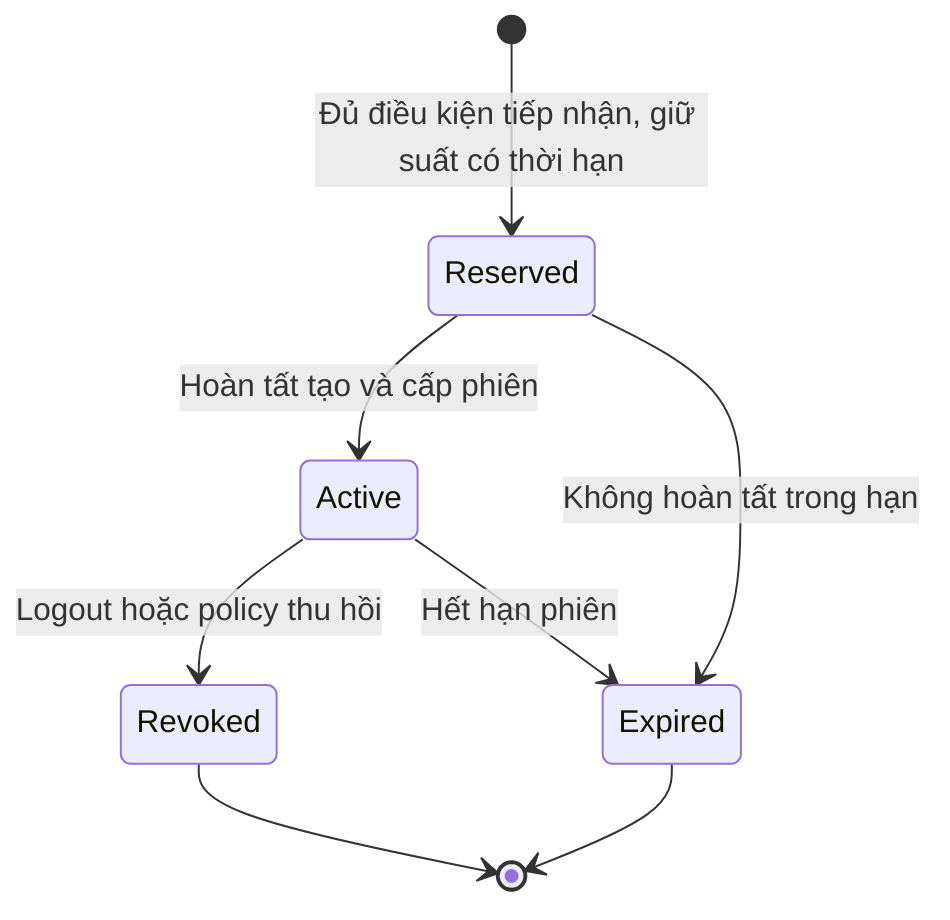
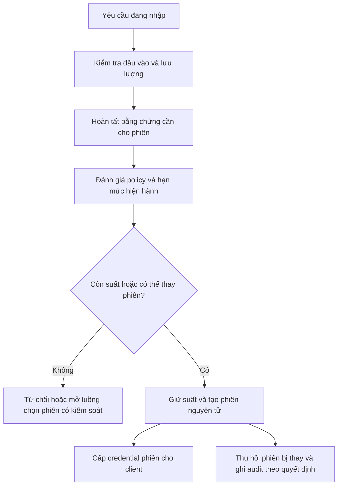

# Concurrent session — Quản lý nhiều phiên đồng thời

## 1. Concurrent session là gì?

Concurrent session là tình trạng một tài khoản có nhiều phiên đăng nhập còn hiệu lực trong cùng một khoảng thời gian. Ví dụ, một giảng viên đăng nhập nền tảng học tập trên laptop, điện thoại và một trình duyệt khác.

Cho phép nhiều phiên là một quyết định thiết kế, không mặc nhiên là lỗi bảo mật. Hệ thống IAM cần xác định phiên nào được tính, giới hạn áp dụng ở đâu và xử lý thế nào khi một lần đăng nhập mới vượt giới hạn.

Sau bài học, người học có thể phân biệt số phiên với số request/thiết bị, chọn chính sách giới hạn phù hợp, thiết kế việc tiếp nhận phiên mới an toàn khi có cạnh tranh và hiểu phạm vi của cơ chế concurrent session trong Spring Security.

| Tình huống | Có nhất thiết là nhiều phiên không? |
| --- | --- |
| Hai tab cùng trình duyệt, cùng cookie | Thường cùng một phiên |
| Nhiều request HTTP/2 chạy song song | Có thể đều thuộc một phiên |
| Một phiên mở thêm WebSocket | Không tự tạo thêm phiên đăng nhập |
| Hai browser profile giữ cookie khác nhau | Có thể là hai phiên |
| Điện thoại và laptop đăng nhập riêng | Thường là hai phiên theo mô hình sản phẩm |
| Token truy cập được refresh nhiều lần | Không nhất thiết là nhiều phiên logic |

Định nghĩa phải dựa trên credential và trạng thái mà hệ thống quản lý. Không lấy số tab, số kết nối TCP hoặc số IP làm số phiên.

OWASP xem việc cho phép đăng nhập đồng thời là quyết định của ứng dụng, đồng thời khuyến nghị khả năng xem và kết thúc các phiên hiện có. Tham khảo [OWASP — Simultaneous Session Logons](https://cheatsheetseries.owasp.org/cheatsheets/Session_Management_Cheat_Sheet.html#simultaneous-session-logons).

## 2. Chọn chính sách khi nhiều phiên cùng tồn tại

Một chính sách cần quy định cả giới hạn và hành động khi chạm giới hạn. Chỉ ghi “tối đa một phiên” mà không nói phiên nào được giữ sẽ tạo ra hành vi khó dự đoán.

| Chính sách | Khi có phiên đăng nhập mới vượt giới hạn | Điểm cần cân nhắc |
| --- | --- | --- |
| Cho phép nhiều phiên | Nhận phiên mới | Trải nghiệm thuận tiện, cần khả năng quản lý và thu hồi |
| Từ chối phiên mới | Giữ các phiên hiện tại, từ chối lần đăng nhập mới | Có đường xử lý phiên bị bỏ quên hoặc thiết bị mất |
| Nhận mới, kết thúc phiên khác | Chọn phiên cũ theo quy tắc và thu hồi | Có thể làm người đang làm việc bị gián đoạn |
| Cho người dùng chọn | Xác minh đủ rồi cho chọn phiên cần kết thúc | Quyền xem/quản lý danh sách phải được bảo vệ |

Nếu chọn kết thúc phiên khác, cần nói rõ “phiên tạo sớm nhất”, “phiên ít hoạt động gần đây nhất” hay một quy tắc khác. Những khái niệm này không giống nhau. Thời gian hoạt động cũng cần nguồn server đáng tin cậy và có thể chịu ảnh hưởng của polling nền.

### 2.1. Không có con số phù hợp cho mọi tài khoản

Người học có thể cần dùng điện thoại và máy tính cùng lúc. Nhân viên hỗ trợ có thể cần nhiều cửa sổ nghiệp vụ. Một phiên quản trị đặc quyền có thể có giới hạn riêng và yêu cầu tái xác thực mới hơn.

Các con số như một, hai hoặc ba phiên là ví dụ chính sách sản phẩm, không tự chứng minh hệ thống đạt một mức bảo đảm xác thực cụ thể.

### 2.2. Đạt giới hạn không chứng minh đang có tấn công

Người dùng có thể quên logout hoặc bị mất kết nối. Ngược lại, tài khoản chỉ có một phiên cũng có thể bị đối thủ dùng lại cùng credential phiên. Concurrent session control hỗ trợ quản lý rủi ro và vận hành, không thay thế MFA, bảo vệ session ID hoặc phát hiện chiếm phiên.

### 2.3. Thay đổi giới hạn khi quyền thay đổi

Nếu một tài khoản được nâng quyền hoặc policy đổi từ ba phiên xuống một, cần quy định điều gì xảy ra với các phiên đang có. Có thể áp dụng ngay hoặc có một cách chuyển tiếp được thiết kế; không để mỗi node tự quyết khác nhau.

Việc thay đổi giới hạn không tự cấp thêm quyền cho một phiên. Mỗi thao tác vẫn phải được đánh giá theo nguồn quyền hiện hành và ngữ cảnh xác thực cần thiết.

## 3. Xác định đúng chủ thể và phạm vi đếm

### 3.1. Dùng định danh ổn định

Một khóa policy có thể được xây từ tenant, subject và nhóm ứng dụng:

```text
session_limit_scope = (tenant_id, stable_subject_id, application_group)
```

Đây là mô hình riêng của ví dụ. Trong hệ thống liên kết danh tính, subject cần được diễn giải cùng issuer và ánh xạ tài khoản đã được xác minh. Không gộp hai người chỉ vì email hoặc tên hiển thị trùng nhau.

Username có thể đổi, email có thể được tái cấp và display name không duy nhất. Nếu dùng chúng làm khóa đếm mà thiếu quy tắc ổn định, có thể bỏ sót phiên hoặc áp nhầm giới hạn cho người khác.

### 3.2. Per application, per tenant hay toàn bộ tổ chức?

Giới hạn một phiên ở ứng dụng A không tự giới hạn phiên ở B. Giới hạn phiên IdP cũng không tự bằng tổng số phiên của mọi relying party.

Nếu sản phẩm muốn một hạn mức chung cho nhiều ứng dụng, cần một cơ chế xác định cùng chủ thể, registry chung và quy tắc thực thi tương ứng. Chỉ dùng chung một trang đăng nhập chưa đủ để có hạn mức toàn tổ chức.

### 3.3. Một thiết bị không luôn là một phiên

Một máy có thể giữ nhiều browser profile hoặc nhiều ứng dụng. Một trình duyệt có thể dùng nhiều account ở các phạm vi cookie khác nhau. Device ID do client gửi không phải căn cứ để miễn giới hạn hoặc tự kết luận đó là phiên cũ.

Nhãn thiết bị, User-Agent và IP hữu ích cho giao diện/rủi ro, nhưng không phải định danh mật mã của thiết bị. Không dùng chúng thay quyền sở hữu phiên.

## 4. Mô hình phiên logic và vòng đời

Một mô hình có thể tách ID quản lý phiên khỏi bearer secret dùng để truy cập:

```text
security_session_id: ID nội bộ để quản lý và kiểm toán
session_credential:  secret hoặc cookie được dùng khi truy cập
tenant_id, subject_id, policy_scope
state: RESERVED / ACTIVE / REVOKED / EXPIRED
created_at, last_accepted_activity_at, overall_expires_at
authentication_time, authentication_context
security_version, policy_version
```

ID nội bộ không được tự trở thành credential đăng nhập. Việc đổi session ID để chống fixation có thể giữ nguyên một phiên logic, do đó không cần chiếm thêm một suất chỉ vì cookie được xoay.

### 4.1. Phân biệt các trạng thái



`RESERVED` là một lựa chọn thiết kế khi tạo phiên phải qua nhiều bước. Nếu không cần reservation, có thể tạo `ACTIVE` ngay trong một giao dịch nguyên tử. Không thêm trạng thái chỉ để làm phức tạp quy trình.

Nếu dùng reservation, nó cần được tính vào sức chứa đang giữ và có hạn dùng. Nếu chỉ đếm `ACTIVE`, hai request có thể cùng giữ suất cuối rồi đều chuyển sang active.

### 4.2. Phiên hết hạn về mặt logic khác bản ghi đã được dọn

Một key còn trong kho dữ liệu chưa chắc là phiên còn hợp lệ. Việc đếm cần xét trạng thái và thời gian theo quy tắc server, không chỉ số hàng hoặc việc job cleanup đã chạy hay chưa.

Ngược lại, không được bỏ một phiên còn có thể truy cập khỏi bộ đếm chỉ vì một cache cục bộ không nhìn thấy nó. Định nghĩa trạng thái có hiệu lực phải thống nhất với nơi thực thi quyền.

### 4.3. Pending MFA và recovery có hạn mức riêng

Một giao dịch mới nhập username hoặc chỉ hoàn tất mật khẩu chưa phải phiên có đầy đủ MFA. Không để request chưa đủ bằng chứng chiếm hạn mức phiên authenticated lâu dài hoặc đẩy phiên hợp lệ ra ngoài.

Giao dịch MFA, recovery và reservation vẫn cần giới hạn riêng về số lượng, thời hạn và lưu lượng để tránh lạm dụng. Việc không tính chúng như phiên đầy đủ không có nghĩa có thể tạo vô hạn.

## 5. Tiếp nhận phiên mới sau đúng mức bằng chứng

Một trình tự khái niệm:



Nếu dùng chính sách “login mới thay login cũ”, phải thỏa điều kiện xác thực của phiên mới trước khi loại phiên hiện tại. Nếu chỉ cần biết username để gây thay phiên, đối thủ có thể liên tục đẩy chủ tài khoản ra ngoài.

### 5.1. Đăng nhập lại ở cùng browser

Đăng nhập lại hoặc tái xác thực một phiên có thể là cập nhật phiên logic thay vì tạo thêm suất. Cần xác định rõ điều này trong mô hình, không bỏ qua giới hạn chỉ vì client tự nói “đây là thiết bị cũ”.

### 5.2. Retry và việc client không nhận được cookie

Một request có thể tạo phiên thành công nhưng response bị mất trên mạng. Nếu mỗi retry tạo phiên mới, bộ đếm có thể đầy dù người dùng chưa thấy lần đăng nhập nào hoàn tất.

Một thiết kế có thể dùng ID giao dịch đăng nhập do server quản lý để nhận diện việc hoàn tất lặp. ID đó cần được ràng buộc với cùng giao dịch/chủ thể và không tự là quyền xác thực. Các phiên không được nhận cũng cần có chính sách hết hạn/dọn hợp lý.

### 5.3. Các đường xác thực khác cũng phải đi qua chính sách

Form login, callback SSO, API xác thực tùy biến, remember-me và luồng nâng cấp từ recovery có thể tạo hoặc phục hồi phiên. Nếu chỉ giới hạn ở một controller, các đường khác có thể bỏ qua.

Mỗi đường cần được tích hợp theo đúng framework và yêu cầu assurance. Không coi một cờ nhớ thiết bị hoặc một grant recovery là lý do tự tạo phiên đầy đủ ngoài quota.

## 6. Chống race condition khi nhiều login cùng đến

Giả sử giới hạn là ba phiên, hiện có hai. Hai request A và B cùng đọc số lượng:

```text
A đọc 2, thấy còn một suất.
B đọc 2, thấy còn một suất.
A tạo phiên thứ ba.
B tạo phiên thứ tư.
```

Mỗi request đều “đã kiểm tra giới hạn”, nhưng giới hạn tổng thể vẫn bị vượt. Một thao tác đọc danh sách rồi ghi riêng không tự có tính nguyên tử.

### 6.1. Một điểm quyết định chung cho cùng phạm vi

Nếu yêu cầu hạn mức nghiêm ngặt, cần một thao tác có thể tuần tự hóa quyết định tiếp nhận cho cùng scope. Có thể dùng giao dịch và khóa hàng trong database, thao tác nguyên tử phù hợp tại kho chung hoặc một dịch vụ tiếp nhận chuyên trách.

Một thuật toán minh họa:

```text
BEGIN TRANSACTION
    Khóa hàng policy/admission của (tenant, subject, application_group).
    Đọc giới hạn và phiên bản policy đang có hiệu lực.
    Xác định các phiên/reservation còn giữ suất theo thời gian hiện tại.
    Nếu còn suất:
        tạo phiên hoặc reservation gắn với giao dịch đăng nhập.
    Nếu đầy và policy từ chối phiên mới:
        không tạo phiên authenticated mới.
    Nếu đầy và policy thay phiên:
        chọn các phiên cần thu hồi theo quy tắc xác định.
        thu hồi/đánh dấu mất quyền và giữ suất cho phiên mới.
    Ghi sự kiện audit/outbox trong cùng quyết định.
COMMIT
```

Mọi đường tạo phiên trong scope đó phải tuân theo cùng cơ chế. Khóa cục bộ trong JVM chỉ điều phối được request của JVM đó; node khác không chịu khóa này.

### 6.2. Khóa phân tán cần đúng vòng đời

Nếu dùng một distributed lock có lease, cần xử lý tình huống lease hết hạn khi tiến trình còn hoạt động. Chỉ thêm tên một khóa vào Redis không tự chứng minh tác vụ ghi sau đó vẫn có thẩm quyền.

Thiết kế phải bảo đảm thao tác ghi được bảo vệ đúng lúc, có kiểm tra version hoặc cơ chế chống tác nhân cũ tiếp tục ghi khi cần. Mục tiêu là một quyết định nhất quán tại mốc được chọn, không phải chỉ có một lời gọi API tên “lock”.

### 6.3. Một counter không đủ nếu không gắn vòng đời

Bộ đếm tăng khi login nhưng không giảm khi timeout sẽ chặn người dùng hợp lệ. Bộ đếm giảm hai lần khi logout và nhận event trùng có thể âm hoặc cấp thừa suất.

Nếu dùng counter, cần trạng thái nguồn và quy tắc cập nhật idempotent. Các sự kiện đến lặp hoặc sai thứ tự phải được xét, cùng cơ chế đối soát. Đừng suy rằng TTL tự giải quyết mọi cạnh tranh giữa đếm, thu hồi và tạo phiên.

## 7. Quyết định thu hồi phải được thực thi khi truy cập

### 7.1. Registry không phải toàn bộ đường thực thi

Một hàng bị đánh dấu `REVOKED` chỉ có tác dụng bảo mật nếu nơi chấp nhận session/credential kiểm tra trạng thái đó. Nếu gateway hoặc resource server tiếp tục chấp nhận token cũ mà không có thông tin thu hồi, người dùng vẫn có quyền truy cập thực tế.

Vì vậy, cần định nghĩa giới hạn đang nói đến số bản ghi được registry coi là active hay số ngữ cảnh thực tế còn được phép truy cập. Nếu yêu cầu không có khoảng chồng lấn quyền, cơ chế xác minh và thu hồi phải đáp ứng điều đó; một cập nhật registry đồng bộ với các cache theo kiểu eventual không tự bảo đảm tức thời.

### 7.2. Request đang chạy và kết nối dài

Thu hồi phiên không tự hủy một request đã được cho phép hoặc hoàn tác một giao dịch đã commit. Các thao tác đặc quyền có thể cần kiểm tra trạng thái tại điểm quyết định nghiệp vụ phù hợp.

WebSocket, stream hoặc kết nối dài cần cơ chế kiểm tra lại hay đóng khi phiên không còn được phép. Chỉ giới hạn số lần login nhưng bỏ qua các kết nối còn mở sẽ không thực thi đầy đủ phạm vi đã hứa với người dùng.

### 7.3. Hết hạn và logout phải giải phóng đúng trạng thái

Logout, timeout, thu hồi thủ công và thay phiên có thể cùng tác động đến một bản ghi. Việc chuyển sang trạng thái kết thúc cần xử lý lặp an toàn để không giải phóng suất hai lần.

Nếu session cookie chỉ bị xóa ở client nhưng phiên server vẫn hoạt động, cả bảo mật lẫn số đếm có thể sai. Máy chủ phải là nơi quyết định hiệu lực và thời hạn; một trình duyệt đóng bất ngờ không bảo đảm đã có sự kiện logout.

NIST mô tả timeout, tái xác thực và vòng đời phiên; các mốc hết hạn cần được thực thi theo chính sách ở relying party. Tham khảo [NIST SP 800-63B-4 — Session Management](https://pages.nist.gov/800-63-4/sp800-63b/session/).

## 8. Ví dụ Spring Security: từ chối login mới khi đã đủ phiên

Ví dụ sau dành cho ứng dụng Spring Boot Servlet dùng form login và registry trong bộ nhớ. Nó minh họa chính sách một phiên hiện hành; không bao gồm triển khai MFA, registry phân tán hoặc cơ chế admission nguyên tử riêng.

```java
import org.springframework.context.annotation.Bean;
import org.springframework.context.annotation.Configuration;
import org.springframework.security.config.Customizer;
import org.springframework.security.config.annotation.web.builders.HttpSecurity;
import org.springframework.security.config.annotation.web.configuration.EnableWebSecurity;
import org.springframework.security.core.session.SessionRegistry;
import org.springframework.security.core.session.SessionRegistryImpl;
import org.springframework.security.web.SecurityFilterChain;
import org.springframework.security.web.session.HttpSessionEventPublisher;

@Configuration
@EnableWebSecurity
public class ConcurrentSessionConfig {
    @Bean
    SessionRegistry sessionRegistry() {
        return new SessionRegistryImpl();
    }

    @Bean
    HttpSessionEventPublisher httpSessionEventPublisher() {
        return new HttpSessionEventPublisher();
    }

    @Bean
    SecurityFilterChain securityFilterChain(
            HttpSecurity http, SessionRegistry sessionRegistry) throws Exception {
        http
            .authorizeHttpRequests(authorize -> authorize
                .requestMatchers("/login", "/error").permitAll()
                .anyRequest().authenticated())
            .formLogin(Customizer.withDefaults())
            .sessionManagement(session -> session
                .maximumSessions(1)
                .maxSessionsPreventsLogin(true)
                .sessionRegistry(sessionRegistry));
        return http.build();
    }
}
```

`maximumSessions(1)` đặt hạn mức cho user theo registry. `maxSessionsPreventsLogin(true)` chọn từ chối xác thực mới khi đạt hạn mức; với `false`, framework cho phép lần mới và làm hết hiệu lực một phiên hiện có theo chiến lược tương ứng. Tham khảo [Spring Security — ConcurrencyControlConfigurer](https://docs.spring.io/spring-security/site/docs/current/api/org/springframework/security/config/annotation/web/configurers/SessionManagementConfigurer.ConcurrencyControlConfigurer.html).

`HttpSessionEventPublisher` giúp đưa sự kiện vòng đời HttpSession đến cơ chế Spring Security. Cần bảo đảm listener được đăng ký đúng trong kiểu triển khai đang dùng. Một listener không được kích hoạt đúng có thể để registry giữ trạng thái cũ. Xem [Spring Security — Configuring Concurrent Session Control](https://docs.spring.io/spring-security/reference/servlet/authentication/session-management.html#ns-concurrent-sessions).

### 8.1. Principal phải được nhận diện nhất quán

`SessionRegistryImpl` dùng đối tượng principal làm khóa trong bộ nhớ. Với `UserDetails` tùy biến, `equals()` và `hashCode()` cần phản ánh cùng một người dùng ổn định và phù hợp tenant. Không đưa thuộc tính biến đổi như thời điểm login vào equality khiến mỗi lần login bị coi là người khác.

### 8.2. Đánh dấu hết hiệu lực và xử lý ở request tiếp theo

Trong cơ chế registry/ConcurrentSessionFilter của Spring Security, phiên bị đánh dấu expired được xử lý khi request đi qua filter tương ứng. Không suy rằng thao tác đánh dấu đó đã lập tức hủy mọi kết nối, mọi request đang chạy hoặc token OAuth được phát bởi thành phần khác.

### 8.3. Các luồng tùy biến cần tích hợp rõ

Nếu tự viết filter/controller để xác thực và lưu security context, không mặc định concurrent session control sẽ tự chạy như form login chuẩn. Cần tích hợp chiến lược và nơi lưu trạng thái theo framework.

Khi có MFA, thời điểm áp dụng policy cho phiên đầy đủ phải đúng với bằng chứng đã đạt. Đoạn cấu hình cơ sở ở trên không tự thêm MFA hoặc giải quyết mọi yêu cầu assurance của module IAM.

## 9. Nhiều node: lưu phiên chung và tiếp nhận nguyên tử là hai yêu cầu

### 9.1. Registry trong bộ nhớ chỉ thấy trạng thái của nó

Nếu node A và node B mỗi node dùng `SessionRegistryImpl`, một user có thể có một phiên được A nhìn thấy và một phiên được B nhìn thấy. Mỗi node có thể cho rằng mình chưa vượt giới hạn trong khi tổng hệ thống đã vượt.

Sticky session có thể giữ một browser quay lại cùng node, nhưng login từ browser khác vẫn có thể đến node khác. Nó không thay thế nguồn trạng thái chung cho hạn mức toàn cluster.

### 9.2. Registry dựa trên kho phiên chung

Spring Session cung cấp `SpringSessionBackedSessionRegistry`, lấy thông tin từ repository và hỗ trợ concurrent session management trong môi trường cluster. Cần repository có khả năng tìm session theo principal và ánh xạ principal nhất quán.

Tham khảo [Spring Session — SpringSessionBackedSessionRegistry](https://docs.spring.io/spring-session/reference/api/java/org/springframework/session/security/SpringSessionBackedSessionRegistry.html). Không chỉ thay nơi lưu cookie/session là đủ; registry được dùng bởi chính sách cũng phải đọc đúng nguồn.

### 9.3. Nguồn chung không tự loại bỏ read-then-write race

Ngay cả khi hai node nhìn cùng một danh sách, cả hai vẫn có thể cùng đọc còn một suất trước khi một node ghi. Nếu sản phẩm yêu cầu giới hạn nghiêm ngặt trong mọi lần tiếp nhận, phải kiểm tra cơ chế tuần tự hóa và mức nhất quán của toàn bộ thao tác admission.

Đây là yêu cầu kiến trúc bổ sung, không thể chứng minh chỉ từ việc hệ thống “dùng Redis” hoặc “dùng Spring Session”. Cần xác định điểm commit quyết định, xử lý retry, mất kết nối và failover.

### 9.4. Khi kho chung không sẵn sàng

Nếu không thể xác định hạn mức và yêu cầu là nghiêm ngặt, không tự tạo phiên mới bằng một registry local trống. Cách fallback đó làm mất chính tính chất đang cần bảo vệ.

Việc các phiên hiện có có được tiếp tục hay không còn phụ thuộc vào cơ chế xác minh trạng thái và chính sách sự cố. Phải có quyết định vận hành rõ ràng, không ngầm bỏ kiểm tra thu hồi chỉ để mọi request tiếp tục thành công.

Cache và sự kiện giúp hiệu năng nhưng cần version, thời gian lưu và độ trễ thu hồi được xác định. Một notification đến chậm không được tự làm một phiên đã bị thu hồi trở thành active lại.

## 10. Concurrent session trong SSO và hệ thống token

### 10.1. Phiên IdP không đồng nhất với phiên relying party

Một phiên IdP có thể cho phép tạo phiên ở nhiều ứng dụng. Ngược lại, một ứng dụng có thể giữ phiên của mình sau khi phiên IdP thay đổi, tùy cơ chế đã triển khai.

Vì vậy, “một phiên ở IdP” không tự có nghĩa “một phiên cho toàn bộ hệ sinh thái”. Cần mô tả rõ giới hạn ở IdP, ở từng relying party hay ở một dịch vụ quản lý phiên chung. Các cơ chế logout/thu hồi phải đi đến nơi đang chấp nhận credential.

Khi callback SSO tạo một phiên ứng dụng mới, nó cũng phải đi qua chính sách của ứng dụng. Không bỏ qua hạn mức chỉ vì người dùng không nhập lại mật khẩu tại trang của relying party.

### 10.2. Không đếm access token như đếm phiên

Một phiên logic có thể nhận nhiều access token qua refresh. Nếu đếm mỗi token như một phiên mới, người dùng có thể chạm quota sau vài lần refresh dù chỉ dùng một ứng dụng.

Một mô hình có thể liên kết nhiều credential với cùng `security_session_id` hoặc grant quản lý trên server. Cách ánh xạ phải được xác thực và có vòng đời; client không được tự gửi một ID tùy ý để né quota.

Refresh token family, phiên ứng dụng và phiên IdP cũng không luôn là một đối tượng. Chính sách cần định nghĩa quan hệ thay vì suy từ tên trường.

### 10.3. Thu hồi phiên không tự làm JWT mất chữ ký

Đánh dấu một phiên đã bị thay không tự khiến access token tự chứa dữ liệu hết hiệu lực trước `exp`. Nếu resource server chỉ kiểm tra chữ ký và thời gian, token cũ có thể vẫn được dùng trong cửa sổ còn lại.

Nếu yêu cầu từ chối ngay phiên cũ, cần cơ chế kiểm tra trạng thái/session version hoặc một mô hình thu hồi tương ứng trên đường truy cập. Nếu chấp nhận độ trễ đến khi access token hết hạn, phải xem đó là giới hạn thực tế của policy.

Thu hồi refresh token ngăn việc tạo access token mới theo điều kiện của grant, nhưng không tự chứng minh mọi access token cũ đã bị từ chối. Giới hạn số phiên và cơ chế token phải được thiết kế cùng nhau.

## 11. Giao diện quản lý phiên, privacy và kiểm toán

### 11.1. Hiển thị đủ để người dùng nhận biết

Danh sách phiên có thể cho biết thời điểm đăng nhập, hoạt động gần đây, loại client và nhãn thiết bị. Nếu hiển thị vị trí, cần hiểu đó có thể là suy đoán từ mạng chứ không phải vị trí chính xác của người dùng.

Không trả bearer session ID, cookie hoặc token trong API danh sách. Dùng ID quản lý riêng và kiểm tra rằng người gọi có quyền xem/thu hồi đúng phiên thuộc account và tenant.

Một endpoint `DELETE /sessions/<management-id>` không được cho phép kết thúc phiên người khác chỉ vì biết ID. Với thao tác có thay đổi trạng thái từ browser, áp dụng kiểm soát CSRF và xác thực lại khi chính sách yêu cầu.

### 11.2. Thông báo khi đạt hạn mức

Trước khi xác minh đủ quyền, không công khai “tài khoản này đang có ba phiên trên thiết bị nào”. Sau khi đủ bằng chứng, có thể hướng dẫn người dùng kết thúc một phiên hoặc tiếp tục qua quy trình hỗ trợ phù hợp.

Nếu chọn phiên mới thay phiên cũ, nên thông báo rõ lý do phiên cũ kết thúc, tránh làm người dùng tưởng mật khẩu tự đổi hoặc mọi thao tác đang làm đã mất dữ liệu. Các biểu mẫu nghiệp vụ cần xử lý hết phiên có kiểm soát, không gửi lại tự động thao tác nhạy cảm dưới một account khác.

### 11.3. Event và audit an toàn

```text
event_type=SESSION_ADMISSION_REJECTED
tenant_id=tenant-7
subject_id=u-104
policy_scope=learning-portal
policy_version=concurrent-session-v2
limit=2
active_slot_count=2
login_attempt_id=attempt-internal-id
```

Đây là dữ liệu nội bộ được bảo vệ, không phải toàn bộ JSON trả cho người chưa đăng nhập. Audit có thể ghi tiếp nhận, thay phiên, thu hồi, hết hạn và kết quả đồng bộ đến nơi thực thi.

Không ghi cookie, session credential hoặc refresh token. Dữ liệu IP, client và thời gian hoạt động cũng cần phân quyền và thời gian lưu phù hợp. Giao diện quản trị phiên là một chức năng đặc quyền, không mở rộng cho mọi nhân viên hỗ trợ.

### 11.4. Theo dõi chất lượng vận hành

Các chỉ số hữu ích gồm số lần bị từ chối do quota, số phiên bị thay, reservation hết hạn, độ trễ thu hồi và chênh lệch giữa registry với repository. Nhiều trường hợp “đủ phiên nhưng không còn thiết bị nào đăng nhập được” có thể cho thấy lỗi vòng đời hoặc retry.

Không chỉ dựa vào số counter đẹp trên dashboard. Cần hiểu liệu credential ngoài thực tế còn truy cập được hay không, đặc biệt khi có nhiều node hoặc token tự chứa dữ liệu.

## 12. Những giới hạn cần hiểu của concurrent session control

Giới hạn một phiên không chặn hai bên dùng cùng bản sao cookie. Họ có thể cùng xuất hiện như một phiên logic. Việc phát hiện và ngăn session hijacking cần các kiểm soát bảo vệ credential, xác thực lại và rủi ro phù hợp.

Giới hạn cũng không chứng minh không có chia sẻ tài khoản. Một nhóm có thể luân phiên đăng nhập, hoặc cùng dùng một ngữ cảnh đã được sao chép. Không coi quota phiên là bằng chứng định danh duy nhất cho mỗi con người.

Ngược lại, nhiều phiên không tự là hành vi đáng ngờ. Có thể đó là một người dùng hợp lệ cần truy cập từ điện thoại và laptop. Chính sách quá chặt có thể gây gián đoạn và tạo áp lực mở các đường bypass hỗ trợ.

Một lựa chọn cân bằng có thể khác nhau giữa người học, người vận hành và tài khoản đặc quyền. Điều quan trọng là có định nghĩa rõ, phạm vi thực thi đúng và đường quản lý phiên đáng tin cậy, thay vì chọn một con số rồi bỏ qua vòng đời.

Với workload identity hoặc service account, cần mô hình grant/credential và sức chứa phù hợp cho máy. Không áp quota browser session của người dùng trực tiếp lên mọi process hoặc worker đang chạy dưới danh tính workload.

## 13. Tình huống vận dụng và điểm cần kiểm chứng

Một cổng học tập cho phép tối đa hai phiên mỗi người. Hai node dùng chung nơi lưu session, nhưng mỗi node có registry trong bộ nhớ. Người dùng đang có một phiên, đồng thời login từ điện thoại và một browser profile khác.

Nếu mỗi node đọc trạng thái thiếu hoặc cùng quyết định từ số đếm cũ, tổng phiên có thể vượt hai. Chỉ dùng sticky session hoặc thêm thao tác đọc Redis trước khi tạo không chứng minh đã xử lý race.

Một phương án cần chỉ ra nguồn trạng thái, khóa scope, chính sách từ chối/thay phiên, và nơi credential cũ bị từ chối. Các tình huống sau giúp đánh giá thiết kế:

| Tình huống | Kết quả cần đạt |
| --- | --- |
| Nhiều tab cùng cookie | Không tự tăng số phiên |
| Nhiều request trong cùng một phiên | Không bị nhầm với nhiều login |
| Hai login tranh suất cuối | Quyết định tiếp nhận tuân theo mức nhất quán đã yêu cầu |
| Sai mật khẩu hoặc thiếu MFA | Không đẩy phiên authenticated hiện tại ra ngoài |
| Reservation bị bỏ dở | Hết hạn và giải phóng đúng một lần |
| Response login bị mất, client retry | Không tạo thừa phiên ngoài thiết kế |
| Session ID được xoay chống fixation | Không bị đếm thành phiên logic mới không cần thiết |
| Timeout/logout nhận event lặp | Trạng thái và số đếm không bị giảm sai |
| Login ở node khác | Áp cùng chủ thể và policy scope |
| Phiên bị thay còn giữ JWT hoặc WebSocket | Thực thi theo phạm vi và độ trễ thu hồi đã xác định |
| Người dùng đổi username hoặc tenant khác có cùng email | Không gộp nhầm hoặc bỏ sót chủ thể |
| Quota đầy nhưng kho chung gặp sự cố | Không tự bỏ giới hạn bằng fallback local không được thiết kế |

Hãy chọn giữa từ chối phiên mới và thay phiên cũ cho hai nhóm: người học dùng điện thoại/laptop và quản trị viên thực hiện thao tác nhạy cảm. Với mỗi nhóm, xác định phạm vi quota, thời điểm tiếp nhận, cách xử lý request đồng thời, trải nghiệm khi hết phiên và trách nhiệm của các ứng dụng SSO liên quan.
