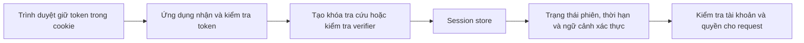

# Session store — Kho trạng thái phiên xác thực

## 1. Session store là gì?

Một người dùng đăng nhập trên node A của ứng dụng. Request tiếp theo được load balancer chuyển sang node B. Nếu trạng thái đăng nhập chỉ nằm trong bộ nhớ của A, B có thể không biết người dùng đã xác thực hoặc có thể đọc một trạng thái khác với A.

**Session store** là nơi lưu và quản lý trạng thái phiên mà máy chủ sử dụng để tiếp tục nhận diện ngữ cảnh đã xác thực qua nhiều request. Kho này có thể nằm trong tiến trình, cơ sở dữ liệu, một hệ thống lưu trữ dùng chung hoặc được cung cấp bởi framework. Điều cần thiết kế không chỉ là vị trí lưu, mà còn là ý nghĩa và tính nhất quán của các thao tác tạo, đọc, cập nhật, hết hạn và thu hồi.

Trong nền tảng IAM, session store kết nối kết quả xác thực với quản lý phiên, MFA, trạng thái tài khoản, SSO và kiểm toán. Nó giúp trả lời phiên thuộc ai, được cấp theo mục đích nào, còn hiệu lực hay không và đã bị thu hồi chưa. Việc có một bản ghi phiên không tự chứng minh người dùng có quyền thực hiện mọi thao tác; RBAC, ABAC và nguyên tắc ít quyền nhất vẫn được áp dụng theo chính sách hiện tại.

Sau bài học, người học có thể:

- Phân biệt session token, session record, kho tài khoản và bộ nhớ phía trình duyệt.
- Chọn dữ liệu cần lưu mà không đưa thêm bí mật vào kho phiên.
- Thiết kế đọc, cập nhật hoạt động và thu hồi có kiểm soát đồng thời.
- Phân tích đánh đổi của bộ nhớ cục bộ, cơ sở dữ liệu và Redis.
- Phân biệt TTL, hiệu lực logic, cache và độ bền của quyết định thu hồi.
- Xác định hành vi khi kho phiên lỗi, failover hoặc phục hồi từ bản sao cũ.

## 2. Phân biệt token và trạng thái phiên

### 2.1. Hai phía của một phiên dùng opaque token



Token là bằng chứng mà client xuất trình. Session record là dữ liệu máy chủ dùng để đánh giá bằng chứng đó. Hai thứ liên quan nhưng không bắt buộc có cùng biểu diễn hoặc cùng thời gian tồn tại vật lý.

| Thành phần | Vai trò | Không nên nhầm với |
|---|---|---|
| Session token | Bí mật cho phép tham chiếu hoặc chứng minh quyền sử dụng phiên | ID kiểm toán có thể công khai trong hệ thống nội bộ. |
| Session record | Trạng thái, thời hạn và ngữ cảnh xác thực của phiên | Toàn bộ hồ sơ và quyền vĩnh viễn của tài khoản. |
| Session store | Nơi thực thi các thao tác trên trạng thái phiên | Chỉ một cache dữ liệu không ảnh hưởng bảo mật. |
| Kho tài khoản/credential | Quản lý danh tính, password verifier, authenticator và trạng thái tài khoản | Một phiên cụ thể trên một thiết bị. |
| Browser local/session storage | Cơ chế lưu dữ liệu ở client | Kho trạng thái xác thực có thẩm quyền của backend. |

### 2.2. Không có bản ghi hợp lệ thì không tự tạo quyền truy cập

Với thiết kế phiên phía server, một token lạ hoặc bản ghi không còn tồn tại không được tự biến thành phiên đã xác thực. Nếu ứng dụng cần phiên ẩn danh mới, phiên đó phải được tạo với quyền và mục đích riêng.

Việc tin một session ID do client tự chọn có thể làm mất kiểm soát quá trình cấp phiên. Máy chủ cần dùng cơ chế tạo và kiểm tra phù hợp của framework hoặc thành phần xác thực đã được thiết kế, thay vì chỉ lấy ID đầu vào làm khóa rồi điền user ID từ request.

### 2.3. JWT không làm mọi trạng thái biến mất

Một access token tự chứa claim có thể được kiểm tra mà không tra kho session trong mỗi request. Tuy nhiên, nếu hệ thống cần thu hồi ngay, giới hạn phiên, kiểm tra trạng thái tài khoản hoặc refresh token có vòng đời riêng, một dạng trạng thái vẫn có thể cần tồn tại.

Không gọi mọi hệ thống dùng JWT là hoàn toàn không có trạng thái. Cần chỉ rõ trạng thái nào được lưu, ai sở hữu và nơi tiêu thụ token biết quyết định thu hồi bằng cách nào.

## 3. Bản ghi phiên nên chứa gì?

### 3.1. Các nhóm dữ liệu cốt lõi

| Nhóm | Trường minh họa | Mục đích |
|---|---|---|
| Định danh nội bộ | `session_ref`, `tenant_ref`, `subject_ref` | Phân biệt phiên và chủ thể trong đúng namespace. |
| Tra cứu bí mật | `token_verifier` hoặc cấu trúc tương đương | Xác minh token mà không nhất thiết lưu raw token. |
| Vòng đời | `created_at`, `last_activity_at`, các deadline | Áp dụng timeout và quản lý tài nguyên. |
| Trạng thái | `ACTIVE`, `REVOKED`, lý do thu hồi | Quyết định có tiếp tục chấp nhận phiên không. |
| Ngữ cảnh xác thực | Phương thức đã dùng, thời điểm xác thực và MFA | Đánh giá độ mới và mức bằng chứng của phiên. |
| Mục đích | `NORMAL`, `RECOVERY`, `STEP_UP` theo thiết kế | Tránh dùng một phiên hạn chế như phiên toàn quyền. |
| Kiểm soát đồng thời | `record_version`, `auth_epoch` nếu áp dụng | Chống ghi đè và đối chiếu trạng thái tài khoản. |
| Tương quan | Tham chiếu sự kiện và chính sách | Điều tra và giải thích quyết định. |

Đây là mô hình tham khảo, không phải schema bắt buộc. Chỉ lưu các trường cần cho hành vi đã xác định. Dữ liệu phụ như tên thiết bị, IP hoặc user-agent cần được đánh giá về độ tin cậy, kích thước và khả năng liên kết danh tính.

### 3.2. Những dữ liệu không nên đưa vào session store

Không giữ mật khẩu dạng rõ, OTP, TOTP seed, recovery code hoặc toàn bộ request đăng nhập. Kho phiên không cần những bí mật đó chỉ để biết một phiên đã hoàn tất xác thực.

Không serialize cả entity người dùng và đồ thị đối tượng liên quan. Điều đó làm tăng dung lượng, dữ liệu nhạy cảm, nguy cơ lỗi deserialization và sự phụ thuộc giữa các phiên bản ứng dụng.

Nếu cần lưu access/refresh token cho một kiến trúc backend-for-frontend, đó là quyết định quản lý bí mật có phạm vi rõ ràng. Không coi việc chúng nằm trong “session” là lý do bỏ qua mã hóa, quyền đọc và vòng đời tương ứng.

### 3.3. Role được lưu trong phiên có thể lỗi thời

Một bản chụp role giúp giảm tra cứu nhưng có thể tiếp tục cho phép quyền đã bị thu hồi. Cần chọn cách cập nhật, kiểm tra version quyền hoặc đọc chính sách tại nơi có thẩm quyền theo mức rủi ro.

`auth_epoch` của tài khoản cũng chỉ có tác dụng nếu các nơi chấp nhận phiên thực sự đối chiếu nó với giá trị hiện tại. Lưu một cột version rồi không kiểm tra không tạo ra cơ chế logout toàn bộ.

## 4. Bảo vệ token và verifier

### 4.1. Token phiên là bí mật có thể bị sử dụng lại

Nếu cookie chứa bearer token của phiên, người lấy được giá trị đó có thể thử dùng nó mà không nhập lại mật khẩu. Entropy cao chống đoán giá trị; nó không bảo vệ một token đã bị đọc trực tiếp từ log hoặc kho dữ liệu.

[OWASP Session Management](https://cheatsheetseries.owasp.org/cheatsheets/Session_Management_Cheat_Sheet.html#server-side-session-token-storage) mô tả lưu verifier một chiều để giảm tác động của việc chỉ bị đọc kho phiên. Cách này không bảo vệ khi cookie bị lấy cắp, bản ghi bị sửa hoặc chính ứng dụng bị chiếm. Các ranh giới bảo vệ cần được giữ riêng khi đánh giá thiết kế.

### 4.2. Hai thiết kế tra cứu minh họa

| Thiết kế | Client giữ | Server lưu | Điều kiện quan trọng |
|---|---|---|---|
| Băm token làm khóa tra cứu | Token ngẫu nhiên đủ dài | Hash của token và session record | Không chấp nhận hash thay cho token tại API. |
| Tách ID và secret | Lookup ID cùng secret ngẫu nhiên độc lập | ID, verifier của secret và session record | Lookup ID đơn lẻ không chứng minh quyền dùng phiên. |

Ví dụ thiết kế có thể dùng bí mật 32 byte ngẫu nhiên từ CSPRNG, tức 256 bit, rồi biểu diễn phù hợp để chuyển qua cookie. Đây là lựa chọn minh họa; độ an toàn còn phụ thuộc cách sinh, vận chuyển, lưu và kiểm tra.

Với bí mật ngẫu nhiên entropy cao, có thể dùng hàm băm mật mã phù hợp để tạo verifier. Không suy rộng sang mật khẩu yếu do người dùng chọn, vốn cần KDF lưu trữ khác. Nếu dùng HMAC, cần có quản lý khóa và phương án khi khóa bị lộ hoặc thay đổi.

### 4.3. Ràng buộc với ngữ cảnh và tránh rò rỉ

Định dạng token, chuẩn hóa và cách băm phải nhất quán. Nếu đưa tenant hoặc domain phân tách vào thông điệp băm, dùng encoding không nhập nhằng. Trong mô hình tách ID/secret, xác minh secret bằng cơ chế so sánh thích hợp và lấy subject từ bản ghi đã kiểm chứng.

Không dùng raw token làm `session_ref` trong audit hoặc nhãn metric. Verifier cũng không cần xuất hiện trong log. Nếu verifier là khóa của session store, người đọc kho có thể thấy khóa đó; thiết kế API phải luôn đòi bằng chứng gốc, không nhận khóa nội bộ như một credential tương đương.

Cookie chứa bí mật cần các thuộc tính bảo vệ và phạm vi phù hợp, đồng thời đường truyền được bảo vệ. Bảo vệ cookie và bảo vệ session store bổ sung cho nhau; không thể thay thế bằng việc chỉ mã hóa cơ sở dữ liệu.

## 5. Chọn nơi lưu và hiểu đánh đổi

| Phương án | Điểm thuận lợi | Rủi ro hoặc trách nhiệm cần giải quyết |
|---|---|---|
| Bộ nhớ trong một tiến trình | Đơn giản, truy cập nhanh | Mất khi restart, không chia sẻ tự động giữa node. |
| Bộ nhớ với sticky session | Giảm chuyển phiên giữa node trong luồng bình thường | Không thay cho chia sẻ hoặc khôi phục khi node chết. |
| Cơ sở dữ liệu quan hệ | Có transaction, truy vấn và ràng buộc dữ liệu | Độ trễ, số lần ghi hoạt động và quản lý dữ liệu hết hạn. |
| Kho in-memory dùng chung như Redis | Phù hợp truy cập nhanh và TTL | Cần tính nguyên tử, giới hạn bộ nhớ, persistence và hành vi failover. |
| Nguồn chính cùng cache | Có thể giảm tải đọc | Cache có thể chấp nhận trạng thái cũ sau thu hồi. |
| Dịch vụ quản lý phiên chuyên trách | Tập trung chính sách và thao tác | Thêm phụ thuộc mạng, năng lực vận hành và ranh giới tin cậy. |

Không chọn công nghệ chỉ vì “session cần nhanh”. Cần biết yêu cầu về độ trễ thu hồi, mất dữ liệu được chấp nhận, quy mô, phân vùng tenant và tác động khi toàn bộ phiên bị mất.

Với một hệ thống nhỏ, framework và cơ chế lưu tích hợp có thể đã phù hợp. Với hệ thống nhiều node, cần xác minh chính xác repository đang được dùng, không suy ra phiên đã chia sẻ chỉ vì các node đọc cùng kho tài khoản.

## 6. Những thao tác cần có hợp đồng rõ ràng

### 6.1. Tạo và đọc phiên

| Thao tác | Bảo đảm cần xác định |
|---|---|
| `create` | ID/bí mật do nguồn được phép sinh; không ghi đè phiên trùng ngoài thiết kế. |
| `lookup` | Tách không tìm thấy với kho không sẵn sàng; ràng buộc đúng ngữ cảnh. |
| `touch` | Chỉ cập nhật hoạt động khi phiên vẫn hợp lệ; không làm sống lại phiên cũ. |
| `revoke` | Sau xác nhận thành công, nơi tiêu thụ biết quyết định trong giới hạn đã chọn. |
| `rotate` | Quản lý quan hệ giữa token mới và token cũ, kể cả request đồng thời. |
| `listBySubject` | Chỉ hiện phiên thuộc đúng chủ thể và tenant; hiểu độ mới của chỉ mục. |
| `revokeAll` | Bao phủ phiên đang có và trường hợp tạo phiên đồng thời theo định nghĩa. |
| `cleanup` | Dọn dữ liệu không còn cần mà không thay cho kiểm tra hiệu lực logic. |

Tạo session record cần hoàn tất đủ bền vững theo mô hình trước khi trả cookie thành công. Nếu cookie đã trả nhưng bản ghi chưa được ghi, request tiếp theo có thể thất bại; nếu hệ thống tự nhận lại dữ liệu client để “khôi phục”, nó có thể tạo đường bỏ qua xác thực.

### 6.2. Touch không phải ghi lại toàn bộ snapshot

Giả sử request A đọc phiên version 5. Trong lúc đó, request B logout và thu hồi phiên. Nếu A ghi lại toàn bộ snapshot version 5 để cập nhật thời gian, nó có thể vô tình ghi `ACTIVE` trở lại.

```text
sai:
    đọc session -> sửa lastActivity -> ghi đè toàn bộ object

cần bảo đảm:
    kiểm tra trạng thái và version tại thao tác cập nhật
    chỉ sửa các trường được phép
    không tạo mới nếu phiên đã mất hoặc không còn hiệu lực
```

Thao tác phải kiểm tra deadline cũ trước khi kéo dài idle. Không đặt `last_activity_at = now` rồi mới đánh giá phiên đã hết hạn hay chưa.

### 6.3. Hợp đồng repository minh họa bằng Java 17

```java
import java.time.Duration;
import java.time.Instant;
import java.util.Optional;
import java.util.UUID;

public interface SessionStore {
    record Snapshot(
            UUID sessionRef,
            String tenantRef,
            String subjectRef,
            long version,
            Instant idleDeadline,
            Instant absoluteDeadline,
            boolean revoked) {
    }

    enum TouchResult {
        UPDATED,
        VERSION_CONFLICT,
        INACTIVE
    }

    // Optional.empty() chỉ biểu diễn không có bản ghi theo hợp đồng.
    Optional<Snapshot> findByVerifier(String verifier)
            throws StoreUnavailableException;

    // Kiểm tra tồn tại, version, thu hồi và deadline trong cùng thao tác.
    // Không được tạo lại bản ghi đã mất; không kéo dài absoluteDeadline.
    TouchResult touchIfActive(
            String verifier,
            long expectedVersion,
            Instant requestTime,
            Duration idleWindow) throws StoreUnavailableException;

    // Tác động được ràng buộc với chủ thể và tenant đã được xác minh.
    void revoke(
            UUID sessionRef,
            String tenantRef,
            String subjectRef) throws StoreUnavailableException;

    final class StoreUnavailableException extends Exception {
        public StoreUnavailableException() {
            super("Session store unavailable");
        }
    }
}
```

Đây là một phần hợp đồng, chưa phải triển khai session manager hoàn chỉnh. Dữ liệu snapshot cần được kiểm tra schema và miền giá trị khi đọc; các tham số thời gian phải từ máy chủ và chính sách tin cậy. Client không được truyền verifier nội bộ, subject hoặc version rồi tự được công nhận là chủ phiên.

`VERSION_CONFLICT` yêu cầu đọc lại hoặc xử lý theo chính sách có giới hạn. Nó không phải kết quả xác thực thành công. `StoreUnavailableException` cũng không được chuyển thành `Optional.empty()` rồi tự tạo phiên xác thực mới.

Lớp service vẫn cần kiểm tra timeout, trạng thái tài khoản, mục đích phiên, độ mới MFA và quyền của request. Một `touch` thành công chỉ bảo đảm điều mà hợp đồng cập nhật định nghĩa, không thay thế toàn bộ quyết định cấp quyền.

## 7. Timeout và TTL trong kho phiên

### 7.1. Hiệu lực logic và thời gian giữ dữ liệu

Một bản ghi còn tồn tại chưa chắc còn hợp lệ. Phiên có thể đã hết idle, hết giới hạn cứng, bị thu hồi hoặc không còn đáp ứng trạng thái tài khoản. Đường truy cập cần đánh giá các điều kiện đó, không chỉ kiểm tra khóa có tồn tại.

Với một mô hình có hai deadline:

```text
idleDeadline = lastQualifiedActivityAt + idleTimeout
absoluteDeadline = sessionStartedAt + absoluteTimeout
effectiveDeadline = min(idleDeadline, absoluteDeadline)

now >= effectiveDeadline -> không chấp nhận phiên
```

TTL giúp dọn dữ liệu và có thể hỗ trợ thực thi thời hạn, nhưng cần phù hợp deadline đã xác định. Việc luôn đặt lại TTL bằng cả cửa sổ idle có thể giữ dữ liệu hoặc quyền vượt giới hạn absolute nếu không kiểm tra giới hạn đó.

Không dùng thời điểm sửa một field bất kỳ làm hoạt động người dùng. Cập nhật metadata, polling hoặc thao tác nền cần theo định nghĩa hoạt động đã chọn. Nếu framework tự touch mọi request, cần phối hợp cơ chế đó với chính sách nghiệp vụ.

### 7.2. Ghi bản ghi và thời hạn cần nhất quán

Thứ tự “ghi phiên rồi đặt TTL” bằng hai thao tác độc lập có thể để lại bản ghi không có thời hạn nếu tiến trình dừng giữa chừng. Chọn lệnh hoặc giao dịch phù hợp để tạo đủ trạng thái và điều kiện hết hạn theo thiết kế.

Với Redis, [tài liệu EXPIRE](https://redis.io/docs/latest/commands/expire/) nêu rằng ghi đè nội dung khóa bằng các lệnh như `SET` có thể làm mất thời hạn; cập nhật field hash bằng `HSET` giữ thời hạn hiện có. Vì vậy cần kiểm tra lệnh và tùy chọn mà client/framework thực sự dùng, không giả định mọi cập nhật đều giữ TTL.

Giữ TTL cũ cũng chưa chắc đúng khi hoạt động hợp lệ cần kéo dài idle. Bộ cập nhật phải tính thời gian còn lại, kiểm tra trạng thái và điều chỉnh thời hạn theo hợp đồng. Không khắc phục mất TTL bằng cách gia hạn mọi khóa không điều kiện.

### 7.3. Dữ liệu phụ và chỉ mục phiên

Chỉ mục `subject -> các session_ref` hỗ trợ màn hình quản lý thiết bị và tìm phiên cần thu hồi. Khi session record hết hạn, chỉ mục có thể còn phần tử cũ; khi tạo chỉ mục lỗi, nó có thể thiếu phiên mới.

Nếu chỉ mục được thiết kế eventual consistency, phải coi nó là công cụ tra cứu có giới hạn. Không dùng nó làm bằng chứng duy nhất rằng đã thu hồi mọi phiên. Có thể cần cơ chế đối chiếu, dọn phần tử mồ côi hoặc nguồn kiểm soát khác cho quyết định thu hồi toàn bộ.

Sự kiện hết hạn của kho dữ liệu cũng không nên được xem như nhật ký bảo mật bền vững nếu cơ chế đó không có bảo đảm tương ứng. Ghi audit cho hành động quan trọng qua luồng riêng thay vì chỉ lắng nghe khóa biến mất.

## 8. Logout, rotation và thu hồi toàn bộ

### 8.1. Logout một phiên

Một thiết kế có thể xóa bản ghi allowlist hoặc đánh dấu thu hồi. Phải biết các cache, replica và nơi kiểm tra phiên nhận thay đổi bằng cách nào. Xóa cookie trên trình duyệt chỉ là một phần của trải nghiệm logout.

Lệnh thu hồi cần được ràng buộc với chủ thể và tenant đã xác minh. Người dùng được đăng xuất phiên của mình không có nghĩa được thu hồi phiên bất kỳ khi đoán được `session_ref`.

Thao tác logout nên xử lý lặp an toàn: gửi lại yêu cầu không được tạo phiên mới hoặc đưa phiên cũ trở lại hoạt động. Cũng không báo đã bảo đảm thu hồi toàn hệ thống nếu chỉ xóa thành công một bản sao cục bộ.

### 8.2. Rotation token

Khi đổi token, cần xác định có giữ một phiên logic và deadline gốc hay tạo phiên mới do xác thực mới. Đổi bí mật để bảo vệ phiên không tự làm mốc xác thực hoặc tuổi phiên bắt đầu lại.

Nếu cho token cũ một khoảng chuyển tiếp, nó vẫn có thể được dùng trong khoảng đó theo các điều kiện đã chọn. Nếu không có khoảng chuyển tiếp, request đang dùng token cũ có thể bị từ chối. Cần xử lý rõ request đồng thời, response đến sai thứ tự và cookie cũ ghi đè cookie mới.

Việc tạo token mới và vô hiệu token cũ phải dùng bảo đảm lưu trữ phù hợp. Hai thao tác độc lập có thể để cả hai cùng hoạt động hoặc khiến người dùng không có phiên hợp lệ sau lỗi giữa chừng.

### 8.3. Logout toàn bộ và `auth_epoch`

Một mô hình lưu version xác thực trên tài khoản và ghi version đó vào mỗi phiên:

```text
Tài khoản: auth_epoch=12
Phiên A: auth_epoch=12
Phiên B: auth_epoch=12

Logout toàn bộ:
    tăng auth_epoch của tài khoản lên 13

Kiểm tra phiên:
    epoch của phiên phải phù hợp epoch hiện tại của tài khoản
```

Mô hình này có thể hỗ trợ vô hiệu phiên cũ mà không đợi xóa từng bản ghi. Tuy nhiên, version tài khoản phải được đọc với độ mới phù hợp, và mọi nơi chấp nhận phiên phải thực thi phép kiểm tra. Cache epoch cũ có thể kéo dài cửa sổ chấp nhận phiên.

Cần xử lý việc đăng nhập đồng thời với logout toàn bộ. Một phiên được cấp từ bằng chứng trước quyết định thu hồi có thể phải bị từ chối dù được ghi muộn. Quy trình cấp và version dùng cho phiên cần tuân theo chính sách thứ tự đã xác định, thay vì chỉ lấy epoch mới để gắn cho bất kỳ yêu cầu xác thực cũ nào.

`auth_epoch` là mẫu thiết kế ứng dụng, không phải một claim chuẩn tự được mọi nhà cung cấp SSO hoặc resource server hiểu. Nó cũng không tự thu hồi OAuth token, phiên ở IdP hoặc workload credential nếu các hệ thống đó không gắn với cơ chế này.

## 9. Cache, replica và failover

### 9.1. Đọc nhanh có thể chấp nhận trạng thái cũ

Nếu node B cache phiên `ACTIVE` trong khi node A đã thu hồi ở nguồn chính, B có thể tiếp tục cho phép truy cập đến khi cache được cập nhật hoặc hết hạn. Cần xác định cửa sổ này có được chấp nhận cho từng loại thao tác hay không.

Invalidation qua message giúp giảm độ trễ nhưng không tự bảo đảm mọi node đã nhận. Có thể cần TTL cache ngắn, version hoặc kiểm tra nguồn chính cho hành động nhạy cảm. Không dùng việc đã phát message làm bằng chứng tất cả nơi thực thi đã áp dụng.

Đọc từ replica cũng có thể thấy dữ liệu cũ sau một lần cập nhật hoặc thu hồi. Hợp đồng repository phải nêu nguồn đọc và bảo đảm độ mới, thay vì chỉ khai báo `find()` rồi để từng client chọn ngẫu nhiên node.

### 9.2. Tính nguyên tử khác với độ bền qua failover

Một thao tác nguyên tử trên node hiện tại giải quyết xen kẽ giữa các lệnh tại phạm vi đó. Nó không tự chứng minh quyết định đã được lưu đủ bền hoặc sẽ xuất hiện trên node được bầu lên sau lỗi.

[Redis replication](https://redis.io/docs/latest/operate/oss_and_stack/management/replication/) sử dụng replication bất đồng bộ theo mặc định. Tài liệu cũng giải thích việc chờ replica xác nhận bằng `WAIT` không biến tập Redis thành một hệ thống nhất quán mạnh và vẫn có những tình huống mất ghi khi failover.

Hệ quả đối với session store cần được đánh giá cụ thể:

| Dữ liệu mất hoặc cũ | Hệ quả có thể xảy ra |
|---|---|
| Mất bản ghi phiên mới | Người dùng cần xác thực lại hoặc nhận lỗi phiên. |
| Mất thao tác thu hồi/xóa phiên | Bản ghi cũ có thể xuất hiện lại và được chấp nhận nếu không có kiểm soát bổ sung. |
| Mất mốc hoạt động gần nhất | Phiên có thể hết sớm theo mốc cũ. |
| Mất thay đổi epoch hoặc chính sách | Phiên không còn phù hợp có thể vượt qua kiểm tra dùng trạng thái cũ. |

Không đồng nhất “có replica” với “không bao giờ mất quyết định thu hồi”. Cần chọn cấu hình và nguồn dữ liệu theo bảo đảm mong muốn, đo hành vi khi lỗi và xác định cách hạn chế truy cập khi không biết trạng thái đủ mới.

### 9.3. Phục hồi từ backup không được làm sống lại phiên ngoài ý muốn

Một bản sao lưu có thể chứa phiên trước thời điểm logout hoặc sự cố. Nạp lại bản sao rồi chấp nhận ngay mọi phiên trong đó có thể phục hồi cả quyền truy cập đã thu hồi.

Kế hoạch khôi phục cần xác định có hủy toàn bộ phiên phục hồi, dùng một generation/epoch hiện tại được giữ đáng tin cậy, hay áp dụng cơ chế đối chiếu khác. Nguồn dùng để phân biệt phiên cũ cũng phải được bảo vệ và có mức nhất quán cần thiết.

Không tự dựng lại phiên xác thực từ lịch sử đăng nhập hoặc kho tài khoản khi session record mất. Dữ liệu cho biết “đã từng đăng nhập” không chứng minh token đang gửi vẫn được phép truy cập.

### 9.4. Allowlist và denylist có lỗi khác nhau

Trong mô hình allowlist, thiếu bản ghi thường dẫn đến không chấp nhận phiên. Trong mô hình denylist cho token tự chứa, thiếu bản ghi thu hồi có thể khiến token vẫn được chấp nhận nếu các kiểm tra khác đạt.

Vì thế, cùng một sự kiện xóa dữ liệu hoặc lỗi cache có thể tạo kết quả bảo mật khác nhau. Cần xác định kho đang lưu quyền còn hiệu lực hay các ngoại lệ bị thu hồi, rồi chọn hành vi lỗi phù hợp.

## 10. Bảo mật và giới hạn tài nguyên

### 10.1. Quyền truy cập kho

Chỉ những dịch vụ cần thiết mới được đọc hoặc ghi session record. Tách quyền hỗ trợ tra cứu thiết bị khỏi quyền đọc bí mật hoặc sửa trạng thái xác thực. Bảo vệ mạng, xác thực client của kho, đường truyền, bản sao và dữ liệu lưu theo mô hình rủi ro.

Không dùng chung tài khoản quản trị kho cho mọi ứng dụng. Nếu nhiều tenant hoặc môi trường cùng chia sẻ hạ tầng, namespace và kiểm tra truy cập phải ngăn đọc nhầm hoặc ghi chéo. Prefix khóa tự nó không phải cơ chế phân quyền đầy đủ.

Thao tác quét toàn bộ key, xuất dump và truy cập công cụ chẩn đoán cũng cần được kiểm soát. Verifier một chiều giảm tác động của một số kiểu đọc dữ liệu, nhưng thông tin phiên, subject và hoạt động vẫn có giá trị nhạy cảm.

### 10.2. Schema và serialization

Dùng schema có giới hạn, kiểu dữ liệu rõ và phiên bản để quản lý nâng cấp. Khi gặp record sai schema, không mặc định role quản trị, deadline tương lai hoặc trạng thái đã xác thực.

Tránh cơ chế deserialize đối tượng tùy ý từ dữ liệu có thể bị tác động. Chỉ parse các trường được định nghĩa, giới hạn kích thước và xác minh tính toàn vẹn hoặc nguồn dữ liệu theo thiết kế. Mã hóa dữ liệu lưu không tự bảo vệ khỏi mọi lỗi giải mã hoặc sửa bản ghi.

Nâng cấp nhiều phiên bản ứng dụng cần tương thích đọc/ghi đã định nghĩa. Một node cũ không được ghi lại record và làm mất trường thu hồi hoặc version mà node mới vừa thêm.

### 10.3. Bộ nhớ, eviction và số lượng phiên

Kho phiên cần giới hạn dung lượng, kích thước record và số phiên theo chính sách. Một ứng dụng có thể vô tình tạo session cho mọi request ẩn danh hoặc static asset, làm tăng tải mà không có nhu cầu xác thực tương ứng.

Nếu kho dùng eviction, việc mất một phiên hợp lệ có thể buộc người dùng đăng nhập lại. Không xử lý eviction bằng cách cho phép token không có record đi tiếp. Cần theo dõi và lựa chọn cơ chế vận hành phù hợp vai trò của kho.

Giới hạn số phiên mỗi tài khoản cũng cần thao tác nhất quán. Hai lần đăng nhập đồng thời không được vượt chính sách chỉ vì cùng đọc thấy số phiên hiện tại còn thấp, nếu giới hạn đó là yêu cầu bắt buộc.

## 11. Theo dõi vận hành và kiểm toán

Theo dõi độ trễ và lỗi đọc/ghi, xung đột version, cache hit, eviction, dung lượng, TTL bất thường, độ trễ replication và kết quả thu hồi. Chỉ số cần phục vụ một câu hỏi cụ thể: hệ thống đang chậm, mất trạng thái hay chấp nhận dữ liệu cũ?

Tách các kết quả sau trong quan sát nội bộ:

- Không có session record theo hợp đồng.
- Bản ghi có nhưng hết hạn hoặc bị thu hồi.
- Kho dữ liệu không sẵn sàng.
- Record sai schema hoặc không qua kiểm tra ngữ cảnh.
- Quyền nghiệp vụ không đủ dù phiên hợp lệ.

Client không nhất thiết được biết mọi chi tiết nội bộ, nhưng vận hành cần phân biệt chúng để tránh chẩn đoán sai. Chẳng hạn, lỗi kho tăng đột ngột không nên bị báo cáo như một đợt người dùng tự logout.

Audit có thể ghi tạo phiên, đổi token, thu hồi và thay đổi trạng thái quan trọng bằng `session_ref` không cấp quyền. Không ghi raw token hoặc verifier. Nếu cần bằng chứng thu hồi bền vững, chọn luồng audit phù hợp thay vì chỉ dựa vào log debug của client Redis.

Metric nên có nhãn hữu hạn như thao tác, kết quả và vùng triển khai. Không dùng token, session ID, email hay subject ID làm nhãn tăng không giới hạn.

## 12. Tình huống xuyên suốt: ba node và một lần logout

Một ứng dụng có ba node A, B, C; session store dùng một primary, một replica và cache cục bộ. Người dùng đăng nhập ở A rồi chọn logout ở B.

| Mốc | Tình huống | Điều thiết kế cần giải quyết |
|---|---|---|
| T0 | A tạo phiên và trả cookie | Bản ghi cùng thời hạn đã được ghi đúng mức bảo đảm chưa? |
| T1 | C đọc và cache phiên đang hoạt động | Cache được giữ bao lâu và tham gia thu hồi thế nào? |
| T2 | B thu hồi ở primary | Kết quả trả cho người dùng bảo đảm phạm vi nào? |
| T3 | C nhận request mang token cũ | Có từ chối theo cửa sổ nhất quán đã định không? |
| T4 | Primary lỗi trước khi quyết định thu hồi được phản ánh đầy đủ | Node được nâng lên có thể giữ trạng thái cũ không? |
| T5 | Hệ thống phục hồi | Điều kiện nào ngăn phiên cũ tự hoạt động lại? |

Nếu chỉ kiểm tra luồng bình thường, nhóm phát triển có thể kết luận logout đã hoạt động vì request tiếp theo trên B bị từ chối. Nhưng C và trạng thái sau failover mới cho biết phạm vi bảo đảm thực sự.

Một thiết kế chấp nhận độ trễ ngắn cần nêu rõ giới hạn và cách đo. Một thiết kế yêu cầu thu hồi chặt hơn cho thao tác đặc quyền phải có nguồn kiểm tra và chiến lược nhất quán tương ứng; không thể đạt chỉ bằng việc đổi tên phương thức thành `revokeImmediately()`.

## 13. Các tình huống cần kiểm chứng khi triển khai

| Tình huống | Kết quả mong đợi |
|---|---|
| Request đi qua các node khác nhau | Nhận diện đúng cùng phiên và chính sách. |
| Client gửi token tự tạo hoặc chỉ gửi lookup ID | Không được coi là phiên đã xác thực. |
| Cookie và tenant không phù hợp ngữ cảnh | Không đọc hoặc cấp quyền theo bản ghi của tenant khác. |
| Bản ghi quá deadline nhưng chưa được dọn | Request bị từ chối theo thời gian logic. |
| Touch đồng thời với logout | Không phục hồi trạng thái hoạt động. |
| Hai request cập nhật hoạt động ngược thứ tự | Không làm lùi mốc hoặc vượt absolute deadline. |
| Ghi record nhưng lỗi đặt thời hạn | Không để phiên có hiệu lực ngoài chính sách. |
| Ghi đè dữ liệu bằng lệnh làm mất TTL | Được phát hiện hoặc ngăn bởi adapter và kiểm tra phù hợp. |
| Rotation có request dùng token cũ | Hành vi đúng với quy tắc chuyển tiếp đã định. |
| Logout toàn bộ đồng thời với đăng nhập | Phiên được cấp tuân theo đúng căn cứ và version. |
| Chỉ mục theo tài khoản bị thiếu hoặc thừa | Không tuyên bố thu hồi đầy đủ chỉ dựa trên chỉ mục lỗi. |
| Cache hoặc replica chưa nhận quyết định mới | Cửa sổ không nhất quán được giới hạn và quan sát. |
| Failover sau thao tác thu hồi | Bảo đảm đã chọn được kiểm tra bằng hành vi thực tế. |
| Nạp lại snapshot cũ | Không tự chấp nhận lại phiên đã bị loại ngoài thiết kế. |
| Kho phiên mất kết nối | Không mặc định cho phép hoặc tự tạo phiên xác thực. |
| Bật logging, dump lỗi và tracing | Không xuất hiện token, verifier hoặc dữ liệu credential khác. |
| Nâng cấp nhiều phiên bản ứng dụng | Không mất trường trạng thái hoặc suy giảm kiểm tra. |

Các tình huống có thể dùng token giả lập, đồng hồ kiểm soát được và công cụ tạo lỗi trong môi trường kiểm thử. Không đưa credential phiên thật của người dùng vào dữ liệu minh họa hoặc báo cáo công khai.

## 14. Những lỗi thiết kế thường gặp

| Lỗi | Hệ quả | Cách xử lý |
|---|---|---|
| Chỉ lưu phiên trong memory nhưng nghĩ các node đã chia sẻ | Hành vi đăng nhập không nhất quán | Xác minh repository và topology thực tế. |
| Xem session store như cache có thể bỏ qua | Thiếu trạng thái vẫn được cấp quyền | Định nghĩa nó là nguồn quyết định theo kiến trúc. |
| Lưu raw token ở mọi khóa/log | Việc đọc dữ liệu có thể cho phép replay | Giảm bản sao bí mật và dùng verifier khi phù hợp. |
| Touch bằng cách ghi lại snapshot cũ | Có thể làm sống lại phiên thu hồi | Cập nhật có điều kiện và version. |
| Dùng TTL trượt mà không có giới hạn cứng | Phiên hoạt động kéo dài ngoài ý định | Kiểm tra deadline gốc và thời hạn còn lại. |
| Đọc replica để thu hồi ngay mà không đánh giá độ trễ | Chấp nhận trạng thái cũ | Chọn nguồn đọc theo bảo đảm cần có. |
| Cho rằng replication hoặc lệnh chờ xác nhận loại bỏ mọi mất ghi | Đánh giá sai khả năng phục hồi phiên cũ | Phân biệt nguyên tử, độ bền và nhất quán qua failover. |
| Backup phiên rồi nạp lại như dữ liệu thông thường | Có thể phục hồi quyền đã thu hồi | Có chính sách khôi phục và kiểm tra thế hệ phiên. |
| Dùng role snapshot vô thời hạn | Quyền bị thu hồi vẫn có thể dùng | Kiểm tra chính sách hoặc version quyền. |

## 15. Bài tập thiết kế

Một nền tảng học tập chạy trên bốn node và có cổng quản trị đặc quyền. Phiên dùng opaque cookie, có idle timeout, giới hạn cứng, màn hình liệt kê thiết bị và chức năng logout toàn bộ. Nhóm dự kiến dùng Redis cùng cache cục bộ để giảm độ trễ.

Hãy đề xuất session record, cách tạo khóa tra cứu, nguồn kiểm tra trạng thái tài khoản và hợp đồng cho `touch`, `revoke`, `revokeAll`. Làm rõ phần dữ liệu nào có thẩm quyền, phần nào chỉ là chỉ mục hoặc cache và bí mật nào không được ghi log.

Tiếp theo, mô tả hành vi khi primary lỗi ngay sau logout, một cache còn trạng thái cũ và hệ thống được khôi phục từ snapshot trước sự cố. Thiết kế cần giải thích bằng chứng nào đủ để nói phiên đã bị chặn trong phạm vi đã chọn, thay vì chỉ liệt kê công nghệ lưu trữ.
