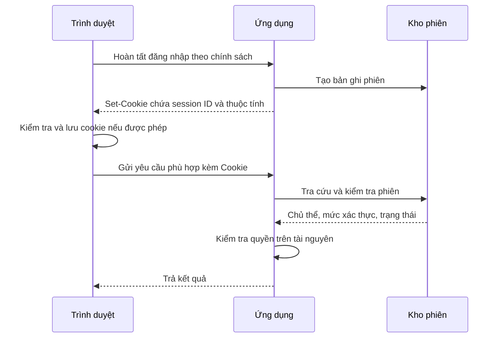

# Session cookie

**Session cookie** có thể được hiểu theo hai nghĩa: cookie mang thông tin để duy trì một phiên ứng dụng, hoặc cookie không có thời hạn lưu bền vững như `Expires` và `Max-Age`. Hai nghĩa này không hoàn toàn trùng nhau. Một cookie dùng để xác thực có thể là cookie phiên theo trình duyệt hoặc là cookie được lưu lâu hơn theo thiết kế.

Trong bài này, trọng tâm là cookie dùng để mang session ID của một ứng dụng IAM. Trình duyệt lưu và gửi cookie theo quy tắc HTTP, còn máy chủ quyết định phiên tương ứng có hợp lệ, đủ mức xác thực và được phép truy cập tài nguyên hay không.

Cookie mang session ID dạng bearer là một bí mật truy cập: nếu bị lấy và còn được máy chủ chấp nhận, nó có thể bị dùng để mạo danh phiên. Cấu hình cookie vì vậy phải đi cùng bảo vệ session ID, thời hạn phía máy chủ, chống CSRF và quản lý vòng đời đăng nhập.

## 1. Phân biệt cookie, session ID và phiên đăng nhập

| Khái niệm | Vai trò |
|---|---|
| Cookie | Cơ chế để trình duyệt lưu và gửi một cặp tên, giá trị theo phạm vi và thuộc tính |
| Session ID | Giá trị định danh hoặc bí mật dùng để liên kết yêu cầu với phiên |
| Bản ghi phiên | Dữ liệu do máy chủ quản lý: chủ thể, trạng thái, thời hạn và thông tin liên quan |
| Phiên xác thực | Ngữ cảnh mà hệ thống công nhận kết quả xác thực còn có thể được sử dụng |
| Session cookie theo thời gian lưu | Cookie không có `Expires` hoặc `Max-Age`, phụ thuộc khái niệm phiên của trình duyệt |

Ví dụ:

```http
Set-Cookie: __Host-session={opaque-session-id}; Path=/; Secure; HttpOnly; SameSite=Lax
```

`__Host-session` là tên cookie. `{opaque-session-id}` là placeholder cho một giá trị được tạo đúng cách, không phải chuỗi dùng chung. Phần còn lại là thuộc tính hướng dẫn trình duyệt xử lý cookie.

Một cookie có thể chứa một session ID mờ để tra cứu phía máy chủ. Một thiết kế khác dùng giá trị có cấu trúc được bảo vệ bằng chữ ký hoặc mã hóa. Việc dữ liệu nằm trong cookie không tự khiến dữ liệu đó đáng tin; phải xác minh theo cơ chế của thiết kế tương ứng.

Không lưu mật khẩu người dùng trong cookie để “đăng nhập tự động”. Cũng không coi một giá trị như `role=ADMIN` do khách gửi là bằng chứng quyền quản trị.

## 2. Luồng Set-Cookie và Cookie

RFC 6265 định nghĩa các header `Set-Cookie` và `Cookie` dùng cho cơ chế trạng thái HTTP. Máy chủ đặt cookie trong phản hồi, trình duyệt gửi lại cookie trong yêu cầu phù hợp. [RFC 6265 — HTTP State Management Mechanism](https://www.rfc-editor.org/rfc/rfc6265.html)



Yêu cầu sau có thể mang:

```http
GET /api/me HTTP/1.1
Host: accounts.example.test
Cookie: __Host-session={opaque-session-id}
```

Trình duyệt không gửi lại `Secure`, `HttpOnly` hay `SameSite` trong header `Cookie`. Vì vậy, máy chủ không thể chỉ nhìn yêu cầu đến để biết mọi thuộc tính ban đầu đã được đặt đúng. Cần kiểm tra phản hồi thực tế và cấu hình ở nơi phát cookie.

Ứng dụng gửi nhiều cookie bằng nhiều header `Set-Cookie`. Không tự gộp chúng thành một chuỗi phân cách bằng dấu phẩy; một số thuộc tính như ngày trong `Expires` đã có dấu phẩy và việc gộp dễ gây diễn giải sai.

JavaScript ở frontend thông thường không đọc được header `Set-Cookie` từ phản hồi Fetch. Không đọc được header đó không chứng minh trình duyệt chưa xử lý cookie; cần phân biệt quyền truy cập của script với việc lưu cookie của trình duyệt.

## 3. Các thuộc tính bảo vệ chính

### Secure

`Secure` yêu cầu trình duyệt chỉ gửi cookie qua kết nối an toàn theo quy tắc áp dụng. Với môi trường triển khai thật, hãy phục vụ luồng phiên qua HTTPS. Đừng bỏ thuộc tính này để chữa lỗi cấu hình HTTPS hoặc reverse proxy.

`Secure` không mã hóa nội dung cookie theo một thuật toán của ứng dụng. Nó cũng không tự bảo vệ đoạn kết nối nội bộ sau nơi kết thúc TLS hoặc một bản sao cookie đã bị lấy từ máy khách. Các lớp đó có phạm vi bảo vệ riêng.

### HttpOnly

`HttpOnly` ngăn script đọc cookie qua các API cookie thông thường. Điều này giảm khả năng một đoạn script lấy trực tiếp session ID, nhưng script chạy trong trang vẫn có thể gửi yêu cầu mà trình duyệt tự gắn cookie.

Vì thế, XSS vẫn có thể gây tác động dù cookie đã có `HttpOnly`. Cần bảo vệ mã và dữ liệu hiển thị của ứng dụng, thay vì xem thuộc tính này là biện pháp loại bỏ mọi rủi ro XSS.

### SameSite

Thuộc tính này ảnh hưởng đến việc gửi cookie trong ngữ cảnh cùng site hoặc khác site:

| Giá trị | Cách hiểu thực hành |
|---|---|
| `Strict` | Hạn chế gửi cookie trong ngữ cảnh cross-site mạnh hơn |
| `Lax` | Cho phép một số điều hướng cross-site, thường bao gồm điều hướng cấp cao dùng phương thức an toàn, nhưng hạn chế nhiều yêu cầu khác |
| `None` | Cho phép gửi trong ngữ cảnh cross-site theo điều kiện khác; trình duyệt hiện hành yêu cầu đi cùng `Secure` |

Các thuộc tính và hành vi `SameSite` được tài liệu trình duyệt mô tả cụ thể; nên đặt giá trị rõ ràng thay vì dựa vào mặc định có thể khác nhau giữa môi trường. [MDN — Set-Cookie](https://developer.mozilla.org/en-US/docs/Web/HTTP/Reference/Headers/Set-Cookie)

Không phải mọi ứng dụng đều nên dùng cùng một giá trị. `Strict` có thể làm thay đổi trải nghiệm khi mở liên kết từ một site khác; `Lax` có thể không phù hợp với một số callback cross-site dùng POST; `None` mở thêm ngữ cảnh gửi cookie và cần phòng vệ tương ứng.

Không đổi toàn bộ cookie sang `None` chỉ vì một luồng SSO bị lỗi. Trước hết phải biết cookie nào cần được gửi ở bước nào, cho host nào và từ ngữ cảnh nào.

## 4. Domain, Path và tiền tố __Host-

### Phạm vi host và domain

Nếu không đặt `Domain`, cookie là host-only: trình duyệt gửi nó cho host đã đặt cookie theo các điều kiện còn lại. Nếu đặt một domain cha được phép, phạm vi có thể bao gồm cả các subdomain tương ứng.

Ví dụ một cookie do `accounts.example.test` đặt không có `Domain` không cần được gửi đến `forum.example.test`. Mở rộng thành `Domain=example.test` làm tăng phạm vi các host liên quan đến bí mật đó.

Không mở phạm vi chỉ để các ứng dụng có thể “dùng chung đăng nhập”. SSO qua giao thức cho phép mỗi ứng dụng có phiên riêng mà không chia sẻ cùng bearer session ID cho tất cả subdomain.

Cookie cũng không có cơ chế phân lập theo cổng như một origin đầy đủ. Hai ứng dụng cùng host nhưng khác port không nên dựa vào cookie để tạo một ranh giới tin cậy độc lập.

### Path là quy tắc gửi, không phải cấp quyền

`Path=/` cho phép cookie được gửi đến các đường dẫn phù hợp trên host. Một path hẹp có thể giảm phạm vi gửi, nhưng không phải cơ chế phân quyền bảo vệ tài nguyên.

Hai cookie cùng tên ở các path khác nhau còn có thể cùng xuất hiện trong một yêu cầu. Ứng dụng cần tránh cấu hình nhập nhằng và không tự chọn danh tính dựa vào “giá trị đầu tiên” theo một giả định không được thiết kế.

### Tiền tố __Host-

Trên trình duyệt hỗ trợ, cookie bắt đầu bằng `__Host-` phải được đặt qua ngữ cảnh an toàn, có `Secure`, có `Path=/` và không có `Domain`. Tiền tố giúp ràng buộc phạm vi theo host nhưng không tự thêm `HttpOnly` hoặc `SameSite`.

Ví dụ trên dùng:

```text
Tên:       __Host-session
Secure:    có
Path:      /
Domain:    không đặt
HttpOnly:  thêm riêng
SameSite:  chọn theo luồng ứng dụng
```

Nếu ứng dụng thật sự cần path khác `/`, cookie đó không đáp ứng điều kiện của tiền tố `__Host-`. Cần chọn tên và cấu hình nhất quán với kiến trúc, không chỉ đổi tên để tạo cảm giác bảo vệ tốt hơn.

## 5. Thời gian lưu cookie khác hiệu lực phiên

Cookie không có `Expires` và `Max-Age` được gọi là session cookie theo trình duyệt. Cookie có thời hạn lưu là persistent cookie. Một cookie mang session ID xác thực có thể thuộc một trong hai loại này.

`Max-Age` biểu diễn khoảng thời gian lưu bằng giây; `Expires` biểu diễn một thời điểm. Nếu có cả hai, `Max-Age` có ưu tiên theo cách xử lý được tài liệu trình duyệt mô tả. Không nên phát hai thuộc tính với ý nghĩa mâu thuẫn rồi trông chờ khách tự chọn như mong muốn.

Đóng trình duyệt không phải cách bảo đảm duy nhất để kết thúc một phiên bảo mật. Chức năng khôi phục của trình duyệt có thể giữ lại hoặc phục hồi trạng thái cookie. [MDN — Using HTTP Cookies](https://developer.mozilla.org/en-US/docs/Web/HTTP/Guides/Cookies)

Máy chủ vẫn cần kiểm tra:

- Phiên có tồn tại hay không.
- Đã bị thu hồi hay chưa.
- Idle timeout và giới hạn tuổi thọ tuyệt đối.
- Trạng thái tài khoản và mức xác thực còn phù hợp.

Một cookie còn được gửi không bảo đảm phiên còn hợp lệ. Ngược lại, xóa cookie trên một trình duyệt không tự vô hiệu hóa một bản sao đã bị người khác lấy.

Tùy chọn “Ghi nhớ đăng nhập” cũng không nên chỉ là tăng `Max-Age` vô hạn cho cùng phiên. Nó cần mô hình thời hạn, bằng chứng ghi nhớ, xác thực lại và thu hồi tương ứng với rủi ro của ứng dụng.

## 6. Cookie tự gửi và CSRF

Trình duyệt quyết định gắn cookie theo ngữ cảnh yêu cầu, không yêu cầu người dùng nhập lại bí mật cho mỗi lần. Đặc điểm này thuận tiện cho phiên nhưng cũng liên quan trực tiếp đến CSRF: một nơi khác có thể tìm cách khiến trình duyệt gửi yêu cầu sử dụng quyền của người dùng.

`HttpOnly` không ngăn loại yêu cầu đó. `Secure` cũng không xác nhận ý định của người dùng. `SameSite` hỗ trợ phòng vệ, nhưng không phải bằng chứng rằng mọi endpoint thay đổi trạng thái đã an toàn.

Ứng dụng cần dùng cơ chế chống CSRF phù hợp với framework và mô hình triển khai, chẳng hạn token được máy chủ kiểm tra hoặc các kiểm soát nguồn và yêu cầu theo thiết kế. Không dùng GET cho thao tác thay đổi trạng thái. [OWASP CSRF Prevention Cheat Sheet](https://cheatsheetseries.owasp.org/cheatsheets/Cross-Site_Request_Forgery_Prevention_Cheat_Sheet.html)

Một sự khác nhau quan trọng:

| Cookie hoặc dữ liệu | Có cần cho JavaScript đọc không? |
|---|---|
| Session credential của thiết kế dùng HttpOnly | Thông thường không; trình duyệt tự gửi |
| Token chống CSRF theo một số mô hình cookie-to-header | Có thể cần, theo cơ chế của framework |

Vì vậy, không áp một quy tắc máy móc rằng mọi cookie trong hệ thống đều phải có cùng thuộc tính. Bảo vệ bí mật xác thực và truyền token chống CSRF là hai trách nhiệm cần phối hợp, không phải hai dữ liệu giống nhau.

CORS cũng không thay thế CSRF. CORS chủ yếu điều khiển việc script ở origin khác được đọc phản hồi theo chính sách; một số yêu cầu vẫn có thể được gửi ngay cả khi script không được đọc kết quả.

## 7. Frontend và API khác origin

Xét hai địa chỉ đều dùng HTTPS:

```text
Frontend: https://app.example.test
API:      https://api.example.test
```

Chúng khác origin vì khác host, nhưng trong cấu trúc ví dụ có thể cùng site. Do đó, **cross-origin** và **cross-site** không phải hai từ đồng nghĩa.

API có thể đặt cookie host-only cho `api.example.test`; frontend không cần đọc hay nhận cookie đó trên host của chính nó. Khi gọi API, trình duyệt quyết định gửi cookie theo URL đích và các điều kiện còn lại.

Ví dụ Fetch đọc hồ sơ:

```javascript
const response = await fetch("https://api.example.test/api/me", {
  credentials: "include"
});
```

`credentials` điều khiển việc xử lý thông tin xác thực trong Fetch. Giá trị mặc định `same-origin` khác với `include` cho yêu cầu khác origin; các ràng buộc cookie vẫn được áp dụng. [MDN — Request.credentials](https://developer.mozilla.org/en-US/docs/Web/API/Request/credentials)

Với CORS cho một origin được phép, phản hồi có thể cần:

```http
Access-Control-Allow-Origin: https://app.example.test
Access-Control-Allow-Credentials: true
Vary: Origin
```

Nếu phản hồi thay đổi theo `Origin`, `Vary: Origin` giúp cache phân biệt trường hợp đó. Máy chủ phải kiểm tra origin bằng danh sách hoặc chính sách tin cậy; không phản chiếu mọi giá trị khách gửi để mở quyền đọc tùy ý.

Không dùng `Access-Control-Allow-Origin: *` như cấu hình cho phản hồi CORS có credentials. Cũng không tự gán header `Cookie` từ JavaScript trình duyệt để né cơ chế credentials; đó là header do trình duyệt kiểm soát.

Nếu frontend và API thật sự khác site, còn phải xét `SameSite`, chính sách third-party cookie và môi trường trình duyệt. `SameSite=None; Secure` không bảo đảm cookie sẽ vượt được mọi chính sách chặn cookie bên thứ ba. Một kiến trúc cùng site hoặc backend phục vụ frontend có thể giảm những phụ thuộc đó khi phù hợp với sản phẩm.

## 8. Minh họa cấu hình trong Jakarta Servlet

Trong ứng dụng Servlet, session manager của container nên sở hữu cookie phiên. Không tự thêm một cookie cùng tên ở controller để sửa từng phản hồi rồi làm cấu hình trở nên không nhất quán.

Ví dụ dưới đây là các lệnh cấu hình ở **giai đoạn khởi tạo hợp lệ**, trước khi `ServletContext` đã được khởi tạo xong. Giả định `servletContext` do container cung cấp và cấu hình domain ở các lớp khác không mở rộng cookie:

```java
import java.util.Set;
import jakarta.servlet.SessionCookieConfig;
import jakarta.servlet.SessionTrackingMode;

SessionCookieConfig cookies = servletContext.getSessionCookieConfig();
cookies.setName("__Host-session");
cookies.setPath("/");
cookies.setSecure(true);
cookies.setHttpOnly(true);
cookies.setMaxAge(-1);
cookies.setAttribute("SameSite", "Lax");

servletContext.setSessionTrackingModes(Set.of(SessionTrackingMode.COOKIE));
```

`SessionCookieConfig` cho phép cấu hình cookie theo dõi phiên. API `setAttribute` có từ Servlet 6.0, nên cần đối chiếu phiên bản container trước khi dùng. Các setter có thể từ chối khi context đã khởi tạo xong. [Jakarta Servlet 6.1 — SessionCookieConfig](https://jakarta.ee/specifications/servlet/6.1/apidocs/jakarta.servlet/jakarta/servlet/SessionCookieConfig.html)

Trong ví dụ, `setMaxAge(-1)` chọn thời gian lưu kiểu session cookie của API; điều đó không đặt idle timeout hoặc absolute timeout cho phiên máy chủ.

Chỉ chọn `SessionTrackingMode.COOKIE` giúp thể hiện cơ chế theo dõi phiên được phép ở tầng container thay vì nhận ID qua URL rewriting. Thao tác này cũng thuộc giai đoạn cấu hình được API cho phép. [Jakarta Servlet 6.1 — ServletContext](https://jakarta.ee/specifications/servlet/6.1/apidocs/jakarta.servlet/jakarta/servlet/ServletContext.html#setSessionTrackingModes(java.util.Set))

Đoạn mã không phải một chương trình Java độc lập hay cấu hình đăng nhập đầy đủ. Với framework hoặc nền tảng nhúng, cần dùng cơ chế cấu hình mà nền tảng đó hỗ trợ, xác định thứ tự áp dụng và đọc phản hồi thật sau khi triển khai.

Đổi tên cookie mặc định còn có thể ảnh hưởng đến load balancer, proxy hoặc công cụ đang dựa vào tên `JSESSIONID`. Cần phối hợp các thành phần đó thay vì chỉ sửa tên ở một lớp.

## 9. Đăng nhập, đổi ID và đăng xuất

### Sau xác thực thành công

Nếu có phiên ẩn danh trước đăng nhập, cần cơ chế đổi session ID hoặc thiết lập phiên phù hợp để chống fixation. Trình duyệt nhận cookie mới, còn ID cũ không được tiếp tục đại diện cho phiên đã xác thực ngoài phạm vi chính sách.

Chỉ đặt lại cookie với cùng một ID đã bị người khác biết không loại bỏ rủi ro. Chất lượng giá trị, việc máy chủ chấp nhận nó và quản lý ánh xạ phiên mới là phần quyết định.

OWASP nhấn mạnh quản lý ID, bảo vệ cookie, thời hạn phía máy chủ và vô hiệu hóa phiên như các phần của cùng một cơ chế session management. [OWASP Session Management Cheat Sheet](https://cheatsheetseries.owasp.org/cheatsheets/Session_Management_Cheat_Sheet.html)

### Khi đăng xuất

Luồng cần làm mất hiệu lực phiên máy chủ, đồng thời yêu cầu trình duyệt xóa cookie với đúng tên và phạm vi:

```http
Set-Cookie: __Host-session=; Path=/; Max-Age=0; Secure; HttpOnly; SameSite=Lax
```

Ví dụ này khớp cookie host-only có `Path=/` đã dùng ở trên. Với cookie có `Domain` hoặc path khác trong một thiết kế khác, thao tác xóa phải nhắm đúng phạm vi đó. Không coi việc xóa cookie cùng tên nhưng sai path là logout đã hoàn tất.

Nên kiểm kê các cookie cũ khi đổi cấu hình. Một ứng dụng có thể vô tình giữ cả cookie path cũ và mới, hoặc giữ tên mặc định bên cạnh tên mới. Xử lý di trú phải nhắm đúng những cookie của ứng dụng, không xóa tùy tiện dữ liệu của ứng dụng khác.

Đăng xuất ứng dụng không mặc nhiên thu hồi access token độc lập, phiên tại IdP hoặc phiên của mọi thiết bị. Cần mô tả và thực hiện đúng phạm vi logout mà sản phẩm cung cấp.

## 10. Reverse proxy, SSO và ranh giới ứng dụng

### HTTPS kết thúc tại proxy

Kết nối trình duyệt có thể là HTTPS còn kết nối từ proxy đến ứng dụng có cấu hình khác. Cookie và redirect phải phản ánh đúng kiến trúc bên ngoài mà không tin tùy tiện các header forwarded do khách tự gửi.

Cần cấu hình danh sách proxy tin cậy và cách truyền thông tin giao thức. Không dùng cách bỏ `Secure` trong môi trường thật để che việc ứng dụng nhận sai ngữ cảnh kết nối. Những thuộc tính do proxy ghi lại cũng phải được kiểm tra ở phản hồi sau tất cả các lớp.

### SSO và cookie tương quan

Một luồng SSO có thể dùng cookie ngắn hạn để gắn yêu cầu đăng nhập với callback, bên cạnh cookie phiên đầy đủ sau đăng nhập. Hai cookie có mục đích khác nhau và có thể cần chính sách khác nhau.

Ví dụ callback cross-site bằng POST có thể không mang một cookie tương quan `SameSite=Lax`. Cần giải quyết theo giao thức và triển khai cụ thể; không bỏ kiểm tra `state` hoặc quan hệ giao dịch chỉ để callback chạy qua.

Cookie của IdP và cookie của ứng dụng cũng thuộc các phạm vi khác nhau. RP không cần đọc cookie IdP để nhận kết quả xác thực hợp lệ qua giao thức. Một phiên IdP còn hiệu lực không tự đồng nghĩa mọi phiên RP đều còn được phép.

### Nhiều ứng dụng cùng host

Tiền tố theo host hoặc path không biến mọi ứng dụng chung host thành các miền tin cậy độc lập. Nếu một ứng dụng ít tin cậy có thể tác động đến nội dung hoặc cookie của host chung, cần đánh giá kiến trúc triển khai và tách host khi cần.

Trong hệ thống nhiều tenant, cookie cũng không thay thế kiểm tra tenant ở máy chủ. Người dùng sửa tham số chọn tổ chức không được tự làm phiên có quyền ở tổ chức khác.

## 11. Chẩn đoán lỗi theo từng lớp

| Hiện tượng | Những điểm nên kiểm tra |
|---|---|
| Phản hồi có `Set-Cookie` nhưng cookie không được lưu | Thuộc tính không hợp lệ, domain, tiền tố, ngữ cảnh an toàn, chính sách trình duyệt và credentials |
| Cookie đã lưu nhưng không được gửi đến API | Host, path, HTTPS, SameSite, credentials của Fetch và chính sách third-party cookie |
| Cookie được gửi nhưng API báo chưa đăng nhập | Phiên máy chủ, timeout, thu hồi, kho phiên và ánh xạ đến node |
| Script không đọc được cookie | Có thể do `HttpOnly`, đây có thể là hành vi đúng |
| CORS lỗi dù cookie tồn tại | Origin được phép, credentials, preflight và các header phản hồi tương ứng |
| Đăng xuất xong vẫn còn cookie cùng tên | Phạm vi xóa khác, có nhiều path/domain hoặc có thành phần đặt lại cookie |
| Callback SSO mất trạng thái | Cookie tương quan, SameSite, phương thức callback và kiểm tra giao dịch |

Không chỉ nhìn tab lưu trữ cookie. Cần phân biệt phản hồi phát cookie, quyết định trình duyệt có lưu, yêu cầu tiếp theo có gửi và máy chủ có chấp nhận phiên hay không. Mỗi lớp có thể thất bại vì một lý do khác.

Khi kiểm tra bằng công cụ trình duyệt hoặc chia sẻ bằng chứng hỗ trợ, che giá trị session cookie. Nhóm hỗ trợ thường chỉ cần tên, thuộc tính, host, path và kết quả của luồng, không cần bearer credential đang có hiệu lực.

Không tắt `HttpOnly`, mở CORS cho mọi origin hoặc chuyển toàn bộ cookie sang `SameSite=None` như một bước chẩn đoán mặc định. Những thay đổi đó làm thay đổi mô hình bảo vệ; trước hết cần xác định lớp đang từ chối và điều kiện nào chưa được đáp ứng.

## 12. Điều kiện cần giữ trong thiết kế IAM

Một thiết kế session cookie có thể được kiểm tra qua các tình huống:

1. Cookie chứa giá trị do cơ chế phiên tạo và không mang mật khẩu rõ.
2. Thuộc tính bảo vệ xuất hiện ở phản hồi thực tế, bao gồm cả các luồng đăng nhập lại hoặc đổi ID.
3. Không mở `Domain` quá rộng so với thành phần thật sự cần nhận bí mật.
4. Cookie của khách không tự khai vai trò, tenant hay mức MFA để máy chủ tin trực tiếp.
5. Phiên máy chủ đã hết hạn hoặc thu hồi vẫn bị từ chối dù cookie còn được gửi.
6. Thao tác thay đổi trạng thái có kiểm soát CSRF tương ứng với mô hình cookie.
7. Frontend khác origin dùng đúng credentials và cấu hình CORS có phạm vi rõ.
8. Đăng xuất vô hiệu hóa phiên và nhắm đúng cookie cần xóa.
9. URL, log, trace và công cụ hỗ trợ không làm lộ giá trị session credential.
10. Luồng SSO, proxy và các ứng dụng chung host không mở một đường bỏ qua những điều kiện trên.

Cookie là phương tiện vận chuyển trạng thái; hiệu lực xác thực vẫn do cơ chế phiên và chính sách IAM quyết định. Giữ rõ ranh giới này giúp cấu hình trình duyệt, máy chủ và luồng đăng nhập phối hợp đúng với nhau.
