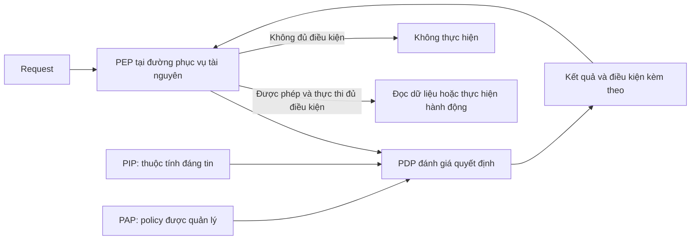

# Authorization decision — Quyết định cấp quyền truy cập

Một người học đã đăng nhập thành công và hoàn tất MFA. Họ gửi request xem tiến độ của một người học khác bằng cách đổi ID trong URL. Bằng chứng đăng nhập vẫn hợp lệ, nhưng điều đó không cho phép đọc tài nguyên vừa được chọn.

**Authorization decision** là kết quả đánh giá liệu một chủ thể có được thực hiện một hành động trên một tài nguyên trong ngữ cảnh cụ thể, theo chính sách đang áp dụng hay không. Quyết định có ý nghĩa khi thành phần phục vụ tài nguyên thực thi đúng kết quả trước khi tiết lộ dữ liệu hoặc tạo tác động.

Trong nền tảng IAM, quyết định này nối danh tính và bằng chứng xác thực với RBAC, ABAC, quan hệ đối tượng, đặc quyền và vòng đời quyền. Mật khẩu đúng, phiên hợp lệ hoặc token có chữ ký là đầu vào có thể cần thiết; chúng không tự trở thành quyền làm mọi việc.

Sau bài học, người học có thể xác định đầu vào của quyết định, phân biệt đánh giá policy với thực thi, xử lý các kết quả ngoài cho phép và xây dựng ví dụ kiểm tra quyền theo tài nguyên.

## 1. Quyết định cấp quyền trả lời một câu hỏi cụ thể

Một cách mô tả khái niệm:

```text
decision = evaluate(subject, action, resource, context, policy)
```

| Thành phần | Câu hỏi | Ví dụ |
| --- | --- | --- |
| Subject | Ai hoặc danh tính nào đang yêu cầu? | Người học, giảng viên, service account |
| Action | Muốn thực hiện hành động gì? | Xem tiến độ, sửa điểm, xuất dữ liệu |
| Resource | Hành động tác động lên đối tượng nào? | Tiến độ của một người học trong một tenant |
| Context | Điều kiện liên quan hiện tại là gì? | Phiên, mức xác thực, thời gian, trạng thái yêu cầu |
| Policy | Những quy tắc nào quyết định quyền? | Chủ sở hữu được xem, giảng viên chỉ sửa lớp được phân công |

NIST SP 800-162 mô tả ABAC là đánh giá thuộc tính của chủ thể, đối tượng, thao tác và trong một số trường hợp điều kiện môi trường dựa trên policy hoặc quan hệ. [Nguồn: NIST — Guide to ABAC Definition and Considerations](https://csrc.nist.gov/pubs/sp/800/162/upd2/final)

Mô hình trên hữu ích ngay cả khi ứng dụng chưa dùng một policy engine riêng. Một câu điều kiện trong service cũng đang thực hiện quyết định, dù người viết chưa gọi nó là PDP hoặc ABAC.

### Không chỉ hỏi “người này có vai trò gì?”

Giả sử chủ thể có vai trò `INSTRUCTOR`. Vẫn cần biết:

- Giảng viên thuộc tenant nào?
- Được phân công lớp hoặc khóa học nào?
- Hành động là xem điểm hay thay đổi điểm?
- Bảng điểm còn mở chỉnh sửa hay đã khóa?
- Quyền được cấp có còn trong thời hạn và chưa bị thu hồi không?

Nếu chỉ thấy vai trò giảng viên rồi cho phép sửa mọi bảng điểm, ứng dụng đã bỏ qua phạm vi của quyền. Nguyên tắc ít quyền nhất cần thể hiện trong quyết định, không chỉ trong tên vai trò.

## 2. Authentication, session và authorization là ba câu hỏi khác nhau

| Kiểm tra | Câu hỏi chính | Một kết quả thành công chưa chứng minh điều gì? |
| --- | --- | --- |
| Authentication | Bằng chứng danh tính có được chấp nhận không? | Được truy cập mọi tài nguyên |
| Session/token validation | Ngữ cảnh hoặc artifact hiện tại có hợp lệ theo mục đích không? | Quyền trên đúng đối tượng yêu cầu |
| Authorization | Chủ thể được thực hiện hành động cụ thể này không? | Request hợp lệ về mọi mặt nghiệp vụ |

Một request có thể vượt qua xác thực và kiểm tra phiên nhưng vẫn bị từ chối cấp quyền. Ngược lại, một tài nguyên công khai có thể được policy cho phép đọc mà không cần một chủ thể đã đăng nhập.

MFA bổ sung bằng chứng xác thực. Nếu policy chỉ cho giảng viên được sửa điểm, người học vừa làm MFA cũng không trở thành giảng viên. Một yêu cầu step-up cho thao tác nhạy cảm là một điều kiện của quyết định, không phải cách tự cấp vai trò mới.

Authorization cũng không thay thế kiểm tra nghiệp vụ. Một giảng viên được quyền sửa điểm vẫn phải gửi giá trị trong khoảng cho phép và tuân thủ quy tắc cập nhật. Cả quyền và tính hợp lệ nghiệp vụ đều cần đạt trước khi ghi thay đổi.

## 3. Đầu vào phải có nguồn đáng tin cậy

Một policy đúng vẫn có thể cho kết quả sai nếu ứng dụng cung cấp thuộc tính giả hoặc cũ.

| Dữ liệu | Nguồn phù hợp trong thiết kế minh họa | Sai lầm cần tránh |
| --- | --- | --- |
| Subject ID | Ngữ cảnh đã được thành phần xác thực xác minh | Tin `X-User-Id` do client bất kỳ gửi |
| Tenant được phép | Membership hoặc ràng buộc danh tính đã kiểm tra | Dùng `tenantId` từ body như quyền chọn mọi tenant |
| Vai trò, grant | Nguồn phân quyền và trạng thái phiên bản phù hợp | Cho client tự gửi `role=ADMIN` |
| Chủ sở hữu tài nguyên | Metadata được server lấy từ kho đáng tin | Tin `ownerId` client khai thay cho bản ghi thật |
| Trạng thái tài nguyên | Dữ liệu hiện hành theo yêu cầu nhất quán | Dùng snapshot cũ cho thao tác đã đổi trạng thái |
| Thời gian, độ mới xác thực | Đồng hồ và dấu vết phía server/issuer tin cậy | Tin cờ `recentMfa=true` tự khai |

Client có thể cung cấp ID để **chọn** tài nguyên. Server vẫn cần xác minh ID đó thuộc phạm vi truy cập của chủ thể. Biết hoặc đoán được ID không tạo ra quyền.

Nếu danh tính đến từ token, việc xác minh chữ ký và các điều kiện sử dụng token chỉ là bước đầu. Thuộc tính phải được hiểu theo issuer và hợp đồng tích hợp; token gửi sai dịch vụ hoặc sai mục đích không trở thành nguồn quyền hợp lệ chỉ vì đọc được payload.

### Thuộc tính bị thiếu khác với thuộc tính không thỏa điều kiện

“Tài khoản không active” có thể là một dữ kiện đã xác định. “Không lấy được trạng thái tài khoản” là thiếu thông tin hoặc lỗi xử lý. Cả hai có thể không dẫn tới cấp quyền trong một thiết kế từ chối mặc định, nhưng lý do và cách vận hành khác nhau.

Nếu mọi lỗi lấy membership đều bị chuyển thành một danh sách grant rỗng, hệ thống khó phân biệt người dùng không có quyền với dịch vụ phân quyền đang hỏng. Nếu lỗi lại được chuyển thành “bỏ qua kiểm tra”, ranh giới bảo vệ bị mất.

## 4. Tách nơi quyết định khỏi nơi thực thi

PDP đánh giá yêu cầu theo policy; PEP dùng kết quả để kiểm soát việc trả dữ liệu hoặc thực hiện hành động. Đây là hai trách nhiệm khác nhau, dù có thể nằm trong cùng một tiến trình. [Nguồn: OWASP — Authorization Decisions and Output Handling](https://cheatsheetseries.owasp.org/cheatsheets/Authorization_Decisions_And_Output_Handling_Cheat_Sheet.html)

Các vai trò kiến trúc thường được mô tả như sau:

| Vai trò | Trách nhiệm | Ví dụ vị trí |
| --- | --- | --- |
| PEP — Policy Enforcement Point | Yêu cầu quyết định và thực thi kết quả | Service xử lý thao tác xem hoặc sửa dữ liệu |
| PDP — Policy Decision Point | Đánh giá policy cho yêu cầu cụ thể | Hàm policy hoặc dịch vụ đánh giá |
| PIP — Policy Information Point | Cung cấp thuộc tính cần thiết | Kho membership, metadata tài nguyên |
| PAP — Policy Administration Point | Tạo và quản lý policy | Quy trình cấu hình và phát hành chính sách |

Tên PIP và PAP cùng mô hình các vai trò này được định nghĩa trong XACML. Chúng không bắt buộc phải là bốn microservice riêng biệt. [Nguồn: OASIS XACML 3.0](https://docs.oasis-open.org/xacml/3.0/xacml-3.0-core-spec-os-en.html)



Một API gateway có thể kiểm tra quyền cấp endpoint, nhưng service sở hữu dữ liệu vẫn cần có đủ kiểm soát theo đối tượng và trường dữ liệu. Gateway biết “được gọi API xem tiến độ” chưa chắc biết người dùng được xem bản ghi tiến độ nào.

UI ẩn nút cũng không phải PEP đủ để bảo vệ backend. Người gọi có thể gửi request trực tiếp từ client khác. Các đường gọi từ batch, job nền và công cụ quản trị cũng cần được đặt trong mô hình thực thi phù hợp.

## 5. Kết quả không chỉ là một Boolean

XACML phân biệt `Permit`, `Deny`, `NotApplicable` và `Indeterminate`. Một ứng dụng có thể dùng kiểu dữ liệu khác, nhưng việc giữ riêng ý nghĩa các kết quả giúp tránh biến thiếu rule hoặc lỗi xử lý thành quyền truy cập. [Nguồn: OASIS XACML 3.0 — Decision](https://docs.oasis-open.org/xacml/3.0/xacml-3.0-core-spec-os-en.html)

| Kết quả | Cách hiểu ở mức nền tảng | Ví dụ |
| --- | --- | --- |
| Permit | Yêu cầu được cho phép theo kết quả policy | Người học được xem tiến độ thuộc chính mình |
| Deny | Policy xác định không cho phép | Chủ thể thuộc tenant khác |
| NotApplicable | Policy đang xét không áp dụng cho yêu cầu | Policy chỉ xử lý đọc, request muốn xóa |
| Indeterminate | Không xác định được kết quả do lỗi/thiếu dữ liệu cần thiết | Không lấy được metadata bắt buộc |

`NotApplicable` không phải “không có cấm nên cho qua”. Nó có thể là kết quả của một policy thành phần; hệ thống cần kết hợp policy theo thuật toán đã chọn rồi thực thi kết quả cuối.

Một ví dụ từ chối mặc định chỉ thực hiện thao tác khi có `Permit` cuối cùng hợp lệ và thực thi được các điều kiện bắt buộc. OWASP khuyến nghị deny by default và kiểm tra quyền trên mọi request liên quan. [Nguồn: OWASP — Authorization Cheat Sheet](https://cheatsheetseries.owasp.org/cheatsheets/Authorization_Cheat_Sheet.html)

### Kết hợp nhiều policy phải có quy tắc

Giả sử policy A cho giảng viên đọc bảng điểm, còn policy B xử lý bảng điểm thuộc tenant khác. Không nên viết “gặp một Permit thì trả ngay” nếu thiết kế yêu cầu ranh giới tenant luôn được giữ.

Tương tự, không khẳng định mọi policy engine đều mặc định “Deny luôn thắng”. Kết quả phụ thuộc thuật toán kết hợp và cấu trúc policy. Trong ví dụ của bài, các ranh giới bắt buộc được kiểm tra rõ trước khi cấp quyền; ngoại lệ đặc quyền nếu có cần được mô tả và kiểm soát riêng.

Nếu chọn thuật toán chỉ áp dụng rule đầu tiên, thứ tự rule trở thành một phần của chính sách. Thay thứ tự khi refactor có thể làm đổi quyền dù từng điều kiện trông không thay đổi.

## 6. Permit có thể kèm điều kiện thực thi

Một quyết định có thể cho đọc dữ liệu nhưng giới hạn trường, hàng hoặc thao tác phụ đi kèm. Ví dụ, một nhân viên hỗ trợ được xem trạng thái tài khoản nhưng không được nhận toàn bộ thông tin cá nhân của người học.

XACML phân biệt obligation phải được thực hiện với advice cung cấp thông tin bổ sung. Không nên coi một điều kiện bảo vệ bắt buộc như gợi ý có thể bỏ qua. [Nguồn: OASIS XACML 3.0 — Result, Obligations and Advice](https://docs.oasis-open.org/xacml/3.0/xacml-3.0-core-spec-os-en.html)

Một kết quả minh họa, không phải schema XACML:

```json
{
  "decision": "PERMIT",
  "action": "profile.read",
  "resourceRef": "internal-profile-reference",
  "policyVersion": "profile-access-v4",
  "requiredOutputProfile": "SUPPORT_LIMITED_VIEW"
}
```

PEP không được chỉ đọc `PERMIT` rồi serialize nguyên entity trong database. Nó phải tạo đúng biểu diễn cho phép. Nếu không thực hiện được điều kiện giới hạn dữ liệu, thiết kế minh họa không phát hành response đầy đủ như một cách fallback.

Với thao tác thay đổi trạng thái, điều kiện có thể gồm kiểm tra tách nhiệm vụ, bước phê duyệt đã có hoặc việc ghi bằng chứng theo policy. Cần xác định điều gì phải hoàn tất trước khi tác động được commit và cách xử lý khi điều kiện đó thất bại.

Không phải mọi dòng log vận hành đều trở thành obligation bắt buộc của mọi thao tác. Tính bắt buộc phải xuất phát từ policy đã định nghĩa, thay vì biến mọi lỗi log thành hành vi không xác định.

## 7. Ví dụ Java: quyết định xem tiến độ của chính mình

Chính sách minh họa cho một endpoint self-service:

- Chỉ xử lý hành động đọc tiến độ.
- Tài khoản phải đang active.
- Chủ thể và tiến độ phải thuộc cùng tenant.
- Người học sở hữu tiến độ phải là chính chủ thể đang gọi.

Ví dụ dùng record và enum trong Java 17 trở lên. Các giá trị subject/resource phải được server dựng từ nguồn đáng tin; không bind trực tiếp body JSON của client thành các đối tượng này rồi coi là bằng chứng.

```java
import java.util.UUID;

public final class SelfProgressPolicy {
    public enum Action {
        READ_PROGRESS,
        CHANGE_SCORE
    }

    public enum Decision {
        PERMIT,
        DENY,
        NOT_APPLICABLE,
        INDETERMINATE
    }

    public record Subject(UUID id, UUID tenantId, boolean active) {
    }

    public record Progress(UUID id, UUID tenantId, UUID learnerId) {
    }

    private SelfProgressPolicy() {
    }

    public static Decision evaluate(
            Subject subject, Action action, Progress progress) {
        if (action == null) {
            return Decision.INDETERMINATE;
        }
        if (action != Action.READ_PROGRESS) {
            return Decision.NOT_APPLICABLE;
        }
        if (subject == null || progress == null
                || subject.id() == null || subject.tenantId() == null
                || progress.id() == null || progress.tenantId() == null
                || progress.learnerId() == null) {
            return Decision.INDETERMINATE;
        }
        if (!subject.active()) {
            return Decision.DENY;
        }
        if (!subject.tenantId().equals(progress.tenantId())) {
            return Decision.DENY;
        }
        if (!subject.id().equals(progress.learnerId())) {
            return Decision.DENY;
        }
        return Decision.PERMIT;
    }
}
```

Đây là một policy hẹp, chưa phải toàn bộ policy engine. Nó không cấp ngoại lệ cho giảng viên hoặc quản trị viên, không xử lý sửa điểm và không tự tải dữ liệu. Một người có vai trò quản trị muốn xem tiến độ của người khác cần một policy có thẩm quyền riêng, không phải một nhánh tự cho phép được thêm ngầm vào policy self-service.

Tại đường thực thi, nguyên tắc minh họa là:

```text
Lấy chủ thể từ security context đã xác minh.
Lấy metadata tài nguyên theo phạm vi xử lý được kiểm soát.
Đánh giá yêu cầu READ_PROGRESS cho đúng bản ghi.

Nếu kết quả cuối không phải PERMIT:
    Không trả nội dung tiến độ.
    Phân loại lý do nội bộ và phản hồi theo hợp đồng API.

Nếu PERMIT:
    Trả đúng biểu diễn dữ liệu mà policy cho phép.
```

Phải bảo đảm còn kiểm soát giữa lúc metadata được đọc và lúc dữ liệu được sử dụng. Nếu đối tượng thay chủ hoặc đổi tenant trong khoảng đó, một quyết định dựa vào bản cũ không tự áp dụng cho bản mới.

## 8. Từ một đối tượng tới danh sách và truy vấn

Một endpoint chi tiết và một endpoint danh sách có hình dạng quyết định khác nhau. Được gọi `/progress` không có nghĩa được đọc mọi bản ghi bên trong kết quả.

OWASP mô tả các cách thực thi đối với collection, chẳng hạn kiểm tra từng ứng viên, lấy các ID được phép hoặc áp dụng bộ lọc quyền. Việc kiểm soát cần xảy ra trước khi dữ liệu không được phép bị phát hành. [Nguồn: OWASP — Enforcing Access to Collections](https://cheatsheetseries.owasp.org/cheatsheets/Authorization_Decisions_And_Output_Handling_Cheat_Sheet.html#enforcing-access-to-collections)

Với chính sách self-service ở mục 7, một truy vấn minh họa có thể mang ràng buộc trực tiếp:

```sql
SELECT p.id, p.course_id, p.completion_percent
FROM learning_progress p
WHERE p.id = :requestedProgressId
  AND p.tenant_id = :trustedTenantId
  AND p.learner_id = :trustedSubjectId;
```

`requestedProgressId` là ID mục tiêu do request lựa chọn và được xử lý như tham số. Hai giá trị `trustedTenantId`, `trustedSubjectId` phải đến từ ngữ cảnh và ràng buộc đã xác minh. Đổi tên tham số không làm dữ liệu do client tự khai trở thành tin cậy.

Truy vấn chỉ thể hiện ràng buộc hàng cho ví dụ. Điều kiện tài khoản active và các policy khác vẫn phải được thực thi. Nó cũng không cấp quyền ghi hoặc xuất dữ liệu chỉ vì đã cho phép một lần đọc.

Nếu cùng chính sách được dùng cho danh sách, phân trang, tổng số và export, các đường đó cần giữ cùng phạm vi. Tải toàn bộ rồi gửi về client để lọc sẽ làm dữ liệu đã vượt ranh giới, dù bảng giao diện chỉ hiện những hàng được phép.

Với batch nhiều tài nguyên, cần ràng buộc mỗi kết quả với đúng ID và hành động. Một `Permit` cho phần tử đầu không được áp dụng cho toàn bộ batch chỉ vì chúng dùng chung request HTTP.

## 9. Quyết định có thời điểm, phạm vi và độ mới

### 9.1. TOCTOU: kiểm tra trước, dùng sau

Giả sử giảng viên được quyền sửa bảng điểm lúc kiểm tra. Trước khi lệnh cập nhật được ghi, bảng điểm bị khóa hoặc phân công giảng dạy bị thu hồi.

Nếu thao tác cần bảo đảm điều kiện còn đúng lúc thực hiện, có thể phải kiểm tra trong transaction, dùng version hoặc đưa điều kiện vào cập nhật có điều kiện. Chọn cơ chế theo nguồn dữ liệu và mức nhất quán yêu cầu; chỉ thêm một hàm `authorize()` ở đầu request chưa chứng minh đã giải quyết cạnh tranh.

Một decision response cũng không nên trở thành giấy phép dùng lại cho mọi tài nguyên. Nếu nó được truyền giữa các thành phần, phải bảo vệ tính toàn vẹn và ràng buộc với đúng chủ thể, hành động, tài nguyên và điều kiện hiệu lực.

### 9.2. Cache cần biết thứ gì làm quyền thay đổi

Ví dụ cache chỉ theo `subjectId` là thiếu nếu cùng chủ thể có thể được đọc A nhưng không được đọc B hoặc được xem nhưng không được sửa.

Một thiết kế cache có thể cần xét tenant, action, resource, phiên bản policy, phiên bản grant và những thuộc tính ngữ cảnh liên quan. Không nhất thiết đưa mọi thuộc tính có thể nghĩ đến vào key; cần đưa đúng những dữ kiện ảnh hưởng kết quả và cơ chế cập nhật của chúng.

Nếu policy yêu cầu xác thực gần đây, một `Permit` cache lâu hơn thời gian bằng chứng còn được chấp nhận có thể cho phép thao tác sau hạn. Nếu quyền bị thu hồi, hệ thống phải có cam kết về lúc cache ngừng chấp nhận bản cũ.

Cache kết quả từ chối cũng có thể trì hoãn việc cấp quyền mới. Vì vậy, độ mới không chỉ là vấn đề an toàn mà còn ảnh hưởng khả năng sử dụng và vận hành.

### 9.3. Thiếu thông tin không tự tạo quyền

PDP từ xa bị timeout cần được phân loại như lỗi đánh giá, không mặc định là `Permit`. Một hệ thống có thể có phương án dự phòng đã định nghĩa, như policy local còn hiệu lực, nhưng phải kiểm soát phạm vi và phiên bản của nguồn đó.

Nếu không có bằng chứng cho phép còn hợp lệ, thiết kế từ chối mặc định không thực hiện hành động. Nội bộ vẫn nên ghi đúng rằng nguồn đánh giá lỗi, thay vì khẳng định người dùng chắc chắn không có grant.

## 10. Quyết định nội bộ khác với HTTP response

API cần chuyển kết quả và lỗi sang phản hồi có ý nghĩa, nhưng không nên làm lộ toàn bộ cấu trúc policy hoặc thông tin tài nguyên.

Theo RFC 9110, `401` liên quan đến thiếu credential xác thực hợp lệ và response cần có challenge phù hợp; `403` biểu thị server từ chối thực hiện. Server có thể dùng `404` thay cho `403` để không tiết lộ sự tồn tại của tài nguyên bị cấm. [Nguồn: RFC 9110, mục 15.5.2 và 15.5.4](https://www.rfc-editor.org/rfc/rfc9110.html#section-15.5.2)

Một ví dụ ánh xạ, cần điều chỉnh theo hợp đồng API:

| Tình huống | Hành vi công khai có thể phù hợp | Phân loại nội bộ |
| --- | --- | --- |
| Endpoint cần xác thực nhưng thiếu bằng chứng hợp lệ | Luồng xác thực/challenge thích hợp | Authentication required |
| Đã xác thực nhưng không đủ quyền | `403`, hoặc `404` theo chính sách che tài nguyên | Policy denial |
| Không có policy cho phép hành động | Không thực hiện; phản hồi theo API | No applicable permission |
| Thiếu dữ liệu hoặc nguồn policy lỗi | Lỗi dịch vụ phù hợp hoặc phản hồi hạn chế; không thực hiện | Decision evaluation failure |
| Cần bằng chứng mới theo policy | Điều hướng/challenge theo giao thức đã định nghĩa | Additional authentication required |

Không trả một error body chứa tên người sở hữu, tenant thật hoặc nội dung tài nguyên mà request không được đọc. Thông báo UI có thể đơn giản hơn nhiều so với lý do được lưu ở hệ thống kiểm toán.

Một response `403` cũng không chứng minh dữ liệu chưa bị lộ nếu ứng dụng đã stream một phần nội dung trước khi kiểm tra. PEP phải được đặt trước bước phát hành dữ liệu hoặc tác động được bảo vệ.

## 11. Người dùng, SSO và danh tính workload

Một người dùng đăng nhập qua IdP vẫn cần được ứng dụng cấp quyền trên tài nguyên local. Identity federation giúp ứng dụng nhận bằng chứng danh tính; nó không tự định nghĩa mọi quyền trên khóa học, tenant hoặc hệ thống nghiệp vụ.

Tương tự, một OAuth scope như `progress.read` có thể giới hạn loại truy cập của token, nhưng không mặc nhiên cho phép xem tiến độ của mọi người. Ứng dụng phải hiểu scope kết hợp với danh tính, phạm vi tài nguyên và grant như thế nào.

Với workload, subject có thể là một service account được phép xử lý một loại công việc. Nếu service đang thao tác thay người dùng, cần phân biệt danh tính kỹ thuật thực hiện và người dùng được đại diện.

Một service có credential mạnh nhưng không bị giới hạn phạm vi có thể trở thành nơi người gọi lợi dụng để truy cập tài nguyên ngoài quyền của mình. Không cho phép một request không có quyền đi qua chỉ vì hop tiếp theo được gọi bằng credential của service đáng tin.

Trong vòng đời IAM, thay đổi nhóm, chấm dứt tài khoản hoặc hết hạn phân công đều có thể làm quyết định thay đổi. Độ mạnh của mật khẩu và MFA không bù được grant đặc quyền bị giữ lại sau khi không còn nhu cầu.

## 12. Kiểm toán và kiểm chứng quyết định

Một dấu vết minh họa:

```text
event_type: AUTHORIZATION_EVALUATED
decision_ref: internal-decision-reference
subject_ref: internal-subject-reference
tenant_ref: internal-tenant-reference
action: progress.read
resource_ref: internal-progress-reference
result: DENY
reason_code: SUBJECT_RESOURCE_SCOPE_MISMATCH
policy_version: progress-self-service-v2
enforcement_result: NO_DATA_RELEASED
```

Nếu chỉ ghi PDP trả gì mà không biết PEP đã làm gì, hệ thống có thể ghi `Deny` nhưng vẫn trả dữ liệu do lỗi tích hợp. Vì vậy, việc kiểm chứng cần quan sát cả quyết định và kết quả thực thi.

Không đưa password, cookie, access token hoặc mọi thuộc tính nhạy cảm vào log để giải thích policy. Resource ID và subject ID cũng có thể nhạy cảm; quyền đọc, thời hạn lưu và dữ liệu được xuất ra công cụ quan sát cần có mục đích rõ.

Các trường hợp quan trọng đối với ví dụ self-service:

| Thay đổi so với trường hợp được phép | Kết quả mong đợi |
| --- | --- |
| Cùng chủ thể, cùng tenant, tài khoản active, đúng tiến độ của mình | `Permit` và chỉ trả biểu diễn cho phép |
| Đổi người sở hữu tiến độ | Không trả dữ liệu |
| Đổi tenant của tài nguyên | Không trả dữ liệu, kể cả khi ID người học trùng một cách bất thường |
| Tài khoản không active | Không cho truy cập theo policy ví dụ |
| Thiếu metadata bắt buộc | Không biến thiếu dữ liệu thành `Permit` |
| Đổi action từ đọc sang sửa điểm | Policy self-service không cấp quyền cho hành động đó |
| Client tự gửi vai trò quản trị hoặc owner ID | Không thay nguồn thuộc tính đáng tin |
| PDP lỗi hoặc timeout | Không thực hiện theo một `Permit` tự tạo |
| Có điều kiện hạn chế trường nhưng PEP không áp dụng được | Không fallback sang trả đầy đủ entity |
| Gọi endpoint danh sách, batch hoặc export | Phạm vi tài nguyên vẫn được kiểm soát |
| Quyền bị thu hồi giữa kiểm tra và ghi | Cơ chế nhất quán thực thi đúng điều kiện của thao tác |
| Có `Deny` trong log nhưng vẫn thấy dữ liệu ở response | Được nhận diện là lỗi thực thi, không coi là kiểm tra đạt |

Không chỉ kiểm tra người dùng có quyền nhận thành công. Các ca đổi đúng một thuộc tính như tenant, action hoặc chủ sở hữu giúp phát hiện điều kiện bị bỏ sót. Kiểm thử tích hợp cần quan sát cả dữ liệu trả về và những thay đổi thực sự được ghi.

## 13. Tình huống tổng hợp

Một cổng học tập có người học, giảng viên và nhân viên hỗ trợ. Người học xem tiến độ của mình; giảng viên xem kết quả lớp được phân công; nhân viên hỗ trợ chỉ xem một biểu diễn hồ sơ hạn chế.

Khi người học đổi ID trên URL, session vẫn hợp lệ nhưng quyết định self-service từ chối vì tài nguyên không thuộc họ. Khi giảng viên truy cập một lớp cùng tenant nhưng chưa được phân công, việc có vai trò giảng viên cũng chưa đủ.

Nhân viên hỗ trợ được `Permit` cho hồ sơ giới hạn. PEP tạo đúng DTO cho hỗ trợ thay vì trả toàn bộ entity. Nếu bộ tạo biểu diễn bị lỗi, ứng dụng không dùng entity đầy đủ làm phương án thay thế.

Sau khi giảng viên chuyển công tác, phân công được thu hồi. Các quyết định mới phải phản ánh thay đổi theo cam kết độ mới của hệ thống; một token còn hạn không tự bảo toàn quyền đã hết.

Quyết định cấp quyền có thể được đánh giá bằng một hàm nhỏ hoặc một hệ thống policy lớn, nhưng luôn cần cùng sự rõ ràng: đúng chủ thể, đúng hành động, đúng tài nguyên, đúng ngữ cảnh và kết quả được thực thi đầy đủ.

## Tài liệu tham khảo

- [OWASP Authorization Cheat Sheet](https://cheatsheetseries.owasp.org/cheatsheets/Authorization_Cheat_Sheet.html)
- [OWASP Authorization Decisions and Output Handling Cheat Sheet](https://cheatsheetseries.owasp.org/cheatsheets/Authorization_Decisions_And_Output_Handling_Cheat_Sheet.html)
- [NIST SP 800-162 — Guide to Attribute Based Access Control Definition and Considerations](https://csrc.nist.gov/pubs/sp/800/162/upd2/final)
- [OASIS XACML Version 3.0](https://docs.oasis-open.org/xacml/3.0/xacml-3.0-core-spec-os-en.html)
- [RFC 9110 — HTTP Semantics, Client Error Responses](https://www.rfc-editor.org/rfc/rfc9110.html#section-15.5)
