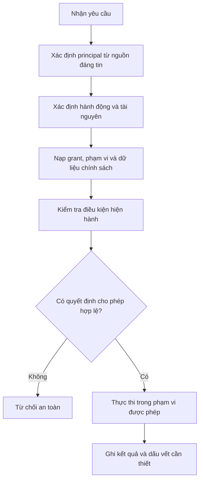

# Permission — Quyền thực hiện thao tác trên tài nguyên

## 1. Permission là gì?

**Permission** mô tả một thao tác được phép thực hiện đối với tài nguyên theo chính sách truy cập. Trong ứng dụng, permission thường được biểu diễn bằng một mã có ý nghĩa nghiệp vụ, chẳng hạn `invoice:read`, `invoice:approve` hoặc `user:disable`.

Ví dụ, một nhân viên có thể đọc hóa đơn nhưng không được phê duyệt hóa đơn. Hai khả năng đó cần được phân biệt dù chúng xuất hiện trên cùng một màn hình và cùng liên quan đến một loại dữ liệu.

Một mã permission không tự mô tả toàn bộ quyết định truy cập. Người có `invoice:approve` trong tenant A chưa chắc được duyệt mọi hóa đơn, duyệt hóa đơn của tenant B hoặc duyệt một hóa đơn do chính mình tạo. Phạm vi, thuộc tính tài nguyên và điều kiện nghiệp vụ tiếp tục giới hạn quyền được sử dụng.

Trong IAM, permission là thành phần giúp nối danh tính đã xác thực với quyết định cấp quyền. MFA, SSO hoặc OAuth/OIDC cung cấp những bằng chứng và ngữ cảnh liên quan, nhưng không tự quyết định chủ thể được thao tác trên từng tài nguyên nào.

Sau bài học, người học có thể:

- Mô tả một permission bằng hành động và tài nguyên.
- Phân biệt permission với role, grant, OAuth scope và quyết định truy cập.
- Thiết kế tên và độ chi tiết của danh mục quyền.
- Thực thi quyền ở backend với phạm vi tài nguyên và điều kiện hiện hành.
- Quản lý cấp, thu hồi, kiểm toán và kiểm chứng quyền theo nguyên tắc ít quyền nhất.

## 2. Từ permission đến quyết định truy cập

### 2.1. Các thành phần của một yêu cầu

Một yêu cầu truy cập có thể được mô tả bằng:

```text
Chủ thể       : ai hoặc workload nào đang yêu cầu?
Hành động     : muốn đọc, sửa, phê duyệt hay cấp quyền?
Tài nguyên    : loại nào và đối tượng cụ thể nào?
Ngữ cảnh      : tenant, thời điểm, trạng thái phiên, thiết bị hoặc quan hệ liên quan?
Chính sách    : quy tắc nào cho phép hoặc ngăn hành động?
```

Ví dụ:

```text
subject  = employee-17
action   = approve
resource = invoice-204 thuộc tenant-a
context  = phiên còn hiệu lực, xác thực đáp ứng yêu cầu
```

Backend cần xác định chủ thể có quyền phê duyệt trong phạm vi thích hợp và hóa đơn đang thỏa các điều kiện áp dụng. Không chỉ kiểm tra rằng chuỗi `invoice:approve` xuất hiện trong một danh sách rồi bỏ qua phần còn lại.

### 2.2. Permission, assignment và hiệu lực thực tế

| Khái niệm | Ví dụ | Vai trò |
| --- | --- | --- |
| Định nghĩa permission | `invoice:approve` | Định danh một khả năng nghiệp vụ |
| Gán quyền hoặc grant | Role kế toán phê duyệt có permission đó trong tenant A | Cho biết nguồn và phạm vi quyền được cấp |
| Điều kiện chính sách | Không duyệt hóa đơn do chính mình tạo | Giới hạn khi quyền có thể được sử dụng |
| Quyền có hiệu lực | Tập khả năng hiện còn hợp lệ sau khi xét nguồn cấp và ràng buộc | Đầu vào cho quyết định tại thời điểm truy cập |
| Quyết định truy cập | Cho phép employee-17 duyệt invoice-204 lúc này | Kết quả áp dụng chính sách cho một yêu cầu cụ thể |

Danh mục có một permission không có nghĩa bất kỳ ai đã được cấp permission đó. Tương tự, dữ liệu gán quyền còn tồn tại trong một bản cache không tự chứng minh quyền vẫn có hiệu lực sau khi bị thu hồi.

## 3. Permission khác role, attribute và OAuth scope như thế nào?

### 3.1. Role tập hợp trách nhiệm

Một role như `ACCOUNTANT_APPROVER` có thể được gán các permission `invoice:read` và `invoice:approve`. Người dùng được gán role trong phạm vi phù hợp, rồi hệ thống xác định các quyền được phép sử dụng từ đó.

Trong mô hình RBAC, quan hệ gán user với role và gán permission với role là những thành phần nền tảng. Tham khảo [NIST — Role Based Access Control FAQs](https://csrc.nist.gov/projects/role-based-access-control/faqs).

Ví dụ ánh xạ của một ứng dụng giả định:

| Role | Permission trong danh mục |
| --- | --- |
| `INVOICE_VIEWER` | `invoice:read` |
| `INVOICE_EDITOR` | `invoice:read`, `invoice:update` |
| `ACCOUNTANT_APPROVER` | `invoice:read`, `invoice:approve` |
| `IDENTITY_OPERATOR` | `user:read`, `user:disable` trong phạm vi được ủy quyền |

Tên role không tự tạo ra thứ bậc. Trong mô hình này, editor không tự có quyền approve, và identity operator không tự có quyền duyệt hóa đơn. Nếu cần kế thừa role, phải định nghĩa và đánh giá riêng tác động của quan hệ đó.

### 3.2. Attribute và quan hệ bổ sung điều kiện

ABAC có thể xét thuộc tính chủ thể, tài nguyên và môi trường. Chính sách theo quan hệ có thể xét chủ thể là người sở hữu, thành viên dự án hoặc người được chia sẻ tài nguyên.

Ví dụ, `invoice:read` chỉ áp dụng khi chủ thể là thành viên hợp lệ của tenant chứa hóa đơn. Việc sở hữu một tài nguyên có thể là một điều kiện cho phép, nhưng không phải quy tắc mặc định của mọi hệ thống. Một hóa đơn đã khóa hoặc thuộc quy trình kiểm soát có thể hạn chế ngay cả người tạo.

### 3.3. OAuth scope giới hạn một ngữ cảnh truy cập bằng token

OAuth scope là các chuỗi do authorization server định nghĩa để mô tả phạm vi truy cập được yêu cầu và cấp cho token. Không có quy tắc chung buộc scope trùng tên một permission nội bộ. Xem [RFC 6749 — Access Token Scope](https://www.rfc-editor.org/rfc/rfc6749.html#section-3.3).

Ví dụ, scope `invoice.approve` có thể được ứng dụng ánh xạ đến khả năng gọi nhóm chức năng phê duyệt. Backend vẫn cần kiểm tra hóa đơn cụ thể, tenant, quyền hiện hành và các điều kiện của mô hình ủy quyền.

Với request thay mặt người dùng, cần làm rõ giới hạn áp dụng cho người dùng, ứng dụng gọi và token. Với workload tự hoạt động, principal có thể là một danh tính máy. Không gán nhầm quyền của người dùng hoặc của client sang mọi request chỉ vì token đã xác minh thành công.

## 4. Thiết kế danh mục permission

### 4.1. Đặt tên theo khả năng nghiệp vụ

Một quy ước đơn giản là:

```text
<loại-tài-nguyên>:<hành-động>
```

Ví dụ:

```text
invoice:read
invoice:update
invoice:approve
invoice:export
user:disable
permission:grant
```

Quy ước này là lựa chọn của ứng dụng, không phải chuẩn bắt buộc. Quan trọng là cùng một mã có cùng ý nghĩa ở nơi cấp quyền và nơi thực thi.

Tên permission nên mô tả hành động ổn định, thay vì phụ thuộc vị trí nút hoặc số thứ tự màn hình. Một permission như `screen-7-button-2` khiến việc thay giao diện dễ làm sai ánh xạ chính sách.

Một endpoint có thể thực hiện nhiều hành động, và một hành động có thể được gọi qua nhiều endpoint. Vì vậy, đường dẫn HTTP không phải lúc nào cũng là đơn vị permission thích hợp.

### 4.2. Chọn độ chi tiết theo rủi ro và trách nhiệm

| Thiết kế | Vấn đề có thể phát sinh | Hướng phân tích |
| --- | --- | --- |
| Một quyền `admin` cho mọi chức năng | Người chỉ cần một thao tác nhận quá nhiều quyền | Tách các trách nhiệm nhạy cảm có chủ đích |
| Một quyền `invoice:manage` gồm mọi hành động | Khó cấp quyền sửa mà không cấp quyền duyệt hoặc xóa | Xác định những hành động cần được cấp độc lập |
| Một permission riêng cho từng ID bản ghi | Danh mục quyền tăng theo dữ liệu và khó quản lý | Dùng phạm vi tài nguyên, ACL hoặc quan hệ phù hợp |
| Một permission cho mỗi chi tiết giao diện | Chính sách phụ thuộc cấu trúc frontend | Đặt tên theo hành vi nghiệp vụ |
| Một quyền đọc bao gồm xuất dữ liệu hàng loạt | Khả năng sao chép dữ liệu lớn có thể vượt nhu cầu | Đánh giá permission export và giới hạn xuất riêng |

Không cần chia mọi thao tác nhỏ thành một permission. Cần tách khi có khác biệt đáng kể về người được cấp, rủi ro, quy trình phê duyệt hoặc phạm vi dữ liệu.

### 4.3. Tránh suy diễn từ ký tự trong tên

`invoice:read` không mặc định bao hàm `invoice:export`. Dấu `*` trong `invoice:*` cũng không tự có ý nghĩa nếu policy engine chưa định nghĩa wildcard. Tương tự, phân cấp tên bằng dấu chấm hoặc dấu hai chấm không tự tạo kế thừa.

Các quy tắc phân biệt hoa thường, chuẩn hóa và ánh xạ cần thống nhất. Đổi tên mã permission là thay đổi hợp đồng giữa thành phần cấp và kiểm tra quyền; cần kế hoạch chuyển đổi để tránh vô tình mất quyền hoặc mở rộng quyền.

## 5. Phạm vi và điều kiện của quyền

### 5.1. Phạm vi dữ liệu

Một grant có thể gắn với tenant, dự án, phòng ban, tập tài nguyên hoặc một đối tượng cụ thể. “Có quyền đọc” cần đi kèm câu hỏi “đọc tài nguyên nào?”.

Mô hình minh họa:

```yaml
permissionDefinition:
  code: invoice:approve
  resourceType: invoice
  action: approve

assignment:
  principalType: role
  principalId: accountant-approver
  permissionCode: invoice:approve
  resourceScope:
    tenantId: tenant-a
  status: ACTIVE

policyConstraints:
  requireActiveTenantMembership: true
  denyApprovalOfOwnInvoice: true
  requireSubmittedInvoice: true
```

Đây là schema do bài học đặt ra, không phải dữ liệu cấu hình của một sản phẩm IAM. Nó phân biệt định nghĩa permission, việc gán quyền và điều kiện quyết định.

Nếu một role có cùng permission trong tenant A và tenant B, hai phạm vi phải được xử lý rõ. Không dùng một boolean toàn tài khoản rồi quên ràng buộc tài nguyên đang truy cập.

### 5.2. Điều kiện còn hiệu lực

Ngoài phạm vi, hệ thống có thể xét thời hạn grant, trạng thái account, quan hệ tổ chức hiện hành hoặc yêu cầu xác thực lại. Những điều kiện này phải đến từ nguồn được tin cậy.

Ví dụ, một quyền hỗ trợ tạm thời hết hạn sau một khoảng được phê duyệt. Tác vụ dọn bản ghi có thể chạy sau đó, nhưng backend không nên tiếp tục cho dùng quyền chỉ vì bản ghi hết hạn chưa bị xóa.

MFA mạnh hoặc phiên rất mới không thay thế một grant đã hết hạn. Ngược lại, một grant còn hạn không tự bỏ qua yêu cầu step-up đối với hành động đặc quyền.

### 5.3. Kết hợp nhiều nguồn quyền

Chủ thể có thể nhận quyền từ nhiều role, nhóm, grant trực tiếp hoặc quan hệ tài nguyên. Hệ thống cần định nghĩa cách kết hợp và xử lý mâu thuẫn.

Không có một quy tắc “deny luôn thắng” áp dụng tự động cho mọi policy engine. Nếu thiết kế chọn explicit deny ưu tiên allow, cần thể hiện và kiểm chứng đúng cách kết hợp đó. Cũng cần phân biệt deny rõ ràng, không có rule áp dụng và không đánh giá được vì thiếu dữ liệu.

Ở ranh giới thực thi, thiếu bằng chứng cho phép không được biến thành quyền truy cập. OWASP khuyến nghị least privilege, deny by default và kiểm tra quyền cho mỗi request. Tham khảo [OWASP Authorization Cheat Sheet](https://cheatsheetseries.owasp.org/cheatsheets/Authorization_Cheat_Sheet.html).

## 6. Thực thi permission tại backend

### 6.1. Luồng quyết định



Một client có thể gửi ID tài nguyên muốn truy cập, nhưng không được tự khai principal, danh sách quyền có hiệu lực hoặc kết luận “đã kiểm tra quyền”. Backend cần lấy các giá trị đáng tin từ context xác thực và nguồn chính sách phù hợp.

### 6.2. Kiểm tra chức năng và kiểm tra đối tượng

Kiểm tra `invoice:approve` trả lời phần khả năng thực hiện loại thao tác. Kiểm tra invoice-204 thuộc đúng tenant và đáp ứng điều kiện trả lời phần phạm vi đối tượng.

Hai lớp phải kết hợp. Nếu chỉ kiểm tra quyền chức năng, người có quyền trong một tenant có thể thử đổi ID để tác động tài nguyên của tenant khác. Nếu chỉ kiểm tra cùng tenant, người chỉ có quyền đọc có thể được phép sửa hoặc duyệt.

Một truy vấn giới hạn phạm vi minh họa:

```sql
SELECT id, tenant_id, owner_id, status, version
FROM invoices
WHERE id = :invoice_id
  AND tenant_id = :authorized_tenant_id;
```

`authorized_tenant_id` phải được xác định sau khi kiểm tra chủ thể và ngữ cảnh truy cập, không chỉ đổi tên một tham số do client gửi. Truy vấn này giới hạn tenant; nó chưa tự kiểm tra permission approve, quy tắc không tự duyệt hoặc trạng thái hóa đơn.

### 6.3. Trường dữ liệu và hành động phát sinh

Quyền cập nhật một tài nguyên không nhất thiết cho phép sửa mọi trường. Ví dụ, người sửa mô tả hóa đơn không nên tự gửi thêm `approved=true` nếu phê duyệt là thao tác riêng.

Backend cần ánh xạ dữ liệu được phép cập nhật và kiểm tra các thay đổi có tác động đặc quyền. Không gắn toàn bộ JSON client gửi trực tiếp vào đối tượng dữ liệu nhạy cảm rồi chỉ kiểm tra một quyền chung.

Với danh sách, tổng số bản ghi, tìm kiếm và export, phạm vi cần được áp dụng nhất quán. Lọc quyền sau khi phân trang có thể làm kết quả sai và để lộ thông tin về những tài nguyên không được xem.

## 7. Ví dụ Java với Spring Security

### 7.1. Kích hoạt method security

Spring Security hỗ trợ kiểm tra quyền ở mức method. Cần kích hoạt cơ chế tương ứng, chẳng hạn bằng `@EnableMethodSecurity`, trước khi dùng các annotation như `@PreAuthorize`. Tham khảo [Spring Security — Method Security](https://docs.spring.io/spring-security/reference/servlet/authorization/method-security.html).

Ví dụ cấu hình:

```java
import org.springframework.context.annotation.Configuration;
import org.springframework.security.config.annotation.method.configuration.EnableMethodSecurity;

@Configuration
@EnableMethodSecurity
class MethodSecurityConfiguration {
}
```

Sau khi các authority đã được ánh xạ từ nguồn tin cậy, có thể đặt một kiểm tra chức năng:

```java
@PreAuthorize("hasAuthority('invoice:approve')")
public void approveInvoice(UUID invoiceId) {
    invoiceApprovalService.approveForCurrentSubject(invoiceId);
}
```

Đoạn method là ví dụ tích hợp, với dependency do ứng dụng cung cấp. `approveForCurrentSubject` vẫn phải xác định hóa đơn, tenant, quyền trên đối tượng và những điều kiện nghiệp vụ trước khi ghi thay đổi.

### 7.2. Authority không tự trở thành chính sách hoàn chỉnh

Một chuỗi authority cần được cấp và ánh xạ có kiểm soát. Không nhận danh sách authority từ body request đăng nhập hoặc từ một JWT chưa xác minh rồi đặt vào security context.

Trong cách cấu hình thông thường của Spring Security, `hasAuthority` kiểm tra giá trị authority, còn `hasRole` dùng quy ước role prefix của framework. Vì vậy, không thay tùy ý `hasAuthority('invoice:approve')` bằng `hasRole('invoice:approve')` rồi cho rằng ý nghĩa giống nhau.

Kiểm tra ở annotation chỉ có hiệu lực trên đường gọi được cơ chế method security chặn. Với cơ chế proxy thông thường, cần chú ý đường gọi nội bộ hoặc code không đi qua bean được quản lý. Cũng cần kiểm tra endpoint khác, job hoặc message consumer có gọi cùng logic theo một đường bỏ qua quyết định hay không.

### 7.3. Kiểm tra quyền tại nơi thay đổi nghiệp vụ

Một trình tự trong service có thể được mô tả bằng pseudocode:

```text
principal = requireTrustedPrincipal()
invoice = loadInvoiceInAuthorizedScope(principal, invoiceId)

requireEffectivePermission(principal, "invoice:approve", invoice)
require(invoice.status == SUBMITTED)
require(invoice.ownerId != principal.subjectId)

applyApprovalWithCurrentStateCheck(invoice, principal)
recordDecisionAndOutcome()
```

Trình tự này là mô hình của ví dụ. Trong hệ thống thật, các điều kiện có thể được thực hiện bằng policy engine, truy vấn ràng buộc hoặc thành phần khác, nhưng cần có cùng hiệu lực tại ranh giới nghiệp vụ.

## 8. Cấp, thu hồi và quản lý permission đặc quyền

### 8.1. Ai được quyền cấp quyền?

`permission:grant` hoặc quyền quản lý role là một khả năng nhạy cảm. Một người có quyền duyệt hóa đơn không tự có quyền cấp quyền duyệt cho người khác. Tương tự, quyền xem người dùng không tự bao gồm quyền gán role quản trị.

Ngay cả khi được phép quản lý quyền, cần xác định người quản lý có thể cấp những permission nào, cho chủ thể nào và trong phạm vi nào. Một quản trị viên tenant A không nên gán quyền toàn hệ thống hoặc quyền ở tenant B chỉ bằng cách thay tham số.

Đây là bài toán giới hạn quyền quản trị và ủy quyền. Có thể cần phê duyệt, phân tách nhiệm vụ hoặc xác thực lại tùy mức nhạy cảm của hành động.

### 8.2. Theo dõi nguồn cấp

Nếu người dùng nhận `invoice:read` qua hai role, gỡ một role chưa chắc làm mất quyền đọc. Hệ thống cần biết các nguồn còn lại, thay vì chỉ xóa một cờ rồi báo quyền đã bị thu hồi hoàn toàn.

Một bản ghi grant có thể cần định danh, principal, permission, phạm vi, nguồn cấp, người cấp, lý do và thời hạn. Các trường cụ thể phụ thuộc mô hình; mục tiêu là giải thích được vì sao quyền có hiệu lực.

### 8.3. Cache, token và độ trễ thu hồi

Khi quyền nằm trong token hoặc cache, dữ liệu có thể cũ sau một thay đổi. Cần xác định khoảng thời gian quyền cũ còn có thể được chấp nhận và cơ chế giảm hoặc loại bỏ khoảng đó khi cần.

Những lựa chọn có thể gồm token ngắn hạn, kiểm tra trạng thái hiện hành, phiên bản quyền hoặc thông báo thay đổi. Việc thêm một phiên bản vào cơ sở dữ liệu chỉ có hiệu lực nếu nơi ra quyết định thực sự kiểm tra nó.

Không cho rằng đăng nhập lại là điều kiện duy nhất để quyền mới có hiệu lực hoặc quyền cũ bị thu hồi. Quy trình phải đáp ứng yêu cầu thực tế của hệ thống và mức nhạy cảm của hành động.

## 9. Trạng thái thay đổi, xử lý hàng loạt và danh tính workload

### 9.1. Kiểm tra và sử dụng có thể không cùng thời điểm

Một request có thể kiểm tra quyền khi hóa đơn thuộc tenant A, nhưng trước khi ghi dữ liệu, trạng thái tài nguyên hoặc quyền của chủ thể đã thay đổi. Với hành động nhạy cảm, cần cơ chế kiểm chứng trạng thái tại ranh giới ghi phù hợp.

Ví dụ, cập nhật có điều kiện theo version giúp tránh phê duyệt một bản ghi đã thay đổi kể từ lúc đọc. Tuy nhiên, version của hóa đơn không tự kiểm tra thay đổi quyền; hệ thống cần xác định những điều kiện nào phải được đánh giá lại.

### 9.2. Batch và tác vụ nền

Một endpoint bulk approve không nên kiểm tra quyền trên bản ghi đầu tiên rồi áp dụng cho toàn bộ danh sách. Cần định nghĩa rõ cách xử lý từng tài nguyên, phạm vi toàn lô và hành vi khi có phần tử không được phép.

Với export hoặc job chạy sau, quyền tại thời điểm gửi yêu cầu và quyền tại thời điểm thực thi có thể khác nhau. Chính sách phải nêu job hoạt động theo quyền được ủy quyền nào, có cần kiểm tra lại không và người dùng có được phép tải kết quả khi quyền đã thay đổi không.

### 9.3. Quyền của workload

Một service account cũng cần permission giới hạn theo chức năng. Tác vụ đồng bộ hóa đơn có thể cần đọc và cập nhật một số trường, nhưng không cần cấp role hoặc quản trị danh tính.

Nếu workload nhận yêu cầu thay mặt người dùng, cần bảo vệ ngữ cảnh ủy quyền và tránh lấy quyền rộng của service để thực hiện mọi yêu cầu của client. Chủ thể thực thi, chủ thể ủy quyền và ứng dụng gọi cần được phân biệt trong quyết định cùng dấu vết kiểm toán.

## 10. Kiểm toán và kiểm chứng quyết định

### 10.1. Giải thích được quyền có hiệu lực

Một sự kiện minh họa:

```text
event_type: AUTHORIZATION_DECISION
subject_id: employee-17
principal_type: HUMAN
action: invoice:approve
resource_reference: invoice-204
tenant_id: tenant-a
decision: DENY
reason: SELF_APPROVAL_NOT_ALLOWED
policy_version: invoice-policy-v2
correlation_id: opaque-request-reference
```

Định dạng là mô hình của bài. Tùy mục đích kiểm toán, có thể bổ sung nguồn grant hoặc thông tin delegation cần thiết. Không ghi token, cookie hoặc toàn bộ nội dung tài nguyên nhạy cảm chỉ để giải thích quyền.

Cần phân biệt quyết định cho phép với kết quả nghiệp vụ. Một thao tác có thể được phép nhưng thất bại do xung đột dữ liệu; cũng có thể bị từ chối trước khi ghi. Gộp các trạng thái đó làm khó điều tra.

### 10.2. Những tình huống cần kiểm chứng

Bảng dưới đây là tiêu chí thiết kế và kiểm thử tích hợp, không phải báo cáo chạy thử một ứng dụng:

| Tình huống | Điều kiện cần xác minh |
| --- | --- |
| Chưa được gán permission | Không nhận quyền chỉ vì đã đăng nhập |
| Có read nhưng không có approve | Không thể phê duyệt qua API hoặc đường xử lý khác |
| Có permission trong tenant A | Không tác động tài nguyên của tenant B |
| Tài nguyên do chính chủ thể tạo | Quy tắc phân tách nhiệm vụ được thực thi nếu chính sách yêu cầu |
| Grant hết hạn nhưng bản ghi chưa dọn | Không tiếp tục dùng quyền hết hạn |
| Quyền đến từ nhiều nguồn | Thu hồi một nguồn có kết quả đúng với những nguồn còn lại |
| Client tự khai role hoặc permission | Không được coi là authority đáng tin |
| Token có scope nhưng tài nguyên ngoài phạm vi | Không bỏ qua kiểm tra tài nguyên |
| Đổi trường nhạy cảm trong payload cập nhật | Không vượt qua permission dành cho hành động riêng |
| Danh sách, count và export | Cùng thực thi giới hạn dữ liệu thích hợp |
| Batch chứa tài nguyên không được phép | Hành vi toàn lô và từng phần tử đúng hợp đồng |
| Quyền bị thu hồi khi request đang chạy | Hành động nhạy cảm tuân theo ranh giới kiểm tra đã thiết kế |
| Gọi method không đi qua cơ chế bảo vệ | Không có đường bỏ qua quyết định ở backend |
| Policy engine lỗi hoặc thiếu dữ liệu bắt buộc | Không chuyển lỗi thành allow |
| Người quản lý quyền đổi principal hoặc tenant đích | Không vượt giới hạn ủy quyền quản trị |

Giao diện ẩn một nút là hỗ trợ trải nghiệm. Phép kiểm chứng cần gọi đường backend và quan sát dữ liệu hoặc hiệu ứng thực tế, không chỉ xác nhận nút đã biến mất.

## 11. Câu hỏi tự kiểm tra và bài tập

**Permission có phải role không?** Permission mô tả khả năng thực hiện hành động; role thường tập hợp trách nhiệm và các permission liên quan. Cách gán và phạm vi vẫn phải được xác định.

**Có `invoice:approve` thì được duyệt mọi hóa đơn không?** Không thể kết luận nếu chưa xét phạm vi, tài nguyên, trạng thái và các điều kiện của chính sách.

**MFA thành công có cho phép thao tác bị thiếu quyền không?** Không. Bằng chứng xác thực và quyết định cấp quyền là các điều kiện khác nhau.

**Gỡ một role có chắc thu hồi một permission không?** Cần xét những nguồn cấp còn lại và cách cập nhật token hoặc cache.

**Scope trong token có thể thay toàn bộ kiểm tra quyền không?** Chỉ khi mô hình cùng hợp đồng tích hợp thực sự mô tả đủ điều kiện và backend thực thi chúng; không mặc định một chuỗi scope bao phủ mọi tài nguyên và ràng buộc.

### Bài tập thiết kế

Một nhân viên có role phê duyệt hóa đơn trong tenant A và quyền xem hóa đơn của một dự án cụ thể trong tenant B. API nhận danh sách ID hóa đơn để duyệt hàng loạt. Frontend chỉ hiển thị nút duyệt khi thấy authority `invoice:approve`. Trong lúc job đang chờ chạy, role phê duyệt tại tenant A của nhân viên bị thu hồi.

Hãy mô tả danh mục permission, các nguồn grant và phạm vi có hiệu lực. Sau đó thiết kế quyết định cho từng hóa đơn, quy tắc không tự duyệt, hành vi khi một phần tử thuộc tenant B và cách xử lý quyền đã thay đổi trước khi job thực thi. Nêu những sự kiện kiểm toán và phép kiểm chứng chứng minh backend thực hiện đúng quyết định.

Một mô hình permission có ích phải làm rõ ai được làm gì, trên tài nguyên nào và trong điều kiện nào. Giá trị của nó nằm ở quyết định truy cập được thực thi nhất quán, không chỉ ở danh sách mã quyền xuất hiện trong giao diện hoặc token.
