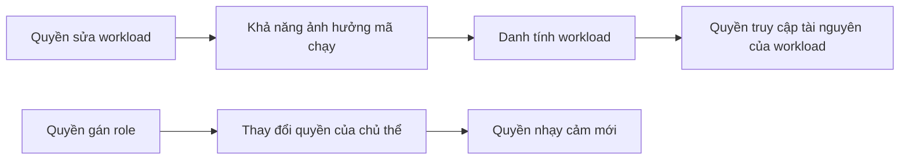
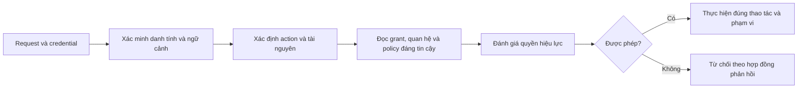

# Privilege — Quyền được cấp và đặc quyền trong IAM

## 1. Privilege là quyền thực hiện hành vi được cho phép

Trong ngữ cảnh authorization, privilege là quyền cho phép một chủ thể thực hiện hành vi đối với đối tượng, tài nguyên hoặc trạng thái vốn bị giới hạn. Chủ thể có thể là người dùng, ứng dụng, workload hoặc một tiến trình hệ thống.

Privilege không chỉ có nghĩa “quyền root” hoặc “quản trị viên”. Quyền đọc một hồ sơ, xuất danh sách người học hoặc phát hành nội dung đều là những quyền cần được quản lý. Với các hành động nhạy cảm hoặc có khả năng kiểm soát hệ thống, người ta thường nói đến elevated privilege hoặc đặc quyền.

NIST Glossary trình bày privilege theo các ngữ cảnh nguồn khác nhau, gồm hành vi được phép của subject và quyền đối với tài nguyên bị giới hạn. Tham khảo [NIST — Privilege](https://csrc.nist.gov/glossary/term/privilege). Khi làm việc với một sản phẩm cụ thể, cần đọc mô hình của sản phẩm thay vì giả định mọi hệ thống dùng thuật ngữ giống hệt nhau.

Sau bài học, người học có thể mô tả một privilege đủ cụ thể, phân biệt nó với role và grant, nhận diện quyền gián tiếp và xây dựng cách cấp/thu hồi quyền theo nguyên tắc ít quyền nhất.

Ví dụ trong nền tảng học tập: người dùng đã đăng nhập thành công chưa mặc nhiên được phát hành khóa học. Hệ thống còn phải kiểm tra quyền phát hành, phạm vi khóa học, tenant, quan hệ của người dùng với tài nguyên và trạng thái nghiệp vụ cần thiết.

## 2. Phân biệt privilege, permission, role, grant và scope

| Thuật ngữ | Vai trò trong mô hình minh họa |
| --- | --- |
| Permission | Mô tả một loại thao tác được bảo vệ, ví dụ `course.publish` |
| Privilege | Quyền hành động được một chủ thể thực sự có trong phạm vi và điều kiện nhất định |
| Role | Tập hoặc cơ chế tổ chức permission, ví dụ `COURSE_EDITOR` |
| Grant / assignment | Bản ghi cấp quyền hoặc gán role cho một chủ thể |
| Entitlement | Quyền lợi/quyền truy cập được quản lý trong danh mục của hệ thống |
| Scope | Phạm vi áp dụng của quyền; ý nghĩa cụ thể tùy mô hình, đặc biệt khi dùng OAuth |

Đây là cách phân biệt để thiết kế bài học, không phải quy tắc thuật ngữ bắt buộc cho mọi vendor. Nhiều sản phẩm dùng permission và privilege gần như đồng nghĩa. Điều quan trọng là xác định được chủ thể có thể làm gì, trên đâu và trong điều kiện nào.

### 2.1. Role là phương tiện cấp quyền, không phải quyết định cuối cùng

Role `COURSE_EDITOR` có thể chứa `course.read` và `course.update`. Nó không nhất thiết chứa `course.publish`, `user.role.assign` hoặc quyền sửa mọi khóa học của mọi tenant.

Một tên như `ADMIN` cũng không tự nói rõ phạm vi. Có thể đó là quản trị trong một lớp học, một tenant hoặc toàn hệ thống. Thiếu phạm vi làm các kiểm tra role dễ trở nên quá rộng.

### 2.2. Grant là sự kiện hoặc bản ghi có vòng đời

Permission `course.publish` có thể tồn tại trong danh mục dù chưa ai được cấp. Khi một người được gán quyền, bản ghi grant cần cho biết ai cấp, lý do, phạm vi, hạn dùng và trạng thái.

Không chỉ hỏi “permission này có tồn tại không”, mà phải hỏi “grant nào đang làm cho subject này có quyền với tài nguyên đang được yêu cầu?”.

### 2.3. OAuth scope không thay mọi kiểm tra tài nguyên

Một access token có scope `course.write` có thể cho phép client yêu cầu một nhóm thao tác, nhưng không tự chứng minh được sửa khóa học của tenant khác. Resource server cần diễn giải scope theo hợp đồng và kết hợp quyền/chính sách tài nguyên.

RFC 6749 mô tả scope như phạm vi truy cập được yêu cầu và được cấp cho access token. Ý nghĩa từng chuỗi scope do hệ thống xác định. Xem [RFC 6749, mục 3.3 — Access Token Scope](https://www.rfc-editor.org/rfc/rfc6749.html#section-3.3).

## 3. Một privilege cần nhiều hơn tên hành động

Mô hình khái niệm:

```text
Quyền hiệu lực được đánh giá từ:
    chủ thể + hành động + tài nguyên/phạm vi
    + điều kiện + thời hạn + nguồn cấp
    + trạng thái hiện tại và quy tắc policy
```

Ví dụ “Lan được phát hành nội dung” còn thiếu nhiều thông tin. Một mô tả rõ hơn là:

> Subject u-104 được thực hiện `course.publish` đối với các khóa học được phân công trong tenant-7, khi nội dung đã được duyệt và grant còn hiệu lực.

### 3.1. Các thành phần cần xác định

| Thành phần | Ví dụ |
| --- | --- |
| Subject | Người dùng u-104 hoặc workload content-publisher |
| Action | `course.publish`, `grade.read`, `identity.role.assign` |
| Resource | Khóa học c-301, lớp l-22, hoặc nhóm đối tượng được chỉ rõ |
| Tenant/domain | Tenant-7, môi trường production hoặc một tổ chức |
| Điều kiện | Được phân công, nội dung đã duyệt, xác thực đủ mới |
| Thời gian | Từ lúc phê duyệt đến hết ca trực |
| Nguồn | Role, group, grant trực tiếp, quan hệ hoặc delegation |
| Trạng thái | Đang hoạt động, hết hạn, bị thu hồi hoặc chờ kích hoạt |

### 3.2. Quyền theo loại tài nguyên và theo đối tượng

Quyền gọi endpoint phát hành nội dung là kiểm soát ở mức chức năng. Quyền phát hành đúng khóa học c-301 là kiểm soát ở mức đối tượng. Một người có thể vượt kiểm tra thứ nhất nhưng vẫn không được phép với đối tượng cụ thể.

Tương tự, được xem hồ sơ không mặc nhiên được xem mọi trường nhạy cảm. Quyền ở mức field hoặc nhóm dữ liệu có thể cần được mô hình hóa riêng theo nhu cầu nghiệp vụ.

### 3.3. Điều kiện được lấy từ nguồn đáng tin cậy

Không lấy `isAdmin`, `tenantId`, `ownerId` hoặc trạng thái phê duyệt từ request rồi coi đó là sự thật để cấp quyền. Client có thể chỉ định tài nguyên muốn truy cập, nhưng server phải xác định chủ thể, ngữ cảnh và thuộc tính liên quan từ nguồn đã được xác minh.

## 4. Quyền hiệu lực có thể đến từ nhiều đường

Trong thực tế, một người có thể được cấp quyền trực tiếp, thông qua group, role kế thừa hoặc quan hệ với tài nguyên. Phân tích một grant riêng lẻ chưa đủ để biết họ còn làm được gì.

```text
u-104
  → thành viên nhóm giảng viên tenant-7
  → role COURSE_EDITOR
  → course.update trong phạm vi được phân công

u-104
  → grant tạm thời course.publish
  → chỉ khóa học c-301, chỉ đến thời điểm hết hạn
```

### 4.1. Không mặc định chỉ cộng mọi quyền cho ra kết quả

Policy có thể có điều kiện, giới hạn, quy tắc deny hoặc ràng buộc theo quan hệ. Cách kết hợp phụ thuộc mô hình cụ thể; không có một thứ tự allow/deny chung cho mọi sản phẩm.

Ứng dụng cần quy định rõ khi có nhiều nguồn quyền, nguồn nào được dùng, điều kiện nào phải đồng thời đúng và cách xử lý xung đột. Nếu policy không xác định được một sự cho phép hợp lệ, không tự suy rằng nên cho qua.

### 4.2. Thu hồi một đường không luôn xóa mọi quyền

Nếu Lan có `course.publish` từ cả role và grant trực tiếp, xóa grant trực tiếp có thể vẫn để lại quyền qua role. Khi xử lý thu hồi, phải xem đường cấp hiệu lực và nguồn còn tồn tại.

Tương tự, gỡ một người khỏi group ở nguồn danh tính không tự bảo đảm mọi cache hoặc token phía sau đã phản ánh thay đổi ngay. Trạng thái cấp quyền và trạng thái sử dụng quyền cần được liên kết đúng.

### 4.3. Session hoặc token giữ snapshot có thể bị cũ

Một token được cấp trước lúc thu hồi role có thể vẫn chứa claim cũ. Cách xử lý phụ thuộc thiết kế: thời hạn token, kiểm tra phiên bản quyền, introspection hoặc tra policy hiện hành tại API.

Không nói “đã thu hồi” chỉ vì sửa bảng assignment nếu nơi thực thi vẫn cho phép theo snapshot cũ trong một khoảng thời gian không được xác định.

## 5. Đặc quyền không chỉ được đo bằng khả năng ghi/xóa

Quyền nhạy cảm cần được đánh giá theo hậu quả, dữ liệu và các quyền tiếp theo mà nó mở ra.

| Quyền | Lý do có thể nhạy cảm |
| --- | --- |
| Đọc dữ liệu hàng loạt | Có thể tiết lộ nhiều hồ sơ hoặc thông tin riêng tư |
| Đọc secret hoặc credential | Có thể sử dụng danh tính của thành phần khác |
| Gán role/permission | Có thể thay đổi quyền của bản thân hoặc người khác |
| Đăng ký lại authenticator | Có thể chiếm quyền kiểm soát tài khoản |
| Sửa cấu hình workload | Có thể thay đổi chương trình chạy dưới danh tính workload |
| Sửa hoặc xóa audit | Có thể làm mất khả năng phát hiện và truy vết |
| Tạo credential dài hạn | Có thể duy trì truy cập sau khi phiên hiện tại kết thúc |

### 5.1. Quyền trực tiếp và quyền gián tiếp

Một người không có quyền đọc dữ liệu production trực tiếp vẫn có thể tạo rủi ro tương đương nếu họ được sửa một workload có quyền đọc dữ liệu đó. Khả năng này phụ thuộc các ranh giới triển khai và kiểm soát hiện có, nên cần được đánh giá như một đường quyền gián tiếp.



Sơ đồ mô tả mối liên hệ để đánh giá rủi ro, không khẳng định mọi quyền sửa workload đều vượt được mọi kiểm soát. Cần xem khả năng phê duyệt triển khai, giới hạn code, danh tính runtime và nơi thực thi quyền.

### 5.2. Không giới hạn đánh giá vào tên role

Một role tên `SUPPORT` có thể ít nhạy cảm nếu chỉ đọc trạng thái ticket. Nhưng nếu nó cho đổi email khôi phục, reset MFA và bỏ qua phê duyệt, hậu quả có thể rất lớn.

Phân loại privilege dựa trên khả năng thực tế và phạm vi ảnh hưởng, không dựa vào tên role có chữ “admin” hay không.

## 6. Least privilege và những ranh giới bổ sung

Least privilege là cấp đủ quyền cần thiết cho nhiệm vụ trong phạm vi và thời gian phù hợp. Nó không đồng nghĩa cố làm mọi người thiếu quyền đến mức phải sử dụng tài khoản chung hoặc đường bypass.

NIST mô tả nguyên tắc ít quyền nhất theo việc giới hạn quyền cần cho chức năng/nhiệm vụ. Tham khảo [NIST — Least Privilege](https://csrc.nist.gov/glossary/term/least_privilege).

### 6.1. Giới hạn hành động, phạm vi và thời gian

Thay vì cấp “quản trị tất cả khóa học vĩnh viễn”, có thể cấp `course.publish` cho đúng nhóm khóa học trong một ca được phê duyệt. Với workload, quyền đọc đúng secret cần dùng có thể phù hợp hơn quyền liệt kê/đọc toàn bộ kho secret.

### 6.2. Tách quyền sử dụng khỏi quyền cấp lại

Người được phát hành khóa học không mặc nhiên được cấp quyền phát hành cho người khác. Quyền quản lý grant hoặc delegation là một quyền riêng, với phạm vi, điều kiện và khả năng thu hồi cần được xác định.

Nếu có ủy quyền, người nhận không được tự mở rộng hành động, tài nguyên hoặc thời hạn vượt điều được phép. Phải xác định cách các grant dẫn xuất bị xử lý khi grant gốc hết hiệu lực.

### 6.3. Separation of duties

Một nghiệp vụ có thể yêu cầu người soạn không tự duyệt nội dung của mình, hoặc người yêu cầu đặc quyền không tự phê duyệt. Đây là điều kiện quan hệ giữa các chủ thể/hành động, không chỉ là thêm một role.

Một người có cả hai permission vẫn có thể bị từ chối ở một giao dịch cụ thể do quy tắc tách nhiệm vụ. Tách nhiệm vụ có thể được quản lý khi gán role hoặc khi thực hiện thao tác, tùy thiết kế.

### 6.4. Quyền eligible khác quyền active

Một tài khoản có thể đủ điều kiện xin kích hoạt đặc quyền nhưng chưa có quyền sử dụng tại thời điểm hiện tại. Luồng kích hoạt có thể yêu cầu phê duyệt, lý do, MFA đủ mới và thời hạn.

Khi hết hạn kích hoạt, nơi thực thi phải từ chối các thao tác cần đặc quyền đó. Chỉ đổi màu trạng thái trên giao diện không thu hồi khả năng truy cập của token đã được cấp.

## 7. Mô hình grant và vòng đời quyền

Một grant nên đủ dữ liệu để giải thích vì sao quyền tồn tại và khi nào nó không còn được sử dụng. Ví dụ bản ghi nội bộ:

```json
{
  "grantId": "grant-internal-id",
  "tenantId": "tenant-7",
  "subjectId": "u-104",
  "action": "course.publish",
  "resourceScope": {"courseIds": ["c-301"]},
  "state": "ACTIVE",
  "validFrom": "<server-assigned-start>",
  "validUntil": "<server-assigned-expiration>",
  "source": "APPROVED_TEMPORARY_ASSIGNMENT",
  "approvalReference": "approval-internal-id",
  "policyVersion": "course-publishing-v3"
}
```

Đây là mô hình riêng để minh họa, không phải schema bắt buộc hoặc một token mà client có thể tự tạo để được cấp quyền. Server phải xác minh người cấp, chủ thể nhận, phạm vi và điều kiện.

### 7.1. Cấp quyền

Yêu cầu cấp quyền cần gắn với nhiệm vụ và tài nguyên. Người phê duyệt phải có quyền phê duyệt chính phạm vi đó; một quản trị viên tenant không mặc nhiên được cấp quyền hệ thống ngoài tenant của mình.

Khi cấp role, xem toàn bộ permission và quyền gián tiếp mà role tạo ra. Không chỉ đọc tên role hoặc chấp nhận mô tả “quyền đọc” nếu role còn có khả năng đọc secret hoặc xuất dữ liệu nhạy cảm.

### 7.2. Sử dụng quyền

Tại thời điểm sử dụng, kiểm tra grant đang active, đúng thời gian, đúng tài nguyên và không bị các điều kiện policy từ chối. Có grant trong bảng không có nghĩa mọi request đều được phép.

Một grant tạm thời chưa đến thời điểm bắt đầu không nên có hiệu lực sớm. Đồng hồ và dữ liệu policy phải được lấy từ nguồn server phù hợp, không dựa trên thời gian do trình duyệt gửi.

### 7.3. Rà soát và thu hồi

Khi người dùng đổi nhiệm vụ, chuyển bộ phận, kết thúc dự án hoặc rời tổ chức, cần rà soát các đường cấp quyền. Quyền tích lũy qua nhiều lần thay vai trò thường tạo ra privilege creep: tài khoản có ngày càng nhiều quyền không còn cần thiết.

Thu hồi có thể cần tác động đến grant trực tiếp, group/role nguồn, grant dẫn xuất, phiên hoặc token chứa snapshot quyền. Mỗi trường hợp cần biết nơi nào đang thực thi quyền và độ trễ thay đổi có hiệu lực.

### 7.4. Truy cập khẩn cấp

Một cơ chế khẩn cấp cần được thiết kế trước: ai được kích hoạt, cho hành động nào, trong bao lâu, có xác thực/phê duyệt gì và cách thu hồi. Không để “break glass” trở thành tài khoản dùng chung hoặc quyền bypass không hết hạn.

Phạm vi và hậu kiểm là kiểm soát bổ sung; chúng không tự thay việc xác minh quyền kích hoạt. Sự khẩn cấp do người yêu cầu tự khai chưa đủ để cấp đặc quyền.

## 8. Từ privilege đến quyết định cho phép trên mỗi thao tác

Một đường kiểm soát khái niệm:



### 8.1. Deny by default

Nếu một thao tác mới chưa có rule phù hợp, không tự để nó công khai hoặc chỉ cần login là được gọi. Cần một sự cho phép có căn cứ. Việc xử lý lỗi policy cũng không được mặc định biến thành allow.

OWASP khuyến nghị từ chối mặc định và kiểm tra quyền trên mọi request liên quan. Tham khảo [OWASP Authorization Cheat Sheet](https://cheatsheetseries.owasp.org/cheatsheets/Authorization_Cheat_Sheet.html).

### 8.2. Kiểm tra ở nơi có đủ dữ liệu nghiệp vụ

Gateway có thể kiểm tra credential và nhóm permission, nhưng thường không biết người gọi có được sửa đúng khóa học hay không. Tầng nghiệp vụ hoặc thành phần policy tương ứng cần kiểm tra đối tượng, tenant, quan hệ và trạng thái.

Ẩn nút “Phát hành” chỉ là UX. Client vẫn có thể gửi request trực tiếp. Kiểm tra quyền cần ở server, bao phủ mọi điểm vào thực hiện cùng một hành động nhạy cảm.

### 8.3. Danh sách và tìm kiếm cũng cần phạm vi

Không chỉ bảo vệ endpoint đọc một đối tượng. API danh sách, export, thống kê và tìm kiếm có thể làm lộ tài nguyên ngoài phạm vi nếu chỉ kiểm tra một permission chung.

Điều kiện tenant/quan hệ nên được áp dụng đúng trong truy vấn hoặc cơ chế lọc được bảo đảm. Đếm tổng, phân trang và các trường dẫn xuất cũng cần cùng phạm vi; lọc một số dòng ở frontend không đủ.

### 8.4. Kiểm tra gần hành động thực tế

Một quyết định allow ở thời điểm đọc tài nguyên có thể không còn phù hợp khi trạng thái hoặc grant thay đổi trước lúc ghi. Với thao tác nhạy cảm, cần quy tắc nhất quán cho khoảng thời gian giữa kiểm tra và sử dụng quyền.

Có thể dùng transaction, khóa/phiên bản tài nguyên và kiểm tra điều kiện tại thời điểm cập nhật. Khóa hàng tài nguyên không tự khóa mọi nguồn grant bên ngoài; nếu policy phân tán, cần thiết kế thêm cách xử lý version và thay đổi trạng thái theo yêu cầu rủi ro.

## 9. Ví dụ Java: permission ở method và phạm vi trong nghiệp vụ

Giả sử ứng dụng dùng Spring Security Method Security. Trước hết cần bật cơ chế annotation tương ứng:

```java
import org.springframework.context.annotation.Configuration;
import org.springframework.security.config.annotation.method.configuration.EnableMethodSecurity;

@Configuration
@EnableMethodSecurity
class MethodAuthorizationConfiguration {}
```

Một service phát hành khóa học có thể kết hợp kiểm tra permission chung với kiểm tra đối tượng:

```java
import java.util.UUID;
import org.springframework.security.access.AccessDeniedException;
import org.springframework.security.access.prepost.PreAuthorize;
import org.springframework.stereotype.Service;
import org.springframework.transaction.annotation.Transactional;

@Service
public class CoursePublishingService {
    private final CourseRepository courses;
    private final CurrentActor actors;
    private final CoursePublishPolicy publishPolicy;

    public CoursePublishingService(
            CourseRepository courses,
            CurrentActor actors,
            CoursePublishPolicy publishPolicy) {
        this.courses = courses;
        this.actors = actors;
        this.publishPolicy = publishPolicy;
    }

    @PreAuthorize("hasAuthority('course.publish')")
    @Transactional
    public void publish(UUID courseId) {
        Actor actor = actors.requireAuthenticated();
        Course course = courses.findForUpdate(actor.tenantId(), courseId)
                .orElseThrow(() -> new AccessDeniedException("Access denied"));

        publishPolicy.requireAllowed(actor, course);
        course.publish();
        courses.save(course);
    }
}
```

`Actor`, `Course`, repository và policy là các kiểu nghiệp vụ minh họa mà dự án phải định nghĩa. `CurrentActor` lấy chủ thể từ ngữ cảnh đã xác thực, không từ một body do client khai. `findForUpdate` cần được triển khai theo đúng tenant và semantics transaction của kho dữ liệu.

Trong ví dụ, policy đối tượng có thể yêu cầu đồng thời:

- Actor thuộc đúng tenant và có phạm vi được phân công với khóa học.
- Grant phát hành đang có hiệu lực tại thời điểm đánh giá.
- Nội dung đã ở trạng thái nghiệp vụ được phép phát hành.
- Quy tắc tách người soạn/người duyệt được đáp ứng nếu sản phẩm yêu cầu.
- Ngữ cảnh xác thực đủ mạnh hoặc đủ mới nếu thao tác được phân loại nhạy cảm.

`hasAuthority('course.publish')` chỉ là một lớp kiểm tra. Nó không tự suy ra owner, tenant hay quan hệ của actor với course. Các authority cũng phải được ánh xạ từ nguồn tin cậy, không được nhận từ request như một danh sách quyền tự khai.

Trong cấu hình mặc định thông dụng, `hasRole` sử dụng quy ước prefix role còn `hasAuthority` đối chiếu authority được chỉ rõ. Tránh lẫn `ROLE_EDITOR` với permission nghiệp vụ. Xem [Spring Security — Method Security](https://docs.spring.io/spring-security/reference/servlet/authorization/method-security.html).

Các annotation phụ thuộc cơ chế proxy/advisor của framework. Gọi trực tiếp một đối tượng tự tạo hoặc gọi nội bộ trong cùng đối tượng có thể không đi qua đường bảo vệ như mong đợi. Không mặc định mọi method không có annotation đều bị từ chối chỉ vì đã bật Method Security; cần cấu hình và ranh giới service rõ ràng.

Đoạn mã không tự giải quyết việc thu hồi quyền đồng thời ở một kho policy từ xa. Transaction của course bảo vệ phần dữ liệu mà transaction thực sự quản lý, còn tính nhất quán với grant ngoài đó cần được thiết kế riêng.

## 10. Workload identity, delegation và tác vụ nền

### 10.1. Danh tính máy cũng có privilege

Một service đọc danh mục khóa học không nên mặc nhiên dùng tài khoản database quản trị. Một pipeline phát hành có thể cần quyền ghi artifact trong phạm vi riêng, không cần đọc toàn bộ dữ liệu người học.

Credential ngắn hạn giúp quản lý vòng đời nhưng không tự làm một tập permission quá rộng trở nên an toàn. Cần giới hạn cả danh tính workload, action, tài nguyên và quan hệ tin cậy để nhận credential.

### 10.2. Phân biệt quyền của người gọi và quyền của service

Một service có quyền truy cập dữ liệu để thực hiện nhiệm vụ không có nghĩa mọi người gọi service đều được hưởng toàn bộ quyền đó. Nếu service dùng quyền của mình mà không kiểm tra yêu cầu của người gọi, nó có thể trở thành thành phần bị lợi dụng để thực hiện vượt quyền.

Ví dụ, endpoint export có thể dùng workload identity để đọc dữ liệu, nhưng vẫn phải kiểm tra actor được xuất dữ liệu của tenant/lớp nào. Không lấy `tenantId` client gửi rồi để service đọc tùy ý bằng quyền rộng của chính nó.

### 10.3. Tác vụ chạy sau cần semantics quyền rõ ràng

Một yêu cầu hôm nay có thể được xử lý bởi worker sau vài phút. Cần xác định tác vụ dùng một quyết định đã được ghi nhận tại thời điểm tiếp nhận hay phải kiểm tra lại quyền tại lúc thực thi, theo tính chất nghiệp vụ.

Với thao tác nhạy cảm và có yêu cầu thu hồi nhanh, cần thiết kế kiểm tra gần thời điểm thực hiện. Message có `requestedBy=u-104` không tự là bằng chứng được ủy quyền; nguồn message, danh tính gửi và phạm vi hành động cần được xác minh.

Không chuyển tiếp một credential người dùng dài hạn không cần thiết vào hàng đợi. Nếu có delegation hoặc capability riêng, phải giới hạn đúng tài nguyên, thời hạn, audience và hành động theo mô hình đã chọn.

## 11. Privilege escalation và các lỗi nền tảng

### 11.1. Mở rộng ngang và mở rộng dọc

Horizontal privilege escalation là truy cập tài nguyên của chủ thể khác ngoài phạm vi được phép, ví dụ người học xem bài làm riêng của người khác. Vertical privilege escalation là thực hiện chức năng có đặc quyền cao hơn, ví dụ người học tự gán role giảng viên.

Hai loại có thể liên quan: truy cập ngang vào một đối tượng nhạy cảm có thể tạo điều kiện thay credential hoặc quyền. Không xem kiểm tra tenant/owner là kém quan trọng chỉ vì action chỉ là `read`.

### 11.2. Quyền quản lý quyền

Các thao tác gán role, sửa policy, tạo API key, liên kết danh tính và reset MFA cần được phân tích như quyền có khả năng làm thay đổi quyền kiểm soát. Không mặc định “quản lý hồ sơ người dùng” bao gồm mọi thao tác này.

Người có quyền gán một role nên chỉ được gán các role và phạm vi nằm trong thẩm quyền đã được định nghĩa. Cần kiểm tra cả người nhận và hậu quả của grant, không chỉ kiểm tra người gọi có một permission tên `role.assign`.

### 11.3. Nhận dữ liệu vượt quyền từ client

Một endpoint cập nhật hồ sơ chỉ cho sửa tên hiển thị nhưng lại bind toàn bộ đối tượng account có thể vô tình nhận `roles`, `tenantId` hoặc `mfaBypass`. Dùng DTO/phạm vi cập nhật rõ ràng và kiểm tra server, không dựa vào việc UI không có các trường đó.

### 11.4. Tách authentication khỏi authorization

Token có chữ ký đúng, MFA thành công hoặc SSO xác thực thành công chỉ cung cấp cơ sở danh tính/ngữ cảnh theo cơ chế tương ứng. Các kết quả đó không tự là grant cho mọi thao tác nghiệp vụ.

Tương tự, một role claim đến từ issuer không được tin cậy cho tenant này không tự trở thành authority local. Cần ánh xạ và ràng buộc theo quan hệ tin cậy đã thiết lập.

## 12. Audit, rà soát và vận hành quyền

Đối với grant nhạy cảm, cần truy được chuỗi: ai yêu cầu, ai phê duyệt, quyền gì, phạm vi nào, khi nào có hiệu lực, ai sử dụng và khi nào bị thu hồi.

Ví dụ sự kiện quyết định nội bộ:

```text
event_type=AUTHORIZATION_DECISION
tenant_id=tenant-7
subject_id=u-104
action=course.publish
resource_id=c-301
decision=DENY
reason_code=OUTSIDE_ASSIGNED_RESOURCE_SCOPE
policy_version=course-publishing-v3
request_id=req-internal-id
```

Lý do nội bộ giúp điều tra, nhưng response công khai không nhất thiết được phép tiết lộ tài nguyên có tồn tại, tên role nhạy cảm hoặc nội dung policy. Chọn hợp đồng phản hồi theo ngữ cảnh và quyền của bên nhận.

Không ghi credential, token, secret hoặc toàn bộ dữ liệu tài nguyên nhạy cảm vào log. Quyền xem và sửa audit cũng cần được bảo vệ; người có quyền nghiệp vụ không mặc nhiên được xóa dấu vết sử dụng quyền của mình.

Rà soát định kỳ cần xem cả người dùng và workload, grant trực tiếp và qua group, quyền tạm chưa hết hạn đúng cách và quyền gián tiếp. Một danh sách “ai thuộc role admin” thường chưa đủ để hiểu toàn bộ khả năng kiểm soát hệ thống.

Các chỉ số hữu ích gồm grant lâu không dùng, grant không có owner/phê duyệt hợp lệ, quyền tồn tại sau khi nhiệm vụ kết thúc và độ trễ thu hồi tại nơi thực thi. Dữ liệu không sử dụng là tín hiệu để xem xét, không tự là căn cứ duy nhất để xóa quyền của một vai trò dự phòng cần thiết.

## 13. Tình huống vận dụng và ma trận quyết định

Lan có `course.publish` trong tenant-7, được phân công khóa c-301. Minh cũng có permission đó nhưng chỉ được phân công c-302. Mọi người đều đã đăng nhập hợp lệ.

| Request | Quyết định dự kiến theo policy minh họa |
| --- | --- |
| Lan phát hành c-301 đã được duyệt, grant còn hạn | Có thể cho phép nếu các điều kiện khác đều đạt |
| Lan phát hành c-301 chưa được duyệt | Từ chối do trạng thái nghiệp vụ |
| Minh phát hành c-301 | Từ chối do ngoài phạm vi phân công |
| Lan phát hành khóa thuộc tenant khác | Từ chối do sai phạm vi tenant |
| Lan tự cấp `course.publish` cho người khác | Từ chối nếu không có quyền cấp lại riêng |
| Workload export đọc mọi tenant vì có kết nối database | Từ chối phạm vi không được phép; kết nối không phải grant nghiệp vụ |
| Người dùng bị thu hồi role nhưng token còn claim cũ | Xử lý theo cơ chế quyền hiện hành và giới hạn thu hồi đã thiết kế |

Hãy mô tả privilege cần thiết cho ba nhiệm vụ: giảng viên sửa khóa được phân công, người duyệt phát hành nội dung trong một ca và workload xuất báo cáo một tenant. Với mỗi nhiệm vụ, chỉ rõ action, tài nguyên, điều kiện, thời hạn, nguồn cấp, quyền gián tiếp và nơi thực thi thu hồi.

Một mô hình quyền tốt phải giải thích được một request được phép vì đâu và bị giới hạn ở đâu. Tên role hoặc một cờ “đã đăng nhập” riêng lẻ không trả lời đủ hai câu hỏi đó.
