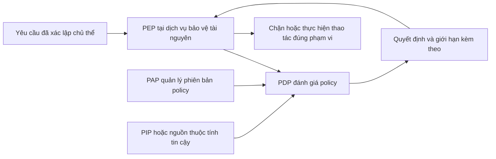

# Policy

Trong phân quyền, **policy** là chính sách mô tả chủ thể nào được hoặc không được thực hiện một hành động trên tài nguyên trong những điều kiện xác định. Policy biến yêu cầu nghiệp vụ như “chỉ người được phân công mới được duyệt chứng từ” thành quy tắc mà hệ thống có thể đánh giá và thực thi nhất quán.

Một policy không chỉ là danh sách tên vai trò. Nó có thể xét vai trò, quyền được cấp, thuộc tính tài nguyên, quan hệ sở hữu, tenant, trạng thái nghiệp vụ và mức xác thực. Cũng cần quy định hành vi khi không có quy tắc phù hợp, thiếu dữ liệu hoặc nhiều quy tắc cho kết quả khác nhau.

Trong nền tảng IAM, policy kết nối danh tính đã xác thực với quyền truy cập thực tế. Mật khẩu, MFA, phiên hoặc SSO giúp thiết lập bằng chứng về chủ thể; policy phân quyền quyết định chủ thể đó được làm gì ở thời điểm yêu cầu.

Sau bài này, người học có thể mô tả đầu vào của quyết định phân quyền, phân biệt policy với cơ chế thực thi, đọc một ví dụ chính sách và xác định những lỗi làm quyền được cấp rộng hơn dự định.

## 1. Policy trả lời câu hỏi nào?

Một yêu cầu phân quyền thường được biểu diễn bằng:

```text
Request = (subject, action, resource, context)
Decision = evaluate(policySet, Request, trustedData)
```

Trong đó:

| Thành phần | Ý nghĩa | Ví dụ |
|---|---|---|
| `subject` | Chủ thể đang yêu cầu truy cập | Người dùng, workload, dịch vụ có quyền được ủy nhiệm |
| `action` | Hành động muốn thực hiện | `invoice.read`, `invoice.approve`, `invoice.export` |
| `resource` | Tài nguyên cụ thể hoặc tập tài nguyên | Một chứng từ của tenant A |
| `context` | Ngữ cảnh được dùng để quyết định | Tenant đang hoạt động, thời điểm, mức xác thực, kênh truy cập |

NIST mô tả ABAC là việc xác định quyền thực hiện thao tác bằng cách đánh giá thuộc tính của chủ thể, đối tượng, thao tác và có thể cả môi trường theo các quy tắc hoặc quan hệ. Đây là một cách thể hiện policy, không phải yêu cầu mọi ứng dụng phải dùng cùng một ngôn ngữ. [NIST SP 800-162 — ABAC Definition and Considerations](https://csrc.nist.gov/pubs/sp/800/162/upd2/final)

Một người đã đăng nhập hợp lệ vẫn có thể nhận quyết định từ chối. Ví dụ người có quyền đọc chứng từ chưa chắc có quyền duyệt, và người có quyền duyệt ở tenant A chưa chắc có quyền trên cùng loại tài nguyên ở tenant B.

Hành động cũng nên gắn với nghiệp vụ, không chỉ với HTTP method. Hai endpoint POST có thể thực hiện “lưu nháp” và “phê duyệt”; dùng cùng một quyền chung cho cả hai dễ làm mất khác biệt nghiệp vụ.

## 2. Policy khác role, permission và kiểm tra trên giao diện

| Khái niệm | Trách nhiệm |
|---|---|
| Role | Gom nhóm trách nhiệm hoặc tập quyền, chẳng hạn nhân viên kế toán |
| Permission | Khả năng thực hiện một hành động trong phạm vi được định nghĩa |
| Policy | Quy tắc quyết định permission hoặc quyền truy cập có áp dụng cho yêu cầu cụ thể không |
| Policy engine | Thành phần đánh giá quy tắc với đầu vào |
| Điểm thực thi | Thành phần chặn hoặc cho phép thao tác theo quyết định |
| Giao diện | Hiển thị khả năng thao tác để hỗ trợ trải nghiệm |

Ẩn nút “Duyệt” không bảo vệ endpoint nếu khách vẫn có thể gửi yêu cầu trực tiếp. Tương tự, một giá trị `canApprove: true` do trình duyệt gửi không phải bằng chứng máy chủ phải chấp nhận.

RBAC có thể thể hiện policy bằng quan hệ người dùng, vai trò và quyền. ABAC bổ sung điều kiện theo thuộc tính. Kiểm soát theo quan hệ có thể xét ai là chủ sở hữu, thành viên dự án hoặc người được giao tài nguyên. Những mô hình này có thể được kết hợp khi có mục đích rõ ràng.

Ví dụ:

```text
Vai trò: kế toán
Permission được cấp trong tenant: invoice.approve
Policy trên một chứng từ:
    đúng tenant
    chứng từ đang chờ duyệt
    người duyệt không phải người lập
    số tiền không vượt hạn mức được cấp
    bằng chứng xác thực đáp ứng yêu cầu
```

Có permission là một điều kiện cần trong ví dụ, chưa phải điều kiện đủ. Policy còn kiểm tra nó có áp dụng cho tài nguyên và ngữ cảnh hiện tại hay không.

## 3. Những thành phần cơ bản của một policy

Một mô hình chính sách thường cần xác định:

1. **Phạm vi áp dụng:** loại chủ thể, hành động và tài nguyên mà quy tắc xét đến.
2. **Điều kiện:** các quan hệ hoặc thuộc tính phải thỏa mãn.
3. **Tác động:** cho phép hoặc từ chối khi quy tắc phù hợp.
4. **Cách kết hợp:** xử lý khi có nhiều quy tắc liên quan.
5. **Mặc định:** hành vi khi chưa có căn cứ cho phép.
6. **Phiên bản và chủ sở hữu:** ai chịu trách nhiệm, phiên bản nào đang được dùng.

Policy cũng có thể yêu cầu việc thực thi đi kèm một giới hạn, chẳng hạn chỉ trả các trường được phép hoặc chỉ cấp đường tải xuống trong khoảng ngắn. Cần phân biệt một điều kiện bắt buộc của quyết định với một gợi ý chỉ dùng cho trải nghiệm.

Ví dụ “được xem hồ sơ nhưng phải che trường nhạy cảm” chưa được thực thi nếu backend trả toàn bộ dữ liệu rồi chỉ ẩn trường ở trình duyệt. Thành phần trả dữ liệu phải thực hiện việc giới hạn trước khi dữ liệu rời ranh giới được bảo vệ.

Tên `ADMIN`, `SUPER_USER` hay `OWNER` không có sức mạnh đặc biệt nếu hệ thống chưa định nghĩa ý nghĩa của nó. Không tự thêm một nhánh “admin luôn được phép” vào mọi policy nếu chính sách còn yêu cầu giới hạn tenant hoặc phân tách nhiệm vụ.

## 4. Ví dụ chính sách duyệt chứng từ

Giả sử một hệ thống nhiều tenant có yêu cầu:

- Chủ thể phải đang hoạt động và có quyền duyệt trong tenant đang xét.
- Chứng từ thuộc đúng tenant đã được máy chủ xác minh.
- Chứng từ ở trạng thái chờ duyệt.
- Người duyệt không phải người lập chứng từ.
- Số tiền và loại tiền nằm trong phạm vi hạn mức được cấp.
- Ngữ cảnh xác thực đáp ứng chính sách của thao tác duyệt.

Biểu diễn dưới đây là **mô hình YAML minh họa tự định nghĩa**, không phải cú pháp được bảo đảm chạy trên XACML, Cedar, OPA hay một framework Java:

```yaml
id: invoice-approve
version: 1
target:
  action: invoice.approve
  resourceType: invoice
effect: ALLOW
conditions:
  all:
    - "subject.status == ACTIVE"
    - "subject.memberships contains context.tenantId"
    - "context.tenantId == resource.tenantId"
    - "subject.permissions[context.tenantId] contains invoice.approve"
    - "resource.status == SUBMITTED"
    - "resource.createdBy != subject.id"
    - "resource.currency == subject.approvalCurrency"
    - "resource.amount <= subject.approvalLimit"
    - "context.authenticationSatisfiesPolicy == true"
defaultDecision: DENY
```

`context.tenantId` ở đây là ngữ cảnh đã được máy chủ kiểm tra, không chỉ là `tenantId` khách tự gửi. Tài khoản có thể thuộc nhiều tenant; ứng dụng phải kiểm tra quan hệ thành viên và quyền theo tenant đang hoạt động.

`resource.amount`, `resource.createdBy` và `resource.status` cần đến từ dữ liệu tài nguyên đáng tin cậy. Không dùng các giá trị tương ứng trong body của yêu cầu duyệt nếu khách có thể tự sửa chúng để làm điều kiện đạt.

So sánh số tiền cần thống nhất kiểu số và đơn vị. Không so sánh chuỗi ký tự hoặc so một số tiền thuộc loại tiền này với hạn mức của loại tiền khác. Các chi tiết dữ liệu như vậy ảnh hưởng trực tiếp đến ý nghĩa của policy.

Trong tập chính sách minh họa chỉ có căn cứ cho phép đã nêu, các trường hợp sau có thể được đánh giá:

| Yêu cầu | Kết quả dự kiến |
|---|---|
| Đủ quyền, đúng tenant, đúng trạng thái, không tự duyệt, trong hạn mức | Cho phép nếu mọi điều kiện còn lại đạt |
| Có quyền nhưng tài nguyên thuộc tenant khác | Từ chối |
| Là người lập chứng từ | Từ chối theo yêu cầu phân tách nhiệm vụ |
| Chứng từ đã được duyệt | Không được duyệt lại qua cùng quy tắc |
| Số tiền vượt hạn mức | Từ chối |
| Thiếu thuộc tính bắt buộc hoặc dữ liệu sai kiểu | Không cấp quyền trên cơ sở dữ liệu chưa xác định |

Nếu sau này bổ sung một policy khác cho cùng hành động, phải kiểm tra rằng nó không mở đường bỏ qua các ràng buộc bắt buộc. Một điều kiện trong policy A không tự trở thành hàng rào toàn cục cho mọi policy B.

## 5. Nguồn thuộc tính quyết định độ tin cậy của policy

Một biểu thức đúng vẫn có thể cấp quyền sai nếu đầu vào do người yêu cầu tự khai. Cần quản lý cả quy tắc và nguồn dữ liệu của nó.

| Thuộc tính | Nguồn nên được xác lập |
|---|---|
| Danh tính chủ thể | Kết quả xác thực và ánh xạ danh tính đã được kiểm tra |
| Trạng thái tài khoản | Kho danh tính hoặc dịch vụ quản lý có trách nhiệm |
| Vai trò và quyền theo tenant | Dữ liệu cấp quyền còn hiệu lực |
| Chủ sở hữu, tenant, trạng thái tài nguyên | Kho hoặc dịch vụ sở hữu tài nguyên |
| Thời điểm xác thực và phương thức đã dùng | Phiên hoặc bằng chứng được máy chủ xác minh |
| Thời gian đánh giá | Nguồn thời gian phía máy chủ |
| Quan hệ được ủy nhiệm | Bằng chứng ủy nhiệm và phạm vi được xác minh |

Một token có chữ ký hợp lệ chưa có nghĩa mọi claim đều được dùng cho mọi mục đích. Cần kiểm tra issuer, audience, loại bằng chứng và ý nghĩa thuộc tính theo thỏa thuận. Một claim mô tả chức danh không tự tương đương permission duyệt một loại tài nguyên.

Thuộc tính còn có độ mới. Người dùng có thể vừa bị rút quyền hoặc tài nguyên vừa chuyển tenant trong khi cache vẫn giữ trạng thái cũ. Thiết kế phải xác định khoảng trễ có thể chấp nhận và cách cập nhật hoặc vô hiệu hóa dữ liệu phân quyền.

Thiếu dữ liệu không nên được đổi thành một giá trị thuận tiện làm điều kiện đạt. Ví dụ thiếu hạn mức không có nghĩa hạn mức vô hạn; thiếu tenant không có nghĩa tài nguyên dùng chung toàn hệ thống.

Định danh tham chiếu trong policy cũng cần ổn định. Nếu cấp quyền cho một tên có thể bị tái sử dụng, người nhận tên đó sau này có thể vô tình hưởng quyền của người trước. Nên dùng định danh nội bộ có vòng đời và phạm vi rõ, thay vì dựa duy nhất vào tên hiển thị.

## 6. Ai quản lý, đánh giá và thực thi policy?

Một kiến trúc phân quyền có thể tách các trách nhiệm logic:

| Thành phần | Trách nhiệm |
|---|---|
| PAP — Policy Administration Point | Quản lý và phát hành chính sách |
| PDP — Policy Decision Point | Đánh giá và đưa ra quyết định |
| PIP — Policy Information Point | Cung cấp thuộc tính cần cho đánh giá |
| PEP — Policy Enforcement Point | Yêu cầu quyết định và thực thi tại ranh giới truy cập |

XACML sử dụng các khái niệm PDP, PEP và PIP để mô tả việc quyết định, thực thi và cung cấp thuộc tính. Tách trách nhiệm giúp nhìn rõ nơi nào phải chặn hành động, dù các thành phần có thể nằm cùng tiến trình. [OASIS XACML 3.0](https://docs.oasis-open.org/xacml/3.0/xacml-3.0-core-spec-os-en.html)



PDP trả “Deny” nhưng controller vẫn gọi thao tác ghi thì policy chưa có hiệu lực. Ngược lại, frontend hiển thị “không có quyền” không chứng minh backend có PEP ở đúng chỗ.

Không bắt buộc mọi yêu cầu đều gọi một máy chủ PDP từ xa. Policy có thể được đánh giá trong thư viện, sidecar hoặc dịch vụ tập trung. Lựa chọn triển khai cần cân nhắc tính nhất quán, độ trễ, khả năng sẵn sàng và cách phân phối dữ liệu; trách nhiệm thực thi vẫn phải tồn tại.

Một gateway có thể kiểm tra quyền tổng quát trước khi định tuyến, nhưng dịch vụ sở hữu tài nguyên thường còn cần kiểm tra đối tượng cụ thể và trạng thái nghiệp vụ. Gateway chỉ thấy URL chưa chắc biết ai tạo chứng từ hoặc chứng từ đã được duyệt hay chưa.

## 7. Kết quả không chỉ là một giá trị boolean

Một engine có thể phân biệt cho phép, từ chối, không có policy áp dụng hoặc không đánh giá được. Ví dụ XACML có các kết quả `Permit`, `Deny`, `NotApplicable` và `Indeterminate`; cách kết hợp được quy định trong mô hình của nó.

Đối với ứng dụng sử dụng quyết định, cần đặt câu hỏi: **Kết quả nào thực sự cho phép thao tác này?**

| Tình huống | Cách xử lý theo mô hình an toàn của ví dụ |
|---|---|
| Có kết quả cho phép rõ ràng và đáp ứng giới hạn bắt buộc | Thực hiện đúng phạm vi |
| Có kết quả từ chối | Không thực hiện |
| Không có policy cho hành động mới | Không mặc nhiên cấp quyền |
| Thiếu dữ liệu hoặc lỗi đánh giá | Không chuyển thành cho phép |
| Engine không phản hồi | Xử lý lỗi dịch vụ hoặc từ chối theo hợp đồng, không bỏ qua kiểm tra |

OWASP khuyến nghị deny by default và kiểm tra quyền trên mọi yêu cầu. Ý nghĩa thực tế là mọi quyền được cấp cần có căn cứ, và một đường truy cập bị bỏ sót có thể làm mất hiệu lực cơ chế ở các đường còn lại. [OWASP Authorization Cheat Sheet](https://cheatsheetseries.owasp.org/cheatsheets/Authorization_Cheat_Sheet.html)

Một ứng dụng có thể trả trạng thái cần step-up khi chưa đủ mức xác thực. Trạng thái đó không được coi là cho phép hành động nhạy cảm. Sau khi xác thực bổ sung, cần đánh giá lại với dữ liệu và trạng thái hiện tại.

Nếu quyết định có yêu cầu bắt buộc như che trường dữ liệu, PEP phải thực hiện được yêu cầu đó trước khi trả dữ liệu. Không bỏ qua yêu cầu vì engine đã có một giá trị “Allow” ở phần khác của phản hồi.

Thông báo cho khách không cần phơi bày toàn bộ nội dung policy, thuộc tính nhạy cảm hoặc sự tồn tại của tài nguyên. Cách dùng 403, 404 hoặc mã lỗi nghiệp vụ cần nhất quán với yêu cầu không tiết lộ và hợp đồng API.

## 8. Nhiều policy cùng áp dụng: phải định nghĩa cách kết hợp

Giả sử có hai quy tắc:

```text
Policy A: người có permission invoice.approve được duyệt.
Policy B: người lập không được tự duyệt chứng từ của mình.
```

Nếu người lập cũng có permission duyệt, hai quy tắc có thể cho kết quả trái nhau. Hệ thống cần quy tắc kết hợp rõ ràng, không phụ thuộc policy nào vô tình được đọc trước từ database.

Một số mô hình có thể dùng ưu tiên từ chối, ưu tiên cho phép hoặc thứ tự xác định. Tên và hành vi cụ thể phụ thuộc engine; không được lấy hiểu biết từ một công cụ áp sang mọi công cụ khác.

Ví dụ Cedar có ngữ nghĩa mặc định từ chối và một policy `forbid` phù hợp sẽ thắng các policy `permit` phù hợp. Đây là hành vi được định nghĩa của Cedar, không phải quy tắc tự động của mọi ngôn ngữ policy. [Cedar — Policy Effects](https://docs.cedarpolicy.com/policies/syntax-policy.html#effect)

Ngay cả khi chọn ưu tiên từ chối, vẫn cần hiểu cách engine xử lý lỗi và thuộc tính thiếu. Một điều kiện “không được tự duyệt” bị lỗi vì thiếu `createdBy` không nên trở thành lý do cho một nhánh cho phép rộng bỏ qua yêu cầu nghiệp vụ.

Các ràng buộc bắt buộc như biên tenant, trạng thái tài khoản và phân tách nhiệm vụ cần được kiểm tra trên **quyết định cuối cùng**, kể cả khi có ngoại lệ hoặc vai trò đặc quyền.

## 9. Thực thi tại tài nguyên và tránh lỗi thời điểm

Một luồng xử lý minh họa cho hành động duyệt:

```text
subject = resolveVerifiedSubject(request)
tenantContext = resolveAuthorizedTenant(subject, request)
resource = loadAuthorizationRelevantInvoiceData(request.invoiceId)

decision = evaluatePolicies(
    subject,
    action = invoice.approve,
    resource,
    tenantContext,
    verifiedAuthenticationContext
)

nếu không có quyền cho phép rõ ràng:
    không duyệt chứng từ

thực thi các giới hạn bắt buộc của quyết định
cập nhật chứng từ có điều kiện trên trạng thái và phiên bản đã kiểm tra
ghi kết quả kiểm toán phù hợp
```

Lấy tài nguyên để đánh giá không đồng nghĩa được phép trả toàn bộ tài nguyên cho khách. Chỉ đọc dữ liệu cần thiết qua một đường nội bộ được kiểm soát, và chưa tiết lộ dữ liệu được bảo vệ trước quyết định.

### Kiểm tra rồi dữ liệu thay đổi

Ví dụ lúc 10:00:00 policy cho phép duyệt vì số tiền nằm trong hạn mức. Trước khi thao tác ghi chốt, một yêu cầu khác tăng số tiền. Nếu lệnh duyệt không kiểm tra trạng thái hoặc phiên bản, nó có thể duyệt một chứng từ khác với dữ liệu đã được xét.

Đây là vấn đề thời điểm kiểm tra và thời điểm sử dụng. Có thể cần giao dịch, khóa hoặc cập nhật có điều kiện theo version và trạng thái tùy kiến trúc. Một quyết định đúng trên snapshot cũ không tự bảo vệ thao tác diễn ra trên dữ liệu mới.

### Danh sách, xuất dữ liệu và xử lý hàng loạt

Policy phải có ý nghĩa nhất quán khi đọc một đối tượng, tìm kiếm danh sách, xuất file và thực hiện thao tác hàng loạt. Không lọc quyền chỉ ở màn hình chi tiết trong khi endpoint export trả toàn bộ dữ liệu tenant khác.

Có thể áp phạm vi truy vấn ngay trong tầng dữ liệu để chỉ lấy các bản ghi được phép. Cần bảo đảm bộ lọc thực thi đúng ngữ nghĩa policy, bao gồm phân trang, số lượng kết quả và các trường nhạy cảm; không chỉ lọc vài phần tử sau khi đã đưa dữ liệu ra khỏi ranh giới bảo vệ.

## 10. Cache, token và độ mới của quyền

Một quyết định phụ thuộc vào nhiều dữ liệu. Cache chỉ theo `subjectId` dễ làm quyết định cho hành động hoặc tài nguyên này bị dùng lại cho trường hợp khác.

Một khóa cache, nếu có, cần phản ánh những đầu vào có ảnh hưởng và phiên bản phù hợp, chẳng hạn:

```text
subject + entitlementVersion
action
resource + resourceAuthorizationVersion
tenantContext
relevantAuthenticationContext
policyVersion
```

Danh sách trên là gợi ý thiết kế, không phải cứ ghép đủ trường thì cache chắc chắn đúng. Điều kiện theo thời gian, quan hệ hoặc trạng thái động còn giới hạn tuổi thọ quyết định.

Người vừa bị thu hồi quyền có thể vẫn mang token chưa hết hạn chứa quyền cũ. Hệ thống phải xác định nơi nào kiểm tra độ mới, khoảng trễ được chấp nhận và cơ chế đồng bộ hoặc thu hồi cần có. Một chữ ký token hợp lệ không tự cập nhật việc cấp quyền đã thay đổi sau lúc phát hành.

Với workload gọi thay người dùng, cần phân biệt danh tính dịch vụ, danh tính người dùng và phạm vi ủy nhiệm. Không tin một header `userId` tùy ý từ mạng nội bộ để suy ra quyền. Đồng thời, không dùng quyền rất rộng của dịch vụ để thực hiện mọi yêu cầu người dùng gửi đến.

Việc xem xét quyền cũng thuộc vòng đời tài khoản: đổi tổ chức, chuyển công việc, kết thúc ủy nhiệm hoặc vô hiệu hóa danh tính có thể làm policy cần dữ liệu mới. Không chỉ đánh giá quyền tại lần đăng nhập đầu tiên rồi giữ mãi trong phiên.

## 11. Policy là một sản phẩm cần quản lý vòng đời

Một thay đổi policy có thể mở quyền cho nhiều tài khoản cùng lúc. Cần quản lý nó như thay đổi có tác động, dù policy nằm trong mã, database hay kho cấu hình riêng.

Một quy trình có thể gồm:

1. Mô tả yêu cầu nghiệp vụ và các ràng buộc bắt buộc.
2. Xác định chủ sở hữu, phạm vi và nguồn thuộc tính.
3. Viết policy có schema, kiểu dữ liệu và ngữ nghĩa kết hợp rõ.
4. Kiểm tra các tình huống được phép và phải bị chặn.
5. Review thay đổi quyền và phát hành phiên bản có thể đối chiếu.
6. Triển khai, theo dõi quyết định và tác động đến người dùng.
7. Thu hồi ngoại lệ hết hạn và cập nhật theo vòng đời quyền.

Không để người chỉ có quyền sử dụng ứng dụng tự sửa policy hoặc nguồn cấp permission của chính mình. Quyền viết, phê duyệt và phát hành policy nên được phân tách khi mức rủi ro yêu cầu.

Một ngoại lệ đặc quyền cần xác định ai được dùng, cho hành động nào, trong phạm vi nào và hết hạn khi nào. Không biến một cờ bypass không được kiểm toán thành cơ chế hỗ trợ khẩn cấp mặc định.

Rollback cũng là một thay đổi quyền. Nếu phiên bản cũ có quyền đã bị thu hồi vì sự cố, quay lại phiên bản đó có thể mở lại quyền không còn hợp lệ. Cần đánh giá nội dung được khôi phục, không chỉ việc hệ thống có tải được file cũ hay không.

## 12. Kiểm chứng và kiểm toán quyết định

Các bài kiểm tra policy cần bao gồm cả những yêu cầu bị từ chối, dữ liệu thiếu, biên tenant và thay đổi trạng thái. Công cụ như OPA có cơ chế kiểm thử policy, nhưng khả năng đánh giá một biểu thức vẫn phải đi cùng kiểm tra tích hợp ở nơi thực thi. [Open Policy Agent — Policy Testing](https://www.openpolicyagent.org/docs/policy-testing)

Với ví dụ duyệt chứng từ, có thể kiểm chứng các bất biến:

- Thay ID tài nguyên không tạo quyền ở tenant khác.
- Một quyền đọc không đủ để duyệt hoặc xuất dữ liệu.
- Người lập không tự duyệt khi chính sách cấm.
- Thiếu trạng thái, hạn mức hoặc nguồn dữ liệu bắt buộc không làm quyền rộng hơn.
- Hành động mới chưa được cấu hình không tự có quyền.
- Endpoint trực tiếp, tác vụ hàng loạt và đường quản trị không bỏ qua quyết định.
- Engine lỗi hoặc phản hồi không được hiểu không dẫn tới thực hiện thao tác.
- Thay đổi tài nguyên sau đánh giá không làm chốt một thao tác ngoài phạm vi đã cho phép.

Một sự kiện quyết định có thể ghi:

```text
decisionId: mã đối chiếu
subjectReference: định danh chủ thể phù hợp cho kiểm toán
action: invoice.approve
resourceReference: mã tham chiếu tài nguyên
tenantReference: tenant đã được xác minh
decision: DENY
reasonCode: SEPARATION_OF_DUTIES
policySetVersion: phiên bản đã đánh giá
occurredAt: thời điểm quyết định
```

Không ghi mật khẩu, OTP, bearer token hoặc toàn bộ tài liệu nghiệp vụ vào log policy. Cần lưu đủ để giải thích quyết định mà vẫn hạn chế dữ liệu và quyền truy cập theo chức năng.

Một log “Allow” chỉ cho biết một quyết định đã được tạo; nó không tự chứng minh thao tác đã được thực thi thành công hoặc mọi nghĩa vụ kèm theo đã được áp dụng. Nên đối chiếu cả quyết định và kết quả nghiệp vụ khi điều tra.

Policy có hiệu lực khi quy tắc đúng, dữ liệu đáng tin và mọi đường truy cập cần bảo vệ đều thực thi quyết định tương ứng. Thiếu một trong ba phần đó, một tài liệu chính sách chi tiết vẫn có thể không giữ được giới hạn quyền mà hệ thống mong muốn.
